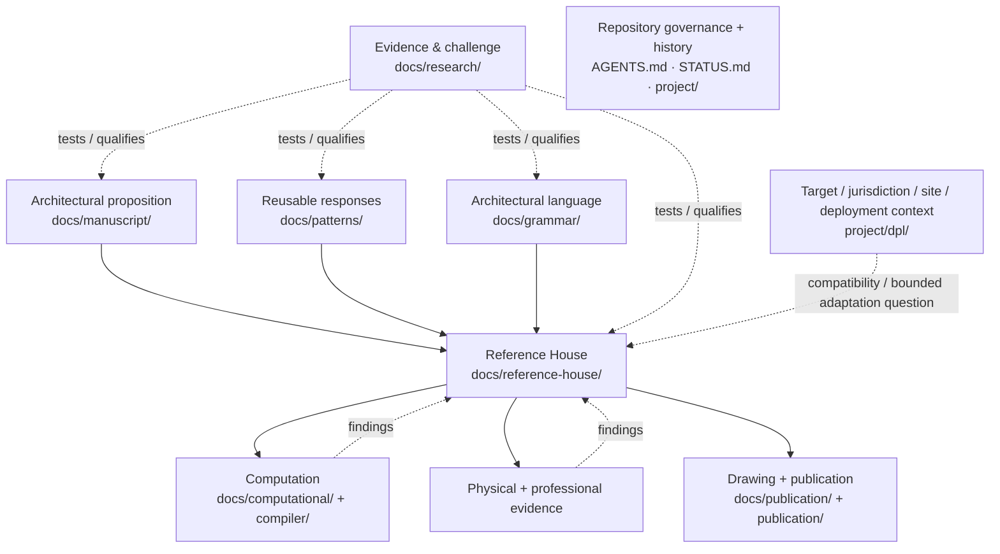

# Ovid’s House

A house should seek **permanence without stasis**.

**Ovid’s House** is an architectural design-research project about how a house can remain durable while the shorter-lived things inside it are maintained, repaired, replaced and changed. It treats those relationships as architecture: access, interfaces, movement, failure, replacement and the geometry needed to work on a building after handover.

The practical purpose is to design and ultimately build the owner’s own home on a later-selected London site. The book is a means of thinking through that architecture and communicating what it teaches; computational tools support consistent design information and bounded checks. The Reference House is the pre-site design study, with real-site adaptation and construction still to be undertaken.

The project does not argue that everything should be demountable, exposed or technically novel. Capacity for change must earn its spatial, material and financial cost. Conventional construction should win where it is the better architectural answer.

The public architectural proposition begins in the [manuscript](docs/manuscript/) and its [governing principles](docs/manuscript/governing-principles.md). The [reading guide](docs/reading-guide.md) is the shortest route through the publication argument.

The current project brief excludes flat roofs, including dormer and ancillary roofs. The [roof constraint](docs/reference-house/georgian-replan.md#roof-constraint) owns this project-specific choice.

## Project map

Ovid’s House deliberately separates architectural propositions, evidence, project-specific choices, executable representations and publication machinery. Those layers inform one another without becoming interchangeable.



The diagram is an **authority and navigation map**, not a claim that every arrow is an implemented data pipeline. The [deployment compiler](https://github.com/adamnoden/architecture/blob/main/compiler/dpl/README.md) implements bounded conformance and obligation/evidence checks; it does not establish whole-site compatibility or select architecture.

### Protected distinctions

- **Ovid’s House** is the architectural research project and public proposition.
- The **formal architectural/computational system** covers only the facts, relationships, obligations and proof boundaries that can legitimately be made explicit. Its subsystem identity and detailed contract live in the computational/compiler documentation; it is narrower than the architecture.
- The **pattern language** contains reusable architectural responses; a pattern is not proof.
- **Architectural grammar** governs selectable questions of composition, hierarchy, topology and proportion. The current Reference House uses a Georgian-derived grammar, but Georgian architecture is not doctrine.
- The **Reference House** is one deliberately specific integration test. Its choices are not universal rules.
- **Research, prototypes and professional review** can support, narrow or falsify claims. Evidence does not become doctrine merely because it is favourable.
- **Metamorph Compiler** checks bounded executable representations. A passing compile is not architectural merit, engineering adequacy or regulatory approval.
- **Generated inspection outputs** are downstream views of controlled sources. They are not architectural source authority.
- **Deployment, jurisdiction and real-site work** is a distinct layer. The DPL programme and [bounded implementation](https://github.com/adamnoden/architecture/blob/main/compiler/dpl/README.md) own its model and checks. The completed conditional studies retain their historical house basis; [owner-house site work](https://github.com/adamnoden/architecture/blob/main/project/dpl/owner-house-site-programme.md) must establish applicability to the accepted design and an actual site.

## What is authoritative for what?

| Kind | Canonical owner | Read it as |
|---|---|---|
| Architectural proposition | [`docs/manuscript/`](docs/manuscript/) | Public architectural argument and governing principles |
| Reusable design knowledge | [`docs/patterns/`](docs/patterns/) | Patterns, strategies, candidates and their stated evidence status |
| Architectural language | [`docs/grammar/`](docs/grammar/) | Grammar framework and selectable grammar instances |
| Evidence and precedent | [`docs/research/`](docs/research/) | Evidential support, challenge and options appraisal |
| Worked project instance | [`docs/reference-house/`](docs/reference-house/) | Reference House choices, coordination and explicit proof limits |
| Computational scope | [`docs/computational/`](docs/computational/) | What the executable model represents and what its checks prove |
| Executable implementation | `compiler/` | Source, compilation, diagnostics, tests and generated inspection machinery |
| Generated inspection | [`docs/reference-house/generated/`](docs/reference-house/generated/) | Derived human-readable views; do not hand-edit |
| Drawing/publication records | `docs/publication/` | Authored authority, drawing and proof records for publication production |
| Publication build system | `publication/` | Preparation, validation, metadata, layout and proof machinery |
| Delivery requirements | [`docs/delivery/`](docs/delivery/) | Mature requirements intended for an appointed project team |
| Current project state | `STATUS.md` | Generated durable execution state and assessed maturity; query live claims separately |
| Minimum Viable Bureaucracy (MVB) | [Integrated manual](https://github.com/adamnoden/architecture/blob/main/project/control/README.md) | Workstreams, packets, dependencies, agent leases, validation, integration and recovery |
| Operating rules | `AGENTS.md` | Durable rules for agents and contributors changing the repository |
| Durable programme history | `project/` | Audits, programme records, provenance and machine-readable project controls |

A document’s existence does not make it authoritative outside its stated role. When two surfaces appear to disagree, follow the owning source rather than the most convenient copy.

## Choose an entry path

### Architect or reader

Start with the [reading guide](docs/reading-guide.md), then the [Preface](docs/manuscript/preface.md) and [governing principles](docs/manuscript/governing-principles.md). Continue into the [Pattern Language](docs/patterns/), [Architectural Grammar](docs/grammar/) or [Reference House](docs/reference-house/) according to the question you are following.

### Developer or contributor

Before changing the repository, read `AGENTS.md` and the [Minimum Viable Bureaucracy (MVB) manual](https://github.com/adamnoden/architecture/blob/main/project/control/README.md). The manual explains the shared execution scaffolding, from workstream and dependency modelling through concurrent agent claims, GitHub automation and recovery. Use `docs/README.md` for documentation ownership, [`docs/computational/README.md`](docs/computational/) for computational proof boundaries and `compiler/README.md` for executable workflow. [`package.json`](package.json) is the command authority.

### Investigating a decision

Start at the surface that owns the decision, then follow its explicit evidence/provenance links upstream. Architectural claims normally lead toward [`docs/research/`](docs/research/); Reference House decisions toward its coordination and gate records; computational conclusions toward compiler tests, method/source provenance and generated manifests. Historical programme records in `project/` explain how a result was reached but do not automatically remain the present authority.

## Repository map

| Area | Role |
|---|---|
| `docs/` | Architectural documents organised by what each document does: manuscript, patterns, grammar, research, Reference House, development, prototypes, delivery, computation, editorial and publication records |
| `compiler/` | Metamorph Compiler source, controlled fixtures, tests, proof contracts and deterministic output machinery |
| `publication/` | Publication preparation, validation, layout, metadata and physical/specimen proof tooling |
| `project/` | Durable programme/audit records and machine-readable project controls; backstage history rather than public architectural authority |
| `scripts/` | Repository-level validation, status, nomenclature and maintenance utilities invoked through `package.json` |
| `public/` | Static website assets and publication-facing resources; not a source of architectural truth merely because material is publicly served |
| `.github/` | CI and repository automation |
| `.vitepress/` | Website configuration and navigation; website structure does not redefine repository ownership or publication order |

The detailed ownership model inside `docs/` is recorded in `docs/README.md`.

## Source and generated boundaries

Prefer the owning authored source and regenerate downstream material.

In particular, [`docs/reference-house/generated/`](docs/reference-house/generated/) is a generated semantic-inspection surface. Change the controlled compiler/source model and use the output workflow; do not patch those artefacts to make them look correct.

Publication records, architectural publication drawings, compiler proof artefacts and generated semantic inspection are different classes of material. Not every SVG or Markdown file is generated. When working locally, follow the directory contract or owning gate before editing an artefact whose authority is unclear.

## Build and verification

Install the locked dependencies with `npm ci`. The canonical repository-health entry point is:

```sh
npm run check
```

That command checks the repository’s declared automated invariants and builds the documentation site. A green result proves only those encoded checks. It does **not** establish architectural quality, engineering adequacy, physical performance, professional acceptance or Building Regulations compliance.

Useful narrower entry points include:

```sh
npm run docs:dev          # local documentation site
npm run outputs:check     # verify committed generated Reference House inspection outputs
npm run publication:build # prepare and build the full publication PDF
```

Use [`package.json`](package.json) for the current command set and local subsystem contracts for narrower proof workflows.

## Current state

The repository is intentionally ahead in some internal forms and behind in external validation. Physical testing, competent professional review and real-site evidence remain distinct from internal coordination and deterministic checks.

For current project-wide durable state and maturity judgements, use `STATUS.md`; use `npm run control:brief` for observed live occupancy and available work. The [current Reference House basis](docs/reference-house/current-house-basis.md) distinguishes the accepted design from historical technical studies. This README is deliberately kept free of packet numbers, branch hashes and live work queues so that it remains a stable map rather than a second status system.
