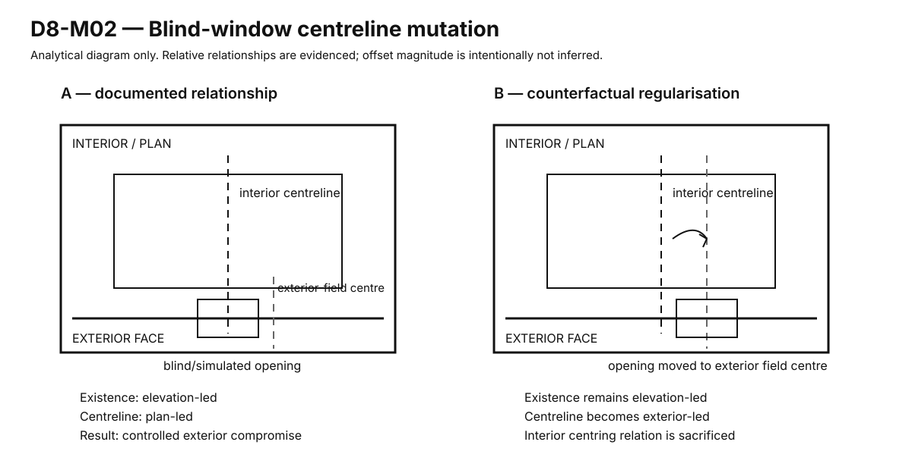
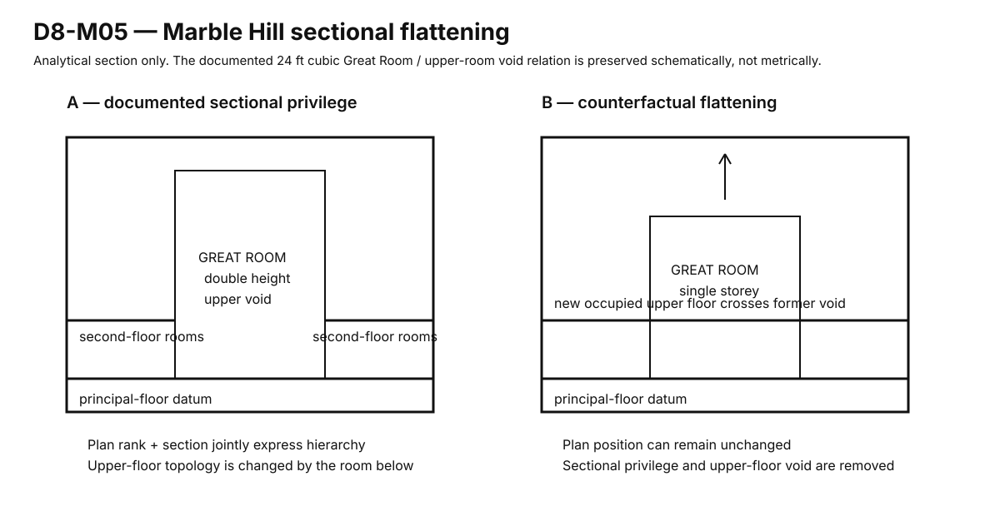
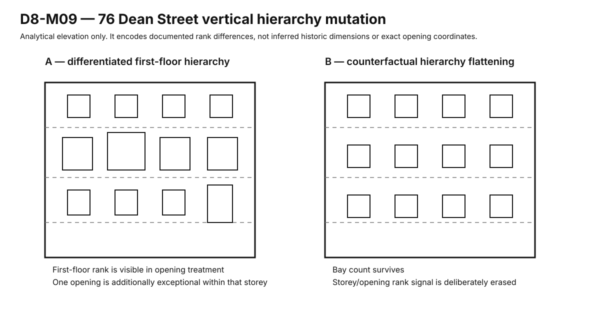

# G-01 D8 — Controlled Falsification Result

**Status:** D8 PASS — falsification coverage complete at current evidence scope  
**Programme:** [G-01 Completion Programme — D8 to D13](g01-completion-programme.md)  
**Issue:** #78  
**Date:** 2026-10-14  
**Authority:** mutation/falsification result only; no G-01 v0.1 rule is promoted here

## 1. Executive result

D8 closes with **seven high-information falsification paths**, not ten artificial exercises.

The original ten-target list was deliberately reduced because:

- two proposed mutations are weaker than direct historical counterexamples already in the corpus;
- one requires exact centreline evidence the current source state does not legitimately provide;
- one is only a metadata deletion rather than a physical/architectural mutation;
- two route-role erasure tests are the same question expressed in different morphologies and are stronger when treated as one cross-case test.

Every D7 candidate is nevertheless challenged by at least one meaningful falsification path.

The main D8 conclusion is asymmetric:

> **The modelling architecture survives strongly. The Georgian-specific hard-rule set does not.**

D8 strengthens the case for hierarchy, scoped order, route/sequence distinction, section, attribute-specific coupling and intentional absence as things the grammar must be capable of representing. It does **not** justify universal centred entrances, one principal-room ratio, one circulation sequence, mandatory double-height principal rooms or one fixed plan/elevation authority direction.

This is a successful falsification result, not an incomplete rulebook.

---

# 2. Mutation / falsification matrix

| ID | Test | Status | Main candidates | Result |
|---|---|---|---|---|
| D8-M01 | Danson principal-room shortcut | **COMPLETE — prior evidence** | C02 | connectivity/sequence distinction survives; no universal sequence rule |
| D8-M02 | Danson blind-window exterior regularisation | **COMPLETE** | C04, C06, C09 | attribute-specific coupling survives; fixed centreline authority rejected |
| D8-M03 | Danson universal-ratio normalisation | **SUPERSEDED BY DIRECT COUNTEREXAMPLE** | C07 | canonical house already falsifies one-ratio invariant; positive bands remain HOLD |
| D8-M04/10 | route-role erasure across Danson + 76 Dean | **COMPLETE AS CROSS-CASE REPRESENTATIONAL FALSIFICATION** | C03 | route role is real information across morphologies; present normative separation remains open |
| D8-M05 | Marble Hill sectional flattening | **COMPLETE** | C01, C08 | sectional hierarchy is materially independent of plan; no mandatory double-height rule |
| D8-M06 | Marble Hill exact dominant-centre drift | **REMOVED FROM D8 CLOSURE SET** | C04, C06 | exact tolerance cannot be tested honestly without measured centreline coordinates |
| D8-M07 | Marble Hill declared-rank deletion | **REJECTED AS ARTIFICIAL** | C01 | deleting labels without changing architecture only tests the representation; C01 is tested elsewhere |
| D8-M08 | 76 Dean centred entrance | **SUPERSEDED BY DIRECT COUNTEREXAMPLE** | C04 | actual coherent four-bay/off-centre entrance condition already rejects global-centred-entry rule |
| D8-M09 | 76 Dean piano-nobile flattening | **COMPLETE** | C05, C08 | opening/storey hierarchy is a real signal; hard universal hierarchy mechanism not earned |

The D8 target was coverage, not numerology. The reduced set attacks every candidate with less invented evidence than the ten-item nominal list.

---

# 3. D8-M01 — Danson principal-room shortcut

Canonical prior record:

[G-01 D6 Mutation Run 01 — Danson Principal-Room Shortcut](g01-d6-mutation-run-01-danson-sequence.md)

### Controlled change

Add one direct `Hall → Saloon` edge to the documented original four-room circuit.

### Result

Connectivity becomes shallower and more efficient while Dining/Library cease to be necessary intermediate spaces on the shortest Hall→Saloon path.

### Consequence

`G01-CAND-02` divides cleanly into two claims:

- **SURVIVE — modelling:** connectivity, route class and architectural sequence must be independently representable;
- **MORPHOLOGY-SPECIFIC / HOLD — architecture:** no general G-01 rule says a Hall may never directly connect to a principal Saloon.

The mutation demonstrates architectural information loss under graph simplification without pretending shorter circulation is generally bad.

---

# 4. D8-M02 — Danson blind-window exterior regularisation

Controlled diagram:



## Source state

The qualified Danson evidence records a condition in which:

- the blind/simulated opening **exists** for exterior compositional reasons;
- its **centreline** is centred internally;
- the result is therefore not centred on the exterior elevation field;
- comparable Robert Taylor examples can resolve equivalent blind windows differently.

The evidence therefore already contains a legitimate internal/external disagreement.

## Mutation

Retain the blind opening's simulated existence, but move its centreline onto the exterior-perfect field centre.

Only centreline authority changes.

## Architectural consequence

The mutation removes the documented interior-centred relation in order to perfect the exterior field.

That is a genuine architectural trade rather than an abstract alignment improvement.

However, the evidence explicitly warns against concluding that the documented Danson choice is the only Georgian answer: related Taylor work can centre equivalent blind windows externally.

Therefore D8 may not say:

> blind windows in G-01 must be internally centred.

Nor may it say:

> exterior-perfect centring is architecturally wrong.

The defensible conclusion is stronger at the modelling level:

> **centreline authority can differ from existence authority, and a legitimate grammar must be able to represent a licensed conflict or compromise.**

## Candidate consequences

### C04 — scoped symmetry / alignment

**SURVIVE at M0.**

An alignment statement needs domain/scope. A room-centred relation and an elevation-centred relation can conflict without the entire building becoming “misaligned”.

### C06 — attribute-specific coupling

**SURVIVE strongly at M0.**

The mutation is almost a direct falsification of one generic object-level coupling property.

### C09 — intentional absence

**SURVIVE as semantic capability; not a required motif.**

The blind opening demonstrates that `TRUE OPENING`, `SIMULATED/BLIND OPENING` and `SOLID FIELD` are architecturally different states. G-01 is not required to use blind windows merely because it can represent them.

## D8-M02 verdict

```text
SOURCE RELATION                         PASS
ONE-ATTRIBUTE MUTATION                  PASS
ATTRIBUTE-SPECIFIC COUPLING             SURVIVE
GLOBAL / OBJECT-LEVEL ALIGNMENT          REJECT
FIXED INTERIOR-CENTRE RULE               REJECT
FIXED EXTERIOR-CENTRE RULE               REJECT
AESTHETIC WINNER                         HUMAN REVIEW
```

---

# 5. D8-M03 — universal-ratio normalisation

The planned geometric mutation is **not necessary to falsify the proposed invariant**.

Danson itself contains, on one principal floor:

- Entrance Hall ≈ 4:3;
- Library = 2:1;
- Dining Room = 2:1;
- Saloon ≈ 1:1 principal axes / canted form;
- a shared 16 ft principal-room height.

A canonical derivation case therefore already falsifies:

> all G-01 principal rooms should share one width:length ratio.

Deforming the building toward a single ratio would create an invented design whose aesthetic evaluation adds less evidence than the actual building already supplies.

## Candidate consequence — C07

**SURVIVE as negative guardrail.**

G-01 must not reject a room merely because it does not match one universal canonical ratio.

**Positive proportional bands: HOLD.**

D8 does not decide whether useful role/morphology-specific dimensional families exist. That requires the D9/D10 path and better comparable measured evidence.

## D8-M03 verdict

```text
UNIVERSAL PRINCIPAL-ROOM RATIO          FALSIFIED BY DIRECT CASE
NEGATIVE NO-RATIO-MONISM GUARDRAIL      SURVIVE
POSITIVE DIMENSIONAL BANDS              HOLD
INVENTED NORMALISATION GRAPHIC          NOT REQUIRED
```

---

# 6. D8-M04/10 — route-role erasure across two morphologies

The original programme proposed separate route-role deletion mutations at Danson and 76 Dean Street.

They are consolidated because the high-information question is cross-case:

> if the physical stair/route geometry remains, what information is lost when principal and secondary/service movement are represented as one undifferentiated circulation class?

## Evidence

### Danson

A dramatic primary stair and adjacent secondary/service stair coexist inside a compact freestanding villa.

### 76 Dean Street

A principal stair and separate service/secondary stair coexist inside a constrained urban double-pile townhouse.

The shared observation therefore survives a major morphology change.

## Mutation

Keep the physical movement networks but erase their architectural route roles.

## Result

Connectivity remains substantially describable, but the model can no longer state:

- which movement system carries principal arrival;
- which route is subordinate/secondary;
- whether a later edit inverts those roles;
- whether a technically efficient route has become architecturally dominant.

This is a **representational falsification**, not evidence that a modern house must reproduce servant circulation.

## Historical dependency

The service distinction is entangled with domestic labour and class.

D8 therefore refuses to promote:

> every G-01 house requires a separate service stair.

What survives is the transferable architectural concept:

> **movement networks may carry different architectural rank even when they are physically close or technically equivalent.**

Whether contemporary G-01 should require, prefer or merely permit differentiated route roles is deferred to D10.

## Candidate consequence — C03

**NARROW.**

- representation of route role: **SURVIVE**;
- historical principal/service segregation: **REJECT as automatic rule**;
- contemporary differentiated route hierarchy: **D10 normative decision required**.

---

# 7. D8-M05 — Marble Hill sectional flattening

Controlled diagram:



## Source state

The qualified evidence gives a particularly clean relation:

- Great Room: 24 × 24 × 24 ft;
- dominant central principal position;
- upper part of Great Room occupies the corresponding second-floor position;
- surrounding upper rooms/gallery continue around the void.

Section therefore changes the topology of the floor above.

## Mutation

Retain the Great Room plan footprint and principal position, but insert an ordinary upper floor through the former upper-room volume.

The test deliberately changes section while leaving plan position as stable as the abstraction allows.

## Consequence

After mutation:

- principal plan position can remain;
- the 24 ft cubic/double-height identity is removed;
- the upper-floor void disappears;
- second-floor occupied topology expands across the former void;
- one major hierarchy signal has been erased without moving the room in plan.

This is enough to prove a narrow claim:

> **plan rank is not sufficient to represent the documented architectural hierarchy of this case.**

It does **not** prove:

- every G-01 principal room must be double height;
- the flattened house would cease to be Georgian-derived;
- taller rooms are always architecturally superior.

Danson itself provides the counterpressure: several differently shaped principal rooms share one 16 ft height and remain strongly hierarchical.

## Candidate consequences

### C08 — section can carry hierarchy independently of plan

**SURVIVE strongly.**

The grammar must be able to express section as an architectural carrier of rank.

### C01 — explicit architectural hierarchy

**SURVIVE but NARROW.**

The mutation supports the need to represent hierarchy, but demonstrates that the mechanism cannot be fixed to area, centrality or one height formula.

## D8-M05 verdict

```text
CONTROLLED SECTIONAL MUTATION           PASS
PLAN-ONLY HIERARCHY MODEL               FALSIFIED FOR CASE
SECTION AS FIRST-CLASS HIERARCHY        SURVIVE
MANDATORY DOUBLE-HEIGHT RULE            REJECT
ARCHITECTURAL VALIDITY AFTER FLATTENING HUMAN REVIEW
```

---

# 8. D8-M06 — Marble Hill dominant-centre drift

**Removed from the D8 closure set rather than guessed.**

The current evidence supports a strong broad architectural centre across:

- dominant central Great Room;
- central three-bay façade emphasis;
- reported 1–3–1 opening rhythm.

But the qualified evidence explicitly withholds exact room/opening centreline coordinates.

A mutation intended to discover an exact or bounded centring tolerance therefore requires evidence not currently in hand.

D8 does not manufacture an arbitrary 100 mm / 250 mm / 500 mm drift and ask whether it “looks wrong”.

The question can reopen if an inspectable measured sheet supplies the relevant coordinates and a later gate actually needs a centring tolerance.

C04 and C06 are already challenged more cleanly by Danson and 76 Dean Street, so this removal creates no candidate-coverage gap.

---

# 9. D8-M07 — Marble Hill declared-rank deletion

**Rejected as an artificial mutation.**

Deleting `principal` / `secondary` labels while keeping the physical building unchanged tests whether the data model stores hierarchy, not whether the architecture depends on it.

C01 is already challenged physically by:

- Marble Hill sectional flattening;
- Dean Street opening/storey hierarchy flattening;
- later hold-out validation.

No separate rank-label deletion run is needed.

---

# 10. D8-M08 — 76 Dean Street centred entrance

The direct built counterexample is stronger than the invented mutation.

76 Dean Street is an ordered early-Georgian townhouse with:

- four-window-wide façade;
- doorway in the second bay from right;
- party-wall / double-pile urban morphology.

Therefore the proposition:

> a coherent G-01 façade requires its principal entrance on the global geometric centreline

is already falsified by the source building.

Forcing a “centred” door into an even four-bay façade would require additional choices about bay restructuring or a centre between bays, making the mutation less controlled than the existing evidence.

## Candidate consequence — C04

**SURVIVE strongly as scoped-order semantics.**

Reject:

- whole-building symmetry boolean;
- universal centred-door rule;
- odd-bay-count assumption.

Retain:

- named symmetry/alignment domains;
- axes owned by particular façades, rooms, rows, ranges or other scopes.

## D8-M08 verdict

```text
GLOBAL CENTRED-ENTRANCE RULE            FALSIFIED BY DIRECT CASE
SCOPED ORDER / SYMMETRY                 SURVIVE
INVENTED DOOR-SHIFT MUTATION            NOT REQUIRED
```

---

# 11. D8-M09 — 76 Dean Street piano-nobile flattening

Controlled diagram:



## Source state

The case evidence supports:

- stronger architectural treatment to first-floor openings;
- one first-floor opening wider/taller than its neighbours;
- principal stair/gallery hierarchy associated with that vertical level;
- an urban condition where rank is expressed vertically rather than by one dominant central villa room.

Exact opening coordinates/dimensions are deliberately unknown.

The diagram therefore encodes rank only, not invented metric geometry.

## Mutation

Retain the broad façade field/bay count while making opening rank/treatment uniform across storeys.

## Consequence

The façade can remain regularly ordered while one documented signal disappears:

> the first floor no longer announces a distinct architectural rank through its opening family.

This demonstrates that opening hierarchy can carry semantic information not reducible to bay count.

But D8 cannot conclude that every G-01 house must use a piano nobile or that principal-storey openings must be numerically larger.

## Candidate consequences

### C05 — opening hierarchy can express spatial/storey hierarchy

**NARROW to PREFERENCE / morphology-sensitive hypothesis pending D9.**

The expressive mechanism is real. Its universal authority is not.

### C08 — vertical/sectional hierarchy

**SURVIVE.**

Dean Street supplies a different mechanism from Marble Hill: hierarchy by storey and façade treatment rather than double-height central volume.

## D8-M09 verdict

```text
OPENING-RANK SIGNAL                     REAL / REPRESENTABLE
UNIFORM-OPENING MUTATION                ERASES DOCUMENTED HIERARCHY SIGNAL
UNIVERSAL PIANO-NOBILE RULE             REJECT
UNIVERSAL NUMERIC OPENING DELTA         NOT EARNED
C05                                     PREFERENCE / D9 TEST
C08                                     SURVIVE
```

---

# 12. Candidate register after D8

| Candidate | D8 state | Meaning after falsification |
|---|---|---|
| **C01 — explicit architectural hierarchy** | **SURVIVE / NARROW** | G-01 needs declared rank where the morphology carries hierarchy; no single geometric mechanism owns rank |
| **C02 — connectivity / route / sequence distinction** | **SURVIVE M0; architecture morphology-specific** | model distinction is durable; no universal Danson sequence |
| **C03 — differentiated route roles** | **NARROW / D10** | route rank is real information; historical service segregation is not automatically normative |
| **C04 — scoped symmetry/alignment** | **SURVIVE strongly at M0** | global symmetry/centred-entry simplifications are falsified |
| **C05 — opening hierarchy expresses rank** | **PREFERENCE / D9** | real expressive mechanism, universal authority unearned |
| **C06 — attribute-specific coupling** | **SURVIVE strongly at M0** | object-level single authority is falsified; authority direction remains case-specific |
| **C07 — no universal proportion ratio** | **SURVIVE negative guardrail** | positive role/morphology bands remain HOLD |
| **C08 — section/vertical hierarchy is first-class** | **SURVIVE strongly** | several mechanisms exist; no mandatory double-height or piano-nobile rule |
| **C09 — intentional absence is architectural data** | **SURVIVE as semantic capability** | blind/simulated/solid states matter; blind windows are not mandatory motifs |

No candidate is promoted to released G-01 rule by this table.

---

# 13. D8 gate decision

The completion-programme gate requires:

- meaningful falsification coverage rather than a literal ten-count;
- every candidate challenged;
- explicit candidate disposition;
- no representational limitation laundered into architectural truth;
- source acquisition only when a named test needs it.

Result:

```text
D8 CONTROLLED FALSIFICATION             PASS
NOMINAL TEN-TEST COUNT                  REDUCED WITH REASONS
ALL D7 CANDIDATES TOUCHED               PASS
REPRESENTATION VS ARCHITECTURE SPLIT    PASS
UNIVERSAL RATIO                         REJECT
UNIVERSAL CENTRED ENTRANCE              REJECT
UNIVERSAL PRINCIPAL SEQUENCE            REJECT
MANDATORY DOUBLE-HEIGHT RULE             REJECT
ATTRIBUTE-SPECIFIC COUPLING             SURVIVE
SCOPED ORDER                             SURVIVE
SECTION / VERTICAL HIERARCHY             SURVIVE
POSITIVE G-01 RULE PROMOTION             NONE
```

## D8 judgement

D8 has done what it was supposed to do: it has made G-01 **smaller**.

The candidates that survive are mostly high-order relational claims rather than stylistic recipes. The mutation programme repeatedly shows that the same architectural concern can be expressed through different mechanisms:

- hierarchy through double-height section at Marble Hill;
- hierarchy through common sectional datum at Danson;
- hierarchy through vertical/storey and opening treatment at 76 Dean Street;
- order through central composition in one morphology and an off-centre entrance inside an ordered urban field in another;
- coupling through mutual alignment in one condition and controlled disagreement in another.

That is precisely the shape a defensible contemporary grammar should have before it meets hold-outs.

# 14. Next gate

Proceed to **D9 — held-out validation**.

Use the pre-declared hold-outs without tuning candidate wording against their results:

1. Kings Nympton Park;
2. 2 New Street, Leicester;
3. 29 Storey’s Way, Cambridge;
4. Tiverton House.

The D9 task is now sharply bounded: challenge the surviving relational claims above, not search for more Georgian facts in general.
