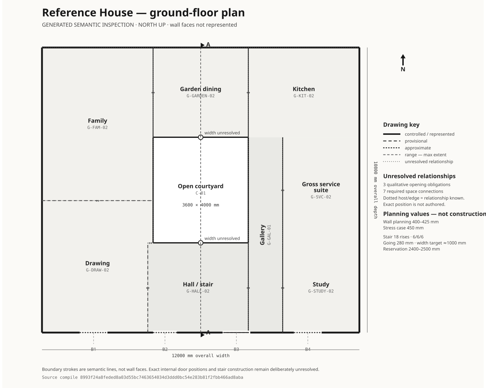
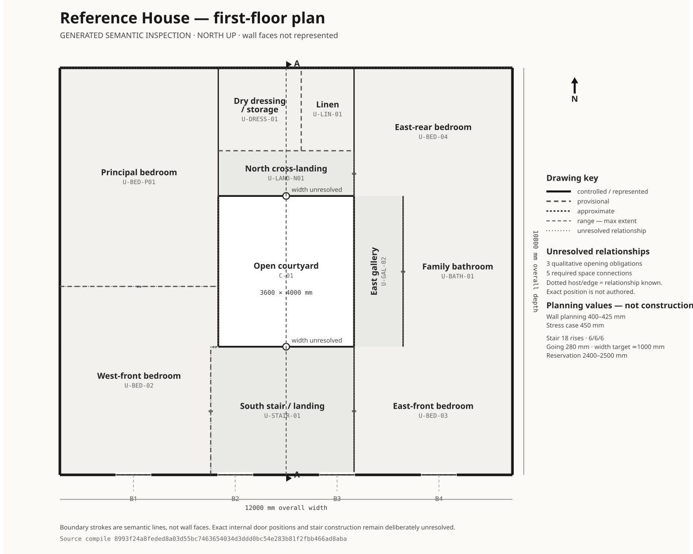
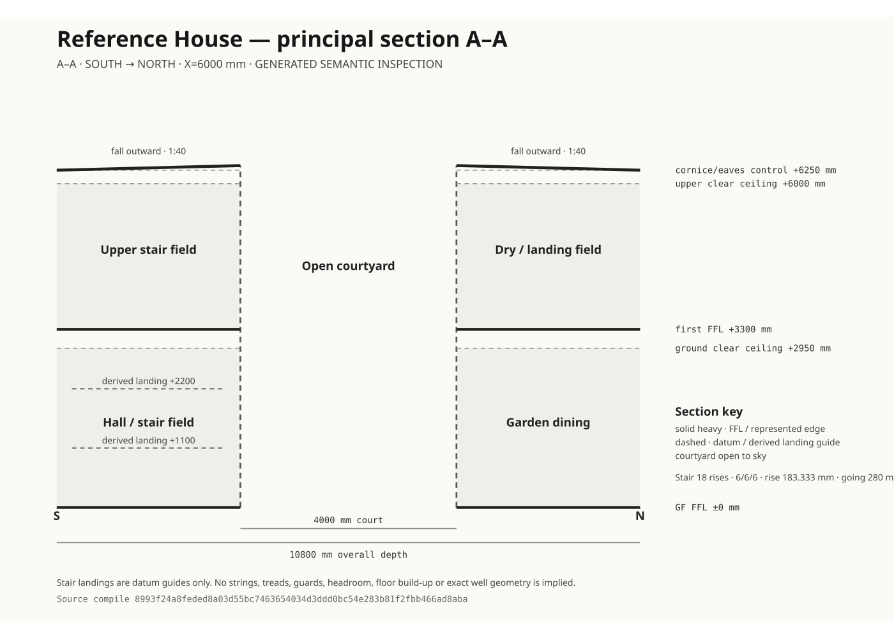
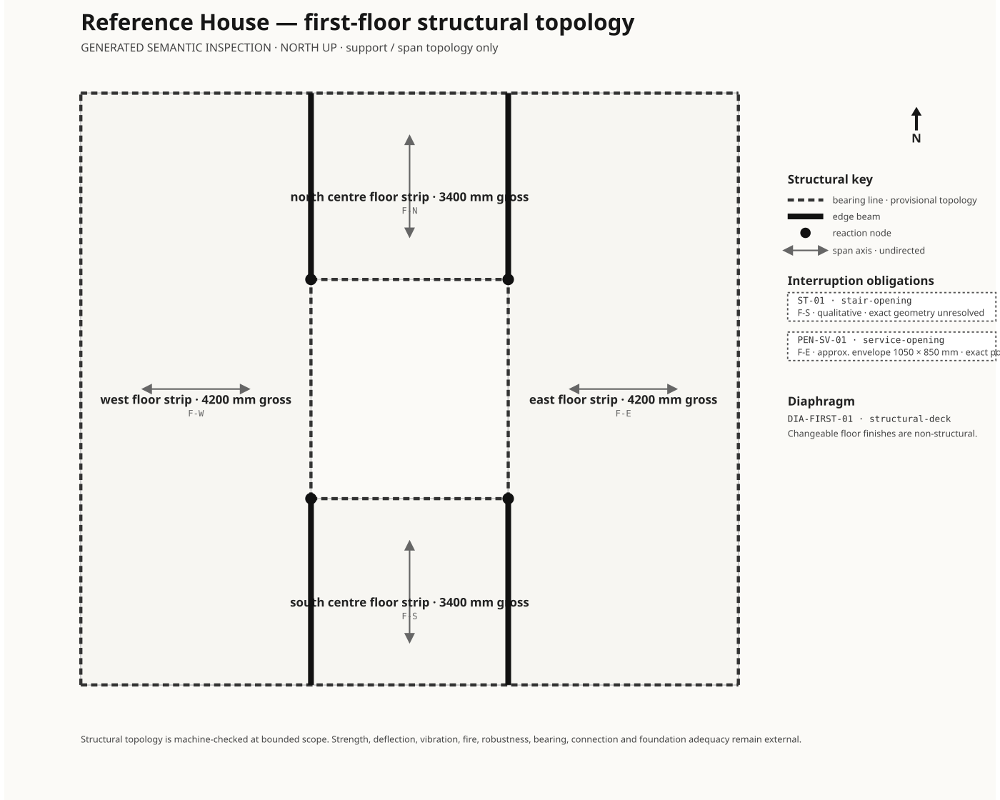

# Generated compiler inspection

This is the current **semantic inspection surface** for the compiled Reference House. It is generated downstream from the canonical single-pass Metamorph Compiler result and is intended for human checking: what the model knows, what remains unresolved, and whether the coordinated views agree.

It is **not architectural source authority** and it is not a construction drawing set. A generated `PASS` means only that the represented relationships are coherent at the compiler's bounded proof scope; it does not establish engineering, building-physics, regulatory or product adequacy.

## Architectural plan and section

The plan and section set is north-up, cross-registered by section `A–A`, and uses one uncertainty language. Human room names lead; semantic IDs remain available for forensic checking. Known relationships whose exact geometry is absent are shown as unresolved obligations rather than plausible invented openings.

### Ground floor

[Open the raw ground-floor SVG](./ground-floor-plan.svg)

### First floor

[Open the raw first-floor SVG](./first-floor-plan.svg)

### Principal section A–A

[Open the raw principal-section SVG](./principal-section.svg)

## Structural topology

The structural view uses the same north-up projection as the plans. Span symbols are deliberately undirected because the compiler owns a span **axis**, not a one-way load vector. Stair and service interruptions are shown at their owned precision; exact trimming geometry is not manufactured.

[Open the raw structural SVG](./first-floor-structure.svg)

## Semantic reports

Service and boundary topology are principally registers rather than drawings, so they are emitted as searchable, selectable and reflowable documents rather than fixed SVG canvases.

- [Service topology register](./service-register.md)
- [Envelope / boundary topology register](./boundary-register.md)

A graphical service or boundary companion should exist only where spatial form answers a question that the registers cannot answer efficiently. There is no requirement for every compiler domain to produce a picture.

## Machine identity

The [generated output manifest](./output-manifest.json) records the canonical compile fingerprint, renderer version and SHA-256 identity of each output. `npm run outputs:check` regenerates the family in memory and refuses stale committed outputs.

## Reading the uncertainty language

- **solid** — controlled / represented geometry;
- **long dash** — provisional represented geometry;
- **short dash** — approximate geometry;
- **nested extents** — numeric range rather than a chosen midpoint;
- **dotted host / candidate edge** — relationship known, exact geometry unresolved;
- **REVIEW banner** — projection is inspectable but the compile carries unresolved diagnostics.

No wall faces, exact internal door positions, finished stair construction, structural member sizes, exact MEP routing or technical performance are added merely to make the output look more conventionally architectural.
