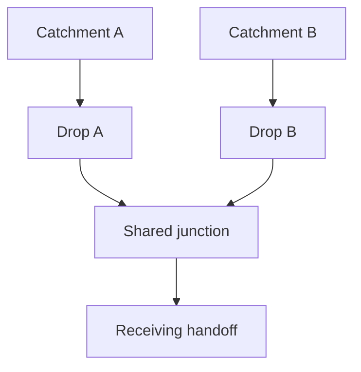

# Rainwater conveyance: separate drops and shared routes

**Status:** architectural options for ordinary gravity drainage, not a selected Reference House network. The [rainfall basis](rainfall-and-hydraulic-basis.md) controls demand/capacity reasoning; the [Accessible Rainwater Route](../patterns/accessible-rainwater-route.md) controls inspection and failure intent. Pipe counts, bores, falls, actual receiving levels and product selections remain unresolved.

The useful objective is a short, understandable and repairable route whose failures have bounded consequences. Fewest pipes is not the objective. Neither is maximum duplication: every extra outlet, joint and support creates work and potential failure.

## Evidence and applicability

Primary sources checked **29 October 2026**:

- [Historic England, Inspection, Maintenance and Repair of Rainwater Systems](https://historicengland.org.uk/advice/technical-advice/retrofit-and-energy-efficiency-in-historic-buildings/resilient-rainwater-systems/inspection-maintenance-and-repair-of-rainwater-systems/), sections on rainwater goods/gullies and below-ground drains. It connects a comprehensible roof plan, accessible clearance and appropriate inspection with maintainability; concealed routes require deliberate access. Its open-shoe/gully advice concerns existing historic buildings, not a universal requirement for this house. This study uses those maintenance lessons without importing heritage consent or a site solution.
- [Marley Alutec, Flush-Fit Downpipes Installation Guide](https://marleyalutec.co.uk/media/3204/marley-alutec-flush-fit-downpipe-installation-guides.pdf), one-page guide, fixing/jointing/drain-connection sections. This actual system distinguishes vertical and offset joint duties, requires support at bends/branches, and offers a removable lower connection. It demonstrates that topology changes joint, support and dismantling requirements. Its products, spacings, sealants and test procedure are **not** adopted as universal rules.
- [Historic England, Upgrades or Alterations to Rainwater Goods](https://historicengland.org.uk/advice/technical-advice/retrofit-and-energy-efficiency-in-historic-buildings/resilient-rainwater-systems/upgrades-or-alterations-to-rainwater-goods/), adding/widening downpipes. Additional drops can simplify a convoluted route, but upstream outlets and receiving drains must also support the change. This supports comparison of the whole route rather than assuming a larger pipe fixes every constraint.

The following judgements are project analysis. They remain falsifiable by the chosen geometry, hydraulic calculation, access trial or product details.

## Topology families

| Family | Advantage | Cost and failure coupling | Disposition for further design |
|---|---|---|---|
| **Separate external drops:** each collected zone descends near its outlet to an inspectable ground transition | Legible route; a local blocked drop need not disable another primary branch; short vertical runs | More visible pipes, brackets and ground interfaces; high-level clearance still needed; shared downstream drainage may reunite the failures | **Preferred starting comparator** for outer roof faces, not a fixed count or selected plan |
| **Separate drops, accessible lower convergence:** branches meet after the difficult vertical geography | Can simplify the receiving interface while retaining locally replaceable drops | Combined demand and one common obstruction point; junction clearance, backwater and access must be earned | **Conditional alternative** where actual service/ground geography benefits; keep emergency-path independence explicit |
| **High-level collector/header with fewer drops:** move water laterally before descent | Can avoid a genuinely unworkable drop position or protect an important opening | Longer supported runs, fall/head requirement, bends/joints and coupled upper catchments; repairs require elevated access | **Higher burden alternative**, not the default way to clean an elevation |
| **Concealed but accessible service-zone route:** pipe behind removable enclosure with designed access and leak consequence | Can preserve a facade or negotiate an unavoidable crossing | The enclosure can conceal leakage/noise; access, removal length, air/thermal/fire interfaces and safe drainage need resolution | **Exceptional candidate** only where actual evidence beats an external route; a panel label alone earns nothing |
| **Built into permanent fabric or an inaccessible cavity** | Visually quiet | Hidden wetting, destructive repair and uncertain joint/support access | **Reject for this project** under its service-access principle; this is a project constraint, not a claim that all conventional concealed drainage is universally defective |

An exposed pipe can still be practically inaccessible. Conversely, a removable enclosure can be maintainable if its real tasks and failure geography work. Compare the task, not the visual label.

## What “independent” must mean

This generic example is topology only, not a proposed house plan:

Blocking Drop A leaves B’s primary route potentially available. Blocking the shared junction or receiving route threatens both. Two visible pipes therefore establish only **local** separation. A secondary path entering the same obstructed junction does not protect against that obstruction. Independence must always name the failure being bypassed; neither this diagram nor an extra outlet proves hydraulic capacity.

At each proposed convergence, record the incoming catchments, combined demand basis, first shared failure point, backwater consequence, accessible clearance approach and emergency path. If the convergence saves one pipe but makes a trapped court depend on an uninspectable common throat, the apparent simplification is rejected.

## Bends, offsets and supports

A short eaves offset can be reasonable when it follows the chosen cornice and keeps the main drop external. Moving water across several bays merely to hide a pipe needs a stronger justification. Record each change of direction, its physical reason, supporting substrate and the actual tool/access position for clearing and replacement. Do not convert bend count into a universal numerical prohibition.

A horizontal or near-horizontal run needs an earned fall, supported alignment and room for installation tolerance/deflection. A pipe fitting that can be purchased is not proof that the route fits or drains. The hydraulic reviewer must assess the complete arrangement; no siphonic benefit is assumed.

Supports must restrain the relevant loads without preventing required movement, and must remain reachable after finishes, planting and other services are installed. A removable pipe attached to inaccessible fixings is not an earned replacement strategy. Material, joint and support specifications belong to the coupled assembly comparison; this topology study does not settle them.

## The courtyard crossing cannot disappear

The court is surrounded by building accommodation. Getting water down a courtyard wall does not get it outside the house. Direct court rainfall also remains even if all roof runoff is redirected outward. The current roof representation has inward and outward collection territory; its provisional arrows establish neither pipe routes nor independent hydraulic loads.

Compare two distinct design moves:

| Move | Potential benefit | Mandatory demonstration |
|---|---|---|
| Inner roof collection descends within the court, then crosses a service/circulation zone to an external inspection handoff | Short local drops and visible court-side inspection | Actual crossing section: structure/footings, pipe envelope, fall/head, joints, removal path, vulnerable fabric and external receiving level; keep court surface collection and roof flow identities distinct even if later combined |
| Inner roof runoff transfers at higher level to an outer drop | May reduce roof-water load and pipework in the court | Continuous viable level/fall and supports across the building zone, roof/air/thermal/fire interfaces, leak consequence and safe access; no arbitrary line through rooms or upward gravity segment |

The first is a **candidate route family**, not an assertion that the accepted plan contains a suitable service corridor or undercroft. The second does not remove the need for a separate court surface-water escape. A nominal “service zone” without a demonstrated section cannot close either question.

The emergency court route must reach a harmless receiving territory before the vulnerable threshold level is exceeded at the required flow. The access doors and occupied corridor are not accepted as the emergency weir. A backup crossing that shares the obstructed primary throat fails the corresponding blockage case. Actual level continuity, capacity and external backwater remain essential selection inputs.

If neither route can be made physically credible, roof topology, court/threshold geometry or the wider architectural arrangement must be reconsidered. A pump, buried inaccessible route or threshold step must not appear silently as a rescue. Those would require an explicit new decision and evidence, not be incidental implementation detail.

## Inspection, demounting and occupation

For each route family, demonstrate one real maintenance intervention before claiming it accessible:

1. Identify a plausible blockage or damaged segment and observe where leakage/backup first appears.
2. Put the person, access equipment and tools at the actual clearance/repair point; account for doors, windows, planting, court width and safe high-level access.
3. Establish how the pipe above remains safely supported while the chosen segment is removed. Reserve the extraction motion as well as the nominal pipe volume.
4. Open the actual joint/fitting with its chosen assembly method, remove and replace the bounded segment, then restore supports and any weather/air/fire boundary crossed.
5. Inspect and test the reinstated route under an appropriate technical acceptance procedure; a hose observation is not certification of storm capacity.

A local removable section may be more useful than making every joint a special coupling. The burden is to show a credible repair extent with ordinary obtainable components, not to maximise fittings. Put rain noise, splash, stain risk, repair disturbance and falling-water territory beside the relevant bedroom, window or entrance in the comparison.

At ground level, compare an open shoe/gully transition with a direct accessible connection. The open form can expose discharge and ease inspection but adds splash, debris and possible icing/occupation consequences. The direct form can contain discharge but needs an explicit blockage, backwater and access strategy. Neither is selected without the actual receiving conditions. This is where building-side design hands requirements to site design, rather than inventing a sewer or soakaway.

## Synthesis requirements

Carry forward separate external drops as the ordinary comparator and accessible lower convergence as a conditional alternative. Higher-level transfer and service-zone concealment must earn their added complexity through a concrete spatial benefit and complete failure/access account. No pipe count, coordinate, diameter, support spacing or fall is frozen by this recommendation.

The selected network must supply:

- a source-bound catchment-to-handoff route for every roof/court contribution;
- actual sections and datum continuity at every crossing or convergence that determines feasibility;
- a named obstruction and the next water path, with local versus downstream shared failures distinguished;
- enough space for the chosen system’s capacity, supports, movement and bounded removal task;
- compatible material/joint evidence and agreed facade/court positions;
- an independent-enough emergency route for each stated high-consequence failure case;
- explicit site receiving constraints and unresolved evidence owners.

The construction-resolution team must settle any missing crossing, structural opening or essential level envelope **before** network selection. The rainwater failure study develops the detailed cases; whole-house moisture assurance tests their consequences. The actual drainage designer and site team retain numerical hydraulic and receiving-condition acceptance. A clearer topology is useful progress; it is not a drainage approval.
