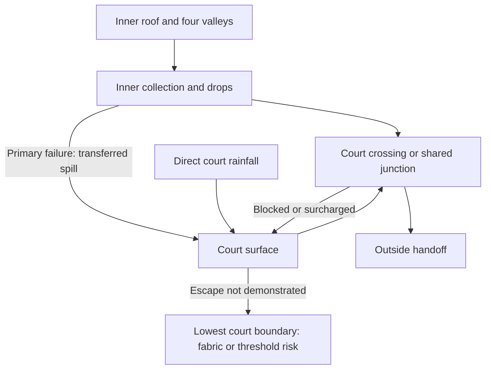

# Rainwater failure and exceedance

The current inward roof concentrates water at four courtyard corners as well as along its inner eaves. A failed collector can therefore transfer roof runoff into an occupied court surrounded by the house. **Visible water in that court is evidence of a fault, not evidence of a safe escape route.**

This study attacks the candidate architectures in [collection](rainwater-collection-options.md) and [conveyance](rainwater-conveyance-options.md), using the [current house basis](../reference-house/current-house-basis.md) and [rainfall basis](rainfall-and-hydraulic-basis.md). It does not select a network, size an overflow, certify a threshold or approve the present court drainage. The adverse findings below constrain the next access/transition study and network selection.

## Evidence and the house inference

England's Approved Document H, H3 §1.7, calls for gutter exceedance to discharge clear of the building; §1.2 treats high-consequence overtopping as requiring more detailed design. Its eaves-drop guidance also addresses falling water, openings, splash and concentrated discharge. Those are useful baseline questions, not proof that free discharge into this court complies. [H1]

Historic England describes visible fail-safe outlets as warning of capacity problems and requires downstream capacity to be considered when enlarging upstream goods. Its maintenance guidance distinguishes visible external pipes from concealed routes and requires access for inspection and repair. [H2, H3] SPAB records debris blockage, sagging supports, joint leakage and guard limitations: needles can pass through guards, and material gathering around outlet guards can itself block flow. [H4] These heritage sources provide failure mechanisms; they do not select new-house assemblies.

The following route attacks are project deductions from those mechanisms and the accepted geometry. No source certifies the proposed house. A warning outlet, extra pipe or leaf guard earns only the particular function demonstrated for its actual detail.

## Physical candidate routes and their present disposition

| Candidate | Normal route under consideration | Next path when primary collection/conveyance fails | Present disposition |
|---|---|---|---|
| Outer exposed eaves | Outer slope → external gutter → visible drop → outside transition | Water rises to a gutter edge or leaks from a joint; may fall outside the wall, run behind the gutter, or wet an opening, depending on the section | Retain as comparator. A lower outward spill edge and clear discharge location could contain a local blockage, but the actual section, splash zone and receiving ground route must prove that result. |
| Inner exposed eaves and valley receivers | Inner slopes/four valleys → court-edge collection → drops | Collector spill or an overflowing hopper falls into the court or down its enclosing wall; direct court rainfall continues | Retain conditionally. Spill-to-court transfers load to another catchment. It is not the final secondary route. Reject any candidate that stops its failure diagram at the court surface. |
| Court surface and low-level crossing | Direct rain plus any transferred roof spill → surface channel/gully → crossing through or beneath the surrounding house → outside | A blocked grate, crossing or downstream junction leaves water in the enclosed court; water seeks the lowest actual boundary, potentially a door or wall junction | No safe route demonstrated. RWT-06 must show the whole crossing and a fault-bypassing escape below vulnerable boundaries; a second grate connected to the same blocked throat does not do this. |
| High-level transfer of inner roof water | Inner collector → gravity transfer across the ring → outer drop | A failed transfer can back water into the inner collector or leak at its crossing/joints; direct rain still reaches the court independently | Conditional alternative only. Actual continuous fall, head, structure and access remain unproved. It cannot remove the court-surface failure case. |
| Concealed/box collection or hidden pipe | Roof receiver → enclosed collector/pipe → outside | Rising water may reach a lining edge, penetration or joint before an external sign appears; leakage can enter concealed construction | Higher burden. Carry forward only with an explicit independent overflow, visible indication and earned access/removal. Concealment supplies no containment evidence. |

This is the coupled court failure to avoid; arrows show candidate water paths, not an adopted drainage layout:

Separate drops can contain a blocked individual pipe while sharing a lower failure. Independence must be stated against a named fault: one blocked outlet, one pipe, a common junction, a receiving drain, or a common debris/ice exposure. Two outlets that return to the same obstructed section cannot bypass that obstruction.

## Failure attack

“First fabric” below names an investigation target: the first plausible vulnerable interface to inspect in the eventual section. It is not a completed first-fabric determination. The actual lowest wetted boundary is unresolved; no row asserts a fixed damage order. RWT-06/07 must locate that boundary and reconcile the resulting order before any candidate is accepted. Visibility means a safe observation opportunity, not guaranteed detection or permission to approach falling water.

| Fault / affected candidate | Next water path and visibility | First fabric or occupation exposure | Passive routing requirement and adverse disposition | Clearance / repair consequence |
|---|---|---|---|---|
| Blocked gutter or channel, outer or inner | Water backs up locally, bypasses the obstruction if a real connected path remains, otherwise overtops a low edge; an exposed spill may be seen in rain | Rear eaves/roof edge if water rises inward; wall/opening below; court users beneath inner spill | Prove a spill edge/overflow discharges away from the vulnerable interface. Inner spill must be added to court inflow. Reject “open gutter therefore safe” without its section | Reach the blocked length, remove accumulated material and inspect falls/supports. An accessible outlet alone cannot clear a remote channel pocket |
| Blocked primary outlet or valley receiver | Water accumulates upstream; may overshoot a receiver, spill a gutter or reach weathering laps before another outlet takes flow | Valley termination, adjacent roof build-up and inner corner wall; people below concentrated discharge | A secondary inlet must remain connected to the backed-up water and bypass the blocked inlet. Its operating water level must remain below vulnerable fabric. Four valleys are concentrated inputs, not four independent systems | Inspect and clear the actual receiver/guard, then check overshoot and adjacent weathering; roof-side access is required where ground observation cannot see the obstruction |
| Blocked downpipe, bend or offset | Water rises above the obstruction; an open hopper may spill, while a closed connection may leak at joints or back up to the collector | Pipe joints/support interfaces and adjacent wall/opening; hidden construction for a concealed route | Trace the backup to its first escape, including any other branches. A second drop counts only for the obstruction it bypasses; shared lower connection remains a fault | Provide access to the actual bend/block and a removal path. Opening a charged pipe can release retained water; the work plan must control that release |
| Failed or displaced joint/support | Water leaves the intended route at the failure, even before capacity is reached; visible on exposed sections, potentially hidden behind cladding | Wall/roof penetration, opening or finish below; impact exposure beneath displaced parts | Locate joints away from vulnerable openings where feasible and demonstrate how escaped water avoids fabric. An overflow elsewhere does not contain a split joint | Inspect movement/support causes, renew the joint or section and check adjoining units. Use the [shared material record](roof-rainwater-material-compatibility.md), not a universal sealant repair |
| Primary route overwhelmed or undersized | Water level increases until extra flow escapes at the actual low point; visual warning can begin after harmful wetting | Lowest weathering/upstand/threshold interface; retained-water load also needs structural assessment | Evaluate the complete secondary path at its operating head, including receiving capacity. Larger upstream goods can move the bottleneck downstream; no numeric adequacy is claimed | Investigate catchment, rainfall and each restriction rather than treating repeat overflow as a cleaning issue; hydraulic/detail redesign may be required |
| Debris accumulating at guards, screens or corners | Partial restriction increases head; debris can bridge both primary and adjacent emergency openings. Fine material may pass to a lower blockage | Same upstream fabric as outlet blockage; concealed downstream deposits can delay diagnosis | Demonstrate distinct obstruction exposure and a cleanable approach. Do not assign a generic percentage derating or call a screened outlet maintenance-free | Remove the guard safely, clear both faces and downstream deposits, reinstate its fixing and inspect compatibility; cleaning only its visible face is insufficient |
| Frozen/obstructed conditions where exposure makes them relevant | Ice or trapped debris can obstruct several nearby paths; thaw/rain may add flow before all paths clear | Collector seams/lining, adjacent fabric and falling-water/ice exposure below | Test shared exposure of primary and secondary routes. No heater, sensor or seasonal intervention is credited as a passive route; site climate/detail evidence must establish the actual case | Planned competent inspection after unsafe conditions pass; assess distortion/joints as well as clearing. No instruction to climb or clear during a storm |
| One missed cleaning plus heavy rain | Use the credible debris-restricted state, then add the event inflow; remaining openings and overflow must carry the consequence together | Court thresholds/walls and any upstream low weathering interface | Explicit compound case, not separate passes for a clean system and a dry blockage. If safe discharge depends on a person unblocking it during the event, reject the candidate | Maintenance frequency remains evidence-led; provide a recoverable post-event task and inspect secondary routes too. Routine maintenance cannot be the emergency barrier |
| Blocked court grate/channel or low-level crossing | Direct court rainfall and any inner roof spill pond at the surface; a blocked crossing can defeat multiple surface inlets | Court door thresholds, wall-base junctions and usable circulation, according to actual levels | Show a separate path to a safe exterior receiver bypassing the named block. A second drain into the same throat, unspecified infiltration, or an emergency route through an occupied room does not qualify | Lift/remove grates and reach the crossing from demonstrated positions; preserve threshold weathering. If the route cannot be inspected/renewed, revisit the crossing or house arrangement |
| Receiving transition blocked or site system surcharged | Water backs up from the lower boundary, potentially coupling roof drops and court drains; visible gully overflow only helps if it occurs safely | Lowest connected court/outer interface; external wall base and access surfaces | State the limiting downstream water level and where exceedance goes before reaching the house. A check valve alone cannot discharge new rainfall when closed. Keep actual site discharge with DPL | Identify accessible inspection/clearance boundary and the competent site investigation needed; do not prescribe a sewer, soakaway or pump from the generic house |

## What would earn a safe secondary route?

A candidate section must identify the obstruction being bypassed; the source catchment; primary and emergency inlet levels; water level while the emergency route is actually flowing; the lowest vulnerable weathering/threshold boundary; and the continuous receiving route. Tolerance, deflection, debris exposure, splash and wind-driven wetting belong in that assessment. A low overflow invert alone cannot establish the operating water level or prevent splash into an opening.

For a trapped receiver, conservation of water gives `change in stored volume = inflow − outflow`. If all outlets are blocked and inflow continues, storage fills. The current model supplies neither a safe storage volume nor a defensible time before harmful wetting, so there is no claimed “time to respond”. The courtyard's direct rain and transferred roof overflow must be included together; storage cannot be presumed from its plan area or by silently raising door thresholds.

A roof spill that lands outside a wall still needs a safe receiving surface and onward route, with openings, people and foundations considered. A court spill has the additional obligation to cross the surrounding house boundary. If no gravity escape can be demonstrated within the current arrangement, record a failed candidate and test a bounded ROF/HAD rewind. Do not draw an imaginary corridor, accept interior flooding, or silently substitute a pump to preserve the plan.

The route must remain effective without a sensor, an alert being noticed or a resident intervening in heavy rain. Visible failure supports diagnosis; it does not turn wet fabric into acceptable sacrificial fabric. MRA later assesses the whole-house consequence of the physical route RWT actually establishes.

## Access, evidence and next decisions

Observation from safe positions can reveal external spills or leaks; it cannot establish clear hidden channels, sound concealed joints or safe high-level working. HSE requires roof work to be planned with competent people, suitable access and fall precautions. [H5] This study specifies no ladder/tower method and assumes no safe court equipment route. Rainfall also cannot be isolated like a domestic water supply: removal and temporary weather protection need a planned task.

RWT-06 must turn the adverse court and access findings into actual sections/tasks: transport and working positions, rodding reach, retained-water release, component withdrawal, surface/door levels, a continuous crossing and a declared outside boundary. RWT-07 must apply every fault above to each composed candidate, including the compound case; an unresolved safe route is a selection failure, not a note to defer to MRA. ROF supplies collection/weathering geometry, OAS/HAD threshold and plan consequences, BCR/EPR technical verification, and DPL the receiving site conditions.

No present candidate has earned a whole-network failure pass. Completion of this comparative attack closes the failure-analysis packet while preserving these explicit adverse dispositions for the dependent transition and selection work.

## Primary evidence

Reviewed 29 October 2026. Section references below identify the scope actually used; no paid standard or full project hydraulic calculation was reviewed.

- **H1:** [Approved Document H, current official landing page](https://www.gov.uk/government/publications/drainage-and-waste-disposal-approved-document-h) and its [2015 England PDF](https://assets.publishing.service.gov.uk/media/5a80cf9ded915d74e33fc8ae/BR_PDF_AD_H_2015.pdf), H3 §§1.2, 1.7–1.9 and 1.13 (printed pp40–42). Baseline guidance, not a compliance determination for this house or another jurisdiction.
- **H2:** Historic England, [Upgrades or Alterations to Rainwater Goods](https://historicengland.org.uk/advice/technical-advice/retrofit-and-energy-efficiency-in-historic-buildings/resilient-rainwater-systems/upgrades-or-alterations-to-rainwater-goods/), 23 July 2024, downstream capacity and “Adding fail-safe systems”. Heritage adaptation context.
- **H3:** Historic England, [Inspection, Maintenance and Repair of Rainwater Systems](https://historicengland.org.uk/advice/technical-advice/retrofit-and-energy-efficiency-in-historic-buildings/resilient-rainwater-systems/inspection-maintenance-and-repair-of-rainwater-systems/), 23 July 2024, access, visible/concealed routes and below-ground failure. No generic maintenance interval adopted.
- **H4:** SPAB, [Rainwater fittings](https://www.spab.org.uk/advice/rainwater-fittings), failure causes and maintenance/guard limitations. Historical repair advice is not a new-house system specification.
- **H5:** HSE, [Roof work](https://www.hse.gov.uk/construction/safetytopics/roofwork.htm), planning, competence, access and fall hazards. No site-specific access method inferred.
