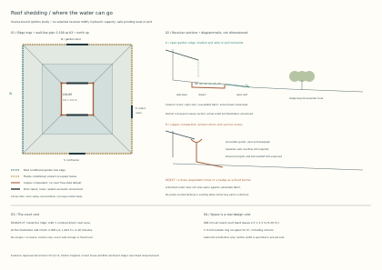

# Roof shedding and ground receivers

**Finding:** free shedding deserves a trial on genuinely open garden edges. Controlled copper collection is the stronger starting point at entrances, service routes and all four edges of the present enclosed courtyard. The distinction follows where falling water, splash and overflow can go. It does not establish a selected drainage system.

This comparison applies to the [current house study](../reference-house/current-house-basis.md), its [material policy](../reference-house/material-policy.md) and [ground-water policy](../reference-house/ground-water-policy.md). It retains the existing house geometry. A gutterless roof still needs deliberate ground collection, conveyance and a suitable final destination.

[Source-bound calculation](../../project/rwt/studies/free-shedding.json) · [Reproducer](../../project/rwt/studies/free-shedding.ts). The A3 plan is at 1:100 when printed at its native size; receiver sections are diagrammatic. The drawing is an options comparison, not construction information.

## An established approach with explicit duties

England's **Approved Document H, 2015 edition, H3 paragraph 1.13, printed page 42**, explicitly addresses eaves drop systems. It asks the design to protect walls and openings from water, people from falling water and ground splash, and foundations from concentrated discharge. Gravel and an outward-deflecting apron are examples, not dimensioned solutions. Paragraph 2.2 concerns surface drainage away from buildings; paragraph 3.25 gives separate guidance on infiltration-device siting. No safe overhang, splash distance or collector width is supplied [1].

Historic England describes projecting eaves, outward ground slopes and softer or gravel receiving surfaces. It also warns that gravel-filled French drains near foundations can concentrate water there, and recognises the need for guttering at doors and adjoining paths [2]. Those mechanisms inform this comparison; a thatched low building is not a performance demonstration for a high slate roof.

## Every edge, including the awkward ones

The source has a 12 m square shell, a 3.5 m square court and nominal eaves at +6.8 m. Its 200 mm section extension is not an adopted deep eave. Continuing the represented 25° pitch gives a mid-side geometric tip at +6,706.7 mm; the final drip profile and receiving level remain unknown. Neither number alone establishes actual fall height, detachment or splash.

The following intervals come directly from the ground-floor opening source. They are nominal apertures, **not clear door widths, complete carrying territories or safe wetting setbacks**. The surrounding route must also be protected.

| Edge | Source conflict | Comparison disposition |
|---|---|---|
| Outer south | Centred entrance, x 5,100–6,900 mm; principal approach | Copper over the entrance and its approach. Side portions are conditional garden candidates only if actual land, access and facade composition allow them. |
| Outer north | Garden doorway, x 4,800–7,200 mm; through route and potential carrier renewal territory | Copper at the door and carrying/renewal route. Do not fill reserved working space with an impact bed or hedge. |
| Outer east | Plant replacement door, y 3,900–5,300 mm | Copper over the replacement route. A service-side label does not make falling water harmless. Other portions remain conditional. |
| Outer west | No exterior ground doorway in this source; windows, wall maintenance and boundary clearance still matter | Best first garden-edge trial candidate. No plot-side territory is established. |
| Court north | 2,400 mm nominal door on a 3,500 mm side | Reject free shedding as the present-house default. Retain the copper comparator and its separate failure-route duty. |
| Court south | Opposing 2,400 mm nominal door; continuous front-to-garden route | Same rejection; a receiver band cannot sever the route. |
| Court east | Windows and wall base within the same narrow enclosed basin | Same rejection. A missing door on this side does not remove shared flood and splash consequences. |
| Court west | Windows and wall base; constrained maintenance territory | Same rejection. Wider eaves also affect daylight, views and access. |

The four inner valleys require concentrated-arrival cases at their corners. Outer hips, edge ends, covering joints and local debris can also invalidate a uniform sheet assumption. The map's eight edge identities are not eight equal outlet duties.

**Prefer one coherent eligible garden edge over a patchwork of short gutterless strips.** Partial guttering introduces terminations, side spill, concentrated arrival and extra cleaning points. Compare it with an uninterrupted copper run before adding those interfaces. No segment length or larger overhang is selected here; roof structure, cornice proportions and daylight retain their existing design owners.

## Three receiver families and the copper control

The sections deliberately use functional territories rather than invented safe dimensions. Let **a** be wall-base/inspection stand-off, **b** the demonstrated capture and impact territory, and **c** the additional maintenance/root territory. Their required sizes follow the actual discharge and access evidence. They cannot be obtained from pitch and covering alone.

| Family | Connected construction and water path | Judgement and possible rejection |
|---|---|---|
| **Accessible shallow collector with removable stone impact bed** | A defined weathering edge discharges into loose, stable mineral impact material held over an accessible non-plastic collector. Water leaves by a visible gravity route; an open outboard spill reaches harmless ground before vulnerable fabric. The hedge sits beyond indispensable drainage/access. | Preferred free-shedding trial. Lift the impact material and collector without cutting permanent fabric. Resolve fines, erosion, collector seams, leakage beneath it, settlement and handling mass. Gravel itself supplies neither watertightness nor a lawful destination. |
| **Open mineral apron or rill** | A shaped mineral receiving surface directs impact and flow outwards to an inspectable channel. Joints, bearing and the full receiving route are visible and renewable. | Credible simpler comparator where its splash, slip, noise, frost and wear are acceptable. A hard surface may throw water back; an angled line in a section does not prove that it prevents this. |
| **Metal channel or stepped cascade** | Genuine brass/copper or another justified non-plastic channel receives and conveys water. A stepped version introduces intermediate impacts and supports. | Retain the channel family for the materials study. Do not prefer a cascade merely because it breaks the fall: each step adds splash, debris, supports and a renewal task. Alloy, joints, movement, patina, runoff compatibility and any coating remain subject to the shared material investigation. |
| **Conventional controlled copper** | A matched eaves gutter, accessible outlets and downpipes lead to visible ground transitions. High-level joints, supports, cleaning and safe overflow remain explicit. | Control for every edge; preferred at doors, service routes and the court. It reduces routine falling water near occupation but does not remove blocked-gutter or downstream-flood cases. A complete non-plastic assembly and actual capacity remain to be demonstrated. |

The useful free-shedding section is **shallow, open towards its safe escape and accessible from above**. Its filled water surface must remain below the first susceptible wall, opening or joint with an evidenced margin. The outboard overflow must reach a real harmless destination without first crossing an entrance, neighbouring land or another vulnerable part of the house. Normal conveyance and emergency surface spill must not merely rejoin the same blocked throat.

Reject a collector enclosed by raised edging when its only exit is a buried drain and filling would wet the house. Reject a sunken "dry" access margin dependent on pumping or inaccessible groundwater tanking. Conversely, an accessible tray collecting roof water is not automatically a prohibited basement: its level, leakage consequence, independent spill and renewal determine its acceptability. A shallow depth alone proves nothing.

Do not connect this garden candidate casually to the historical north-carrier receiving bay. That proposal's receiving-water comparison lies below schematic external grade and has its own unresolved flooding and renewal duties. Enlarging a wet hole to hide gutters would defeat the passive-dryness brief.

## Quantities that help the decision

### Catchment conservation

This reuses the existing [construction water study](https://github.com/adamnoden/architecture/blob/main/project/bcr/bcr-water-result.md) and [rainfall basis](rainfall-and-hydraulic-basis.md). With shell side 12 m, ridge square 7.75 m and court 3.5 m, the vertical-rain wall-line areas are:

| Area | Wall-line comparison | Consistent 200 mm square-offset sensitivity |
|---|---:|---:|
| Outward roof projection | 83.9375 m² | 93.6975 m² |
| Inward roof projection | 47.8125 m² | 50.4525 m² |
| Direct exposed court | 12.2500 m² | 9.6100 m² |
| Total projection | 144.0000 m² | 153.7600 m² |
| Inward roof plus direct court | **60.0625 m²** | **60.0625 m²** |

Adding the full 12.25 m² court to the offset inward roof double-counts 2.64 m² intercepted by the overhang. These are projected areas, not wind-adjusted effective catchments or covering quantities. Actual corners, facade contributions and hydraulic allocation remain unresolved.

### Flow and concentration

Use the existing illustrative rates, runoff coefficient one and `Q = rate × area`. They are **not London design storms**, climate allowances or final sizing inputs.

| Illustrative rate | Equivalent intensity | Outer roof total | Mean per metre of outer eave | Direct court | Inward roof plus court |
|---:|---:|---:|---:|---:|---:|
| 0.020 L/(s·m²) | 72 mm/h | 1.679 L/s | 0.0350 L/(s·m) | 0.245 L/s | 1.201 L/s |
| 0.040 L/(s·m²) | 144 mm/h | 3.358 L/s | 0.0700 L/(s·m) | 0.490 L/s | 2.403 L/s |
| 0.060 L/(s·m²) | 216 mm/h | 5.036 L/s | 0.1049 L/(s·m) | 0.735 L/s | 3.604 L/s |

The perimeter mean is not a safe local design load. Even on the ideal outer trapezoid, its 2.125 m central tributary run gives **0.085 L/(s·m)** at the middle rate, above the 0.070 mean. Concentrated streams and inner valleys need their own actual contributing areas and receiving geometry.

Allowing the inward roof to fall into the court gives **4.90 times** its nominal direct-rain load. At the middle illustrative rate, complete obstruction with no escape or loss accumulates **1,441.5 litres in ten minutes**, compared with 294 litres for direct court rain alone. This is a volume comparison: it gives no permissible storage, actual water level, time to threshold failure or response allowance. Controlled roof collection must still face this combined-load case when its failure sends water into the court.

### Ground territory is not free

For a uniform court band of width `w`, remaining central area is `(3.5 − 2w)²`. This band represents a deliberately assumed total territory, not a proved splash width.

| Assumed band on all four sides | Central width | Central area | Court occupied by band |
|---:|---:|---:|---:|
| 300 mm | 2.9 m | 8.41 m² | 31.3% |
| 450 mm | 2.6 m | 6.76 m² | 44.8% |
| 600 mm | 2.3 m | 5.29 m² | 56.8% |
| 750 mm | 2.0 m | 4.00 m² | 67.3% |
| 1,000 mm | 1.5 m | 2.25 m² | 81.6% |

The band also crosses both court door routes. Remaining area does not prove accessible circulation or scaffold fit. The 600 mm sensitivity already leaves a central width smaller than the nominal 2,400 mm doors.

For one 12 m exterior edge, a 1 m band uses 12 m² before corner/access additions. A complete exterior ring uses `(12 + 2w)² − 12²`: 25 m² at 500 mm, 38.25 m² at 750 mm and 52 m² at 1 m. These quantities expose plot demand; they reserve no actual land and recommend no width.

## Planting, infiltration and the final destination

A hedge belongs in the architectural comparison but earns **no essential capture, capacity or flood-protection credit**. Design and test the receiver bare, then measure any benefit from planting separately. Keep pruning, clippings, roots, leaf fall, drought and replacement from defeating the primary or overflow path. No species is selected before soil, light, exposure and root/access territory exist.

The 2026 containerised-hedge study measures rainfall interception and throughfall using controlled spray, with nozzle heights adjusted to canopy height. Its indexed methods do not establish performance under concentrated roof discharge or high-eave ground splash [5]. No interception percentage is transferred to this house.

Separate **near-eave impact collection** from **infiltration into the ground**. Defra's non-statutory SuDS standards distinguish point-infiltration risk assessment within 5 m from assessment of near-surface diffuse infiltration within 3 m; geology and groundwater can impose further constraints. They also address blocked components and surcharged outfalls [3]. Those distances are not splash setbacks, and a narrow strip taking a substantial roof catchment cannot automatically claim the diffuse-rainfall case. The applicable building-regulation guidance must also be reconciled at the actual site.

RHS guidance helps with planting, inlet erosion protection and overflow. Its 20%-of-roof rain-garden rule is expressly for typical UK summer rainfall, so it cannot size this house's storm protection [4]. No infiltration rate, soil condition, groundwater margin, drainage consent, receiver water level or site outfall is invented here.

## Evidence that would admit or reject an outer trial

Use the actual candidate covering, drip/underside profile, height, discharge distribution and receiver construction. A reduced-height demonstration needs a justified transfer method; an attractive low shed is not a test of this house. Record rainfall/flow, wind directions and ranges, tolerances and the measured limits before interpreting a result.

| Challenge | Observation and consequence |
|---|---|
| Low flow and adverse wind | Observe cling, underside return, wall/window wetting and the full landing envelope. Reject a detail whose normal variation reaches vulnerable fabric. |
| High flow, valley/end concentration and uneven edge discharge | Measure local capture, splash and escape; a perimeter average cannot stand in for the concentrated input. |
| Bare, new, dead or freshly pruned hedge | The independent building-protection case must remain intact. Plant benefit is additional measured evidence only. |
| Leaf mat, clippings, silt, displaced stones and roots | Observe obstruction, erosion, failed seams and access for restoration. Avoid an arrangement that needs perfect housekeeping to keep the wall dry. |
| Primary outlet blocked; power unavailable | Trace the real water surface and outboard spill to its safe destination. No pump or prompt intervention is credited. |
| Frozen/full receiver and flooded downstream outfall | Check return water and the common failure of normal and backup paths. Where no harmless gravity escape remains, change the levels, route or site proposition. |
| Door open/closed, people passing, pruning and cleaning | Test falling water, slip/trip, noise and carrying clearance with actual occupation and equipment. |
| Collector or impact-bed renewal while rain remains possible | Demonstrate first removal, handling, retained wall protection and a separate temporary discharge route. Maintenance cannot require an unprotected opening beside the wall. |

Measure the wetting/splash envelope, leakage beneath the collector, water levels at flow, erosion, displaced material and noise. Establish the first susceptible assembly and agreed acceptance limits before a pass/fail verdict. No mock-up has been performed by this study.

## Design handoff

Develop the west garden-edge trial only where actual landscape territory can provide a shallow accessible collector and independent harmless outward spill. Keep copper as the full-edge comparator and at every door/working route. Retain controlled collection on all court edges; its own failure route remains a demanding unresolved obligation.

Roof and architectural design own any larger eave, cornice change, support reaction, daylight effect or revised route. Materials design owns full collector/joint/finish constituents; an attractive brass face is insufficient. Drainage design must establish inlet/conveyance capacity, operating levels and independent failures against site receiving conditions. Later moisture assurance attacks that integrated selection. This comparison closes none of those physical acceptance duties and does not redesign the court levels.

## Evidence

Checked 30 October 2026. Guidance, experiment and project inference retain distinct scopes.

1. [Approved Document H official publication](https://www.gov.uk/government/publications/drainage-and-waste-disposal-approved-document-h), [2015 England PDF](https://assets.publishing.service.gov.uk/media/5a80cf9ded915d74e33fc8ae/BR_PDF_AD_H_2015.pdf): H3 1.13, 2.2 and 3.25. The current official page links this edition. Guidance is not a whole-house approval.
2. [Historic England, Buildings Without Rainwater Goods](https://historicengland.org.uk/advice/technical-advice/retrofit-and-energy-efficiency-in-historic-buildings/resilient-rainwater-systems/buildings-without-rainwater-goods/), 23 July 2024. Conservation context; mechanisms and adverse perimeter-drain evidence, without quantitative capture dimensions.
3. [Defra national SuDS standards](https://www.gov.uk/government/publications/national-standards-for-sustainable-drainage-systems/national-standards-for-sustainable-drainage-systems-suds), updated 30 July 2025: 3.24, 7.16–7.16.1 and 7.27–7.27.2; [non-statutory status](https://www.gov.uk/government/publications/national-standards-for-sustainable-drainage-systems). England site drainage, not a roof collector-sizing method.
4. [RHS, Rain gardens](https://www.rhs.org.uk/garden-features/rain-gardens). Horticultural guidance; its summer-rain sizing example is not adopted.
5. [Blanusa et al., Assessing Year-Round Capacity of Single-Species and Mixed Hedges to Provide Rainfall Attenuation](https://www.mdpi.com/2076-3298/13/5/252), *Environments* 13(5), 252, 2026, DOI 10.3390/environments13050252. Indexed primary abstract/methods inspected; direct full-page access returned HTTP 429. No fully reviewed physical proof or high-eave splash result is claimed.
