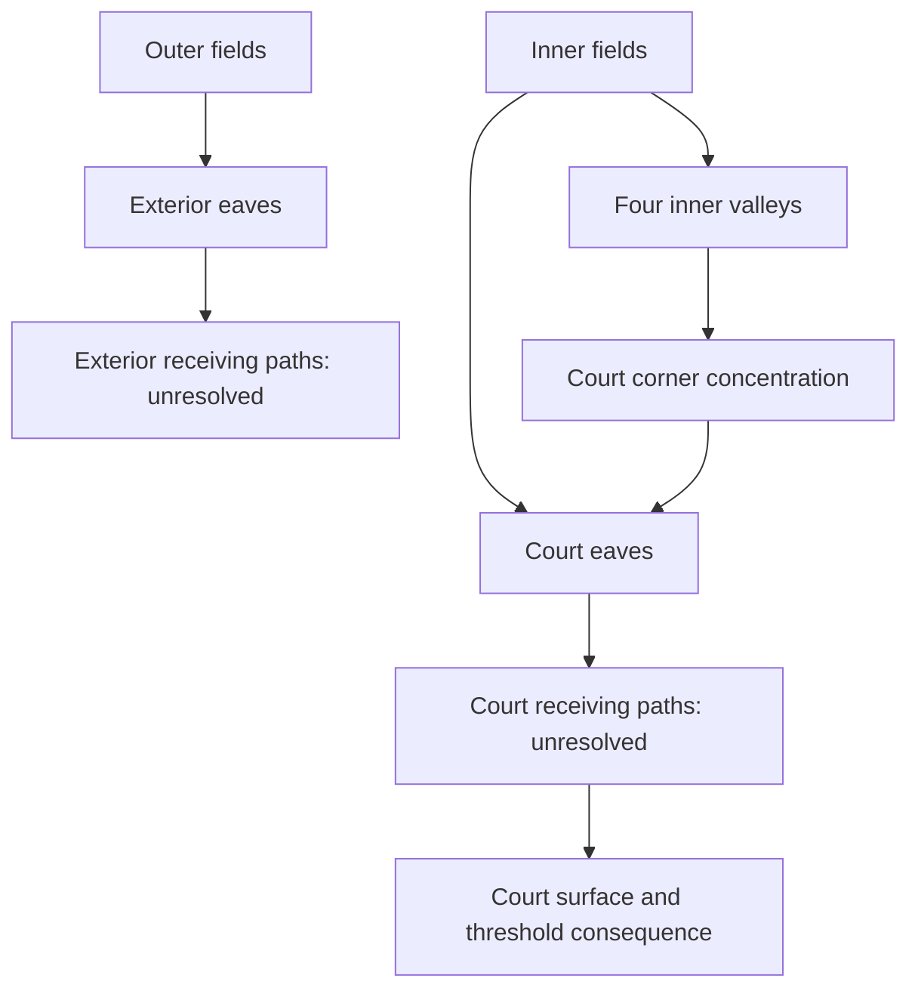

# Roof topology and water paths

**Scope:** geometry-family research, 29 October 2026. Read with [Roof Failure and Recovery Evaluation](roof-failure-evaluation.md). These are bounded comparisons, not selected assemblies or hydraulic designs.

## Finding

A simple silhouette can conceal a complicated water system. Count and classify the interfaces that change where water travels, accumulates or escapes; do not treat every line on a roof plan as an equivalent joint.

The current inward/outward courtyard ring has four outer hips **and four inner valleys**. Its inner diagonals concentrate toward courtyard corners. A single diagonal drawn across both roof bands therefore changes function at the ridge. Removing the inner valleys is geometrically possible with an outward-only ring, but that raises the courtyard-side roof edge at equal pitch and exterior eaves level. Water simplicity has a real architectural price.

## A small topology grammar

| Element | Definition for this study | What the record must preserve |
|---|---|---|
| Face | A connected weathering field with a defined fall direction or explicit variable geometry | Boundary, pitch/fall, adjacent faces, normal destination and any local depression |
| Ridge | High junction between roof faces that generally shed away on opposite sides | End/intersection detail; a closed ridge ring still has corners and junction duties |
| Hip | Convex inclined junction between adjacent faces | Divergence of surface water, fixing/weather exposure and difficult local renewal |
| Valley | Concave junction receiving water from adjacent faces | Tributary faces, longitudinal fall, uninterrupted route and discharge concentration |
| Abutment | Roof meeting a wall or another rising construction | Upstand/flashing, movement, secondary drainage and access; not interchangeable with a ridge |
| Edge | Boundary of the roof field | Classify as low draining edge, side/verge, high termination or retaining edge |
| Eave | Low edge at which a roof field sheds | Projection, receiver, collection/overflow interface and effect on wall/openings below |
| Penetration | Interruption by a hatch, flue, vent, support or other element | Uphill diversion, side routes, downstream discharge, movement and replacement |
| Collection point/edge | Deliberate handoff from weathering to the rainwater system | Location, receiver and material/movement interface; no implied outlet size |
| Concentration point | Place where surface routes converge or discharge in a restricted zone | Distinguish convergence from a depression: concentrated flow need not be trapped |

An apex, ridge corner or multi-face meeting is a **junction of these elements**, not a new favourable roof category. A fall arrow is a direction cue, not a hydraulic catchment polygon or proof that a valley's discharge is distributed evenly along an eave.

### Reading rules

1. Follow descending paths on faces and along valleys to a named receiver. A geometric low point without an exit is an unresolved reservoir.
2. Repeat the trace with the relevant collection path blocked. Record the level at which water reaches each vulnerable receiver; do not infer safety from a visible overflow lip without its operating depth.
3. Trace the secondary weathering independently. A second layer sharing the same obstructed exit is not necessarily a second defence.
4. Identify boundary changes separately from face count: a parapet, raised cornice or blocked eave can convert an open edge into a trapped condition without changing the silhouette greatly.
5. Reserve inspection, working position and removal paths. A roof plan readable from above may describe details invisible and unreachable in occupation.

These are analytical rules. Actual capacity, wind-driven rainfall, built tolerances, deflection, water levels and safe access remain evidence-bearing design work.

## Family comparison

Counts describe idealised uninterrupted geometry, excluding coverings, apertures and edge details. They are explanatory, not a complexity score.

| Family | Normal topology and collection | Failure / maintenance burden | Fit with the retained courtyard study |
|---|---|---|---|
| Simple gable over an unbroken rectangle | Two faces, one ridge, two low eaves and gable verges; no intrinsic valley | Edge collection can spill externally if detailed to do so; exposed verges, ridge and access still matter | A useful conventional comparator, **not a drop-in solution**: cutting an open court through it adds high edges, abutments and/or valleys that must be counted anew |
| Simple hipped or pyramidal roof | Four faces and hips; a rectangular plan can have a ridge, an equal-pitch square tends to a single apex | No intrinsic internal valley in the unperforated form; hips/apex remain weathering and renewal interfaces | Also a counterfactual comparator. An open courtyard removes its centre and changes the topology |
| Inward/outward ring, current baseline | Eight faces; a four-sided ridge ring, four outer hips, four inner valleys; outer and court-facing low edges | Inner valleys discharge toward four court corners. Court collectors/access and ultimate surface-water escape remain consequential; outer collection also needs a safe route | Retains current massing and both low eaves. Still a candidate, with unselected weathering and water systems |
| Outward-only pitched ring | Four outward-falling fields and outer hips; high roof termination around the court; low exterior perimeter | Removes intrinsic court-facing valleys and ordinary roof discharge to the court; increases exterior receiving load and leaves high court-edge weathering/access duties | A genuine geometric alternative. At equal exterior eaves and face pitch, the higher court edge changes daylight, enclosure, structure and appearance; those effects must be assessed |
| Inward-only pitched ring | Four inward-falling fields and inner valleys; high exterior termination; low court perimeter | Concentrates roof-water dependence at the court; long high outer edges need closure; blocked court collection can affect several sides at once | Possible geometric challenger, with no demonstrated compensating benefit yet. Cannot claim improvement simply because exterior gutters disappear |
| Mansard, broken-pitch or compound wings | Additional slope-break edges; ridge/hip/valley counts depend on actual layout, court and dormers | Transitions add movement, weathering and renewal interfaces; low upper fields or concealed channels must be stated rather than hidden behind steep visible skirts | May serve architectural/space aims. Requires a located topology before comparison; the name “mansard” proves neither a flat top nor a robust system |
| Flat/low-slope field with explicit falls | Actual falls, sumps, drainage divides and edge conditions govern; nominally one plane may contain several water compartments | Deflection/tolerances, local ponding, penetrations and retaining edges can control failure; an exposed draining perimeter behaves differently from a parapet enclosure | Research challenger only: the project's exclusion of flat/very-low-slope roofs remains operative. No silent admission or claim that all such roofs fail |

**Parapets and valleys are not mutually exclusive roof families.** A parapet is a boundary treatment that can be applied to several forms. It may conceal collection and restrict free escape; its capping, roof abutment, outlets, overflow and working access become explicit interfaces. A shallow valley gutter similarly adds a lined collection channel to a geometric valley; its finished invert and fall are not determined by the nominal roof-face pitch.

## The current ring: what the geometry actually implies

The equal-pitch square ring divides at its ridge into an outer band and an inner band. Each diagonal is convex in the outer band and concave in the inner band. Four inner valleys terminate at the four court corners, alongside four ordinary inner eave segments. Collection design must account for both distributed face discharge and local corner concentration; eight schematic arrows do not mean eight equal loads.

For equal 25° faces meeting along a plan diagonal at 45° to their steepest fall, the ideal diagonal inclination is:

$$\theta_d=\arctan\!\left(\frac{\tan 25^\circ}{\sqrt{2}}\right)\approx18.25^\circ.$$

This is geometric derivation, **not a minimum permitted pitch or a selected gutter fall**. It explains why covering/junction research must examine the actual valley rather than assume a 25° detail everywhere. Finished weathering thickness, support, valley lining and eaves overhang may change local conditions.

The diagram shows **roof-side water relationships**, not installed gutters or an accepted overflow route. Court-roof collection and rain falling directly into the court remain distinct sources. Even an outward-only roof would not remove the court's own drainage obligation.

### The price of removing inward falls

Hold the current exterior eaves datum, 25° face pitch and nominal 4.25 m wing depth solely for comparison. The present half-wing rise is about 0.991 m; an outward-only full-wing rise would be about 1.982 m. The high court edge would therefore be roughly 0.991 m above the current ridge, before assembly or edge detailing. This is not an adopted level.

Reducing the alternative's pitch or changing eaves/roof geometry might reduce that height, but each move changes covering applicability, the inherited project constraint or architectural relationships. An outward-only ring cannot be credited with eliminating valleys while retaining the old silhouette by assumption.

## Hostile conditions and recovery questions

| Condition to expose | Why it matters | Required design response before selection |
|---|---|---|
| Valley ending at a court corner, opening or narrow collector | Distributed water becomes locally concentrated | Located receiver, operating water level, blockage behaviour, wall/opening protection and reachable cleaning point |
| Retaining edge with no credible independent escape | The blocked route can make the roof a water store | Evidence-led escape territory and levels, including where exceedance goes next; do not merely draw an extra outlet |
| Long hidden valley/box gutter above occupied fabric | A local failure can wet concealed substrate before detection | Continuity, visible declaration, safe inspection, local renewal and temporary protection |
| Several outlets sharing an inaccessible bottleneck | Apparent duplication can retain one common failure | Trace complete independent routes and quantify only when the hydraulic basis exists |
| Complex roof intersections over inaccessible voids | Waterproofing and drying routes may become discontinuous | Located primary/secondary junctions, inspection/repair sequence and assembly evidence |
| Roof overhang, cornice or landscaping erasing access | Maintainability disappears after construction | Reserved approach/working/handling geometry appropriate to the task, without assuming permanent anchors solve it |

None of these is an automatic ban on a stylistic family. A visibly complex roof can be recoverable; an apparently simple roof can fail through one concealed, inaccessible concentration point.

## Evidence and conclusion boundary

The classification, ideal geometry and comparison are this study's deductions, not empirical rankings of roof reliability. The accompanying [evaluation evidence](roof-failure-evaluation.md#evidence-and-its-limits) supplies moisture, movement, assembly and access context.

Two further primary sources were inspected on 29 October 2026:

- [Approved Document H, England, 2015](https://assets.publishing.service.gov.uk/media/5a80cf9ded915d74e33fc8ae/BR_PDF_AD_H_2015.pdf), H3 paragraphs 1.2 and 1.7, printed pp.40–41: distinguishes high-consequence collection arrangements and addresses safe overflow. Its role here is to justify an explicit consequence/escape question; no simplified table or rainfall value is applied to the current ring.
- [Historic England, Inspection, Maintenance and Repair of Rainwater Systems](https://historicengland.org.uk/advice/technical-advice/retrofit-and-energy-efficiency-in-historic-buildings/resilient-rainwater-systems/inspection-maintenance-and-repair-of-rainwater-systems/), 23 July 2024, “Rainwater goods and gullies”: explains why valley, box and parapet gutters may require access beyond ground-level inspection. Conservation advice supports the access question, not an assumed new-build maintenance interval.

The current ring and outward-only ring merit explicit coupled comparison in later system synthesis. The former must earn its inner collection and valley behaviour; the latter must earn its height, court-edge and exterior receiving consequences. This is a research recommendation, not a selected roof or a general preference for outward drainage. Covering, assembly, junction, access, water-network and architectural evidence may reject either.
