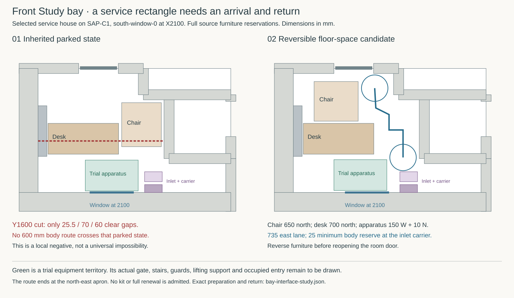

# Keep a connected arrival and return at the front Study bay

**Reject the inherited furniture park as a connected window-service arrangement.** In its fixed parked state, the desk, chair and emitter leave no route for the existing 600 mm body proxy between the closed room door and the window. A smaller preparation change works in the floor-space model: move the full chair reservation north, keep the desk's northward move, and shift the trial apparatus territory slightly west. The selected south-wall inlet changes the result again: stop at a **north-east apron**, retaining its installed module and complete carrier territory. Actual apparatus entry and supported window renewal remain unresolved.

This completes the independent **BCR-BAY-INTERFACES** investigation. It supplies a specific rejection and a reversible floor-space candidate to BCR-BAY-DESIGN; it does not adopt that candidate into the house. The final bay design still requires **TRIAD-GATE**. No active roof source, shared BCR matrix, product selection or construction release changes here. [Authorised scope](buildability-construction-resolution-programme.md#independent-current-source-interface-investigation) · [Machine-readable result](studies/bay-interface-study.json)



## Use the selected service house, with its structural boundary intact

The architectural starting point is main `a06013820dfdc2b5ee1918abf42abce8423eb0ad`, including services PR #1473; execution begins after the study registration on `e19ce0d94cf7186eee517027873f14b43cb4f786`. The probe executes the default **`deriveCurrentHouse()`** from the [current-house compositor](../had/studies/current-house.mjs), read-only, and records its actual input identities. Its 41 ground furniture/service rectangles supersede the earlier water plan where explicitly changed. The [selected service result](../had/inhabited-services-selection.md) is an architectural selection on SAP-C1; [STR's provisional handoff](../str/provisional-house-handoff.md) and the [triad contract](../triad-interface-contract.md#structural-direction-and-selection-compatibility) still distinguish SAP-C1 from the controlled RH-LAYOUT-REVISION-02 house. The 29 October [bay brief](bay-brief-result.md) remains historical source evidence.

| Interface | Historical brief | Basis for this investigation |
|---|---|---|
| Opening identity | GROUND / outer-south / south-window-0, centre X1800 | Same composite occurrence, **X2100**, raw width 1000, sill Z750, spring 2550, crown 2850; the head is segmental |
| Room-side wall | 417.5, including 15 finish | **429.5**, including 27 dry finish; conservative 18 trim is additionally charged in the floor-space check |
| Structure at each jamb | Ordinary 140-deep inner zone | Continuous **205 along-wall × 180 normal RC jambs**, axes X1497.5/2702.5; core depth 222.5–402.5, 70 glass insulation and 50 drained cavity outside it |
| Intermediate floor | 350-deep timber/finish/service allocation | **RC200 at Z3170–3370**, 80 above to first FFL3450 and 70 below to ceiling3100; the old timber stack cannot be added |
| Ground support | Unallocated Z−300–0 | **RC200 at Z−380–−180**, 180 upper zone to ground FFL0; finish and apparatus point-load capacity are not supplied by that depth |
| Local services | Earlier water-plan west-wall inlet | Selected **south inlet X3045/Z2100**, installed inward tip Y608, plus the retained west emitter |

Two old detail transfers fail arithmetically. A 970-wide rectangular frame exceeds the 946 width remaining after two 27 returns by **12 mm per side**. Its rectangular top Z2835 at X±485 sits **258.60 mm above** the raw segmental arch there. These are applicability failures of copying the old rectangular envelope, not defects in its original nominal study. Carry the [MAT fixed low light, rectangular outward leaf and split fixed head](../mat/study-coupled-window.md) into the moved opening; its earlier full-height moving arch remains rejected.

The MAT trial frame occupies normal depth Y220–348. That shares **85.5 mm** with the ordinary core, but **125.5 mm** with the thicker portal core. This is depth coincidence, not bearing area or anchor capacity. Keep positive jamb support and dry mechanical fixings separate from the weather tray, insulation and room-side air closure. The head-to-ceiling interval is still only 250 mm. The old tray upstand already reaches Z3100, so it cannot acquire a free trim, movement or service allowance there. [Inherited head/jamb/sill duties](../../docs/reference-house/opening-interface-studies.md)

## The parked-state obstruction is exact

The original MAT platform starts at X1200 for the X1800 opening. SAP-C1 translated it to **[1500,465,1200,700]**, in `[x,y,width,depth]` notation. Its inherited service state parks the desk at **[655,1300,1600,700]** and the rotated chair reservation at **[2325,1470,900,1000]**. MAT itself says furniture handlers, platform entry and occupied return still need checking; this investigation answers part of that open duty.

At **Y1600**, the only gaps in the closed Study are:

| Gap | Clear width |
|---|---:|
| West emitter to desk | 25.5 mm |
| Desk to chair | 70 mm |
| Chair to trimmed cloak wall | 60 mm |

Every continuous north-to-south path within that room must cross this section. Expanding the solid intervals by the 300 mm body radius covers its whole width. Therefore a 600 mm body cannot cross **this fixed parked state**. This is an interval proof, not a failed pathfinding grid. It does not rule out every alternative staged protocol or a smaller actual chair. The translated platform also leaves only 585 mm to the cloak wall: insufficient for a straight 600 mm side lane at its narrow part. [Exact intervals and input blobs](studies/bay-interface-study.json)

## A reversible preparation candidate

Retain the entire **1000 × 900 chair reservation**. It is a conservative occupied-plan rectangle, not a measured selected chair. Keep the room door closed during preparation and restoration. Retain all composed ground furniture, three fixed obstacles, stair, closed leaf, frame pieces, walls and trim. The ground-floor entrance is not charged as a hole: the source void is on the first floor.

| Item | Candidate park / territory | Change from its applicable source state |
|---|---|---|
| Chair | [900,2050,1000,900] | Translate 650 north, without rotation |
| Desk | [655,1300,1600,700] | Retain the 700 north translation |
| Entire prospective apparatus | [1350,475,1200,700] | 150 west and 10 north from the **SAP-translated** territory |
| Body arrival | [2917.5,1225] | North-east apron; neither deck nor entry step |

The apparatus leaves 125 mm to the parked desk and 27.5 mm to the conservatively trimmed south face. Its east lane is 735 mm: a centred 600 mm body has **67.5 mm per side before any apparatus projection outside the green territory**. Rails, stairs, stabilisers, feet and handling support must all be charged to the actual assembly.

The joined sequence uses the existing source's inside door-close endpoint **[2275,2800]**:

1. Approach the chair's east side at **[2300,1850]**. Translate chair and handler together 650 north, ending with the handler at **[2300,2500]**. The prospective contact is 400 mm away.
2. Walk through **[2300,2200] → [2600,2200] → [2600,1150]** to the desk. This kink preserves the desk corner clearance. The earlier direct diagonal to [2600,950] intersects the desk's body envelope and the selected inlet carrier.
3. Translate the desk 700 north with its handler at **[2600,1150] → [2600,1850]**, keeping the prospective contact 345 mm away.
4. Reach the north-east apron through **[2917.5,1850] → [2917.5,1225]**. Apparatus delivery, erection and entry must be drawn from this state before using the candidate as an actual method.

The selected inlet cannot be omitted. Its 347 mm module occupies Y458–608 on a 1% axis at about Z2105. The earlier body endpoint [2917.5,815] collides with it: **[3045,590,1950]** lies inside both the module and the 600-diameter, 2000-high standing proxy. The corrected desk handler and apron also avoid the complete **[2845,675,400,225]** inlet carrier. This study conservatively charges both as full-height plan obstacles; it does not assume the carrier disappears or allow simultaneous inlet extraction. [Selected inlet body and first release](../had/studies/inlet-maintenance.mjs)

| Continuous geometric check | Minimum nominal clearance |
|---|---:|
| Chair's full item sweep to other solids | 100 mm |
| Chair handler to other solids / moving chair | 129.54 / 100 mm |
| Kinked approach to desk | 45 mm |
| Desk's full item sweep to emitter | 25.5 mm |
| Desk handler to other solids / moving desk | 50.04 / 45 mm |
| Joined closed-door position to north-east apron | **25 mm**, at inlet carrier |

The check uses exact segment-to-rectangle distance, exact translated rectangle sweeps, a 300 mm body radius and 40 mm forearm radius. Prospective 45 mm hand envelopes touch the furniture deliberately; the arm remains 5 mm short of the item. The 25 mm floor-space screen is an authored nominal margin, not a construction tolerance or physical handling result. Grasp, actual furniture mass, cable disconnection, moving force and stability remain unknown.

The floor-space check starts at the **closed-body endpoint**, with no new door-operation claim. HAD's composed source still contains a centred leaf proxy. The [IAS face-pivot trial](../ias/ias-03-study-door-reveal.md) identifies a 12 mm open-blade/jamb clash in that interpretation and retains the same body knots with corrected grips. It remains a proposal requiring a complete compatible doorset. This check charges the **union of both closed blade placements**, selecting neither. Their operation proofs keep their own smaller margins and applicability; the new 25 mm floor result does not replace them.

**Return is explicit.** Leave the apparatus to the apron, keeping the window independently supported and weather-secure. Remove the apparatus by its separately qualified method before restoring the desk. Reverse the apron path, desk translation and kinked connector; then reverse the chair translation and initial approach. Only after both original furniture positions are restored may the source door-opening sequence be reused. The north chair park obstructs the open-door state. No climbing over furniture, window exit or obstructed reverse move is credited.

## What the floor-space result buys at first release

Keep the two proposed **374 × 310 × 100** fixed-head packs and their independently supported **250 mm inward draw**. That puts the far face 40.5 mm beyond the 429.5 lining; 150 mm leaves it 59.5 mm short. Prospective shoulders at [1875,800,2500] and [2225,800,2500] lie within the trial rectangle with 25 mm body allowance. At Y348, an authored room-side grip field includes the full pack width and Z2449–2775, allowing the lower 16 mm pocket bite as well as the reserved height. Its largest corner distances are **568.87/591.74 mm**. These are distance budgets only, not selected grip positions or swept arm paths. A real deck, gate, rail, retainer tool, capture and lowering path must coexist with those bodies. A green floor rectangle supplies none of them.

Retain MAT's tight release limits: **2 mm** head-pocket reserve after its two adverse 2 mm deviations; **7 mm** per side through the opened warm-ring throat; and only **21/18 mm** moving-frame structure at sides/top-bottom. The **24.13 kg** figure is moving glass alone. STR's separate 1.2914 mm rough-opening change and 1.427 mm face departure are historical structural-case envelopes, not a single concurrent tolerance to add or a window test. The [floor/portal correction](../str/floor-portal-interface-review.md) withdraws their current support and movement applicability: STR-FLOOR-PORTAL must replay them before the bay relies on either value. The source-bound floor-space investigation remains valid at its recorded static geometry. OAS/MAT must allocate actual movements, fixings, seals and capture geometry together before relying on those small reserves. [MAT release and materials](../mat/study-coupled-window.md#first-release-return-and-remaining-duty) · [Dated structural interface](../str/studies/reconciled-house-interface.json)

The inherited OAS sill projects outward and its tray ends at depth 370; neither supplies a selected inward sill overhang. Curtains, blind controls, lamp/cable and actual handle projections are also absent as complete bodies. IAS/OAS must bind them to the occupied candidate before final use. Full frame and guard exchange additionally need the moved jamb mounts, temporary support, exterior access over the stepped front approach and renewed weather/air boundaries. The ground slab and upper finish zones do not establish apparatus footing capacity. These are named remaining design inputs; they do not prevent closing this bounded obstruction/preparation investigation.

## Reproduce and receive the result

Run from the repository root:

```sh
python3 project/bcr/studies/bay-interface-study.py
python3 project/bcr/studies/bay-interface-study.py --check
```

The standard-library Python probe invokes the existing Node compositor without writing to it. It emits only this study's compact JSON and SVG, records source Git blobs and current compositor inputs, retains the rejected diagonal and inlet collision witness, and checks exact forward/reverse furniture sweeps. The rendered SVG is inspected for readable room geometry and limits. It is a local comparative plan, not a scaled construction drawing.

**BCR-BAY-DESIGN receives:** reject the inherited park; carry this full-reservation preparation candidate; draw and test the actual apparatus arrival/entry/removal and supported first release against the inlet, whole room and return. Retain the conventional independently fixed window and renewable local seals/trim. No new permanent mounting system is earned by this result.
