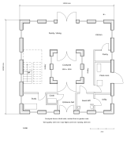
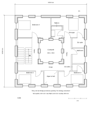
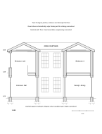
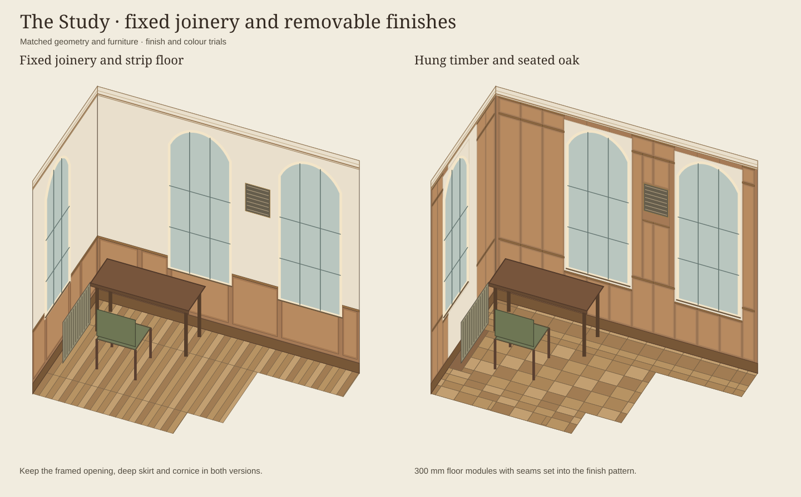
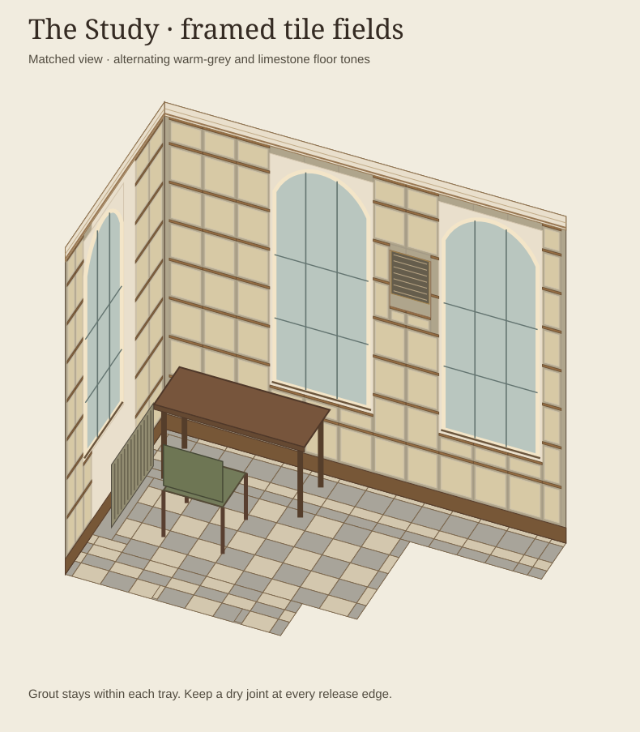

# The courtyard house and the crafted Study

**Recommendation:** retain the accepted courtyard plan and develop the timber Study as the preferred interior proposal. Keep the tiled room as a fair appearance comparison. The structural and raised-ground alternatives below have real architectural consequences; none has yet replaced the accepted house.

This is an owner-review index of the actual drawings, with their differences exposed. The five principal views are frozen from the existing current gallery at [source 08b11134](https://github.com/adamnoden/architecture/tree/08b11134af37453ea258a53bbb18551b32b33be0). That source was published in **[PR #1597](https://github.com/adamnoden/architecture/pull/1597)**; this package does not record a merge or an owner decision. [Exact visual and source identities](studies/convergence-owner-review/sources.json).

## Read the house in five views

The accepted working basis is the **12 m square house with a 3.5 m open court**, five front bays, a centred entrance and a west return stair. These views use `RH-LAYOUT-REVISION-02` / `RH-LAYOUT-FAMILY-02`, with nominal ground/first floors **0 / +3450 mm**. Sections and elevations retain their provisional assemblies and roof details; accepted layout is distinct from selected engineering. [Owning basis and limitations](../../docs/reference-house/current-house-basis.md).

| View | What to judge |
|---|---|
| [1 · Ground floor](studies/convergence-owner-review/01-ground.svg) | Entrance–court–garden sequence, the two-window Study, kitchen/family relationship and the cost of the eastern service strip. |
| [2 · First floor](studies/convergence-owner-review/02-first.svg) | Four-bedroom arrangement, the entrance void and bridge, west gallery and compact bathroom reservations. |
| [3 · Principal section](studies/convergence-owner-review/03-principal-section.svg) | Room height, court enclosure, stair/void relationship and the roof's visible scale. Floor and foundation hatching are reservations. |
| [4 · Front elevation](studies/convergence-owner-review/04-front.svg) | Quiet five-bay order, paired entrance and sash proportions. The drawing retains the accepted window grid. |
| [5 · Roof and court](studies/convergence-owner-review/05-roof-court.svg) | The inward/outward 25° roof and the need to collect water at both eaves. Dashed collection is a reserve, not a sized drainage system. |

The court is an inhabited external room, not merely a drainage aperture. Read its [north entrance elevation](studies/convergence-owner-review/court-north.svg) and [south window elevation](studies/convergence-owner-review/court-south.svg) beside the section. The [four exterior isometrics](../../docs/reference-house/exterior-isometrics.md) show the same accepted massing.

## What has developed beyond these drawings

| Status | Actual proposal and visual | Architectural consequence |
|---|---|---|
| **Selected for architectural development** | [Open north loggia and independent east water route: plan and section](../had/studies/water-replan.svg); [owning selection](../had/water-replan-result.md) | A real northern opening and east under-gallery route supersede the earlier north-only water arrangement. This conditional development is not depicted by simply relabelling the nominal plans above. |
| **Rejected cage; architectural replacement proposed** | [Continuous RC/whole-floor comparison](../str/studies/monolithic-rc-native31-floor.svg); [ground-joint barrier](../str/studies/monolithic-rc-native31-barrier.svg); [owning RC challenger](../str/continuous-rc-portal-challenger.md) | The crossing arch/post cage is [rejected](../str/continuous-rc-closed-links.md). The [recommended straight-frame/separate masonry-arch direction](../str/portal-architectural-simplification.md) keeps finished2400/775 but reduces local jamb glass to60mm; its complete load path and thermal junction remain unproved. The retained full-height RC reference and floor upstands show the source-bound force comparison. The proposed removal of the visible transom needs appearance judgement. Its source ground FFL is **0 mm**; first-floor RC spans **3170–3370 mm**, below the same **3450 mm** first-floor finish with an 80 mm gross finish/service zone. The metal barrier and reinforcing/contact path remain unqualified. |
| **Candidate — actual seated wet-wall support** | [Coupled floor, beam and pads](../str/studies/seated-wet-support-floor.svg); [owning result](../str/seated-wet-support-result.md) | The250×350mm beam has soffit3020, RCtop3370 and finite posts/pads at the actual north-west supports. This source-ground-zero candidate adds a real local ceiling/trim and service interface; the nominal plans above have not adopted it. Nodal attachments now recover executed discrete beam cuts, and901 actual origins close the two wet-post receiving grid members per case. The [current cage and bearing comparison](../str/wet-support-cage-comparison.md) retains a lightly loaded north-head contact/joint problem and unqualified mass/anchorage; these executed-case cuts do not supply complete envelopes or resistance. In the530 raised profile the beam soffit becomes3550, retaining3020mm local unfinished clearance; this is a coordinated geometry comparison, not a raised force replay. |
| **Unselected floor depths — numerical screen fails** | [Actual RC250 field](../str/studies/floor-section-250.svg); [section and fixed-cut result](../str/floor-section-result.md) | Retaining FFL3450 leaves80mm over RC200 and30mm over RC250; neither residual depth is a selected finish/service assembly. The700→500mm fixed-cut comparison changes integrals by up to15.41%; it does not select thickness or qualify a physical corner joint. The current finer250mm mesh completed and also fails: head components change by up to2.77kN and a fixed-cut twisting integral by32.72%. Separated controls locate the dominant cut sensitivity in the coupled vertical discretisation, which also changes bearing fibres and finite receiver subdivisions; they do not isolate a faulty plate kernel. Earlier killed250/274 workers remain history; no slab thickness follows from them. The wet beam does not cure the remote south-corner demand. |
| **Candidate — incoming-water source and occupied-room envelope** | [Source/room comparison](../had/studies/inlet-source-envelope.svg); [joined room duties](../had/inlet-whole-room-convergence.md) | Utility and Plant duties remain distinct. Saved floor geometry now drives the actual outlet elevations, pressure budget and electrical exposure. The [actual wall-hung frame](../had/studies/inlet-frame-support.svg), [local Utility pocket](../had/studies/inlet-local-pocket.svg) and [graded copper pan with open chutes](../had/studies/inlet-local-pan.svg) now form one dimensioned comparison. The retained530mm ground floor can use a local245mm distribution zone without raising the whole house to715mm. Its named dead inventory totals350.334kg (including the187.051kg frame); disjoint below-floor/closed-body blocked water adds1060.320kg. These totals follow different supports and are not one floor reaction or a whole-fault cap. Frame-to-wall strength, local RC/mineral retention into the actual grid/soil, thermal/weather boundaries, outfall states and loaded renewal remain incomplete. None is inserted into the source-ground-zero force model. |
| **Candidate — separated dry ground** | [Raised-house section and approaches](../str/studies/dry-side-ground-section.svg); [owning comparison](../str/dry-side-ground-section.md) | Preferred development FFL **+530 mm** imposes a substantial accessible approach and a distinct local-solum obligation. The **+715 mm** uniform service-floor trial is retained as a comparison; the local245mm Utility pocket avoids that uniform rise. The shared profiles now carry actual wet-beam soffits, fixed-base post extensions and conditional quantities, while withholding raised force and roof/weather acceptance. Neither is an adopted plinth or site datum. |
| **Candidate — closed service floor** | [Split lids, east body and north support](../had/studies/closed-service-floor.svg); [owning comparison](../had/closed-service-floor-comparison.md) | A separately supported floor and maintainable water body are plausible design work, with pressure sealing, handling, compatible support and weather duties still open. Its drawn stack belongs to the explicit raised-ground case, not the RC comparison above. |
| **Rejected wet/support detail; lower pipe retained for development** | [Fixed inlet proposal](../had/fixed-inlet-entry-candidate.md) and [compact receiver development](../had/fixed-inlet-receiver-development.md) | Joint-free lower tubes replace the rejected loaded carrier. The actual82OD collar clashes and the wet low-chassis screen fails; a conventional shared service frame is being developed. These remain development details; cold upper-pipe support and actual grip/material/wet duties are unresolved. They do not authorise the structural window rewind. |

The accepted south Utility opening is **X9700–10700**. The structural rewind and current inlet host use **X9400–10400**. The light pipes fit the accepted aperture, but restoring its jambs also changes the corner toe, receiver lever and wind proof. Preserve the accepted uniform window grid as the architectural constraint; neither a convenient support nor a good local pipe fit chooses a new facade. [Owning corner disposition](../str/whole-house-corner-rewind.md) · [shared interface](../triad-interface-contract.md).

The **3450 mm first-floor finish and 3170–3370 mm structural slab are compatible layer datums**, not competing floor heights. The real unresolved change is the proposed ground rise and its consequences for supports, approaches, occupied services and roof interfaces. No composite resolved-house image adopts the +715 ground trial while retaining untransformed source-ground details. The drawings above remain the architectural reference while those actual changes are coordinated.

The [named floor-to-corner comparison](../str/floor-interface-result.md) now distinguishes simultaneous six-component interface actions from a complete joint free body. It joins the actual plate and membrane actions at each named collector, with physical origins and work checks. It does not supply the missing upper/lower member actions, finite concrete transfer, reinforcement or a converged local demand. The next structural selection must resolve those actual interfaces rather than treating a raw corner sample as a whole-floor thickness instruction.

The [indoor isolation view](../had/studies/inlet-indoor-cuts.svg) and [four cold-water paths](../had/studies/inlet-indoor-routes.svg) now show the actual valve bank, the unchanged full equipment field and separate Utility/Plant continuations. The full single leaf clashes with the protected door; the paired outward leaves pass the declared connected access comparison. The pipes have explicit lengths, tolerance-specific bores, pressure losses and named gravity/pressure actions. Their fitted turns, independent supports and loaded removal still need completion. These proposed loads are not admitted to the source-ground-zero structural model.

The [wet-beam normal-bearing comparison](../str/wet-bearing-refinement-development.md) now passes the declared32→64 quadrature check for both tested wet-support material weights. The16→32 adverse failure remains recorded. This resolves numerical contact integration for those cases; pad material, post-head resistance, a complete signed envelope and floor/corner convergence remain unqualified. It selects no slab thickness, plinth or house revision.

The [four L-corner demand recovery](../str/four-l-joint-recovery-development.md) now joins eight actual physical member ends into four balanced rigid-joint free bodies for one verified request. The complete ordinary native result remains byte-for-byte unchanged. Joint concrete weight is already in the plate, so no extra joint load is added. Changed or unverified requests and numerical runtimes retain explicit unavailable joint diagnostics while the ordinary floor remains computed; finite-joint behaviour, resistance and a complete signed load envelope remain unresolved.

## The interior should earn its place on beauty

The [completed IAS proposal](../ias/crafted-room-kit-result.md), integrated through [PR #1584](https://github.com/adamnoden/architecture/pull/1584), puts a fixed furnished room beside hung timber faces and seated oak floor modules. The furniture and occupied-room openings are matched. This is the strongest available appearance comparison, rather than an isolated panel detail.

**Prefer the timber direction:** warm wall fields, substantial skirt and cornice, local mouldings and a floor pattern that absorbs the 300 mm module seams. The removable room must look as composed as the fixed room. The complete tiled-wall comparison is much heavier and more fragmented; retain it as an alternative to judge, not the dry Study default or a claimed waterproof room.

Read the [eight timber wall faces](../ias/studies/crafted-study-whole-timber.svg) and [coordinated floor](../ias/studies/crafted-study-coordinated-floor.svg) against those furnished views. The [floor/cornice/threshold sections](../ias/studies/crafted-study-junctions.svg), [fixed protective return](../ias/studies/crafted-study-wall-transition.svg) and [key seats](../ias/studies/crafted-study-floor-keys.svg) show what the appearance demands of the hidden interfaces. Decorative release does not remove the permanent protective layer or carry the services.

For an ordinary renewal, the [eastern](../ias/studies/crafted-study-handling-east.svg), [northern](../ias/studies/crafted-study-handling-north.svg) and [corner](../ias/studies/crafted-study-handling-corner.svg) views show actual furniture staging, the person, the moving finish and the supported temporary rest. The nominal source now has a geometric operation for every shaped floor piece. Real loaded handling, tolerance, reinstatement and the one-hour installation ambition remain unearned. In particular, the tight floor-support depth and small board-clearance reserves are not construction allowances.

The occupied Study opening/set-out still differs from the nominal house plan; the wall-hung inlet support is a stated candidate. Judge the matched room comparison at that scope, then reconcile its actual openings and support with the selected house before calling it the interior scheme.

The [lighting service corner](../ias/studies/adaptable-study-lighting-corner.svg) charges the real bend, straight entry collar and setting envelope to the room. Its proposed service bay is now310mm wide, retaining the door stop; the former300mm comparison fails the declared setting margin. Local entries do not establish a connected common riser: the remaining depth transition, independent support, electrical/material admission and actual removal sequence stay visible in the [owning comparison](../ias/adaptable-room-lighting-result.md). The browser and command line now share the same editable lighting choices, with pure input admission kept separate from source loading.

The [common-depth lighting comparison](../ias/studies/adaptable-study-lighting-common-depth.svg) now shows the complete three-case depth transition and supported whole-case withdrawal in the same browser-editable source. It remains an unselected development comparison: recessed plug grip, terminal/protection/material evidence and qualified loaded renewal are unresolved. Its 88.29 N case-demand ceiling has not entered the structural mass inventory. The completed furnished Study comparison above is retained.

## The owner decision this package prepares

At the existing **post-integration design gate**, the useful decision is whether the **joined house and timber room are a desirable home**: court and entrance sequence, facade rhythm, visible plinth/approach and northern opening, then the timber room's proportions, grain, seams, mouldings and brass interfaces against the fixed and tile alternatives. Aesthetic approval must attach to the drawings actually shown, with any requested changes recorded there. It cannot be inferred from passing calculations.

That joined appearance decision is **not requested by this index**: the unresolved datum/window/support choices above still prevent one honest whole-house proposal. Once they are reconciled, bring the affected five views and inhabited room back together at the same revision. Final rendered book/drawing acceptance remains the separate existing owner gate. No new review packet or additional approval layer is created. [Owner charter](../owner-house-charter.md#book-stage-assurance-boundary--14-november-2026) · [interior review brief](../ias/crafted-room-kit-brief.md).

## Book and house correspondence

These are specific editorial boundaries to preserve, not reasons to disguise the remaining architecture.

| Source address | Finding and required reading |
|---|---|
| [Part IV, opening paragraph](../../docs/manuscript/part-iv.md) versus [active plate registry](../../publication/plates-current.ts) | The opening now identifies the **current nominal plans and matched IAS Study proposals** inserted by the active registry. Historical and conditional technical plates retain their explicit limits; the corrected paragraph transfers no engineering or appearance acceptance. |
| [Original Georgian re-plan](../../docs/reference-house/georgian-replan.md) versus [accepted revision 02](../../docs/reference-house/layout-revision-02.md) | The earlier 3.6 m court and attic-stair narrative is historical. The accepted 3.5 m court, revised rooms and ground–first return stair control the five views here. Do not use the original page as the current brief. |
| [Nominal current-house basis](../../docs/reference-house/current-house-basis.md#dimensions-and-rooms-in-the-accepted-layout) versus [RC challenger](../str/continuous-rc-portal-challenger.md) and [raised-ground comparison](../str/dry-side-ground-section.md) | The nominal first-floor finish is +3450; RC underside/top are +3170/+3370 and its membrane port is at +3270. These are compatible construction layers. The proposed +530/+715 ground changes still require a real joined transformation, and the nominal section alone supplies no structural or service-floor acceptance. |
| [Part IV floor-zone and interior prose](../../docs/manuscript/part-iv.md#the-floor-zone), [active Study plate captions](../../publication/plates-current.ts) and [IAS result](../ias/crafted-room-kit-result.md) | The prose correctly retains an unselected floor/interior and the captions disclose the occupied opening mismatch. Keep those qualifications when replacing pictures; the timber proposal and ordinary geometric renewal do not select the entire assembly. |

*Reference design — not released for construction. Assumptions and outstanding verification accompany the proposal; internal checks do not constitute external assurance or certification.*

## The pantry and service-passage conflict

The accepted nominal Georgian plan retains G-PANTRY, its north wall and door. The conditional occupied-water proposal inserts an outdoor eastern passage and weather separator, expressly loses that pantry and substitutes a low kitchen larder. These are different architectural revisions, not one coordinated accepted plan. Its inherited principal lower-foul route also assumes the displaced pantry working field. Retaining the pantry is the preferred architectural control; the service layout and actual current-host foul route need a coordinated replacement before a joined owner review.

## Worked coordination comparisons

The [whole-house vertical section](../had/studies/house-vertical-profile.svg) compares the530/715occupied-floor proposals while holding the cold grid fixed. The roof weather height remains unresolved; these are not replacement elevations. The [vertical RC floor drawing](../str/studies/vertical-rc-floor.svg) shows actual plate/self-weight/normal-bearing participation and the remaining absent ground patch. It uses the source-ground-zero mechanical control, including the rejected curved cage, and does not adopt the raised house or replacementA. The current front elevation and principal section are now active book plates at their declared nominal architectural scope.
