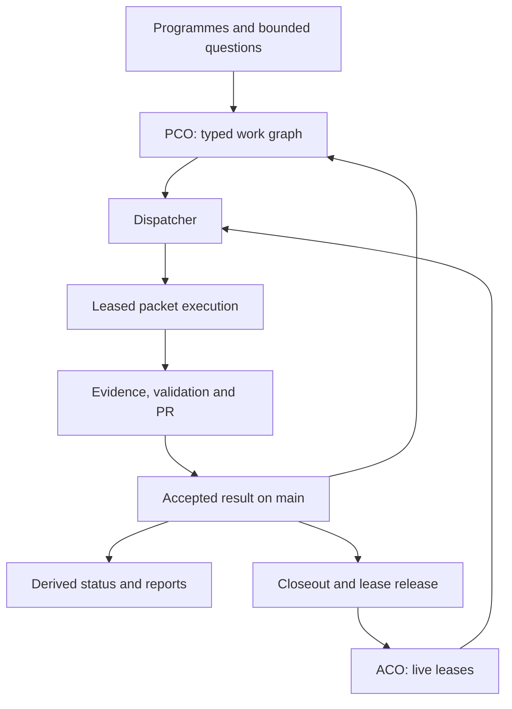

# Minimum Viable Bureaucracy (MVB)

**Minimum Viable Bureaucracy (MVB)** is Ovid’s House’s project execution and agent coordination system. The name expresses its design constraint: retain the coordination needed for safe, recoverable work, and make every additional rule or mechanism earn its maintenance cost.

This is the **single entry point and integrated manual** for how Ovid’s House plans work, coordinates independent agents, validates changes, integrates results and recovers from interrupted execution. Humans and agents use the same system. Read this document for the whole model; follow its links for exact executable contracts and operating procedures.

The system is the project's **execution scaffolding**. It makes architectural work safer to organise and easier to continue, much as access, temporary works and a construction programme enable work on a physical site. It supports the owner's house and the enquiry conducted through its book; it does not become architectural authority merely because it coordinates their production.

The shared vocabulary and interfaces form one cohesive system. Its authorities remain deliberately separate: a plan is not a reservation, a reservation is not evidence, and completed work is not construction readiness. Some coordination machinery may eventually be replaced or retired; accepted decisions, evidence and provenance must survive it.

## Version and adoption policy

The current operating-contract version and compatibility history live in [MVB versions](releases.md). The [external-platform assessment](../pco/mvb-platform-review.md) records what existing systems could replace and what still requires a deployment trial. Prefer adoption when it removes owned machinery or demonstrates a material execution improvement. Keep one authoritative project plan and one execution-ownership authority per packet; do not maintain competing editable task graphs.

## Operational communication

Use the [MVB communication phrasebook](communications.md) for consequential assignment, correction, handoff and integration exchanges. It keeps receipt, intention, permission and verified result distinct, with selective readback and plain-language fallback. It adds no scheduler, message channel or conversational authority.

## Start here

| Visitor | Reading path |
|---|---|
| Outside observer | [Whole-system model](#whole-system-model) → [workstreams and packets](#workstreams-packets-and-dependencies) → [one packet end to end](#one-packet-end-to-end) → [native automation](#native-github-automation) |
| Agent about to work | Root [operating constitution](../../AGENTS.md), this manual, then the [swarm runbook](swarm-runbook.md); read the owning programme/result after identifying an eligible packet |
| Maintainer changing the system | [Authority and storage](#authority-and-storage) → [sources](#sources) → [safe evolution](#changing-or-retiring-the-system) → the affected detailed contract and regression tests |
| Observer asking what is happening now | [Operations reports](https://github.com/adamnoden/architecture/actions/workflows/control-operations.yml), `npm run control:brief`, and generated [project status](../../STATUS.md); read timestamps and observation warnings |

This manual owns the integrated explanation and navigation. The [runbook](swarm-runbook.md) owns transport/mailbox procedures, session reporting and publication preflight. Typed schemas and implementation own executable behaviour. Founding programmes and dated result records preserve rationale and failures; their old examples do not override the current protocol. Keeping one entry point does not mean copying every contract into one competing specification.

## Whole-system model

The system answers five related questions:

1. **What work exists, and what genuinely blocks it?** A typed registry and dependency graph.
2. **Which eligible work can this agent safely acquire now?** The dispatcher combines the graph, dispatch policy and live reservations.
3. **Who currently has permission to work on it?** An expiring, versioned lease.
4. **What result is earned, and can it enter main?** Owning evidence, appropriate validation, a traceable PR and fresh publication preflight.
5. **What should an observer or replacement agent see?** Derived status, operational snapshots, recovery checkpoints and durable result records.



The cycle shows the **execution process**. The PCO dependency graph inside it remains acyclic. This is not the compiler's graph of a building, nor the editorial order of the book.

**PCO** means Project Control & Orchestration: durable work identity, dependencies, lifecycle and eligibility. **ACO** means Agent Claim Orchestration: temporary ownership of executable packets. They are cooperating layers of MVB, not separate task queues. MVB names the whole system; PCO and ACO remain its technical layer names. Existing workstream/node IDs, commands, source paths and the `runtime/claims` branch retain their identities. GitHub supplies versioned storage, PR integration, CI and event-driven automation. Agents supply bounded execution and judgement within their actual sessions.

Read the [owner-house charter](../owner-house-charter.md) and [delivery route](../del/owner-house-delivery-plan.md) before scoping substantial work. They establish why the work exists; this system establishes how it can execute. Publication completion is not a prerequisite for progressing the owner's house.

## Workstreams, packets and dependencies

These identities belong in the same explanation because they are the units the coordination protocol acts upon.

| Term | Meaning | Owner |
|---|---|---|
| Workstream | A coherent area of architectural, evidential, editorial or infrastructure work, with a registered identity | [`workstreams.ts`](workstreams.ts) and its owning programme |
| Three-letter code | A stable handle for a first-class workstream; new codes use exactly three uppercase letters | Registry and validation; historical exceptions are retained, not new precedents |
| Packet / node | A substantial bounded question or gate, suitable for an execution unit; not every lookup or commit | Sharded [`nodes/`](nodes/) and owning scope/evidence records |
| Canonical node ID | The unique executable identity to which dependencies and a lease attach | [`types.ts`](types.ts), node manifests and canonical resolution |
| Alias | A historical or per-workstream name resolving to that same node | Node manifest; never a separate opportunity to claim shared work |
| Shared packet | One canonical node with multiple owning workstreams | One node and one lease; not duplicate tasks |
| Hard dependency | An upstream result that must be complete before the downstream planned packet is ready | Node manifest; readiness is derived |
| Manual gate | Work requiring explicit direction, physical action, competent review or another stated boundary | Explicit `agentDispatch` policy and reason |

A node records its identity, owners, bounded title, dependencies, deliberate lifecycle, dispatch policy and expected closeout evidence. The schema is [`ControlNode`](types.ts); do not invent a parallel queue in issues, spreadsheets, chat or Markdown. Programmes and result records retain the actual question, alternatives, reasoning and evidence. A path existing in `closeoutEvidence` is a validation condition, not proof that its argument is good.

Edges encode real prerequisites for the claimed result. They do not mean “related topic”, “nice to read first” or “might need this someday”. Split a genuinely independent packet to expose concurrency; do not remove a real dependency simply to increase apparent parallelism. Shared nodes are counted once globally and within each owning workstream; do not sum those workstream counts.

### Deliberate lifecycle and derived readiness

| Stored lifecycle | Derived structural state |
|---|---|
| `planned` and every hard dependency `complete` | `ready` |
| `planned` and at least one dependency not `complete` | `blocked` |
| `started` | `active` — durable partial work, not live presence |
| `held` | `held` |
| `complete` | `done` |
| `cancelled` | `cancelled` |

Do not store `READY` or `BLOCKED`. Cancellation does **not** satisfy a dependency: revise the downstream scope/edge explicitly if that prerequisite is no longer necessary. Holding, reopening, cancelling and changing dependencies are deliberate project decisions, not convenient ways to bypass a gate. Reopening a node can legitimately block its dependants again.

Structural eligibility is only one input to acquisition:

| Situation | Operational interpretation |
|---|---|
| Ready, self-service and no occupying lease | Candidate for canonical dispatch |
| Ready and manual | Needs explicit direction; not generic-agent work |
| Ready or active with a live/grace lease | Reserved; another agent cannot take it merely because it looks quiet |
| Active without a lease | Self-service recovery candidate only with a predecessor branch and actionable checkpoint; otherwise a handoff requiring review. See [crash recovery](#crash-recovery-and-connector-only-chats) |
| Terminal/blocked/held node with an occupying lease | Coordination inconsistency; inspect/reconcile it, do not mask it |
| Lease store unavailable or malformed | Availability unknown; automatic acquisition fails closed |

## Authority and storage

| Question | Authoritative home | Derived or navigational surfaces |
|---|---|---|
| Why are we doing this? | Owner charter, owning architectural sources and programme scope | Root README and reading paths |
| Which workstreams and packets exist? | Registry and sharded node sources on main | Issues, code register, DAG viewer and status tables |
| Who owns execution now? | `.pco/claims/NODE.json` on retained `runtime/claims` | Briefings, job summaries, checkpoints and live graph overlays |
| What was actually learned or accepted? | Owning source/result/gate and its evidence, with Git/PR provenance | Completion markers and summaries |
| What maturity is earned? | [`maturity.ts`](../maturity.ts), its assessments, [named subject bindings](../maturity-subjects.ts) and [freshness checks](../maturity-freshness.ts) | Generated maturity tables |
| What may the project claim? | [`authority.ts`](../authority.ts) and earned evidence | Neither packet coverage nor a passing compile widens that ceiling |
| What is the present operational view? | Fresh derivation from the graph, leases and observation time | `control:brief`, Actions artifacts and generated status; snapshots are not another store |

`runtime/claims` is retained coordination infrastructure. It is **not** a feature branch to merge into main or delete after a PR. It contains one current record per canonical node, with Git history retaining earlier generations. Source branches must not acquire copies of those runtime records.

Issues are discussion, scope and navigation, not an independent execution database. Branch names identify output locations, not ownership. A merged PR records integration, not physical proof. The work graph is not an architectural ontology, the book's contents page or a substitute for professional/site evidence.

## Coordination protocol and transport

A lease has three different identities: the canonical **node ID** selects the unit of work; its **UUID and generation** identify the current execution permission; the stored file's **Git blob SHA** identifies the exact version a mutation is allowed to replace. These are not interchangeable with a branch-head commit SHA, PR number or agent label.

Acquisition, renewal and release use compare-and-swap (CAS): create only if absent, or replace only the record version that was read. If two agents try to reserve the same prior record, both cannot win. The loser re-reads live state; undirected acquisition reranks the eligible frontier. Updates to different nodes can still collide at the shared branch head, so the store distinguishes unchanged target content from a changed lease before bounded retry. Unknown write outcomes are reconciled, not blindly replayed.

The record deliberately stores `claimed` or `released`; live/grace/expired are derived from its timestamps and observation clock. Normal reacquisition after release/expiry advances generation. UUID/generation checks prevent an old execution from renewing or releasing the replacement's lease. They do not themselves form an atomic lock across GitHub's separate claim and merge operations.

| Route | Fresh reads | Authorised writes | Clock boundary |
|---|---|---|---|
| Native GitHub API | API claim-store reads | Configured `GH_TOKEN` / `GITHUB_TOKEN`, exact per-file CAS | Prefers response server time; explicit local fallback |
| Git plus connector | Explicit runtime-branch ref, immutable commit/blob verification | Private bounded mailbox serviced through the already-authorised GitHub connector, with the same exact per-file CAS | Local observation time, not Git commit timestamps |

Native API listings capture one runtime-branch commit, list its directory and verify the exact claim blobs with at most eight concurrent reads. A malformed, incomplete or mismatched snapshot fails closed. The snapshot time belongs to the captured branch observation; it is not a fresh observation of each later request. Acquisition still re-reads the selected record and uses its exact SHA for CAS. Occupancy appearing between selection and that read is a bounded selection conflict: the dispatcher refreshes and reranks rather than abandoning available work.

These are two transports to **one store and one coordination protocol**, not competing reservation systems. A session can have read access without native write credentials. Doctor reports transport configuration separately from proved mutation capability. The connector handshake neither discovers another chat nor manufactures credentials; its exact requests/replies and uncertain-outcome handling are owned by the [runbook](swarm-runbook.md#connector-mailbox-protocol).

A node lease is also **not a filesystem lock**. Independent packets may touch shared sources or generated families. Isolated branches, genuine integration dependencies, preservation of parallel work and validation against moved main remain necessary. If a shared upstream defect changes several packets, fix the owning source and reconcile affected outputs rather than assuming separate leases make their edits independent.

## One packet end to end

Consider a hypothetical options packet and a downstream selection packet. The selection waits for the options result because that result is a real input. Once the options packet is complete, selection may become structurally ready; a manual policy or another worker's lease can still prevent generic acquisition.

1. **Establish purpose and authority.** Read root instructions, the charter and this manual. Use current main and an isolated checkout; query the operational briefing and transport readiness. Capture a run baseline before the first lease.
2. **Acquire the exact unit.** An undirected agent uses `control:claim-next`; a directly assigned agent claims that canonical node through the same lease protocol. Record UUID/generation, branch and a recoverable checkpoint. A reservation does not silently mark durable lifecycle `started`.
3. **Answer the bounded question.** Read the owning programme, existing evidence and latest applicable result. Preserve parallel agents' work. Keep source decisions, project preferences, unresolved inputs and actual proof distinct. A justified no-change or rejection is a valid result.
4. **Leave recoverable evidence.** Push a meaningful branch/draft PR or owning result checkpoint; record what is verified and what happens next. Renew at genuine execution checkpoints. A scratch path and an optimistic chat message are insufficient handoff records.
5. **Prepare integration.** Reconcile the owning source, dependent outputs, evidence and warranted node lifecycle. A complete marker on an unmerged branch is not shipped work. The PR declares its packet and lease identity; CI checks that association and the applicable repository boundaries.
6. **Publish safely.** Reconcile moved main, validate the actual head, and run fresh `control:merge-check`. Merge immediately with that expected head SHA. A prior green CI result and an expiring lease are separate checks; neither proves the other.
7. **Close the loop.** Verify the merge/result, release promptly, reconcile owning issues and clean up with positive provenance. Native terminal-lease reconciliation is a safety net, not a reason to leave an invalid lease occupying the frontier. Main automation regenerates projections; record the verified shipment in the run journal.
8. **Continue or hand off explicitly.** An undirected swarm dispatches again while eligible work remains. A directed assignment can finish at its bounded scope. Preserve incomplete work and release/handoff ownership before stopping; use the runbook's measured report and concrete stop reason.

The detailed command sequence, connector handshake, timing rules and report contract live in the [swarm runbook](swarm-runbook.md). Root [AGENTS.md](../../AGENTS.md) governs authorisation, isolation, judgement and end-to-end closeout.

## Swarm startup and reporting

The [swarm runbook](swarm-runbook.md) owns startup, native/connector transport selection, validation cadence and the final report contract. `npm run swarm:run` captures a main-source baseline, records verified merge identities and renders before/after packet coverage and measured wall time. It is a session journal/report, not another scheduler or architectural maturity authority.

Use `node --import tsx scripts/project-claims.ts …` if the `tsx` launcher cannot create its IPC socket. The same CLI supports `--transport connector` with Git-backed fresh reads and a private `--bridge-dir` mailbox for already-authorised GitHub connector writes. No placeholder token or HTTP monkey-patch is needed; the canonical dispatcher and CAS/lease protocol remain unchanged. If neither supported transport can establish safe live state, fail closed.

## One operational briefing

Run `npm run control:brief` from clean current main. It derives dispatcher order, live lease age/runway/checkpoints, expired recovery pointers, manual gates, invalid claims and open PR identities in one read-only view. Unavailable sources remain unknown. Use `-- --json /ABSOLUTE/TEMP/operations.json --markdown /ABSOLUTE/TEMP/operations.md` for machine and human snapshots.

[GitHub operations reports](https://github.com/adamnoden/architecture/actions/workflows/control-operations.yml) publish timestamped job summaries and JSON/Markdown artifacts after claim-branch events and completion of main projection reconciliation. Claim-push events require a small read-only entry point installed at `runtime/claims:.github/workflows/control-operations.yml`; its canonical installation source is `runtime-operations-workflow.yml`. GitHub resolves push triggers from the pushed branch, so a main-only trigger cannot observe this retained branch. The entry point calls the reporting implementation on main and contains no acquisition, release or source mutation authority. They are observations, never a second queue or an alive/dead oracle. GitHub's report and artifact visibility follows repository access; do not put private owner information in checkpoints.

Packet PRs carry `Work: CANONICAL-NODE` and `Lease: NODE / UUID / generation N` (one lease line per comma-separated packet). CI checks canonical identity, branch/PR association, live state and lease generation. Trivial non-packet PRs use `Work: none` and `Work reason: ...`; changes to node sources cannot use that exemption. CI can become stale; repeat `control:merge-check` immediately before merge.

Specialised proof workflows can skip a narrowly proven coordination-only change; full repository health remains unconditional. Shared dependencies, lockfiles, non-control commands, workflow/selector changes, renames crossing source boundaries and unknown paths conservatively run proofs. Manual proof dispatch always runs. The selector explains each decision in a job summary; it is not a complete architectural dependency engine.

After main projection reconciliation, a trusted-main Actions job releases only exact-generation leases on terminal canonical nodes with a matching merged main PR and packet declaration. It rechecks main before writes and uses normal CAS. Missing or contradictory provenance is retained with a reason, not force-cleaned. The same run then emits an operational report. GitHub's normal merged-branch deletion and the existing branch audit retain their respective jobs; workstream issues still need evidence-led reconciliation. This automation never acquires work, steals quiet leases, edits source lifecycle, closes a workstream issue, or deletes a working branch.

## Agent operating loop

For substantial bounded project work intended to produce durable/authoritative output:

1. if the owner has explicitly assigned a packet, identify that canonical PCO node; otherwise use `npm run control:claim-next` to self-serve the best currently available generic-agent packet;
2. for a directed packet, verify the node is structurally `ready` (or already durably `active`) and acquire its exact ACO lease;
3. read the owning issue/programme/result sources for scope and authority;
4. execute the bounded work without silently changing another node/workstream’s owned decisions;
5. renew the lease at meaningful checkpoints when the work approaches expiry;
6. verify the lease still belongs to this execution before final merge/handoff;
7. commit durable result / closeout evidence and change only the owning sharded node lifecycle when warranted;
8. release the ACO lease after merge, handoff or abandonment;
9. run project-control validation and the applicable repository/workstream checks;
10. let main-branch projection reconciliation update `STATUS.md`, `project/workstream-codes.md` and `project/control/graph.md`;
11. if still idle and undirected, run `control:claim-next` again rather than choosing an arbitrary READY node.

Read-only inspection that cannot collide with another agent’s durable output does not need a lease.

Do not hand-author `READY` or `BLOCKED`. Do not treat GitHub issue open/closed state as execution authority. Do not create a graph node for every implementation micro-step.

**READY means structurally dependency-eligible, not globally unclaimed and not automatically suitable for generic agent execution.** ACO owns live execution occupancy on the dedicated `runtime/claims` branch. Each live node also has an explicit `agentDispatch` policy: `self-service` nodes may enter the generic dispatcher; `manual` nodes remain directed work even when structurally READY.

Normal agents must not force-take a live lease merely to avoid waiting. Force takeover is an exceptional owner/admin operation requiring an explicit reason. An expired/released lease may be reacquired normally.

If the live lease store is unavailable or malformed, fail closed for new collision-prone work rather than assuming the node is free.

If a node becomes blocked, held, complete or cancelled while a lease is live, the lease becomes an invalid coordination condition and cannot be renewed. It can still be released. A canonical orphaned lease can also be released even if its node has subsequently been removed from the graph.

If substantial authorised work has no suitable node, add a bounded node to the owning workstream before treating the work as part of the execution programme. New first-class workstreams must be registered with exactly three uppercase letters; historical exceptions/aliases are not precedents for new codes.

## Self-service dispatcher

The dispatcher combines durable PCO structure with live ACO occupancy to help an idle undirected agent select useful work without reconstructing the programme from chat history.

```text
npm run control:next
npm run control:next -- --limit 10
npm run control:next -- --workstream IAS
npm run control:next -- --format json

npm run control:claim-next -- --holder-kind chatgpt --holder-label session-name
npm run control:claim-next -- --holder-kind chatgpt --holder-label session-name --workstream OAS
```

`control:next` is read-only and explainable. It ranks presently unclaimed, explicitly `self-service` nodes that are structurally READY or meet the [guarded started-packet recovery conditions](#crash-recovery-and-connector-only-chats). The ordering is lexicographic rather than a hand-tuned score:

1. longer remaining structural critical depth;
2. greater direct blocker relief;
3. greater unfinished downstream reach;
4. lower current owner/workstream load;
5. canonical node id for deterministic ties.

The metrics are structural. They are not wall-clock duration estimates.

`control:claim-next` applies the same ranking and acquires the top candidate through the ordinary ACO compare-and-swap protocol. If another agent wins that node concurrently, the dispatcher reloads live occupancy, reranks the complete eligible frontier and attempts the new best candidate. It never calls force takeover.

Manual READY nodes remain visible with their exclusion reason but are never auto-selected. This includes physical tests and competent external/professional review gates. Durably active, unclaimed self-service nodes can re-enter dispatch only with a predecessor branch and actionable checkpoint, rechecked at acquisition. Active nodes without that recovery evidence, and manual active nodes, remain handoffs requiring review.

Any invalid live claim makes automatic dispatch fail closed until the coordination inconsistency is resolved. A missing dispatch policy on any live non-terminal node is also a repository-validation failure, so newly added work cannot silently become generic-agent work.

The stable machine-consumption surface is `control:next -- --format json`. An optional `--workstream CODE` filter only narrows eligible work; it cannot turn a manual node into self-service work.

The [founding dispatcher design](../pco/pco-dispatcher-design.md) retains the original ranking rationale and adversarial contract. Its READY-only eligibility was extended by the [crash-recovery result](../pco/mvb-crash-recovery-result.md); the current recovery conditions are below.

## Visual control map

`project/control/graph.md` is a generated Mermaid projection of the durable PCO DAG. Its first graph omits completed/cancelled history to keep the current execution frontier legible; a second collapsed graph includes the complete history.

```text
npm run control:graph
npm run control:graph -- --all
npm run control:graph -- --tb
```

The committed map is intentionally structural. For the same graph with live ACO occupancy overlaid at read time:

```text
npm run control:graph:live
npm run control:graph:live -- --all
```

The live graph command reads `runtime/claims` through the GitHub API and evaluates leases using response server time when available, with a local-clock fallback. Unlike the claims CLI, this command does not implement the Git/connector transport. It marks structurally eligible nodes as `AVAILABLE`, `CLAIMED`, `CLAIM GRACE` or `ACTIVE · UNCLAIMED`; `AVAILABLE` describes occupancy, not self-service dispatch permission. Use `control:next` for dispatch policy and recovery eligibility. A live lease on a blocked/held/done/cancelled node is rendered as an explicit invalid-claim condition rather than masking PCO state.

## Lease commands

Use `control:doctor` before startup and `control:merge-check` immediately before publication; the [resilience and recovery protocol](swarm-runbook.md#resilience-recovery-and-publication-preflight) owns checkpoint, expiry and preflight semantics. `control:next -- --format json` includes heartbeat age, renewal advice and checkpoint information for occupied packets. These observations do not prove whether a session is responsive.


The GitHub-backed client uses `GH_TOKEN` or `GITHUB_TOKEN` for mutations. It prefers GitHub server time when evaluating leases.

```text
npm run control:claims
npm run control:claim -- NODE --holder-kind chatgpt --holder-label session-name --branch work/example
npm run control:verify -- NODE --lease-id UUID --generation N
npm run control:renew -- NODE --lease-id UUID --generation N
npm run control:release -- NODE --lease-id UUID --generation N --reason completed
npm run control:force -- NODE --holder-kind human --holder-label owner --reason "confirmed ghost session"
```

Aliases resolve to canonical node ids before touching the lease store, so shared packet aliases cannot acquire separate leases.

`status`, normal `claim` and `force` deliberately require a checkout whose PCO structural graph matches current `main`, because they answer structural availability. Dispatcher commands additionally require the local dispatcher/ACO protocol itself to match `main`, so a feature branch cannot silently run a private ranking policy. `verify` is occupancy-only: it proves that the supplied lease id/generation still owns a live lease, while PCO/merge validation independently proves durable structural correctness. `renew` refuses renewal when the caller’s graph already says the node is no longer ready/active. `release` is intentionally more permissive so an orphaned canonical lease can always be relinquished.

## Native GitHub automation

Native automation maintains and observes the execution system. It does not host the agents or independently decide architectural questions.

| Event or surface | What happens | Owning implementation |
|---|---|---|
| Packet PR | Check Work/Lease association, run mandatory repository health, render projections for validation and check publication boundaries | [PR validation workflow](../../.github/workflows/validate-pr.yml), [`operations.ts`](operations.ts) and [`control-operations.ts`](../../scripts/control-operations.ts) |
| A specialised proof workflow is triggered | A shared selector may skip only a narrowly proven coordination-only change; unknown/shared inputs and manual invocations run the proof | [Scope workflow](../../.github/workflows/proof-scope.yml), [selector and regressions](../../scripts/proof-scope.mjs) |
| Main source is integrated | Regenerate status, code register and graph projections from authoritative sources; commit only the projection delta | [Projection workflow](../../.github/workflows/project-control-projections.yml), [`update-status.ts`](../../scripts/update-status.ts) |
| Main projection reconciliation completes | On success, trusted-main code checks terminal leases against merged PR provenance and releases only matching UUID/generation through normal CAS; then a report runs | [Operations workflow](../../.github/workflows/control-operations.yml), [`reconcileCompletedClaims`](operations.ts) |
| Claim branch changes | A small read-only workflow on that branch calls the shared main reporter; it never acquires or releases leases | [Canonical runtime entry point](runtime-operations-workflow.yml), installed at `runtime/claims:.github/workflows/control-operations.yml` |
| Operations reporting | Read canonical programme sources and live claims, observe open PR heads, publish timestamped Markdown/JSON artifacts and a job summary | [Shared reporter](../../.github/workflows/operations-report.yml), [`operationsBrief`](operations.ts) |
| Branch hygiene audit | Classify orphan signals with explicit retention/provenance context; this is distinct from automatic merged-branch deletion | [Existing audit workflow](../../.github/workflows/branch-orphan-audit.yml) and its linked scripts |

GitHub resolves a push workflow from the **pushed branch**. Defining the claim-push trigger only on main is insufficient: the small entry point must also be installed on `runtime/claims`. It calls the read-only reporting implementation on main so that operational code does not fork into a second maintained implementation. Retain that installed entry point during normal cleanup. After changing its canonical template, reconcile the installed copy deliberately and verify a real branch event.

Main reporting follows projection completion so that it does not routinely race its own generated status commit. GitHub-token writes need not emit another ordinary push workflow; the closeout workflow therefore explicitly calls the reporter after reconciliation instead of depending on a second push. The runtime entry point and report have read permissions; only the trusted-main reconciliation job needs claim-write permission. It checks current main again before mutations. Main movement, mismatched provenance or a changed generation leaves the lease retained with a reason.

An operations snapshot records its source revision and observed main tip. A clean canonical main ancestor may be used only when the intervening changes are known generated projections; any actual source difference, dirty source or unmerged/divergent history is rejected. Claim snapshots fetch an explicit branch-specific ref, without reading or overwriting shared `FETCH_HEAD`, then read immutable Git objects. These are read-side consistency measures, not additional authorities.

The report can be stale by the time a visitor opens it. It does not reserve the highest-ranked packet or establish publication permission. Unknown claim availability stays unknown, and invalid coordination state does not become an apparently empty safe frontier. A report's PR list is an observation of heads, not proof that their CI has passed.

## Minimal regular-chat command gateway

Ordinary chats with the GitHub connector, but without local GitHub CLI/network access, can request **only** `claim-next`, `renew` or `release` through the locked [MVB mailbox issue #1089](https://github.com/adamnoden/architecture/issues/1089). A narrowly authorised GitHub Actions workflow runs the **existing** canonical CLI from trusted main, writing to the **existing** ACO claim store and returning a comment correlated to the original request ID. The [gateway result and contract](../pco/mvb-issue-gateway-result.md) owns the format, security boundary and non-goals. Read-only work status remains in `control:brief` / Operations reports; merges still use current-head CI and fresh publication checks. The gateway is not a worker host, a second queue, a generic command shell or a chat-session restart mechanism.

## Crash recovery and connector-only chats

MVB assumes workers can disappear at any instruction, including from usage exhaustion. This is **execution loss**, not automatically a failed packet or an abandoned branch. An expired/released planned self-service lease can already be reacquired; a started self-service packet now re-enters the **same** dispatcher only when its predecessor claim retains a branch and actionable checkpoint, available directly or through its retained recovery evidence pointer. Otherwise it remains an active-unclaimed handoff for review. No automatic force takeover, dead-worker verdict or second queue exists. Acquisition rechecks recovery evidence and writes a new generation with an immediate predecessor identity and a separately retained **last durable evidence source**. If a replacement itself dies before checkpointing, a later generation can still recover the earlier pushed work without falsely attributing that evidence to the dead successor. That pointer does not copy the old checkpoint as current progress or authorise publishing its head.

The read-only operations briefing distinguishes eligible predecessor recovery, active packets requiring review, and observed unmerged PR evidence. **A released lease is not a merged PR.** Missing PR observations or claims remain unknown; missing local-only work and lost-session wall time cannot be reconstructed. The [runbook](swarm-runbook.md#resilience-recovery-and-publication-preflight) owns startup, validation and exact-head publication, including the stale-worker rule. Prefer useful separate work if one packet needs review.

**Regular chats are a supported collaboration surface, but not necessarily a full execution runtime.** Some can use an authorised GitHub connector while lacking a Git network path, full repository checkout or CLI transport. A connector write capability alone does not prove that `control:claim-next`, exact-head validation or publication preflight ran. The [connector-only boundary](swarm-runbook.md#connector-only-chat-boundary) allows narrowly owner-directed CAS work with explicit checks, or read-only planning when those checks cannot be established. Undirected swarms require the canonical dispatcher; the connector is not a parallel task scheduler.

## Failures, recovery and limits

| Observation | Meaning and response |
|---|---|
| Ready packet is already claimed | Plan eligibility and temporary ownership differ. Dispatch another eligible packet; do not infer that the entire frontier is blocked |
| Missing native token | A write route is not configured, not evidence that work is unavailable. Check doctor output and use the supported authorised connector route when available |
| Network/claim-store read failure | Ownership is unknown. Fail closed for new collision-prone work; preserve local evidence and diagnose the actual transport |
| Write timed out or acknowledgement was lost | Remote outcome may be successful. Confirm exact intended content through fresh readback; otherwise retain UUID/generation and reconcile before retrying. Do not blindly replay a stale mailbox request |
| Quiet worker with unexpired lease | Heartbeat age is an observation, not proof of death. Do not steal ownership or maintain it with a detached heartbeat that could outlive useful execution |
| Lease expired plus grace | Normal reacquisition can create a new generation. Inspect previous evidence, use a replacement branch, and preserve potentially live work |
| Original worker returns after reassignment | Revalidate ownership. An old UUID/generation cannot renew, release or publish for the replacement; preserved work may still be offered for integration |
| Branch-local completion prevents renewal | The caller's graph already marks work terminal. Use a clean current-main control checkout for a warranted renewal before final preflight; never weaken lifecycle checks |
| Terminal node retains a lease | Release promptly or inspect the native reconciler's reason for retaining it. Automatic cleanup requires matching merged provenance; it must not guess |
| Report rejected because main changed | A changed source needs a fresh checkout/observation. Known generated-only advances are tolerated and disclosed; unknown differences are not silently accepted |
| Proof selection is uncertain | Run the proof. The optimisation is intentionally incomplete and never replaces full repository health |
| A workflow file parses | YAML syntax/basic shape passed, not necessarily GitHub's complete schema, permissions or event semantics. Observe the relevant native event when wiring changes |

The current recovery timing, acknowledgement protocol, merge runway and exact commands are in the [runbook's resilience contract](swarm-runbook.md#resilience-recovery-and-publication-preflight). Source constants live in [`claims.ts`](claims.ts); freshness interpretation in [`lease-health.ts`](lease-health.ts). Transport timeout bounds apply to individual requests/commands, not an invented total job-duration guarantee.

The system has explicit limits:

- It coordinates cooperating workers. It does not automatically start, message, wake, interrupt or prove the responsiveness of another ChatGPT session. An issue probe is a durable request, not guaranteed delivery.
- A lease is temporary permission, not a security credential or a permanent ownership assertion. Expiry bounds abandonment delay; it does not delete or authenticate the work left behind.
- Fresh publication preflight and the GitHub merge are separate operations. Expected-head merging protects head identity, not an atomic transaction across source and claim refs. A hard fence would require a single permission-controlled merge gateway; a historical green CI check would not supply one.
- Structural critical depth and packet percentages are not effort, elapsed compute, architectural maturity or an ETA. Added/reopened work can lower coverage after useful progress.
- Physical experiments, competent external review, regulatory applicability and actual construction remain evidence-bearing activities with their own owners. Software cannot complete them merely by completing a node.

## Changing or retiring the system

Begin with the bounded failure or question, not a new framework proposal. Read this manual and the owning detailed contract, establish current main/live occupancy, register an appropriate packet if none exists, and acquire its normal lease before collision-prone implementation. System-maintenance work uses the same coordination protocol as the architectural work it supports.

| Intended change | Owning sources and reconciliation |
|---|---|
| Add a workstream | Register its three-letter identity and owning programme in `workstreams.ts`; define bounded nodes, actual dependencies, dispatch policy and evidence; let projections derive their views |
| Split, share, hold, reopen or cancel work | Change the owning node manifests and warranted programme/result scope; preserve aliases/provenance and inspect downstream blockers and any existing leases |
| Change ranking or eligibility | `dispatch.ts`, derivation/policy validation and dispatcher design contract; retain deterministic ordering, manual gates, race-safe retry and explainable exclusions |
| Change lease fields, time semantics or recovery | `claims.ts`, store operations, health/preflight logic and both transport adapters; consider existing runtime records, superseded workers, expiry, lost acknowledgements and migration compatibility |
| Change transport/authentication | Native API or Git/connector adapter and runbook; retain exact content identity, fresh reads, per-file CAS, bounded failures and explicit unknown outcomes |
| Change reporting | `operations.ts`, run-report module and their CLIs; preserve source/time identity, uncertainty, attribution and the distinction between graph coverage and maturity |
| Change CI or native wiring | Workflow sources, proof selector, packet checks and YAML validation; reconcile the runtime entry point if affected and test the actual event/permission path |
| Change visual status | Renderer/graph sources and main projection workflow; do not hand-edit derived status or make snapshots into a queue |
| Change architectural maturity/claim ceiling | Follow the independent owning evidence/assessment sources; completion of an infrastructure packet does not authorise this change |

During iteration, run the checks appropriate to the boundary. `npm run test:project-control` covers graph, dispatcher, claims, transport, snapshot, reporting and associated workflow/selection regressions. `npm run test:repo` includes workflow syntax/basic shape and repository/documentation integrity. `npm run check` is canonical full repository health; exact-head CI and owning proof/native checks remain necessary where local runtime cannot establish them. Do not repeatedly rerun successful checks without a changed input, failure or unresolved concern.

Before integrating an uplift:

1. preserve the smallest independent regression or evidential review that demonstrates the actual failure;
2. inspect races, interrupted execution and old runtime records, not only the happy path;
3. preserve parallel work and reconcile source/protocol freshness with moved main;
4. update this manual when the integrated model changes, the runbook when procedures change, and the specific owning contract when its behaviour changes;
5. verify required source/output reconciliation, exact-head validation, lease identity, integration and cleanup;
6. leave durable results explaining what is earned and what remains outside the proof boundary.

Do not rewrite the root constitution for temporary packet facts, timings or implementation choices. Founding programmes and dated results retain the history; this manual remains a current explanation rather than a release diary. A protocol change may require an explicit runtime migration; changing one file and assuming every existing lease/worker silently follows it is not a migration.

The scaffolding can be simplified or replaced when its maintenance burden exceeds its coordination value. Retirement is an explicit migration, not ordinary cleanup: account for active work and leases, transfer the remaining source/authority contracts, preserve accepted results and Git/PR provenance, and verify the replacement before removing retained infrastructure. The house and book must remain intelligible without dependence on an active agent service.

## Detailed contracts and retained rationale

| Need | Follow |
|---|---|
| Repository-wide authorisation, source authority, isolation and cleanup | [AGENTS.md](../../AGENTS.md) |
| Exact startup, native/connector mailbox, recovery, preflight and measured report procedures | [Swarm runbook](swarm-runbook.md) |
| Dispatcher ordering and adversarial design rationale | [Dispatcher design](../pco/pco-dispatcher-design.md), [closeout](../pco/pco-dispatcher-closeout.md) and current `dispatch.ts` tests |
| Founding durable-control model | [PCO programme](../pco/project-control-orchestration-programme.md) and [adversarial closeout](../pco/pco-08-adversarial-closeout.md) |
| Founding concurrent lease model | [ACO programme](../aco/agent-claim-orchestration-programme.md) and [adversarial closeout](../aco/aco-04-adversarial-closeout.md) |
| Transport/reporting and resilience decisions | [Swarm operations result](../pco/swarm-operations-result.md), [lease resilience result](../pco/lease-resilience-result.md) |
| Native integration, observed failures and subsequent repairs | [Operations result](../pco/operations-result.md), [snapshot result](../pco/claim-snapshot-result.md) |
| Current source schemas and behaviour | Source/test map below and [`package.json`](../../package.json); dated examples elsewhere do not override executable contracts |
| Current project scope and live work | Owner charter, owning programmes/results, canonical graph and fresh ACO; not old programme “next” statements or closed/open issue state alone |

## Sources

- `workstreams.ts` — first-class workstream identity.
- `nodes/` — sharded executable packets/gates, deliberate lifecycle and explicit agent-dispatch policy.
- `derive.ts` — readiness, blockers, frontier, unlocks and structural critical path.
- `dispatch.ts` — deterministic self-service eligibility, ranking and race-safe `claim-next` orchestration.
- `claims.ts` — lease schema, canonical resolution, expiry and operational-state semantics.
- `claim-store.ts` — race-safe store-level acquire/verify/renew/release/takeover operations.
- `github-claim-store.ts` — reusable native GitHub API store; the same canonical CAS protocol as the connector route.
- `publication-preflight.ts` — checked head/base/ownership observations and optional readable reports; no CI or atomic-fence claim.
- `lease-health.ts` — heartbeat observations, branch/lease publication boundaries and runway checks.
- `operations.ts` and `../../scripts/control-operations.ts` — packet declarations, briefing consistency, native reconciliation and snapshots.
- `../../scripts/proof-scope.mjs` — conservative specialised-proof selection; full health remains unconditional.
- `../../scripts/validate-workflows.mjs` — workflow YAML/basic execution-shape validation, not the complete GitHub schema.
- `git-connector-claim-store.ts` — fresh Git snapshots and verified connector CAS writes through a bounded private mailbox.
- `run-report.ts` — packet-coverage deltas and standard run-report rendering, separate from architectural maturity.
- `../../scripts/swarm-run.ts` — baseline/merge journal and main-source report CLI.
- `mermaid.ts` — deterministic structural/live Mermaid projection.
- `graph.md` — generated structural Mermaid map; never runtime claim authority.
- `validate.ts` — structural, dispatch-policy and evidence-contract guardrails.
- `render.ts` — human-readable durable projections.
- `../maturity.ts` — separate epistemic maturity authority.
- `../maturity-freshness.ts` — separate evidence-content and subject-source watches; changes require reassessment, unavailable baselines are unknown, and unchanged bytes do not prove applicability.
- `../maturity-subjects.ts` — named existing assessment subjects, bounded controlling source inputs and explicit applicability limits. The HRS source-inspection baseline is not a new maturity judgement.

Root `AGENTS.md` remains the repository-wide operating constitution. This README adds the PCO/ACO-specific execution mechanics; it does not duplicate or weaken the root rules.
