# Project control map

**State:** generated projection of `project/control/` — do not hand-edit graph topology.

This page visualises the durable PCO dependency graph. It does **not** persist ACO runtime occupancy: live claims are intentionally queried from `runtime/claims` at read time.

## Current execution graph

Completed/cancelled history is omitted here so the current dependency frontier remains legible.

```mermaid
flowchart LR
  %% Generated from project/control. Do not hand-edit graph topology.
  subgraph g_OAS["OAS"]
    direction TB
    n_OAS_01E["OAS-01E<br/>Envelope openings, external doors, thresholds and boundary candidates<br/><b>READY</b>"]
    n_OAS_01I["OAS-01I<br/>Internal door assembly candidates<br/><b>READY</b>"]
    n_OAS_03["OAS-03<br/>Selected opening family and replacement/reinstatement set<br/><b>BLOCKED</b>"]
  end
  subgraph g_IAS["IAS"]
    direction TB
    n_IAS_02S["IAS-02S<br/>Interior services and access family<br/><b>READY</b>"]
    n_IAS_02W["IAS-02W<br/>Wet-room and kitchen interior-system variants<br/><b>READY</b>"]
    n_IAS_03["IAS-03<br/>Selected interior family, drawings and disassembly set<br/><b>BLOCKED</b>"]
  end
  subgraph g_SHARED["Shared integration gates"]
    direction TB
    n_IAS_OAS_JUNCTION["IAS-OAS-JUNCTION<br/>Interior-system to opening-assembly junction reconciliation<br/><b>BLOCKED</b>"]
    n_IAS_HAD_JUNCTION["IAS-HAD-JUNCTION<br/>Interior-system to architectural-expression reconciliation<br/><b>READY</b>"]
    n_OAS_HAD_JUNCTION["OAS-HAD-JUNCTION<br/>Opening-assembly to facade/interior-expression reconciliation<br/><b>BLOCKED</b>"]
    n_TRIAD_GATE["TRIAD-GATE<br/>Shared selected-house integration gate<br/><b>BLOCKED</b>"]
  end
  subgraph g_HAD["HAD"]
    direction TB
    n_HAD_02M["HAD-02M<br/>Material and finish synthesis<br/><b>BLOCKED</b>"]
    n_HAD_03["HAD-03<br/>Architectural design convergence and visual synthesis<br/><b>BLOCKED</b>"]
  end
  subgraph g_BCR["BCR"]
    direction TB
    n_BCR_SCAFFOLD["BCR-SCAFFOLD<br/>Construction-resolution inventory and matrix scaffolding<br/><b>READY</b>"]
    n_BCR_CONVERGENCE["BCR-CONVERGENCE<br/>Substantive construction-resolution convergence<br/><b>BLOCKED</b>"]
  end
  subgraph g_HRS["HRS"]
    direction TB
    n_HRS_SYNTHESIS["HRS-SYNTHESIS<br/>Post-BCR final house resolution and synthesis<br/><b>BLOCKED</b>"]
  end
  subgraph g_MRA["MRA"]
    direction TB
    n_MRA_00["MRA-00<br/>Moisture constitution, inventory and threat model<br/><b>ACTIVE</b>"]
    n_MRA_01["MRA-01<br/>External water and ground-envelope assault<br/><b>BLOCKED</b>"]
    n_MRA_02["MRA-02<br/>Internal water and wet-zone assault<br/><b>BLOCKED</b>"]
    n_MRA_03["MRA-03<br/>Vapour, condensation and drying assault<br/><b>BLOCKED</b>"]
    n_MRA_04["MRA-04<br/>Whole-house moisture failure matrix and adversarial gate<br/><b>BLOCKED</b>"]
    n_MRA_05["MRA-05<br/>Post-BCR moisture assurance closeout<br/><b>BLOCKED</b>"]
  end
  subgraph g_PLT["PLT"]
    direction TB
    n_PLT_CURRENT_REVIEW["PLT-CURRENT-REVIEW<br/>Current-source plate capability and physical review work<br/><b>ACTIVE</b>"]
    n_PLT_FINAL_FREEZE["PLT-FINAL-FREEZE<br/>Final resolved-house plate integration and freeze<br/><b>BLOCKED</b>"]
  end
  subgraph g_EDA["EDA"]
    direction TB
    n_EDA_RENEWED["EDA-RENEWED<br/>Renewed editorial-doctrine assurance over enlarged final source<br/><b>BLOCKED</b>"]
  end
  subgraph g_PUB["PUB"]
    direction TB
    n_PUB_02_PREP["PUB-02-PREP<br/>Content-independent private-object preparation<br/><b>ACTIVE</b>"]
    n_PUB_02_FINAL["PUB-02-FINAL<br/>Final private-object content, drawing and manufacture gate<br/><b>BLOCKED</b>"]
  end
  subgraph g_PHY["PHY"]
    direction TB
    n_PHY_01["PHY-01<br/>W2 wall-bay optional physical research<br/><b>HELD</b>"]
    n_PHY_02["PHY-02<br/>Selective floor-access physical research<br/><b>HELD</b>"]
    n_PHY_03_ENGINEERING["PHY-03-ENGINEERING<br/>Structural floor-edge engineering option reduction<br/><b>READY</b>"]
    n_PHY_04["PHY-04<br/>Wall/ceiling movement-junction build and test<br/><b>READY</b>"]
  end
  subgraph g_EPR["EPR"]
    direction TB
    n_EPR_RH11["EPR-RH11<br/>Obtain and process competent Reference House reviews<br/><b>READY</b>"]
  end
  n_OAS_01E --> n_IAS_OAS_JUNCTION
  n_OAS_01I --> n_IAS_OAS_JUNCTION
  n_OAS_01E --> n_OAS_HAD_JUNCTION
  n_OAS_01I --> n_OAS_HAD_JUNCTION
  n_IAS_HAD_JUNCTION --> n_HAD_02M
  n_OAS_HAD_JUNCTION --> n_HAD_02M
  n_IAS_02S --> n_IAS_03
  n_IAS_02W --> n_IAS_03
  n_IAS_OAS_JUNCTION --> n_IAS_03
  n_IAS_HAD_JUNCTION --> n_IAS_03
  n_OAS_01E --> n_OAS_03
  n_OAS_01I --> n_OAS_03
  n_IAS_OAS_JUNCTION --> n_OAS_03
  n_OAS_HAD_JUNCTION --> n_OAS_03
  n_IAS_HAD_JUNCTION --> n_HAD_03
  n_OAS_HAD_JUNCTION --> n_HAD_03
  n_HAD_02M --> n_HAD_03
  n_IAS_03 --> n_TRIAD_GATE
  n_OAS_03 --> n_TRIAD_GATE
  n_HAD_03 --> n_TRIAD_GATE
  n_BCR_SCAFFOLD --> n_BCR_CONVERGENCE
  n_TRIAD_GATE --> n_BCR_CONVERGENCE
  n_MRA_04 --> n_BCR_CONVERGENCE
  n_BCR_CONVERGENCE --> n_HRS_SYNTHESIS
  n_MRA_05 --> n_HRS_SYNTHESIS
  n_MRA_00 --> n_MRA_01
  n_TRIAD_GATE --> n_MRA_01
  n_MRA_00 --> n_MRA_02
  n_TRIAD_GATE --> n_MRA_02
  n_MRA_00 --> n_MRA_03
  n_TRIAD_GATE --> n_MRA_03
  n_MRA_01 --> n_MRA_04
  n_MRA_02 --> n_MRA_04
  n_MRA_03 --> n_MRA_04
  n_BCR_CONVERGENCE --> n_MRA_05
  n_HRS_SYNTHESIS --> n_PLT_FINAL_FREEZE
  n_PLT_CURRENT_REVIEW --> n_PLT_FINAL_FREEZE
  n_PLT_FINAL_FREEZE --> n_EDA_RENEWED
  n_PUB_02_PREP --> n_PUB_02_FINAL
  n_EDA_RENEWED --> n_PUB_02_FINAL

  classDef ready fill:#e9f7ef,stroke:#2f855a,color:#1a202c,stroke-width:2px;
  classDef blocked fill:#f3f4f6,stroke:#718096,color:#2d3748;
  classDef active fill:#e8f1fb,stroke:#2b6cb0,color:#1a202c,stroke-width:2px;
  classDef held fill:#fff7e6,stroke:#b7791f,color:#3d2b0b;
  classDef done fill:#f7fafc,stroke:#a0aec0,color:#718096;
  classDef cancelled fill:#f7fafc,stroke:#a0aec0,color:#718096,stroke-dasharray:4 3;
  classDef available fill:#e9f7ef,stroke:#2f855a,color:#1a202c,stroke-width:3px;
  classDef claimed fill:#eee9ff,stroke:#6b46c1,color:#24144f,stroke-width:3px;
  classDef claimGrace fill:#fff7e6,stroke:#b7791f,color:#3d2b0b,stroke-width:3px,stroke-dasharray:4 3;
  classDef activeUnclaimed fill:#e8f1fb,stroke:#2b6cb0,color:#1a202c,stroke-width:3px,stroke-dasharray:4 3;
  classDef invalidClaim fill:#fff0f0,stroke:#c53030,color:#5b1515,stroke-width:4px;
  class n_OAS_01E ready;
  class n_OAS_01I ready;
  class n_IAS_02S ready;
  class n_IAS_02W ready;
  class n_IAS_OAS_JUNCTION blocked;
  class n_IAS_HAD_JUNCTION ready;
  class n_OAS_HAD_JUNCTION blocked;
  class n_HAD_02M blocked;
  class n_IAS_03 blocked;
  class n_OAS_03 blocked;
  class n_HAD_03 blocked;
  class n_TRIAD_GATE blocked;
  class n_BCR_SCAFFOLD ready;
  class n_BCR_CONVERGENCE blocked;
  class n_HRS_SYNTHESIS blocked;
  class n_MRA_00 active;
  class n_MRA_01 blocked;
  class n_MRA_02 blocked;
  class n_MRA_03 blocked;
  class n_MRA_04 blocked;
  class n_MRA_05 blocked;
  class n_PLT_CURRENT_REVIEW active;
  class n_PLT_FINAL_FREEZE blocked;
  class n_EDA_RENEWED blocked;
  class n_PUB_02_PREP active;
  class n_PUB_02_FINAL blocked;
  class n_PHY_01 held;
  class n_PHY_02 held;
  class n_PHY_03_ENGINEERING ready;
  class n_PHY_04 ready;
  class n_EPR_RH11 ready;
```



## Complete graph

```mermaid
flowchart LR
  %% Generated from project/control. Do not hand-edit graph topology.
  subgraph g_ACO["ACO"]
    direction TB
    n_ACO_00["ACO-00<br/>Authority and lease model<br/><b>DONE</b>"]
    n_ACO_01["ACO-01<br/>Runtime lease store and atomic protocol<br/><b>DONE</b>"]
    n_ACO_02["ACO-02<br/>Live operational query and authenticated client<br/><b>DONE</b>"]
    n_ACO_03["ACO-03<br/>Repository and agent integration<br/><b>DONE</b>"]
    n_ACO_04["ACO-04<br/>Self-hosted adversarial closeout<br/><b>DONE</b>"]
  end
  subgraph g_PCO["PCO"]
    direction TB
    n_PCO_00["PCO-00<br/>Control-plane inventory and authority map<br/><b>DONE</b>"]
    n_PCO_01["PCO-01<br/>Schema and concurrency-safe storage<br/><b>DONE</b>"]
    n_PCO_02["PCO-02<br/>Derivation engine<br/><b>DONE</b>"]
    n_PCO_03["PCO-03<br/>Live-frontier migration<br/><b>DONE</b>"]
    n_PCO_04["PCO-04<br/>Status and naming projections<br/><b>DONE</b>"]
    n_PCO_05["PCO-05<br/>Maturity separation and stale-evidence guard<br/><b>DONE</b>"]
    n_PCO_06["PCO-06<br/>Repository, CI and agent guardrails<br/><b>DONE</b>"]
    n_PCO_07["PCO-07<br/>Wider migration and overlap removal<br/><b>DONE</b>"]
    n_PCO_08["PCO-08<br/>Adversarial closeout<br/><b>DONE</b>"]
    n_PCO_VIS["PCO-VIS<br/>Generated structural and live Mermaid control graphs<br/><b>DONE</b>"]
    n_PCO_DISPATCH["PCO-DISPATCH<br/>Self-service agent dispatcher and race-safe claim-next policy<br/><b>DONE</b>"]
  end
  subgraph g_BSR["BSR"]
    direction TB
    n_BSR_ROOT["BSR-ROOT<br/>Book structure root and authority handoff<br/><b>DONE</b>"]
  end
  subgraph g_IAS["IAS"]
    direction TB
    n_IAS_00["IAS-00<br/>Interior architecture baseline, challengers and invariants<br/><b>DONE</b>"]
    n_IAS_01V["IAS-01V<br/>Vertical interior system candidates<br/><b>DONE</b>"]
    n_IAS_01H["IAS-01H<br/>Horizontal interior system candidates<br/><b>DONE</b>"]
    n_IAS_02S["IAS-02S<br/>Interior services and access family<br/><b>READY</b>"]
    n_IAS_02W["IAS-02W<br/>Wet-room and kitchen interior-system variants<br/><b>READY</b>"]
    n_IAS_03["IAS-03<br/>Selected interior family, drawings and disassembly set<br/><b>BLOCKED</b>"]
  end
  subgraph g_OAS["OAS"]
    direction TB
    n_OAS_00["OAS-00<br/>Opening taxonomy, baselines and invariants<br/><b>DONE</b>"]
    n_OAS_01E["OAS-01E<br/>Envelope openings, external doors, thresholds and boundary candidates<br/><b>READY</b>"]
    n_OAS_01I["OAS-01I<br/>Internal door assembly candidates<br/><b>READY</b>"]
    n_OAS_03["OAS-03<br/>Selected opening family and replacement/reinstatement set<br/><b>BLOCKED</b>"]
  end
  subgraph g_HAD["HAD"]
    direction TB
    n_HAD_00["HAD-00<br/>Architectural brief, hierarchy and invariants<br/><b>DONE</b>"]
    n_HAD_01E["HAD-01E<br/>Exterior and courtyard architectural design<br/><b>DONE</b>"]
    n_HAD_01P["HAD-01P<br/>Principal-interior architectural design<br/><b>DONE</b>"]
    n_HAD_01S["HAD-01S<br/>Private and service-interior architectural design<br/><b>DONE</b>"]
    n_HAD_02M["HAD-02M<br/>Material and finish synthesis<br/><b>BLOCKED</b>"]
    n_HAD_03["HAD-03<br/>Architectural design convergence and visual synthesis<br/><b>BLOCKED</b>"]
  end
  subgraph g_SHARED["Shared integration gates"]
    direction TB
    n_TRIAD_IFACE_FREEZE["TRIAD-IFACE-FREEZE<br/>Shared IAS/OAS/HAD interface freeze<br/><b>DONE</b>"]
    n_IAS_OAS_JUNCTION["IAS-OAS-JUNCTION<br/>Interior-system to opening-assembly junction reconciliation<br/><b>BLOCKED</b>"]
    n_IAS_HAD_JUNCTION["IAS-HAD-JUNCTION<br/>Interior-system to architectural-expression reconciliation<br/><b>READY</b>"]
    n_OAS_HAD_JUNCTION["OAS-HAD-JUNCTION<br/>Opening-assembly to facade/interior-expression reconciliation<br/><b>BLOCKED</b>"]
    n_TRIAD_GATE["TRIAD-GATE<br/>Shared selected-house integration gate<br/><b>BLOCKED</b>"]
  end
  subgraph g_BCR["BCR"]
    direction TB
    n_BCR_SCAFFOLD["BCR-SCAFFOLD<br/>Construction-resolution inventory and matrix scaffolding<br/><b>READY</b>"]
    n_BCR_CONVERGENCE["BCR-CONVERGENCE<br/>Substantive construction-resolution convergence<br/><b>BLOCKED</b>"]
  end
  subgraph g_HRS["HRS"]
    direction TB
    n_HRS_SYNTHESIS["HRS-SYNTHESIS<br/>Post-BCR final house resolution and synthesis<br/><b>BLOCKED</b>"]
  end
  subgraph g_MRA["MRA"]
    direction TB
    n_MRA_00["MRA-00<br/>Moisture constitution, inventory and threat model<br/><b>ACTIVE</b>"]
    n_MRA_01["MRA-01<br/>External water and ground-envelope assault<br/><b>BLOCKED</b>"]
    n_MRA_02["MRA-02<br/>Internal water and wet-zone assault<br/><b>BLOCKED</b>"]
    n_MRA_03["MRA-03<br/>Vapour, condensation and drying assault<br/><b>BLOCKED</b>"]
    n_MRA_04["MRA-04<br/>Whole-house moisture failure matrix and adversarial gate<br/><b>BLOCKED</b>"]
    n_MRA_05["MRA-05<br/>Post-BCR moisture assurance closeout<br/><b>BLOCKED</b>"]
  end
  subgraph g_PLT["PLT"]
    direction TB
    n_PLT_CURRENT_REVIEW["PLT-CURRENT-REVIEW<br/>Current-source plate capability and physical review work<br/><b>ACTIVE</b>"]
    n_PLT_FINAL_FREEZE["PLT-FINAL-FREEZE<br/>Final resolved-house plate integration and freeze<br/><b>BLOCKED</b>"]
  end
  subgraph g_EDA["EDA"]
    direction TB
    n_EDA_RENEWED["EDA-RENEWED<br/>Renewed editorial-doctrine assurance over enlarged final source<br/><b>BLOCKED</b>"]
  end
  subgraph g_PUB["PUB"]
    direction TB
    n_PUB_02_PREP["PUB-02-PREP<br/>Content-independent private-object preparation<br/><b>ACTIVE</b>"]
    n_PUB_02_FINAL["PUB-02-FINAL<br/>Final private-object content, drawing and manufacture gate<br/><b>BLOCKED</b>"]
  end
  subgraph g_PHY["PHY"]
    direction TB
    n_PHY_01["PHY-01<br/>W2 wall-bay optional physical research<br/><b>HELD</b>"]
    n_PHY_02["PHY-02<br/>Selective floor-access physical research<br/><b>HELD</b>"]
    n_PHY_03_ENGINEERING["PHY-03-ENGINEERING<br/>Structural floor-edge engineering option reduction<br/><b>READY</b>"]
    n_PHY_04["PHY-04<br/>Wall/ceiling movement-junction build and test<br/><b>READY</b>"]
  end
  subgraph g_EPR["EPR"]
    direction TB
    n_EPR_RH11["EPR-RH11<br/>Obtain and process competent Reference House reviews<br/><b>READY</b>"]
  end
  subgraph g_DEL["DEL"]
    direction TB
    n_DEL_00["DEL-00<br/>Delivery responsibility and evidence baseline<br/><b>DONE</b>"]
  end
  n_ACO_00 --> n_ACO_01
  n_ACO_01 --> n_ACO_02
  n_ACO_02 --> n_ACO_03
  n_ACO_03 --> n_ACO_04
  n_PCO_00 --> n_PCO_01
  n_PCO_01 --> n_PCO_02
  n_PCO_02 --> n_PCO_03
  n_PCO_03 --> n_PCO_04
  n_PCO_04 --> n_PCO_05
  n_PCO_04 --> n_PCO_06
  n_PCO_05 --> n_PCO_06
  n_PCO_06 --> n_PCO_07
  n_PCO_07 --> n_PCO_08
  n_PCO_08 --> n_PCO_VIS
  n_PCO_VIS --> n_PCO_DISPATCH
  n_BSR_ROOT --> n_IAS_00
  n_BSR_ROOT --> n_OAS_00
  n_BSR_ROOT --> n_HAD_00
  n_IAS_00 --> n_TRIAD_IFACE_FREEZE
  n_OAS_00 --> n_TRIAD_IFACE_FREEZE
  n_HAD_00 --> n_TRIAD_IFACE_FREEZE
  n_TRIAD_IFACE_FREEZE --> n_IAS_01V
  n_TRIAD_IFACE_FREEZE --> n_IAS_01H
  n_TRIAD_IFACE_FREEZE --> n_OAS_01E
  n_TRIAD_IFACE_FREEZE --> n_OAS_01I
  n_TRIAD_IFACE_FREEZE --> n_HAD_01E
  n_TRIAD_IFACE_FREEZE --> n_HAD_01P
  n_TRIAD_IFACE_FREEZE --> n_HAD_01S
  n_IAS_01V --> n_IAS_02S
  n_IAS_01H --> n_IAS_02S
  n_IAS_01V --> n_IAS_02W
  n_IAS_01H --> n_IAS_02W
  n_HAD_01S --> n_IAS_02W
  n_IAS_01V --> n_IAS_OAS_JUNCTION
  n_IAS_01H --> n_IAS_OAS_JUNCTION
  n_OAS_01E --> n_IAS_OAS_JUNCTION
  n_OAS_01I --> n_IAS_OAS_JUNCTION
  n_IAS_01V --> n_IAS_HAD_JUNCTION
  n_IAS_01H --> n_IAS_HAD_JUNCTION
  n_HAD_01P --> n_IAS_HAD_JUNCTION
  n_HAD_01S --> n_IAS_HAD_JUNCTION
  n_OAS_01E --> n_OAS_HAD_JUNCTION
  n_OAS_01I --> n_OAS_HAD_JUNCTION
  n_HAD_01E --> n_OAS_HAD_JUNCTION
  n_HAD_01P --> n_OAS_HAD_JUNCTION
  n_HAD_01S --> n_OAS_HAD_JUNCTION
  n_HAD_01E --> n_HAD_02M
  n_HAD_01P --> n_HAD_02M
  n_HAD_01S --> n_HAD_02M
  n_IAS_HAD_JUNCTION --> n_HAD_02M
  n_OAS_HAD_JUNCTION --> n_HAD_02M
  n_IAS_02S --> n_IAS_03
  n_IAS_02W --> n_IAS_03
  n_IAS_OAS_JUNCTION --> n_IAS_03
  n_IAS_HAD_JUNCTION --> n_IAS_03
  n_OAS_01E --> n_OAS_03
  n_OAS_01I --> n_OAS_03
  n_IAS_OAS_JUNCTION --> n_OAS_03
  n_OAS_HAD_JUNCTION --> n_OAS_03
  n_IAS_HAD_JUNCTION --> n_HAD_03
  n_OAS_HAD_JUNCTION --> n_HAD_03
  n_HAD_02M --> n_HAD_03
  n_IAS_03 --> n_TRIAD_GATE
  n_OAS_03 --> n_TRIAD_GATE
  n_HAD_03 --> n_TRIAD_GATE
  n_BSR_ROOT --> n_BCR_SCAFFOLD
  n_BCR_SCAFFOLD --> n_BCR_CONVERGENCE
  n_TRIAD_GATE --> n_BCR_CONVERGENCE
  n_MRA_04 --> n_BCR_CONVERGENCE
  n_BCR_CONVERGENCE --> n_HRS_SYNTHESIS
  n_MRA_05 --> n_HRS_SYNTHESIS
  n_BSR_ROOT --> n_MRA_00
  n_MRA_00 --> n_MRA_01
  n_TRIAD_GATE --> n_MRA_01
  n_MRA_00 --> n_MRA_02
  n_TRIAD_GATE --> n_MRA_02
  n_MRA_00 --> n_MRA_03
  n_TRIAD_GATE --> n_MRA_03
  n_MRA_01 --> n_MRA_04
  n_MRA_02 --> n_MRA_04
  n_MRA_03 --> n_MRA_04
  n_BCR_CONVERGENCE --> n_MRA_05
  n_BSR_ROOT --> n_PLT_CURRENT_REVIEW
  n_HRS_SYNTHESIS --> n_PLT_FINAL_FREEZE
  n_PLT_CURRENT_REVIEW --> n_PLT_FINAL_FREEZE
  n_PLT_FINAL_FREEZE --> n_EDA_RENEWED
  n_BSR_ROOT --> n_PUB_02_PREP
  n_PUB_02_PREP --> n_PUB_02_FINAL
  n_EDA_RENEWED --> n_PUB_02_FINAL

  classDef ready fill:#e9f7ef,stroke:#2f855a,color:#1a202c,stroke-width:2px;
  classDef blocked fill:#f3f4f6,stroke:#718096,color:#2d3748;
  classDef active fill:#e8f1fb,stroke:#2b6cb0,color:#1a202c,stroke-width:2px;
  classDef held fill:#fff7e6,stroke:#b7791f,color:#3d2b0b;
  classDef done fill:#f7fafc,stroke:#a0aec0,color:#718096;
  classDef cancelled fill:#f7fafc,stroke:#a0aec0,color:#718096,stroke-dasharray:4 3;
  classDef available fill:#e9f7ef,stroke:#2f855a,color:#1a202c,stroke-width:3px;
  classDef claimed fill:#eee9ff,stroke:#6b46c1,color:#24144f,stroke-width:3px;
  classDef claimGrace fill:#fff7e6,stroke:#b7791f,color:#3d2b0b,stroke-width:3px,stroke-dasharray:4 3;
  classDef activeUnclaimed fill:#e8f1fb,stroke:#2b6cb0,color:#1a202c,stroke-width:3px,stroke-dasharray:4 3;
  classDef invalidClaim fill:#fff0f0,stroke:#c53030,color:#5b1515,stroke-width:4px;
  class n_ACO_00 done;
  class n_ACO_01 done;
  class n_ACO_02 done;
  class n_ACO_03 done;
  class n_ACO_04 done;
  class n_PCO_00 done;
  class n_PCO_01 done;
  class n_PCO_02 done;
  class n_PCO_03 done;
  class n_PCO_04 done;
  class n_PCO_05 done;
  class n_PCO_06 done;
  class n_PCO_07 done;
  class n_PCO_08 done;
  class n_PCO_VIS done;
  class n_PCO_DISPATCH done;
  class n_BSR_ROOT done;
  class n_IAS_00 done;
  class n_OAS_00 done;
  class n_HAD_00 done;
  class n_TRIAD_IFACE_FREEZE done;
  class n_IAS_01V done;
  class n_IAS_01H done;
  class n_OAS_01E ready;
  class n_OAS_01I ready;
  class n_HAD_01E done;
  class n_HAD_01P done;
  class n_HAD_01S done;
  class n_IAS_02S ready;
  class n_IAS_02W ready;
  class n_IAS_OAS_JUNCTION blocked;
  class n_IAS_HAD_JUNCTION ready;
  class n_OAS_HAD_JUNCTION blocked;
  class n_HAD_02M blocked;
  class n_IAS_03 blocked;
  class n_OAS_03 blocked;
  class n_HAD_03 blocked;
  class n_TRIAD_GATE blocked;
  class n_BCR_SCAFFOLD ready;
  class n_BCR_CONVERGENCE blocked;
  class n_HRS_SYNTHESIS blocked;
  class n_MRA_00 active;
  class n_MRA_01 blocked;
  class n_MRA_02 blocked;
  class n_MRA_03 blocked;
  class n_MRA_04 blocked;
  class n_MRA_05 blocked;
  class n_PLT_CURRENT_REVIEW active;
  class n_PLT_FINAL_FREEZE blocked;
  class n_EDA_RENEWED blocked;
  class n_PUB_02_PREP active;
  class n_PUB_02_FINAL blocked;
  class n_PHY_01 held;
  class n_PHY_02 held;
  class n_PHY_03_ENGINEERING ready;
  class n_PHY_04 ready;
  class n_EPR_RH11 ready;
  class n_DEL_00 done;
```

<details>
<summary>Show completed and cancelled history</summary>



</details>

## Live ACO occupancy

The committed Mermaid map above stays structural by design. To overlay current claims without creating heartbeat churn on `main`:

```text
npm run control:graph:live
```

For the structural graph in terminal/Markdown form use `npm run control:graph`; add `-- --all` to include completed history.

