# Project control map

**State:** generated projection of `project/control/` — do not hand-edit graph topology.

This page visualises the durable PCO dependency graph. It does **not** persist ACO runtime occupancy: live claims are intentionally queried from `runtime/claims` at read time.

## Current execution graph

Completed/cancelled history is omitted here so the current dependency frontier remains legible.

```mermaid
%%{init: {"theme":"base","themeVariables":{"background":"#f7f6f2","primaryColor":"#f0eee9","primaryBorderColor":"#c9c6bd","primaryTextColor":"#20221f","clusterBkg":"#f8f7f4","clusterBorder":"#ccc9c1","lineColor":"#9eaaa1","fontFamily":"ui-sans-serif, system-ui, sans-serif","fontSize":"15px"},"flowchart":{"htmlLabels":true,"useMaxWidth":false,"nodeSpacing":42,"rankSpacing":68,"curve":"basis"}}}%%
flowchart LR
  %% Generated from project/control. Do not hand-edit graph topology.
  subgraph g_IAS["IAS"]
    direction TB
    n_IAS_03["IAS-03<br/>Selected interior family, drawings and disassembly set<br/><b>READY</b>"]
  end
  subgraph g_HAD["HAD"]
    direction TB
    n_HAD_03["HAD-03<br/>Architectural design convergence and visual synthesis<br/><b>READY</b>"]
  end
  subgraph g_SHARED["Shared integration gates"]
    direction TB
    n_TRIAD_GATE["TRIAD-GATE<br/>Shared selected-house integration gate<br/><b>BLOCKED</b>"]
    n_ROF_RWT_GATE["ROF-RWT-GATE<br/>Reference House roof and rainwater reconciliation gate<br/><b>BLOCKED</b>"]
    n_STR_HOUSE["STR-HOUSE<br/>Coordinate whole-house structure with the inhabited plan and section<br/><b>READY</b>"]
  end
  subgraph g_BCR["BCR"]
    direction TB
    n_BCR_CONVERGENCE["BCR-CONVERGENCE<br/>Substantive construction-resolution convergence<br/><b>BLOCKED</b>"]
    n_BCR_BAY_DESIGN["BCR-BAY-DESIGN<br/>Resolve the selected bay as a coordinated design study<br/><b>BLOCKED</b>"]
  end
  subgraph g_HRS["HRS"]
    direction TB
    n_HRS_SYNTHESIS["HRS-SYNTHESIS<br/>Post-BCR final house resolution and synthesis<br/><b>BLOCKED</b>"]
    n_HRS_TECHNICAL["HRS-TECHNICAL<br/>Current-house technical migration and computational applicability<br/><b>BLOCKED</b>"]
  end
  subgraph g_RWT["RWT"]
    direction TB
    n_RWT_06["RWT-06<br/>Rainwater access, courtyard transition and site handoff<br/><b>READY</b>"]
    n_RWT_METALS["RWT-METALS<br/>Develop copper collection, brass channels and non-plastic concealed routes<br/><b>READY</b>"]
    n_RWT_ROBUSTNESS["RWT-ROBUSTNESS<br/>Test full-duty independent paths, reserve and common-cause rainwater failures<br/><b>BLOCKED</b>"]
    n_RWT_07["RWT-07<br/>Rainwater network synthesis and Reference House candidates<br/><b>BLOCKED</b>"]
    n_RWT_08["RWT-08<br/>Rainwater formalisation and regression admission<br/><b>BLOCKED</b>"]
  end
  subgraph g_ROF["ROF"]
    direction TB
    n_ROF_09["ROF-09<br/>Roof formalisation and regression admission<br/><b>BLOCKED</b>"]
  end
  subgraph g_STR["STR"]
    direction TB
    n_STR_RECONCILE["STR-RECONCILE<br/>Reconcile structural interfaces and affected evidence for house selection<br/><b>BLOCKED</b>"]
  end
  subgraph g_MAT["MAT"]
    direction TB
    n_MAT_ENVELOPE["MAT-ENVELOPE<br/>Resolve non-plastic envelope and structural assembly alternatives<br/><b>READY</b>"]
    n_MAT_SERVICES["MAT-SERVICES<br/>Resolve non-plastic service systems and disclose functional residues<br/><b>READY</b>"]
    n_MAT_INTERIORS["MAT-INTERIORS<br/>Resolve non-plastic interior and wet-room assembly alternatives<br/><b>READY</b>"]
    n_MAT_COORDINATION["MAT-COORDINATION<br/>Reconcile selected-house material compliance and explicit owner exceptions<br/><b>BLOCKED</b>"]
  end
  subgraph g_MRA["MRA"]
    direction TB
    n_MRA_01["MRA-01<br/>External water and ground-envelope assault<br/><b>BLOCKED</b>"]
    n_MRA_02["MRA-02<br/>Internal water and wet-zone assault<br/><b>BLOCKED</b>"]
    n_MRA_03["MRA-03<br/>Vapour, condensation and drying assault<br/><b>BLOCKED</b>"]
    n_MRA_04["MRA-04<br/>Whole-house moisture failure matrix and adversarial gate<br/><b>BLOCKED</b>"]
    n_MRA_05["MRA-05<br/>Post-BCR moisture assurance closeout<br/><b>BLOCKED</b>"]
  end
  subgraph g_PLT["PLT"]
    direction TB
    n_PLT_FINAL_FREEZE["PLT-FINAL-FREEZE<br/>Final resolved-house plate integration and freeze<br/><b>BLOCKED</b>"]
    n_PLT_FINAL_PREP["PLT-FINAL-PREP<br/>Prepare coherent final current-house digital and print proof set<br/><b>BLOCKED</b>"]
    n_PLT_PRINT_REVIEW["PLT-PRINT-REVIEW<br/>Receive and disposition actual-size BOOK and WALL print verdicts<br/><b>BLOCKED</b>"]
  end
  subgraph g_EDA["EDA"]
    direction TB
    n_EDA_RENEWED["EDA-RENEWED<br/>Renewed editorial-doctrine assurance over enlarged final source<br/><b>BLOCKED</b>"]
  end
  subgraph g_PUB["PUB"]
    direction TB
    n_PUB_02_FINAL["PUB-02-FINAL<br/>Final private-object content, drawing and manufacture gate<br/><b>BLOCKED</b>"]
  end
  subgraph g_ADE["ADE"]
    direction TB
    n_ADE_MODEL["ADE-MODEL<br/>Connect current design identities to construction-information outputs<br/><b>BLOCKED</b>"]
    n_ADE_DETAILS["ADE-DETAILS<br/>Produce source-bound technical bay drawings and details<br/><b>BLOCKED</b>"]
    n_ADE_SCHEDULES["ADE-SCHEDULES<br/>Produce linked bay schedules specifications and quantities<br/><b>BLOCKED</b>"]
    n_ADE_EVIDENCE["ADE-EVIDENCE<br/>Bind bay calculations and external evidence to controlling inputs<br/><b>BLOCKED</b>"]
  end
  subgraph g_DEL["DEL"]
    direction TB
    n_DEL_BAY_PACK["DEL-BAY-PACK<br/>Assemble one coherent construction-bay review issue<br/><b>BLOCKED</b>"]
    n_DEL_COMMISSION_PLAN["DEL-COMMISSION-PLAN<br/>Register grounded whole-house design construction and handover packets<br/><b>BLOCKED</b>"]
    n_DEL_CURRENT["DEL-CURRENT<br/>Reconcile selected-house delivery and reinstatement requirements<br/><b>BLOCKED</b>"]
  end
  subgraph g_EPR["EPR"]
    direction TB
    n_EPR_BAY_REVIEW["EPR-BAY-REVIEW<br/>Obtain and disposition actual designer and contractor bay feedback<br/><b>BLOCKED</b>"]
    n_EPR_DESK_REVIEW["EPR-DESK-REVIEW<br/>Answer current-house technical review questions through internal evidence and challenge<br/><b>READY</b>"]
    n_EPR_RH11["EPR-RH11<br/>Obtain and process competent Reference House reviews<br/><b>READY</b>"]
  end
  subgraph g_DPL["DPL"]
    direction TB
    n_DPL_COMMISSION["DPL-COMMISSION<br/>Receive owner-nominated real plot and authorised assessment scope<br/><b>READY</b>"]
    n_DPL_SITE_ASSESSMENT["DPL-SITE-ASSESSMENT<br/>Assess actual site applicability and explicit adaptation choices<br/><b>BLOCKED</b>"]
  end
  subgraph g_PHY["PHY"]
    direction TB
    n_PHY_01["PHY-01<br/>W2 wall-bay optional physical research<br/><b>HELD</b>"]
    n_PHY_02["PHY-02<br/>Selective floor-access physical research<br/><b>HELD</b>"]
    n_PHY_03_ENGINEERING["PHY-03-ENGINEERING<br/>Internal floor-edge research, calculations and provisional option reduction<br/><b>READY</b>"]
    n_PHY_04["PHY-04<br/>Wall/ceiling movement-junction build and test<br/><b>READY</b>"]
  end
  subgraph g_SWE["SWE"]
    direction TB
    n_SWE_CONTROL["SWE-CONTROL<br/>Repair dispatcher selection races and make lease snapshots efficient and coherent<br/><b>READY</b>"]
    n_SWE_PUBLICATION["SWE-PUBLICATION<br/>Correct PDF routes, persist pinned fonts and preserve Mermaid transformations<br/><b>READY</b>"]
    n_SWE_AUTOMATION["SWE-AUTOMATION<br/>Make briefings source-coherent and reduce evidenced setup and proof overhead<br/><b>READY</b>"]
    n_SWE_IDENTITY["SWE-IDENTITY<br/>Make canonical compiler fingerprints independent of execution locale<br/><b>READY</b>"]
  end
  n_IAS_03 --> n_TRIAD_GATE
  n_HAD_03 --> n_TRIAD_GATE
  n_ROF_RWT_GATE --> n_TRIAD_GATE
  n_MAT_COORDINATION --> n_TRIAD_GATE
  n_STR_RECONCILE --> n_TRIAD_GATE
  n_TRIAD_GATE --> n_BCR_CONVERGENCE
  n_MRA_04 --> n_BCR_CONVERGENCE
  n_HRS_TECHNICAL --> n_BCR_CONVERGENCE
  n_BCR_CONVERGENCE --> n_HRS_SYNTHESIS
  n_MRA_05 --> n_HRS_SYNTHESIS
  n_DEL_CURRENT --> n_HRS_SYNTHESIS
  n_TRIAD_GATE --> n_HRS_TECHNICAL
  n_RWT_METALS --> n_RWT_ROBUSTNESS
  n_RWT_06 --> n_RWT_07
  n_RWT_METALS --> n_RWT_07
  n_RWT_ROBUSTNESS --> n_RWT_07
  n_RWT_07 --> n_ROF_RWT_GATE
  n_HAD_03 --> n_ROF_RWT_GATE
  n_STR_RECONCILE --> n_ROF_RWT_GATE
  n_ROF_RWT_GATE --> n_ROF_09
  n_ROF_RWT_GATE --> n_RWT_08
  n_STR_HOUSE --> n_STR_RECONCILE
  n_MAT_ENVELOPE --> n_MAT_COORDINATION
  n_MAT_SERVICES --> n_MAT_COORDINATION
  n_MAT_INTERIORS --> n_MAT_COORDINATION
  n_IAS_03 --> n_MAT_COORDINATION
  n_HAD_03 --> n_MAT_COORDINATION
  n_ROF_RWT_GATE --> n_MAT_COORDINATION
  n_TRIAD_GATE --> n_MRA_01
  n_TRIAD_GATE --> n_MRA_02
  n_TRIAD_GATE --> n_MRA_03
  n_MRA_01 --> n_MRA_04
  n_MRA_02 --> n_MRA_04
  n_MRA_03 --> n_MRA_04
  n_BCR_CONVERGENCE --> n_MRA_05
  n_PLT_FINAL_PREP --> n_PLT_FINAL_FREEZE
  n_PLT_PRINT_REVIEW --> n_PLT_FINAL_FREEZE
  n_PLT_FINAL_FREEZE --> n_EDA_RENEWED
  n_EDA_RENEWED --> n_PUB_02_FINAL
  n_HRS_SYNTHESIS --> n_PLT_FINAL_PREP
  n_PLT_FINAL_PREP --> n_PLT_PRINT_REVIEW
  n_TRIAD_GATE --> n_BCR_BAY_DESIGN
  n_HRS_TECHNICAL --> n_ADE_MODEL
  n_ADE_MODEL --> n_ADE_DETAILS
  n_BCR_BAY_DESIGN --> n_ADE_DETAILS
  n_ADE_MODEL --> n_ADE_SCHEDULES
  n_BCR_BAY_DESIGN --> n_ADE_SCHEDULES
  n_BCR_BAY_DESIGN --> n_ADE_EVIDENCE
  n_ADE_DETAILS --> n_DEL_BAY_PACK
  n_ADE_SCHEDULES --> n_DEL_BAY_PACK
  n_ADE_EVIDENCE --> n_DEL_BAY_PACK
  n_DEL_BAY_PACK --> n_EPR_BAY_REVIEW
  n_DPL_COMMISSION --> n_DPL_SITE_ASSESSMENT
  n_DPL_SITE_ASSESSMENT --> n_DEL_COMMISSION_PLAN
  n_DEL_BAY_PACK --> n_DEL_COMMISSION_PLAN
  n_BCR_CONVERGENCE --> n_DEL_CURRENT

  linkStyle default stroke:#aab1a9,stroke-width:1.5px;
  style g_IAS fill:#f8f7f4,stroke:#d4d0c7,stroke-width:1px;
  style g_HAD fill:#f8f7f4,stroke:#d4d0c7,stroke-width:1px;
  style g_SHARED fill:#f8f7f4,stroke:#d4d0c7,stroke-width:1px;
  style g_BCR fill:#f8f7f4,stroke:#d4d0c7,stroke-width:1px;
  style g_HRS fill:#f8f7f4,stroke:#d4d0c7,stroke-width:1px;
  style g_RWT fill:#f8f7f4,stroke:#d4d0c7,stroke-width:1px;
  style g_ROF fill:#f8f7f4,stroke:#d4d0c7,stroke-width:1px;
  style g_STR fill:#f8f7f4,stroke:#d4d0c7,stroke-width:1px;
  style g_MAT fill:#f8f7f4,stroke:#d4d0c7,stroke-width:1px;
  style g_MRA fill:#f8f7f4,stroke:#d4d0c7,stroke-width:1px;
  style g_PLT fill:#f8f7f4,stroke:#d4d0c7,stroke-width:1px;
  style g_EDA fill:#f8f7f4,stroke:#d4d0c7,stroke-width:1px;
  style g_PUB fill:#f8f7f4,stroke:#d4d0c7,stroke-width:1px;
  style g_ADE fill:#f8f7f4,stroke:#d4d0c7,stroke-width:1px;
  style g_DEL fill:#f8f7f4,stroke:#d4d0c7,stroke-width:1px;
  style g_EPR fill:#f8f7f4,stroke:#d4d0c7,stroke-width:1px;
  style g_DPL fill:#f8f7f4,stroke:#d4d0c7,stroke-width:1px;
  style g_PHY fill:#f8f7f4,stroke:#d4d0c7,stroke-width:1px;
  style g_SWE fill:#f8f7f4,stroke:#d4d0c7,stroke-width:1px;
  classDef ready fill:#dce9df,stroke:#376249,color:#20392b,stroke-width:2px;
  classDef blocked fill:#f0eee9,stroke:#a5a197,color:#54534e,stroke-width:1.5px;
  classDef active fill:#dce9e8,stroke:#356966,color:#1f4542,stroke-width:2px;
  classDef held fill:#eee5d8,stroke:#957044,color:#634a2d,stroke-width:1.5px;
  classDef done fill:#f6f5f1,stroke:#c9c7c0,color:#85837c;
  classDef cancelled fill:#f6f5f1,stroke:#c9c7c0,color:#85837c,stroke-dasharray:4 3;
  classDef available fill:#dce9df,stroke:#376249,color:#20392b,stroke-width:3px;
  classDef claimed fill:#e5e7e2,stroke:#52695d,color:#253c32,stroke-width:3px;
  classDef claimGrace fill:#eee5d8,stroke:#957044,color:#634a2d,stroke-width:3px,stroke-dasharray:4 3;
  classDef activeUnclaimed fill:#dce9e8,stroke:#356966,color:#1f4542,stroke-width:3px,stroke-dasharray:4 3;
  classDef invalidClaim fill:#f1e0dc,stroke:#a45f54,color:#693d37,stroke-width:3px;
  class n_IAS_03 ready;
  class n_HAD_03 ready;
  class n_TRIAD_GATE blocked;
  class n_BCR_CONVERGENCE blocked;
  class n_HRS_SYNTHESIS blocked;
  class n_HRS_TECHNICAL blocked;
  class n_RWT_06 ready;
  class n_RWT_METALS ready;
  class n_RWT_ROBUSTNESS blocked;
  class n_RWT_07 blocked;
  class n_ROF_RWT_GATE blocked;
  class n_ROF_09 blocked;
  class n_RWT_08 blocked;
  class n_STR_HOUSE ready;
  class n_STR_RECONCILE blocked;
  class n_MAT_ENVELOPE ready;
  class n_MAT_SERVICES ready;
  class n_MAT_INTERIORS ready;
  class n_MAT_COORDINATION blocked;
  class n_MRA_01 blocked;
  class n_MRA_02 blocked;
  class n_MRA_03 blocked;
  class n_MRA_04 blocked;
  class n_MRA_05 blocked;
  class n_PLT_FINAL_FREEZE blocked;
  class n_EDA_RENEWED blocked;
  class n_PUB_02_FINAL blocked;
  class n_PLT_FINAL_PREP blocked;
  class n_PLT_PRINT_REVIEW blocked;
  class n_BCR_BAY_DESIGN blocked;
  class n_ADE_MODEL blocked;
  class n_ADE_DETAILS blocked;
  class n_ADE_SCHEDULES blocked;
  class n_ADE_EVIDENCE blocked;
  class n_DEL_BAY_PACK blocked;
  class n_EPR_BAY_REVIEW blocked;
  class n_DPL_COMMISSION ready;
  class n_DPL_SITE_ASSESSMENT blocked;
  class n_DEL_COMMISSION_PLAN blocked;
  class n_PHY_01 held;
  class n_PHY_02 held;
  class n_PHY_03_ENGINEERING ready;
  class n_PHY_04 ready;
  class n_EPR_DESK_REVIEW ready;
  class n_EPR_RH11 ready;
  class n_DEL_CURRENT blocked;
  class n_SWE_CONTROL ready;
  class n_SWE_PUBLICATION ready;
  class n_SWE_AUTOMATION ready;
  class n_SWE_IDENTITY ready;
```



## Complete graph

<details>
<summary>Show completed and cancelled history</summary>

```mermaid
%%{init: {"theme":"base","themeVariables":{"background":"#f7f6f2","primaryColor":"#f0eee9","primaryBorderColor":"#c9c6bd","primaryTextColor":"#20221f","clusterBkg":"#f8f7f4","clusterBorder":"#ccc9c1","lineColor":"#9eaaa1","fontFamily":"ui-sans-serif, system-ui, sans-serif","fontSize":"15px"},"flowchart":{"htmlLabels":true,"useMaxWidth":false,"nodeSpacing":42,"rankSpacing":68,"curve":"basis"}}}%%
flowchart LR
  %% Generated from project/control. Do not hand-edit graph topology.
  subgraph g_ACO["ACO"]
    direction TB
    n_ACO_00["ACO-00<br/>Authority and lease model<br/><b>DONE</b>"]
    n_ACO_01["ACO-01<br/>Runtime lease store and atomic protocol<br/><b>DONE</b>"]
    n_ACO_02["ACO-02<br/>Live operational query and authenticated client<br/><b>DONE</b>"]
    n_ACO_03["ACO-03<br/>Repository and agent integration<br/><b>DONE</b>"]
    n_ACO_04["ACO-04<br/>Self-hosted adversarial closeout<br/><b>DONE</b>"]
  end
  subgraph g_CCR["CCR"]
    direction TB
    n_CCR_PLAN["CCR-PLAN<br/>Repair rectangle-union area and plate closure<br/><b>DONE</b>"]
    n_CCR_STAIR["CCR-STAIR<br/>Repair stair datum arithmetic and discrete topology<br/><b>DONE</b>"]
    n_CCR_DRAINAGE["CCR-DRAINAGE<br/>Repair drainage declaration validity and source consistency<br/><b>DONE</b>"]
    n_CCR_IDENTITY["CCR-IDENTITY<br/>Adjudicate identity guarantees and integrate correctness repairs<br/><b>DONE</b>"]
  end
  subgraph g_PCO["PCO"]
    direction TB
    n_PCO_REVIEW_POLICY["PCO-REVIEW-POLICY<br/>Separate internal development from external assurance and remove unnecessary review waits<br/><b>DONE</b>"]
    n_PCO_MODES["PCO-MODES<br/>Close regular-chat PR association and confirm shared worker topologies<br/><b>DONE</b>"]
    n_PCO_GATEWAY["PCO-GATEWAY<br/>Expose canonical self-service leases to connector-only chats through a minimal issue gateway<br/><b>DONE</b>"]
    n_PCO_CRASH["PCO-CRASH<br/>Recover interrupted swarms and support connector-constrained chat execution<br/><b>DONE</b>"]
    n_PCO_COMMS["PCO-COMMS<br/>Introduce readable MVB communication discipline and scoped preflight observations<br/><b>DONE</b>"]
    n_PCO_MVB_REVIEW["PCO-MVB-REVIEW<br/>Assess external orchestration systems and version the MVB operating contract<br/><b>DONE</b>"]
    n_PCO_MANUAL["PCO-MANUAL<br/>Document the integrated project execution system for outsiders and maintainers<br/><b>DONE</b>"]
    n_PCO_SNAPSHOT["PCO-SNAPSHOT<br/>Keep claim and briefing snapshots correct during main updates<br/><b>DONE</b>"]
    n_PCO_OPERATIONS["PCO-OPERATIONS<br/>Integrate agent briefing, scoped proof CI and safe post-merge reconciliation<br/><b>DONE</b>"]
    n_PCO_RESILIENCE["PCO-RESILIENCE<br/>Bound failure recovery and expose lease freshness and handoff evidence<br/><b>DONE</b>"]
    n_PCO_HOUSE_PLAN["PCO-HOUSE-PLAN<br/>Record owner-house objective and delivery execution plan<br/><b>DONE</b>"]
    n_PCO_REFURB_PLAN["PCO-REFURB-PLAN<br/>Record owner-directed refurbishment scope and swarmable handoffs<br/><b>DONE</b>"]
    n_PCO_00["PCO-00<br/>Control-plane inventory and authority map<br/><b>DONE</b>"]
    n_PCO_01["PCO-01<br/>Schema and concurrency-safe storage<br/><b>DONE</b>"]
    n_PCO_02["PCO-02<br/>Derivation engine<br/><b>DONE</b>"]
    n_PCO_03["PCO-03<br/>Live-frontier migration<br/><b>DONE</b>"]
    n_PCO_04["PCO-04<br/>Status and naming projections<br/><b>DONE</b>"]
    n_PCO_05["PCO-05<br/>Maturity separation and stale-evidence guard<br/><b>DONE</b>"]
    n_PCO_06["PCO-06<br/>Repository, CI and agent guardrails<br/><b>DONE</b>"]
    n_PCO_07["PCO-07<br/>Wider migration and overlap removal<br/><b>DONE</b>"]
    n_PCO_08["PCO-08<br/>Adversarial closeout<br/><b>DONE</b>"]
    n_PCO_VIS["PCO-VIS<br/>Generated structural and live Mermaid control graphs<br/><b>DONE</b>"]
    n_PCO_DISPATCH["PCO-DISPATCH<br/>Self-service agent dispatcher and race-safe claim-next policy<br/><b>DONE</b>"]
    n_PCO_APPLICABILITY["PCO-APPLICABILITY<br/>Bind maturity applicability to assessed design sources<br/><b>DONE</b>"]
    n_PCO_SWARM["PCO-SWARM<br/>Swarm continuation, startup transport and evidence-based run reporting<br/><b>DONE</b>"]
  end
  subgraph g_BSR["BSR"]
    direction TB
    n_BSR_ROOT["BSR-ROOT<br/>Book structure root and authority handoff<br/><b>DONE</b>"]
  end
  subgraph g_IAS["IAS"]
    direction TB
    n_IAS_00["IAS-00<br/>Interior architecture baseline, challengers and invariants<br/><b>DONE</b>"]
    n_IAS_01V["IAS-01V<br/>Vertical interior system candidates<br/><b>DONE</b>"]
    n_IAS_01H["IAS-01H<br/>Horizontal interior system candidates<br/><b>DONE</b>"]
    n_IAS_02S["IAS-02S<br/>Interior services and access family<br/><b>DONE</b>"]
    n_IAS_02W["IAS-02W<br/>Wet-room and kitchen interior-system variants<br/><b>DONE</b>"]
    n_IAS_03["IAS-03<br/>Selected interior family, drawings and disassembly set<br/><b>READY</b>"]
  end
  subgraph g_OAS["OAS"]
    direction TB
    n_OAS_00["OAS-00<br/>Opening taxonomy, baselines and invariants<br/><b>DONE</b>"]
    n_OAS_01E["OAS-01E<br/>Envelope openings, external doors, thresholds and boundary candidates<br/><b>DONE</b>"]
    n_OAS_01I["OAS-01I<br/>Internal door assembly candidates<br/><b>DONE</b>"]
    n_OAS_03["OAS-03<br/>Selected opening family and replacement/reinstatement set<br/><b>DONE</b>"]
    n_OAS_DETAIL["OAS-DETAIL<br/>Representative dimensioned opening interfaces<br/><b>DONE</b>"]
  end
  subgraph g_HAD["HAD"]
    direction TB
    n_HAD_00["HAD-00<br/>Architectural brief, hierarchy and invariants<br/><b>DONE</b>"]
    n_HAD_01E["HAD-01E<br/>Exterior and courtyard architectural design<br/><b>DONE</b>"]
    n_HAD_01P["HAD-01P<br/>Principal-interior architectural design<br/><b>DONE</b>"]
    n_HAD_01S["HAD-01S<br/>Private and service-interior architectural design<br/><b>DONE</b>"]
    n_HAD_02M["HAD-02M<br/>Material and finish synthesis<br/><b>DONE</b>"]
    n_HAD_03["HAD-03<br/>Architectural design convergence and visual synthesis<br/><b>READY</b>"]
  end
  subgraph g_SHARED["Shared integration gates"]
    direction TB
    n_TRIAD_IFACE_FREEZE["TRIAD-IFACE-FREEZE<br/>Shared IAS/OAS/HAD interface freeze<br/><b>DONE</b>"]
    n_IAS_OAS_JUNCTION["IAS-OAS-JUNCTION<br/>Interior-system to opening-assembly junction reconciliation<br/><b>DONE</b>"]
    n_IAS_HAD_JUNCTION["IAS-HAD-JUNCTION<br/>Interior-system to architectural-expression reconciliation<br/><b>DONE</b>"]
    n_OAS_HAD_JUNCTION["OAS-HAD-JUNCTION<br/>Opening-assembly to facade/interior-expression reconciliation<br/><b>DONE</b>"]
    n_TRIAD_GATE["TRIAD-GATE<br/>Shared selected-house integration gate<br/><b>BLOCKED</b>"]
    n_RWT_SHED["RWT-SHED<br/>Develop free-shedding edges and planted ground-receiver comparisons<br/><b>DONE</b>"]
    n_ROF_RWT_GATE["ROF-RWT-GATE<br/>Reference House roof and rainwater reconciliation gate<br/><b>BLOCKED</b>"]
    n_STR_HOUSE["STR-HOUSE<br/>Coordinate whole-house structure with the inhabited plan and section<br/><b>READY</b>"]
  end
  subgraph g_BCR["BCR"]
    direction TB
    n_BCR_SCAFFOLD["BCR-SCAFFOLD<br/>Construction-resolution inventory and matrix scaffolding<br/><b>DONE</b>"]
    n_BCR_CONVERGENCE["BCR-CONVERGENCE<br/>Substantive construction-resolution convergence<br/><b>BLOCKED</b>"]
    n_BCR_STRUCTURE["BCR-STRUCTURE<br/>Structure, stair and entry-void feasibility<br/><b>DONE</b>"]
    n_BCR_WET["BCR-WET<br/>Wet-room sections, sanitary fit and foul-drainage feasibility<br/><b>DONE</b>"]
    n_BCR_SERVICES["BCR-SERVICES<br/>Plant, riser, distribution and replacement feasibility<br/><b>DONE</b>"]
    n_BCR_WATER["BCR-WATER<br/>Roof and courtyard normal/failure water-path feasibility<br/><b>DONE</b>"]
    n_BCR_OCCUPATION["BCR-OCCUPATION<br/>Complete occupation, escape and renewal actions<br/><b>DONE</b>"]
    n_BCR_PROPORTIONALITY["BCR-PROPORTIONALITY<br/>Current-house conventional comparator and burden appraisal<br/><b>DONE</b>"]
    n_BCR_PREFLIGHT["BCR-PREFLIGHT<br/>Reconcile early feasibility findings into selection constraints<br/><b>DONE</b>"]
    n_BCR_BAY_BRIEF["BCR-BAY-BRIEF<br/>Select one consequential construction bay and its proof obligations<br/><b>DONE</b>"]
    n_BCR_BAY_DESIGN["BCR-BAY-DESIGN<br/>Resolve the selected bay as a coordinated design study<br/><b>BLOCKED</b>"]
  end
  subgraph g_HRS["HRS"]
    direction TB
    n_HRS_SYNTHESIS["HRS-SYNTHESIS<br/>Post-BCR final house resolution and synthesis<br/><b>BLOCKED</b>"]
    n_HRS_BASELINE["HRS-BASELINE<br/>Accepted 12 m house identity and historical-evidence applicability<br/><b>DONE</b>"]
    n_HRS_TECHNICAL["HRS-TECHNICAL<br/>Current-house technical migration and computational applicability<br/><b>BLOCKED</b>"]
  end
  subgraph g_ROF["ROF"]
    direction TB
    n_ROF_00["ROF-00<br/>Roof constitution, baseline and inherited constraints<br/><b>DONE</b>"]
    n_ROF_01["ROF-01<br/>Roof evidence, failure model and evaluation frame<br/><b>DONE</b>"]
    n_ROF_02["ROF-02<br/>Roof topology and geometry families<br/><b>DONE</b>"]
    n_ROF_03["ROF-03<br/>Roof covering-system families<br/><b>DONE</b>"]
    n_ROF_04["ROF-04<br/>Roof assembly beneath the covering<br/><b>DONE</b>"]
    n_ROF_05["ROF-05<br/>Roof junction and penetration families<br/><b>DONE</b>"]
    n_ROF_06["ROF-06<br/>Roof access, maintenance, repair and renewal<br/><b>DONE</b>"]
    n_ROF_07["ROF-07<br/>Roof system synthesis and candidate families<br/><b>DONE</b>"]
    n_ROF_09["ROF-09<br/>Roof formalisation and regression admission<br/><b>BLOCKED</b>"]
  end
  subgraph g_RWT["RWT"]
    direction TB
    n_RWT_00["RWT-00<br/>Rainwater constitution, baseline and interfaces<br/><b>DONE</b>"]
    n_RWT_01["RWT-01<br/>Rainfall and hydraulic basis<br/><b>DONE</b>"]
    n_RWT_02["RWT-02<br/>Rainwater collection architecture<br/><b>DONE</b>"]
    n_RWT_03["RWT-03<br/>Rainwater conveyance topology<br/><b>DONE</b>"]
    n_RWT_04["RWT-04<br/>Rainwater materials, joints and compatibility<br/><b>DONE</b>"]
    n_RWT_05["RWT-05<br/>Rainwater blockage, failure and exceedance<br/><b>DONE</b>"]
    n_RWT_06["RWT-06<br/>Rainwater access, courtyard transition and site handoff<br/><b>READY</b>"]
    n_RWT_METALS["RWT-METALS<br/>Develop copper collection, brass channels and non-plastic concealed routes<br/><b>READY</b>"]
    n_RWT_ROBUSTNESS["RWT-ROBUSTNESS<br/>Test full-duty independent paths, reserve and common-cause rainwater failures<br/><b>BLOCKED</b>"]
    n_RWT_07["RWT-07<br/>Rainwater network synthesis and Reference House candidates<br/><b>BLOCKED</b>"]
    n_RWT_08["RWT-08<br/>Rainwater formalisation and regression admission<br/><b>BLOCKED</b>"]
  end
  subgraph g_STR["STR"]
    direction TB
    n_STR_00["STR-00<br/>Establish the structural brief and coordinated architecture programme<br/><b>DONE</b>"]
    n_STR_MASONRY["STR-MASONRY<br/>Compare solid wall roles and genuine masonry opening systems<br/><b>DONE</b>"]
    n_STR_SPANS["STR-SPANS<br/>Compare primary floor and roof systems with direct support<br/><b>DONE</b>"]
    n_STR_RECONCILE["STR-RECONCILE<br/>Reconcile structural interfaces and affected evidence for house selection<br/><b>BLOCKED</b>"]
  end
  subgraph g_MAT["MAT"]
    direction TB
    n_MAT_00["MAT-00<br/>Establish whole-house material policy and coordinated rainwater rebrief<br/><b>DONE</b>"]
    n_MAT_AUDIT["MAT-AUDIT<br/>Inventory synthetic constituents across visible and concealed house assemblies<br/><b>DONE</b>"]
    n_MAT_ENVELOPE["MAT-ENVELOPE<br/>Resolve non-plastic envelope and structural assembly alternatives<br/><b>READY</b>"]
    n_MAT_SERVICES["MAT-SERVICES<br/>Resolve non-plastic service systems and disclose functional residues<br/><b>READY</b>"]
    n_MAT_INTERIORS["MAT-INTERIORS<br/>Resolve non-plastic interior and wet-room assembly alternatives<br/><b>READY</b>"]
    n_MAT_COORDINATION["MAT-COORDINATION<br/>Reconcile selected-house material compliance and explicit owner exceptions<br/><b>BLOCKED</b>"]
  end
  subgraph g_MRA["MRA"]
    direction TB
    n_MRA_00["MRA-00<br/>Moisture constitution, inventory and threat model<br/><b>DONE</b>"]
    n_MRA_01["MRA-01<br/>External water and ground-envelope assault<br/><b>BLOCKED</b>"]
    n_MRA_02["MRA-02<br/>Internal water and wet-zone assault<br/><b>BLOCKED</b>"]
    n_MRA_03["MRA-03<br/>Vapour, condensation and drying assault<br/><b>BLOCKED</b>"]
    n_MRA_04["MRA-04<br/>Whole-house moisture failure matrix and adversarial gate<br/><b>BLOCKED</b>"]
    n_MRA_05["MRA-05<br/>Post-BCR moisture assurance closeout<br/><b>BLOCKED</b>"]
  end
  subgraph g_PLT["PLT"]
    direction TB
    n_PLT_CURRENT_REVIEW["PLT-CURRENT-REVIEW<br/>Current-house digital plate capability and review handoff<br/><b>DONE</b>"]
    n_PLT_FINAL_FREEZE["PLT-FINAL-FREEZE<br/>Final resolved-house plate integration and freeze<br/><b>BLOCKED</b>"]
    n_PLT_FINAL_PREP["PLT-FINAL-PREP<br/>Prepare coherent final current-house digital and print proof set<br/><b>BLOCKED</b>"]
    n_PLT_PRINT_REVIEW["PLT-PRINT-REVIEW<br/>Receive and disposition actual-size BOOK and WALL print verdicts<br/><b>BLOCKED</b>"]
  end
  subgraph g_EDA["EDA"]
    direction TB
    n_EDA_RENEWED["EDA-RENEWED<br/>Renewed editorial-doctrine assurance over enlarged final source<br/><b>BLOCKED</b>"]
    n_EDA_ADAPTER["EDA-ADAPTER<br/>Restore authored ownership of architectural publication prose<br/><b>DONE</b>"]
    n_EDA_ARGUMENT["EDA-ARGUMENT<br/>Red-team architectural contribution and evidence for the central thesis<br/><b>DONE</b>"]
    n_EDA_NARRATIVE["EDA-NARRATIVE<br/>Reshape and subtract for a compelling architectural reader journey<br/><b>DONE</b>"]
  end
  subgraph g_PUB["PUB"]
    direction TB
    n_PUB_02_PREP["PUB-02-PREP<br/>Content-independent private-object preparation<br/><b>DONE</b>"]
    n_PUB_02_FINAL["PUB-02-FINAL<br/>Final private-object content, drawing and manufacture gate<br/><b>BLOCKED</b>"]
  end
  subgraph g_DEL["DEL"]
    direction TB
    n_DEL_BRIEF["DEL-BRIEF<br/>Reconcile owner requirements and open project decisions<br/><b>DONE</b>"]
    n_DEL_ISSUE_PROFILES["DEL-ISSUE-PROFILES<br/>Define purpose-specific information and issue requirements<br/><b>DONE</b>"]
    n_DEL_BAY_PACK["DEL-BAY-PACK<br/>Assemble one coherent construction-bay review issue<br/><b>BLOCKED</b>"]
    n_DEL_COMMISSION_PLAN["DEL-COMMISSION-PLAN<br/>Register grounded whole-house design construction and handover packets<br/><b>BLOCKED</b>"]
    n_DEL_00["DEL-00<br/>Delivery responsibility and evidence baseline<br/><b>DONE</b>"]
    n_DEL_CURRENT["DEL-CURRENT<br/>Reconcile selected-house delivery and reinstatement requirements<br/><b>BLOCKED</b>"]
  end
  subgraph g_ADE["ADE"]
    direction TB
    n_ADE_DELIVERY_AUDIT["ADE-DELIVERY-AUDIT<br/>Map construction-information needs to existing capabilities<br/><b>DONE</b>"]
    n_ADE_MODEL["ADE-MODEL<br/>Connect current design identities to construction-information outputs<br/><b>BLOCKED</b>"]
    n_ADE_DETAILS["ADE-DETAILS<br/>Produce source-bound technical bay drawings and details<br/><b>BLOCKED</b>"]
    n_ADE_SCHEDULES["ADE-SCHEDULES<br/>Produce linked bay schedules specifications and quantities<br/><b>BLOCKED</b>"]
    n_ADE_EVIDENCE["ADE-EVIDENCE<br/>Bind bay calculations and external evidence to controlling inputs<br/><b>BLOCKED</b>"]
  end
  subgraph g_EPR["EPR"]
    direction TB
    n_EPR_BAY_REVIEW["EPR-BAY-REVIEW<br/>Obtain and disposition actual designer and contractor bay feedback<br/><b>BLOCKED</b>"]
    n_EPR_DESK_REVIEW["EPR-DESK-REVIEW<br/>Answer current-house technical review questions through internal evidence and challenge<br/><b>READY</b>"]
    n_EPR_RH11["EPR-RH11<br/>Obtain and process competent Reference House reviews<br/><b>READY</b>"]
    n_EPR_REFRESH["EPR-REFRESH<br/>Refresh current-house review briefs and questions<br/><b>DONE</b>"]
  end
  subgraph g_DPL["DPL"]
    direction TB
    n_DPL_SITE_BRIEF["DPL-SITE-BRIEF<br/>Derive owner-house plot criteria and evidence requirements<br/><b>DONE</b>"]
    n_DPL_COMMISSION["DPL-COMMISSION<br/>Receive owner-nominated real plot and authorised assessment scope<br/><b>READY</b>"]
    n_DPL_SITE_ASSESSMENT["DPL-SITE-ASSESSMENT<br/>Assess actual site applicability and explicit adaptation choices<br/><b>BLOCKED</b>"]
  end
  subgraph g_PHY["PHY"]
    direction TB
    n_PHY_01["PHY-01<br/>W2 wall-bay optional physical research<br/><b>HELD</b>"]
    n_PHY_02["PHY-02<br/>Selective floor-access physical research<br/><b>HELD</b>"]
    n_PHY_03_ENGINEERING["PHY-03-ENGINEERING<br/>Internal floor-edge research, calculations and provisional option reduction<br/><b>READY</b>"]
    n_PHY_04["PHY-04<br/>Wall/ceiling movement-junction build and test<br/><b>READY</b>"]
    n_PHY_APPLICABILITY["PHY-APPLICABILITY<br/>Reconcile prototype applicability and earned evidence requirements<br/><b>DONE</b>"]
  end
  subgraph g_SWE["SWE"]
    direction TB
    n_SWE_PLAN["SWE-PLAN<br/>Register the owner-directed software audit and bounded implementation packets<br/><b>DONE</b>"]
    n_SWE_CONTROL["SWE-CONTROL<br/>Repair dispatcher selection races and make lease snapshots efficient and coherent<br/><b>READY</b>"]
    n_SWE_PUBLICATION["SWE-PUBLICATION<br/>Correct PDF routes, persist pinned fonts and preserve Mermaid transformations<br/><b>READY</b>"]
    n_SWE_AUTOMATION["SWE-AUTOMATION<br/>Make briefings source-coherent and reduce evidenced setup and proof overhead<br/><b>READY</b>"]
    n_SWE_IDENTITY["SWE-IDENTITY<br/>Make canonical compiler fingerprints independent of execution locale<br/><b>READY</b>"]
  end
  n_ACO_00 --> n_ACO_01
  n_ACO_01 --> n_ACO_02
  n_ACO_02 --> n_ACO_03
  n_ACO_03 --> n_ACO_04
  n_CCR_PLAN --> n_CCR_IDENTITY
  n_CCR_STAIR --> n_CCR_IDENTITY
  n_CCR_DRAINAGE --> n_CCR_IDENTITY
  n_PCO_HOUSE_PLAN --> n_PCO_REVIEW_POLICY
  n_PCO_GATEWAY --> n_PCO_MODES
  n_PCO_CRASH --> n_PCO_GATEWAY
  n_PCO_COMMS --> n_PCO_CRASH
  n_PCO_MVB_REVIEW --> n_PCO_COMMS
  n_PCO_MANUAL --> n_PCO_MVB_REVIEW
  n_PCO_SNAPSHOT --> n_PCO_MANUAL
  n_PCO_OPERATIONS --> n_PCO_SNAPSHOT
  n_PCO_RESILIENCE --> n_PCO_OPERATIONS
  n_PCO_SWARM --> n_PCO_RESILIENCE
  n_PCO_DISPATCH --> n_PCO_HOUSE_PLAN
  n_PCO_DISPATCH --> n_PCO_REFURB_PLAN
  n_PCO_00 --> n_PCO_01
  n_PCO_01 --> n_PCO_02
  n_PCO_02 --> n_PCO_03
  n_PCO_03 --> n_PCO_04
  n_PCO_04 --> n_PCO_05
  n_PCO_04 --> n_PCO_06
  n_PCO_05 --> n_PCO_06
  n_PCO_06 --> n_PCO_07
  n_PCO_07 --> n_PCO_08
  n_PCO_08 --> n_PCO_VIS
  n_PCO_VIS --> n_PCO_DISPATCH
  n_PCO_DISPATCH --> n_PCO_APPLICABILITY
  n_HRS_BASELINE --> n_PCO_APPLICABILITY
  n_PCO_DISPATCH --> n_PCO_SWARM
  n_BSR_ROOT --> n_IAS_00
  n_BSR_ROOT --> n_OAS_00
  n_BSR_ROOT --> n_HAD_00
  n_IAS_00 --> n_TRIAD_IFACE_FREEZE
  n_OAS_00 --> n_TRIAD_IFACE_FREEZE
  n_HAD_00 --> n_TRIAD_IFACE_FREEZE
  n_TRIAD_IFACE_FREEZE --> n_IAS_01V
  n_TRIAD_IFACE_FREEZE --> n_IAS_01H
  n_TRIAD_IFACE_FREEZE --> n_OAS_01E
  n_TRIAD_IFACE_FREEZE --> n_OAS_01I
  n_TRIAD_IFACE_FREEZE --> n_HAD_01E
  n_TRIAD_IFACE_FREEZE --> n_HAD_01P
  n_TRIAD_IFACE_FREEZE --> n_HAD_01S
  n_IAS_01V --> n_IAS_02S
  n_IAS_01H --> n_IAS_02S
  n_IAS_01V --> n_IAS_02W
  n_IAS_01H --> n_IAS_02W
  n_HAD_01S --> n_IAS_02W
  n_IAS_01V --> n_IAS_OAS_JUNCTION
  n_IAS_01H --> n_IAS_OAS_JUNCTION
  n_OAS_01E --> n_IAS_OAS_JUNCTION
  n_OAS_01I --> n_IAS_OAS_JUNCTION
  n_IAS_01V --> n_IAS_HAD_JUNCTION
  n_IAS_01H --> n_IAS_HAD_JUNCTION
  n_HAD_01P --> n_IAS_HAD_JUNCTION
  n_HAD_01S --> n_IAS_HAD_JUNCTION
  n_OAS_01E --> n_OAS_HAD_JUNCTION
  n_OAS_01I --> n_OAS_HAD_JUNCTION
  n_HAD_01E --> n_OAS_HAD_JUNCTION
  n_HAD_01P --> n_OAS_HAD_JUNCTION
  n_HAD_01S --> n_OAS_HAD_JUNCTION
  n_HAD_01E --> n_HAD_02M
  n_HAD_01P --> n_HAD_02M
  n_HAD_01S --> n_HAD_02M
  n_IAS_HAD_JUNCTION --> n_HAD_02M
  n_OAS_HAD_JUNCTION --> n_HAD_02M
  n_IAS_02S --> n_IAS_03
  n_IAS_02W --> n_IAS_03
  n_IAS_OAS_JUNCTION --> n_IAS_03
  n_IAS_HAD_JUNCTION --> n_IAS_03
  n_OAS_01E --> n_OAS_03
  n_OAS_01I --> n_OAS_03
  n_IAS_OAS_JUNCTION --> n_OAS_03
  n_OAS_HAD_JUNCTION --> n_OAS_03
  n_IAS_HAD_JUNCTION --> n_HAD_03
  n_OAS_HAD_JUNCTION --> n_HAD_03
  n_HAD_02M --> n_HAD_03
  n_OAS_03 --> n_OAS_DETAIL
  n_IAS_03 --> n_TRIAD_GATE
  n_OAS_03 --> n_TRIAD_GATE
  n_HAD_03 --> n_TRIAD_GATE
  n_OAS_DETAIL --> n_TRIAD_GATE
  n_ROF_RWT_GATE --> n_TRIAD_GATE
  n_BCR_PREFLIGHT --> n_TRIAD_GATE
  n_MAT_COORDINATION --> n_TRIAD_GATE
  n_STR_RECONCILE --> n_TRIAD_GATE
  n_BSR_ROOT --> n_BCR_SCAFFOLD
  n_BCR_SCAFFOLD --> n_BCR_CONVERGENCE
  n_TRIAD_GATE --> n_BCR_CONVERGENCE
  n_MRA_04 --> n_BCR_CONVERGENCE
  n_BCR_PROPORTIONALITY --> n_BCR_CONVERGENCE
  n_HRS_TECHNICAL --> n_BCR_CONVERGENCE
  n_EPR_REFRESH --> n_BCR_CONVERGENCE
  n_PHY_APPLICABILITY --> n_BCR_CONVERGENCE
  n_BCR_CONVERGENCE --> n_HRS_SYNTHESIS
  n_MRA_05 --> n_HRS_SYNTHESIS
  n_PCO_APPLICABILITY --> n_HRS_SYNTHESIS
  n_DEL_CURRENT --> n_HRS_SYNTHESIS
  n_EDA_NARRATIVE --> n_HRS_SYNTHESIS
  n_BSR_ROOT --> n_HRS_BASELINE
  n_BCR_SCAFFOLD --> n_BCR_STRUCTURE
  n_HRS_BASELINE --> n_BCR_STRUCTURE
  n_BCR_SCAFFOLD --> n_BCR_WET
  n_HRS_BASELINE --> n_BCR_WET
  n_BCR_SCAFFOLD --> n_BCR_SERVICES
  n_HRS_BASELINE --> n_BCR_SERVICES
  n_BCR_SCAFFOLD --> n_BCR_WATER
  n_HRS_BASELINE --> n_BCR_WATER
  n_BCR_SCAFFOLD --> n_BCR_OCCUPATION
  n_HRS_BASELINE --> n_BCR_OCCUPATION
  n_BCR_SCAFFOLD --> n_BCR_PROPORTIONALITY
  n_HRS_BASELINE --> n_BCR_PROPORTIONALITY
  n_BCR_STRUCTURE --> n_BCR_PREFLIGHT
  n_BCR_WET --> n_BCR_PREFLIGHT
  n_BCR_SERVICES --> n_BCR_PREFLIGHT
  n_BCR_WATER --> n_BCR_PREFLIGHT
  n_BCR_OCCUPATION --> n_BCR_PREFLIGHT
  n_TRIAD_GATE --> n_HRS_TECHNICAL
  n_CCR_IDENTITY --> n_HRS_TECHNICAL
  n_BSR_ROOT --> n_ROF_00
  n_ROF_00 --> n_ROF_01
  n_ROF_01 --> n_ROF_02
  n_ROF_01 --> n_ROF_03
  n_ROF_01 --> n_ROF_04
  n_ROF_02 --> n_ROF_05
  n_ROF_03 --> n_ROF_05
  n_ROF_04 --> n_ROF_05
  n_ROF_05 --> n_ROF_06
  n_ROF_05 --> n_ROF_07
  n_ROF_06 --> n_ROF_07
  n_BSR_ROOT --> n_RWT_00
  n_RWT_00 --> n_RWT_01
  n_RWT_01 --> n_RWT_02
  n_RWT_01 --> n_RWT_03
  n_RWT_01 --> n_RWT_04
  n_RWT_02 --> n_RWT_05
  n_RWT_03 --> n_RWT_05
  n_RWT_04 --> n_RWT_05
  n_RWT_03 --> n_RWT_06
  n_RWT_05 --> n_RWT_06
  n_MAT_00 --> n_RWT_SHED
  n_RWT_01 --> n_RWT_SHED
  n_ROF_02 --> n_RWT_SHED
  n_MAT_00 --> n_RWT_METALS
  n_RWT_04 --> n_RWT_METALS
  n_RWT_SHED --> n_RWT_ROBUSTNESS
  n_RWT_METALS --> n_RWT_ROBUSTNESS
  n_RWT_05 --> n_RWT_ROBUSTNESS
  n_RWT_02 --> n_RWT_07
  n_RWT_03 --> n_RWT_07
  n_RWT_04 --> n_RWT_07
  n_RWT_05 --> n_RWT_07
  n_RWT_06 --> n_RWT_07
  n_ROF_02 --> n_RWT_07
  n_RWT_SHED --> n_RWT_07
  n_RWT_METALS --> n_RWT_07
  n_RWT_ROBUSTNESS --> n_RWT_07
  n_ROF_07 --> n_ROF_RWT_GATE
  n_RWT_07 --> n_ROF_RWT_GATE
  n_HAD_03 --> n_ROF_RWT_GATE
  n_OAS_03 --> n_ROF_RWT_GATE
  n_OAS_DETAIL --> n_ROF_RWT_GATE
  n_STR_RECONCILE --> n_ROF_RWT_GATE
  n_ROF_RWT_GATE --> n_ROF_09
  n_ROF_RWT_GATE --> n_RWT_08
  n_HRS_BASELINE --> n_STR_00
  n_STR_00 --> n_STR_MASONRY
  n_STR_00 --> n_STR_SPANS
  n_STR_MASONRY --> n_STR_HOUSE
  n_STR_SPANS --> n_STR_HOUSE
  n_BCR_PREFLIGHT --> n_STR_HOUSE
  n_STR_HOUSE --> n_STR_RECONCILE
  n_HRS_BASELINE --> n_MAT_00
  n_MAT_00 --> n_MAT_AUDIT
  n_MAT_AUDIT --> n_MAT_ENVELOPE
  n_MAT_AUDIT --> n_MAT_SERVICES
  n_MAT_AUDIT --> n_MAT_INTERIORS
  n_MAT_ENVELOPE --> n_MAT_COORDINATION
  n_MAT_SERVICES --> n_MAT_COORDINATION
  n_MAT_INTERIORS --> n_MAT_COORDINATION
  n_IAS_03 --> n_MAT_COORDINATION
  n_HAD_03 --> n_MAT_COORDINATION
  n_OAS_DETAIL --> n_MAT_COORDINATION
  n_ROF_RWT_GATE --> n_MAT_COORDINATION
  n_BSR_ROOT --> n_MRA_00
  n_MRA_00 --> n_MRA_01
  n_TRIAD_GATE --> n_MRA_01
  n_MRA_00 --> n_MRA_02
  n_TRIAD_GATE --> n_MRA_02
  n_MRA_00 --> n_MRA_03
  n_TRIAD_GATE --> n_MRA_03
  n_MRA_01 --> n_MRA_04
  n_MRA_02 --> n_MRA_04
  n_MRA_03 --> n_MRA_04
  n_BCR_CONVERGENCE --> n_MRA_05
  n_BSR_ROOT --> n_PLT_CURRENT_REVIEW
  n_PLT_FINAL_PREP --> n_PLT_FINAL_FREEZE
  n_PLT_PRINT_REVIEW --> n_PLT_FINAL_FREEZE
  n_PLT_FINAL_FREEZE --> n_EDA_RENEWED
  n_EDA_ADAPTER --> n_EDA_RENEWED
  n_BSR_ROOT --> n_PUB_02_PREP
  n_PUB_02_PREP --> n_PUB_02_FINAL
  n_EDA_RENEWED --> n_PUB_02_FINAL
  n_HRS_SYNTHESIS --> n_PLT_FINAL_PREP
  n_PLT_CURRENT_REVIEW --> n_PLT_FINAL_PREP
  n_PLT_FINAL_PREP --> n_PLT_PRINT_REVIEW
  n_EDA_ARGUMENT --> n_EDA_NARRATIVE
  n_EDA_ADAPTER --> n_EDA_NARRATIVE
  n_DEL_BRIEF --> n_BCR_BAY_BRIEF
  n_HRS_BASELINE --> n_BCR_BAY_BRIEF
  n_BCR_PREFLIGHT --> n_BCR_BAY_BRIEF
  n_BCR_BAY_BRIEF --> n_BCR_BAY_DESIGN
  n_TRIAD_GATE --> n_BCR_BAY_DESIGN
  n_ADE_DELIVERY_AUDIT --> n_ADE_MODEL
  n_HRS_TECHNICAL --> n_ADE_MODEL
  n_ADE_MODEL --> n_ADE_DETAILS
  n_BCR_BAY_DESIGN --> n_ADE_DETAILS
  n_ADE_MODEL --> n_ADE_SCHEDULES
  n_BCR_BAY_DESIGN --> n_ADE_SCHEDULES
  n_ADE_DELIVERY_AUDIT --> n_ADE_EVIDENCE
  n_BCR_BAY_DESIGN --> n_ADE_EVIDENCE
  n_CCR_IDENTITY --> n_ADE_EVIDENCE
  n_PCO_APPLICABILITY --> n_ADE_EVIDENCE
  n_ADE_DETAILS --> n_DEL_BAY_PACK
  n_ADE_SCHEDULES --> n_DEL_BAY_PACK
  n_ADE_EVIDENCE --> n_DEL_BAY_PACK
  n_DEL_ISSUE_PROFILES --> n_DEL_BAY_PACK
  n_DEL_BAY_PACK --> n_EPR_BAY_REVIEW
  n_DEL_BRIEF --> n_DPL_SITE_BRIEF
  n_HRS_BASELINE --> n_DPL_SITE_BRIEF
  n_DPL_SITE_BRIEF --> n_DPL_COMMISSION
  n_DPL_COMMISSION --> n_DPL_SITE_ASSESSMENT
  n_DPL_SITE_ASSESSMENT --> n_DEL_COMMISSION_PLAN
  n_DEL_BAY_PACK --> n_DEL_COMMISSION_PLAN
  n_PHY_APPLICABILITY --> n_PHY_03_ENGINEERING
  n_PHY_APPLICABILITY --> n_PHY_04
  n_EPR_REFRESH --> n_EPR_DESK_REVIEW
  n_EPR_REFRESH --> n_EPR_RH11
  n_HRS_BASELINE --> n_EPR_REFRESH
  n_BCR_PREFLIGHT --> n_EPR_REFRESH
  n_HRS_BASELINE --> n_PHY_APPLICABILITY
  n_BCR_PREFLIGHT --> n_PHY_APPLICABILITY
  n_BCR_CONVERGENCE --> n_DEL_CURRENT
  n_SWE_PLAN --> n_SWE_CONTROL
  n_SWE_PLAN --> n_SWE_PUBLICATION
  n_SWE_PLAN --> n_SWE_AUTOMATION
  n_SWE_PLAN --> n_SWE_IDENTITY

  linkStyle default stroke:#aab1a9,stroke-width:1.5px;
  style g_ACO fill:#f8f7f4,stroke:#d4d0c7,stroke-width:1px;
  style g_CCR fill:#f8f7f4,stroke:#d4d0c7,stroke-width:1px;
  style g_PCO fill:#f8f7f4,stroke:#d4d0c7,stroke-width:1px;
  style g_BSR fill:#f8f7f4,stroke:#d4d0c7,stroke-width:1px;
  style g_IAS fill:#f8f7f4,stroke:#d4d0c7,stroke-width:1px;
  style g_OAS fill:#f8f7f4,stroke:#d4d0c7,stroke-width:1px;
  style g_HAD fill:#f8f7f4,stroke:#d4d0c7,stroke-width:1px;
  style g_SHARED fill:#f8f7f4,stroke:#d4d0c7,stroke-width:1px;
  style g_BCR fill:#f8f7f4,stroke:#d4d0c7,stroke-width:1px;
  style g_HRS fill:#f8f7f4,stroke:#d4d0c7,stroke-width:1px;
  style g_ROF fill:#f8f7f4,stroke:#d4d0c7,stroke-width:1px;
  style g_RWT fill:#f8f7f4,stroke:#d4d0c7,stroke-width:1px;
  style g_STR fill:#f8f7f4,stroke:#d4d0c7,stroke-width:1px;
  style g_MAT fill:#f8f7f4,stroke:#d4d0c7,stroke-width:1px;
  style g_MRA fill:#f8f7f4,stroke:#d4d0c7,stroke-width:1px;
  style g_PLT fill:#f8f7f4,stroke:#d4d0c7,stroke-width:1px;
  style g_EDA fill:#f8f7f4,stroke:#d4d0c7,stroke-width:1px;
  style g_PUB fill:#f8f7f4,stroke:#d4d0c7,stroke-width:1px;
  style g_DEL fill:#f8f7f4,stroke:#d4d0c7,stroke-width:1px;
  style g_ADE fill:#f8f7f4,stroke:#d4d0c7,stroke-width:1px;
  style g_EPR fill:#f8f7f4,stroke:#d4d0c7,stroke-width:1px;
  style g_DPL fill:#f8f7f4,stroke:#d4d0c7,stroke-width:1px;
  style g_PHY fill:#f8f7f4,stroke:#d4d0c7,stroke-width:1px;
  style g_SWE fill:#f8f7f4,stroke:#d4d0c7,stroke-width:1px;
  classDef ready fill:#dce9df,stroke:#376249,color:#20392b,stroke-width:2px;
  classDef blocked fill:#f0eee9,stroke:#a5a197,color:#54534e,stroke-width:1.5px;
  classDef active fill:#dce9e8,stroke:#356966,color:#1f4542,stroke-width:2px;
  classDef held fill:#eee5d8,stroke:#957044,color:#634a2d,stroke-width:1.5px;
  classDef done fill:#f6f5f1,stroke:#c9c7c0,color:#85837c;
  classDef cancelled fill:#f6f5f1,stroke:#c9c7c0,color:#85837c,stroke-dasharray:4 3;
  classDef available fill:#dce9df,stroke:#376249,color:#20392b,stroke-width:3px;
  classDef claimed fill:#e5e7e2,stroke:#52695d,color:#253c32,stroke-width:3px;
  classDef claimGrace fill:#eee5d8,stroke:#957044,color:#634a2d,stroke-width:3px,stroke-dasharray:4 3;
  classDef activeUnclaimed fill:#dce9e8,stroke:#356966,color:#1f4542,stroke-width:3px,stroke-dasharray:4 3;
  classDef invalidClaim fill:#f1e0dc,stroke:#a45f54,color:#693d37,stroke-width:3px;
  class n_ACO_00 done;
  class n_ACO_01 done;
  class n_ACO_02 done;
  class n_ACO_03 done;
  class n_ACO_04 done;
  class n_CCR_PLAN done;
  class n_CCR_STAIR done;
  class n_CCR_DRAINAGE done;
  class n_CCR_IDENTITY done;
  class n_PCO_REVIEW_POLICY done;
  class n_PCO_MODES done;
  class n_PCO_GATEWAY done;
  class n_PCO_CRASH done;
  class n_PCO_COMMS done;
  class n_PCO_MVB_REVIEW done;
  class n_PCO_MANUAL done;
  class n_PCO_SNAPSHOT done;
  class n_PCO_OPERATIONS done;
  class n_PCO_RESILIENCE done;
  class n_PCO_HOUSE_PLAN done;
  class n_PCO_REFURB_PLAN done;
  class n_PCO_00 done;
  class n_PCO_01 done;
  class n_PCO_02 done;
  class n_PCO_03 done;
  class n_PCO_04 done;
  class n_PCO_05 done;
  class n_PCO_06 done;
  class n_PCO_07 done;
  class n_PCO_08 done;
  class n_PCO_VIS done;
  class n_PCO_DISPATCH done;
  class n_PCO_APPLICABILITY done;
  class n_PCO_SWARM done;
  class n_BSR_ROOT done;
  class n_IAS_00 done;
  class n_OAS_00 done;
  class n_HAD_00 done;
  class n_TRIAD_IFACE_FREEZE done;
  class n_IAS_01V done;
  class n_IAS_01H done;
  class n_OAS_01E done;
  class n_OAS_01I done;
  class n_HAD_01E done;
  class n_HAD_01P done;
  class n_HAD_01S done;
  class n_IAS_02S done;
  class n_IAS_02W done;
  class n_IAS_OAS_JUNCTION done;
  class n_IAS_HAD_JUNCTION done;
  class n_OAS_HAD_JUNCTION done;
  class n_HAD_02M done;
  class n_IAS_03 ready;
  class n_OAS_03 done;
  class n_HAD_03 ready;
  class n_OAS_DETAIL done;
  class n_TRIAD_GATE blocked;
  class n_BCR_SCAFFOLD done;
  class n_BCR_CONVERGENCE blocked;
  class n_HRS_SYNTHESIS blocked;
  class n_HRS_BASELINE done;
  class n_BCR_STRUCTURE done;
  class n_BCR_WET done;
  class n_BCR_SERVICES done;
  class n_BCR_WATER done;
  class n_BCR_OCCUPATION done;
  class n_BCR_PROPORTIONALITY done;
  class n_BCR_PREFLIGHT done;
  class n_HRS_TECHNICAL blocked;
  class n_ROF_00 done;
  class n_ROF_01 done;
  class n_ROF_02 done;
  class n_ROF_03 done;
  class n_ROF_04 done;
  class n_ROF_05 done;
  class n_ROF_06 done;
  class n_ROF_07 done;
  class n_RWT_00 done;
  class n_RWT_01 done;
  class n_RWT_02 done;
  class n_RWT_03 done;
  class n_RWT_04 done;
  class n_RWT_05 done;
  class n_RWT_06 ready;
  class n_RWT_SHED done;
  class n_RWT_METALS ready;
  class n_RWT_ROBUSTNESS blocked;
  class n_RWT_07 blocked;
  class n_ROF_RWT_GATE blocked;
  class n_ROF_09 blocked;
  class n_RWT_08 blocked;
  class n_STR_00 done;
  class n_STR_MASONRY done;
  class n_STR_SPANS done;
  class n_STR_HOUSE ready;
  class n_STR_RECONCILE blocked;
  class n_MAT_00 done;
  class n_MAT_AUDIT done;
  class n_MAT_ENVELOPE ready;
  class n_MAT_SERVICES ready;
  class n_MAT_INTERIORS ready;
  class n_MAT_COORDINATION blocked;
  class n_MRA_00 done;
  class n_MRA_01 blocked;
  class n_MRA_02 blocked;
  class n_MRA_03 blocked;
  class n_MRA_04 blocked;
  class n_MRA_05 blocked;
  class n_PLT_CURRENT_REVIEW done;
  class n_PLT_FINAL_FREEZE blocked;
  class n_EDA_RENEWED blocked;
  class n_PUB_02_PREP done;
  class n_PUB_02_FINAL blocked;
  class n_EDA_ADAPTER done;
  class n_PLT_FINAL_PREP blocked;
  class n_PLT_PRINT_REVIEW blocked;
  class n_EDA_ARGUMENT done;
  class n_EDA_NARRATIVE done;
  class n_DEL_BRIEF done;
  class n_DEL_ISSUE_PROFILES done;
  class n_ADE_DELIVERY_AUDIT done;
  class n_BCR_BAY_BRIEF done;
  class n_BCR_BAY_DESIGN blocked;
  class n_ADE_MODEL blocked;
  class n_ADE_DETAILS blocked;
  class n_ADE_SCHEDULES blocked;
  class n_ADE_EVIDENCE blocked;
  class n_DEL_BAY_PACK blocked;
  class n_EPR_BAY_REVIEW blocked;
  class n_DPL_SITE_BRIEF done;
  class n_DPL_COMMISSION ready;
  class n_DPL_SITE_ASSESSMENT blocked;
  class n_DEL_COMMISSION_PLAN blocked;
  class n_PHY_01 held;
  class n_PHY_02 held;
  class n_PHY_03_ENGINEERING ready;
  class n_PHY_04 ready;
  class n_EPR_DESK_REVIEW ready;
  class n_EPR_RH11 ready;
  class n_DEL_00 done;
  class n_EPR_REFRESH done;
  class n_PHY_APPLICABILITY done;
  class n_DEL_CURRENT blocked;
  class n_SWE_PLAN done;
  class n_SWE_CONTROL ready;
  class n_SWE_PUBLICATION ready;
  class n_SWE_AUTOMATION ready;
  class n_SWE_IDENTITY ready;
```

</details>

## Live ACO occupancy

The committed Mermaid map above stays structural by design. To overlay current claims without creating heartbeat churn on `main`:

```text
npm run control:graph:live
```

For the structural graph in terminal/Markdown form use `npm run control:graph`; add `-- --all` to include completed history.

