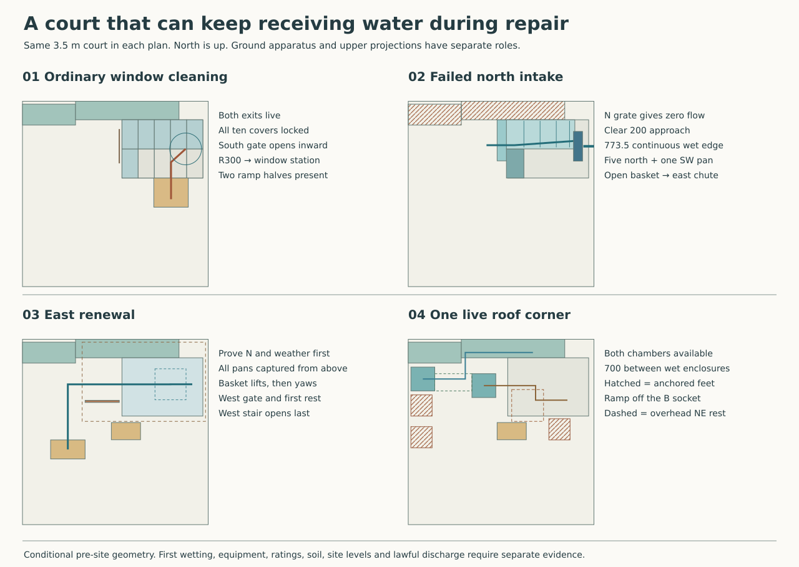
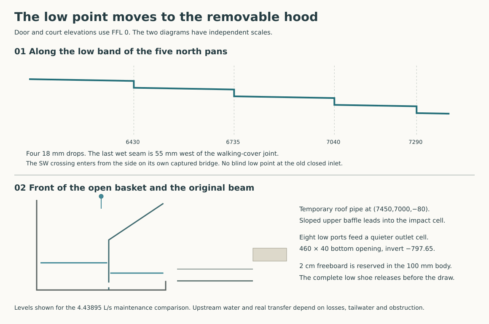

# A south approach and an open east intake for the court

**Select the open, stepped six-pan collector with a removable south approach. Keep the west stair for isolated renewal.** Move the two temporary corner chambers, carry the scaffold feet to the structural heads, and give the east hood a removable two-cell basket with a low outlet. The north loggia, the east gallery and plant rooms, the court windows and both independent routes to outside stay in the house. This is the pre-site architectural successor to the [two-exit house](water-replan-result.md). The complete older source remains replayable. Subsequent RWT work should start from the [new geometry and state record](studies/court-intake-selection.json). Ground works, lifting equipment, wet tests and site acceptance still have real work to do.

## Buy the width where water can actually approach

Use the existing court fall of 40 mm/m northward on the **whole approach**, including its upstream edge. Reserve X5925–6125, Y6625–7398.5 as one unobstructed, 200-deep feeder. At the well face X6125 form a continuous free brink. The remaining south section below Y6625 earns no capacity. Retain the south hinge/foot in its dead strip, collect the middle Y6838.5–6861.5 gap onto the real bridge below, and turn the final 1.5 mm sheet outwards up to Y7400. Extend the 1.5 mm fixed north gable below the brink to a small guide ending X6135/Y7370 at −155, beneath the control section and above the wet pan. It turns the last strip of falling water into the northern wet cassette, away from its sliding side clearance. The fixed end and the apron define one water edge; the pan moves independently underneath. Wet-test this end and reject a backed or obstructed brink. Keep the N grate beyond Y7400 free. Captive folding supports and fixings must remain behind the brink or above its water surface. A foot on the northern end or a lip across the walking-panel seam changes this choice.

| Full 3.60375 L/s court event with N disabled | 100 mm approach | 150 mm | 200 mm |
|---|---:|---:|---:|
| Former six-wet arrangement, nominal −35 quiet stage | 4.321 | 4.131 | 3.975 |
| Same, brink uniformly 5 mm high | 3.393 | 3.232 | 3.101 |
| Continuous brink, nominal −35 | 4.871 | 4.690 | 4.538 |
| Continuous brink, uniformly 5 high **and** 5 lost at each end | 3.922 | 3.762 | **3.630** |

Figures are L/s using the existing finite-section trial with n=0.04, the full K=1 at entry and the deepest quarter of the effective opening unavailable. The former 325 mm selected edge gave 2.505 at 100 mm. In the adverse new 200 mm case the margin is only 0.0263 L/s. A different feed distribution, backed level, larger obstruction or raised intermediate edge can remove it. Survey the entire approach and wet it both from the broad court and the concentrated corner-chamber outlet. Keep the +15 geometric return, −35 quiet stage and their 25 splash and 25 tolerance allocations. The assembled first harmful level remains unknown. [Frozen adverse inlet control](../rwt/rwt-06-court-intake-decision.md) · [Hydraulic model](../rwt/studies/short-inlet-review.mjs)

The old north gate post falls in the credited opening. Rehang the 645 × 40 leaf at (6075,6577.5) with an independently supported raised catch at (6075,7222.5,+1000). Fix its 282 mm horizontal arm to a mast at (5800,7285) on a 140-square footprint. The foot ends 55 west of the feeder and 45 south of the north grate. Its south edge is 40 north of the widest captured cover crossing Y7175. Route a new below-paving, 1.892 m bracket back to the P33 court-side support. Keep its top at or below −465, the mast outside the two entries and the exposed dry access clear. A 1 kN horizontal latch load asks for up to 0.282 kNm plan torque at the mast as well as the 1 m vertical lever. Verify the gate, post, arm, positive fasteners, wet exterior ground structure and deformation without giving the mast a hole through either wet channel.

## The six wet covers now drain to an open hood

Five 305 × 550 northern walking cassettes and the southwest cassette carry the wet bodies; four southern cassettes remain plain. Independent fixed ledgers take walking loads. Keep a 25 underlap at the two west pans so a nearly vertical drop at X6125 enters their real wet area. The continuous fixed edge spans their structural seam. Install the 307 × 40 captured bridge from Y6830 to 6870 inside the falling water footprint; leave the 200 mm upstream paving and its edge continuous across the cassette joint. A 1.5 mm flush/recessed upstream seat prevents a countersill.

The SW floor falls from −135 at Y6311.5 to −166 at 6830, then across the bridge to −169 at 6870. The north low band starts at −189 at X6111.5, falls 1.5% east and steps down **18 mm** at X6430, 6735, 7040 and 7290. Outside Y6935–7165, fall at 2.5% to that band. The minimum bridge-to-north-pan reserve is 7.53 after independently charging both 5 mm errors and the 1.5 sheet. Each step leaves 6.5 after the same deductions. The lowest nominal clearance over the actual first three stair treads is 66.30, 225.30 and 402.30. The upper 25-underlap cases still need a horizontal release before lifting. Fit positive removable shingled saddles; a shared walking-cover butt is not the wet joint.

At the fifth structural seam X7345 a 100-long saddle on the old line would extend 20 beyond the previous spout. The relocated final wet seam finishes its saddle at 7340, 10 short of the hood face. It gives the fifth body a 55 westward projection under cover four. Remove the saddle and lift cover four and its shortened pan before lifting five. Extend the fifth spout to X7390 at −280.18: 25 inside the basket plan. Form the 230-wide side outlet at Y6935–7165 and a new open-upward hood notch Y6915–7185 down to −310. The pan underside at the hood face clears that lower cut by **18.92** after two 5 mm errors. Return its north end so the wet jet is inside the basket by 15 nominal. The old slot lost the last 5 mm of the spout. At 25% blockage the 3.60375 L/s side feed needs 70.87 mm ideal head at K=1. The 100 mm end sides then retain 19.13 mm after the two installation errors. The 4.43895 maintenance duty arrives separately through the original upper pipe.

Reserve **300 mm complete depth** on the five north cassettes, including underside brackets. At a 1700 lift top the bottom remains 1400, 300 above the guard, with 270 to the 1970 weather roof. The fifth combined rockers/cover/wet overhang fit a 360 × 550 plan. Bounding that whole plan flooded to 300 gives 59.4 kg of water; the five-face 1.5 mm copper sheet comparison gives 10.0 kg before frame, cover, eyes and saddles. Detail the depth and actual full mass in the lifting order. A 35 kg tare plus that water gives 1.39 kN at 1.5 dynamic factor. Use independent 2 kN minimum project-design lifting and restraint provision, with actual apparatus, loss of one retention and installed load paths qualified. No hand lift or supporting worker in the well.

## Receive both feeds and recover the basket

Retain the actual Ø125 ID / Ø128 OD N-maintenance pipe at (7450,7000,−80) and its original 160-square cover opening. The old upper baffle at X7460 split the jet. Bring the upper diverter to X7532 at −140, slope to X7460 at −450, then descend to the low ports. The full Ø128 silhouette has 21 mm west and 18 mm east to the two bounding faces before setout. Close the high quiet-side roof into the upper wall; give the impact face a continuous return, independent vent and removable access. Leave the original open side-spout underneath its notch. The 180° turn, splashing, air displacement, delivery from each side and a blocked port group need wet testing.

Keep the **complete guided basket within 170 × 560** at X7365–7535/Y6620–7180, bottom −875. Its removable hardware stays inside that allowance; attach the two 40 mm side handling grips only once the main shaft is cleared. The 200 × 600 shaft leaves 15/20 nominal at its ends. Two 5 mm setout errors and 0.25° skew over the 765 height leave just 1.66 in the narrow direction. A 190-wide bare basket lost its original 5 mm side tolerance. Use opposed top guides and a positive anti-tilt carriage. If fabricated hardware, debris or observed skew uses this clearance, resize the receiver before admitting it.

Eight 40-square submerged ports from −852 to −812 lead to the second cell. With two unavailable and trial K=8, losses at the two duties are 57.46/87.18. Provide a low 460 × 40 clear outlet at Y6675–7135, invert −797.65; keep the original chute headroom and standard wet body east of the entry. Quarter blockage leaves 0.0138 m². Compare K=4 from quiet cell through port, shoe and expansion; the actual jet, approach velocity, tail and losses require a full first-bay witness.

| Separate condition | Court, 3.60375 L/s | Long N works, 4.43895 L/s |
|---|---:|---:|
| 600 wide, 50:4250 chute normal depth; n=0.02 | 17.23 | 19.58 |
| Trial low outlet head / reserve beyond 20 freeboard | 13.90 / 21.10 | 21.09 / 13.91 |
| Limiting total K at the assumed tail | 10.07 | 6.64 |
| Maximum nominal local tail elevation, charging +5 | −736.55 | **−743.74** |

For this comparison, the controlling receiver level is the higher of the entire 40-high slot top +5 and uniform tail +5. The limit is the chute top −697.65 less 20 freeboard. At the long duty a half-blocked opening misses this allowance by 12.46. A 520 gross horizontal overflow lip at −752, 25% obstructed, can instead work with a locally 25-higher open collar. Its worst acceptable nominal tail is −772 to maintain the 10 free nappe and independent raised tail/low crest. Its 47.27 mm ideal pool head has to recover within the finite original body. Select the lower, less tail-sensitive port and allow access to its sediment sump. Up to 7.36 L lies below the outlet and 72.83 kg over the gross basket when blocked to −110. Keep the floor continuous, isolated and accessible to a captured wet lance; physical sediment and residual water determine safe first release.

Give the low basket and the first chute body a positive, separable shoe. Provide a 510-wide external envelope and two closed, accessible metal faces around the 460 × 40 waterway. The operational shoe spans X7525–7585, sleeves the basket by 10 and enters the separately guided beam-side chute. A backshell under the bed catches seepage visibly into the primary wet well; it provides no licence for hidden discharge. Two opposed top-driven wedge dogs compress replaceable sealing lands; choose compatible seal, contact pressure, fixings, material and blind pockets with RWT/MAT. Design a removable open service top only in the first 90 mm of chute, before the X7650 beam. Confirm no actual continuous top member or keeper blocks this opening. Positive isolation, venting, drainage and independent capture precede release. Retract 25 east: the shoe at X7550–7610 now clears the basket by 15 and the beam by 40. Lift it vertically and stage it before the long body draws east. At blocked −110 the low joint sees about 6.75 kPa static differential. A bare lap over the 15 mm gap fails the pressure boundary.

During E work N must already take the event. With locked covers and both gates secured remove the ramp, establish/test the east weather roof, berm and independent receiving route. Capture and remove the SW/north bridge and second north/south cassettes first. The old 35 east stroke took the western pan edge only to X6135, exactly at the new fixed end gable. Move each captured western body east **50**, from outside X6100 to 6150; this leaves 15 at the gable, 5 after both 5 mm errors. The removed adjacent cassette supplies the travel. Then lift and transfer. Release all saddles in sequence. Empty the basket and capture it independently before freeing shoe or guides. Use a 35 kg maximum tare comparison against its 72.83 kg full-water envelope: 1.59 kN at the 1.5 action factor. Lift its bottom to +100 (top +865) and transfer centre to (7040,6900), using the now-open west gate with remaining sides guarded. A 90° yaw occupies a 585.23 square entirely inside the emptied well. Proceed west at Y6898.75; the gate and weather opening share 602.5 mm. Presented narrow with two 40 handles, it leaves 176.25 each side. The inside top leaves 1105 to weather underside. Cross the weather entry to X5105 before carrying south to a 650 × 360 restrained rest at X4780/Y5490 within the existing southwest stage. Keep people clear of the suspended body and count handling of shield, shoe and separate cover/frame stores. Use the west steps and 600 × 900 standing platform only after above-well capture is secure. Restore the two-piece east chute, shoe, basket, ordered pans and both gates, then prove E and remove weather protection. [Existing two-piece chute and independently exposed connection](water-replan-result.md)

## Put the ordinary route and corner frame on real supports

Retain all ten locked covers for ordinary cleaning at east window Y6850, the inward-opening pair under the fixed arch, the R300 outer worker at (7325,6850) and the original indoor handle/cleaning positions. Approach from (7050,5900) north to (7050,6600), then turn to the window. The ordinary ramp occupies X6725–7375/Y5750–6300. Split into two 325 × 550 direct-bearing wedge units. Use a non-slip, parallel-edged supported 3 mm bevelled toe on the existing −30 paving, 52 mm maximum depth at the north end, walking top +0 at the well. The 3 mm toe is a change to the former flush −30 entrance and its actual profile and access acceptance must be checked. Against solid steel at 7850 kg/m³ the trapezoid gives 38.59 kg each before grip and shoe details. The full-depth solid-block bound is 72.97 kg each. Lift under capture. The panels bear on a finished exterior substrate which stays in place and drains on its original grade when they are absent. A dedicated shallow frame from the P36 outrigger supports the substrate; protect blind plug seats and avoid any penetration into the well. Put dry side ledges clear of the complete B square. The principal thresholds, east equipment dock and basement-free interior remain separate.

Move the south 695 × 40 gate from Y6250 to **6290**. Its closed south face at 6270 is 20 clear of B's north edge, 10 after two 5 mm errors. Its eastern/western frame and latch feet lie outside the 650 ramp. Rework the boundary to meet the side guards without opening a gap. The hinge remains at X6702.5 and the open leaf stays north over locked covers. The source parked leaf leaves 27.5 to the R300 path; prove actual knuckles, wind/guard forces, closing and tether. During E service keep the south gate locked before the separate weather barrier at Y6250 is erected.

Before roof-corner work, retain both water routes and the locked well. Close ordinary access and lock the two gates. Transfer each captured wedge south to a turning cradle centred (6900,5360); its 319.42 radius bounds the 90° yaw. Carry west and then north, each to its own ledgers in a 600 × 350 two-level rack at X5900/Y5840. The 550 × 325 stored footprints clear the wet chambers, first-rest projections and the ground aisle. The rack stays 50 east of the historical SW cover stage. Remove the two halves, the toe hardware and socket blanks before erecting foot B. Leave a level shoulder for the foot at Z0 above the original sloping substrate, with individually fitted blind seats. Restore sealed flush blanks and the full walking surface before reopening the gate.

Place A at (4500,5900), B at (7100,6050), C at (4500,6500); each has a 400-square sole. Extend dry positive steel brackets from the **courtward sides** of P33 and P36. P33 is 600 square at (3950,6200), P36 is 600 × 650 at (7950,6100). Their tops are −180 and bottoms −750. A/C are 250 courtward of the west face, B 550 from the east face, and the new east ramp frame reaches 925 to its west edge. Reserve cast-in opposed anchor plates at Z−675…−465 on those exterior faces with rows at −630/−510. Start a 200 × 120 × 8 closed steel cantilever at the east face, a matching twin-ended west yoke and positive sleeve/post risers to the three sole plates. Keep their blind anchor/rebar paths in the cap; no credit for the domestic RC200 floor, paving, unqualified soil or a bolt through the DPC. The exterior court deck in the structural ledger supplies a distributed reservation of 7.5/4 kPa, not the required uplift. Recheck cap cages, exposed shoulder drainage, corrosion, bolts, welds, member/torsional capacity, soil, secondary beams and existing P36 service-platform alternatives on the signed house states. [Structural grid](../str/studies/current-house-grid.json) · [Provisional house handoff](../str/provisional-house-handoff.md)

At +5540 erect two EW transfer beams at Y5900/6500 between X4500/7100, with a short two-direction yoke at the east column. Attach the north/south cantilever needles to **both** beams. One active 1800-square quadrant and the 1000-square central landing carry a restrained 600-square first-rest stand with top +5750. Suspend the guarded two-stage access ladder/rest in the X6300–6900/Y5200–5800 territory; charge its load and rigging to the frame. Keep low ties out of the active aisle. Erect the anchored lower towers and intermediate bracing first. Install two reversible positively restrained wall ties at the structural mid-floor line, Z3270/Y6000 on X3917.5/8082.5 between the ground openings ending Y5650 and starting 6350. Reserve a sealed blind structural receiver on the court faces and flush dry/weather covers after strike; do not screw through a window, weather pan or structural bars. Tangential and normal reaction and yaw both require real fixity or guides. For a 1 kN horizontal action at +5540, this reference puts 1.694 kN total into the upper pair and opposite 0.694 into the bases. A corner eccentricity of 1650 adds a ±0.396 kN tangential share at the two stations. With no high ties, a 1 kN +Y action alone reverses 9.233 kN between A and C. Keep positive temporary restraint during erection and strike.

| One 5 kN vertical point | First rest X/Y lower left, 600 square | A/B/C under the point alone, kN | A/B/C with 1.5 kPa over active deck and shared landing |
|---|---|---|---|
| Southwest | 5200 / 5200 | +18.13 / −0.29 / −12.84 | +27.39 / +1.80 / −18.32 |
| Southeast | 6200 / 5200 | +13.37 / +6.06 / −14.43 | +20.40 / +10.69 / −20.51 |
| Northeast | 6200 / 6200 | −14.13 / +6.06 / +13.07 | −18.80 / +10.69 / +18.69 |
| Northwest | 5200 / 6200 | −9.37 / −0.29 / +14.66 | −11.97 / +1.80 / +21.04 |

Negative is hold-down. The 1.5 kPa is an authored service gravity comparison over the union of the two upper areas, with the shared area counted once. A centred 5 kN rest load still reverses at least one foot in every quadrant. The NE stand projects **600 × 500** over the well. The NW rest projects over the moved east chamber. No prop below either. As an example, the combined southwest state delivers N/Mx/My of +9.07/+13.71/+4.99 at P33 and +1.80/+0.09/−1.53 at P36, in kN and kNm. Use each simultaneous row and its sign, not independent maxima added together. These actions exclude unweighed frame, lifting shock, actual guards and wind; independently qualify the whole temporary structure and rescue.

## Keep two low chambers and both roof drips available

For corner work place the 450-square normal chamber at X4300/Y6775 and the east chamber at X5450/Y6650. The first sits 50 inside the west court face; the second ends 25 before the **entire** 200 mm approach. The clear grounded aisle between them is **700 mm**, a deliberate 50 mm reduction from the previous 750. It leaves 50 each side of a single R300 body. Keep tools and hoses off this strip, close household use during the operation, and open the two lids only after isolating/draining their individual branch. No passing or rescue stretcher fit is implied. Keep the garden bypass available independently; land, actual scaffold access, rescue and held weather states remain to qualify.

Carry the 250-wide normal discharge Y7225→7325, 25 over the actual N intake at Y7300. Carry the E sill east to X5945, 20 over the start of the continuous feeder at X5925. A falling toe with underside +40 leaves 75 above the −35 quiet reference, with no ground shoe in the approach. The 250-wide E mouth projects within Y6750–7000 and the continuous pan edge. Prove the full 3.60375 L/s concentrated feed, its spread, splash and bypass around the low opening. Do not add the same roof event twice. Keep both branches independently supported, vented and available. At full blockage each chamber retains the former **60.97 kPa** head and **9.76 kN** over its 400-square lid. The 450 enclosure and 700 aisle do not prove lid resistance or outfall capacity. [Ground chamber and hydraulic controls](../rwt/rwt-06-corner-and-cleanout.md)

The raised slate on the provisional structural option moves the court primary to inward Q4525. Carry forward the separate underlay and buy a protected drip 20 further in at Q4545. Reflect across the four faces. Extending the outer primary/secondary detail by the additional 75 at 25° gives a trial +7290.19/+7107.33 respectively; this court detail needs its own matching stock, supports and weather proof. Leave the old L receiver at its original elevation for this comparison. The primary now drops 700 to the original gutter bottom. A parked temporary catch beginning at 4515 sits 10 inside the new primary. Recut the two 230 faces on the carriage: wet near 4440, dry near 4590, travel still 150. It catches both nominal drips and clears them by 65/45 on return. Keep both 150-square spouts over separate fixed 350-square heads with 25 at either end of travel by rerouting their necks with the face. Retain both neighbouring pickups, positive leader spool capture, diagonal 900/900 draw and supported first rest. Capture the actual concentrated valley emission; physical throw, new apron, wind and blockage can still veto this arrangement. [Raised slate](../mat/ring-roof-family.md) · [Upper catch and first rest](../rwt/rwt-06-corner-and-cleanout.md)

Route independent temporary water lines above the occupied ground doors and below the deck, one at approximately +3650 and the other +4050. Reserve 160-square gross envelopes for each, including restraints. The SW high head legs start at (5400,4500)/(4500,5400); reflect at the other corners. Before descending, offset the second leg 250 toward the centre at the existing transfer-channel level; avoid the C tower at the reflected northwest head. The normal lower trunk runs on X5325 to Y7000; the east lower trunk runs at X5175 or 6650 to Y6875. Both then enter directly above their designated chamber. Give horizontal legs a continuous fall within their separated bands and support on independent hangers. The four plan checks leave at least 100 between the 160 pipe territories and the 140-square column bodies. Do not put brackets through a falling cassette, ladder, removable rest or roof air/water return. Erect and test both chambers and lines first, upper catch last. Reinstall the L, both scuppers and leader, test both faces and routes, then shift the catch dry before striking the frame and returning the ramp.

## Alternatives, limits and downstream handoff

* **Selected open family.** It uses the existing two east chute pieces at X7550–10050.5–12250. Preserve their guarded east withdrawal, actual outside cradle, first outboard removal and separate low receivers. Retain conditional far maximum water of −1000 north/−1600 east and maximum faulted receiver levels −650/−1250. The local basket tail limit is another condition. Confirm both low egress routes and lawful receiving ground with DPL. A common flooded site, both discharges blocked, or a lost temporary chase has no inferred alternative.
* **Closed native family.** Retain the six-wet covers and the genuinely different low point X7181.71/Z−200. Its old east end at −180 rises 20; attaching that profile directly to the open hood fails. Lawton 159 × 2 hard copper, Endex N18/89710 and N1FMGI159/89719 need their actual supported sockets and bolts; the nominal port-to-flange run is 72.03. The one-piece 4700 assembly parks X12250–16950, extends the stage east by 2200 and needs deck to X17150, down outlet (12950,7000,−1200) and a matched low receiving/blocked-spill route. The distinct upper-first study separates supported ends, locks roll and guides the raised package past the posts with 208/260 above-guard/below-roof reserves. Its side-receiver fault can spill into the dry draw lane. Keep it as a complete alternative if the open port fails; do not take its six-pan grades or native first rest without its machinery. [Closed carrier](../rwt/rwt-06-closed-control-and-canopy.md) · [Native upper-first handling](../rwt/rwt-06-upper-first-release.md) · [Side receiver](../rwt/rwt-06-side-receiver.md)
* **Open an outdoor passage all the way east.** The east end is already open. The additional X7750–9722.5/Y6300–7500 removes 2.367 m², including 1.228 m² of clear interior gallery. The actual strip hits no current fixed furniture. Together with the north loggia it cuts rear-east dry ground circulation. Reject this house change without an occupied dry crossing or a correspondingly redrawn rear-east room sequence.

This closes **HAD-COURT-INTAKE's internal pre-site selection** and gives RWT-06 a current source. RWT-06 still owes physical and system first-wetting, temporary-corner hardware, net obstruction, receiving/clearing and reversal. OAS owns the installed windows, hinges, guards and threshold interfaces. STR owns the exact external bracket/shaft, sunken release tooling, upper ties and all occupied temporary combinations; MAT owns the wet weld/seal, discharge compatibility and connected dry enclosure. RWT-07 remains behind RWT-06. [Architectural programme](house-architectural-design-programme.md) · [Six water duties](../rwt/rwt-06-finite-exit-map.md) · [Reproducer](studies/court-intake-selection.mjs)
