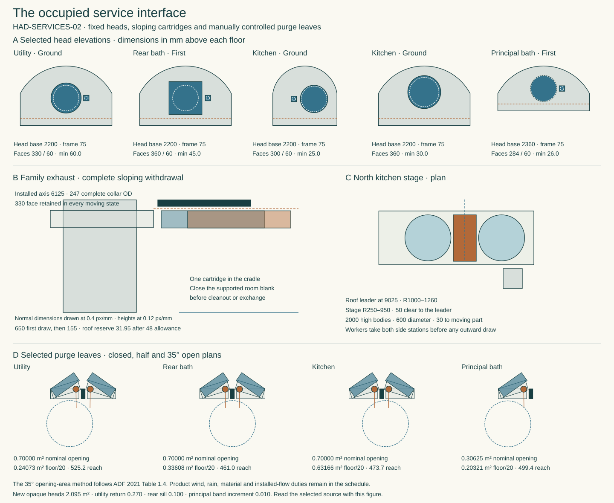

# Occupied house services and the first store movement

HAD-SERVICES-02 selects the furnished local-extract service architecture on the reconciled SAP-C1 house. Six independent room extracts, separate cooker exhaust and tempered supply, a separated heating primary and a pressure-rated mineral-clad domestic store form one current occupied reference. The default `deriveCurrentHouse()` compositor exports that selection from seventeen recorded inputs. The earlier water, materials and structural studies retain their pinned historical sources. Run `node project/had/studies/current-house.mjs --write` to reproduce the schedule and three drawings. [Selected service schedule](studies/current-house-services.json) · [Executable current house](studies/current-house.mjs)

The development selection fixes service locations, finite operating and renewal geometry, heating and airflow comparisons, and the consequential window and room changes. Product, assembled fault, material, site and statutory evidence remains assigned below. The selection introduces zero approved material exceptions.

**Located thermal choice.** The local executable integrated all 46 closed openings, 3 excluded open portals, true G/F heat footprints and all 14 served uses (15 separate level-specific rows) at −10 outside, 20/22 inside. Complete Uw/Ud 1.6; wall U0.324/0.189, sloping roof0.12 and the exposed soffit penalty; q50=1 at 4 Pa, n=.65. Even Uground0.18 and zero bridge gives 17.032 kW hot at actual 6-room extraction, or 15.755 zero independent leakage. Six lower/nine upper circulation windows each beat their own 481 W radiator. Current stress buys Uground0.41, ψ=.02 per actual opening perimeter, .03 per each horizontal boundary, 0.12 W/K points per served room, +450.07 W and +175 W buffer/primary heat. Then peak18.270 kW, daily22h idle +2h hot at 357.406 kWh. Retain Panasonic WH-WXG16ME8 useful14 kW at the actual A−10 65/55 primary, 55/45 secondary, 32 mm clear, 45.9 L/min/53.14 kPa, HX≥1.4 kW/K. Retain 14 cold/9 hot, three bathing places. The W9/10-kW Ecodan's previous 8 kW useful allocation fails even without room supply heat; its body overlaps local buffer375×503/controls510.5×263.5.

**Room positions and exchange.** Increase principal K3 to 600×1200 complete [10165,11370.5,1350,200], Bed2/3 to 600×900 [3425,429.5,1050,200]/[7625,429.5,1050,200]. Four local circuits: Stiebel CK20 Trend LCD 236653 ground [4200,2747,275,131], upper [8179.5,5755,131,275] Z350–750; ground CNS100 Trend NC 202003 [2920,2747,426,100], rear bedroom CNS50 202001 against rear divider X7525.5/Y8450–8798, Z350–800. Actual 216.2 V resistance (verify electronics whose claimed range is 230–240): 13.533 kW hydronic after useful distributed electric contribution, 467.50 W whole headroom, every room ≥62 W. Cooking commits 51/32.91/32.78 A plus other household duty; three 80 A phases as a site condition. New heaters physically clear received bath goods. Grade/openings, acoustic/fire, product, voltage and individual bridge limits need witness. Move and restrain wardrobes first: Bed2 park X2320 same Y; Bed3 Y980 then X9180. Front-only 1100×300 caddies at (3400,700)/(7600,700); 47.5/67.5 to parked wardrobes, 472–475 mm crouched valve reach. Principal 1350×300 receiver east of X10165/Y10760, 25 to rotated bed. Keep supports/actual masses, valve counterholds, leak checks and restored wardrobing.

**Kitchen.** Retain Swegon Salsa/Twist high 10 V and the 48 L/s capture comparator, Titon kitchen dMEV at 5 standby, 16 or 20 boost and 20 when cooking, five further independent 13/16 L/s fans, and six 15,000 mm² equivalent inlets. Eight matched 44 mm dry-door LVN20S assemblies include the 400 × 400 module in the actual 845 × 44 FD-EAST-CROSS leaf. Its 409 × 409 formed cut retains 218 mm of wood each side and requires 35,000 mm² calibrated equivalent area. Seven smaller dry transfers and four wet-wall LVH44S transfers require 7,600 mm² each. The existing stair contributes 90,000 mm².

The selected north hood outlet is X9900/Z2565. Its supported route passes inward through [9900,11275,2572.25] from the retained stack at [11125,11443.5,2600]. Charging a conservative additional 2 m of Ø125 duct and two K1 bends gives 65.89–80.37 L/s hood flow, 78.00–95.71 L/s direct supply and kitchen pressure −4.00 to −3.12 Pa across 96 states. Keep the separate east supply at Y8600/Z2400 and its Ø320 formed opening. The hot-hood, local-extract and common-supply safety seats are [11125,11443.5,1979], [9850,10150,2997] and [11380,8600,2400]. The local seat now follows the actual westward ceiling trunk. Its 172 × 84 × 93 mm actuator body has a south-side socket path, an 1100 mm kneeling deck and a supported 50 mm axial release before 450 mm lowering. The selected shaft engagement is 42 mm. The 6 Nm stored-energy actuator, zero bridging, actual damper torque, grease, seat leakage and loaded airflow response remain assembled qualification duties. Preserve fire and frost priority. [Selected controls and route](studies/current-house-services.json) · [Belimo actuator and shaft accessory](https://www.belimo.com/mam/general-documents/datasheets/en-gb/belimo_NKQ24A-SR_datasheet_en-gb.pdf)

**Heating buffer and DHW.** February 2026 UK Cylinders FCBVS0300 Ø545×1975,45/335 kg within existing650 station [10125,5000,650,650], body [10177.5,5052.5,545,545]. Require measured 260 effective stratified litres ×3.2kJ/(L K)×10K=2.311 kWh. Ten minutes no cooking, max3 kW reverse plus actual room withdrawal needs2.141 kWh. Old100 gives.889 and fully mixed290 at5K gives1.289, both fail. Allow ~31-minute recharge after reversal (cycle spacing ≥41min), re-open hot mode only once charged. Complete kept buffer+capped ports≤2175 high on100 deck; 335−45 implies roughly290 L water. Price glycol compatibility, pressure, full support, fired backup zero. 370 L Howden MS103 standard is only 25 m head/≈2.45 bar,118kg dry/488kg full, and cannot inherit 3.5 bar domestic reducer or Megaflo relief group. Buy BESPOKE pressure-rated unvented mineral-clad cylinder Ø760×1650 within (9830,4250), ≤850 cart, ≥300 net, 3 kW low element, ≤3.5kWh/day 60/20, one kWh/day distribution. Four draws80/80/70/70 at07:00/07:45/08:30/19:00; 216.2V yields2.4345kW, final-week minimum46.88°C, every draw served. Keep pressure vessel's actual qualification and return-valve parts.

**Safety and occupation.** Factory top T&P outlet (10035,4550,1730), separate expansion outlet (10120,4760,1720), factory-rated manifold (10035,4660,1620), final tangent (10035,4800,1480), tundish (10035,4800,1400). R30 bend leaves67.57 straight; T&P/expansion D1 developed432.26/441.70, 28mm minimum tube/jacket corner clearance, 36.65 mm retained valve radius within transport envelope, 595/605/635 mm from shoulder (10545,4425,1450). Dedicated heat-safe D2 G½/Ø28=11.847 m, G¾/Ø35=13.447, G1/Ø42=14.647 against18. No rain/foul/utility receptor sharing. Cold SE port [10131.5,4018.71,380] → west seat, no dimensional credit for a valve in 80mm before seat; worker (10545,4325) at shoulder750 reaches634, shoulder800 fails664. East lower element needs actual ≤550 immersion plus150 head/tool and controlled 700 axial withdrawal to10910. Keep position of actual trapped outlet at (12350,2500,−1850). IAS ladder350 clear cylinder/399 buffer but overlaps working bay585×470; never charge or move cylinder with that ladder present. Two pressure-independent sites/court g1, protected stair, full bathroom and confirmed three-bathing remain available in their defined states. Optional rear WC/basin: two bathing/13 cold/8 hot, six fans, no automatic deletion.

## Cylinder exchange through the east door

The Ø850 whole-load cradle cannot start concentrically. At X9830 it clears the finished west wall at X9397 by only 8 mm. Put the cradle centre 17 mm east of the stationary vessel, at (9847,4250). The 760 mm jacket then retains 28 mm inside the cradle on its tight side. The proposed centre path runs east to (10500,4250), north to (10500,4575), then east through the 1000 mm clear door. Keep the tank upright and the offset fixed. Do not rotate the vessel relative to the cart during either turn. The whole load includes wheels, guards, handles, retained caps and the top valve. The directly attached valve can occupy at most a 45.96 mm plan radius about its axis if it is to retain a further 25 mm inside that envelope. The purchased cradle must support the eccentric drained load and transfer it at its installed plinth height.

| Fixed item | Minimum clear distance to rolling cradle |
|---|---:|
| West wall / south wall | 25 / 28 mm |
| Riser / complete round heating buffer | 25 / 26.66 mm |
| Controls / plant-room radiator | 480.5 / 117.59 mm |
| South / north finished cargo jamb | 50 / 100 mm |

With the safety group fixed in place, **the D1 manifold axis penetrates the swept volume by 15 mm**. Its centre already meets the envelope after 76.08 mm of eastward roll. A real fitting makes contact sooner. Before loading, withdraw the ladder, isolate all heat and power, lock off the cold inlet, cool, drain and prove zero pressure. Independently support the retained services, release the loaded-side hot/cold and electrical connections, remove the west bridge and its stand, then detach the matched D1 group at its two vessel outlets and above the separate tundish. Keep the directly sensing safety valve on the cylinder. No isolation valve or operational plug belongs between the cylinder and its safety valve. The surviving tundish axis clears the swept envelope by 91.58 mm. Its complete retained body, cap and support must fit within 66.58 mm of that axis to keep 25 mm clearance, or be redesigned. The separate discharge below the tundish stays supported. Keep both releases downstream of their safety devices and use only a manufacturer-qualified detachable joint arrangement. England’s Approved Document G describes the common factory manifold, visible vertical tundish and discharge route in paragraphs 3.50–3.56. [Approved Document G, 2015 edition incorporating 2024 amendments](https://assets.publishing.service.gov.uk/media/66f6c6ce3b919067bb4828cc/ADG_with_2024_amendments.pdf)

Set the replacement on the supported stand before remaking any connection. Align, support and renew the approved discharge joints. Prove sensing, open discharge to the proper outlet and the cold controls before enabling heat. Leave the store de-energised with access restricted until that test passes. The route represents plan space through the east opening. The matched removable safety group and first union releases, actual cargo frame and rated eccentric cradle still need dimensions. The proposed dry rest outside the door depends on a supported, level site landing. [Computed sweep](studies/store-exchange.mjs)

### First release of the three-ended discharge group

A rigid three-ended manifold cannot be pulled axially out of three ordinary sockets. For the G½ outlet comparison only, price a **factory-built group with three fully separable flat faces** downstream of the two safety devices and immediately above the supported tundish. Independently support the cold and drained group before loosening anything. Require enough captive-nut travel to clear the fixed thread completely at all three ends. Reject any projecting pilot, socket or spigot across the split plane. The maker must verify combined discharge capacity and deliver the qualified assembly: its common manifold cannot be replaced by an improvised site tee.

A 15 mm × ½″ Conex P4355 flat-faced connector has a 42 mm length and 24 mm spanner size. It is a dimensional comparator only. The press seal is EPDM, and certification of an unvented discharge under steam, blow-off capacity and the actual mating terminal is outstanding. Reserve a 20 mm outer radius over the complete 42 mm top leg fitting. The common vertical tangent leaves 67.57 mm before the tundish, leaving 25.57 mm after charging one 42 mm comparison fitting. A larger outlet has to be drawn again. [Manufacturer drawing, ratings and seal](https://conexbanninger.com/product/flat-faced-connector-15-x-1-2/)

With all three stationary faces exposed, move the supported group 65 mm west, 28 north and 12 up. This single translation opens the T&P, expansion and lower faces by 11.31, 9.24 and 12 mm respectively. A continuous lower bound on the moving Ø22 top tube gives 26.66 mm to the jacket; the top union gives at least 30.00 mm. The other legs retain over 55 mm. The model checks the first stroke, not the later lift, counterhold or temporary stand. Once clear, move the whole unpressurised group to a separate supported dry rest before loading the vessel. If the actual factory faces, supports or rod travel prevent that sequence, or bind as any nut is removed, reject the common group. Two individually drained, visible tundishes would require their own gravity routes and cannot silently use the common-manifold result. [First-stroke model](studies/store-discharge-release.mjs)

## Cooker fault during occupancy

A seated damper cannot instantly restore room pressure. In the fourteen-room pressure network the kitchen starts at −4 Pa. Cut its direct supply to zero, keep the hood and local extract at their conservative 107.38 L/s combined upper bound, and put the other five fans at boost. Give each room its plan area × 3.1 m of compressible air; the combined plant/utility room retains its open arch. The supported network of six 15,000 mm² inlets, room transfers, enlarged kitchen transfer and open stair exchanges mass at each step. With outward flow maintained until the blades seat at 4.35 seconds the kitchen is still at **−12.35 Pa at five seconds**. It first stays above −5 Pa at 5.97 seconds. A four-second shaft travel time and a closed-position signal alone fail the design contract. [Pressure calculation](studies/cooker-fault.mjs) · [Belimo stroke, position accuracy and zero bridging](https://www.belimo.com/mam/general-documents/datasheets/en-gb/belimo_NKQ24A-SR_datasheet_en-gb.pdf)

Specify combined **measured outward flow** limits from onset of supply loss. The two closed seats together allow 0.50 L/s. From that residual to the initial 107.38 L/s, the remaining increment may be at most 50% at 1.35 s (53.94 L/s total), 25% at 2.35 s (27.22 L/s), 10% at 3.35 s (11.19 L/s) and zero at 4.35 s. Maintain each limit until the next. Disconnect the hot-cooking permission on first loss of proven flow. Require a latched safe state, independent feedback and a measured recovered kitchen pressure by five seconds before crediting the shut-off. No automatic restart follows a trip.

With that staircase the model crosses −5 Pa for the last time at 4.47 s and reaches −3.97 Pa at five seconds. A 20% larger effective air volume gives 4.59 s and −4.23 Pa. All 32 configurations of the other five fans satisfy this last case. The governing all-boost nominal-volume trajectory still reaches −35.26 Pa and imposes a 14.52 Pa maximum kitchen-to-hall differential. Test actual door forces with closer, seals and the fast fault. The air law assumes uniform pressure within each room, isothermal compliance, fixed external inlet pressure and one-way background inlets, with the hood/duct/fan network bounded by the imposed residual flows. Dynamic duct inertia, site wind, grease, fan coast-down and a stopped/stuck blade still require the assembled rig. Measure both air streams and room pressure against a common clock under supply loss, hood loss, loss of power and priority fire/frost controls. Motor angle does not give an airflow bound. [Published cooker and room network](../mat/tempered-kitchen-air.md#prove-the-changeover)

## Loss of extract and complete power failure

Specify the same staged fraction limits on the **inward** supply, from 100.43 L/s to at most 0.25 L/s seated. If the hood and kitchen room extract already stopped, the remaining five ordinary room fans still draw 65 L/s. If those also stop on a common power loss, one-way background inlets trap the air delivered during supply rundown. The nominal-volume model retains **+35.35 Pa at five seconds** even with the supply seat closed. Without an outward path it cannot justify pressure recovery.

Keep the existing six formed inlet sleeves. Require each installed weather terminal, grille, screen and acoustic passage to admit the original 15,000 mm² inward equivalent area and at least **5,000 mm² outward equivalent area** without electrical power. Both areas refer to the same orifice law (Cd 0.61), not face dimensions. A one-way shutter fails this selection. With all extracts off and the seated supply still leaking 0.25 L/s, the nominal kitchen returns inside ±5 Pa at 3.36 s. With 20% more effective room air and any one outward terminal blocked, it returns by 3.86 s and reaches at most +0.80 Pa at five seconds. With the other five fans still running, both kitchen extracts lost and the six outward paths present, the nominal kitchen peaks at +18.22 Pa and returns to −2.15 Pa at five seconds.

This comparison adds an author-selected +5 Pa recovery screen for the reverse fault. It does not erase the transient positive load on fire doors and the final exit. Prove the bidirectional weather terminals under actual pressure at each façade, dirt, icing, insect screen and flame/smoke protection. Prove the coil and water branch remain frost-safe when electric controls are dead. Wind, component stall, grease or a stuck shutter may invalidate the specified flow limits. Until those cases are demonstrated, keep high cooking inhibited on fault. [Room pressure and terminal selection](studies/current-house-services.json)

## Rear-room alternative

Keep the three-bathing house as the base case. Converting only the rear shower to a WC/basin and adding the family-bath diverter retains four WCs, four basins, six fans and the rear foul/vent. Omit 3.370 m of dedicated shower branches, one hot and one cold endpoint, the rear shower drain, lifting station and formed well. The controlled comparison moves from fourteen cold/nine hot to thirteen/eight. It has two simultaneous bathers, a 580 mm bath rim and an 18.764 m Bedroom 4 journey through two operated doors. Keep 22°C in the rear wet room, its 13/16 L/s fan and the same four-person 300 L/day equivalent hot-water draw. The room heat budgets, closed-door cooker network, pressure-rated store and three-phase duty therefore remain at their base-house sizes. No capital-cost saving or ownership preference is assumed. [Joined IAS option, actions and fixtures](../ias/ias-03-shared-family-bathing.md)

## Fitted services on the structural house

The selection consumes the four IAS rim/catch plans, all four WC bodies and first breaks, the six kitchen breaks, actual family shaft, separate sink/washer waste and the 15 mm utility-head relocation. The 235 mm valve bay, independently supported rack, 70 × 100 mm foot, 960 mm waste branch and 24 mm fall remain in the furnished source. The empty washer moves 700 mm to its dry rest and temporarily occupies 0.2093 m² of the isolated electrical working field. Restore that field before re-energising. The structural source supplies the shifted fridge and principal bed. [Fitted water and shaft](../ias/ias-03-household-water.md) · [WCs and discharge](../ias/ias-03-guest-rear-wc-takeoffs.md)

The inherited SAP-C1 comparison rejected twelve of the twenty-one original service apertures against the shifted arches and complete concrete jambs. That failure remains in `structuralServiceReview`. The current `selectedServiceInterfaces` supplies the replacement port, complete weather face and occupied renewal for each selected occurrence. All twenty-one formed apertures and complete faces retain at least 25 mm in their stated structural or head boundary. [Aperture calculation](studies/service-apertures.mjs)

### Fixed heads and separate wall terminals

Four new opaque heads occupy local +2200 to +2850. The principal bath uses its existing upper head with a 10 mm lower-band extension. Each tube draws out through its retained receiver while the head and glazing stay fixed. All outside faces project at most 100 mm.

| Service | Main outside axis in mm | Separate drain axis in mm | Complete main/drain faces |
|---|---|---|---|
| Utility ground east | Y2100, Z2500 | Y2320, Z2500 | Ø330 / 60 square |
| Rear bath first west | Y9900, Z5950 | Y10145, Z5950 | 360 square / 60 square |
| Kitchen ground north | X8400, Z2490 | X8180, Z2490 | Ø300 / 60 square |
| Cooker ground north | X9900, Z2565 | Independent grease-cleanable route | Ø360 |
| Principal bath first east | Y7400, Z6054 | Y7600, Z6054 | Ø284 / 60 square |
| Ground WC south wall | X8950, Z2975 | X9130, Z2700 | Ø330 / 60 square |
| Family bath east wall | Y5750, Z6125 | Y6000, Z6100 | Ø330 / 60 square |

The six room ducts retain a 125 mm clear passage, 227 mm insulated body and 247 mm maximum collars. Separate drains have 15 mm maximum outside diameter. Every post-transition horizontal run falls outward at least 1%. The complete support envelopes retain at least 25 mm beneath their structural sections. Main-to-drain separation uses complete collars and keeps at least 28.99 mm. The upper fan pods lower 30 mm.

The principal face has a 284 mm outside skirt, 2 mm metal and 280 mm inside diameter around a 278 mm receiver. The 45 mm telescopic overlap leaves 1 mm nominal radial running clearance and requires at least 0.5 mm after fabrication. Its drained cowl has a 196 × 60 mm clear throat. The independent condensate cover retains 28 mm between the two complete faces. Other heads use a 40 mm upper lap, 25 mm side laps and a 30 mm bottom drip, with separate accessible inner air seals and mineral insulation. The retained foul termination requires its formed metal flashing and qualified sealed lap within its existing 320 mm face envelope. [Selected interfaces and joints](studies/selected-service-interfaces.mjs)

### Purge, room use and glazing cost

Utility uses the shifted south window at X9900, Rear Bath the north window at X2100, Kitchen the east window at Y9900, and Principal Bath the southern leaf of its east Y7400 window. The first three use paired 370 × 1160 × 128 mm leaves. The principal leaf is 370 × 1035 × 128 mm. Each leaf opens outward to a controlled 35° stop with bronze hinges, positive catches and a 300 mm pivot-to-peg stay. The grip moved to local 270/193 mm after the former 350 mm grip struck the centre post. Finite 40 mm hand/arm capsules and 600 mm diameter, 2000 mm high standing bodies are included.

England's 2021 Approved Document F Volume 1 Table 1.4 uses opening area of at least one-twentieth of floor area for hinged windows opening at least 30°. The selected nominal openings are 0.700 m² in Utility, Rear Bath and Kitchen, against 0.241, 0.336 and 0.632 m². The principal opening is 0.30625 m² against 0.20321 m². The finite leaf occupies part of the aperture plane during operation. The selected stop and named opening-area method govern the comparison. The published 2026 edition takes effect for relevant non-higher-risk work on 24 March 2027. [2021 ADF Volume 1](https://assets.publishing.service.gov.uk/government/uploads/system/uploads/attachment_data/file/1045918/ADF1.pdf) · [2026 ADF Volume 1](https://assets.publishing.service.gov.uk/media/6a9a918a01bbff0bf8f97e1b/Approved_Document_F__Volume_1_Dwellings.pdf)

The kitchen and rear radiators move to their west walls with accessible unions and captured 50 mm lift/200 mm draw operations. The principal high radiator moves to the south wall at local +2075 to +2675 and becomes a 400 × 600 K3, article 3063304. Its 956 W catalogue output at Δ50 gives 438.42 W at the selected 55/45/22 condition against 270.58 W duty. Separate left/right valve hands keep their complete tools outside the panel. The 30 kg complete exchange envelope lowers on a guided carriage that travels with the radiator. The utility inverter starts at +2100 above the full standing envelope. [Radiator reference](https://www.stelrad.com/wp-content/uploads/2019/12/25928_Compact_-K3_Web.pdf) · [Occupied window source](studies/purge-window-interfaces.mjs) · [Radiator exchange](studies/radiator-maintenance.mjs)

The four new heads cost 2.09502 m² of gross glazed aperture. The utility's 200 mm blind return adds 0.270 m² and retains 53 mm to the partition. Raising the fixed rear west sill from 750 to 850 adds 0.100 m². The principal band extension adds 0.010 m². The current gross glazed fields before frame and glass-edge deductions are 3.094 m² in Utility, 3.264 m² in Rear Bath, 3.869 m² in Kitchen and 1.610 m² in Principal Bath. Keep the whole-opening Uw ceiling at 1.6 and the existing perimeter heat penalties. Daylight qualification must use the actual frames, glass transmission, room surfaces, external obstructions and these reduced fields. [Glazing and operating schedule](studies/current-house-services.json)

### Finite renewal and roof clearance

A complete exterior cartridge is 605 mm long. From its installed inner tip at normal −505 and weather face at +100, it draws 650 mm outward along its 1% fall, leaving 45 mm beyond the retained outer face. A further 155 mm places the whole body on a dry cradle spanning normal 275–930. The two workers occupy opposite side stations before any draw. One cartridge is cleaned or replaced and restored before the next is removed. A supported 20 mm temporary room-side blank closes in the 458–505 axial gap, leaving 27 mm to the retained duct. The full passage becomes accessible from the cowl end, with separate cleanouts at retained bends and the fan or hood end. The former interior rig failed because its two removed parts shared a rest and its lowered panel crossed the carrier. Those cases are retained as rejection evidence. [Complete cartridge sequence](studies/service-head-maintenance.mjs)

Exterior stages occupy outward normal 250–950, giving 50 mm to the roof leaders at 1000–1260. Their 2000 mm high workers stand on an upper deck at 4300. Against the roof's 6375 lower-carrier envelope and 48 mm combined movement, body and setting allowance, the head reserve is 27 mm. Family Bath's complete moving 330 mm face retains 31.95 mm. The six inlet hoods have separate 350 mm outward exchanges and 250 mm inward module releases. Bed2/Bed3 decks lower to 4200 so the moving 400 mm hood clears the finite 1100 mm guard by at least 26.5 mm after draw fall and setting. [Inlet modules and hood renewal](studies/inlet-maintenance.mjs)

The inlet stations are Study south X3045/Z2100, Living north X3090/Z2100, Bed2 south X3045/Z5550, Bed3 south X8955/Z5550, Bed4 north X4800/Z6095 and Principal east Y8950/Z6095. Lowering the last two faces removes their former radial conflict with the lower roof goods. Every inlet still owes its complete 15,000 mm² forward and 5,000 mm² unpowered reverse equivalent area. A 96-state room network charges all 32 other-fan masks at each kitchen 5/16/20 setting. It gives 70–100 L/s whole-house extraction and at least 13.17 Pa against the conservative native TOR pressure comparisons at zero façade wind. Actual CF1 operation and complete installed resistance require commissioning. [Native fan pressure curves](https://products.titon.com/wp-content/uploads/2025/03/Titon-Ultimate-dMEV-Sales-Brochure.pdf)

The principal fan inhibit operates while the window remains positively latched. Hold that state through motor coast-down until the local measured-flow indicator confirms at most 0.25 L/s, then release the manual catch and open the leaf. Positive reclosure permits normal humidity demand. The other five fans command 16 L/s during normal purge, giving a commanded 80 L/s. Cooker safety shut-off, fire and frost controls retain priority and can reduce that total. Qualify the inhibit and flow indication under power and component faults. All selected heads and independent intakes require wind/tracer re-entry testing with neighbouring windows open and closed. Temporary closures, dry rests, scaffold ties and feet require actual load, ground-bearing and weather qualification within the drawn envelopes.

## Selection boundary and assigned evidence

The bounded architectural service selection is complete when the owning source, regressions, independent internal challenge, rendered drawings and exact-head repository validation agree. The current-house compositor is the selected service source for further MAT, IAS, OAS and roof coordination. The three-bathing house remains the base configuration, with the rear-WC alternative separately costed.

| Missing evidence | Decision affected | Owning route and resolution point |
|---|---|---|
| Complete constituent register for fans, controls, doors, windows, actuators, seals, coatings, insulation binders and supported assemblies | Material admission and any actual exception | MAT-COORDINATION and the owner material policy before procurement. Approved exceptions remain zero |
| Loaded cooker flow cutoff, seat leakage, wind, stuck component, door forces and pressure recovery on a common clock | Enabling high cooking and its actual controls | MAT/BCR assembled rig before releasing that operating duty |
| Whole-window wind/rain/cycle/Uw, actual daylight, terminal free areas, temporary weather closures and exhaust re-entry | Final window and terminal product acceptance | OAS/MAT/BCR with DPL façade conditions before product freeze and installation |
| Qualified cylinder pressure, safety group, three separable discharge faces, complete loaded cradle and discharge route | Domestic store purchase and first energisation | MAT/IAS/BCR through the selected supplier and installation witness |
| Carriage/scaffold loads, anchors, guides, catches, shaft engagement and actual handling equipment | Execution of the drawn service operations | IAS/STR/DEL before issuing the relevant installation or renewal method |
| Electrical supply, site ground/bearing, outfalls and actual flood/wind conditions | Deployment of this reference on a plot | DPL and the relevant undertaker before site-specific acceptance |

The selected files retain failed inherited apertures, the rejected interior cassette, the colliding old purge grip, the old central radiator-tool path and the high wall-terminal/roof conflicts as adverse evidence. The new guards and actual local shutoff seat are regression checked. Historical source hashes stay attached to their original studies. [Material offer](../mat/whole-service-material-offer.md) · [Owner material policy](../../docs/reference-house/material-policy.md)
