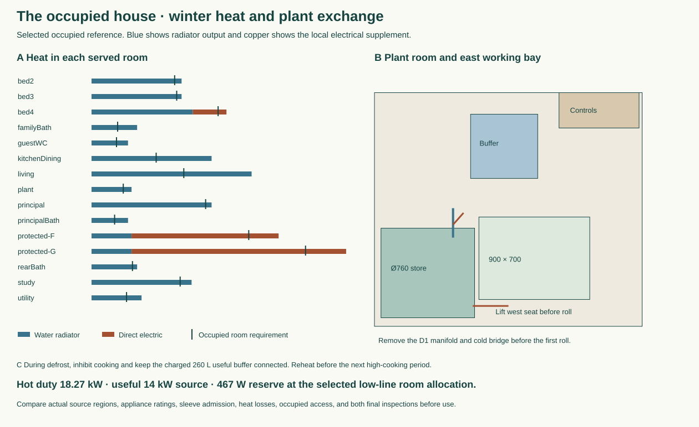
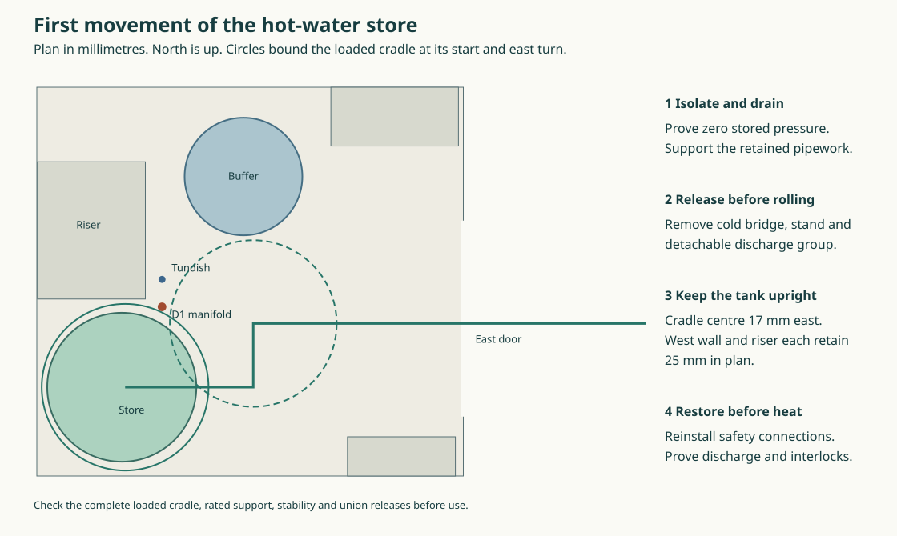

# Occupied house services and the first store movement

The furnished local-extract house option uses six room fans, separate cooker exhaust and tempered supply, a separated heating primary and a pressure-rated mineral-clad domestic store. Its full model, compact schedule and two drawings are reproducible from the nine recorded input files. Run `node project/had/studies/current-house.mjs` to inspect the option and `node --test project/had/studies/current-house.test.mjs` to verify the figures and schedule. The controlled default remains the selected water-replan house pending the joined service decision. [Service schedule](studies/current-house-services.json)

**Located thermal choice.** The local executable integrated all 46 closed openings, 3 excluded open portals, true G/F heat footprints and all 14 served uses (15 separate level-specific rows) at −10 outside, 20/22 inside. Complete Uw/Ud 1.6; wall U0.324/0.189, sloping roof0.12 and the exposed soffit penalty; q50=1 at 4 Pa, n=.65. Even Uground0.18 and zero bridge gives 17.032 kW hot at actual 6-room extraction, or 15.755 zero independent leakage. Six lower/nine upper circulation windows each beat their own 481 W radiator. Current stress buys Uground0.41, ψ=.02 per actual opening perimeter, .03 per each horizontal boundary, 0.12 W/K points per served room, +450.07 W and +175 W buffer/primary heat. Then peak18.270 kW, daily22h idle +2h hot at 357.406 kWh. Retain Panasonic WH-WXG16ME8 useful14 kW at the actual A−10 65/55 primary, 55/45 secondary, 32 mm clear, 45.9 L/min/53.14 kPa, HX≥1.4 kW/K. Retain 14 cold/9 hot, three bathing places. The W9/10-kW Ecodan's previous 8 kW useful allocation fails even without room supply heat; its body overlaps local buffer375×503/controls510.5×263.5.

**Room positions and exchange.** Increase principal K3 to 600×1200 complete [10165,11370.5,1350,200], Bed2/3 to 600×900 [3425,429.5,1050,200]/[7625,429.5,1050,200]. Four local circuits: Stiebel CK20 Trend LCD 236653 ground [4200,2747,275,131], upper [8179.5,5755,131,275] Z350–750; ground CNS100 Trend NC 202003 [2920,2747,426,100], rear bedroom CNS50 202001 against rear divider X7525.5/Y8450–8798, Z350–800. Actual 216.2 V resistance (verify electronics whose claimed range is 230–240): 13.533 kW hydronic after useful distributed electric contribution, 467.50 W whole headroom, every room ≥62 W. Cooking commits 51/32.91/32.78 A plus other household duty; three 80 A phases as a site condition. New heaters physically clear received bath goods. Grade/openings, acoustic/fire, product, voltage and individual bridge limits need witness. Move and restrain wardrobes first: Bed2 park X2320 same Y; Bed3 Y980 then X9180. Front-only 1100×300 caddies at (3400,700)/(7600,700); 47.5/67.5 to parked wardrobes, 472–475 mm crouched valve reach. Principal 1350×300 receiver east of X10165/Y10760, 25 to rotated bed. Keep supports/actual masses, valve counterholds, leak checks and restored wardrobing.

**Kitchen.** Retain Swegon Salsa/Twist high10V and 48 L/s capture requirement, Titon kitchen dMEV 5 standby /16 or20 boost /20 when cooking, other five independent 13/16, 6×15000 equivalent inlets. Eight matched 44-mm dry-door LVN20S, largest 400×400 with 409×409 formed cut centred Z650 in actual FD-EAST-CROSS 845×44. Remaining wood218 each side, 48,000 physical free, 35,000 calibrated equivalent at network Cd.61. Seven dry 200-square/209 formed, four separately accessed wet wall LVH44S 250×200 with290×240 reserved opening; guest WC north X8875, rear wet east Y9910, family wet spine Y5010, principal bath wall X11150, at Z2050; 7600 per small edge. Existing open-stair 90,000. Source fit gives96 independent high states, 69.445–85.089 hood/78–100.431 direct L/s, −4.00 to −3.589 Pa kitchen after K1+200mm extra exhaust. Keep original manual window. Use existing east supply X12000/Y8600, increase formed 280→320. Lower hood axis X11125/Y11443.5, original connector1679..1879, add removable Ø125 shutoff bay1879..2079/drive facing south, Twist2079..2432, straight2432..2521 then short bend and north exit X11125/Z2600; conservative pre-tolerance ring reserve25.61. Fit separate hot-hood, local-extract and common-clean-supply seats at (11125,11443.5,1979), (11282.5,11450,3010), (11380,8600,2400) with stored-energy 6 Nm NKQ24A-SR/zero bridging. Price 0.35 s detect/release+4.0 s travel+0.40 verify=4.75s, actual torque, cleanability, grease, every seat leakage≤0.25 L/s at full fan pressure, dynamics and fire priority. Lost supply retained 87.38 hood+20 local gives kitchen/hall −42.16/−26.98 Pa, difference15.18 and +14.08 N on 845 leaf. Lost hood adds max7.90 N opposite. Both closed leaks give −3.50..−2.32. NEVER claim instantaneous −5: prove real transient and occupied final-exit and internal door force. Seven other dry transfers and eight-door material PVC/intumescent, batteries, Talkback and emergency power must be charged. Preserve manufacturer fire/frost precedence.

**Heating buffer and DHW.** February 2026 UK Cylinders FCBVS0300 Ø545×1975,45/335 kg within existing650 station [10125,5000,650,650], body [10177.5,5052.5,545,545]. Require measured 260 effective stratified litres ×3.2kJ/(L K)×10K=2.311 kWh. Ten minutes no cooking, max3 kW reverse plus actual room withdrawal needs2.141 kWh. Old100 gives.889 and fully mixed290 at5K gives1.289, both fail. Allow ~31-minute recharge after reversal (cycle spacing ≥41min), re-open hot mode only once charged. Complete kept buffer+capped ports≤2175 high on100 deck; 335−45 implies roughly290 L water. Price glycol compatibility, pressure, full support, fired backup zero. 370 L Howden MS103 standard is only 25 m head/≈2.45 bar,118kg dry/488kg full, and cannot inherit 3.5 bar domestic reducer or Megaflo relief group. Buy BESPOKE pressure-rated unvented mineral-clad cylinder Ø760×1650 within (9830,4250), ≤850 cart, ≥300 net, 3 kW low element, ≤3.5kWh/day 60/20, one kWh/day distribution. Four draws80/80/70/70 at07:00/07:45/08:30/19:00; 216.2V yields2.4345kW, final-week minimum46.88°C, every draw served. Keep pressure vessel's actual qualification and return-valve parts.

**Safety and occupation.** Factory top T&P outlet (10035,4550,1730), separate expansion outlet (10120,4760,1720), factory-rated manifold (10035,4660,1620), final tangent (10035,4800,1480), tundish (10035,4800,1400). R30 bend leaves67.57 straight; T&P/expansion D1 developed432.26/441.70, 28mm minimum tube/jacket corner clearance, 36.65 mm retained valve radius within transport envelope, 595/605/635 mm from shoulder (10545,4425,1450). Dedicated heat-safe D2 G½/Ø28=11.847 m, G¾/Ø35=13.447, G1/Ø42=14.647 against18. No rain/foul/utility receptor sharing. Cold SE port [10131.5,4018.71,380] → west seat, no dimensional credit for a valve in 80mm before seat; worker (10545,4325) at shoulder750 reaches634, shoulder800 fails664. East lower element needs actual ≤550 immersion plus150 head/tool and controlled 700 axial withdrawal to10910. Keep position of actual trapped outlet at (12350,2500,−1850). IAS ladder350 clear cylinder/399 buffer but overlaps working bay585×470; never charge or move cylinder with that ladder present. Two pressure-independent sites/court g1, protected stair, full bathroom and confirmed three-bathing remain available in their defined states. Optional rear WC/basin: two bathing/13 cold/8 hot, six fans, no automatic deletion.

## Cylinder exchange through the east door

The Ø850 whole-load cradle cannot start concentrically. At X9830 it clears the finished west wall at X9397 by only 8 mm. Put the cradle centre 17 mm east of the stationary vessel, at (9847,4250). The 760 mm jacket then retains 28 mm inside the cradle on its tight side. The proposed centre path runs east to (10500,4250), north to (10500,4575), then east through the 1000 mm clear door. Keep the tank upright and the offset fixed. Do not rotate the vessel relative to the cart during either turn. The whole load includes wheels, guards, handles, retained caps and the top valve. The directly attached valve can occupy at most a 45.96 mm plan radius about its axis if it is to retain a further 25 mm inside that envelope. The purchased cradle must support the eccentric drained load and transfer it at its installed plinth height.

| Fixed item | Minimum clear distance to rolling cradle |
|---|---:|
| West wall / south wall | 25 / 28 mm |
| Riser / complete round heating buffer | 25 / 26.66 mm |
| Controls / plant-room radiator | 480.5 / 117.59 mm |
| South / north finished cargo jamb | 50 / 100 mm |

With the safety group fixed in place, **the D1 manifold axis penetrates the swept volume by 15 mm**. Its centre already meets the envelope after 76.08 mm of eastward roll. A real fitting makes contact sooner. Before loading, withdraw the ladder, isolate all heat and power, lock off the cold inlet, cool, drain and prove zero pressure. Independently support the retained services, release the loaded-side hot/cold and electrical connections, remove the west bridge and its stand, then detach the matched D1 group at its two vessel outlets and above the separate tundish. Keep the directly sensing safety valve on the cylinder. No isolation valve or operational plug belongs between the cylinder and its safety valve. The surviving tundish axis clears the swept envelope by 91.58 mm. Its complete retained body, cap and support must fit within 66.58 mm of that axis to keep 25 mm clearance, or be redesigned. The separate discharge below the tundish stays supported. Keep both releases downstream of their safety devices and use only a manufacturer-qualified detachable joint arrangement. England’s Approved Document G describes the common factory manifold, visible vertical tundish and discharge route in paragraphs 3.50–3.56. [Approved Document G, 2015 edition incorporating 2024 amendments](https://assets.publishing.service.gov.uk/media/66f6c6ce3b919067bb4828cc/ADG_with_2024_amendments.pdf)

Set the replacement on the supported stand before remaking any connection. Align, support and renew the approved discharge joints. Prove sensing, open discharge to the proper outlet and the cold controls before enabling heat. Leave the store de-energised with access restricted until that test passes. The route represents plan space through the east opening. The matched removable safety group and first union releases, actual cargo frame and rated eccentric cradle still need dimensions. The proposed dry rest outside the door depends on a supported, level site landing. [Computed sweep](studies/store-exchange.mjs)

## Remaining decision

The numerical heat balances, room coordination and conditional trolley route can inform the selection. Before adopting the house, join the actual utility sink/washer isolation and capped connections to the current fittings, verify the detachable D1 pair and whole cradle, demonstrate the loaded closure/transient pressure for the kitchen or select a passive fault-safe arrangement, and bring the rear-room option to the same operating comparison. The current file exports the furnished **candidate**. Keep the historical water model and its dependent engineering studies on their recorded sources. MAT retains its ten-family schedule and every material exception for explicit disposition.

[Original house source](studies/water-replan.json) · [Materials offer](../mat/whole-service-material-offer.md) · [Room and cooker network](../mat/tempered-kitchen-air.md) · [Operating pump and tank alternatives](../mat/local-extract-heat-and-store.md) · [Classified door module](https://www.lorientuk.com/products/lvn20s) · [Fast actuator](https://www.belimo.com/mam/general-documents/datasheets/en-gb/belimo_NKQ24A-SR_datasheet_en-gb.pdf) · [2026 heating buffer brochure](https://ukcylinders.co.uk/wp-content/uploads/2026/02/UK-Cylinders-Ltd-FlowCyl-Heat-Pump-Cylinders-Buffers_16499-Feb-26-Low-Res.pdf) · [Calorifier pressure/head variants](https://www.howden-electric.com/wp-content/uploads/2025/07/MS-Catalogue.pdf)
