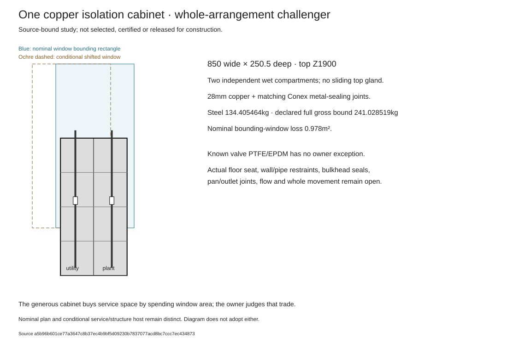

# One copper inlet cabinet: conventional replacement comparison

**Later disposition —21November2026:** the [joined wet/fault/renewal matrix](inlet-cabinet-copper-wet-matrix.md) supersedes this first nominal checkpoint. It rejects the tall cabinet as a complete arrangement, while preserving its finite-receiver method and source-bound comparison. The figures below record PR1603; the current executable case includes new permanent pans, individual fronts, tolerance bounds and actual source/renewal challenges.

**20 November 2026 · HAD-INLET-RESOLUTION · unselected owner-review proposition.**

The two tight hoods and shared frame have reached the convergence threshold. PR1601 retains the adverse joined proof: 150N top-exit drag plus independently bounded partial water exceeds its steel comparator; paired seized exits are worse. Raising the guide and using passive sheds gives only narrow static and handling reserves. That arrangement is no longer the preferred refinement route. Retain it as a rejected comparison; do not add larger bars or another sliding packing detail to rescue it.

Develop one conventional wall-backed cabinet with separate wet compartments and independently grounded pipe supports instead. The native source is `compiler/reference-house/current-design/inlet-cabinet-copper.ts`; the versioned optional compiler stage is `inletCabinet`. Its datum comes from the actual source entry face, its two pressure routes retain their actual house destinations, and both the accepted nominal window and separately conditional structural window are measured. This proposal spends useful window area; the owner has not accepted that architectural cost.

Reproduce the compact source-bound result and drawing with `node --import tsx project/had/studies/inlet-cabinet-copper.ts`; `--check` rejects stale outputs.

## What the default whole case buys and costs

| Item | One cabinet comparison |
|---|---:|
| Body | X9760..10610; Y429.5..680; Z140..1900mm |
| Separate risers | X9950 and10415; Y600mm |
| Pipe fixed/axial slide heights | Z1900 /2100mm |
| Source wall axes retained | X10080 /10285mm |
| Lower matching elbow gap outside bodies |46mm |
| Valve side reserve after5mm allowance |47 /52mm |
| Spanner side reserve after5mm allowance |118 /123mm |
| Pipe support bases clear of finished back after5mm |10.5mm |
| Washer / inverter body clearance after5mm |115 /195mm |
| Energised PV field clearance after10mm |10mm |
| Bowl transport clearance after5mm |359mm |
| Cabinet plus independent support steel |134.405kg |
| Conservative pan water |58.253kg |
| Whole route tube plus water |21.303kg |
| Gross solid brass reservations, deliberately including voids |27.067kg |
| Total declared upper mass |241.029kg |
| Nominal / conditional bounding-window obscuration |0.9775 /0.736m² |
| Pressurepost gross normal-stress screen |90.595 /87.189MPa against133.333MPa |

Steel falls from the earlier approximately185kg steel comparison;241kg is a different **whole gross** bound and must not be compared with185kg as if both described the same mass. Door flat stock is4.488kg each, before folded edges and retainers. Four cabinet feet and two separate pipe feet receive distinct gravity demands. No finishes, damp barrier or friction-only foot is credited as a structural receiving system.

The cabinet masks a significant part of a window. It cannot become an accepted Reference House detail through an engineering clearance test. Its wet back, four lift-off front panels and continuous compartment divider need an architectural elevation, actual folded-seam details and owner review. The drawing is a dimensioned study, not a beauty claim.

## Actual material route, not the22mm specimen

Use **Lawton TY0283:28×1.2mm R250 EN1057 copper**, matching28mm Conex DZR301 couplings (`HH-5020301--`) and401 elbows (`HH-5020401--`). The coupling is53mm long with26mm insertion; elbow virtual corners are42mm with26mm insertion. The catalogue39mm spanner and55±5Nm joint duty replace the earlier press-jaw/Viega valve reservation. R25028mm has the manufacturer's three-quarter-turn alternative. Metal cone/olive/capnut water joints require no additional water sealant. This does not prove undisclosed factory lubricants or tube marking constituents absent.

The parametric thermal law uses the actual copper area,17µm/mK expansion and117.2GPa reference modulus, with110–130GPa sensitivity. The nominal1.2mm wall is required; the0.9mm TX0283 product is not accepted by this TY0283 case. The minimum1.02mm tolerance is recorded, but thin-wall pressure, bend ovalisation and joint stresses have not been certified by nominal-wall flexibility.

Two lower catalogue elbows provide the130mm lateral dogleg; the upper path is a114mm-radius formed-tube comparison retaining actual source destinations. Actual upper bought-fitting/formed-stock schedule, production bend qualification and joint stiffness remain necessary. Its tube-only centreline is not represented as a complete purchase schedule.

## Joined thermal support, and its exact limits

The existing upper and lower3D tube flexibility kernels now share **one finite receiver**. Their14 redundant reactions are solved together using receiver strain-energy compliance, physical80mm lever offsets and separate fixed/guide heights. Receiver EA, both EI values and closed-RHS GJ are retained; Simpson integration is exact on each straight receiver segment. Independently signed segment-temperature bounds remain; cancellation under uniform heating is never the design envelope.

Default upper/lower compatibility residual and reciprocity error round to0. The utility fixed clamp thermal translation component bounds are0.0644/0.0488/0.0028mm; the plant bounds0.0196/0.0474/0.0025mm. A rigid-receiver limit converges to the previous solver, zero temperature gives zero response, and doubling temperature doubles thermal actions and motion. The post gross screen includes independent pA components, complete declared route gravity, clamp moments and actual guide lever heights. It is a conservative component screen, not a coupled pressure/deadload contact analysis or an anchor/floor/clamp proof.

The pressure posts now run continuously from a12mm plate at the proposedZ0 receiving seat toZ2130; the earlier Z88..100 plate had no authored pedestal and is corrected. Each180×150×12 plate has four13mm hole reservations at130×100 pitch; a30mm socket clears the post by16.40mm after5mm setting. Retain the full vertical force and both bending **and torsional** base demands. The Utility/Plant force component bounds are496.15/487.87/901.09N and466.88/481.24/932.91N. Their moment component bounds are998.56/941.56/40.24Nm and987.81/882.34/38.53Nm. An equal-stiffness four-fastener equilibrium comparison demands8.840/8.566kN tension and0.297/0.285kN shear per fastener, before prying or substrate/group reduction. This exceeds the inherited5.8kN isolatedM12/50mm anchor comparator even before those reductions: that old anchor detail is rejected here. No actual anchor or floor capacity is supplied. The exact two required receiving cutouts are X9860..10040 and10325..10505/Y445..595 atZ0. Finish and DPC are interrupted only by an authored, moisture-closed structural receiver; they are never credited as its substrate.

The receiver's fixed base, rigid arms and source six-axis end restraints are declared comparison laws. They do not invent real Lodge restraint, floor stiffness, cast fitting stiffness, a qualified guide friction law or a sliding-guide seizure allowance. Those exact receiving/support and fault laws remain to be joined before structural admission. This is a much less cramped architecture worth developing, not a pass certificate.

## Isolation and complete renewal sequence

Each branch retains reachable ordinary indoor isolation atZ1100. Opening a known faulted wet compartment first requires its independent Lodge cut; no live-fault-open containment is claimed. Close both independent cuts, exclude electricity, drain and prove zero pressure. Move the washer to its restrained first rest before a wall-tube draw. Remove the four panels, then independently retain the actual upper network before its first overhead connection and the pipe clamp are released. The upper plain riser needs27mm unseat travel; zero-retreat compression renewal is expressly rejected.

Use two39mm spanners to oppose the joint torque. Remove the valve and lower dogleg, then draw the released straight wall tube739.5mm. The first-rest washer allows this tube body; the installed washer does not. Replace damaged olives rather than treating an ordinary compression joint as indefinitely reusable. Restore static wall/top closures, pans, return routes and electrical boundaries before pressure/leak and fitted fault/spray checks. Authored400mm spanner handles and25° swing are envelopes awaiting actual tool/hand testing, not measured operator proof.

## Valve decision: no hidden plastic exception

**Reject ConexS701 as an admissible all-metal inlet valve.** It is a useful28mm geometric control, not the selected installed valve. Each `HH-5012701--` is99.5mm axial,138mm stem reservation and56mm wide, PN10 to65°C, and contains PTFE packing, a PTFE gasket and an EPDM seat constituent. That is six known polymer constituents across the two valves, with **zero approved exceptions**. The manufacturer's available material evidence does not permit these to disappear into a later generic MAT debt. Its unknown flow coefficient also prevents a guaranteed50L/min Howden duty.

| Bounded alternative | Evidence and actual decision |
|---|---|
| Ordinary ConexS70128 | Best current direct copper compression/access control; conflicts with binding material requirement. Do not select pending owner exception and flow proof. |
| CraneD1511inch potable metal-seat gate | Manufacturer dimensions62mm face-to-face,105mm overall height,65mm wheel,0.593kg; PN20 and potable approval in this size. The same primary datasheet explicitly specifies **PTFE packing**. Metal seats do not make it polymer-free. Taper threads would also require actual adapters and water-sealing material. Rejected as an all-metal escape. |
| SpiraxSarcoBSA6T metal-seat bellows | Primary manufacturer identifies stainless seats/disc/bellows, graphite stem packing and graphite/stainless body gasket. Optional R-PTFE seat must be excluded. It is an industrial flanged water/steam family; no source evidence presently proves potable approval, exact gasket additives, the complete28mm adapter/flange set, or installed flow/access. It cannot be silently substituted as an accepted potable inlet. |

**Recommended owner decision:** permit an explicitly itemised, minimal potable isolation-valve polymer exception while retaining metal-sealing tube joints, if the owner values ordinary maintainable indoor isolation above absolute exclusion at this function. This is a recommendation, not approval; the exactS701 six-item request and its PN10/flow limitations are visible. If the owner retains absolute exclusion, reject the current ordinary-valve proposal and require a declared potable metal-seat/bellows-or-mineral-seal valve and complete adapter/flow/repair package before selecting an inlet. A missing catalogue proof is not evidence that every possible metal valve is impossible. Do not replace a genuine owner choice with indefinite component searches or custom machinery.

## Remaining proof, kept in the existing HAD packet

1. Choose the valve/material route at the genuine owner gate; qualify its actual duty including50L/min and transient pressure. No installed valve claim precedes that decision.
2. Detail static wall/top bulkheads and the four panels with actual relative pipe/cabinet motion, fasteners, metal/mineral seal composition and fault jet/head envelope. No sliding gland is proposed. Actual fitted spray remains a later physical acceptance, while the internal dimensional/material closure must exist first.
3. Join each independent new pan to its existing source relief route; prove inlet, tail and outlet capacity and distinguish either single-side fault from simultaneous faults. The current water prisms are mass bounds, not hydraulic proof.
4. Resolve actual structural floor seats, moisture/damp continuity, base/anchor groups, clamps and guides, upper terminals and external network. Include combined receiver movement, guide seizure, pressure/deadload and actual fittings; the gross screen cannot replace these.
5. Close the whole-route warm/frost strategy and occupied repair/tool sweeps. If it needs a room or service replan, author that change in the same current model. Owner window and visual approval remains genuine.

This comparison replaces endless local repair with a bounded conventional development direction and exposes its architectural cost. HAD-INLET-RESOLUTION stays open; roof/material gates are not falsely unlocked.

## Primary sources checked20November2026

- [Lawton copper tube](https://lawtontubes.co.uk/product/copper-tube-plain-straight-length/) and [28mm tolerance/temper](https://lawtontubes.com/lt-product/28mm-copper-pipe/).
- [Conex2025 compression technical](https://conexbanninger.com/en/wp-content/uploads/sites/12/2024/08/Conex-Compression-Tech-Brochure-International-17-02-25-New-Branding-WEB.pdf), [UK dimensions](https://conexbanninger.co.uk/wp-content/uploads/2024/02/Conex-Compression-Technical-Brochure.pdf), [valve materials/dimensions](https://conexbanninger.com/wp-content/uploads/2024/02/Compression-Valve-Tech-brochure-.pdf).
- [CraneD151 datasheet](https://www.cranefs.com/app/uploads/2023/09/D151-Gate-Crane-FS-DS-0922.pdf), [manufacturer potable-size statement](https://www.cranefs.com/product/gate-valves/d151/).
- [SpiraxSarcoBSA/BSAT manufacturer family](https://www.spiraxsarco.com/global/en-GB/products/isolation-valves/bellows-sealed-stop-valves/bsat-and-bsa-bellows-sealed-stop-valves), [2026 manufacturer handbook](https://ebooks.spiraxsarco.com/view/77580004/823/).
