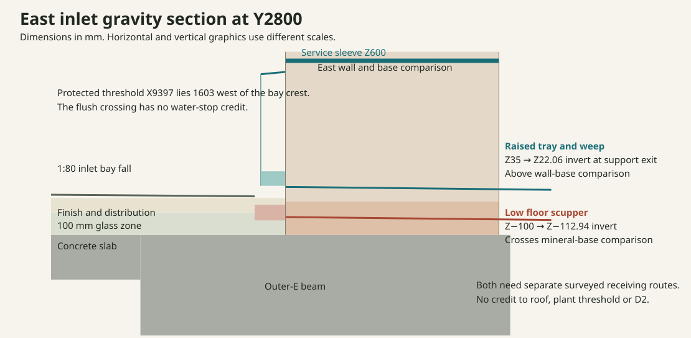

# Resolve the selected incoming-water route

**HAD-INLET-RESOLUTION — development checkpoint; no new inlet is adopted.**

The selected house retains an incoming-water centreline at X11200/Z500 that
passes through 200 mm of the plant-N required envelope. The
[internal-leak study](../mra/internal-leak-study.md) correctly labels it rejected
and requires an actual route, upstream isolation and contained drain before
selected-house and internal-moisture acceptance. This packet develops the
evidence needed for that decision. [Owner-directed issue #1477](https://github.com/adamnoden/architecture/issues/1477)

## Current-source findings

The [reproducible study](studies/incoming-water.mjs) and
[derived result](studies/incoming-water.json) now distinguish the historical
proof from the actual selected house. The earlier proposal cannot be adopted by
changing its status or refreshing a source hash.

| Current occurrence | Result and consequence |
|---|---|
| Plant-N and inherited inlet | The retained line still enters 200 mm of the required radiator envelope. It remains rejected. |
| Current Ø760 cylinder | The old west seat at (10090,3970), checked against a Ø595 case, overlaps the current complete case/pipe reservation by 34.9 mm. The current seat at (10195,3970) has 43.0 mm installed clearance; its tail and stand must nevertheless leave the cylinder transport envelope. |
| Ordinary plant entry | The old low bridge crosses the normal body path. A removable connection cannot require disassembly every time somebody enters the plant. |
| Current utility fan | The old low branch endpoint at (11315,2380,1000) enters the selected maintenance-platform territory. The former generic upper connection (11200,1800,2945) lies inside the selected fan pod. Neither remains a connected utility solution. |
| Utility first release | A tube that reaches a generic under-bowl point does not establish reachable native tap breaks or a captured sink-head release. Rigid tails can invalidate the selected head package and its 250 mm retained underhang. |

### What the new geometry earns

The cold backbone keeps the authored **Ø74 complete envelope** and uses finite
R75 centreline bends, including a diagonal between the fan assembly and the
utility heating pair. It rises in the lobby and crosses the utility pier at
X11315/Z2725. Its controlling nominal gaps are 28.17 mm to the complete fan
support, 28.40 mm to the heating pair and 28.50 mm to the east wall. These are
only about 3 mm beyond the 25 mm comparison; an actual fitting, clip or setting
error cannot be hidden outside the modelled envelope.

A separate hot branch can leave the retained hot routing territory at
(10100,3200,2945), cross the **west** utility pier and use the rear chase. It
clears the fan pod by 363 mm and the full electrical work territory by 108 mm.
This changes the hot route as well as the incoming cold route; it is not a
second supply installed beside the rejected branch. Both new pier crossings
remain structural and fabric admission duties.

The trial leaves full upper ends at (10760,1250,1000) and
(10860,1250,1000). Their complete envelopes have 26 mm between them, with
58 mm to the lifted host frame and 113 mm to its translated carrier. The cold
end moves 40 mm west of the old fixed upper-water axis. Its restraint and the
new hot restraint need actual shaped contacts and a declared load path; an
overlapping beam is not a clearance pass.

Below those ends, the study separately examines **exposed removable apparatus
connections**, with a 50 mm whole terminal reservation and finite R25 bends.
That is an explicit alternative requiring product, guard, touch-temperature,
condensation and receiving evidence; it is not an unnoticed reduction of the
backbone's insulation. The routes avoid the declared foot windows, rack links,
waste and head bounds. The washer stem meets its authored valve reaction
support, so the actual clamp/fitting interface must still be drawn. More
fundamentally, reachable sink first breaks and the native head separation are
not yet earned. The terminal alternative remains **NOT_ADOPTED**.

The recovered successor now brings the cold/hot head breaks forward to
**(11110,1275,595)** and **(11300,1275,595)**. These are designed service
interfaces, not inferred native tap positions. Each matched union occupies
Z565–625; a positive open reaction key on its lower body leaves the turning
38 mm spanner at Z615. The 297 mm long, 71.5 mm wide, 12.8 mm thick tool,
50 mm hand and 40 mm arm are included. The cold 35–95° and hot 75–135°
sectors each retain 27.95 mm after the conservative angular bound, with
maximum reaches 544.58/515.45 mm from a declared crouched shoulder.

The reaction keys connect through a removable front frame to the existing
independent rear service rack, not to the sink head. The proposed
30 × 40 × 3 mm rail carries an authored 250 N vertical and 50 Nm wrench
comparison with 40.54 N/mm² nominal bending and 0.525 mm cantilever
deflection. Actual contact, torsion, welds and rack anchors remain the matched
component/installation duty. The keys are shaped contacts around their own
union, not unexplained solid interpenetrations.

Hot branch stop **H0** sits on the vertical upper drop at
(10860,1250,1500), stem facing north, before the lower removable apparatus
connections. Its control is reachable from the utility front without passing
an arm through the upper pipes. Cold isolation remains the separate lobby U0
duty. H0 replacement itself needs upstream store isolation and controlled
discharge; closing H0 cannot isolate its own upstream connection.

The captured head now explicitly allows **350 mm below the rim**, giving a
610 × 610 × 700 mm complete moving package. Lift its lowest part to925 before
the existing760 north/730 west moves. Full head comparisons retain25 mm to
the frame,30.5 mm to the east wall and33 mm to H0 and the hot upper cap.
At the separate rim700 rest its lowest appendage is350 above the floor.
The530 mm lower-body limit applies across the two longitudinal bearing rails;
it is not a square throat. Place any receiver cross-bracing below325 and
retain positive capture against pitching until the actual underside lands
are supported. The original fastener/pickup qualifications remain with IAS.

A separate **400 × 400 × 75 mm controlled-service receiver** fits beneath
the head and all four full foot windows with25 mm clearance. Its12 L external
cuboid is an upper bound; require10 L actual net capacity. It is distinct from
the normal2 L leak witness. Drain one isolated branch at a time, verify zero
pressure before first release and empty the receiver under control. No
unattended burst or whole-cylinder draining claim follows. These successor
calculations are in `utilitySuccessor`; the old terminal trial is retained as
the adverse comparison. Overall inlet adoption still awaits the station and
supported cylinder release.

For the cylinder, a **2150 mm bridge crown** leaves 113 mm above a declared
2000 mm standing head and 78 mm below the actual 2350 mm finished service
panel after the 85 mm lift. A small dogleg keeps the original entry and work
endpoints while clearing the full pier, including its 18 mm baseboard. The
proposed 120 mm east / 160 mm north diagonal gives continuous minima of
43 mm to the case and 41 mm to the heating pair. The lower minima occur during
travel, not at the end. The old tilt and parking rack do not accept this taller
bridge. A proposed indoor first-rest frame passes object distances but blocks
the obvious handler stance; it is explicitly rejected as a complete receiving
method. Independent capture, retained supports and an actual receiving sequence
remain prerequisites to adoption.

### Isolation and material boundary

The located lobby comparison now separates three upward-stem cartridges.
Main **I0** is at X11450, union Y3075/3520, made Z1440–1500 and crown1690;
utility **U0** is at X11315, Y2732/3057, made Z1140–1200 and crown1390;
plant **P0** is at X11315, Y3175/3500 with the same lower heights.
Each branch has175 mm of straight crown for the55 mm comparator and two
bounded55 mm adapters. The main has295 mm. A larger flanged valve is not
silently substituted. The main's lower return uses explicit R50 bends within
the same complete Ø74 reservation; other station/backbone bends retain R75.

The incoming entry moves to **(12090,2800,600)**. The utility riser moves behind
the station to **(11505,2882)**, then crosses back to X11315 above the work area.
The earlier west riser met the turning spanner and is rejected. Complete
297 ×71.5 ×12.8 mm wrench sectors, hands, arms and arrival bodies now clear
the named station walls, other union/valve bodies and riser. The controlling
tool reserve is27.40 mm after the continuous angular bound; maximum declared reach is
643.01 mm at the P0 north joint. Main servicing removes the branch cartridges
before its nuts are worked. The main carrier rear handoff bar is45 mm higher than the branch bars; the
lower version obstructed the wrench hand. The station comparison includes two
independently supported metal
elbow shoes, positive wall catches, complete carrier rails and a two-person
handoff at the finished doorway. A low removable tool closes each captive
half-shoe beside the stripped22 mm pressure tube. Its loaded native gap is
2.708 mm after the stated tool deflection and0.5 mm setting allowance;
remote hand/tool/arm spaces retain the separate25 mm comparison. The shoe
radius and fasteners fit within the declared complete envelope. The branch
valve/adaptor module retains5 mm at each tangent-trimmed shoe end.

Both captive nuts release while the independent catches carry the cartridge.
After witnessed transfer to rated grips, withdraw both positive catch keys,
lift85 mm and move west. The complete moving carrier is tested against the
retained pipes, valves, reaction keys and catch hardware. The old I0 reaction
arm left only20.86 mm to P0; raising it15 mm and shifting its north approach
25 mm closes that specific conflict. The arm-to-key load path is continuous.

At module axis9400/3200 a second worker takes a separately inserted and
positively pinned rear yoke. The first withdraws to8830/3830, clear of the WC,
court and closed protected cross door; the second carries to the anchored
400×650 mm receiver at X8000/Y2875. The complete receiver has sparse guides,
metal bearing lands and two positive moment-restraint keys. Its key-actuation
hands and arms are included. Each independent catch/grip carries the8 kg
complete handled-module comparison with a factor2; every receiving capture
also resists25 Nm pitch moment. The positive hard seats must close their
initial2 mm insertion fit to≤0.1 mm play before either hand releases.

This is one first-rest field. An occupied frame is never unbolted or replaced
under load. Onward restrained bench transfer and an empty receiver must be
verified before another cartridge follows; both branch cartridges leave
before I0. Actual material, matched contact, gross mass, native installation,
anchor/core and pressure performance remain allocated qualification duties.
These bounded native and operational arrangements support an architectural
selection; they do not supply an installed article rating.

Separate350 ×450 ×75 mm floor receivers require8 L net each; their external
cuboid permits at most11.81 L. Use manually closed batches of at most5 L.
Four capped manually controlled drains now discharge through metallic spouts
atZ200 into their named receivers. Their crouched control reaches, arms and
station obstacles are included. DU/DP deliberately retain sealed low900 mm
pockets; draining a high branch does not claim those pockets are empty. Full
low-spool removal needs local capture after zero-pressure proof. Utility
cold/hot branch drains end atZ150 over their separate10 L receiver, leaving
75 mm to its lip. The whole vessel is emptied through its dedicated admitted
drain before plant/bridge intervention; these pans cannot hold300 L. The new bore's protected riser has
200 mm plan separation from the current P17 cap; actual wall/bore/foundation
and site/provider details remain explicit receiving duties.

The water cut must be located upstream of the component under intervention.
Closing a fixture stop cannot isolate its own upstream joint; replacing the
main indoor stop requires an independent boundary cut. Mains closure and pump
shutdown do not remove DHW or heating inventory. A finite controlled-drain
receiver cannot be credited as unattended mains-burst protection, and the
cylinder safety route must remain independent while the vessel is charged.

The Hattersley 33X ¾-inch valve is a **dimensional comparator only**: its official
sheet gives 55 mm face length, 95 mm height and a 69 mm handwheel. It uses an
integral bronze seat, but the listed asbestos-free packing and fibre gasket do
not identify their complete constituents. The manufacturer allows a vertical
stem on horizontal pipe, or a horizontal stem on vertical pipe, and requires
accessible maintenance. No no-synthetic or product acceptance follows from
these dimensions. [33X data](https://www.hattersley.com/app/uploads/2024/01/Fig-33X-33XLS-Hattersley-DS-1219-P67.pdf)
· [manufacturer installation instructions](https://www.hattersley.com/app/uploads/2024/11/Hattersley-Gate-Valves-Bronze-Iron-IOM-112024.pdf)

Pegler PB350 is not an admitted substitute: the prior materials investigation
already records its PTFE/FPM duty. The industrial Spirax BSA6T metal-seat option
has useful bellows/packing evidence, but drinking-water suitability, full
constituents and the cap ambiguity are unresolved. Neither a partial bill of
materials nor industrial water service establishes the owner's material policy.
[BSA6T technical information](https://content.spiraxsarco.com/-/media/spiraxsarco/international/documents/en/ti/bsat_bsa-ti-p137-18-en.ashx?rev=6f4d23327ff843fab9521857b6a0178f)

#### First wetting at the lobby inlet

Wetting trace starts at the actual new I0/U0/P0 cartridge axes and at the
inside sleeve face, not at the point where a sump would be convenient.
The six union locations project **50–75 mm** inside their assigned lobby
receiver edges. All four controlled spouts project into their receivers,
with **30 mm** minimum nominal plan reserve. These are downward point
projections before water follows insulation, clips, pipes or structure.
They do not support a burst-capture assertion. A closed pan can retain
maintenance batches only while the operator positively verifies its
upstream cut, attends the spout and closes before emptying. Keep the
separate leak path as an independent design problem.

By contrast, the entry meets the inside east face at **X11570.5**, already
**20.5 mm east of the pan lip**. In a straight-down witness, wetting starts
at the wall toe or floor joint even with both pans empty. Keep B0 on the
owner side ahead of the entry and I0, accessible from the dry exterior.
An I0 closure cannot cut a pressurised joint ahead of I0. A leaking I0
body or either I0 union therefore requires B0. U0/P0 body or union
failure requires I0 on the forward path and verification of the return
or stored downstream inventory. A failed B0 or an upstream joint needs
the provider’s separate upstream action. Keep the independent plant
relief connected while the vessel is charged. D2 behind the visible
tundish receives the safety-device discharge, not an arbitrary lobby or
plant floor leak. [Approved Document G, 3.54–3.57](https://assets.publishing.service.gov.uk/media/66f6c6ce3b919067bb4828cc/ADG_with_2024_amendments.pdf)

A full or defeated witness provides no additional capacity. With an empty
8 L net receiver and full capture only, the inherited MRA **6/15/30 L/min**
flow comparisons reach its edge at **80/32/16 seconds** from first capture.
After one 5 L controlled batch the same arithmetic gives **30/12/6 seconds**.
Neither timing is a declaration or response interval. Splash, a blocked
witness or bypass can wet the room before any water becomes visible there.
A torn inlet can remain supplied while a person is absent. An unknown
residual, no protective sump, and a shared blocked drain cannot supply
a guaranteed outfall. An unverified jet direction is recorded as unknown.

In plan the two pans touch along their shared edge; the nearest solid
room-side toes are **20.5 mm** at the east wall and **28 mm** toward the
respective utility and plant walls. The upper arch and utility access
remain separate openings. From the centre of the western pan edge,
the straight projection to the east face of the protected-hall door
is **1803 mm**. The actual open effective passage is **742.5 mm** and
its floor is not a demonstrated water barrier. The existing occupied
body station leaves only **25 mm** to that west pan edge. No broader
stand, emergency tray, or passive cross-floor channel gets that space
free. A spill could affect access to the utility electrical station from
its lobby side or the plant controls, depending on its direction and floor
levels. Do not credit either route as dry, the closed door as a dam,
or the currently dry operator path as a fault-time escape check.

An inspectable sleeve drip flashing with **25 mm** trial plan overlap and
5 mm setting on each of pan and flashing must project at least **55.5 mm**
inward from the finished wall. The 35 and 50 mm projections leave 4.5 and
19.5 mm effective overlap. The 60 mm comparison reaches X11510.5 and
retains **29.5 mm** overlap. At the 100 mm bore's plan edges there is 75 mm
nominal south reserve and 275 mm north within the receiver's Y extent.
This only positions a drip edge. It has no end return, drip angle, jet
hood, independent support, safe outflow or blocked-lip proof. Keep its
fixing and first motion independent of the bore seal and pressure pipe.

**Pre-site design action:** develop the local sleeve drip detail and earn a continuous
visible mineral-floor toe and a competent, passive disposal route that
keeps the protected opening and utility electrical territory out of the
spill field. Compare a very local joined receiver with a genuinely dry
upstream supply-isolation arrangement. Do not extend the existing floor
pan into the protected passage. Show first wetting outside the collar,
blocked witness, first safe approach to B0 and the independent destination
before crediting the liner. Trace wetting under the floor finish and behind
wall toes, document dismantling and drying access, and separately test the
pressure repairs. Repeat this check after those details and actual fall
and thresholds exist. This advances the MRA INT-01 design input and
retains the rejected old route and current inlet adoption blocker.

Run `node project/had/studies/incoming-water-first-wetting.mjs` to reproduce
the case matrix.

#### Passive lobby drain and sleeve section

The selected house has ground FFL Z0. The [MAT floor comparison](../mat/conventional-ground-junction.md) places the 15 mm finish, 65 mm distribution zone and 100 mm glass above concrete at Z−180. Keep the existing protected opening at X9397. At the east side, the finished wall face is X11570.5 and the Z600 service sleeve passes at Y2800. At this station, the proposed [outer-E grid](../str/studies/current-house-grid.json) occupies X11217.5–12117.5 at Z−630 to −180. These inputs limit the section. The quoted mineral wall-base depth at Z−180 to −30 belongs to the MAT internal-spine comparison. Challenge a continuous break of that depth at the east wall as a negative control. The actual east-wall load, DPC, air closure and sill assembly must be issued separately.

A trial 570.5 mm-wide repaired floor bay from X11000 to the east face takes a 1:80 fall from Z0 to Z−7.13, leaving 5.13 mm net eastward fall after two 1 mm endpoint settings. The tray and bay extend Y2675–3575 and end just 28 mm before the south and north finished faces. Continue formed end returns to their separately detailed wall-base joints. Locate the contained low sump in this bay. The new sump shell would reach Z−115 and locally displace 35 mm of the assigned glass zone. Give it direct verified support, a thermal detail and an inspectable cleanout. The protected opening stands 1603 mm west of the bay crest. Neither that separation nor the ordinary Z0 floor and threshold establishes water retention. A jet outside the bay or a blocked sump can still wet the circulation route. Keep the opening flush in the control and trace wet escape into the utility and plant openings as well.

| Section at Y2800 | Dimensions and disposition |
| --- | --- |
| Low floor scupper | Ø80 clear within Ø100 formed reservation, invert Z−100 to −112.94 on a 1:50 grade from the inside face to X12217.5. The envelope clears the outer beam top by 52.06 mm after adverse setting and passes 245 mm south of the P17 cap in plan after setting. But it overlaps 80 mm of the comparison mineral-base band at the inside and 92.94 mm at the end if that band continues across the section. Reject cutting an unchanged continuous mineral base for this branch. The low route needs a proper formed supported opening, separately detailed bond, damp and air returns around it, and restored insulation below the sump. A passing beam clearance gives none of those. |
| Raised sleeve drip receiver | Keep the 60 mm inspectable flashing beneath the existing sleeve, shedding into a small supported receiver at X11510.5–11570.5/Y2735–2865. Its floor at Z40 falls into a separate formed outlet with invert Z35, reaching Z22.06 at X12217.5. The Ø100 reservation remains 7.06 mm above FFL after adverse setting at the end, outside the base comparison. Keep the rim at Z105, 30 mm above the retained service pan rim, and keep access from the lobby to the return. Support the tray independently from the pressure tube and removable pan, then check removable flashing, end laps and access to the bore collar under movement. This is a way to develop a local drip route above the base. It cannot drain the existing floor or claim capture of a pressure jet or a cartridge rupture. |

The two alternatives require their **own destination**. The outer lines extend a trial 3 m at 1:50 beyond X12217.5. At the terminal allow 25 mm free drop to the design maximum receiving water, giving at most **Z−197.94** for the low route and **Z−62.94** for the raised route. Maintain access outside the RWT receiving territory, verify ground and gravity inequalities with actual outfall and tailwater levels, and provide visible escape away from protected doors on blockage. The exterior plant-door collector, roof receivers, D2 vessel relief and unverified buried site drains receive no flow allowance. A finite isolated receiver without an outlet needs **30/150/600 L** for one/five/twenty minutes at the retained 30 L/min sensitivity, before freeboard. That scale makes timely isolation material even when the sleeve captures.

As a conveyance screen, an Ø80 smooth trial at half full, 1:50 and Manning n=0.018 gives **87.3 L/min**. An ideal free rectangular control at 25 mm available head gives only **32.3 L/min** at 80 mm effective width and **16.2 L/min** at 40 mm. That is an ideal local weir, not the native pipe inlet or a prediction for a grille. Keep both free approach and receiving ventilation, and test contraction, inlet loss, cold outlet and partial blockage. Preserve the 8 L removable service pans and independent upstream isolation. The raised option may improve visibility of first drips. A passive floor escape route is still held by the floor and wall section, guarded threshold, accepted receiving destination, and physical wetting and reinstatement checks. [Hydraulic model reference](https://www.fhwa.dot.gov/engineering/hydraulics/pubs/12026/hif12026.pdf) · [Reproduce the section comparison](studies/incoming-water-lobby-drain.mjs)

#### Separate elevated drip witness

Keep the wet-area and sleeve duties distinct. Route the inlet's clean gravity drips through a small accessible witness above the south intervention pan. The witness cannot receive the uncontained floor or a cartridge rupture, cannot demonstrate pressure-jet capture, and does not change the B0 or provider isolation hierarchy.

The earlier Z40 receiver competed with the retained south pan where they shared plan. Try a separately supported metal receiver at X11485–11570.5/Y2705–2895, underside Z100 and rim Z145. The witness ends under the pressure-tube territory at Z550, just 3 mm from its lower surface after the two 5 mm settings. Do not touch or support the pressure train, and avoid hiding the pressure-sleeve collar. A shortened 50 mm flashing ends at X11520.5 and overlaps the wider witness by 25.5 mm after both settings. Across Y, the witness leaves 35 mm reserve after charging the diameter of the formed supply sleeve and both settings. Form returned ends and a visible drip, and prove that parts can be removed from the room independently of the seal and pressure tube. Verify brackets, substrate, local movement and cleaning. The repaired floor and its ventilation and moisture interfaces carry no witness load by assumption.

The elevated tray overlaps 65 mm of the retained floor pan in plan, with 15 mm vertical separation after settings. Translate the dry pan 75 mm west before an upward lift. A matching 75 mm worker retreat from the selected stance puts the trial body centre at X10800 to retain the same 25 mm plan relationship to the pan edge. Prove the positive handhold, floor slide, reach and full movement. The four controlled spouts keep their separate service-pan projection and existing 125 mm height above the pan rims. Closest plan clearance to the new witness and its side plenum is 100 mm even after the specified spout envelope is charged. Do not use the witness to receive the normal 5 L service batches.

Give the clean branch a 175 mm north diversion to Y2975, at 1:50 (3.5 mm fall), before any new wall crossing. Keep the vented side plenum at X11485–11570.5/Y2895–3055 and its whole underside at or above Z90. At such depth the plenum has only 5 mm clearance to the pan after settings. Final inlet invert Z90 lies below the starting tray floor. Fold the local branch and plenum without adding a second pan opening or fastening into the original pressure bore. The Ø80 passage through an independent Ø100 formed reservation then falls at 1:50 to its first supported exterior station, X12217.5/Z77.06. The design separation to the comparative Ø200 inlet riser is **15 mm** after two 5 mm settings, with the centre lines only 175 mm apart. Matched fabricated geometry, fastening, air and water sealing, capillary ends, insulation, frost and actual excavation around both runs remain open. Do not fit a new inside drain by cutting the mineral barrier below floor.

A separate 1.5 m supported branch reaches X13717.5/Z47.06. Retain a visible 25 mm free-drop comparison and maximum receiving water **Z+22.06**. The earlier 3 m termination would lie inside the temporary gantry's dry set-down field, X15075–16425/Y2325–3275. The shorter trial terminates 1357.5 mm west of that field and south of the mapped east RWT receiving corridor, whose south edge is Y6100. Neither position proves site disposal. Demonstrate the actual supported duct, free outlet, protected cleanout, separate maintained receiver and downhill continuation. Keep water and ice out of the carrier set-down and emergency approach. Neither the plant-door collector, roof-water receiver nor D2 takes this duty.

The tray has 20 mm freeboard above the 25 mm trial head. A 160 mm clear entrance into a separate vented plenum screens **64.7 L/min ideal**, **32.3 L/min** at half width and **16.2 L/min** at quarter width. The prior Ø80 half-full barrel remains above these ideal figures. Actual contraction, strainer, outlet and backflow could lower the capacity. The status remains a drip comparison because an outlet able to pass a nominal flow says nothing about capturing a pressurised release. The candidate has no wet protected-threshold or pressure shutoff proof.

Reject the unchanged pressure sleeve as the same gravity branch. The Ø100 bore minus Ø74 pressure train gives 13 mm radial room, 11 mm after the sourced 2 mm setting. Across the 519.5 mm bore reach, 1:50 takes 10.39 mm of this, leaving **0.61 mm** before any independent liner or support. Extending that slope to X12217.5 exceeds the entire available radial room by 1.94 mm. Even granting a full 11 mm open circular segment and slope, ideal capacity is only 8.07 L/min. A purpose-built dual sleeve would need its own closed pressure and ventilation boundary. The independent elevated case preserves the existing sleeve and leaves full lobby wet containment held. [Reproduce the comparison](studies/incoming-water-elevated-drip.mjs).

### Checkpoint boundary and reproduction

This checkpoint preserves the selected model, compact service schedule,
roof-facing ports and weather faces. It does **not** clear the existing inlet
blocker or complete this node. The JSON records exact source blobs and the
unchanged current-house identity; historical MAT and MRA results retain their
original scope. Any later physical selection requires its own precise consumer
receipt, including MRA and the ordinary plant-access path.

Run `node project/had/studies/incoming-water.mjs --write`, then
`node --test project/had/studies/incoming-water.test.mjs`. The regression checks
finite bends, the current adverse controls, complete pipe envelopes, continuous
motion minima, the failed first rest and the prohibition on implicit adoption.

#### Trade the wet lobby approach for an external I0 cabinet

The [external cut cabinet comparison](studies/incoming-water-cut-cabinet.mjs) moves the I0 cartridge, both I0 captive unions and the independent D0 intervention point outside. B0 remains farther upstream in the Boundary Service Lodge, with an independent provider-authorised cut for intervention on B0. In normal service the relocated I0 remains the forward cut for U0 and P0. During work on I0, prove closure at B0 and on the house side before releasing its nuts. Stored water, the vessel safety discharge and any downstream return remain separate duties. Relocating the cut is consistent with the *location option* in [Water Regs UK guidance](https://www.waterregsuk.co.uk/topics/all-faqs/why-do-customers-need-their-own-stop-valves/). It requires a genuinely accessible location and acceptance for the specific installation.

| Current-source comparison | Earliest useful decision |
| --- | --- |
| Cabinet at X12125–12650/Y2450–3350, open face to east | Both cabinet and first-rest field have 50 mm nominal plan separation from the dock. The trial 100 mm support shoes clear P17 by at least 57.5 mm in plan before excavation and construction allowances. The elevated drip pipe remains a different route below the cabinet with a conservative 60 mm vertical separation to the base. Its independent access and outlet cannot be built over. |
| Control and first rest | The comparison puts a dry R300 operator at X12975/Y2800 on Z−490. The mirrored control reach is 555.0 mm. Both mirrored wrench-sector plan trials have at least 62.7 mm lateral reserve to an 820 mm clear face before the pipe, lock, chamber and door geometry is fitted. The 85 mm lift and 650 mm eastward translation take the emptied cartridge to a first rest at X13000, leaving 25 mm beyond the R300 body during the trial. Provide two positively retained supports and an opposing reaction for both unions. None of the figures earns a loaded handling pass. |
| Plant dock trial level | At grade Z−1800 the working platform would need to rise **1310 mm**. A valve at Z850 cannot be treated as directly accessible from that grade. Prove an independently guarded dry approach and retreat with room to carry and inspect the module in an outage. The dock edge, opening and loading path keep their separate duties. No unproved platform surface, stance or ground can establish adoption. |

Keep the single Y2800/Z600 house penetration and the existing three-way tee at X11315/Y3175/Z900. The relocated train can enter the bore on a straight tangent and continue to the tee on the 1944 mm indoor route with R60 centreline turns. Its first turn starts 70.5 mm inside the finished east face. The lower jacket turn retains 34.5 mm to that face, 46.0 mm to the north wall, 116.0 mm to the south wall and 212.3 mm to the retained upper cold riser. Two independent 5 mm settings leave only 24.5 mm at the east approach, 0.5 mm below the 25 mm comparison. Set the tube farther inboard with a checked bend and update the support geometry, or substantiate a tighter transfer datum. Keep air, seals, structure, actual fitting geometry and independent support in the joined detail. The D1 takeoff remains on a straight tangent at its existing point but cannot drain the new route's low stretch at Z600. Develop that distinct low cut as part of sleeve isolation and drainage. Existing D0's removable arrangement is not transplanted by name.

The aligned preformed R60 elbow and jacket occupy a 134 mm crosswise envelope, 34 mm over the existing formed bore. Passing the straight jacket uses 74 of 100 mm and leaves 11 mm radial allowance after setting. Do not assume manipulation through the finished bore or in-place forming earns a renewably joint-free sleeve. If a separately renewed straight spool needs an accessible inside union, it returns one indoor pressure repair point. Even with demonstrated straight-sleeve continuity, the four U0/P0 unions and tee stay indoors. The comparison moves first wetting from the I0 body and its two joints to the exterior, leaving indoor branch, wall-bore, tracked-water and stored-water faults to be checked separately.

A clear inside tray 820 × 440 × 80 mm has 28.86 L gross before slopes, penetrations, clips and slosh. Treat **24 L clear net** with 6 L held back for downstream residual, tolerances and post-cut arrivals as a trial requirement, not measured storage. At 30 L/min, with both outlets blocked and complete enclosure capture, 18 L fills in **36 seconds**, and 24 L fills in 48. The 6 and 15 L/min cases give 180 and 72 seconds to the reserve. Alarm and valve travel, leakage after closure, and remaining pipe and vessel inventory must meet that bound for any future automatic response claim. Manual action has no guaranteed response time. A tripped indicator is not proof of upstream shut-off. Failure of the valve or a leak ahead of it requires the appropriate upstream cut, even where the enclosure collected the initial wetting.

A separate 160 mm sharp-crested opening with 25 mm head and a trial 0.62 coefficient gives **69.5 L/min** ideal, or **34.7 L/min** for half the clear width. A fault outlet and overflow need independent free discharge with no shared pinch or backwater, and no spray or sheet flow through the standing or loading areas. The tray arrangement still needs a physically intercepted jet, independent supports and a verified sealed route around the rising supply where it passes the tray level. Wet hood, closures, bypass, blocked outlet, outfall, re-entry at the wall, frost and dry service access are controlling tests. No capacity is credited to the raised gravity drip, threshold collector, roof receivers or D2. Do not substitute the 30 L/min sensitivity for the actual source-fed burst rate.

**Disposition.** Keep the existing interior proof as the working comparator. Advance the external I0 route only when survey supports the dry working level and receiver and a matched valve, sleeve and isolated capture fits. A confirmed branch leak still needs independent indoor protection. Neither option admits the whole inlet because station, utility and plant renewal duties remain open. Reproduce the bounds with `node project/had/studies/incoming-water-cut-cabinet.mjs --check`.

## Starting authority and bounded question

Registration began at `b0f3ffd5363bbedb1c295ee1041c15cbfb5e5de5`; the substantive
checkpoint starts from merged main `003f61bacebd4cb3294280059b64f1bb5fc87f88` and the default
[current-house compositor](studies/current-house.mjs), including the selected
Ø760 cylinder at (9830,4250), utility first release and fitted fixtures. The
[lobby inlet proposal](../mat/plant-inlet-route.md) is a developed alternative;
its historical Ø595-cylinder clearance proof is not current-house evidence.
The old cold seat at (10090,3970) overlaps the current complete jacket
reservation. The selected seat at (10195,3970) clears the installed case, but
its tail and stand must also leave the current cylinder transport envelope.

Resolve a complete pre-site architectural inlet/station and its affected
branches without changing another worker's roof/floor source. Keep explicit
source identities and recheck changed wall, support and foundation interfaces.
HAD-SERVICES-ADOPTION and MRA-INTERNAL-LEAKS are the completed prerequisites;
TRIAD-GATE and MRA-02 receive the result. No dependency or wider acceptance gate
is removed, and no additional registration-completion packet is created.

## Required result

1. Select or reject a located incoming route with complete pipe, fitting,
   insulation, support and wall-crossing envelopes. Preserve plant-N normal
   operation and renewal, utility/cylinder/buffer access and the inhabited
   house. Compare the existing lobby alternative and any necessary correction.
2. Locate accessible upstream isolation, branch cuts and a contained controlled
   drain. Distinguish downstream-tail isolation from replacement of the stop
   itself or a joint upstream of it. Charge the actual control, hands/tools,
   arrival, supported first release and retained-end restraints.
3. Complete the utility-side branch to the selected washer stop and sink
   connections without defeating the integral head carry, washer withdrawal,
   electrical field or emitter access. Rebase the cold bridge and removable
   west socket/stand onto the selected Ø760 vessel and actual safety route.
4. Trace first wetting, bounded controlled residual, visible declaration,
   receiving and repair at the assembly. Do not credit a finite maintenance
   receiver as unlimited unattended mains-leak protection or drain through a
   path whose blockage is the failure under examination.
5. Publish reproducible current-source geometry and adverse cases, a reasoned
   architectural decision and the affected source/receipt reconciliation.
   Retain the exact structural piercing/support, constituent/product,
   physical, frost/provider and real-site conditions with their receiving
   owner and resolution point. No material exception, physical acceptance,
   whole-house moisture pass or construction release follows from this study.

**Exit:** an earned architectural selection and complete bounded interface
result, or a substantive rejection with the required changed house scope and
canonical graph disposition. Another brief or an unchanged unresolved route is
not sufficient to mark this node complete. Useful independent work proceeds
before roof acceptance; the whole selected house still needs its owning gates.

## Registration provenance

Issue #1477 recorded the exceptional absent-node bootstrap before source
mutation. The exact runtime file was absent. Generation 1 was constructed and
parsed by the canonical claim schema, created with create-if-absent semantics
on retained `runtime/claims`, and verified by exact content reread. Until this
planned node reaches main, its unknown live claim intentionally fail-closes
automatic dispatch. This is not a canonical dispatcher execution. The separate
roof lease and selected source remain untouched.

Registration adds one planned node and its receiving dependencies. The graph
regression checks that the inlet can proceed before roof integration, that
finishing the roof alone cannot release TRIAD, and that MRA-02 still requires
TRIAD after the inlet result. Applicable checks, exact-head CI and fresh
canonical publication preflight are required before merge; the PR retains the
executed evidence. No substantive inlet completion is claimed here.

## Independent utility first-rest candidate — 12 November 2026

The interrupted generation-3 **Y1110 / 285 mm** utility correction now has
an executable current-source comparator:
[utility-first-rest-preflight.mjs](studies/utility-first-rest-preflight.mjs).
It imports the actual IAS utility frame blob and the current-house envelope;
it intentionally does **not** mutate or regenerate the historical
`incoming-water.json` or selected-house sources. The existing `Y1125`
trial is retained as a rejecting control.

The first bound preserves the four existing IAS frame feet and the temporary
carry bar. Movement is 35 mm up, 285 mm north, then 35 mm down on
flush bearing patches; no west translation is borrowed from the older frame
route. The two complete lower sink branches move their horizontal crossing to
Y1110 (R25 exposed-terminal envelope), without touching the selected upper
cold/hot backbones. The checker uses exact segment/box distances for finite
pipe bends, conservative swept AABBs for the axis-aligned moving members,
full fixed cap/washer/emitter/reaction objects and continuous crew body
path bounds. Two grip heights per worker get 100 arm/hand samples per stage
with a half-step distance penalty. The new underside washer-stop key/reaction
boxes are explicit remote obstacles except at their own intentionally
mated tube/support contact.

The independent source calculation found the following nominal design
witnesses, to be confirmed by exact-head CI:

- moving frame to finished east wall: **25.5 mm**, not the defunct wide
  corridor implied by the abandoned west-translation method;
- moving frame to Y1110 terminal branch: **29.999 mm** after the
  R25 pipe envelope and finite-bend bound;
- Y1110 branch to retained rack post: **29.999 mm** under the same bound;
- retained Y1125 trial to rack post: approximately **15 mm**, which fails
  the 25 mm remote nominal screen.

The proposed four feet land directly over the specified65 ×110 mm recessed
prepared patches. With 1 mm lost at each edge, each patch leaves 6804 mm²
for the 2 kN/foot **comparison**, or0.294 MPa against the inherited0.3 MPa
screen. There is no credit for loose raised pads under the workers.

This is a *local first-rest candidate*, not an adopted factory-head removal
method. It does not qualify the full frame mass/CG, four actual foot anchor
paths, bolt/pin welds, physical crew handling, pressure components,
all actual placement tolerances or IAS onward export/return. The new dry
native washer-stop contract remains its own fabrication/pressure duty.
The cylinder's whole-U bridge/tail and stand retirement, and the selected
inlet/house/MRA replay, remain open. No material/house selection or
workstream-completion claim is made by this comparator.

### Native upper bridge restoration — generation 4

The source recovered on11 November as inert text is now restored as an
importable [upper bridge native module](studies/incoming-water-bridge-native.mjs),
with its import relative to the real main-house study directory. The
recoverable original text remains in the [immutable predecessor archive](https://github.com/adamnoden/architecture/blob/a654e8ed200d2b9de057e7e4008cbd67655392d4/project/had/recovery/2026-11-11/README.md).
The executable wrapper
fail-closes if the selectedØ760 cylinder body, east plant door, western
water socket or exterior finished-wall line changes; it does not substitute
a historicalØ595 cylinder.

The existing HAD test suite now executes the native spanner/hand/arm envelopes,
two independently retained upper shoes, low positive capture and pinned
receiver, including adverse controls for the original raised gate and the
wrong gate-close order. It distinguishes intentionally mated native contacts
from25 mm remote noncontact. Independent source-bound room and utility
first-rest cases remain independent; the original20-state bridge-motion
source and signed braced-support frame are still **inert recovery source**
and have not been promoted to executed project receipts in this head.

The native upper bridge remains **unselected**. This work does not qualify
actual factory unions, pressure fittings, physical mass/CG, guide fabrication,
room/floor anchors, wear or the installation crew's verified procedure.
The lower tail/stand withdrawal and full whole-U move remain separate open
requirements. Require exact-head CI for the restored source before crediting
its executable controls.

### Generation 6: selected-house source guard and native upper motion

The first executable recovery used `water-replan.json` to guard the selected
cylinder. That file is an upstream **historical 595 mm candidate**, although
the same programme later composes the real selected 760 mm vessel. Exact-head
CI #43189142696 correctly rejected the stale guard. The new code checks
`deriveCurrentHouse().model` instead, including the full 760 mm cylinder,
western cold seat, actual plant door and current house east envelope. It does
not alter the old upstream evidence or weaken the guard.

The previously private [20-state upper-bridge motion
source](studies/incoming-water-bridge-native-motion.mjs) is also now
executable and included in the HAD test suite. The moving carrier struts,
shoulders, actuator/cleats and true heel boxes have explicit swept AABB/actual
oriented-arm checks; carried crown/elbows/vertical metal are checked against
the forks, posts, base, plate and both arms. The original <=2 mm movement
sampling and <=0.5-degree arc comparison include separate motion/chord
allowance deductions. The pre-existing, rejected old fork collision remains
a negative control. To make the original calculation practical on CI, every
pipe sample updates the governing global and per-obstacle minima rather
than retaining millions of rows; geometric operations and witness
comparisons are unchanged.

This is **upper bridge motion only**. The signed removable-post stiffness
source remains a private recovered comparator, and neither whole-U bridge
support/receiving sequence nor the lower tail and stand retirement is
proved by these changes. Pre-site geometry is not installation, pressure,
actual physical mass/CG, material constituent or whole-house moisture
acceptance. The present house inlet blocker remains until the owning
selected-source overlay and receiving-gate replay are earned.

### Generation 6: lower-cap eccentric cart negative control

A separately runnable
[exact lower-cap plan envelope](studies/incoming-water-lower-cap.mjs)
now binds to the **composed** selected760 mm cylinder, its western seat
(10195,3970), and its actual425 mm transport-cart radius. The partial
factory-flat-face comparator has an explicitly *unselected* port point
(10131.50,4018.71), a45 mm complete flange disc, and an eccentric
candidate cart centre(9847,4250). It evaluates the true worst
disc/normal-projection radius analytically; no coarse angular mesh or
cart-square approximation earns a false pass.

The recovered25 mm projection reaches radius**395.402 mm**, leaving
**4.598 mm** inside the400 mm retained-part limit but *failing* two
independent5 mm placement allowances by**5.402 mm**. A shorter15 mm
unselected challenger reaches**385.503 mm**, leaving**14.497 mm**
inside the same radius (**4.497 mm** beyond the two settings).
A30 mm projection is a retained **rejected case** (radius400.354 mm,
0.354 mm outside the allowable retained-part envelope).
The exact radius45 geometric limit for outward projection is
**29.643 mm**, before any setting or real component qualification.
Charging both 5 mm settings reduces that limit to **19.543 mm**.

No 15 mm-rated flange, complete bolts/heads/gasket, temperature/pressure
match, fitting torque, welded/bonded port or native tail capture has
been demonstrated. Neither the exact plan clearance nor the smaller
candidate amount to adopting the lower-tail design. The full loaded
cylinder, stand and exposed services must still be physically supported,
removed and landed on a proved sequence.

### Generation 7: lower-tail parking and cap tool

The same executable comparator now checks the finite cap driver against the
parked lower-tail flange. It takes the 45 mm face, four front bolt locations,
240 mm shaft and 150 mm lever from the [recovered lower-tail
contract](https://github.com/adamnoden/architecture/blob/a654e8ed200d2b9de057e7e4008cbd67655392d4/project/had/recovery/2026-11-11/lower-tail-handoff.md).
At 60 mm travel the
shaft centreline crosses the parked disc. At 280 mm the disc remains only
8 mm from the R7 shaft capsule for the recovered 25 mm cap and 18 mm for the
15 mm challenger. The 25 mm remote clearance screen therefore requires at
least 297 or 287 mm travel respectively for the **shaft alone**.

At a 10° inboard lever pose, the R50 hand has only 17.28 or 16.38 mm
clearance to the parked disc respectively. The outboard lever orientation
retains at least 87.28 mm to that disc over its full ±15° sector. Use the
outboard orientation for the next comparison against the actual parked
shoe, rail, carrier, operator and remote obstacles. A longer shaft-only
parking distance gives no credit for clearing those parts or carrying the
tail to positive first rest.

The modelled Ø760 body also comes within 9.725 mm of the bolt-centred R7
shaft at 15 mm projection. Even at the 19.543 mm setting limit the gap is
only 14.248 mm. This proximity at the bolt plane is independent of parking
stroke. If the 25 mm remote screen is required at this local interface,
the full admissible cap projection range fails. The next detail must
locate the actual shell, boss and socket, and justify their local working
clearance.

### Generation 8: shorter driver and rail-end witnesses

The [lower-tail comparator](studies/incoming-water-lower-tail.mjs) reuses the
composed-house guard, native obstacle geometry and lower-cap datum. A 100 mm
shaft and 60 mm lever serve all four bolt positions after 260 mm of trial
rail travel. The four ±15° tool sectors include the hand and arm, with a
0.25° step and half-step motion allowance. The minimum remote gap is
**37.252 mm** to the west post. Maximum reach is **465.066 mm** and the
50 mm worker arrival retains **32.5 mm** with the parked parts in place.

At the local bolt, the candidate internal bit and shaft shoulder retain
**10.238 mm** and **11.716 mm** to the modelled vessel envelope. Both meet
the authored 4 mm combined setting and 2 mm working allowance. A full cup
reaching behind the head has **4.747 mm** and fails that comparison. The
actual bolt head, drive, shell and torque still require a matched detail.

Two rail-end witnesses prevent a capture claim. The made tail has only
**13.619 mm** to the initial near end plate. The shifted guide and link
arrangement has only **10.558 mm** to the west post after 22 mm of travel.
Both gaps use the finite declared shapes at their adverse positions. The
shorter driver therefore earns a tool-access candidate while the reaction
path, loaded latch, stand retirement and first rest remain open. The prior
[native latch and support replay](https://github.com/adamnoden/architecture/pull/1492#issuecomment-6835327126)
retains the associated torque, stiffness and mounting assumptions.

An independent temporary floor frame puts the rails on the opposite side of
the tail at local **t+68 mm**. With the near guide end at **n55 mm**, the
260 mm trial gives **44.009 mm** from the moving tail to the frame and
**29.000 mm** from the moving links. The closed carriage retains **10.031 mm**
at its near end. At the existing work point the body retains **28.160 mm**
and the four tool sectors retain at least **31.253 mm**. This case checks the
work point and still needs a complete arrival and departure comparison.

The bare-post reaction trial fails independently of those geometric results.
Even an ideal solid 20 × 30 mm near post under the separate 265 N lower and
165 N upper horizontal comparisons deflects **5.522 mm** and **7.862 mm**.
Each exceeds the **1 mm** guide budget before connections or mounting. The
independent frame needs a different load path with bracing, floor anchorage
and a positive release detail before a supported renewal can be considered.

### Generation 9: beam reactions and the occupied dock

The [two-ended reaction and release study](studies/incoming-water-release-support.mjs)
keeps the short-driver arrangement and develops the upper and lower bracing at
both rail ends. The 260 mm stroke changes the near/far rail shares. The two
separate horizontal demand bounds are 100 N and 6 Nm at the port height. The
ideal near and far upper-guide elastic terms are 0.086 and 0.079 mm. The
vertical balance and the residual three-axis base moments remain explicit
loads on the crossheads and floor mounts.

The four near brace toes sit **15–42 mm north** of the 600 mm plant-intermediate
beam. The mirrored far toes sit **116–215 mm inside** its north edge. Moving
the near toes 210 mm along the port axis brings them over the beam, but
produces a **3.88 mm tool overlap** and a **16.28 mm brace overlap**. Preserve
the near work geometry and compare a recessed transfer to the beam instead.
The near toes reach 95–123 mm to the trial transfer line at Y3920. The 60 × 40
solid-strip elastic check contributes up to 0.003 mm vertically. It excludes
joint and substrate movement.

The far and near toe spacings are both as low as 31 mm. Use one four-point
structural receiver per end. At the actual RC top, Z−180, the trial groups
have at least 80 mm of plan margin to their beam outline. Rigid equal-spring
load distribution gives **774 N normal / 81 N shear** at the near group and
**431 N normal / 24 N shear** at the far group, quoted as independent bounds.
These are demand comparisons. The 15 mm finish, 65 mm accessible distribution
layer and 100 mm glass layer lie above the RC. Reserve inspectable transfer
recesses and blank flush covers, with blind cast-in sockets to be coordinated
against the actual reinforcement, services and wetting path. Verify the
positive load path, bearing, prying, installed movement and the dry or
pressure boundary before committing either receiver. The
[structural floor](../str/current-house-structural-reference.md) and
[floor layer record](../mat/floor-pour-boundary.md) govern this interface.
[Anchor interface reference](https://www.hilti.co.uk/media-canonical/ASSET_DOC_23126683_APC_RAW)

The closed frame obstructs the inherited south arrival while deployed.
Compare arrival through the cleared east opening with the independently
supported plate and guarded dock in position. The spanning guides obstruct
a straight north departure by **41.6 mm**. Passing the parked tail around the
retained far end also meets the upright. The stronger candidate uses a
separate positively captured carry yoke before withdrawing the two guides.
The study sweeps the tail, bounded flange and grips toward a distinct exterior
bearing land. The envelope, body, hands and arms each retain more than 25 mm
in the detached trial. A zero bearing separation is intentional at landing.
The hand's native distance to that land remains over 2 mm. Actual
carrier-to-shoe keys, supported guide withdrawal, locked receiving keeper and
frame handling remain the release gates.

The [plant-threshold source](../mat/plant-threshold.md) moves the cylinder
cart endpoint from **X12500 to X12580**, at Y4575. That changes the margin to
the occupied whole-U receiver from **+35 to −45 mm**. Translating that
receiver 70 mm east restores the cart margin but puts its east handler
30 mm across the inner guard line. The north dogleg keeps about 26 mm in
nominal plan and only 16 mm after two 5 mm settings. At its final X12580
station the retained receiver needs Y4859.23 or greater with those settings,
while the guard permits Y4840 or less. Clear the scaffold board, land and
park the separate tail receiver south, then export the whole-U load and
retire its receiver before the straight cylinder exchange. The south
parking box compares inside the guarded dock and outside the cylinder cart
reservation. An empty whole-U receiver can move 525 mm south in the dock
plan, leaving at least 75 mm of lateral clearance to the cylinder cart. The 425 mm between the parked
fixtures and the 225 mm between the whole-U receiver and south guard each
fail a 600 mm body. The transfer therefore needs a positively supported
detachable receiver and a north-side crew route before the cylinder arrives.
Rolling restraint, actual deck capacity and onward handovers
require their own evidence. This sequence leaves the inlet adoption and
moisture replay open.

Run `node project/had/studies/incoming-water-release-support.mjs` for the
governing witnesses and `node --test project/had/studies/incoming-water.test.mjs`
for the regression.

### Generation 10: intact west stand retirement

The [stand retirement comparison](studies/incoming-water-stand-retirement.mjs)
locates an upright seven-stage route for the west post, braces, feet, drive,
fork and compact handling shoes. With the protected internal leaf closed,
raise the captured stand **140 mm** before approaching the retained east fork.
Move 390 mm east, 260 mm north, another 75 mm east and 400 mm north. Lower
the stand to the **60 mm** transport height before crossing the outer opening
and receiving plate. A **60 mm initial lift** passes the fork with only
**5 mm**. The open internal leaf leaves **12 mm** to the shoe.

The modelled comparison inputs give at least **31.17 mm** object clearance,
**29.58 mm** body clearance and **96.15 mm** hand or arm clearance. The modelled
push grip remains within **433 mm** reach. Through the east opening the
loaded envelope is Y4255–4700 and its high point is Z2223. The service plate
leaves a **142.5 mm** lateral margin. The south-parked tail and empty whole-U
receivers are obstacles throughout this exchange. The lower-tail frame
must be absent and the guarded external access open before the internal
leaf closes.

The steel inventory comparison weighs **73.49 kg** with its centre of mass
at Z1412.87. Three independent point shoes would require one shoe to carry
**91 N of hold-down**. A broader rolling base leaves only **15.22 mm** clearance
to the cylinder, and its gravity restoring moment after the declared setting
allowance is **29 Nm** against a **172 Nm** handling comparison. A compact
carrier therefore requires positive hold-down and steering. The trial key
line spacing of 80 mm prices at least **2.15 kN** in its opposed tie couple.
A separate four-key first takeover distributes the doubled 90 kg vertical
comparison to explicit positions. The executable results keep its ideal
pin/lug checks distinct from product, mount and latch acceptance.

At 80 mm gauge the retained carrier needs **3.04 kN compression** at one
line and **1.27 kN hold-down** at the other under the authored combined
challenge. Both compact guide envelopes pass the nominal object sweep.
An additive screening ratio using basic static load and the smallest
catalogue static moment at 10 mm eccentricity gives **1.085** for the
58 × 32 × 16 mm MGN15H and **0.475** for the 73.8 × 60 × 16 mm MGW15H.
The wide candidate exceeds unity when the authored comparison is multiplied
by three. The model also prices **0.050 mm** ideal guide and **0.112 mm**
ideal backing-rail differential movement. The [UK guide tables](https://hiwin.co.uk/wp-content/uploads/2017/06/Linear-Guideways.pdf)
and [guide stiffness tables](https://www.hiwin.com/wp-content/uploads/Linear_Guideway-E.pdf)
provide component inputs. Establish actual combined duty, rail anchorage
and positive X/Y changeover. The north turn and east route leave the
plant-intermediate beam. The inboard finished floor sits **180 mm** above
the structural concrete.

The downward and uplift checks require different load cases. Apply the
100 N disturbance in both directions at the authored 1380 mm handle
height. Recompute the signed 1:80 slope contribution at each assumed
vertical action. At 80 mm rail gauge the 2g design-mass comparison governs
compression at **3.04 kN**. Half and full gravity at the 73.49 kg modelled
mass require **1.63 kN** and **1.54 kN** hold-down respectively. The
zero-downward-contact comparison requires **1.725 kN** hold-down and
changes the loaded rail when the disturbance reverses. Retain both load
signs through the shoe, rail, bridge and dry anchors. The zero-contact
comparison tests a support transition under an authored disturbance.
Installed actions and resistance still require the actual handling and
support design.

The flush MAT plate bears on gravity ledges. It has no stated uplift
connection. An independent 40 × 25 mm head per rail line spanning
**558 mm** from X11682 to X12240 gives **102 MPa** maximum ideal bending
stress and **1.50 mm** differential flex. The inboard footing lies 20 mm
behind the X11722 dry face but occupies the removable floor cover plan.
The outer footing is at least 90 mm clear of the collector and overlaps
the proposed scaffold board plan. The required column envelope also
intersects the moving shoe. With 10 mm clearance over the Z0 wet crossing,
the head and guide block alone reach **Z51**, 13 mm above the current
capture reservation. To fit at the same datum, the head underside would
need to reach **Z−3**, through the wet crossing. Keep the plate's gravity
role and carry the signed restraint through separately mounted dry steel.
The next crossing trial needs a revised capture datum and coordinated
cover/scaffold sequence before retaining the stand across the opening.

A +90 mm transport comparison moves the dry posts to Y4135 and Y4850.
Two 40 × 35 mm solid longitudinal heads retain the 558 mm dry span.
An ideal 80 × 35 × 4 mm transverse head bridges 715 mm between the posts
at each end. The correlated signed cases put **−193 N to +1.142 kN**
into the individual post reactions and give **36.95 MPa** maximum
transverse bending stress. Separate elastic differential bounds are
0.545 mm longitudinally and 0.016 mm transversely. These ideal beam
checks give no credit to the weld, local distortion, concrete support
or an installed anchorage.

Stacking the transverse head raises the assembly to Z96. A co-planar
welded frame holds the guide top to Z61. This puts the guide through the
full 5 mm thickness of the proposed continuous deck at Z50–55 and
leaves only 16 mm to the Z85 moving-link envelope with 8 mm radius.
A continuous walking deck and this carrier geometry cannot coexist.
The independent route needs fixed workers on either side, a positively
retained remote drive and a proven handover between the orthogonal
rails. Moving the steel under the deck needs a fresh wet-pan and
support comparison.

A separately lifted handoff would take the load off the crossing rails
before they pass through the threshold. The travelling stand occupies
Z2223 beneath the Z2300 opening head. The 77 mm gross gap leaves **42 mm**
for above-stand lifting hardware after 25 mm clearance and 10 mm relative
setting. An 80 mm over-top assembly misses by 38 mm. The authored centred
vertical handoff challenge is **1.766 kN**; a lower, side-supported pickup
would need an independent dry span, a positive overlap and separate
pitch and roll restraint. The portal's two jambs leave lateral hardware
budgets of 120 mm south and 365 mm north at the authored clearances.
A 60 mm side pickup fits that aperture comparison. A 35 mm lower tine
under the travelling stand base at Z60 fails the same clearance and
setting comparison by 10 mm before interference with the existing shoes.
A sideways pickup into an independently supported positive receiver
therefore remains a distinct design question. Simply unloading the
positive guides onto a gravity cradle also fails the 80 mm gauge: the estimated-mass static
case alone needs **421.7 mm** of gauge to keep both supports in compression.
The zero-downward-contact case retains a signed couple.

A side-trunnion trial crosses at Z2010 on two dry rails at Y4185 and
Y4960. Two carried cross pins 190 mm apart restrain pitch as well as roll.
Their stepped ends terminate above the rail rather than crossing its
section. A trial keeper crown meets each end with 15 mm conservative
running clearance between the rigid link and its own rail.
The four keepers have 90 mm nominal rail overlap at both stops. At the
inboard stop the stand stops 155 mm before the plate. At the
outboard stop the last carried shoe has cleared the collector by 260 mm.
These are parked overlap positions for a floor-to-side and side-to-dock
handover. Carrying the full moving keepers into this station from the
eastbound travel start leaves only **27.3 mm** to the buffer. Fitting
the keepers from the side at the stop also fails the 35 mm clearance
and setting budget. The south keeper intersects the wall envelope and
the north keeper retains 15.5 mm to the reveal. An 80 mm vertical
installation motion has 40.5 mm minimum clearance to surrounding fabric
and carried stand parts. Use that as the next geometric trial for split
keepers. The motion comparison excludes their intended rail and pin
engagement surfaces. The lock, proof of load transfer and release sequence
remain open.

The finite keepers clear the fixed fabric by **38 mm**, and the nearest
dry frame clears a carried shoe by **50 mm**. The two north-face post
pins clear the carried brace by **12.4 mm**. That is a tight attachment
reservation. An operator following the captured handle through the
crossing has 50.6 mm minimum clearance and 363 mm maximum reach in the
nominal lane. This replay covers translation after frame installation.
It does not cover a second worker or the keeper-lock actions at the stops.

The inboard feet are 259.5 mm inside the outer-E girder footprint, with
180 mm between girder top and the finished floor. The two outboard feet
lie beyond that girder and need an independently supported dock. The
nearest feet leave 77 mm to the recessed cover and 136.6 mm to the scaffold
board plan. The ideal signed comparison puts −176/+842 N at one keeper
and −173/+1,276 N at a post. A 60 × 5 mm round rail in a single-wheel
midspan check deflects 0.37 mm. A full 100 N axis challenge assigned to
one unbraced leg gives 198 N·m at its foot and 4.92 mm of ideal top
deflection. Two R15 longitudinal diagonals fit the occupied sweep and
need 192 N axial under an ideal 100 N along-rail challenge on one frame.
The same size diagonal across the aisle intersects the operator and
west brace. Move the transverse ties to Z2310 at X11505 and X12620,
outside the door head, and connect them through 170 × 240 mm knee
braces. The overhead pieces retain 65 mm to the stand and 50.5 mm
to the fixed fabric. The full support frame retains 37.5 mm to the
head. A one-knee 100 N transverse challenge requires 173 N axial.
The same lateral challenge at rail height requires an ideal 226 N
base couple to the inboard girder or 208 N to the sloping dock deck.
This traces a load path through the frame to its feet. Anchor substrates,
fixture connections, local plate stiffness and the actual loaded capture
remain unqualified.

A keeper trial replaces the full body envelope with paired C jaws on
a 24 mm longitudinal pitch. It moves each support leg 96 mm outboard,
raises the hanger to Z2031 and lowers the longitudinal brace junction
120 mm, with connections back to the legs. A full keeper envelope still
intersects the hanger by 34 mm. The paired jaws retain **37.0 mm** to
other fixed supports, **15.8 mm** to the mating hanger and **4.0 mm** to
their own running rail. An 80° downward gate offset longitudinally
from the jaws retains **37.5 mm** in closed travel and at least
**40.9 mm** in parked swing against other hardware. Its minimum running
rail clearance is 2.73 mm. Charging the single-wheel rail deflection
reduces that to **2.36 mm**, before hanger flexibility, fit and setting.

A Z1490 remote rod retains **38.6 mm** in carried translation and
12.16 mm to its own rail. A 40 mm hand stroke from the forward crew
lane needs at most **296.4 mm** reach, with **55.6 mm** minimum parked
body clearance. The rod and latch geometry needs a proved motion
relation and positive locking state. Ideal balance under 176 N uplift
requires **127 N** at a trial 8 mm double-shear latch pin, giving
1.26 MPa nominal pin shear and 3.16 MPa bearing in a single 5 mm lug.
These demands leave actual rail contact, tolerance, local gate/lug
capacity, independent anchor certification and a loaded interlock to
be verified.

The trial dock rest sits within the required cylinder cart reservation.
The widened rest passes the ideal gravity-moment comparison. Fit a positive
keeper before releasing the carrier, and verify the installed restraint.
Export the captured stand, clear its receiver,
then move the cylinder to the MAT docking endpoint. The full carrier,
releasable positive track, supported threshold, anchored receiving frame,
retainer activation and as-built mass and centre of gravity remain
conditions for a loaded exchange. The inlet and its moisture replay stay open.

Run `node project/had/studies/incoming-water-stand-retirement.mjs` to
reproduce the route, handling controls, support reactions and landing
conflict.

### Independent receiving dock

Keep the [MAT threshold's](../mat/plant-threshold.md) outer 20 mm plate
seat on independently supported steel at X12130–12150. The four-foot
dock comparison spans X12400–14050 and Y3650–5100. Its 250 mm pad
envelopes leave at least **145 mm** to the collector, **157.5 mm** to
the P17 cap, **275 mm** to the protected inlet, **250 mm** to the foul
stack and **60 mm** to the scaffold board. These are plan distances
to source footprints, with no excavation or soil reserve inferred.

The scaffold board still intersects all three parked cargo envelopes.
Remove or re-site that scaffold bay with its replacement edge protection
before opening the exchange route. The first-rest stand also overlaps
all three cargo parking envelopes. Transfer it to independent capture,
remove it and its rest from the dock, then admit the cylinder or W9.
The nominal south crew lane puts one 600 mm person envelope at Y3775,
leaving **75 mm** raw lateral clearance to the controlling cylinder.
The north strip cannot accommodate a second parallel crew envelope.
Prove the actual crew task, retreat path and protected gate sequence
before the exchange.

Charge the MAT **3.443 kN** one-wheel challenge to the outer shelf
and the full cargo footprint corners through the deck end. With a
100 kg comparison operator in the south lane, the ideal foot model
reaches **3.864 kN compression**. The separate shelf-wheel case with
no favourable operator weight gives **0.514 kN uplift**. Stand-only
signed travel gives **−0.267 to +1.289 kN** under the specified
disturbance. The 260 mm shelf cantilever sees **0.895 kN·m** under
the full point load. With 250 mm square pads the peak nominal pressure
is 61.8 kPa before platform self-weight. Equal 0.514 kN preloading at
each foot would correspond to about 210 kg total dead weight and raise
that pressure to 70.1 kPa. This is a hold-down sensitivity. Use
positive anchorage or verify the full stability and bearing of a
different load distribution.

A single ideal 100 × 50 × 5 mm tube spanning 1650 mm deflects
0.93 mm under the wheel comparator. The same tube at the stand-post
load deflects 0.34 mm. Combined with the earlier rail comparison,
the remaining modeled split-gate clearance is only **2.01 mm**.
The full deck needs transverse load distribution and the south stand
rail post is 439 mm off the nearest foundation line. Do not use the
single-tube result as whole-platform stiffness.

At X14230 the independent guarded receiving lift must match **Z−26**
and the **1774 mm** comparison rise from grade. The packed cargo and
crew envelopes require **1300 × 1500 mm** clear, including two 25 mm
side allowances. Keeping the existing Y3775 crew centre and the
northmost Y5025 cargo edge through a straight transfer instead needs
**1300 × 1600 mm** clear, from Y3450 to Y5050. A narrower lift would
need a separate repositioning and restraint proof. Keep the actual
gate, tread, stop and restraint outside the clear working area. The 1:80 fall produces about 29 N gravity
drive for the coarse 234 kg mass. A 15 mm square step at the same
point load would need about **2.13 kN** ideal axle force. Require
a positively held, level-adjusted and retained transition instead of
using that step as a stop. The actual cargo, lift, platform geometry,
stiffness, ground and anchors still need qualified source evidence.

[Reproduce the signed dock comparison](studies/incoming-water-dock-support.mjs).
It leaves the existing threshold, wet drainage and physical inlet hold
in place.

#### Removable goods gantry and retained guard

Keep the weather rail, threshold crossing and independent upper dock on
the common architectural side of the exchange. Beyond them, prefer
developing a goods-only temporary transfer on a plot that can accommodate
it. This avoids maintaining an outdoor passenger-capable appliance merely
for infrequent plant renewal. The same cylinder and W9 still need their
interior first-release, cart, positive restraint and lowered transfer.
If the dry landing cannot accept the temporary footprint, compare a
smaller fixed through-car lift or redesign the plant. A shorter upper
dock by itself does not resolve the 1774 mm trial step.

A centred transverse grade-standing gantry over the unchanged dock
would put the west extreme of the padded frame envelope at X12063.5
even with the load axis as far east as X13555. That leaves only
63.5 mm from the house wall and places the frame beside the collector,
foundation, inlet and scaffold. Do not infer actual bearings or usable
assembly room there. The trial instead places the beam at X15750,
with a separate 2195 mm upper extension ending at X16425.
Keep the dry dish and removable threshold plate on their existing
independent bearings and keep a guarded platform seam at X14230/Z−26.
The extension has its own four supported pad axes at X14400/X16250
and Y3650/Y5100, without loading the threshold, gantry or buried inlet.
Allow the upper route to receive the equipment before suspending it.

The tall REID PORTAGANTRY PGAS01000TC1 comparator with 4570 mm beam
provides a 3650 mm published maximum operating span and 5829 mm maximum
lifting-eye height. Compare a Y1725–5375 clear span, Y4575/4600 pickup
and Y2800 grade set-down. The 2733 mm frame width plus the trial
125 mm pad extension at each end starts at X14258.5, only 28.5 mm
east of the original dock. The trial north pad comes to Y5725,
375 mm south of the mapped RWT wet corridor. Allowing a full 125 mm pad
projection beyond the assumed centred beam end leaves just 140 mm to
that wet territory. The nominal Y1950/Y5600 frame support axes are
a site and gravity study input. Confirm that the actual frame and
trolley stops permit these axes, the clear span and the separate
125 mm nominal gap between the northern pad and the upper deck. The grade set-down
reservation is X15075–16425/Y2325–3275. It leaves 125 mm horizontal
order-of-fit beyond the south guard after the declared 50 mm cargo
allowance. Keep the rest and onward ground access dry, and verify
actual product frame, caster, brake, tool, build-up and transport
envelopes. The existing roof-gutter plan ends at X13900, 358.5 mm west
of the padded frame, but clear footprint gives no permission to rig
under active roof/scaffold work. [REID guide, pp. 4–7 and 25–27](https://uk.reidlifting.com/s/PORTA-GANTRY-500-3000-OM-EN-Global-V8-Lo-Res.pdf)

The rigid plant/carrier, not a person or platform, crosses over the
1100 mm guard with 50 mm lift clearance. A 350 mm upper rig allowance,
350 mm Yale 0.5/1 hook head, 30 mm beam deflection allowance and 50 mm
vertical setting leave **2125 mm above the upper deck for the complete
carrier**. The existing W9 cart bound of 2011 mm leaves 114 mm. The 2300 mm
door envelope fails by 175 mm. The old 1745 mm bare cylinder study is
neither the Ø760 selected handling assembly nor proof of its final
height. Secure the complete item and qualify the actual lifting frame,
strap/pickup positions, swing restraint and loaded centre of gravity.
An ordinary cart deck or the vessel's insulated jacket is not a lifting
attachment. The minimum grade stroke 2924 mm leaves only 76 mm within
the catalogue 3000 mm nominal hoist travel before height variations
and actual grade rest. Confirm a suited chain length and ground-side
control. [Yale catalogue, VSIII 0.5/1](https://www.cmco.com/globalassets/catalogs--documents/emea/en/chapters-no5/02_cmco_no5_2024_04_wup_en-hoisting-equipment.pdf)

A 350 kg total suspended mass comparison with a 1.25 study factor gives
437.5 kg equivalent hook demand. Leave 25 kg above the hook for the
hoist and travel hardware in the frame model. The W9/fixture/cart
234.05 kg input leaves 115.95 kg of the nominal 350 kg for remaining
scoped items. The cylinder and transfer fixture must be weighed.
Family ratings require the actual combination, brakes, vertical hoist
line, compatible geared/controlled trolley, level pads and withdrawal
of all crew from the suspended route. The cross-span gravity model
gives 4.46 kN on the north frame at pickup, or 71.4 kPa if transiently
on one 250 mm square pad. It does not predict local caster sharing,
bearing, load swing or wind. The separate extension's 5.15 kN adverse
single-wheel screen plus the 100 kg operator gives **5.44 kN compression
and 0.47 kN uplift** in its ideal support comparison, before permanent
deck self-weight, rolling impact and actual grillage stiffness. Give
the extension and threshold positive independent support and resolve
actual site fit, dry floor, scaffold retirement and flood separation.

Lower and remove cargo only after everyone is outside the path. Keep
upper crew protection, lower set-down and retreat access independent
of the route and gantry stands. No permanent lift shaft, roofing,
machine access or lift controls follow from this route. Scope both
options as plot tests, and carry the smallest footprint that satisfies
matching, lifting capture, dry arrival and actual crew recovery into
DPL; do not make the permanent lift a pre-site prerequisite. This is a
preferred conditional development path with no adopted cylinder
transport assembly, ground layout, temporary work method or equipment
set. The [site assessment brief](../dpl/owner-site-brief.md#current-house-findings-that-a-plot-must-not-conceal)
compares the two east field reservations and the same-level alternative. [Reproduce the envelope and reaction comparison](studies/incoming-water-temporary-gantry.mjs).

#### Site decision envelope for the lobby route

Carry the Y2800/Z600 entry, independent B0 and the I0/U0/P0 lobby
cartridges, H0 utility hot stop, controlled local receivers and raised
cold bridge as the coordinated reference to detail. Keep the old
X11200/Z500 route excluded. A plot can remove the need for an outdoor
lift. It cannot change which internal valve cuts which segment, or
prove a compatible cylinder carrier. The external route, entered grade,
foundation detail and handling equipment remain conditional. Preserve
this candidate separately from the selected house and MRA duty exports
until a cutover receipt proves the altered native interfaces.

Use the [applicability comparison](studies/incoming-water-site-applicability.mjs)
with a trial input JSON or use no input to list unknowns. X/Y/Z remain in
house drawing axes and millimetres. `landingGradeMM` means actual grade at
the lower set-down or at the same-level arrival. `entryGradeMM` means
actual grade at the protected inlet riser. Measure both rather than
importing one earthwork level across the east field. `siteWaterMM` is
the independently assessed local controlling water level for the landing.
Supply the required dry freeboard for that site, the relevant wet or
obstructed exclusion boxes and their required plan setback. Separate the east and north roof outfalls.
An empty exclusion list is not survey evidence. DPL must verify the
continuous route and footing/assembly territory beyond these local boxes.

| Option | Screening boundary at the retained dock edge Z−26 |
| --- | --- |
| Retained level landing and bridge | First choice if site and independent bearing can provide the existing 5 mm relative-level trial, with verified transition, loaded rolling and positive retention. A revised ramp or bridge would require its own profile. |
| Temporary gantry comparison | Drop cannot exceed **1850 mm** for the 3000 mm nominal standard hook travel over the retained guard before extra reach at set-down. The headroom bound for a **2011 mm** carrier is **1888 mm**. With a **2300 mm** carrier the headroom bound drops to **1599 mm**. At the **1774 mm** reference drop the two bounds allow **2125 mm** gross carrier height and **350 kg** modeled mass. Use actual assembled dimensions and qualified pickup, including loaded restraint. |
| Fixed through-car flush or ramp trial | The planning stroke asks for at least **450 mm** drop at a flush lower landing, or **520 mm** with the 70 mm raised ramp. Both cases screen the current weather/service cabinet and fully dry local route. The ramp toe at **X17845** is not the full reservation. The retained cabinet and approach extend to **X18630**. These figures combine current provisional dimensions, not a selected lift. |

The bounds expose gaps: at a shallow unbridged drop with no viable gantry
or retained level transition, the fixed lift can be too short in stroke
before width, fabrication or placement enter. Conversely, at a deep plot
the stock gantry can fail hook travel even when the actual load is short
enough to clear the guard. Check each failure before proposing a change
of lift. The first fully evidenced trial is returned even when a higher
priority option still lacks evidence. Resolve that alternative before
selecting a permanent lift. When a source cap, geometry or qualified
allowance changes, run the comparison with the actual input and repeat the affected interference
and equipment checks. A geometry pass alone remains a trial. All mode
results distinguish conflicting evidence from missing evidence.

At the inlet itself, preserve the Ø100 formed port and Ø74 complete
pipe, with 13 mm radial difference before support, seal and movement.
Using the older **900 mm soil cover** solely as a comparison, local grade
**−1800 mm** puts the top of buried pipe at **−2700** and the newer Y2800
entry centre **3300 mm** above it. This is **400 mm less rise** than the
prior Y3150/Z1000 alternative under identical cover and grade. The newer
Ø200 riser envelope clears P17 by **200 mm in plan**, with the cap's near
edge **300 mm** from the riser axis along the controlling Y direction.
A 150 mm excavation radius outside the duct body consumes 150 mm of
that 200 mm clearance. Plan reserve does not determine safe excavation,
wind/seismic or frost performance. DPL must show the actual levels,
provider upstream isolation, soil cover, route and water boundary before
accepting a plot. STR owns structural admission of the formed wall and
local ground interface. MAT owns supports, frost protection, full
pressure-boundary constituents and seal replacement around movement.

Keep B0 upstream of I0 and keep a provider-controlled cut upstream of
B0. Use the supported I0 isolation sequence when withdrawing U0/P0,
and B0 when the fault or service lies at I0 or upstream of it. Start
with the authored 8 L net lobby pans and 5 L controlled batches only
after verifying isolation, then restore supports and seals and test.
HAD/MAT/IAS still owe the actual vessel/carrier and indoor first release
interface. MRA needs the installed first-wetting paths, repair receipt,
and remaining uncontrolled water duties before inlet adoption. An
indoor route reference and a plot screening envelope do not close those
duties or replace the existing node exit.

#### Through-car receiving lift and removable sill

The [Lödige ESCORTA planning guide](https://www.lodige.co.uk/fileadmin/Downloads/doc-lift-e/Sherpa-Escorta/Planning-guide-Sherpa-Escorta-20210329-LUK_01.pdf)
provides a comparison for a trained attendant with opposite entries.
A 2300 mm clear door on the 1774 mm flush-pit stroke fails the
front-only travel criterion by 826 mm. With a 70 mm raised lower
ramp, stroke falls to 1704 mm and the shortfall grows to 896 mm.
Opposite entries meet the stated 450 mm minimum travel in both cases. Retain the 1600 mm aligned clear width. A 1650 mm cabin depth
keeps 1300 mm after reserving the guide’s 175 mm allowance at each
end. That is a conservative two-end allowance. Confirm the available
paired stop option and its actual dimensions. The guide allowances give a 1970 × 1790 mm shaft. A 70 mm pit
would retain the trial ground datum. The guide's pitless 70 mm rise
over a 1000 mm ramp gives 160 N gravity drive on the coarse 234 kg
carrier. Provide positive holding at that slope.

The 1600 mm aligned opening has nominal hinges at Y3450 and Y5050.
Two 800 mm leaves swinging west from X14230 reach X13430 in their
longitudinal projection. The W9 parked nose at X13405 gives a 25 mm
conservative plan separation before hinge, leaf thickness and setting. Keep the load outside the swing
while the leaves open. The lower approach comparator reserves 825 mm
for leaf reach and clearance before the 1000 mm ramp. Retain the same
1600 mm clear width from Y3450 to Y5050 through the lower landing. The
ramp ends at X17845 before the bottom arrival space. The outside shaft, canopy, base and
wind fixings, and actual door sweep and protected retreat still need
a matched drawing and site. The planning guide's 60% axle/edge limit
would require 585 kg nominal payload for the 3.443 kN wheel challenge
even before a specific concentrated contact check.

A 40 mm free sill gap is a trial sensitivity independent of the
manufacturer drawing. Allowing 10 mm setting makes it 50 mm. A 200 mm
wheel drops 3.18 mm across that gap in the level comparison, with
0.889 kN ideal axle force to climb the far lip. A separate 5 mm square
step needs 1.132 kN. A retained bridge with 25 mm bearing each side
has a 75 mm span between bearing centres. A 40 × 12 mm effective strip
under the 3.443 kN challenge gives 67.2 MPa ideal stress and 0.026 mm
deflection using the full 12 mm section across that span. A reduced
taper section or local bearing may govern. At midspan each seat takes
1.72 kN. A 120 mm tapered run
with 5 mm relative level and a residual 2 mm lip needs about 0.143 kN
and 0.699 kN separately. Charging both gives a 0.843 kN retaining-force
comparison. The actual wheel, end taper, bearing and hold-down, lift
sill allowance and differential settlement remain physical tests.

Only release the sending capture once the receiving capture, level,
landing lock, open gate and locked bridge are confirmed. Apply the
reverse order on return. Confirm the level and load clear before retracting the bridge. Travel needs the load captured on the car, dock capture released,
bridge stowed and locked, gate closed and locked, and landing
restraint released.
Treat an unknown bridge, gate or landing restraint state as a failed
permission. The [executable comparison](studies/incoming-water-lift-sill.mjs)
tests these design requirements as a model. The actual gates, position sensing, positive restraint and
loaded handover still require physical evidence.

#### Outdoor drive access and separate roof drainage

The [Lödige planning guide](https://www.lodige.co.uk/fileadmin/Downloads/doc-lift-e/Sherpa-Escorta/Planning-guide-Sherpa-Escorta-20210329-LUK_01.pdf)
locates the drive inspection and emergency release hatch over the upper
door and calls for 700 mm clear depth. Keep X13530–14230 free at the
upper face. The parked W9 leaves 125 mm before that reservation, but
the two leaves have a plan projection across its full depth. The
hatch is above the leaves. Verify interference at actual elevations and
prove which gate position permits release and retreat. The rescue
platform and its position remain design work. The cited
door-flap clearance reference is Z+2424 on the trial Z−26 landing.
Confirm the actual hatch and flap openings and handling swept height.
Keep braces, gutters and weather screens clear of both.

The 2300 mm clear door gives Z+2724–2924 for the trial shaft top under
the guide's two headroom allowances. A fixed roof spanning over the
shaft needs an underside at Z+3124–3424 for the bounding assembly
combinations, before separate roof framing. Alternatively leave the
over-shaft area clear for installation and removal. Reserve the guide's
site lifting hooks and prove their support and access independently. A low fixed awning
can project only outside the confirmed assembly prism and still needs
a proved service opening. The 760 × 760 × 210 mm ESCORTA cabinet needs
700 × 760 mm clear in front. The aligned doorway leaves only 50 mm
and 300 mm within the dock on its sides. It cannot take a 760 mm
front-facing cabinet beside the opening. Rotating it introduces a
910 mm cabinet and working depth across its face. Reserve a separate
protected cabinet position. The manufacturer allows a nearby wall
within 10 m; verify its access, cable route, conditions and enclosure.
The guide lists IP54 without a frequency converter and IP44 with one.
Obtain the matched outdoor specification and rescue instructions.

Reject the first north-facing cabinet position at X14620–15380.
Its grade approach occupies Y5610–6360. It overlaps the full
[selected east spill reservation](../rwt/studies/selected-receiving-interface.json)
by 1500 × 260 mm and the narrower
[RWT fault lane and lined apron](../rwt/rwt-06-east-ground-outfall.md)
by 2900 × 235 mm through X17400. The narrower ordinary lane stays
outside that approach. Beyond X17400 the same approach intersects
the full armoured receiving corridor at Y6100–7700. The trial lower
grade Z−1800 is 200 mm below the declared maximum water at the
channel mouths. Keep the protected approach physically separate.

As a plan comparison, put a south-facing cabinet past the lower
ramp toe at X17870–18630/Y5850–6060. Its 700 mm service strip runs
south to Y5150. A 750 mm turning strip begins 25 mm beyond the
ramp toe. The cabinet body stays 40 mm south of the mapped armoured
corridor and the service strip is on the dry side. Treat those
distances as plan reservations before fencing, foundations, flooding,
splash and construction allowance. Verify the common-datum arrival,
protection of the onward water route, actual dry access, power
isolation and cable routing. Reject this location if its enclosure
or protected space needs the reserved wet territory.

A 1970 mm wide roof, the 1790 mm shaft, a 1000 mm upper awning and
a lower cover to the pitless ramp toe screen 9.09 m² of horizontal
catchment, or 0.545 L/s at the MAT test rate of 216 mm/h. The centred
upper awning projects 135 mm south of the existing dock. Keep supporting
legs out of the dock, shaft and moving gates, with independent support
and site ground verified. A gutter or downpipe needs clear service access
from a protected standing area and should remain outside both gate and
crew fields. No roof area or support arrangement is selected.

Adding just the upper awning's 0.118 L/s to the existing blocked-primary
collector raises the modeled level from 2.89 mm below the pan toe to
4.09 mm above it. The same hydraulic screen reaches the toe with only
0.837 m² extra effective catchment. This charges additional runoff
without a shelter credit and preserves the existing MAT wet-face
challenge. Give the roof its own runoff route, including around the grade cabinet
and its approach. Provide a visible
gravity overflow away from both landings, the pit, and the house
threshold when a roof outlet blocks or freezes. The trial upper,
shaft and lower roof areas each contribute 0.118, 0.212 and 0.216 L/s
in that check. Keep rain, meltwater and shedding ice out of the
emergency standing area and the lower wheel path. Confirm actual
receiver levels, drainage and frost conditions. [Reproduce the
access and runoff comparisons](studies/incoming-water-lift-weather.mjs).

#### Goods-only receiving lift

A wider tandem arrangement does not automatically preserve the occupied
route. The [Aritco 1000 × 1980 AC drawing](https://www.aritco.com/wp-content/uploads/2023/12/1000x1980-AC.pdf)
gives 900 mm clear opposite doors. The platform figures include the safety
list. A 600 mm attendant and the W9 require 1925 mm length after charging
25 mm at each end and between them. The 1980 mm platform leaves 55 mm
before controls, safety list and real handling. The documented
[1100 × 1480 outdoor variant](https://gartec.com/wp-content/uploads/2025/12/Artico-PublicLift-Access-Brochure-2025.pdf)
falls short by 445 mm. An 850 mm cylinder envelope consumes all 900 mm
after two 25 mm allowances. The two cylinder alignments therefore need
different door centre lines or separate repositioning. The Aritco
long-deck drawing, outdoor equipment and concentrated wheel duty
need a matched offer.

Use the [EdmoLift TBD 2000](https://www.edmolift.com/en/lift-tables-and-lifting-solutions/lift-tables-vertical-double-o-triple-scissors/tbd-2000)
as a cargo-only reference with no crew on the moving car. The stock
1500 × 1000 mm table, article 611320, has 1800 mm nominal stroke and
360 mm closed height. Continue the cargo lines to a centred park at
X14980. The W9 leaves 125 mm each end before gates, which leaves 100 mm
after a 25 mm local reserve. The unchanged cargo lines need a 925 mm
clear opening from Y4125 to Y5050. Two 30 mm guard intrusions leave a
15 mm total reserve. Two 40 mm intrusions fail by 5 mm. Bind actual
gate and edge occupancy with the [manufacturer drawing](https://www.edmolift.com/custom/images/products/TBD_2000/TBD_2000_2022-05-27_1054.pdf).

A 360 mm recess gives the 1774 mm flush-grade stroke with 26 mm
nominal reserve. With 180 mm recess, the lower deck sits 180 mm
above trial grade and needs 3600 mm run at the illustrative 1:20
approach. A surface-mounted unit sits 360 mm above grade and needs
7200 mm. Starting with the 650 mm level worker station beyond the
lower gate, those three comparators end at X16380, X19980 and
X23580 respectively, before bottom arrival space. Assess drainage,
maintenance access, protection below the car, construction and
substrate for the actual choice. The 2000 kg nominal model rating
does not give an admissible concentrated wheel load. The source's
[general load cases](https://www.edmolift.com/custom/files/17BF7264A0AFFA9A54F843794D3B5B94.pdf)
describe distributed patterns, and the 3.443 kN point load and actual
edge load require an equipment-specific check.

Keep one operator on each fixed landing. A line on the common lift
centre is 812.5 mm across the existing south crew lane. A 620 mm TU8
lever length cannot by itself establish an operable stance. The
[Tractel Minifor TR30](https://www.tractel.com/PIM/Technical%20Data%20Sheets/LH/minifor/TR/TR10-30-Radio%20-%20Reeler/FT_T3730_TR10TR30_ENROULEUR_ENFR_IND00.pdf)
offers a powered draw comparator. Its
[series literature](https://www.tractel.com/PIM/TBN_products/Price-list-pdf/Prijslijst_TBN_ENG_jul_2021.pdf)
lists multidirectional pulling and a 2.5 m pendant lead. The straight
plan from the trial upper and lower drives to their fixed stances
needs up to 1.06 m. This leaves 1.44 m before routing and vertical
allowances. A remote draw needs actual hardware, visibility, operating
speed/overrun and a fail-hold return. A fixed upper drive cannot pull
an outbound car towards itself from behind. The outbound lead needs a
qualified forward redirect or a positively engaged pusher, with its
reaction carried into the landed car and independent restraint. Keep
a distinct unloading line at the lower landing. Do not take either
reaction through an ordinary gate or temporary sheet. An 80 mm internal
redirect reservation on the W9 park leaves only **20 mm** for the
connector after setting. A direct exterior line over a 1100 mm closed
far gate, from a 150 mm low eye and with a trial redirect 700 mm beyond
the gate, would require a 6585 mm redirect height. That line would
produce **6.80 kN uplift** and need **6.85 kN tension** for the modeled
horizontal draw. Reject that arrangement and carry forward a low
captured pusher or a rated positive redirect through a purpose-designed
guard interface.

A fixed rear push/pull head has 450 mm minimum extension at the upper
sill, but reaching from the protected pre-stage to the fully parked
cargo needs **1725 mm** total stroke. The
[Tsubaki catalogue](https://tt-net.tsubakimoto.co.jp/lib/catalog/C_SAD_ZCA_EN/book/data/all_page.pdf)
lists the ZCA45N150 at 1500 mm/2 kN, so it misses the travel by 225 mm.
The ZCA45N200 gives 2000 mm stroke and 1.2 kN open or 0.9 kN with
bellows. The latter leaves 29 N against the upper operating comparison
and falls short by 57 N on the lower ramp. These margins give no credit
for friction, impact or duty. The
[manufacturer's manual](https://tt-net.tsubakimoto.co.jp/lib/manual/M_ZCA_EN/book/data/all_page.pdf)
requires a dry, non-condensing indoor environment even for the stocked
family. Reject an exposed unit and do not treat bellows as outdoor
approval. A protected or separately rated drive still needs the
manufacturer's linear guide in the travel direction. Preserve
positive support across the locked transfer and withdraw the guide
from the shaft before travel. Actual guide continuity, restraint under
power loss, motor, guards, anchorage and enclosure remain to qualify.

Separate the draw sensitivity, **0.871 kN** across the dock sill or
**0.957 kN** with the 1:20 lower recovery challenge, from the actual
rated anchorage. The TR30 catalogue comparator is 300 kg, giving
2.94 kN line action and up to 5.89 kN at an ideal reversal. Align
the load eyes with Y4575 or Y4600 as required. A shared centred line
gives 10.9 N·m yaw at the modeled upper draw. Before releasing a
landing capture, prove the landed overlap and the car capture. Before
travel, park and retain the cargo, disconnect lines, stow and lock
the bridge, close and lock gates and release the landing lock.
Unknown capture or a line across a closed gate blocks travel.
The [executable comparison](studies/incoming-water-goods-transfer.mjs)
screens the geometry, operating forces and transfer states. Actual
outbound traction, anchors, cargo eyes, guard, car control and site
access remain unqualified.

### Two-level lower-tail capture

The [release and support study](studies/incoming-water-release-support.mjs)
compares an independent capture mast on the unoccupied south side of the
parked lower tail. Four trial anchors sit at least **140.68 mm** inside
the plant-intermediate beam outline. Pickups at Z610 and Z790 preserve
**31.24 mm** to the simultaneously engaged portable yoke outside their
own contact. The lower pickup at the transport grip elevation overlaps
its envelope. The offset portable yoke spine retains **30 mm** to the
installed guides and moves out with the load.
The 118 N vertical and 100 N lateral handling challenges demand an
ideal **1.21 kN** anchor-row couple through the 180 mm floor build-up.
The capture shoes, mast joints, cast-in sockets and operator's handover
remain physical qualification duties.

Neither full-length guide has a direct free withdrawal in the tested
directions. The 20 mm square short-cartridge comparison moves up **40 mm**,
then **170 mm** away from the tail. Its governing **11 mm** is a controlled
metal-to-metal clearance at the retained frame. A single 250 mm upward
movement fails at the other rail or upper grip. The staged route lowers
the unloaded cartridge another **20 mm** onto two separate rest lands.
The 20 mm bar has only **3 mm** lateral bearing overhang at each side.
Add positive retention before disconnecting the handling tool. Develop the
opening end mount, service actuator, installed rail rest and operator sequence.

Two 55 mm projecting yoke keys preserve the detached package route. An
85 mm control approaches within **0.50 mm** of the far upright. On the
dock, lower the keys into two open clevises at Z560 and Z740 before
driving the captive pins. The executable seating comparison preserves
**5.50 mm** at the local jaws. Keep the carrier worker on both grips.
A second worker enters on the clear dock from the east, on the south side
of the receiver. That operator's full 51 mm pin stroke gives **76.81 mm**
hand and arm clearance and **453 mm** reach. The worker path retains
**55 mm** to the occupied whole-U receiver, **95 mm** to the guard and
**225 mm** between body envelopes.
The same lateral challenge places **+306/−206 N**
on the opposed keeper pair. The adverse combined pin demand is **327 N**.
The outside receiver anchor row must transfer **1.17 kN** across its
95 mm trial gauge. Maintain positive capture until both pins lock.
Verify the fork and key ligaments, actual latch drive, fit,
spine and foot connections and their dry supported dock load path before
releasing either hand or moving the landed receiver.
