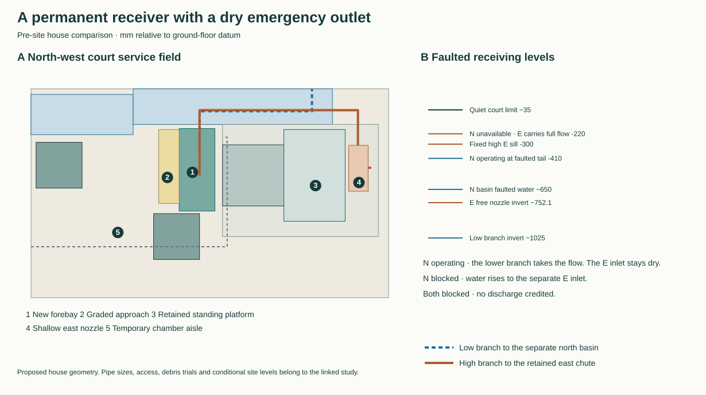
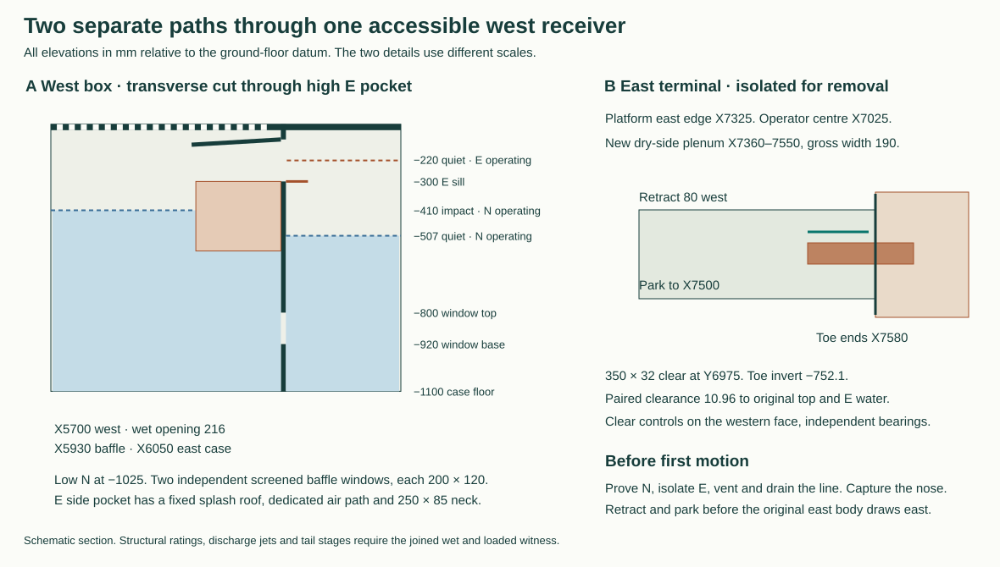

# A permanent courtyard receiver with two independent outlets

**HAD-COURT-BYPASS selects the accessible west receiver and retires the removable wet pans, split hood, submerged socket and their gallery cups.** The ordinary north L-inlet, south window-cleaning ramp, guarded west stair, two-flap E maintenance passage and separate N/E exterior destinations remain part of the house. The new permanent wet work sits west of the well. Its low branch leads to N. A normally dry, separately vented high overflow leads to E. Either receiving territory may be unavailable on its own. This is the pre-site house source for the next RWT-06 review. [Dimensioned record](studies/receiver-selection.json) · [Previous intake](court-intake-selection.md) · [Water challenger](../rwt/rwt-06-low-court-bypass.md)

## Floor, people and removable walking panels

Use X5700–6050/Y6550–7360 for the 350 × 810 wet box, with a supported floor at −1100. The creditable walking/grating strip is 216 wide at X5700. Its 200 clear approach starts at X5500. The south hinge, northern closure and working tolerances reduce Y6625–7350 to 6630–7345 before blockage. Keep court Z−30 at Y5750, then fall 5% to −85 at 6850, then 2% to −96 at 7400. Taper this local regrade west to X4750–5250 and east to X6600. The N western lip stays −92 and the ordinary south ramp remains at its registered levels. At the actual west gate ends Y6597.5/7200 the adjacent elevations are −71.99/−91.82. Buy the tapered removable dry transition −8.01/+11.82 to the −80 top landing, along the 600 stair width clear of the hinge/foot. The continuous temporary north closure stays at Y7380 with 10 paired reserve on either side, the western weather plate at X6075 leaves 25 nominal to the wet box. [Retained steps, window and rig](court-intake-selection.md)

The walking cover must carry people and water at the same coordinates. Price three 24 mm supported perforated plates with 9 mm circular openings on 12 mm pitch. The perimeter and two 20-wide independent ledgers at Y6825/7090 give a 275 nominal longest panel. A 100 mm loaded stripe has at least 24 mm of net material. A conservative one-way 5 kN point on 285 paid span gives 154.6 MPa and 0.436 mm elastic deflection at 200 GPa. The largest 350×275×24 full plate weighs 18.48 kg before removing holes or adding its two eyes. Verify edge bearing, eccentric wheels, perforated plate strength, retention, lifting and wet traction. Use the independently supported cart rails during E renewal. Capture each lid before releasing its hold-downs, close both public gates and erect an independent guard before exposing the well. No person stands on the temporary pipe insert.

| Whole floor entrance | Calculated L/s |
|---|---:|
| Earlier low-return contour, newly covered shortened entrance | 3.4463 |
| Selected contour, stage −40 | 3.9507 |
| Selected contour with another 2 mm adverse level | 3.6763 |
| Assigned all-house event | 3.60375 |

The control removes two 5 mm end errors, the deepest quarter, both supporting strips and another quarter of the remaining 18 × 41 actual holes. Their effective area is 0.03521 m². At Cd 0.60 they cost 1.483 mm at duty. Charge the full 416 mm rough travel, n=0.04 and unit entrance loss. Reproduce at 128 and 256 panels. The chamber and N roof pipe deliver through their dedicated contained openings. Their concentrated streams do not earn this broad-inlet capacity. Witness adverse level, blocked grating, distributed and concentrated water together against the real north portal/shoe and south tray/jamb. The design references quiet −35 and protective +15. First harmful fabric level is still unmeasured. [Short-inlet source](../rwt/studies/short-inlet-review.mjs)

## The actual failure switch

Give the impact cell X5700–5930. Across the full width at Y6550–6740, a closed south compartment accepts the concentrated roof/corner feeds. Its water exits into the west impact cell. Close the south end of the east quiet cell at Y6740. Form a 5 mm baffle at X5930–5935 with two independently accessible screened 200 × 120 windows at Y6857.5 and 7125, Z−920 to −800. Each 210 × 130 cassette rises on the quiet face between the 20-wide ledgers. The one-side worst clearance after two 5s is 7.5 mm. Keep a parallel blind guide, retain both pieces from above and insert the blind before lifting a dirty screen, or isolate and drain under a proved weather diversion. Each 190 × 110 adverse view includes 15 × 9 complete 9 mm holes. Charge K4, only one screen in service and one quarter of the holes blocked. The low N neck crosses the solid lower baffle at Y7015–7265, Z−1025 to −940, 20 below the nearest screen. Its independently roddable, sealed transition on the impact side joins the buried line at X5900/Y7140 without admitting unscreened water. Charge its separate 250 × 85 neck at K3 with the same adverse area. With N working at long duty, quiet water stands at −506.83 and upstream impact water at −410.01. A blocked low N intake must still expose the separate high E inlet to the rising calm-cell water. Keep the emergency crest −300, clear length 270 at Y7010–7280. Put its lidded drop channel on the west side of the baffle, opening only into the calm compartment and hard-shielded from falling deck and roof water. Give its quiet-facing intake 160 clear above the −300 sill to the −140 soffit and fall the solid cover west to −160. A reflected drop from the −160 feed can cross the apparent plan separation. The entire high receiver therefore needs an impermeable cover and impact-side return. A continuously descending 250 × 85 neck feeds the closed E branch. Put independent atmosphere vents above the +15 protected water reference, returning any drips to the impact side. Three captive top access lids, independent screens and reach-down lifting keys allow clearing from a guarded dry top position. Avoid a common cross-screen across both outlets.

| One-site state | 3.60375 L/s | 4.43895 L/s |
|---|---:|---:|
| West pool with N receiving at faulted −650 | −488.42 | −410.01 |
| Clear height to the low-set E sill with N available | 183.42 | 105.01 |
| Quiet pool with N isolated and E taking all flow | −229.69 | −219.96 |
| Impact compartment above the one running screen | −165.88 | −123.13 |
| Remaining E delivery head after neck, pipe and outlet losses | 278.90 | 211.04 |

Levels are millimetres. The 150 ID low line uses 75% area and diameter, f=0.06 over 12 m, K14, 10 mm check-opening head and the separate window loss. At normal north −800 the west pool is 150 lower. With N stopped the E weir pays two end errors, a further quarter loss, unit entrance loss and 5 mm high sill. Downstream use only the sill elevation as source. Charge the separate neck K3, full 3 m rough E line K8 and nozzle K4 including free jet, each at its own restricted area. No reverse pressure signal is assumed across the free discharge. With E blocked and N operating, E must remain physically dry under the splash and transient tests. The long event with only half the perforated screen area available reaches −2.10 in the impact chamber, above quiet −35. Clean, gauge and qualify both screens before N isolation. Re-instate the alternate catch and weather cover if the measured duty or blocked area cannot be sustained. In the event of a sudden local blockage neither this small box nor human intervention supplies assured storage. A stopped common screen, two failed receiving sites or a submerged air break exceeds this demonstration.

## Buried routes and supported nozzle

Keep the separate north receiving site and its original vertical outlet. The west low-line invert starts at (5900,7140,−1025), runs via (5900,7530), (7000,7530), (7000,12800), (5300,12800), ends (5300,14100,−1171.4) at 1.5%. Its 9760 mm orthogonal allowance leaves 2240 for fittings within the 12 m budget. A 200 gross connector passes the two −750 tie soffits by 115.65/169.91 after paired setout. P26/P30/P31 are the closest cap edges at 100 nominal. Reserve actual long bends, independent supports, external rodding at each change of direction and construction access. Insulate/bridge crossings without cutting the ties. At the north end use the 500 × 600 accessible sump within the original N basin, floor −1350, communicating edge −900 and top-operated check plus manual isolation. Preserve both independent service/spill areas and maximum N/E receiving levels −650/−1250. A flooded or unreleasable site demands a different plot or house. [Structural grid](../str/studies/current-house-grid.json) · [Both site conditions](../rwt/studies/selected-receiving-interface.json)

The E branch runs (5900,6900)→(5900,7540)→(7450,7540)→(7450,6975). Two R150 corners and a separate fixed turning plenum replace a fictitious third 90° in a 130 mm run. Fall the 150 ID pipe 1% from centre −635. Independently bridge the N grate/liner above the crossing. At X5900/Y7540 its original bed is −202.9. Reserve a −515 underside for the new structural opening, 10 mm paired clear even using the absolute highest pipe crown −535. Keep grate bending, lateral load, waterproofing, soil and bedding separate from the wet pipe supports. Separate N-low/E-high buried levels and cleanouts require a true crossed-section/trench survey.

The shallow plenum occupies X7360–7550/Y6745–7195. A 350 × 32 nozzle centred at Y6975 has invert −752.105. Its 1.5 top sheet and two 5 mm errors leave 10.96 below the original opening top −697.647. The opposite 5s leave 10.96 above the +5-raised long E water at −773.063. The nearest paired side clearance within Y6600–7200 is 40. Capture the supported toe and translate it 80 west from X7580 before the E body draws east. Parked edge X7500 has 40 paired separation. The new line leaves 15 paired to the whole occupied 600 × 900 platform and the plenum leaves 25. From centre (7025,6975) with shoulder −150, a retained western operating dog at (7360,6975,−460) is within 457 mm. Require hooks/handles, restraint, supporting guides and a drain witness at the accessible western face. Service the fixed end box independently or lift its empty 190×450×185 pack on captured gear through the existing 650-long airlock using the 585×550 cart, +90 rails and two removable bridge sections, to the 750-square rest at (4730,5135). The native inboard/outboard cartridge, 900×303 protected socket, eastern platform and restrained longitudinal exchange retain their separate original sequences. [Retained two-flap exchange](../rwt/rwt-06-low-court-bypass.md)

## Corner exchange, northern work and first release

For the corner state, secure the upper guard, strike both halves of the south ramp, and move its 600 × 350 rack 25 east to X5925/Y5840 before placing the full B foot. Put the two independently restrained 450-square chambers at X4300/Y6775 and X5450/Y6075. The ground aisle remains 700 and the new E case clears the rack by 25. The north outlet still overlaps the N intake by 25. The E throat clear X5710–5885 crosses the 25 gap from Y6525 and ends at Y6580, 30 inside the new south catch. With two end errors and quarter obstruction 123.75 remains. Its K1 control needs 88.43 mm at ordinary duty and 101.62 at long duty. Keep the outlet raised and turned down through a captured, contained roof insert; buy clear head and vent to the case below. Buy an independently supported cheek, contained impact and an open air path ahead of the actual low control. An open jet onto the grate cannot replace it. The corner feed and the temporary N pipe use the south impact compartment at different times. All ordinary lids stay locked; both chambers and flow destinations must be available before corner release. Do not operate the west gate in this state.

Retain A/B/C at (4500,5900)/(7100,6050)/(4500,6500), their four governing upper first rests and signed source loads. Keep the two temporary 160-square pipe territories at about +3650/+4050, one quadrant live. Change the final E leg to Y6300. In the SE quadrant the inherited X6650 route crossed the active ladder. From the actual (7250,5400) drop run east to X7500, then north to Y6300 before returning west. Price R100 bends and the 50 centreline straight between them on the 250 link. The ladder [6300,5200,600,600] keeps ≥260 after paired setout from the E lines in all quadrants. Minimum to actual towers is 90. Add real hangers and prove their actions, fall, eccentric/reversed couples and fixed chamber lid up to the source 60.97 kPa and 9.76 kN. Do not couple wet lids to the deck or use movable handles as anchors. Reinstall, wet-prove and strike the frame before reopening the window/ramp.

Move the west gate's northern keeper to (6130,7275), 50-square and clear of the stair by 50. A 76 mm upper arm returns to the actual fixed catch (6075,7222.5,+1000). Its root buys a new independent dogleg from the real P33 cap east face (4250,6200,−465) to (6170,6200), then north to Y7275. Reserve 150 × 150 over 2.995 m. Keep 45 clear of the wet box and 130 vertical under the top stair. This extends the former 1.892 m support. Prove the cap, root eccentricity, cantilever torsion, rigid keeper, collar and separate above-water weather lap. First descent requires a positively attached and tested guard; no seat on the N grate or the perforated deck.

For N short works use the prior lowered temporary gutter/collector at +1850 and separate high N alternate. Use the actual 133 mm copper with 128.65 minimum bore and 133.9 installed-tube maximum. Drop to axis +1550 at (7675,7000), fall 1:30 via (6880,7000) and (6520,6640) to the independently supported terminal at (5950,6640,−160). The source long 90° port leg is 253, leaving 47 in the first 300 drop. The two N21 45° bends in plan have 269 between their port faces. Allow the final true elbow and downslope cant, the low neck, joints and accessible captured removal. The original short crew path (4600,6950)→(5650,6950)→(5650,8100) and R300 body keeps 18.2 beyond the tube and two 5s. Any extra clamp/sag in this narrow field needs a new measured reserve. Replace only the first lid by a keyed 160-square pipe cartridge and dry flashing. The full 133.9 silhouette clears its aperture by 13.05 each, or 3.05 after opposed 5s; it clears the solid quiet end by 23.05 after setout. Its tip ends below the 24 plate, inside the separate covered full-width impact compartment. Keep the receiver air vent independent of the tube seal. [Roof hardware and high N chase](../rwt/rwt-06-closed-control-and-canopy.md)

After every short worker returns, the long loggia secondary runs south at X6800 with axis +1685 at Y7750 toward the new court pipe near the diagonal. Fall the new connector south to the lower takeoff, positively join it above the standing zone and support independently. Reserve the original source's 11.55 straight gap below the separate N chase and the 83.05 lateral keep-out from the long crew. Price the actual junction's width, sags and the larger fitting box independently. The N short and N long works must physically demonstrate the high N alternate or another independent dry diversion before opening the first module. If N site, temporary high chase and E are unavailable in combination, keep the system closed.

For E service, test N, isolate/vent/drain E at accessible controls, fit a pressure-retained blank at the high branch before opening the termination. Close the continuous weather enclosure, prove N and release the outer nozzle before the west descent and native two-piece cartridge exchange. Fit/prove the weather enclosure **before** unseating anything at the house, keep the fixed west wet box covered throughout, then open one flap at a time. Retain independent closed rail bridges for any removed pack. Reinstall the deepest seats and the separately supported nozzle, re-establish both independent outlets, test the idle E from the west side with low N temporarily blanked and original N L proved, and only then strike the weather/guard and restore normal walking. Record stages, outfall, leakage and wet witness on each side at both flow duties.

## Disposition and remaining evidence

The three-shutter high gallery would introduce three penetrations in the closed temporary north weather skirt. The bidirectional low-return alternative captures blocked spout and shoe water, but its south cup is at most 95 mm from every admissible R300 centre on the open −800 platform. Removing that cup alone leaves 15/10 mm projecting branch crowns. A fair repair withdraws **both** complete cups under independently verified double isolation, lowers both inverts to −1000 or below, and reinstates two flush load-rated plugs. It still buys a 2.2 m wetted hood seam, bottom seat at −915, galleries, divided pressure-bearing shells, a hoist and the full reverse-flow/occupancy witness. The selected arrangement removes those four routine wet lifts and leaves the entire working platform available. Its price is a permanently deeper west excavation, a second buried gravity line, the reinforced grate crossing, an independently supported pressure-tested wet box, and controlled material at every seal. [Both priced alternatives](../rwt/rwt-06-low-court-bypass.md)

Use mineral/metal structure and a separated replaceable wet liner, screens and terminals. Compare a welded 316L wet case and compatible isolated fittings; identify/acquire any necessary renewable check seat, cold seal or material exception with MAT. Do not silently accept an elastomer, lead/copper-bearing runoff, welded whole-life permanence, safe irrigation or a particular disposal site. Lift screens and cleanouts from above. For eventual full rebuild, establish a separately testable bypass/temporary over-roof with its own discharge before cutting fabric or opening the footway; shore and reline the entire pit and restore every independent header and top ledge.

This completes **HAD-COURT-BYPASS's internal architectural selection**. RWT-06 resumes its six-duty review on this geometry. STR owns the supporting frame, grate/recess, low-pipe trench and new independent gate root. MAT owns wet materials, separable seals and dissimilar-metal interfaces. OAS owns the repaired guard/window/door. DPL owns real ground, lawful independent receiving and spill territory. No installed capacity, first-harm stage, purchased product, owner exception or site admission follows from this source. [Reproducer](studies/receiver-selection.mjs) · [House programme](house-architectural-design-programme.md)
