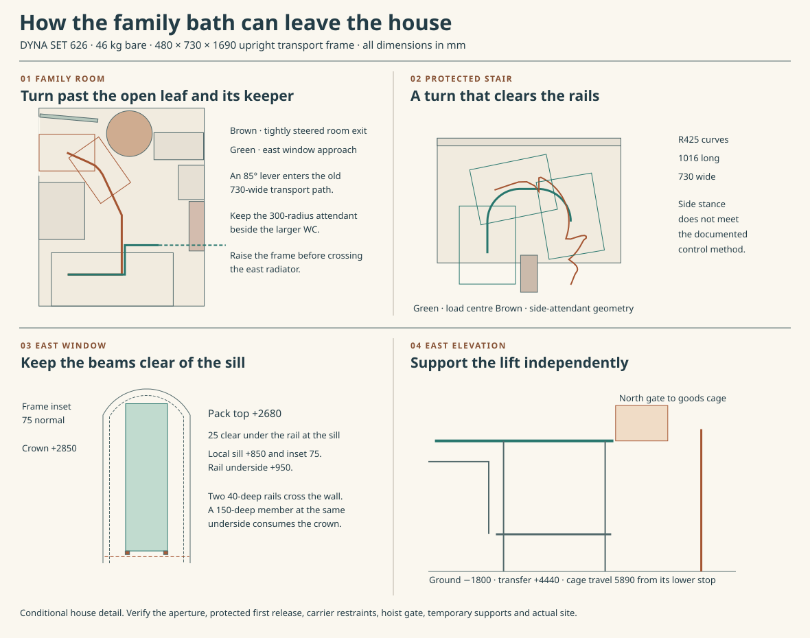
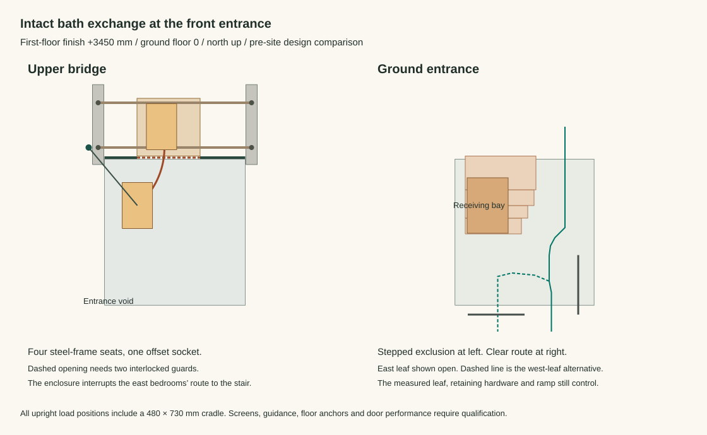
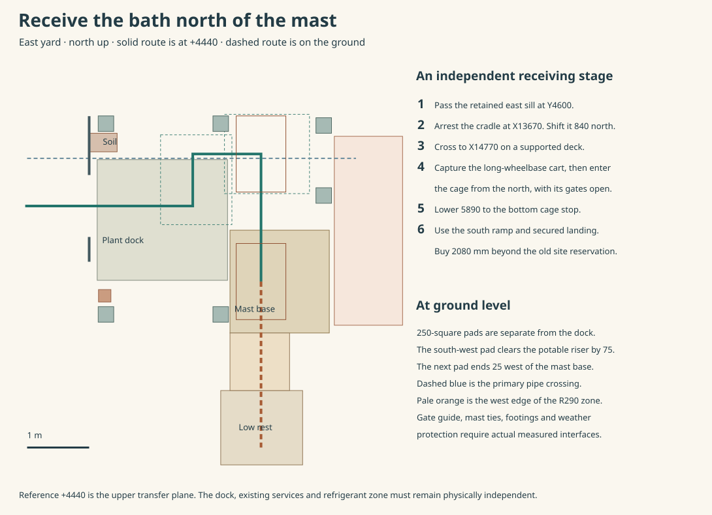

# Replace the family bath through the entrance void or east window

**Keep the protected stair and Bedroom 2 wall. Develop an indoor goods transfer for a planned vacancy, and the east window for work with the upper protected route in service.** The upright 46 kg DYNA SET 626 can pass the occupied family doorway in a compact cradle. A guarded loading opening at the existing entrance void could then avoid opening the façade or erecting a tied exterior mast. It interrupts the east bedrooms’ only demonstrated route to the stair and needs structural hold-downs from the outset. The window alternative preserves that route but requires an independent outdoor platform, mast ties and suitable ground. Neither is ready for a service visit. Choose between the architectural provisions before fixing the guard, concrete reinforcement or window specification. The three-bathing house remains the control pending the household programme choice. [Shared bathing option](ias-03-shared-family-bathing.md) · [Door, stair and window study](studies/family-bath-exchange.json) · [Entrance-void study](studies/family-bath-entrance-void.json)

The [later open-back family WC](ias-03-upper-wc-release.md#preserve-the-shower-and-the-bath-exchange) changes the occupied room clearance. With that suite, the attendant moves to (10500,6060) and the upright cradle turns earlier. Its checked minimum room gap is 11.40 mm. Use the original route below only with the original WC setout.

## Get the steel shell onto its feet

Isolate the family hot and cold supplies at their actual service positions. Drain the bath, expose the front and lower connection, disconnect the waste, overflow and mixer, and independently cap and support the retained pipe. Remove the curtain and demountable rails. Keep the floor seal, upper soil opening, WC, basin and radiator. Before releasing either bath support, fit two shaped, padded underside saddles to an arrested lifting frame. The enamel rim and the old waste are unsuitable as lifting points. Keep ordinary trap service through the removable front. [Bath outlet and lower access](ias-03-family-bath-outlet.md) · [Manufacturer handling and installation](https://files.cdn.kaldewei.com/data/sprachen/englisch/prospekte/rest/GB_GUARANTEE_CARE_AND_INSTALLATION_INSTRUCTIONS_2020.pdf)

Move the captured shell 65 mm north. Place the cradle’s rotation axis at X9560/Y4215/Z580, at the west rim height, with the bearings on the independent stand. Raising the east end swings the shell depth towards the middle of the room. The complete turning envelope stays 76.6 mm west of the radiator and 124.6 mm above the floor. Its top reaches 2250.2 mm. Capture it upright, lower it 460 mm onto the 100 mm dolly, then secure the wheels and transfer fittings before releasing the turning frame. Reverse those supports for the incoming shell. The fixture feet, sealing lap and trap go back while both sides remain inspectable.

Price **480 × 730 × 1690 mm** for the complete travelling frame. The 430 mm shell depth leaves two 20 mm steel rails and two 5 mm pads. At 40 × 20 × 2 mm, 7.98 m of hollow section weighs about 14.0 kg. A 25 kg tare budget leaves about 11 kg for saddles, straps, end pieces and locks, for 71 kg moving. A 0.92 m centre-of-gravity arm and a 1.5 load factor give 0.96 kNm at the pivot, or 2.92 kN with a 330 mm jack arm. Qualify the actual contact pressures, brake, independent catch, foot-access order and dry first rest under loss of one restraint. Those are purchase loads and envelopes.

## The internal route and the operator who has to use it

The older 730-wide pass through a nominal 767 opening intersects the real handle by **137.7 mm** at the held 85° family door. The south-side passage between jamb and grip is only 610.8 mm. Turn the upright load progressively through 30°, 35°, 50°, 65°, 80° and 90° between the service cupboard and the door attendant. Price the attendant at X10585/Y6065, 492 mm to the grip, with both hand and shoulder represented. The new 480 face passes the doorway. The continuous room sweep leaves 11.5 mm at its tightest point, the unchanged 510 frame intersects the attendant on this path. The onward gallery sweep leaves 32.0 mm at the protected-circulation radiator. Actual frame tolerance and a person steering the dolly require a two-way carrying trial. [Occupied door study](ias-03-shared-family-bathing.md) · [Pose and clearance record](studies/family-bath-exchange.json)

Park the load west of the upper flight at X1450/Y4110 before the empty powered carrier arrives. The Zonzini Domino Stabilized comparator is 556 × 956 mm with a 530 × 630 mm platform 135 mm above the floor. Its 107 kg chassis, 9 kg lithium battery and 71 kg load total **187 kg**. A proposed 715.5 mm sideways transfer needs a positive bridge and 35 mm levelling stroke. On the 1070 mm head landing the native body leaves 79.5 mm to the finished Bedroom 2 return and 34.5 mm to the first nose. The upright shell can extend 100 mm each side of the platform. Match the actual support, travel position, balance and restraints. [Manufacturer dimensions](https://zonzinistairclimbers.com/shop/us/shop/stair-climbers-for-goods/domino-stabilized/) · [UK technical brochure](https://www.zonzini.co.uk/wp-content/uploads/2024/09/brochure_domino_en_uk.pdf)

| Actual house constraint | Geometric comparison | Decision |
|---|---|---|
| Two 984 mm clear flights, 172.5 rise and 300 going | A 730-wide load with the axis shifted 60 has 187/67 mm either side. Allowing 1.30 m load overhang, five additional rises and a 250 mm high platen leaves only 13.2 mm beneath the lower header. | Obtain the loaded tilt, track contact and real maximum height through approach and breakover. |
| 1623 mm midlanding, retained rails and 100 mm well return | Two 425-radius curves plus a transverse straight turn the complete 730 × 1016 envelope. The body stays at least 35.4 mm from obstacles and 27.2 mm onto level floor while steering. A 1076 mm envelope loses the demonstrated level reserve. | A body 300 mm in radius directly behind the handle intersects the boundaries by up to 249 mm. A calculated side position clears them by 43.5 mm, within 600 mm shoulder reach. |
| Ground hall, entrance and exterior approach | The separate braked dolly clears the ground hall by 34.5 mm. Both leaves of the front entrance, its working threshold bridge, the 2000 mm landing and the four 9 m ramp flights would be needed for transfer to the −1800 site datum. | The documented stair machine requires one operator upstream in front of its control handle. A side approach and a favourable empty-machine landing figure cannot establish that operating condition. **Reject this machine and sequence as the issued exchange method.** |

A second, shorter powered hand truck, SANO’s LiftKar HD UNI 060 703, has a 220 kg rating and a 530 × 183 mm toe. The standard toe alone ends 297 mm short of the proposed 480 mm package. A 530 × 400 accessory still needs the restrained shell, its actual balance and the full instructed operator position checked. Neither comparison justifies moving the load-aligned Bedroom 2 wall or removing the protective stair rail. [Zonzini operating manual, rev. 19_TER, §§2 and 5](https://device.report/m/a25c8fe3a85e7bdc05840e55d0601099469f7e619ef7451f89761ebad5a6c901) · [SANO technical sheet](https://www.sano-stairclimbers.com/fileadmin/user_upload/td_en_technical_data_hd.pdf) · [SANO accessories](https://www.sano-stairclimbers.com/load-transporters/products/liftkar-hd/) · [Stair-wall load](../str/disjoint-house-actions.md)

## Lower the upright shell inside a vacant house

The family doorway delivers an upright cradle only 480 by 730 in plan. Keep that posture. A horizontal 1690 by 730 cradle clearing an intact 1100-high guard needs to turn above the hall. In the tested slew, at centre (5978,2795) and 72° yaw its eastern corner projection below the opening reaches X6342.8. Even before guarding that leaves just 758.7 to the finished wall. Turning it to its narrowest face at the final rest does not recover that lost width in transit. Taking the upright pack above an intact rail also fails the vertical budget by 790 mm. An open drop edge would be an unacceptable substitute. [Current bridge and guards](../had/studies/water-replan.json) · [Bath lowering calculation](studies/family-bath-entrance-void.json)

### From the family room to the loading opening

Roll the braked dolly west from the east gallery at Y3290. Turn it on the upper bridge approach until its **480 side is across X**. The rotating diagonal is 873.4 in the 1017.5 between the north guard and the court. At Y3290 the circular envelope leaves 68 mm to the guard and 76 mm to the court. Reserve a lockable, level 940 by 880 lift table at X7340–8280/Y2820–3700, and a separate level receiving deck at +200 over the temporary frame. An open-centred lift stand can pick the pack off the ordinary floor dolly and transfer it, at the same level, onto the captive bogie without cutting a lift pit. Transfer using an independently braked horizontal pull. Position the uprights, indexing fittings and side-loading gate outside the whole moving envelope. With the dolly top at +100, its loaded height on that deck is 1990. Test the bearings, independent catches, edge transitions, actual stand feet, crew positions and manual recovery under a single failed restraint. Nothing rolls across an exposed edge.

Retain ordinary guarding on both sides of a new, deliberately detailed **guarded loading opening** in the north rail. Where the load crosses the rail, give it a sliding or telescoping void-side guard and a separate interlocked east loading door, continuous side screens and a closed north return. Supports and locks belong to the temporary frame and actual fixed guard sockets. The two doors must never be open together. Keep the void closed while the pack enters from the east and is coupled from a protected position. Prove positive restraint, clear all people from the enclosure and close the landward gate before releasing the void gate. Restore the void gate after each transfer. The winch and push/pull controls remain outside this bay. Details must contain a loose component and prevent a fall or a person reaching a moving load, including during installation, power/brake failure and reversal. A tape barrier or a panel taken off an ordinary rail does not meet that duty.

Use REID's TDAVIT Winched **TDWA5A2TD2**, column 5 and beam 2. In pin A the manufacturer's working point is 1200 radius and 1935 height above the illustrated socket reference. Pin B changes both to 1110 and 2315. The radii are quoted at 75% of WLL; this light load must reproduce the tested working line, unloaded and loaded. The beam weighs 13 kg and the column 28 kg. A 15 m galvanised Plus Winch RLGWG50015 on the specified TDAVIT column bracket RAWB010200 weighs 14 kg, with 500 kg first-layer and 430 kg last-layer capacity. The upper operator controls a column-mounted drum through the davit's two sheaves; no free hand chain needs to be reached over the opening. Match the actual cable, bracket, brake, end stop, stopping distance and remaining drum wraps. [REID winched davit](https://reidlifting.com/product/tdavit-winched/) · [Dimension sheet, pp. 2–3](https://www.safetygearstore.co.uk/images/uploaded/REID-TDavit-Winched-DataSheet-EN-V5-Lo-Res.pdf) · [Plus Winch and bracket](https://reidlifting.com/product/plus-winch/)

**The Plus Winch load-pressure brake requires at least 70 kg suspended.** The 71 kg pack alone leaves only 1 kg. With the assumed 14 kg yoke/loose gear the fully suspended mass is 85 kg, but just 147 N of supporting reaction brings the drum load back to the threshold. The 25 kg empty cradle and a partly landed pack cannot rely on it. Weigh the actual moving assembly. Positively latch the pack to an independent docking stand before either support takes weight; use the stand’s self-holding adjustment to transfer load while the main drum is stationary. Fit a separately anchored, load-independent restraint for pickup, a jam, an interrupted descent, the unloaded hook/yoke return and all reverse transitions. Verify both directions including a failed restraint, return-line control and measured drum load. If these conditions cannot be delivered within the passage and headroom budgets, reject this winch and qualify a compatible light-load system or use the window provision. [REID Plus Winch operating guide, manual brake and handle](https://www.liftingsafety.co.uk/files/product/5509/REID-EN-PlusWinch-O%26M-V2-hi%20res.pdf)

Set the socket reference at a proposed +350 above first-floor finish. Hoisting just 40 off the arrested dolly gives a pack underside at +340 and top at +2030. The theoretical +2285 working point leaves **255 mm for everything above the cradle**. Allow 225 for a low-headroom load-spreading yoke, connector and upper rope stop, leaving 30. Use structurally continuous cradle lifting lugs and a supported centre of gravity within the sling geometry. Do not load the bath rim. Size the entire installed and erection envelope below +2894, leaving 100 to the lowest +2994 roof-closure comparison where present. Confirm the actual underside over the bridge, pin insertion, swing of the rear winch/crank and erection of the 28 kg column. The Bed 2 trimmed wall at Y2765 is only 155 south of the mast. A conservative 322-radius plan circle for the operator’s crank already overlaps that wall by 167. Require the actual mounted drum offset, handle clocking and swept hand/arm to clear in every permitted orientation, including braking and recovery. A shaft turning in a vertical plane has a different plan footprint. If no supplied configuration provides a safe control position, use the window option. The 1935 working height is not the total equipment height. The drop to a ground dolly with its bed at +100 is 3690; the required cable also includes the column and beam path, termination and retained wraps. Match all three dimensional chains on the supplied assembly.

### Carry the moment back to the house

The 200 by 350 entrance-edge members run north–south on X4785 and 7215 between Y2650 and 3917.5. Put the socket on a removable four-point frame fixed to **cast-in hold-downs** on those beam lines at Y2920 and 3630. Cantilever its centre 150 west to X4635 to buy the east hallway clearance. A wide socket bolt pattern belongs on the steel frame. Bolting a 200-square pattern straight into a 200-wide concrete beam would put bolt axes at its edges. Keep flush covers ordinarily, and detail the bar cages, arch skewbacks, finish, fire stopping, water and renewal prospectively. Price the accessible two-piece deck and its assembly restraints. Neither the guard nor the adjacent roof or room walls carry the davit.

The new action reaches the original west end seats P49 and P38 and east seats P52 and P40. The two northern beam seats sit 32.5 south of the court girder; the two southern piles are offset 15 from their warm beam axes. Existing bridge gravity already claims 9.036 kN ULS per seat. The model separates each new vertical load into east/west crosspiece reactions, then takes the south/north reactions through both real side beams. It includes 200 kg of provisional frame/deck, the 28 kg column, 13 kg beam and 19 kg winch/bracket allowance. Actual self-weight, eccentricities and assembly load cases must replace those allowances. For a 71 kg pack plus 14 kg loose gear at 1.5 times the suspended load, the northwest frame seat can already reverse to **0.73 kN uplift**, including the assumed dead load. At the **500 kg marked load** and full possible rotation the screen reaches 14.01 kN uplift and 24.97 kN compression at different frame seats, and −5.69 to +16.64 kN additional at different existing support seats. These are extrema of one explicit load-sharing model. Engineer the actual member stiffness, horizontal loads, socket, steel prying, base, local concrete breakout, reversal, ties and pile actions. Provide qualified rotation/end restraints without modifying the supplier's davit. Verify a separate accidental case without relying on the removable dead weight.

Even the marked suspended load alone gives 8.83 kNm at the 1.5 screen. Across 710 support spacing that is a 12.44 kN force couple, and across a 200 mm socket bolt-row lever arm it is 44.15 kN before prying. A deadweight 710 from the pivot would already need 845 kg for the **static** load alone. A single socket planted on one side beam and a stack of loose counterweights are poor house provisions. [Entrance bridge and native seats](../str/studies/whole-house-reaction-join.json) · [Actual ground heads](../str/studies/current-house-grid.json) · [Owner house charter](../owner-house-charter.md)

### Keep people outside the lowering bay

From (5788.7,3250) swing the suspended pack **upright, without a planned yaw**, about (4635,2920) to (5405.5,2000). The full sweep crosses the 50-deep north guard between X5425.5 and 6099.4. A clear loading gate X5400–6400 leaves 20.5 on its tighter side after 5 mm gate error. These figures already assume measured radius within ±5, mast setout within ±3 on each axis, guided lateral travel within 10 and yaw within ±1°. Buy positive guides, arrested indexing, two captive stabilising points and independent retention. An unconstrained hook and a pair of hand-held ropes cannot establish these bounds. Test the hard limits and stopping distance with the actual package through the whole descent. The manufacturer's working radius at 75% of its rating is not that test.

Reserve a lower receiver at X5090–5740/Y1560–2440. The adverse load clears all four outer limits by at least 51.1 mm before fittings. Keep the receiver and locked docking blocks inside a separate exclusion envelope. Use stepped **outside** barrier faces at X5950, 6050, 6150 and 6180 over consecutive Y1550–1800, 1800–2000, 2000–2250 and 2250–2785 bands. The 60 mm walls, 5 mm barrier setout and the moving package leave at least 10.46 on their inside. Extend the containment through the fall height, with guarded/loading gates, clear debris/deflection limits and independent reaction paths. The 60 mm allocation is an envelope for engineered protection, not the rating of a screen. The west cloak is inside the closure. Strike temporary fittings and make good the floor before reopening it. [HSE lifting operations](https://www.hse.gov.uk/work-equipment-machinery/planning-organising-lifting-operations.htm)

The finished east wall at X7101.5 leaves **921.5 mm**, or **911.5 mm** after two adverse 5 mm errors. The checked dogleg towards the entrance gives a 900-wide approach. Separate 850-wide doorway comparisons require the actual clear aperture to contain X6000–6850 if the east leaf is active, or X5150–6000 for the west. The western approach turns across the short bay's south end. Retain the real open leaf, seals, handle and release; an 1800 raw pair does not provide either effective clear interval by itself. Keep the exterior landing, drain and step-free ramp free during the lift. The 900 circulation and 850 door sizes are design comparisons against England's dwelling guidance. For M4(2), the active leading leaf itself must deliver 850 clear; also verify the 300 leading nib extended 1200 and the maximum 200 leading reveal. M4(1) uses a 775 clear entrance comparison. Confirm the applicable access category, protected escape, leaf operation and rescue route separately. [Approved Document M, volume 1](https://www.gov.uk/government/publications/access-to-and-use-of-buildings-approved-document-m) · [Actual front threshold and landing](../mat/studies/front-threshold.json)

**The upper bridge is the controlling occupancy decision.** The actual principal-bedroom escape runs from (8700,3485) to (3450,3485) across this operation. Only 165 mm remains to the court at pickup even before the loading enclosure. Plan a vacant dwelling and establish the crew's west-side route through all installation, test, loading and recovery states. From the western control station the checked retreat passes north of the Bed 2 return and reaches the upper stair at (2250,4432.5), leaving a minimum 337.5 from the centreline to a modelled solid. Downstairs the existing stair route connects to the new east bypass with 346.0 centreline clearance at the Study return. These segments admit the 300-radius operator while the newly narrowed approach still supplies its separate 900-wide comparison. Include the actual assembled crank, steelwork, packing and erection equipment before relying on either retreat. Place the bath in an arrested rest before changing the barrier arrangement. No crew member may be left behind the east closure. Show a protected ground-level observer or monitored views with stop authority. The view from an upper west operator (4450,3300) towards the ground receiver intersects the upper floor at (4762,2876), outside the void. Side guides must continue below the guard into the ground receiver without passing a hand or a loose rope into the drop. Do not use the house for normal occupancy while the protected route or guard is interrupted. [House escape witnesses](../had/studies/water-replan.json) · [TDAVIT operating guide](https://uk.reidlifting.com/s/T-DAVIT-OM-EN-GLobal-V7-High-Res.pdf)

Land and positively capture the complete cradle on the +100 ground dolly. Confirm it is independently supported, release the yoke and return the hook to its secured rest before entering the fenced footprint. Once the upper guard is closed and the lower bay is released, roll the upright cradle east to X6000, then south through both secured leaves over the supported threshold bridge. The 480 by 730 cradle fits straight on the 2000 by 1200 landing; reorient the dolly there for the previously priced 1200-wide, four-flight ramp. Verify the landing turn, controls and all landings, assisted restraint on the full 1:20 descent, crew access and actual exterior collection. Reverse with the replacement. Reinstate and proof the original guard, front leaves, floor covers, wet joints, trap and overflow. A single service visit is a poor reason to buy an unverified permanent hoist. Preserve the prospective support and opening only if the occupied-house and specialist handling comparisons justify them.

## Pass the window upright

Keep the 1000 mm masonry opening at Y4600, its +850 sill, +2550 spring and +2850 head. A horizontal 1690-long package wholly inside the room overlaps the retained cupboard by at least 144.5 mm in X and 230 mm in Y when aligned for the window. Instead roll the upright load to X10970/Y4600 with its 480 face across the opening. This floor route leaves 31 mm to fixed work. Jack the carriage to +990, secure it on the two horizontal runners, and pass **above** the retained 700-high radiator. The wheel path, removable wet rail and hydraulic table must be matched to the actual carrier. Do not support the load on the radiator, timber sill or frame.

Allow 75 mm of normal perimeter intrusion for a fully released window, including its retained head. The 566.67 mm segmental radius and +2283.33 centre put the pack top at +2680, with 50.5 mm to each arched side. Raising it 5 mm and moving it 5 mm towards one jamb still leaves **38.55 mm**. The 40-deep runners have +950 undersides, 25 mm above the nominal sill plus frame reserve. Passing a 150-deep beam at the same underside puts the pack top at +2790, **15 mm above the inset crown**. An unreleasable glazing bar, guard or closer can defeat the remaining aperture. Release glazing and sash by their actual OAS method before moving the bath. [Current opening and support geometry](../had/studies/water-replan.json) · [Window first-release boundary](../oas/north-export-occurrence-result.md)

Use two 50 × 40 × 4 mm steel rails at Y4380 and 4820 between X11020 and 12270. Taking a full 2 kN centre point on one rail over 1250 mm gives 82.25 MPa and 2.68 mm deflection at 200 GPa. The separate outside span to X14270 can use 75 × 150 × 5 mm members, giving 12.04 MPa and 0.27 mm over 2000 mm. Four linked, restrained rollers, captured end stops and independent arrest before each joint must carry the complete load. The 160-square west stand feet at Y4170 and 5010 stay outside the 200 mm floor-seal keepout by at least 40 mm. Price the tube joints, local wheel action, torsion, frame buckling and all four transverse supports. Workers use the independently guarded deck.

## Reach ground without loading the plant dock

Put two temporary cross frames at X12270 and 14120, with indicative 250-square seats at Y2850 and 5930. The old south post at Y3150 would have landed on the potable riser. The new south pad clears its reserved Ø200 riser by 75 mm. Above grade a 190-wide post at X12270 leaves 25 mm to the D2 envelope at X12450. The second south pad stays 25 mm west of the hoist base. Its 150 mm eccentric rail seat adds 0.30 kNm under a 2 kN point. The north pads clear the foul stack by 30 mm and the Y6100 water territory by 45 mm. Keep columns, braces and their connections out of both services. A 100 × 160 × 6 mm transverse tube at the 3.08 m row spacing is a component comparison for a 4 kN point and 1.5 kN/m line load. Keep the dock clear of foundation loads. [Plant loading dock](../mat/plant-threshold.md) · [Potable inlet](../mat/plant-inlet-route.md) · [D2 discharge](../mat/cylinder-safety-route.md)

### Enter the goods cage from the north

The 300 Z/ZP’s ground ramp and elevated unloading face point in opposite directions. Use the north-facing upper gate and south ground ramp in the orientation shown in GEDA's BL 121 plan. Place the base at **X14270/Y2550**, 1600 in X and 1660 in Y. It leaves 40 mm to the dock, 80 mm to the open-site refrigerant zone and 1110 mm to the Y5370 primary pair under an adverse 100 mm jacket. Keep the cable box, bracing and any powered accessories within the qualified territories too. Its cage occupies the western part of the base. The current manufacturer's 1350 × 950 platform and the BL 121 EN manual (Rev. 001, May 2011) 1320 × 960 clear floor are both recorded. Use 1320 × 950 for the comparison and survey the matched gate, cage and controls. [GEDA 300 Z/ZP](https://www.geda.de/en/product/300-zzp/) · [Operating manual, pp. 15–23 and 48–49](https://maceindustries.co.uk/wp-content/uploads/2022/01/300ZZP-Instructions.pdf) · [Pipe and machine positions](../mat/winter-heat-and-water.md)

The window route does not point at that cage. At X13670 arrest the complete package on a positively indexed cross-slide, move its centre **840 north** from Y4600 to 5440, then transfer it east to **X14770** on a separate north landing. Its supporting deck occupies X14180–15550/Y4800–6080. Buy outer support and an additional 1660 span to X15780 with columns below at Y4770 and 5900. Keep both the 150 mm rail-seat brackets and the Y5930 post heads and braces below the travelling frame. Support the separate worker lane and the full right-opening gate guide, which needs 1950 mm from its fixing bar. Qualify its full sweep and gate openings, a clear deck limit 20 mm south of the reserved Y6100 water strip, and coverage during the transfer. Lift or slide onto an **800 × 1230 mm restrained shipping cart** before advancing south to the cage. Centre its X axis within 50 mm of the actual clear floor centre for 25 mm minimum side clearance. A 5440 centre leaves 25 mm at both deck edges and its south end at 4825, 25 behind the maximum +Y landing-gate target of 4800 before controlled entry. Advance the locked trolley past Y4870 into the actual cage, provisionally around Y3380. With 1230 on a clear 1320 floor the final stop must be within ±20 mm of its measured longitudinal centre for 25 mm at each end. Secure all wheels/retainers and clear the native gate and ramp before travel. If the gate, floor stops or fully lowered hatch cannot be set there, move the landing and its bearings.

The transfer is at +4440, 6240 mm above the trial ground at −1800. GEDA’s ground-station floor is 350 mm above its base, so **actual cage travel is 5890 mm**. With the 2590 mm open base dimension, the south ground ramp projects 930 mm beyond the base to Y1620. The 1200-deep lower landing ends at Y420, requiring **2080 mm of additional southern site depth** beyond the old mechanical reservation. On that 350/930 ramp a 480-wheelbase cart would exceed the tipping line under the stated 920 mm loaded CG, 50 mm eccentricity and 0.1 g braking sensitivity. A 1100 wheelbase on the shipping cart leaves over 55 mm, with 45 mm nominal at both ends of the shorter cage floor. At 91 kg and rolling coefficient 0.03, specify a separately anchored, braked restraint for the whole ramp transition, including the breakover and one lost contact. Ground, cart and cable routing require a real loaded demonstration with every native safety device intact. The ramp alone supplies neither a level handover nor an outside route on the eventual site.

The base/platform/cable unit alone is 730 kg in BL 121. Its 10 m assembly example requires 73 kPa ground bearing before safety factors. **GEDA prohibits free-standing operation without anchors.** Price the mast ties, mast extension, rescue access, foundation and structurally braced landing separately. The first bracket must be at or below 4 m above base and subsequent spacing at most 6 m, with a maximum 3 m mast oversail and more than 1.25 m above the emergency limit bar. For example, place ties at 3 m and 5.5 m above base into a verified anchored temporary structure, subject to the specific manufacturer's geometry, tie forces, ground and wind. The manual’s scaffold example uses A/B/C = 2.50/2.48/0.20 m. Its top anchor forces span 5.4/5.7 to 8.6/8.6 kN by wind region before safety factors. Revised geometry needs revised manufacturer loads. Reserve the actual anchor plane, mast head and safety clearances on the surveyed site. Neither a 2 m tie across the dock nor an unsupported mast is accepted. Reject this option if the necessary anchors, protective enclosure or northern landing cannot be provided. [GEDA operating manual, §§1.7, 3.5–3.9](https://maceindustries.co.uk/wp-content/uploads/2022/01/300ZZP-Instructions.pdf)

Close the bath and the plant exchange lane for the operation. Provide protected worker access independently of the goods run. Erect and test the external guarding, mast ties, weather enclosure and supported racks before taking over the fixed window guard. Keep the inner barrier until the enclosed receiving deck, gate and a separate fall restraint are effective. Capture and store each glazing/sash component, pull the upright package to the positively restrained cage from a protected station and lower it to the south landing. Reverse with the intact replacement. Take the window load off the temporary frame, reinstate its guard, drainage, air seal and glazing, and prove those functions before striking the outer enclosure. Reinstate the bath on its factory feet, refill to the overflow and inspect the upper and lower joints before closing either face. Physical handling, the matched doorset/window, site, temporary works and wet reinstatement remain open. The household choice between a private rear shower and shared bathing remains with the owner.
