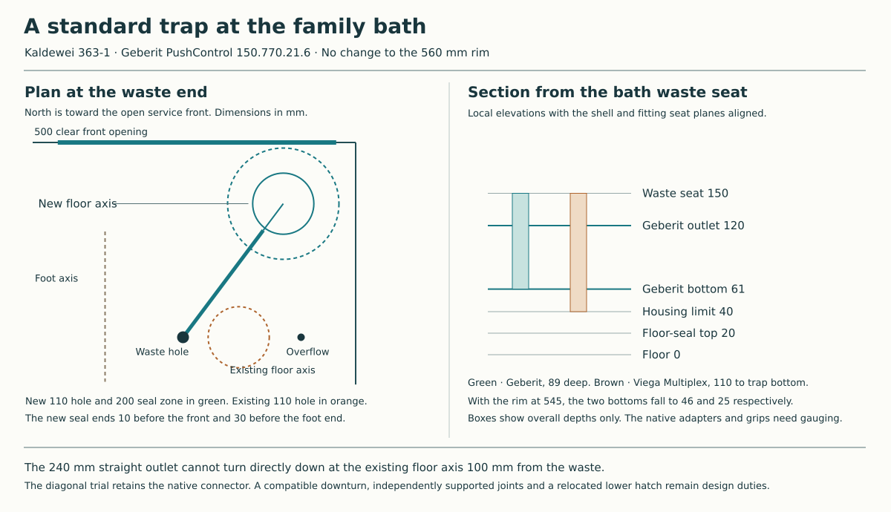

# Keep the family bath at its ordinary rim height

The [permanent three-bathing section](ias-03-three-bathing-sections.md#original-family-bath-and-its-floor-crossing) supersedes the nominal 60 mm elbow throw below with a dimensioned MT4L comparison, moves the proposed floor axis to (11012,4366) at the stated engagement and prices the actual worker below. It also checks the complete original 1700 shell through the east opening.

**Develop the Geberit PushControl straight outlet with a floor drop near the removable bath front.** It keeps the 560 mm rim and the required 50 mm water seal. Its supplied connector reaches beyond the existing floor axis. The new setout needs a compatible downturn and approval from Services, HAD and STR. Keep the existing port on the house drawings until those connections agree. [Current bath and lower branch](../mat/whole-house-service-baseline.md) · [Located calculation](studies/family-bath-outlet.py)

## Start with the two holes in the actual bath

The 1700 × 700 Kaldewei 363-1 has a 52 mm waste at X10850/Y4150, a 52 mm overflow 212 mm farther east, and a bare mass of 41 kg. At the selected 560 mm rim, the waste is at local Z150 and the overflow at Z497. Lowering the rim to the permitted 545 lowers both holes by 15. All elevations here are above the first-floor finish. [Kaldewei 363-1 drawing](https://files.cdn.kaldewei.com/data/sprachen/englisch/techdata/DB04_24-Sort_DB_UK-GBeng_BW_ADV_363-1_SANIFORM_PLUS_SANIFORM_PLUS_STAR.pdf)

Compare the shell waste datum with the native mounting plane of each kit. The 212 mm horizontal and 347 mm vertical hole spacings fall within both drawings' adjustment ranges. The elevation results below assume the planes coincide. Every millimetre by which the fitted trap sits lower spends a millimetre of clearance.

| Functional assembly | Native dimensions | At the 560 rim |
|---|---|---|
| Geberit PushControl **150.770.21.6** for a standard steel bath | 145–260 horizontally, 230–460 vertically. The trap bottom is 89 below the seat, with the outlet axis 59 above that bottom. DN40, 50 mm seal, supplied straight PE-HD connector Ø43. | Bottom **Z61**, 21 above the Z40 body limit. Outlet **Z120** at its own connection. At the 545 rim the bottom is Z46 and the axis Z105. |
| Viega Multiplex **6162.1 / 103 071** with supplied 45° elbow | 100–260 horizontally, 180–400 vertically. The trap bottom is 110 below the seat, with the straight outlet axis 75 above that bottom. DN40/50, 50 mm seal. | Bottom **Z40**, before fitting tolerance. The elbow tip in the illustrated downturned position extends lower. Straight outlet axis Z115. At the 545 rim the body alone reaches Z25. |

Use the 2022 Geberit installation sheet, page 2, which identifies the exact **.6** article, shows the two different swivel limits and dimensions the straight connector. Its UK catalogue supplies the application, water seal and connector material. The Viega comparison uses Figure 2, printed page 10. Its mounting directions call for access beneath the installed bath. Its lower position and downturned elbow make it a poor match for the present housing. Both are functional material comparators. The Geberit connector is PE-HD and the waste and overflow use seals. An owner decision on constituents, or a verified alternative of equivalent size and function, remains with MAT. DN40 also needs its actual minimum flow bore checked against the Services requirement. [Geberit UK article](https://catalog.geberit.co.uk/en-GB/product/PRO_102129) · [Geberit 971.150.00.0(00), pp.2–8](https://cdn.data.geberit.com/documents/971.150.00.0_00_20220330144511.pdf) · [Viega UK article](https://www.viega.co.uk/en/products/Catalogue/Drainage-technology/Drains-for-bathtubs-and-shower-trays/Multiplex/Multiplex-Drainoverflow-6162-1.html) · [Viega 6162.1 instructions](https://pspstmsimanuals.blob.core.windows.net/pub-production/Manuals/9bd7d6d6d389ba3eac11409424c7c297_en_GB.pdf)

## One turn from the connector to the floor

The Geberit outlet reaches **140 + 100 = 240 mm** from the waste centre in the dimensioned straight configuration. The existing 110 mm floor hole at X10950/Y4150 is only 100 mm from the waste. Even with unrestricted plan rotation the full straight connector would overshoot a directly aligned downturn by at least 140 mm. Retaining that hole requires a return route with real fittings. Cutting the supplied part short would need its own permitted engagement and dimensional evidence.

Point the outlet 3 east for every 4 north, towards the bath front at Y4500. That demands **126.87°** from the direction away from the overflow. The manufacturer's plan gives 130° on one side and 100° on the other. The installation must put the longer swing toward this front. It has only 3.13° nominal angular reserve. At the 140 and 240 mm stations the axis reaches X10934/Y4262 and X10994/Y4342. Both lie within the 500 mm service front's X10625–11125 span, respectively 238 and 158 mm behind it.

Test a downturn whose vertical axis is **300 mm** from the waste, at **X11030/Y4390**. Its centre must lie exactly 60 mm beyond the supplied spigot tip after full engagement. That is a requirement for the matched bend, accessible joint, fall and support. No generic elbow dimension or solvent bond to PE-HD is assumed. The 200 mm floor-seal zone stays inside the bath outline by 10 mm at the front and 30 mm at the east end. Its west edge is 220 mm east of the nearer factory foot axis. Actual foot lengths, bearers, outlet underside, nut bodies and front-panel frame must fit together. The expanded route replaces the current 300 mm square upper apparatus reservation.

The change moves the floor crossing **80 mm east and 240 mm north**. Its centre is already 40 mm beyond the present lower hatch edge. Moving the 400 mm clear hatch to X10830–11230/Y4190–4590 puts it inside the recorded 1000 × 800 lower equipment field in plan. From the new drop to Y5200, then west to X10800, the branch is 1040 mm long. Holding its established end at Z2707.5 and its 1:40 fall gives **Z2733.5** at the new lower turn, 4 mm below the old turn. The structural opening, named floor seal, hatch framing, plant occupants, lower spool and supports still need review at these positions. An existing equipment rectangle supplies no working posture. [HAD house and service interfaces](../had/studies/water-replan.json)

## Keep three different interventions

- **Plug and actuator service.** The native sheet shows the plug lifting from above and the actuator operating from the bath face. Keep the bath on its own feet and its concealed joints supported. Test plug closure, drainage and overflow after service.
- **Trap or bath retirement.** Open the front, isolate the water and drain the bath. Before releasing either basin fitting, support the trap, overflow head and retained downstream pipe independently. The upper fixing screw and the overflow's inner fastening are accessible from the bath. Release the overflow pipe and cable as appropriate, retract the supported head clear of its side opening and release the top waste clamp. This arrangement allows a rare bath lift with the waste body and floor pipe left below. Establish the actual seal disengagement, underside contacts, four-foot support and protected grip or lifting fixture before lifting the shell. Support the freed trap from the open bay and withdraw it along the real connector axis after loosening its fastening. The delivered insertion length and clearance determine whether that can be done with the bath in place. A loosened nut alone earns no such exchange.
- **Incoming assembly and first wetting.** Protect and cap the retained branch and keep the floor sleeve in place for the upper intervention. Fit the replacement with both sides accessible, the bath bearing on its factory supports and the trap and pipe independently supported. Follow the native length, deburring, seal and cable-routing instructions. Verify full engagement and plug adjustment. With the front open, fill to the overflow, drain and inspect both flange seals, the connector, downturn and the surface above the floor collar. Dry the visible service field before closing it. Fixed stem or floor-seal renewal remains a separate lower-hatch intervention.

The drawing resolves a choice of waste geometry and sets out the cost of a direct drop. It gives no rating to the bend, joints, lifting equipment or floor boundary. The whole incoming 1700 mm bath, and the choice between this floor replan and a complete return to the existing hole, remain IAS/HAD/Services decisions.
