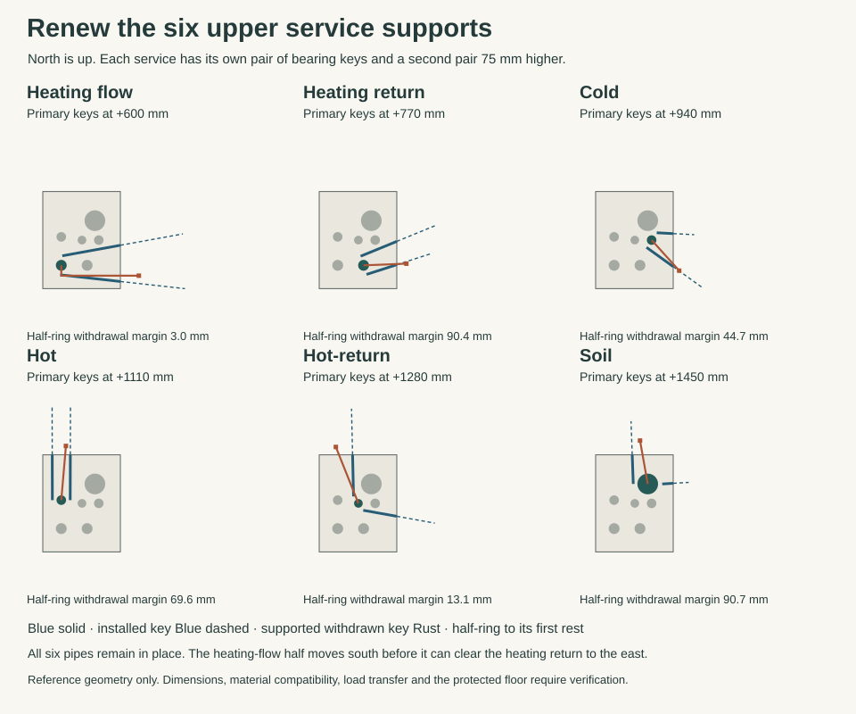

# Renewing the supports in the family service shaft

Keep the six pipes at their current centres and retain the 465 × 545 formed floor opening. Retire the unfitted upper strainer requirement from this cabinet. The lower plant strainer has its own service position. Replace the old single east service face with removable **east and north faces**. The north side opens into the bathroom beside the privacy door. Close that door during work, withdraw the ordinary users and keep its handle and return route available between operations. A 230 mm tool ring around the cold line would overlap the soil envelope by 42.0 mm. Giving the same allowance to every pipe made the cupboard appear unserviceable.

The [checked coordinates](studies/family-shaft-keys.json) give the two bearings, front sockets, complete moving bodies, receiving ends and operator stances at each pipe. The [geometric check](studies/family_shaft_keys.py) retains the installed bath, revised basin, WC, fixed terminals, closed privacy leaf, four frame columns and all six pipe envelopes. Run it through the [four-WC check](studies/wc-service-stations.py), which also guards the current exported schedules.

## Separate the pipe, its working bearing and the cabinet

Use a permanent service frame with a detachable bearing for each service. The decorative faces lift from their own catches. No water or soil joint opens to change a working bearing. On each service, specify a factory-prepared support section with two weight-transfer shoulders 75 mm apart and separate insulation continuity. It must transfer force to the actual metal carrier, with a load-bearing insulation insert where needed. A sleeve clamped to a soft jacket cannot support a pipe. Select the single axial anchor and the sliding guides for each real thermal run with Services. Keep intentional movement at guides and restrain the stack independently on both sides of the floor seal.

At each shoulder fit two matched semicircular steel bearing shells with recessed seam locks. The envelope for each unloaded half, including its positive handling keeper, is the service radius plus 12 mm. The fixed service profile at the working shoulder must fit the service radius plus 6. The bearing surface remains continuous except at the two release seams. Give the ring 25 mm axial depth. Two opposed keys engage the reinforced seat lands; the 6 mm wide radial nose reaches from the priced pin axis to within 8 mm of the service envelope. Each key and its face joint fit 20 mm in plan and 45 in height. Use an independent guide, positive end stop, removable anti-walk lock and a restrained screw-adjusted seat at each face. The technician works at the face where each key exits. Flush seam releases must accept the same indexed extension from that face. An assembly requiring a third hand behind the riser fails procurement.

| Service | Primary / transfer seat above floor | Minimum key clearance | Minimum shell clearance on its way out |
| --- | ---: | ---: | ---: |
| Heating flow | 600 / 675 mm | 2.2 mm | 3.0 mm |
| Heating return | 770 / 845 mm | 6.0 mm | 90.4 mm |
| Cold | 940 / 1015 mm | 6.0 mm | 44.7 mm |
| Hot | 1110 / 1185 mm | 6.0 mm | 69.6 mm |
| Hot return | 1280 / 1355 mm | 6.0 mm | 13.1 mm |
| Soil | 1450 / 1525 mm | 6.0 mm | 90.7 mm |

The positions stagger the six sets vertically. Two 5 mm errors are already charged to pipe, key, post and shell clearances in the priced checks. The cold and soil half-rings can turn with only 13.97 mm of radial reserve to the neighbouring installed service. The heating-flow half must move 80 mm south to Y4775 before translating east to a supported first rest at X10140. A direct pull through the heating return fails. Do not discard the half-shell ends, screws, guide or keeper to get inside these limits.

## Load transfer, first rest and return

1. Bring the bath out of use. Open only the applicable east or north face strip. Use captive 145 mm high covers at 170 mm vertical pitch. Support a cover on its independent vertical runners before releasing its lower catches. Move it 20 out, raise it 180, and hook it onto two positive catches above its own opening. The supported parked strip occupies the next unopened tier on that same face and needs no floor park. Provide the blank head field above the highest tier. Price the required carrier clearance at the openings and keep the sleeve height and both operating tiers exposed. Inspect the stack and pipe joints for wetting or movement. Isolate, depressurise or drain the relevant service whenever a failed support, unsafe temperature or uncertain load makes a live transfer unsuitable.
2. Both working keys remain locked. Fit and lock the two keys at the separate transfer shoulder, using screw-adjusted shoes and a measured load witness. Transfer the reaction onto them; prove the original seat is unloaded before removing either working key. The transfer pair must take the entire service load in either direction required, independently of either working key or removable face. Treat a failed frame or support section as a different intervention requiring independent temporary shoring above and below; first unloading a damaged common member onto itself would be unsafe.
3. Engage the retained draw guide and screw drive before unlocking a key. Its thin nose comes away with it, leaving no projecting trunnion on the shell. Withdraw straight to the positively retained first rest outside the aperture. The longest key extends 468 mm to its bearing and needs another 35 mm to clear its carrier. The complete key and telescoping receiver start folding only when the inner end is 35 mm outboard of the face. Pivot upwards under arrested drive, then raise the upright package until its bottom is 180 mm above the working tier. Keep the folded package within a 40 mm radius, including locks. The maximum top is below +2000. The carrier and its upward turn stay over the charged straight draw, clear of the other key. Both parked packages clear the separate shell exchange in height; the second operator approach and subsequent shell-working stance also avoid both parks in plan. Reverse the sequence to reinstate. With the current source closed-door approach, the least R300-body clearance is 33 mm and the furthest nominal shoulder-to-face grip is 556 mm. The calculated line is for a captured guide and a receiver; greater real hand, torque or operating-room needs require another set-out.
4. Keep both shell halves secured to their low-profile carrier. Lower the unloaded set 12 mm clear of the working shoulder, release its flush seam locks and rotate the two halves together onto the registered exit direction. Draw the outward-facing half first. Rotate the remaining half into the vacant sector, then draw that one out. Park the first shell on the receiving carriage. Restrain and remove it to the dry work station before drawing the second. Do not stack a dirty loose half in the next working path. Its true semicircular mating surface separates from the service on the first outward motion. The collision check bounds it by a larger half-square against every *other* service and fixed item. Use the two-stop guide for the heating-flow dogleg; the keeper must remain captured when changing axis. Fit the new parts in reverse, inspect both seams, lock the original key pair, transfer the load back and witness the idle transfer seats. Refit the faces only after checking the pipes, backing, floor collar, wet indicators and all positive locks.
5. If the actual collar cannot rotate on the unloaded barrel, has projecting seam bolts, cannot be handled on the captured guide or misses either positive stop, reject its use in this envelope. Replacement of the fixed service section, a damaged anchor or a pressure boundary is a planned outage. Shut down all affected circuits, support the lines above and below on independent structure and provide qualified joints and renewed fire or wet closure. No field-made shoulder on a pressurised copper supply, expansion lock at every floor or undocumented floor penetration is selected.

## Frame and installation conditions

Replace the former cabinet-only bearing assumption with a fixed frame carrying the **six service loads below**. Retain the four 80 × 50 concrete contact fields at X9450/9920 and Y4715/5370. Use continuous east–west end rails 70 deep × 40 wide with 4 mm walls centred on the two Y lines. They lie wholly on the solid end strips, 25 mm south and 45 mm north of the formed hole. Short returned brackets connect the four 30-square corner posts at X9415/9979 and Y4693/5407 to these rails. The greatest eccentricities to the contact centres are 59 mm in X and 37 in Y. The posts do not bear directly on a decorative face or at an unsupported edge of the opening.

Price each key alone for a **0.75 kN vertical design comparison**, including the filled isolated length, hardware and bounded renewal action. Weigh and recalculate the actual service. Allowing 492 mm from frame to radial toe, a plain 20 × 45 steel key gives 0.369 kNm, 54.7 MPa nominal bending and about 1.03 mm tip deflection at 190 GPa. Reinforced seat, screw housing, shear, slip, torsion, cyclic force and the loss of either key require their own verification. Six such assumed service loads plus a 1 kN frame and fronts total 5.5 kN. Bounding all 5.5 kN at one extreme post gives 0.325/0.204 kNm eccentric moments. The 470 mm supported transverse span has a 0.646 kNm centre-load comparison. With the stated end-rail section the latter gives 44.5 MPa nominal bending. One foot carrying the entire gravity load would bear 1.375 MPa over its nominal contact. A separate 0.30 kN lateral action at 1.6 m gives 0.48 kNm before pipe thrust, thermal forces or water hammer. STR must establish the actual force combinations, positive anchor groups, slab edge reinforcement, bracket/weld action and independent temporary load path. Preserve the qualified fire, water and acoustic closure around the six continuous services without a fixing through the protective seal.

This selects a maintainable support arrangement at house-development scope. It does not establish the capacity of an unbuilt frame, availability of compatible factory shoes, drinking-water approval or actual continuous gravity support. If any measured envelope or duty fails, revise the cabinet and service section before fabrication.
