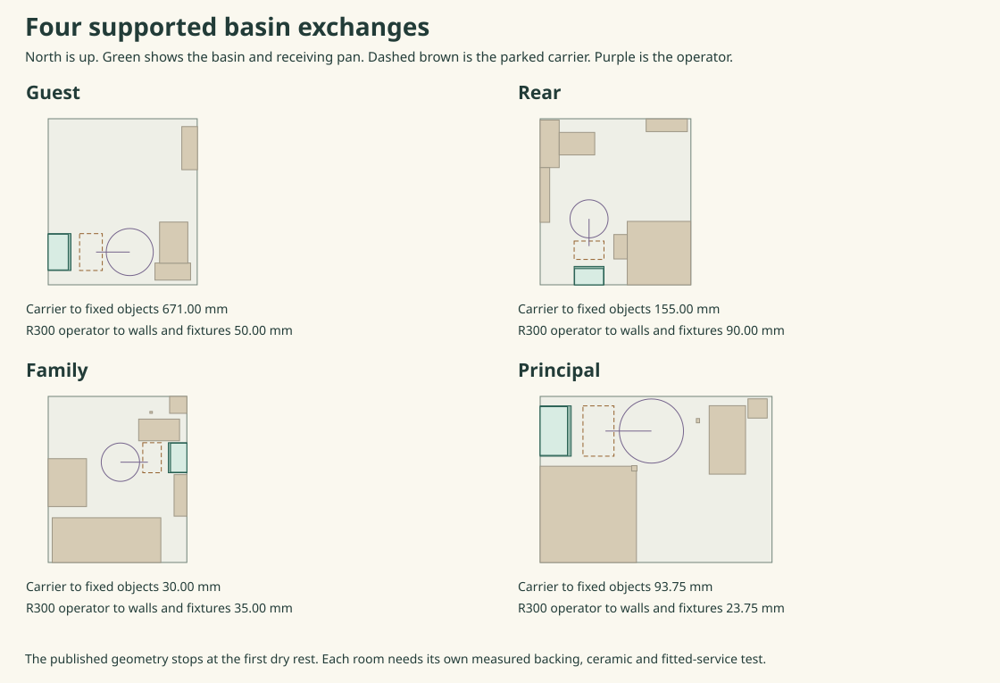

# Household water fixtures and the actual family shaft

**Keep the four washbasins on independent wall supports. Use a domestic lever mixer, an exposed trap and two locally accessible stops at each. Keep kitchen drainage separate from the utility washer.** The current house has no kitchen dishwasher. In the kitchen, raising the sink-trap outlet allows its waste to cross two insulated feeds. In the utility, opening the lower U first allows the factory sink head to leave without cutting the fixed outlet. The [guest and rear WC takeoffs](ias-03-guest-rear-wc-takeoffs.md) supply the adjoining fixture releases. [Reproducible model and results](studies/household-water.json) · [Verification source](studies/household-water.mjs)

## Four basins

Use the Ideal Standard EXTRA T373401 development comparison, 450 × 250 × 150 mm, 8.6 kg and two fixings at 280 centres. At a local rim of +850 the fixing axes are +790. Verify the delivered template and independent backing at each of the four actual walls. The guest basin moves to the solid west partition. Its earlier south-wall option put a fixing above a +750 window sill. Keep the family basin on the east pier clear of its jamb, and retain the independent rear and principal shower fixtures during basin removal. Measure the ceramic against a 455 × 255 purchase envelope. Allow 470 × 290 for the whole support. [Ceramic, overflow class and fixing drawing](https://www.idealstandard.co.uk/dfsmedia/9e07a8a15f014cab9f19c3786cffba89/441921-source/is-extra-t373401-dsheet-nn-en)

| Room | Back centre X/Y, facing | Whole carrier to fixed objects | R300 worker clearance |
| --- | --- | ---: | ---: |
| Ground guest | 7300 / 850, east | 671 mm | 50.00 mm |
| Rear | 1200 / 8952.5, north | 155 mm with the optional shower service enclosure retained | 90 mm |
| Family | 11567.5 / 5440, west | 30 mm | 35 mm |
| Principal | 9400 / 7828.75, east | 93.75 mm | 23.75 mm |

Select the Cerafine BC718AA comparison with its fixed 115 mm spout facing along the bowl. This equals the 115 mm between the ceramic tap and waste axes. Verify the ±10 setout, lever swing, Ø35 deck hole, EasyFix underside, directional jet and two supplied flexible tails. Keep the manufacturer's balanced high-pressure application, 15 mm copper connections and outlet flow regulator. Its 5 L/min figure is at 3 bar. Measure no more than 6 L/min throughout the house duty. The basin's CL25 overflow rates 15 L/min with a working common downstream path. Test blocked trap and open-spout overrun separately. The regulator has no effect on a ruptured supply hose upstream of the spout. [Mixer and factory flow conditions](https://www.idealstandard.co.uk/dfsmedia/9e07a8a15f014cab9f19c3786cffba89/433829-source/options/download/is-cerafinemodeld-bc718aa-dsheet-nn-en)

Move the actual branch endpoints to a supported pair of stops +640, 100 from the wall and 150 apart. Preserve upstream isolation when either stop is under repair. Reserve 298 mm across the two indexed spanners, with counterhold and separate working planes. Set the Ø32 wall outlet at +590. For a slotted G1¼ basin waste, compare the McAlpine CA32UK-CB brass bottle trap, 75 mm current water seal and 60–160 adjustable inlet. Set the top +700, 110 above the wall axis. First release the top and shorten the supported trap by 25, then pull the whole shortened tube 75 clear of its wall socket. Require no more than 65 mm measured wall engagement and verify the actual nut, rings, tube length and hand force. The older manufacturer drawing shows an 80 mm seal. Keep the fitted article's declared duty. [Trap drawing](https://mcalpineplumbing.com/wp-content/uploads/2023/11/CA32UK-CB.pdf) · [Current trap specification](https://mcalpineplumbing.com/traps/bottle-traps/cp-brass-basin-kit-with-cylindrical-bottle-trap/)

Drain the trap, close the foul end, empty and remove the low pan, then capture the ceramic on the dry stand. Use a deep stud socket with its grip at least 75 mm out from the wall. The family position needs a 575.5 mm reach. Unlock the supported bowl, draw 75 normal to disengage studs projecting at most 65, and roll the captured body until its back is 400 from the wall. It then clears the original apron by 110. Restore the ceramic on fixed support before loading the seals, then reconnect, fill, clean, inspect the back return and dry the floor. In the 647.5 mm principal throat the maximum centred allowance is 23.75 on each side of an R300 body. If the incoming rig requires 25, enlarge the real throat by 2.5 and replay the shower corner.

In the alternative raised rear shower use the revised early stance (1225,9580) and late approach via (995,9590) to (1050,9590). The earlier occupied replay with the new basin gave 30.23 and 45.33 mm clear, with grips at 487.06 and 534.53. The selected flush tray passed the new basin by 58 in its tight horizontal move. The two upper WC exchanges, moving principal shower leaf and family bath were also replayed before publication. The executable attached here reproduces the basin movements; the older detailed fixture studies remain the starting point for an independent joined replay. [Three-bathing floor and replacement sections](ias-03-three-bathing-sections.md) · [Both upper WC exchanges](ias-03-upper-wc-release.md)

## Kitchen connections and drainage

Keep the head and frame supported while disconnecting the three removable spools. A faces up at Y10950.5/+475. B faces south at Y10985.5/+625. Cold, hot and waste use X9025, 9130 and 9275. The proposed pressure flanges are Ø70, the waste Ø94. Each has an 8 mm moving plate, a 12 mm fixed plate, two captive M6 screws and a one-sided recessed face seal. Reserve 8 mm thread engagement and 12 retreat so the parked screw clears the mating face by 4. The opposite face must be flat, without a pilot or an interfering nut. Verify the drinking-water-compatible metals and seals, cross-brand transition, fabrication, loading and pressure performance before any purchase.

Capture the spool on its independently restrained fork. First move 3 south **and** 3 up together to unload both seals, then another 17 south and 17 up. The tube needs a real R40 upper turn, 15 mm overshoot and two 35.66° returns to produce a 55.36 straight stem in the 35 mm plan separation. A commercial socket with axial capture cannot perform this motion. The short offset ratchet and counterheld straight driver keep the furthest grip within 586 mm. Three mobile spools with 0.25 kg hardware allowance apiece compare at 2.737 kg against the 5 kg rack limit. Price head and fixture supports separately. A seized screw still pilots the opposing plate until its shank is extracted or the replaceable moving plate is split. Isolate, depressurise, support, recover debris and prove the restored connection.

Bring the temporary rail forward on independently captured attachments to the existing legs. Its front section reaches X9320 at Y10838 before returning diagonally to (9500,11070.5). The prior moving-solid study gave 28.17 mm to the worker and 33.24 to the retained waste. After the 120 mm captured draw, move the supported load west of the worker for the turn past the actual east chair. Price stop pins, retained scope and a second pair of hands for failure recovery. Drain and cap the actual branch. Return clean parts in reverse, restore the upper head support first, and retest each join separately. [Existing kitchen head, chair and receiving-table sequence](ias-03-selection-closeout.md)

Use the BLÜCHER 505.040.050 S stainless bottle-trap trial, 1½-inch inlet, 75 mm seal, 0.85 kg and Ø50 outlet. From the gasket plane at +430 its 71 mm native offset gives outlet +359. Counting the entire 233 mm height downwards gives a conservative +197 bottom, 147.125 over the high catch sheet. Retain a Ø50 branch downstream, including the locked 841.050.050 S double socket, 97 long with two separate seals. Select 38 engagement in the 30–47 range. The captive lower tail and trap draw 60 south to free the socket, with a 13 mm reserve at the longest engagement, then 240 total to the supported first rest. Catch residual water in a tested low vat, open the sump on the supported cassette, dry the gaskets and inspect the sheet before restoring. Compare the 40 mm polypropylene Viva WTBT4076 only on its own approved material and outlet route. [BLÜCHER dimensioned trap](https://www.blucher.com/dfsmedia/0533dbba17714b1ab581ab07a4cbb521/30498-50060/639217548170000000) · [EUROPipe installation and seals](https://www.blucher.com/dfsmedia/0533dbba17714b1ab581ab07a4cbb521/79313-source/638991498880000000/blucher-europipe-installation-maintenance-material-properties-exp.pdf) · [Viva alternative](https://www.vivasanitary.co.uk/media/pjyhew3r/wtbt4076.pdf)

The old +300 run hit the cold and hot jackets at Y11250 and 11350 by 7.49 and 9.99 mm. The raised branch has centres +356.375 and +353.875. After allowing the full support envelope to +304, another 50 along the slope and two 5 mm errors, the clearances are 16.125 and 13.625. At Y11412 fit two R65 bends with a 40.68 mm diagonal link. The 1:40 line resumes at Y11529.44/+285.53 and reaches the prior wall axis (9275,12000,+273.7625). Redraw the downstream opening and fittings for Ø50. At +435 the fixed transom underside clears the Ø70 socket by 11 after tolerances. Reserve two independent 40-square wall arms in the north pier, the X9330 hanger and accessible clips; qualify steel, anchors, wall bearing and dynamic loads.

Give the welded head's ends and back seal their own removable drip returns into a 640 × 630 sheet at X8830–9470/Y10885.5–11515.5. The front is +42, with 7.875 fall to it. The 100-square plates at the four leg centres overlap the sheet 20 in plan; its 1.2 underside clears their tops by 32.8. The vertical legs leave 10 per side. Use positive guides and a second low receiver. Move the empty dry sheet 650 south before lifting it; the table in its pre-release state clears by 35.5. Inspect the underside and permanent floor. The small receiving trough needs at least 0.40 L measured net and visible wetting by 0.05 L.

## Utility bench and washer

Keep the Acorn Thorn CS862-SB 600-square factory top with the supplied 1½-inch standpipe overflow, four separate head fixings, 500 × 400 × 200 bowl and +900 rim. The related manufacturer's drawing locates the outlet towards the rear right. From the selected X10935/Y740 origin use about (11395,940), then verify the actual CS862 template within 10. A waste and gasket plane 35 below the bowl bottom gives +665. The McAlpine WM2 single-appliance swivel P-trap has 185 overall height and its nozzle and outlet are 140 and 130 above its bottom. Installed levels are +620, +610 and +480 respectively. The washer nozzle lies inside the Bosch 600–1000 range. Match the 20/24 nozzle to the delivered hose and the 24–40 external clamp. The stock polypropylene trap needs an explicit materials decision. [Factory sink and waste](https://www.acornthorn.co.uk/basins-bowls-catering-sinks/freestanding-catering-sinks/catering-sink-single-bowl) · [Outboard waste drawing](https://www.acornthorn.co.uk/imagprod/CS860-SB_5.jpg) · [WM2 assembly](https://mcalpineplumbing.com/wp-content/uploads/2023/11/WM2.pdf)

Face the detachable upper nozzle towards the front-left shoulder (11090,1645,+650) and the independent P elbow west. The R300 worker clears the bench by 5. Counterhold the trap and use the opposed 120 mm clamp tool and 260 mm nut extension. The checked grip distances are 524, 508 and 540; bare-hand clamp access fails. The Ø36 upper tool needs 17 below the bowl. Isolate and empty the washer. Clip its released hose and cap the nozzle. Take the U on an independently supported drip cradle before releasing its two parallel lower nuts. Lower 45 on ≤35 engaged seats and slide its 140-wide receiver forward onto the dry stand. The lowered U and 30-deep cradle clear the +245 shelf by 160. Check both lower screws and grips at the real underside. The inlet tee then drops 45; the independently held outlet elbow draws 65 east from its released ≤55 insertion. The room-side elbow and branch stay supported when the factory top lifts. [Factory top and cradle](ias-03-utility-factory-head.md) · [Actual appliance service and controlled draining](ias-03-utility-first-release.md)

From (11270,940,+610) take the independent tube west to X10760, north to Y1275 and east to X10875. The 960 run falls 24 to +586, then turns down to the retained covered floor connection. Two R45 bends leave 25 of straight on the 115 final leg. The axis keeps 40 from the foot-seat rectangles, 90 from the rack post and 86 from the installed washer. Charge the full Ø50 assembly envelope at these locations, inspect actual sockets/clips and certify simultaneous sink and pumped discharge. The tap, hose union, pump outlet, filter and blocked waste each need their own observed leak test.

## Visible first wetting and drying

The four basin pans have 2.04 L rectangular gross and require 1.25 L measured net. Put a visible indicator at or before 0.20 L. Behind the bowl, seal the wall return and guide small drips forward. In all four rooms a blocked bowl can run over its rim beyond the under-basin pan. Extend the continuous room-side water boundary to a visible floor strip, including the ground guest basin. Remove local facing to inspect and dry the wall toe. Witness rim overflow, hose discharge and the floor seam separately.

Under the kitchen sheet put a 640 × 40 trough at Y10845.5 with a +35 rim, seven below the lip. Provide a visible overflow onto the washable floor. In the utility, grade the 1500-wide area under the rear chase, sink, valve bay and washer 9.5 towards Y1400. Keep the four foot seats independently level and return the water layer up their collars and around the retained waste access. A 1500 × 40 flush grated channel at X10050/Y1400 needs 55 mm internal depth. The 3.30 L gross must yield 2 L measured net, visible by 0.20 L. It clears the floor-standing receiving stand by 25 and the electrical working-field edge by 310. Check the loaded machine foot/wheel, grille and permanent support before rolling the washer over it. All electrical isolation, wet-area protection, equipment clearances and dry re-entry still apply. Empty the machine in controlled batches. Its existing hand-drain vessel has an external 3.445 L bounding prism and unknown usable capacity.

| Time from visible indication to first overrun | At 6 L/min | At 15 L/min | At 30 L/min |
| --- | ---: | ---: | ---: |
| Basin pan | 10.5 s | 4.2 s | 2.1 s |
| Kitchen trough | 3.5 s | 1.4 s | 0.7 s |
| Utility channel | 18 s | 7.2 s | 3.6 s |

These flows illustrate the consequence of a finite witness. Measure actual raw hot and cold flows and residual release. Isolate both relevant supplies, remove the appliance or empty support to reach behind it, inspect the floor and wetting routes, dry all affected surfaces, then recommission. A separate requirement to contain an unattended burst needs a separately sized and inspectable gravity destination or an independently verified supply shutoff and adequate retention. The ordinary basin regulator, visual indicator and finite tray cannot supply that duty.

## Family shaft

The old X9500 upper task has no surviving fitted occurrence in this house. Its lining cuts the actual Bed 3 footprint. Retain the real 600 × 750 cabinet at (9397,4675) and the six continuous service envelopes in the 465 × 545 formed opening at (9440,4760). Use four 80 × 50 concrete contacts centred on X9450/9920 and Y4715/5370. South contacts clear the hole by 20, north by 40. Price outward, cast-in anchorage, edge reinforcement and water/fire closure. A 1 kN gravity and reversible 0.30 kN lateral comparison gives corner actions −0.182/+0.682 kN; a tension connection is necessary. That four-foot calculation covers only the cabinet. The [selected service frame](ias-03-family-shaft-support.md) adds the actual pipe load paths and end-rail eccentricities on those contacts.

Use two dry supported lift-off faces opening east. The far heating flow and hot bosses need oblique tool entries at X9997, Y5042 and 4777. With a Ø30 tool and two 5 mm errors the six pipes leave 8.65 and 7.95. A complete Ø230 ring overlaps adjacent cold/soil and return/cold envelopes. Retire the obsolete upper Fig. 12 strainer, which occupies the cold pipe; the genuine lower plant strainer remains. If the support requires a whole ring, isolate and support that circuit, make a supported accessible separation or re-space the pipes. The [supported half-ring exchange](ias-03-family-shaft-support.md) replaces this rejected full-ring task with an explicit load-transfer and reinstatement sequence. [Current service riser](../mat/whole-house-service-baseline.md) · [Governing sections and superseded task](ias-03-three-bathing-sections.md)
