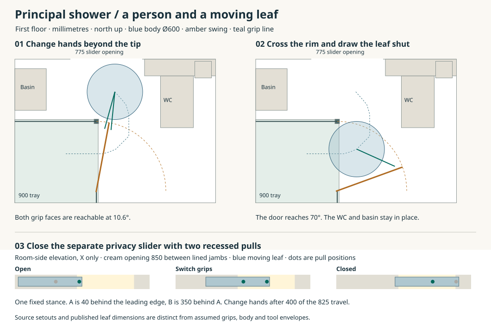

# Entering the principal shower and closing both doors

**Carry a south-hinged, outward-opening screen and a two-pull bedroom slider into the next joined room drawing.** They give the 900 mm principal shower a reversible route without moving the WC or basin. The 600 mm body model clears the fixed fittings by 23 mm and the moving glass by 26 mm during operation. Keep the rear 1000 shower as a separate enclosure. The accepted-plan 2020 × 1075 en-suite still requires a joint decision to supersede it with the three wet rooms of the water replan. [Accepted en-suite](../had/had-03-ensuite-fit-review.md) · [Room assembly](../mat/interiors-b-wetroom-assembly.md) · [Calculation and drawing source](studies/principal-shower-entry.py)

## Close the room

The east bedroom approach meets the existing bathroom-entry path at X10400/Y8825. Move through the 775 clear slider opening, across the 20 mm saddle, to X10400/Y8050. The 950 × 44 leaf runs on the bedroom side of a 260 mm reveal. The source inside grip is at X10050/Y8360. If attached rigidly to the leaf it finishes at X10875, **75 mm into the rough east jamb** and 100 beyond the lined opening. An open-door reach check misses this collision.

Reserve two recessed pulls on the room-facing side of the leaf, both flush on its sliding face. At full opening their centres are X9960 and X9610, both at Y8430. The first is on the 75 mm of leaf still visible in the lined opening. Draw it 400 mm, transfer to the second, then draw the remaining 425 mm. The second pull finishes at X10435. From the same stance the maximum reach is 581.4 mm against the 600 comparison. A 12 mm plan allowance around the reaching line leaves 23 mm to the lined jamb. Keep covers flush through the 17.5 mm clearance behind the wall. Size the cups, edge webs, finger purchase, latch and outside emergency release in the actual 44 leaf. Reopening reverses the same handover. [Bedroom and bathroom geometry](../had/studies/water-replan.json) · [Slider and fixture setouts](../mat/studies/interiors-b-wetroom-assembly.json)

## Open the shower, enter, close and leave

| 900 enclosure reference | Published opening | Consequence against 700 |
|---|---:|---|
| Kudos Divera bifold K22K0905007-0001 | 650 mm | 50 mm short. The 750 opening belongs to the rear room’s 1000 size. |
| MERLYN 8 Series hinge M81221 with M82221 side | 750 mm | 50 mm spare. The door swings 750 outside and closes onto the side panel. |

MERLYN lists a 765 mm moving pane, 8 mm glass and 1950 height. The door with a side panel adjusts to 870–910 and the 900 side panel to 870–890. Set the two lines 880 mm from the finished walls, 20 inside the tray edges. Put the hinge axis at X10280/Y6730, a fixed return on the tray’s north edge and the closing corner at X10280/Y7480. Treat the 15 mm difference between moving width and swing as a heel behind the trial pivot. Reserve two grip centres 75 back from the free end and 35 either side of the glass. The product guide shows both handles. Its drawings do not dimension these grip coordinates. [Kudos collection](https://online.flippingbook.com/view/933073217/86/) · [MERLYN product dimensions](https://www.merlynshowering.com/series-8-hinge-shower-door.html) · [Corner configuration and side adjustment](https://www.merlynshowering.com/amfile/file/download/file/2064/product/6425/) · [MERLYN installation guide](https://www.merlynshowering.com/amfile/file/download/file/968/product/6152/)

1. From the closed room slider move to X10480/Y7800. Take the outer pull. The old bifold stance intersects the moving door centreline at 49.4°.
2. At 10.6° remain beyond the free end and take the inside pull with the other hand before releasing the first. Both straight reach paths clear the glass. Follow the free end from the north side as the leaf opens to 70°.
3. Cross inward at the tray’s east edge, then draw the leaf shut from inside. Release the pull at X9940/Y7130 and move to the source shower stance X9850/Y7090. Reverse the movement to leave. The catalogue opening assumes a fully open leaf; the 70° route independently checks the moving person and glass.

The continuous plan calculation gives at least 96.2 mm from body to handle, 29.6 mm spare reach, 11.0 mm from the 12-radius reach line to the glass face and 15.0 mm to fixed fittings. The closed-slider stance to the shower approach gives 43.0 mm of body clearance. The screen’s full 90° sweep stays at least 212 mm from the other fixtures. The coordinates test a 300-radius standing outline, a 10 mm moving-glass envelope each side and a grip envelope of 7 mm beyond the two centres. Exclude a full 50 × 50 square centred on the closing corner from body and arm movement throughout. The earlier 64° path intersects this square by 4.7 mm at X10563/Y7648.6. It represents a keep-clear envelope around mating fittings. Their actual profiles must let the door open and seat in the catches. Each interpolation interval subtracts a bound on body and screen travel. A person 25 mm larger in radius consumes the fixed-fixture margin on this trajectory. Actual shoulder mechanics, door force, wet footing, the crossing of the **120 mm raised rim**, head/foot and accessibility remain to demonstrate.

## First release and return to use

Support the door frame and fixed side independently before removing catches, covers, screws and wet seals. MERLYN’s basic guide installs the framed door as a unit and specifies nylon clips, washers, a bottom deflector and silicone. Keep the side-panel corner connection and its own instructions with the frame. An intact L-shaped 880 × 880 corner presented square to the door exceeds its 775 clear opening by 105. A bare L at 45° projects about 622 across and 1245 along the opening before frame depth or protection. That aperture comparison supplies no coupled rotation, support or carrying route. Separate and edge-protect the assemblies for the reference renewal sequence. The room needs a support and carrying method for glass up to 1950 high, with hardware and protective packaging included. Refit on a level supported rim, reinstate the wall and tray seals, set the two catches, allow the specified 24-hour cure and inspect for leaks before ordinary use. The coated glass, nylon and sealants still require a material disposition. This study selects a room-side geometry for development. Hardware, privacy, safe handling, wet performance and joint house adoption remain open. [Tray removal and temporary closure](../mat/interiors-b-wetroom-assembly.md) · [Material policy](../../docs/reference-house/material-policy.md)
