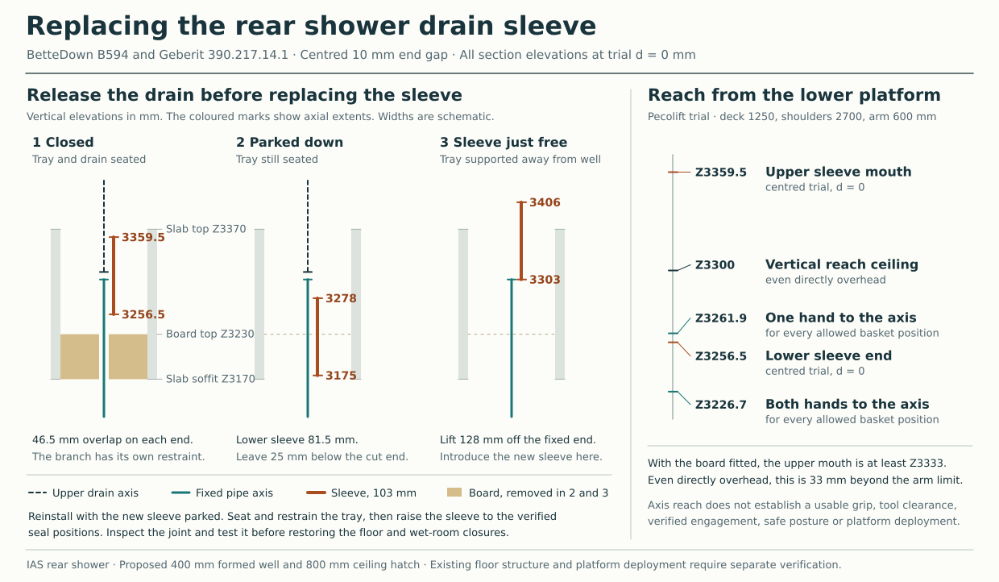

# Changing the rear shower tray and drain

**Reject the centred Geberit slip sleeve as the release detail for the rear shower on the current lower platform.** The BetteUltra 5940 tray, B50-3064 frame and bolted B594 drain can still be compared as one removable package. The trial does not establish either the sealing land for the sleeve or a way for the worker to set and verify its upper engagement. Develop a separable clamped joint with accessible fasteners and a separately restrained pipe before selecting this package. [Original tray, frame and formed opening](ias-03-renewal-proportionality-result.md#an-ordinary-sliding-release-with-a-constrained-closed-position) · [Calculated section and reach](studies/conventional-first-rest.json)

## The joint has to fit in three positions

The proposed 400 mm square well sits at the drain centre, X2012.5/Y9452.5. The comparison puts the rim at finished floor Z3450 and the top of the sacrificial 60 mm board at Z3230. Let *d* be the actual downward offset from the rim to the B594 drawing's flange datum. The full 50 mm outlet ends at Z3313 − *d*. The difference between its 137 mm overall depth and 81 mm body depth gives at most 56 mm below the body. The cylindrical sealing and clamping length within that extent still needs a supplied-part measurement. Keep the native outlet full length. [Bette installation drawing and sequence](https://shop.my-bette.com/out/media/B594.pdf)

The 103 mm Geberit sleeve with the project's 10 mm end gap has 93 mm to distribute between the two spigots. If *U* is the upper overlap, the closed clearance above the board is *U* − 20 − *d* mm. Even assigning all 56 mm of gross outlet extent to that overlap only permits *d* ≤ 36 mm at zero clearance. Centring gives 46.5 mm overlap at each end and requires *d* ≤ 26.5 mm. Leave 25 mm above the board as a comparison and those limits fall to 11 and 1.5 mm. Geberit identifies this sleeve for repairs to its own pipes. Its published installation sequence secures fittings against axial sliding. The 10 mm pullback in its ordinary pipe instructions does not specify the engagement of this Bette outlet. [Geberit article 390.217.14.1](https://catalog.geberit.co.uk/en-GB/product/PRO_101519) · [Installation guide, sections 3.1–3.2](https://www.geberit.co.uk/_assets/local-media/literature/brochures/geberit-silent-pp-quietly-getting-on-with-being-super-efficient.pdf)

| Trial, with 25 mm parking reserve below the fixed pipe end | Upper overlap | Maximum *d* with 25 mm above the closed board | Downward parking stroke | Clear fixed pipe needed |
|---|---:|---:|---:|---:|
| Geberit 103 mm, centred on 10 mm gap | 46.5 mm | 1.5 mm | 81.5 mm | 128 mm |
| Fernco PC56, 70 mm supplied width, abutting ends | 35 mm | 23 mm | 60 mm | 95 mm |
| Fernco PC56, 80 mm supplied width, abutting ends | 40 mm | 18 mm | 65 mm | 105 mm |

Fernco lists the PC56 for 48–56 mm outside diameters and gives 6 Nm band torque. Its printed datasheet gives 70 mm axial width and 80 mm outside dimension. Its live table gives 80 mm width for the same code. The specific installation guide marks the second pipe at half the supplied width. The two trials additionally assume the ends meet, giving equal overlap. At *d* = 0 the parked cuff reaches 12 or 22 mm below the board top. Measure the supplied cuff, both clamp lands, the driver sweep and the nested outlet's permissible band load. Support and restrain both sides independently. The EPDM body, stainless bands and any required insert or lubricant belong in the material comparison. [Fernco PC/DC datasheet](https://www.fernco.de/wp-content/uploads/2024/01/Fernco_DC-PC_Data-Sheet-1.pdf) · [Product table](https://www.fernco.de/en/product/drain-coupling) · [Installation catalogue, pp. 41–42](https://www.fernco.de/wp-content/uploads/2023/05/Fernco_EN_Produktkatalog_2023_einseitig-min-1.pdf) · [UK application and release instructions](https://www.fernco.co.uk/product/rubber-plumbing-couplings)

## What the worker can reach

A closed 103 mm sleeve wholly above the board has its upper mouth at Z3333 or higher. The 1250 mm deck places the reference shoulder at Z2700. Even a vertical 600 mm reach ends 33 mm short. The verified basket and ceiling allowance leaves only 0.375 mm of further deck rise. Across the possible shoulder positions, one hand can reach the drain axis to Z3261.94 at every origin. Two hands reach only Z3226.66 at the least favourable origin. The centred sleeve bottom is Z3256.5 − *d*. Reaching that lower datum does not put a second hand at the upper engagement mark or create space for a tool. These are targets on an axis. Actual cuff surfaces, hands and driver require their own envelopes. [Static platform and hatch coordinates](studies/pecolift-static-reference.py)

The 1350 mm ZARGES deck puts the shoulder at Z2800. At *d* = 0 each shoulder would have to lie within 216.70 mm in plan of the centred upper mouth. The 260 mm-deep platform also falls 40 mm short of the earlier 300 mm-square foot-contact comparison. A different platform, verified stance or independently supported remote tool can change the result. [Cold-task platform comparison](ias-03-renewal-proportionality-result.md#cold-lower-access-has-a-different-equipment-question)

## Outgoing and incoming work

1. Isolate the shower and opening. Establish lower access and temporary boundary protection. Independently restrain the fixed pipe in both axial directions. Its releasable fitting locator and standing pipe support must leave the full parking length clear. The friction-fit fire board does not carry tools, pipe or tray loads.
2. Open the lower closure and release the locator. Park the sleeve down onto the fixed pipe. Only after it is clear of the B594 may the crew lift the bolted tray, frame and drain to a verified four-foot crib. Keep the tail clear of the receiving floor.
3. With the tray absent, remove the old sleeve up over the free pipe end and load its replacement before lowering the incoming tray. The 103 mm sleeve needs 128 mm upward from its parked position just to clear the pipe. In every board-clearing centred case its top then stands at least 9.5 mm above the concrete. Guard the well and allow access into that space.
4. Seat the incoming assembly on its verified contacts. Hold it against upward insertion while raising the new sleeve. The four feet can bear down but cannot hold the tray down against seal drag. Neither renewed wall seals nor an unqualified clamp on the drain body provides that reaction. Confirm actual engagement at both ends and reinstate the locator.
5. Test the visible, unstressed discharge joint before restoring the assessed board, collar, seals, room ceiling and shower-to-wall waterproofing. Inspect the restored boundaries and test the completed shower. Ordinary trap cleaning remains accessible from above.

The next selection needs one measured tray-to-outlet datum, the actual usable straight lands and permissible loads on both pipe ends, together with a reachable locator and positive counterhold in this section. The four native foot contacts and the aligned floor opening still require their owning checks. [Release calculation](studies/rear-release-reach.mjs) · [Interior family exits](ias-03-current-occurrences-and-exits.md)
