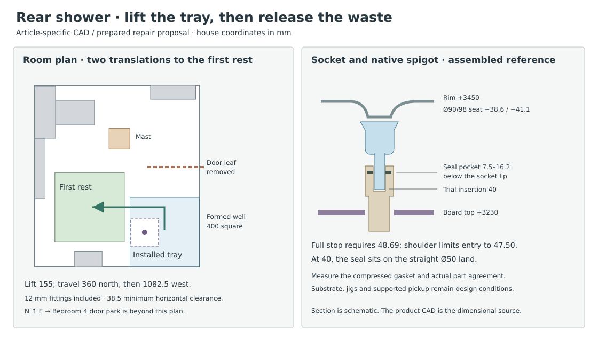

# Lift the rear shower tray before withdrawing its drain

**Develop the tray-first sequence for a prepared new-build installation. Reject the centred slip sleeve and an assumed fully bottomed Geberit socket.** Removing the upper wet junction, tray and frame opens a straight service route through the proposed 400 mm well. This costs four sacrificial perimeter releases, a prepared carrier and temporary lifting equipment. It keeps routine drain exchange off the Pecolift and out of the lower fire and acoustic closure. The mixed-product joint and positive restraint are real selection conditions.

## The actual parts change the section

The Bette product page defaults to a narrower tray. Use the 5940 **1000 × 1000** model. Of its two STEP solids, the enamel receptor spans 999 × 999 from outer edge to edge, with rim at model Y0. The other solid is loose trim. Around the drain the receptor has two planar annuli, each bounded by Ø90 and Ø98, at Y−38.60 and −41.10. The sheet is 2.50 thick there. Catalogue depth 25 is not the drain seat. Its annulus is only 4 wide; the complete rubber seal must conform to the surrounding formed profile. The manufacturer's case-A Foot-System has four corner assemblies with underside retainers; the handling subtotal for tray and frame is 26.6 kg before everything else. Verify the actual four contacts, the applicability of an additional central support, the configured Upstand and all attachments. [5940 manufacturer STEP](https://content.my-bette.com/produkt_downloads/BetteUltra-1000-mm-462223/BetteUltra-1000-1000-25-mm-134394/BE3C_Ultra_5940_Part.stp) · [5940 dimension drawing](https://content.my-bette.com/produkt_downloads/BetteUltra-1000-mm-462223/BetteUltra-1000-1000-25-mm-134394/BETZ_Ultra_5940.pdf) · [Foot-System, Rev. 15](https://shop.my-bette.com/out/media/Z0009038-REV15.pdf)

The B594/Viega drain has a Ø120 lower flange, Ø110 upper ring, Ø89 body and nested outlet. Retain the full outer Ø50 spigot. Cutting it back is the documented conversion to DN40. The 137 tail and 81 body dimensions in B594V start at **different witness lines** about 1.51 apart. In the native vector profile, calibrated independently against its printed Ø50 and 137 dimensions, the bevel ends 1.77 from the tip. The straight section continues to the moulded shoulder at approximately 47.50. Its nominal sealing land is therefore about 45.73, rather than the old 56 mm difference. The shoulder reaches radius 27.12 on one side of the drawing. These are model observations, not production tolerances. Viega places the seal in the housing groove, passes its upper lip through the tray, then installs the fixing flange with three hand-started screws tightened evenly by screwdriver. The 2.5 sheet is on the thin side of its 10 mm seal-splitting threshold. [B594V native drawing](https://content.my-bette.com/produkt_downloads/BetteDown-senkrecht-0-6-l-s-596193/BetteDown-weiss-601325/B594V.pdf) · [Bette mounting sheet](https://shop.my-bette.com/out/media/B594.pdf) · [Viega full guide, pp. 8–11](https://web-catalog.viega.com/en_GB/html/Mounting/Drainage-technology/Drains-for-bathtubs-and-shower-trays/03241ff43288fb6cac114094526976c6_2_en_GB/pdf/ga_tempoplex-drain_2_en_--.pdf)

| Geberit Silent-PP 390.204.14.1, single socket | Measured consequence |
|---|---|
| CAD lip ID50.8; largest outside Ø63.5; pocket 7.50–16.20 below lip | The model contains the pipe and moulded socket. It does not model the compressed EPDM lip or certify Bette compatibility. |
| Ø50 square-ended cylindrical probe reaches the sloped stop at 48.69 depth | The Bette shoulder meets the Geberit lip after 47.50 at most. The native bevel would admit a deeper stop contact. **Ordinary full-stop insertion cannot occur.** The minimum shortfall on these drawings is 1.19 mm. |
| Trial independently fixed engagement 40 | The seal pocket spans 23.80–32.50 from the native tip, within the observed straight land. Axial reserve to the moulded shoulder is 7.50. No credit from a deliberate bottom-and-pull-back installation that the shoulder prevents. |
| Gross socket solid 62.50 long; outside profile enlarged above the plain pipe for 52.50 | Define *g* as the signed installed vertical separation from the tray’s lower Ø90/98 annulus down to the B594 **137** datum. With rim +3450, native tail is +3271.90−g and pipe mouth +3311.90−g. Relative to board top +3230, the lowest socket solid clears by **19.40−g**; enlarged outside collar by **29.40−g**. A required 25 clearance to the enlarged collar permits g≤4.40. Measure the actual compressed stack and the fire-system’s fitting separation. |

The earlier centred Geberit 390.217.14.1 slip sleeve would enter the board by **14.60+g** even closed in this section. Its parked bottom is lower still. A 10 pullback in instructions for Geberit pipe does not authorise a foreign drain fitting’s engagement. Select the 40 setout **only** if both actual parts, retained insertion, ring contact, permissible movement, flow and leak tests support it. Otherwise specify a demonstrably compatible, shallower single socket and rerun the section. Do not shorten the native outlet or take restraint from the sacrificial board. [Geberit one-socket product](https://catalog.geberit.co.uk/en-GB/product/PRO_101480) · [390.204.14.1 manufacturer STEP](https://cdn.data.geberit.com/cad/390.204.14.1_P.stp) · [Geberit installation guidance, §§3.1–3.2](https://www.geberit.co.uk/_assets/local-media/literature/brochures/geberit-silent-pp-quietly-getting-on-with-being-super-efficient.pdf) · [Earlier sleeve and platform result](ias-03-rear-drain-release.md)

## Hold the drain while releasing the upper seal

Keep the aligned 400-square formed well centred at (2012.5,9452.5), 110 west of the existing Services axis, as a **proposed** coordinated construction change. The RC opening is Z3170–3370. Leave its bottom-flush 60 board, collar and pipe seals intact for this routine event. Keep a structural pipe bracket **below the socket**, fixed to an independent support. Set its delivered width against the 29.40−g collar-to-board interval. If the selected bracket cannot fit, locate and qualify its reaction in the lower service zone at first construction with the manufacturer’s required support spacing. No bracket or waste stand bears on the board. The board/collar’s specific system and eventual replacement remain separate.

1. Before opening the shower, erect the lifting rig, prove the independent fixed pipe restraint and set a body support under the Ø89 shell. Price two contoured, removable saddle halves at opposite sides of the well with captive vertical fixings at X2012.5±100. The assembled cradle has a slot clear of the full Ø63.5 socket; qualify the actual housing bearing area, stiffness and loads. Do not wedge a retaining finger into the seal. The drawing leaves only about **2.17 radial** between the outer seal profile and the Ø120 edge, before compression or setout. A 1 mm keeper with 1 mm reserve on both sides does not fit there.
2. Remove cover and bell. With the lower body supported, expose the wet junction, remove the three native screws and lift the upper fixing flange. Do not pull the tray against the old seal. Fit three **temporary headless ties with supplier-matched threads** to the vacated bosses, with original engagement controlled by stops. An independently supported spider above the proposed +3605 maximum raised rim holds the body axially while the old upper rubber lip is peeled free or deliberately sacrificed. The three centres are at about 41 radius. Native heads extend to approximately 45.48, **outside** the Ø90 tray hole. At 1.5 radial reserve a through-going tie must be no greater than **5.00 OD**, including its driver or coupling at the moving face. Qualify actual thread, boss capacity, backlash and the revised fixture before using it. If that envelope or positive hold cannot be supplied, reject this tray-first procedure.
3. Independently capture tray and frame. Instrument the initial release and stop at the 1 kN total pickup trial limit. Independently prove the old seal has detached around the complete opening, the body remains seated and the lower pipe has not moved. Raise vertically with only the slim ties passing the tray. Lock the carrier on mechanical stops before releasing the ties or reaching anywhere near the parked component. Withdraw the ties and their spider while the tray is stationary and demonstrably clear. No native screw head, Ø110 ring or Ø120 body passes through the Ø90 tray.
4. With tray and frame on their separate first rest, fit a retained grille/hoist guide over the opening. Capture the waste using a tested yoke on the exposed housing, release the two saddle halves and draw its tail vertically out of the fixed socket. At 40 engagement, 50 stroke gives 10 end clearance. The 400 well leaves 140 around the Ø120 flange on each side, before the yoke. Lift the waste through the grille’s controlled access and place it in a separate lipped service bin. Inspect or replace the socket ring from above only if its supplier permits the complete task there. A damaged **fixed pipe** or failed fire seal still requires a different lower-floor repair.
5. Reinstall the independently restrained fixed pipe at its marked setout; an undisturbed pipe stays in place. Seat a new B594 and gasket in the locked lower cradle, align the uncut tail, verify the 40 engagement witness and test while the well is exposed. Return the supported tray/frame above the drain. Refit the three slim ties and spider before lowering. Guide the gasket’s upper lip through the clean Ø90 aperture without using the pipe as a jack. Transfer from ties to native flange and screws in a controlled sequence with the body independently supported. Tighten by hand as instructed, refit bell and cover, test and inspect, then renew the wet perimeter and test the finished shower. The isolated room remains unavailable through cure. A cassette underneath a completed tray cannot be used to verify a concealed bad connection afterwards.

## Give the first moving package a real rest

The bare tray is a two-solid CAD file. The service load includes its B50 frame, all actual pads/feet and the pickup carrier. Compare two dedicated 1000 × 50 × 40 × 3 steel rails with positively captured bearing shoes under the measured native feet. Bare rails weigh 7.91 kg at 7850 kg/m³; the tray/frame subtotal and bare rails already make **34.51 kg**. A 40 kg trial leaves 5.49 for shoes, ties, Upstand and attached hardware. Weigh the configured package. Native frame screws or suction pads alone are not lifting eyes.

Keep the reference native foot tops at RC +3370. The 40-deep rails therefore require deliberately formed shallow seats down to +3330 outside the 400 hole; RC remaining below each recess would be 160 before reinforcement. Do not assume the existing slab can be cut. Require every measured native foot and its bearing block to lie on the two rails or a qualified crosspiece. For example, 170-square corner zones stay at least 130 from the well in Y; these are acceptance territories, not invented factory foot positions. Test any required intermediate support without landing it on the board. Recess the carrier’s four load tails in the dismantlable perimeter. Allow 12 beyond the tray during movement, requiring at least 22 locally to the actual south/east substrate for a 10 setup reserve. Peel back/rebuild the two wall returns and the other two wet edges. If the true Upstand, frame, membrane or wall core cannot clear, this whole-edge repair is unavailable at this setout.

The moving envelope is 1024 × 1024 in plan and 120 below rim in section (80 native foot reference +40 carrier). Trial mast at (1650,10800) with 300-square anchored plate outside the wet well. A two-axis trolley or slewing jib with 1650 outreach covers the largest nominal CG radius, **1497.17**, plus 100 CG/setout budget. Reserve clear boom underside +5450, 2000 above finished floor. Provide separate held positions for load and drain spider without crossing the ties. At 1 kN hook demand the cantilever moment is 1.65 kNm. Charge an independently controlled 0.25 kN spider reaction at the 1395 mm drain-axis reach: the conservative moment sum is 2.00 kNm and a 300 effective anchor couple needs 6.66 kN before self-weight, dynamics and steel/RC checks. Set and test restraint-force limits; if adhesion or socket drag exceeds them, stop on the mechanical supports. Select actual bearings, reserve the required headroom, and keep people outside the load. New sealed fixing sockets/caps, the interior floor repair and its water test are part of this choice.

| Ordered move | House-space result |
|---|---|
| Capture, lift 155 and lock | Carrier bottom reaches +3485, 35 above finished floor and 10 above the crib. Secure independent stops before clearing the drain ties. |
| Translate north 360 | Bare tray southwest corner goes from (1802.5,8952.5) to (1802.5,9312.5). This clears the existing basin before moving west. |
| Translate west 1082.5 | Bare southwest corner reaches (720,9312.5). Lower 10 onto secured four-point crib at +3475. All three poses and the continuous axis-aligned sweeps include the 12 hardware projection. Minimum checked horizontal gap to fittings, mast and parked leaf is 38.5. Guard around the well is now 55.5 from the landed envelope. |
| Clear the worker route | With the 830 × 44 rear door held fully open, the gap from its tip to the landed package is 342.7 and west clearance to the low box is 128.5. A 600 worker cannot pass this continuous obstruction. Before the exchange, support the open leaf, lift it off its pins and move its line 350 north to Y10735 while still in the bathroom. Pass it east edge-first through the opening. Use a restrained 900 × 150 upright rack at X3300/Y11110 in Bedroom 4. It leaves 650 to the actual wardrobe and 110.5 to the north emitter; the 600 route at Y10785 has 25 each side. Qualify the door dolly, pins, weight and grip. Reverse to restore privacy. |
| Work from the rear doorway | With the leaf out, R300 can move from (2500,10800) to (2500,9990), then (2100,9990). The minimum reserve is 12.5 to the guarded well. A crouched shoulder at +4200 reaches a tool top at (2012.5,9760,+3800) in 469.6. Use guided tools/hoist, never a person standing on the temporary 400 opening guard. |

For a drain-only exchange return the same supported tray. For whole-tray retirement the replacement cannot occupy that single first rest until the outgoing piece has left. Strip the outgoing assembly on the locked crib or transfer it on edge using a qualified carrier before incoming placement. The native new tray can arrive separately from the frame, which assembles inverted; provide protected two-person inversion and all perimeter fasteners before landing the incoming assembly. Retain the previous Bedroom 4 emitter-aware furnishing/route constraints. The geometric payload envelopes and first rest do not establish a stair carry, permissible grips, full furnished-house delivery or a new northern window export. [First-rest study and manufacturer assembly](ias-03-renewal-proportionality-result.md) · [Bedroom/stair and enclosure decisions](ias-03-stair-renewal-reset.md)

## Compare the adjacent hatch and the whole family

A WATERSAFE IP66 access cover with 350 × 400 clear at X1320–1670/Y9300–9700 needs a **550 × 600 outer frame** at X1220–1770/Y9200–9800. Its 0.33 m² outer territory alone is more than twice the existing 0.16 m² well. It leaves only 27.5 to the basin in Y and 32.5 to the tray in X. The work axis remains 342.5 beyond its clear east edge and under the retained tray/frame. Joining the separate openings also crosses the 142.5 intervening region between clear east edge and original well west edge. Do not remove that supporting floor or count a straight reach through the rim/frame. The cover has a drained perimeter and 15 bleed; its IP66 jet rating does not qualify immersion, the cut floor’s membrane, the heavy filled panel, lift/park or the hidden two-arm release. **Reject this hatch as a drop-in cure.** Ordinary bell/hair removal stays an above-tray task; tray-first trades a larger occasional upper wet-boundary repair for avoiding lower occupied-room staging and sacrificial fire-board work at each body exchange. [Howe Green specification and sizes](https://www.howegreen.com/files/downloads/access360-hg-watersafe-ip66-datasheet-lo-res.pdf)

**IAS-03 remains open.** IS-01 still needs the selected access front on the accepted occurrence. IS-02 now has an actual rear seat and socket limit, alongside the [family bath](ias-03-family-bath-outlet.md), not a ready-to-install wet family. IS-03 still needs HAD/OAS to adopt the three-room rewind over the old 1075 en-suite; retain the [principal room door and shower operation](ias-03-principal-shower-entry.md). IS-04 retains [four WC stations](ias-03-wc-service-stations.md), kitchen/utility isolation and first leakage alongside this repair. IS-05 retains service-owned capacity, penetration and terminal work. IS-06 now has a quantified independent restraint, carrier and formed-slab demand; check the actual contact, mixed materials, full incoming route and classified floor before selection. [Current occurrence and exit ledger](ias-03-current-occurrences-and-exits.md) · [Owning selection and disassembly result](ias-03-selection-closeout.md)

Run `python -B project/ias/studies/rear-tray-first.py --check`. The normal check uses the committed measurement record. The optional `--inspect-cad DIRECTORY` rechecks the hashed original Bette and Geberit STEP solids and B594V PDF with CadQuery/OCP and PyMuPDF. Put the three unmodified files under their published filenames in that directory. No supplier geometry is republished.
