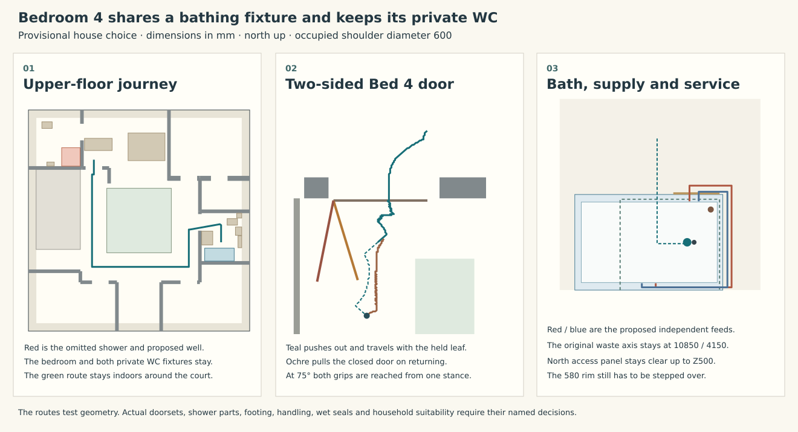

# Keep the rear WC and share the family bath-shower

**Offer a private rear WC and basin with a shared family bath-shower as the lower-maintenance house option.** It eliminates a shower whose ordinary drain exchange otherwise needs a removable door, temporary body restraint, a lifting rig and a guarded 400 mm floor well. It preserves four bedrooms, four WCs and four basins. The price is two independent bathing places instead of three, a longer private journey from Bedroom 4, and a 580 mm bath rim to climb for a shared standing shower. Keep the present three-bathing house on the controlled drawings until the owner chooses between those domestic arrangements. This is a complete architectural option for that choice; IAS-03 has other open fitted interfaces. [Dimensioned action record](studies/shared-family-bathing.json) · [current rear shower exchange](ias-03-rear-tray-first.md) · [occupancy and maintenance decisions OB-04 and OB-10](../../docs/delivery/owner-project-brief.md)

| Domestic arrangement | Ordinary use | Consequence for permanent work |
|---|---|---|
| Current principal shower, family bath and rear shower | Three bathing places and two private showers. Bedroom 4 uses its own shower and WC. | Carry the B594 drain, prepared supports, formed 400-square well, sacrificial lower board, independent lifting/retirement equipment and fitted replacement package. The same room can be out of service during that work. |
| Principal shower, shared DYNA SET combination and rear WC/basin | Two people can bathe independently. The family bath and its shower cannot serve two people at once. Bedroom 4 keeps private night-time toilet and basin access. | Omit the rear shower, drain assembly, dedicated water tails, shower enclosure, hoist seat and proposed well from the unbuilt design. Keep its WC/basin, stack, access cabinet, wet splash junctions and extract. Use the ordinary family water station for both functions. |
| Whole rear room converted to dry use | Same two bathing places, only three WCs, with a shared night-time WC journey as well. | The owner could gain dry use of the former sanitary room. Four-to-three WC/basin scheduling, five extract rooms, the remaining ground connections and continued roof vent require their own replan. Deleting the tray alone cannot deliver this benefit. |

## The shared bathing place

Place the 1600 × 700 Kaldewei **DYNA SET 626** at X9560–11160/Y3800–4500. The manufacturer identifies the model as a combination bath with a shaped standing zone. Its outside head end moves 100 east of the 1700 × 700 SANIFORM PLUS 363-1. The 1155 bottom length is 5 longer, while the top length falls from 1530 to 1440. The listed bottom widths increase from 390/350 to 450/470. Bare mass rises from 41 to 46 kg. The maker's water figures increase from 111 to 122 L at the same stated displacement convention. Select the delivered finish and actual slip treatment before commitment. [626 sheet and drawing](https://files.cdn.kaldewei.com/data/sprachen/englisch/techdata/DB04_24-Sort_DB_UK-GBeng_BW_AMB_626_DYNA_SET_DYNA_SET_STAR.pdf) · [363-1 comparison](https://files.cdn.kaldewei.com/data/sprachen/englisch/techdata/DB04_24-Sort_DB_UK-GBeng_BW_ADV_363-1_SANIFORM_PLUS_SANIFORM_PLUS_STAR.pdf)

Set the rim at **+580**, within the native +561–586 foot range. Its 430 overall depth puts the waste at the existing X10850/Y4150/Z150 local datum. The overflow is X11056/Y4150/Z510. Both holes are 52 diameter. Their horizontal/vertical differences of 206/360 are inside the Geberit 150.770.21.6 comparator's 145–260 and 230–460 adjustment spans. The previous trap bottom at +61, Ø43 connection, 50 mm seal and proposed 300-long diagonal run to X11030/Y4390 can therefore be studied at the **same** waste elevation. Its above-floor 200-diameter seal territory retains 10 to the bath front and 30 to the east end. The old plan still puts a 110 port at X10950/Y4150. Only a joined downturn, supported branch/floor detail and actual serviceable sealing lands permit that change. [Existing native outlet and floor-drop study](ias-03-family-bath-outlet.md)

The new eastern foot axis is X10750 and the other X10060. Maximum foot width is 445. The eastern foot can project at most 181.5 longitudinally from its centre toward the proposed circular seal territory at that maximum transverse width, before tolerance. The native sheet omits that longitudinal length. Measure or select the full feet rather than cutting the floor to make them fit. Retain the 500-wide north access at X10625–11125/Y4500 and Z0–500. Its front reveals the two bath valves and a supported removable waste. The cover supports neither the bath nor its supply.

Use one bath/shower diverter on the south wet wall and one independently supported shower head. The GROHE Eurosmart 33 300 003 is a real wall-mounted single-lever comparator with a centre diverter, ceramic cartridge, temperature limiter and replaceable non-return valve. The project requires the complete mounted body inside a 250 × 240 plan envelope, actual lever and diverter within the checked working volumes and compatible hot/cold connections. Fit temperature protection, backflow provision and pressure/flow for the actual house. A lever stop alone supplies no thermostatic anti-scald performance. Preserve access to the replaceable cartridge, seals and non-return valve; if upstream temperature protection is necessary it needs an accessible supported location. [Manufacturer's product and spare-parts sheet](https://www.showerstoyou.co.uk/uploads/documents/GROHE_Specification_Sheet_33300003.pdf)

Retain the independent bath valves at X10800 and 10900/Y4450/Z350. Bring their two outlet legs forward inside the removable face, rise to Z548 and pass **above** the access panel to two horizontal rails in the unoccupied east corner. The outer hot line and inner cold line then run south in the 407.5 end gap and rise to the wet wall at different levels. No hole through the bath or new floor crossing is used. At a maximum 36 outside envelope per line including insulation/clips, the independent runs retain 9 to each other, 30 above the access panel, 14 below the rim and at least 12 beyond the circular floor-seal plan at the front crossing. Match bend bodies, actual shell underside at the two rises, insulation and support to that limit. Keep the joint faces visible after the panel comes off and water-test both outputs. The discharge goes first into the bath, then through the existing family waste duty; a connection leak under the tub requires a visible dryable opening at the panel, with no concealed path into the slab seal. [Pipe coordinates and service clearances](studies/shared-family-bathing.json)

Use a three-sided curtain around the standing zone. The rear wet wall is at Y3800; the centre lines of the end curtains are X10050/11125 and the front Y4465. Two 85 mm parks leave 905 clear. From the actual bath approach at X10450/Y4820, open the front, transfer over the rim and take the foot-end position X10775/Y4150. The standing shoulder clears the proposed pipes and curtain by at least 12 and is within 600 of the central mixer control envelope. A nominal 1720 combined hanging drop to a local +480 hem returns drips 100 below rim. A made-to-measure U track requires independently anchored end sockets and both supports. A +2200 rail below the +3100 ceiling requires 900 of drop, plus the actual fixing/closure above the ceiling. Do not hang it from plaster. Specify positive gathering, replaceable curtain/fastenings and the wall-end splash returns. A conventional curtain, cartridge and door seal all require constituent admission. Test sag, side spray, grip forces and real feet/step-over under wet conditions. Someone requiring step-free bathing cannot use this bath as an equivalent private shower. [Purpose-made U tracks and two ceiling supports](https://www.adaptocare.co.uk/product/spares-and-ancillaries/shower-curtain-rails/) · [source shower and bath fixture arrangements](../mat/whole-house-service-baseline.md)

For bath replacement isolate and drain, release the curtain, the mixer, demountable service rails/holders and sealing joints, support the shell, release the feet and bring the bare, protected body onto its independent handling frame. A 510 × 730 × 1690 carrier would leave 18.5 at each edge of the 767 family threshold if centred. The seated transfer and new 46 kg shell are not validated by the old 41 kg lift. Confirm forward and incoming load support, complete cradle, ninety-degree turn, stairs and actual assembly mass before ordering. For ordinary trap service those whole-bath moves are unnecessary if the matched fitting and supported outlet can be withdrawn through the north panel. [Existing bath first rest and carry limits](studies/selected-family-convergence.json)

## From Bedroom 4 with both doors closed

The current HAD paths meet at X3450/Y3782.5. The often-quoted **13.57 m** ends at an already-open family-door entry point. The walk to the old closed-door push position is 13.26 m. Neither length opens the bedroom door. Its current drawing represents an inward 900 × 44 leaf within a 900 rough opening and requires an E20 private doorset. With no room for a complete frame at that bare width, choose a declared frame/body rather than retrofitting a performance claim to that drawing.

The alternative uses two positively controlled 762 × 44 leaves, 700 hinge-to-grip positions and 70 projection from each face. Place the **west Bed 4 pivot at X3140/Y8735.5**, swinging out into its own approach. Keep the 900 rough opening and support the asymmetric jamb buildout. Stop at **100°**; the earlier more open trial put the opposite handle into the stair guard. At the family room keep the north-hinged inward operation, set the pivot 12 into the room at **X9409/Y6281** and stop at **85°**. Allowing the family leaf to reach 90° puts its opposite handle into the northern partition. Both plans retain the island wardrobe and account for the larger family WC. The 18 mm decorative surround is returned flush at the Bed 4 hinge cheek. A complete applicable doorset must admit the stops, pivot, buildout, controls, latching, smoke/closing behaviour and protected clear widths. An outward-moving bedroom door changes the shared gallery condition; protected egress and simultaneous users still require approval.

On the outward journey push the bedroom door, hold the handle during the short move around its open end, then let the closer return to 75° from the recorded waiting position. Release outside the entire moving leaf. Walk around the south side of the court, push the family door and enter the bathroom. On return, pull each shut door to 75°. At that stance both complete handles can be reached at once on opposite faces. Take the other grip before releasing the first, control the leaf to its full operating stop and reverse the checked path. No stationary closer dwell is credited. The articulated calculation prices both handles as finite solid boxes, a Ø600 moving body, paired 40-radius arms and 600 reach. It includes the closed starting stances, distinct shoulders during handover, all leaf/handle sweeps against the house and the link to the bath. The checked Bedroom 4 station-to-bath arrival is **18.76 m**, including the door manoeuvres. The smallest sampled-interval hardware-to-fixed lower bounds are 11.0 mm for Bed 4 and 10.8 mm for the family door. The independent arms retain 95 mm between their represented volumes at the shared hold posture. Those figures leave very little scope for a different pivot or lever. The loaded wet transfer over a 580 rim remains a separate human task. [Paths and measured controls](studies/shared-family-bathing.json) · [continuous moving-body check](studies/shared-family-bathing.py)

## Six family decisions

| IAS exit | What this house option settles | What still prevents closure |
|---|---|---|
| IS-01, independent service fronts | Keep four WC/basin stations, the rear upstream valve outside the cabinet and the independent north bath panel. No shower lifting frame occupies the rear. | The new pipework must fit the delivered 626 upper shell, supports and valves. Retain current utility/kitchen/plant first releases and their separate source adoption. |
| IS-02, wet wall/floor | Omit the unbuilt 400 well, proposed shallow carrier seats, upper tray, drain and lower wet access. The complete rear 160 soil aperture remains. Use the family bath waste coordinates and ordinary rim. | Preserve a supported continuous floor where the well would have gone; an existing formed opening would need engineered closure. Prove trap/downturn, supported floor seal, actual curtain catch and wet reinstatement before issuing the room. |
| IS-03, sanitary fit and domestic use | All four bedrooms stay. Bed 4 retains private basin/WC. Two closed-door operations and a real combined bathing fixture give a decision usable against the four-bedroom brief. | The owner chooses shared 580-rim bathing or the third private shower. HAD/OAS must adopt the revised door swings, clear galleries, household programme and protected doorset. |
| IS-04, fixture failure and renewal | Four WCs/four basins stay. Isolate and remove the rear shower back to actual live tees or a manifold. Use a single combined family bath/shower with a mutually exclusive diverter. | Do not leave capped 3370 mm redundant branches accessible only at the old shower. Record leak visibility, draining, new complete bath transport, incoming support and temperatures/functional materials on the chosen variant. |
| IS-05, distribution and crossings | Source 14 cold / 9 hot endpoints become 13/8. Shortening one branch does not release its full shared pipe length. The six existing 13 L/s normal extracts still total 78 L/s, including the rear private WC; only a full dry-room conversion would give five/65 against the source 58.02 floor criterion. | MAT recalculates pressure, temperatures, moisture load at the now-shared family room, transfers, noise and actual terminal duties. Keep the rear stack at X567.5/Y11177.5, its vent and remaining basin/WC connections. |
| IS-06, permanent supports and reinstatement | Keep SAP-C1, the protected stair, two water exits and the load-bearing wet spine distinct from the replaceable family rails, curtain and wet fixtures. Source solid dry backgrounds, local repairable finishes and independent access fronts remain the interior recommendation. | STR must release any changed floor port and head/attachment, OAS the two actual doorsets, MAT the fitted product constituents and MRA the wet failure route. EPR/PHY retain evidence only after the actual source choice and fit. |

Do not close IAS-03 on this comparison. The outstanding choice changes ordinary household use, not just procurement: a household that expects its non-principal shower to remain private or step-free should keep the third shower or alter the whole room programme. If the owner accepts sharing and the high rim, take this combination into HAD’s next coordinated house source and retire the rear hoist and well there. Continue the independent fitting work at the other house occurrences in parallel. [Existing IAS exit authority](ias-03-current-occurrences-and-exits.md) · [selected provisional structure](../str/provisional-house-handoff.md)
