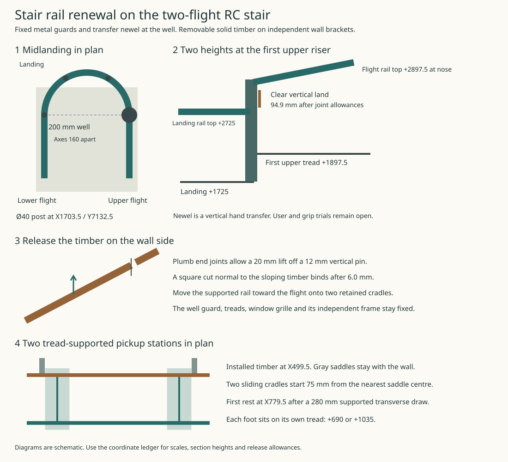

# Keep the stair guards in place when renewing the handgrip

Use **fixed plain-metal well guards with integral metal handrails, independent removable solid-timber grips on the solid wall runs, and the existing mineral RC tread surface** as the IAS development detail for this stair. The window crossing also uses a fixed metal rail. Changing timber or repairing a tread need not disconnect either well guard, the first-floor edge guard or the low-cill grille. MAT’s all-timber handrail expression remains the comparator. Its independent support principle carries through. [Material family J-S](../mat/interiors-whole-house-assembly-schedule.md) · [Current HAD stair and grille](../had/studies/water-replan.json)

### Join the two flight heights at a fixed newel

The 200 mm well lies between X1523.5 and 1723.5. The two Ø40 well-side rails have axes X1543.5 and 1703.5. Keep each flight’s 1004 mm nominal between-rail width, or 984 mm after HAD’s combined 20 mm positional allowance. Keep the 80 mm radius inner turn. Its outside reaches 100 mm into the 1623 mm landing and leaves 1523 mm beyond. These widths and the 1000 mm handrail height are house choices.

At Y7132.5 the lower landing is +1725 and the first upper nosing is +1897.5. The source locates the top of each handrail 1000 mm above its pitch line or landing. Consequently the lower return top is **+2725** and the upper flight top at the same station is **+2897.5**. A level U cannot meet them both. Even varying each endpoint within the 900–1000 mm range in England’s Approved Document K §1.34 leaves 72.5 mm between the two bands. A flat connector at +2725 would be 827.5 above the upper nose; one at +2897.5 would be 1172.5 above the landing. The common-stair treatment in §1.35 belongs to a different building condition. [Approved Document K, §1.34](https://assets.publishing.service.gov.uk/media/60d5bdcde90e07716f516cfd/Approved_Document_K.pdf)

On the current house keep the level return at +2725 and end it on the north face of a **fixed Ø40 steel newel at X1703.5/Y7132.5**. Bring the upper grip to the opposite face from the south at its actual pitch. Keep the east face, toward the upper flight and the turning traveller, free of brackets, protruding welds and infill ends throughout the transfer zone. The fixed post provides a place to change grasp from the level return to the rising rail. The traveller can approach its north/east quadrant from the landing or its east/south quadrant from the upper flight.

The +1000 dimension is to the **top**. The horizontal rail axis is +2705. At a fixed station, a Ø40 pitched tube occupies 46.14 mm vertically; its axis is +2874.43 at the post station. Allowing for the pitch across the full 40 mm post diameter gives +2839.86 as a conservative lower bound on the upper tube’s underside. Reserving up to 10 mm for each dressed joint leaves **94.86 mm of uninterrupted vertical post**, +2735…2829.86. A 90 mm axial hand-band probe has 4.86 mm spare. Another 5 mm at each weld loses that probe. The selected grip references on the approaching U, the post’s east face and the departing flight are 105 mm and 141 mm apart in 3D; the two rail references are 236 mm apart. These are centre/contact references. Neither a sliding one-hand grasp around both joints nor a two-hand transfer while balancing on the riser has been demonstrated. Use a full-size sample with both directions, actual weld blends and hand access before retaining the newel for use. [Section and grip coordinates](studies/stair-rail-renewal.json)

### Keep the edge protected at both heights

Carry a permanent vertical steel infill under each well rail to its own RC edge. Close the nose of the well on the lower landing with a returned infill panel and the upper first-riser cheek. A pair of Ø40 end rails alone leaves 120 mm between them. Use Ø12 verticals at no more than 100 mm centres on the straight runs. At the semicircular nose divide the 180° return into three 60° bays at radius 80. The maximum centre chord is 80 mm, with no more than 68 mm between a pair of Ø12 bars. The straight maximum is 88 mm. Step the bottom closure along the actual treads, returning at each vertical riser with a nominal 50 mm bottom gap. Close the 172.5 mm upstand at the first upper riser with a solid cheek inside the east edge line. Locate the return joins and end bars against the permanent newels. Check every installed side, triangle, return and joint with the required sphere and load tests. The 20 mm flight-width allowance is not a clearance allowance for the infill.

Where the lower west wall rail crosses the stair window, span from Y6790 to 8010 on independent supports. Two trial 100 mm-wide support plates each stop 60 mm short of the raw jambs at 6900 and 7900. Keep the rail’s nearest face at X479.5 throughout. The grille’s first 60 mm eastward release reaches X462.5, leaving the existing 17 mm. Keep arms, fixings and splice projections outside the moving grille. The 1220 mm span includes the pitch-to-level transition; size the bent rail, connection, substrate and sill/jamb anchor zones for actual loads. Neither the glass nor the removable grille carries the rail.

### Support, remove and reinstate one wall rail

On the lower west solid wall use a straight timber piece between the joint stations Y5332.5 and 6232.5, axis X499.5. Its nominal centreline span is 1038 mm before joint deductions. Give each end a **plumb** cut and a 3 mm joint, with dressed edges. Use two open steel saddles at Y5407.5/6157.5, independently fixed to the backing. Provide a 12 mm vertical locating pin, maximum 8 mm saddle-lip height, and underside-released captive screws into compatible metal cross-dowels. A conventional square cut normal to the sloping stock consumes a 3 mm joint after only 6.02 mm of upward motion. It binds before the 12 mm pin clears. Plumb joints keep their longitudinal gap through the vertical lift.

1. Close the stair to ordinary traffic and provide an agreed occupation, escape and worker-protection arrangement before removing a handrail. Retain both well guards and the permanent metal grips. Bring in two linked, independently supported task cradles. Each 360 × 120 mm foot sits on one tread at X459.5–819.5, centred at Y5482.5 or 6082.5. Their respective tread levels are +690 and +1035. The two moving heads capture the rail between the permanent saddles. With each saddle and pickup limited to 40 mm along Y, the nearest pair leaves 35 mm for independent operation.
2. Secure both grips, take the weight and release the captive underside fixings from the stair side. Raise 20 mm in unison. The pin then clears by 8 mm and the saddle lips by 12 mm. Translate the captured piece 280 mm east to X779.5 and lower both heads 320 mm to the first rest, about 763 mm above their individual treads. The rail load axis stays at least 40 mm inside the lateral foot edges. The temporary stands leave 704 mm to the well edge, a working territory on the **closed** stair. Lock and restrain both cradles there.
3. Use the same clamped rest for the replacement. Raise, shift west and lower onto the two saddles and locating pin. Reinstate the captive fastenings, verify grip continuity and retention, and remove the apparatus before reopening. Actual weight, centre of gravity, grip/cradle capacities, tool envelopes, tread friction and bearing, synchronized motion, operator position and ingress/export still require checking. The support projections alone do not establish stability or safe handling.

Repair integral tread wear locally to the original nosing elevations. An unpriced overlay changes the first/last rise. Replacing a **guard or newel** is a separate major operation: establish an independently anchored edge barrier *before* removing its permanent protection, or use a separately designed access/closure method. Neither the timber-rest fixture nor the opposite flight's rail protects an opened edge. This decision advances J-S at the current candidate. The first-floor void guards, escape strategy, structural support and physical acceptance keep their own duties. [Reproducer](studies/stair-rail-renewal.py) · [Occurrence and exit ledger](ias-03-current-occurrences-and-exits.md)
