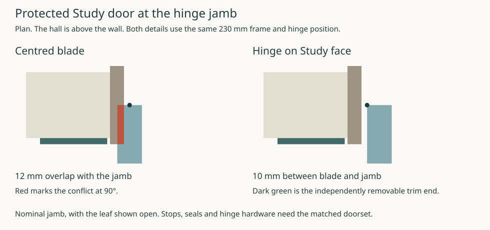

# The protected Study door and its removable trim

**Stop the ordinary skirting beside the frame and keep its face flush with the jamb.** On the Study side an extra 18 mm casing over the jamb catches the forearm in the tested closing action. The 230 mm frame already projects 18 mm beyond each face of the 194 mm finished wall. A decorative architrave needs no further depth to mark this opening. This is an interior interface proposal for the current house. [HAD opening](../had/studies/water-replan.json) · [IAS/OAS interface](../oas/ias-oas-junction.md)

### The complete blade changes the hinge decision

The 900 mm rough opening runs from X1350 to 2250. Both 25 mm jamb allocations run from Y3132.5 to 3362.5. The retained 140 mm core faces are Y3177.5 and 3317.5, with 27 mm finishes. HAD locates the pivot at X1385/Y3247.5 and measures the 830 × 44 mm leaf along a segment for its operator test. Putting a square-edged blade equally either side of that segment makes its open hinge edge reach X1363, **12 mm into the hinge jamb**. The operator pass checks a different contact.

Place the same pivot at the Study-side face of the closed blade, with its 44 mm thickness towards the hall. The whole closed blade sits inside the masonry depth. Across 0–90° its leftmost X is 1385, ten millimetres clear of the hinge jamb. The far back corner reaches X2216.17 before the blade is fully open, leaving **8.83 mm** at the latch jamb. The closed blade and the open blade are insufficient by themselves to give this second bound. Actual hinge throw, stop, seals, latch, knob and clear passage still belong to a complete doorset. [Computed limits](studies/study-door-reveal.json)

### Close, change hands and reopen

Retain HAD’s body knots, 300 mm body radius, 40 mm forearm radius and 45° two-hand changeover. Moving the blade while leaving both grips at their old positions makes the forearm overlap the blade by 3.46 mm at changeover. Keep the original **62 mm grip-to-face distance** instead. With the changed blade the grip centres lie at +62 and −106 mm from the pivot plane. The signed directions refer to the moving blade. The calculation compares the full leaf rectangle, both jambs, the conservatively trimmed wall and fixed furniture/obstacle envelopes. It bounds motion between 0.1° samples using the speeds of the body, grip and far blade corner.

| IAS trial on the original HAD jamb allocation | Result |
|---|---|
| Flush room face, face pivot, grip station 780 mm along the leaf | Continuous lower bounds of **3.05 mm** for the body and **2.02 mm** for the forearm. Reach stays below 549.91 mm. |
| Place a 70 mm-wide × 18 mm-thick casing over the Study face of each jamb, finishing at the opening edge | At the closed position the latch-side casing overlaps the forearm by **1.78 mm**. Keep the flush end for this operation. |

The 18 mm overlay is one explicit mounting detail. A moulding wholly outside the checked field can be assessed on its own geometry. The computed gaps are small; gauge actual handles, projecting stops, hinges and finish thickness before using the witness. [Motion check and source-linked geometry](studies/study-door-reveal.py)

### Release the skirting without opening the protected boundary

Reserve one **120 × 150 × 18 mm** removable end on each side, X1225–1345 and X2255–2375 on the Study face. Each stops 5 mm short of the nominal frame. Continue the mineral wall finish behind each piece to its own termination. Use a room-side carrier with flush face-accessible fixings, independent of the doorset, perimeter firestop and floor joint. Keep the closed leaf latched for this ordinary finish operation. Release the two fixing points and pull the short end 22 mm south before lifting. The closed blade begins 97 mm north of the back of the trim, and the horizontal draw increases that separation. Keep the functional seal and frame fully fixed throughout. The upper protected infill stays independently supported above the rectangular assembly, whose current maximum height is 2250 mm. Support and close off the opening before any different operation that removes the complete frame. Product-compatible carrier attachment, actual tool access, upper closure and classified reinstatement remain separate. [Interior access family](ias-02s-services-access.md)

### A real fire-door comparison consumes the width budget

Warringtonfire’s EGGER 44 mm assessment, Chilt/A13085 revision G, specifies a minimum **32 mm timber jamb excluding the stop** for the standard Type 1 frame and **2–4 mm leaf-edge gaps**. The existing 25 mm jamb allocations and 10 mm side gaps do not match that example. The report describes the wall/frame firestop separately and includes routes requiring acrylic intumescent mastic. Compatible fixing and tested firestopping must remain intact; removing a casing which the selected system requires for protection would change the assembly. No polymer exception or doorset selection follows. [EGGER field of application, §§7.1, 11.2–11.5](https://www.egger.com/get_download/830b658c-c79e-4371-a0ab-7cbb89a2b056/Report_Global_Fire_Resistance_Assessment_FD30_FD30_Decor_44mm_Door_Blanks.pdf?country=GB)

As a dimensional comparison, retain the pivot and 830 mm leaf, use 32 mm jambs, 3 mm leaf gaps and trial 3 mm installation joints. That requires **906 mm rough**, X1347–2253 if widened symmetrically. The inside jamb faces become X1382 and X2218. The far blade corner has only **1.83 mm** nominal clearance. Moving the comparison grip from 780 to 768 mm along the leaf gives continuous lower bounds of **3.05 mm body, 4.84 mm forearm** and a maximum reach below 561.66 mm, before adding actual stop and hardware solids. The 32 mm dimension is a published minimum. The 3 mm installation joint is a design input. Preserve the original masonry until HAD, OAS and STR accept the rough-opening change or provide a matched set that fits the existing opening. The full 230 mm-depth configuration, 12 mm stop, installation gaps, smoke/fire duty, installed clear passage, material constituents and upper infill remain unqualified.
