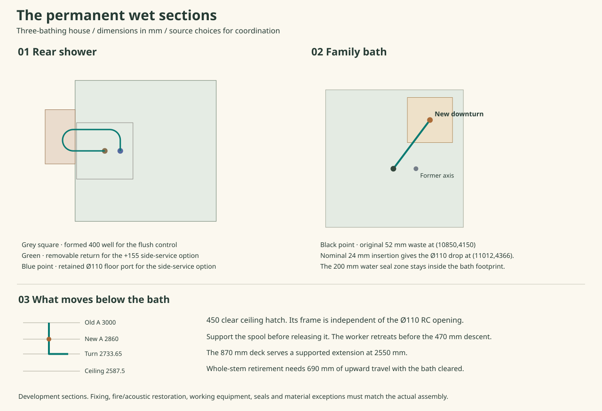
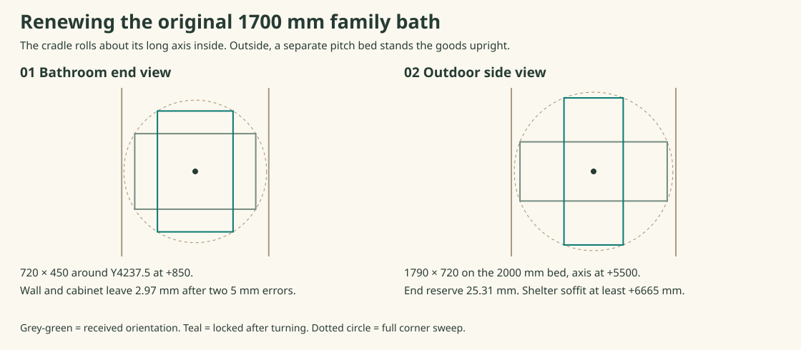

# Keep the private rear shower and make the family bath serviceable

**Keep four bedrooms, four WCs, the private rear shower, the principal shower and the original 1700 mm family bath as the three-bathing design.** Select the prepared flush rear well for this layout and a new cast-in bath outlet and plant access below. The rear shower's 155 mm stepped alternative earns a service advantage but changes daily use. Carry the flush version unless the household accepts that change. The separate two-bathing option still requires its own household decision. [House programme comparison](ias-03-shared-family-bathing.md) · [Checked dimensions and alternatives](studies/three-bathing-sections.json)

## Rear shower at floor level

Keep the 1000-square BetteUltra 5940 at X1802.5–2802.5/Y8952.5–9952.5 with its west drain at (2012.5,9452.5). The enamel seat is 41.1 below the rim, with a 4 mm radial annulus and 2.5 mm steel thickness. Use the B594 vertical trap and the independently restrained 40 mm socket-entry comparison. An assumed fully bottomed joint runs out of smooth sealing land before the stop. The fixture, seal, fixed tail and load-limited catch are distinct parts. Retain the native foot system, separate support for the lower body, the full wet floor/wall assembly, the source-tested upper first rest and the sacrificial perimeter seal. Routine cup cleaning is available from above. For a complete drain-body fault the flush option requires the controlled tray-first lift and re-wetting test. [Native seat, supported lift and incoming sequence](ias-03-rear-tray-first.md) · [Geberit socket comparison](ias-03-rear-drain-release.md)

Reserve the **400 × 400 formed opening at X1812.5–2212.5/Y9252.5–9652.5**, through RC from Z3170 to 3370. It is 590 from the wet beam face. The current structural study diverts the 13.49 kN local strip, adds H12 steel and a separate 2 kN point, and locates the bar returns. Its wet-beam shear comparison is **68.25 kN demand against 68.82 kN resistance**. Never count that difference as spare capacity for a hoist, a different tray seat or a revised pipe support. Form the opening, trimmers and shallow seats during construction with the coordinated cage. Keep an independent upper guard and lower fire/acoustic boundary at the opening. The original four-point support and 155 lift remain governed by their own loads, 38.5 mm travel minimum and actual contact geometry. The room door is temporarily removed on the tray-first route. STR, OAS and the floor system supplier still owe the detailed support and boundary. [Structural section and bar layout](../str/current-house-structural-reference.md) · [Wet-room material direction](../mat/interiors-b-wetroom-assembly.md)

## A raised rear shower with side access

At a **+155 rim**, install the same tray on native four-corner support above the finished wet floor. The square case A falls within the manufacturer's under-1200 dimensions and the 142–160 foot setting. Qualify any required central support, the wall fixings and actual rail soffit. Keep the east and south walls, private door, basin, existing liner and four foot bearings. Buy a removable non-loadbearing panel on the west side and a low service enclosure at X1590–1802.5/Y9360–9745. Its plan cost is about 0.082 m². The complete drain still needs a real clear path between the supports. [Foot-System installation, pp. 7–12](https://shop.my-bette.com/out/media/Z0009038-REV15.pdf) · [BetteCompact+ B568](https://shop.my-bette.com/en/Spare-parts-by-product/BetteCompact.html)

The B568 has a 115 mm body, a 55 mm installed height, a 50 mm water seal and an uncut Ø50 side outlet 167.5 from the centre. At the selected position the first outlet points west and ends at (1845,9452.5). Its nominal centre is +83.9. Retain the original Services Ø110 floor crossing at (2122.5,9452.5), clear sleeve 97, and the original lower branch/hatch. Omit the 400 structural well **only on this stepped alternative**. A straight east outlet would overshoot that crossing even before adding a downturn. [Bette installation, p. 5](https://shop.my-bette.com/out/media/Z0020405-REV2.pdf) · [Current service contract and lower crossing](../mat/whole-house-service-baseline.md)

Bring a separate return line back through a northern lane at Y9604.07. Both permanent ends point west on parallel horizontal axes. A removable horseshoe joins them. Screen an actual two-inch 316L U-bend with 50.8 outside diameter, 152.4 centres and 127 to its outer back. Weld the matching sanitary sockets on a separately captured carrier. The process fitting supplies dimensions; require a properly approved transition to the actual 50 mm waste spigots, rodding access and foul-gas-tight seals. Roll the horseshoe **6° about its withdrawal axis**. It drops 15.93 from one socket to the other while both axes remain parallel. Even after opposite 2 mm seat errors the drop is 11.93, against 8.75 for its 350.19 developed length at 1:40. The two short straight mating lands are level. Demonstrate drainage of the actual return, hair loading, access, trap-seal retention and removal force. Two oppositely inclined fixed sockets would fight a straight withdrawal. [316L stock dimensions and drawing](https://completestainless.co.uk/products/hygienic/swept-tee-y-piece-crosses-and-u-bends/) · [Alternative welded return dimensions](https://dhstainless.co.uk/products/tru-pure-asme-bpe/tru-pure-asme-bpe-elbow/tru-pure-180-elbow-weld-ends/)

The 396.87 mm fixed return continues east, turns south on a proposed R75 and drops at the original port. The complete route is 747.06 mm in plan/developed comparison. At +155 the final centreline is +58.05. A 66 mm housing clears a secondary liner at +8 by **7.05 mm after two adverse 5 mm errors**. At +145 the same calculation is 2.95 mm short. Lower rim trials use space beneath the finished floor; a leak there cannot flow uphill to a room-side lip. Such a trial needs a separately closed and visible gravity telltale below and a new working section. The old IP66 recessed cover has 550 × 600 overall for 350 × 400 clear; its standard 100 mm recess exceeds the 80 mm floor build-up. Its rating alone does not establish the wet-floor joint. [Howe Green cover](https://www.howegreen.com/files/downloads/access360-hg-watersafe-ip66-datasheet-lo-res.pdf)

At the factory’s 0.5 L/s figure a smooth 47.5 mm trial bore gives 0.561 L/s in the half-full uniform-pipe comparison; 44 gives only 0.457. At full bore the path with friction factor 0.035 and local-loss coefficient 7 needs about 31 mm of head at 0.5 L/s. The geometric fall is about 26 mm. Reject a claim of rated flow from the outline alone. Meter the specified shower flow with the complete trap, return, actual stack head, contamination and realistic tolerances; reduce the fed flow, enlarge/regrade the branch or reject this option if its duty is missed. The B568 body, water seal, joint rings, footwear and any bonded sheet constituents remain in the materials register with no exception presumed.

### Remove and restore the trap

1. Isolate shower use, drain and retain the floor water boundary. Remove the external service facing, support the U and verify the independent restraints on the B568 and northern return. Pull the U at least 55 west to release both seals. Its far face would still be at X1845, under the tray. Continue on captured rails to **125 total**, ending at X1775, 27.5 clear of the tray edge. Lift and park it on the paid 280 × 285 rest route; its closest conservative transit reserve is 6 mm. Contain residual water and apply an independently retained temporary gas closure to the downstream return from a protected position. Allow for actual spigot, clamp, seal, rod reach and lip damage. Do not leave an open foul connection.
2. With the lower body independently held, lift the cover and cup, release the three native fasteners from above and free the source gasket without loading its seat. Lower the captured body 15, then slide it **420 west** on the separate arrested carrier. Its complete 225 × 115 body/tail now sits at X1425–1650/Y9395–9510 over an independent stand. The northern return clears that service envelope by 51.1 after pipe radius and paired errors. Buy a clear side opening for the full moving section, shallow adjustable cradle and remote stop. Prove the remaining native rail and all four supports carry the tray while its facing is removed. No one reaches beneath an unsupported tray.
3. From the open private door the worker can reach the first grip with 30.2 body clearance and 484.5 mm shoulder-to-handle distance. Retreat before the drain enters its rest. After it is positively arrested, the second approach gives 45 clearance and about 527 reach. Reverse the stops, gaskets and connections for the new body. Refill to the working level, inspect the secondary tray, dry the exposed surface, recheck the foul seal and restore the removable facing. The continuous secondary pan must fall to a visible lip and keep the original floor seal effective. An overflowing shower or damaged primary tray remains a whole-room moisture case.
4. The ordinary route enters the shower at about (2171,9952.5). The 600-wide body clears the open privacy leaf by 36.45. A grip at X2675 is over 613 away in the reference posture. Price a wall-supported end at X2580, 225.5 from the finished east wall, or a different actual handhold with the curtain/enclosure and door still usable. The 155 mm step is a genuine daily use cost. The handhold and clear route require a physical test; they do not turn this into level access.

## Original family bath and its floor crossing

Keep the 41 kg 1700 × 700 × 410 Kaldewei 363-1 on its native feet at rim +560. Its waste remains at (10850,4150,+150), overflow 212 east and 347 higher. Geberit's PushControl 150.770.21.6 provides a 50 mm seal and the Ø43 PE-HD straight connector. Use the published 140 + 100 reach and the 3-east/4-north direction. The straight end is (10994,4342), with a 126.87° turn on the manufacturer's 130° side. The old floor crossing only 100 east of the waste cannot receive the full straight assembly. [Original shell/overflow and angles](ias-03-family-bath-outlet.md) · [Geberit product and connector](https://catalog.geberit.co.uk/en-GB/product/PRO_102129)

Use an actual 90° fitting as the dimensional comparator. McAlpine MT4L measures **54 from its bare threaded face to the plain-leg centreline**, 27 to its shoulder; the plain leg is Ø44 and reaches 64.5 below the inlet centre, with 40 straight at its end. Measure where the Ø43 tip stops relative to that *bare* face, including the internal supporting sleeve, washer, nut and approved engagement. With 24 mm entry the effective extra reach is 30, making **R270 and (11012,4366)**. With 20–27 entry the required radius is 274–267. No solvent weld or forced fit is assumed between PE-HD and the fitting. Qualify the actual Ø44-to-downstream joint, cap/support, bore, clearances and materials, or specify a different matched outlet and rerun its measured location. [Manufacturer’s fitting](https://mcalpineplumbing.com/overflow-fittings/water-storage-cistern-fittings/90-multifit-bend-x-plain-end/) · [Dimensioned MT4L drawing](https://mcalpineplumbing.com/wp-content/uploads/2023/12/MT4L_0.pdf)

The new Ø110 floor opening moves **62 east and 216 north**. Its Ø200 seal territory stays 34 from the front bath edge and 48 from the east end. It is 202 east of the nearest factory-foot axis after the 100 seal radius; require actual longitudinal foot extents. The Ø44 tip is at +55.5 before pipe fall at the 560 rim and only +40.5 at 545. Hold the ordinary 560 rim. Make the independently supported outlet accessible through the bath front. For routine plug and actuator service retain all the existing pipe support. For a complete upper trap change, isolate, drain and support the ceramic/enamel shell and wet parts separately. Release the native waste flange and cap/withdraw the overflow head. Lift the shell a controlled 40 onto locked saddles to free up to 25 flange projection, giving 5 after paired 5s. Only then draw the supported horizontal connector 29 back along its axis (17.4 west/23.2 south). Hold the MT4L, stem and floor seal still during that pull. If the matched overflow head, cable, gasket or feet cannot clear and park under this sequence, take the fully supported shell clear before extracting the trap from the front. Verify fill, plug, overflow and both sides of the floor seal before restoring service.

This is the ordinary indoor east EW slab field, not the rear wet beam or externally exposed loggia. The Ø110 takes 1.90 L out of nominal RC200. Its perimeter is 530.5 from the inner face of the outer collector, in a 2367.5 mm clear span. A 110-wide strip under the source ULS gravity combination carries 3.42 kN. An intact one-metre strip capacity cannot be transplanted to the penalty around a hole. With H12 at 150, a hole must miss each bar centre by 61, leaving only a 28-wide clear phase. The old-to-new offsets are 62 and 66 modulo 150, so the same straight mesh cannot clear both locations in either direction if the old one was deliberately mesh-clear. At most one H12 per axis per applicable face intersects a single bore in an otherwise regular mat. Detail a formed sleeve and diverted bars with full anchorage before casting; if the old hole already exists, the two cuts have only 114.72 between edges and the old one needs a structural and water/fire/acoustic closure. Do not core either zone from these coordinates. [Current house structural reference](../str/current-house-structural-reference.md)

### Give the lower worker a real working height

At the retained terminal (10800,5200,+2707.5), the revised 1046 mm return at 1:40 puts the lower turn at **2733.65**. Position upper union A at **2860**, the equipped spool below it independently held. The 126.35 vertical interval leaves only 72.35 for the union, capture and travel above a 54-to-face turn. At 2830 there is only 42.35; at the old 3000 the bare working posture cannot reach it. Demonstrate matched zero-capture faces before relying on the orthogonal separation. A locating spigot, unretractable nut or upward force on the unrestrained pipe defeats the detail.

Reserve 450 square clear at X10787–11237/Y4151–4601, 490 gross. This is a **ceiling hatch**, separate from the RC hole. It fits the 1000 × 800 lower equipment field with 79 minimum to an edge, 257 to the main service band and 183 to the compared nearby emitter branch. A larger opening adds 0.0425 m² clear, 0.0465 m² gross and 200 perimeter against the 400 comparison. Select a compatible restored ceiling/water/fire/acoustic assembly, load paths, hinge and latch. Open and retain the north-hinged panel before raising a worker. Its full leaf swings down to 2137.5. Compare the actual heat/cylinder/controls layout for the service state; the obsolete incoming cold leg crosses the proposed step position.

A Werner 75076 adjustable step has an 870 deck, 860 × 470 open footprint, 1500 overall and a published **2620 safe working height**. Reserve X10560–11420/Y4131–4601, subject to the maker's actual deck registration within that base. It clears the selected incoming water bridge by 124, the radiator by 134 and the empty rack by 44.9. Use a supported counterheld extension to put its operating grip at +2550, 310 below A. The two-handle comparison at A needs 551 mm from shoulders at Z2320; bare reach alone does not qualify the higher work. Head top +2620 projects 32.5 through the opened local soffit; the 450 opening leaves 65 to the head envelope, 29.49 to the working arm after allowances and 85 to the nominal spool plan. A wider/deeper platform, a second worker or a different stock step needs new standing and retreat geometry. [Werner dimensions and safe working height](https://www.wernerco.com/uk/step-ladders/AdjustaStepPROAluminium/75076)

Isolate and support above and below. Catch the spool before cracking the A/B faces, complete its 20 mm disengagement stroke under restraint and pause after the initial 20 mm descent. Withdraw the worker and step, keep the area beneath clear and control the remaining 450 mm descent from the offset room position. On rare whole-stem renewal, the longer plain tail reaches local −590. Clear the bath, strip every part above the 75 mm stem envelope and buy **690 upward travel** to +100 through the 97 clear sleeve. Keep positive temporary closure and independent supports until the matched wet/fire/air/acoustic boundary is reinstated. Ordinary upper trap service leaves this lower connection undisturbed.

## Carry the original 1700 shell intact

The 1600 DYNA SET option has a different width-height envelope, occupied doorway and outdoor transfer. For the governing 1700 × 700 × 410 SANIFORM, retain or buy a releasable east window and a fully independent external receiver. The working comparison keeps the shell on its **long edge** while it crosses the wall and turns it upright outside. It does not assume that an extra 100 mm of upright height can pass the arched head. A full new shell returning to a serviced bathroom must make the same journey. [Existing east-yard ground and tied-mast receiver](ias-03-family-bath-exchange.md#reach-ground-without-loading-the-plant-dock)

Use a supported 1790 × 720 × 450 frame. The narrow section allows only 10 per long side of the 700 shell, pricing a 4 mm side cheek, 3 mm separate padding and 3 mm assembly allowance. The 410 shell depth leaves 40 for both sides. Keep the trunnions outside the ends and support the underside on verified pads; do not pass an axle through enamel or use the rim as a lifting hook. The native front opening misses the farther foot axis X9970 by at least 655 before depth. Provide a second accessible front or a fully removable apron. First capture the complete weight, release both feet/supports, and cap or remove projections in the travel zone to +100. The two +350 water targets cannot stay projecting into the initial move. Controlled jacking, load sharing and stored energy must work if a grip or seal fails.

The original centre is (10310,4150,+355). Move the bare body north in stages, bring the shell/frame to Y4237.5 and raise its roll centre to +850. If rotated at +355 its corner would pass **69.53 mm through the floor**. At +850 the 424.53 mm swept radius clears both wall and cabinet by 12.97 before paired 5 mm errors, only **2.97 mm** afterwards. Qualify the actual cradle, wall face, cabinet trim, protruding pipes and wet-lining tolerance before committing to that package. Lock on its edge, move to Y4430 and support the underside at +990. The 450-wide face passes in Y4205–4655, 30 from the tighter lined jamb and 20 from the cabinet. Its top is +1710, well below the spring. The radiator remains in place, with 200 vertical reserve even on the priced lifted-radiator comparison.

Provide rails at Y4305 and 4555, with the full independent western runway to X9550 and intermediate supports at 10350, 11020, 12270 and 14270. The former north rail lies 165 outside the body. The starting front bogie also lies 60 west of the old first support. With revised feet the closest pad remains 51 from the R270 floor-seal zone and 25 from the cabinet. The 1250 internal rail leaves **12.32 over the lined sill** after the single 2 kN point, calculated deflection and the two position errors. Price both bogies at each joint, captured lateral guidance, weather closure, safe human access and the independent receiving supports. Never load the frame, wet floor seal or radiator.

Outside, buy a separate **2000 × 1700 pitch bed** at X12270–14270/Y3580–5280 and paired bearings about (13270,4430,+5500). The 1790-by-720 pitching rectangle has a 964.69 swept radius. It retains 25.31 at the tight horizontal ends after both tolerances, 95.31 above the transfer deck and needs shelter soffit at least +6664.69 to maintain the stated head reserve. The old 1150 × 1450 table is too short. Two positive catches, independent arrest and controlled vertical transfer are required. The component comparison gives 1.079 kNm worst arrest and about 82 MPa bending and 44 MPa torsion on a trial Ø50 stub; contacts, steel frames, bracing, fatigue and actual soil anchorage remain to be designed.

Bring the empty cart from the west, lower the captured vertical frame 65 onto its 100-high deck, secure it, then move **510 east before turning north** to clear the retained pivot pedestal. The 800 × 1230 cart and 1130 wheelbase require wheels no bigger than 100, measured loaded CG no higher than 1000, eccentricity no greater than 50 and independently braked descent. The source comparison gives a 96 kg gross ceiling, 31.8 mm remaining on the grade under the 0.1g braking screen and a 1.413 kN independent arrest. Use the actual gate height and floor position for the 1890-high goods. The site still owes the tied mast, northern landing, full chain of stands and southern collection land. If it cannot supply them, this route fails; replan a genuine intact incoming delivery. [Numerical original-shell exchange](studies/three-bathing-sections.json) · [Window and two native GEDA gates](ias-03-family-bath-exchange.md#enter-the-goods-cage-from-the-north)

## Handoff

Use the flush rear well, the Ø110 family sleeve at R270, the revised plant hatch and the intact-shell receiver as a single drawn three-bathing **development** option. Retain the original accepted house and its pipe/door/floor authority until HAD, Services and STR issue the coordinated geometry. The raised private shower and the shared-family alternative change daily use in different ways and each has its own priced consequences. No field procedure, material exception, protective assembly or commissioned flow is approved by this study.
