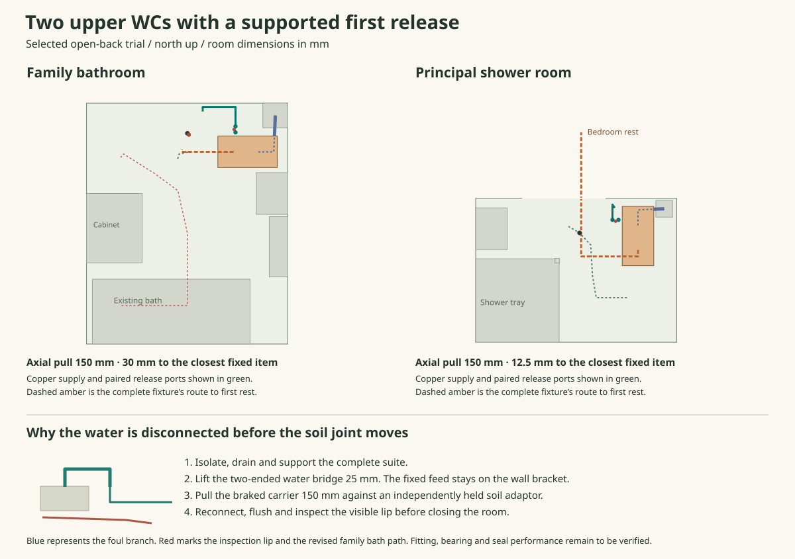

# Replace the two upper WCs without reaching behind a fixed pan

Use a narrow open-back pan, a separately supported foul branch and a removable water connection on the accessible side of each upper WC. Keep the actual four WCs, three bathing places, basin locations and two soil columns. This decision serves the three-bathing house and the optional shared-bath layout. It changes the development setout of **both** upper WCs. Leave the guest low-level suite and rear fixed cabinet on their own service details. [Earlier four-room service stations](ias-03-wc-service-stations.md) · [Controlling house geometry](../had/studies/water-replan.json) · [Reproducible checks](studies/upper-wc-release.json)

## Select the open back and pay for its pipework

The original UK Duravit 211809 and 094015 combination shrouds the horizontal connection and bottom-left inlet. Its upstream valve can be reached while both local releases remain hidden. Duravit also offers **21110900002 and 0927150004** as a genuine UK open-back pair. The 355 × 650 × 385 pan weighs 18.6 kg and the matching 390-wide bottom-inlet cistern 14.4 kg. Keep that option if its supplied exposed spigot, inlet, fixings, tool space and actual withdrawal match the room. A regional side-inlet product description is insufficient to specify a UK combination. [UK open-back pan](https://pro.duravit.co.uk/pro/html/default/product-details.com-en.html?ncat=toilets&nser=7120&product=94720) · [Matching UK cistern](https://pro.duravit.co.uk/pro/content/homepage/products/series/overview/products~402880943a1b6e1b013a1bd20b39003d.uk-en.html?ncat=toilets&product=6461171)

Develop **Tavistock Structure P450S and C450S** for these two positions. The manufacturer's October 2020 drawing gives 340 width, 640 projection, 400 pan top, 850 total height, a bottom-right inlet and an unbraced 155 rear void. It allows a side-connected outlet. Its horizontal ceramic spigot is Ø102 at Z180. The published rear setback is 195 in the table and 210 at the sectional dimension. The sheet declares ±5. Use the full 190–215 comparison until the delivered ceramics are measured. The manufacturer's product page also lists different overall dimensions; order against a matched drawing and measured sample. The 155 between seat fixings is a separate dimension. Use the actual open rear pocket, including its depth at the soil joint. Nylon floor brackets, collars and plugs accompany stainless screws. Disclose those parts, seat buffers, fill/flush mechanisms, seals and surface treatments. [Tavistock open-back suite](https://www.tavistock-bathrooms.co.uk/products/structure-open-back-close-coupled-pan) · [Manufacturer’s dimensional and fixing sheet](https://roper-rhodes.files.svdcdn.com/production/products/downloads/Structure_CC_Open-Back_WC_1020.pdf?dm=1762989049)

| Nominal formed position, mm | Family bathroom | Principal shower room |
| --- | --- | --- |
| New back centre and orientation | (11453.36, 5875), facing west. Shift the pan 25 south and 104.14 forward. | (11150, 8065.66), facing south. Shift 20 east and 76.84 forward. |
| Existing stack axis | (11432.5, 6267.5), 392.5 transverse | (11432.5, 8040), 282.5 transverse |
| Moving water port and fixed port, Z300 | (11003.36, 6085) and (11003.36, 6150) | (10940, 7920.66) and (10875, 7920.66) |
| Body centre with spanners in use | (10485, 6075), shoulder Z520 | (10520, 7780), shoulder Z520 |
| Clearance through the first 150 mm pull | 30 mm | 12.5 mm |
| Complete cistern and pan on the narrower onward carrier | 30 mm to fixed fittings at the room rest | 9.34 mm to fixed fittings on the route into the bedroom |

For the soil joint use BLÜCHER's 316L 855.090.110 S toilet adaptor with its EPDM socket, followed by the same-system 820.090.110 S branch bend. The adaptor page gives 124 overall; the 2025 catalogue gives 126 and an outer collar Ø133. The bend drawing puts 74 from its outgoing axis to the receiving socket shoulder, 136 to the outlet end and R110 through the turn. Use the 87.5° fitting in the horizontal branch, rolled for a 1:40 outgoing downgrade. Its small plan angle costs another 17.14 mm axially at the family stack and 12.34 mm at the principal. At the trial 205 ceramic setback, 35 ceramic entry, 125 adaptor length and 3 clearance from the steel socket stop, the outgoing axis begins 38 ahead of the ceramic back. That explains the two forward moves. The calculated stack entry heights are +170.19 and +172.94. The remaining transverse distances after the bend's plain end, before the stack branch takeoff and socket lands, are approximately 257 and 147 respectively. Independently fix the stack branch, bend and adaptor cradle. Allow the intended expansion movement elsewhere. Never let an extraction pull travel to the stack or use the ceramic to carry the pipe. [BLÜCHER toilet adaptor](https://www.blucher.co.uk/products/drainage-solutions/drainage-pipes-and-fittings/adaptors/adaptor-toilet/toilet-adaptor-straight-855090110-s) · [Adaptor catalogue, p. 25](https://www.blucher.co.uk/dfsmedia/0533dbba17714b1ab581ab07a4cbb521/46183-source/638956712960000000/cumarineproductcatalogue.pdf) · [Bend drawing, p. 43](https://www.blucher.co.uk/dfsmedia/0533dbba17714b1ab581ab07a4cbb521/33038-source/638725361770000000/curainwatercatalogue.pdf)

The 35 overlap and the 3 stop clearance are **purchase conditions**. The maker has not confirmed this ceramic in that rubber socket. Survey ovality and actual minimum and maximum insertion, qualify branch fall, receiving tee, clamp keepouts, seal loads, inspection and existing stack cut-in inside the 180- and 270-wide columns. With 30–45 ceramic entry, 0–5 stop clearance and both conflicting published product lengths/setbacks, the required forward movement ranges from 80.14–127.14 in the family room and 52.84–99.84 in the principal. The checked positions are the two nominal values in the table. A different setout requires a new coupled room check. McAlpine WC-CON1 is a conventional polypropylene comparison with a stated 97–107 pan inlet. Its 117 overall and 47 inlet reference do not by themselves give the installed withdrawal stroke; Ø102±5 also consumes its whole stated range. A short reach or the absence of an approved polymer exception cannot justify a chemical seal or a modified valve. [McAlpine drawing](https://mcalpineplumbing.com/downloads/wc-con1-technical-drawing/) · [Connector installation](https://mcalpineplumbing.com/wp-content/uploads/2023/11/L-ConMcalpine-RED-July-2016-B2.pdf) · [House material policy](../../docs/reference-house/material-policy.md)

## Open the water connection from the room

Keep the remote isolations from the four-room study. Carry the fixed 15 mm copper from each valve down the finished north side on independent clips to the fixed port in the table. In the family room the wall leg runs at Y6360 and turns towards the port west of the wet column. In the principal room use the X10875 solid pier beside the sliding door. The model keeps the fixed feed centreline at least 105 and 80 from the respective retained fixture envelopes. Limit the mounting bracket and feed to their paid territories; neither bears on the removable ceramic.

Give the tank its own formed, capped-capable copper tail to the second, mobile port. Purchase the native right-bottom thread and the room-side turn under the tank. A compact, demountable 15 × ½ bent union such as Pegler K927X 43356K is a size comparison at 23 × 40 × 50 with a fibre washer. Check the actual fill-shank face, thread form, cold potable suitability and wrench flats before choosing it. Allow the tail to cross **above** the contained soil branch at Z300 on a local removable saddle. Its 15 tube underside is 45 mm above the nominal Ø135 housing crown at +180; clamps, sag, inclination and loss of one support use that allowance. Support it independently before making the fill connection. The factory shank must carry neither the pipe weight nor nut torque. [Pegler union](https://aalberts-ips.co.uk/products/item/43356k/) · [Fixture supply and actual valve duties](../mat/studies/whole-house-service-baseline.json)

Join the two upward-facing ends with a 65-centre removable metal bridge and two captive swivels. After isolation, drain and verify zero flow. Hold each fitting on its own flats while undoing the swivel, then lift the bridge 25 clear into a separate tray and cap the two exposed ends. Design for the actual ferrule, thread, face gasket, tool and removal stroke. Each tested wrench has 155 to its working grip with an 18-radius metal envelope through 30°; park the reacting wrench in a vertically offset plane. The hand/forearm comparison uses a 30-radius body. The closest continuous handle gaps exceed 20.6 and arm gaps are 7.67 and 8.65. Shoulder-to-grip distances stay below 463/469. Provide a captive anti-rotation bracket or sufficient access for the second hand and ratchet, plus enough indexed strokes to free the nut. The model prices reach and the moving wrench. Actual forces, a second hand and both tools at once remain physical qualification.

## Move the entire suite, then clean and reconnect

First challenge the normal SP14211 fixings. After the lateral ceramic screws are out, two upstanding nylon brackets can still stop an axial draw. A 150 measured clear void with a required 5 each side admits **140 mm maximum for both retained brackets together**. Gauge the entire 150 travel at every relevant height with both original brackets fitted. The porcelain tapers, and a width measured only at the rear is insufficient. Ordinary accessible screw removal wins if this gauge and the two actual screwdriver approaches pass.

If that test fails, preserve the native pan-to-bracket joint and move the bracket with the supported shell. Price two **32 × 6 × 635 stainless fixing strips** from local depth 80 to 715, centred 85 either side of the pan. The native brackets bolt to the strips before setting the pan. Two separately accessible front locking screws at depth 680 secure them to captive seats. They sit 40 ahead of the 640 ceramics under flush, cleanable caps. The trial front driver grips are within 354 mm from the family kneeling shoulder and 415 mm from the principal one. Close-fitting side guides react yaw independently of the screw threads. The two bare strips weigh 1.91 kg. Form 6 mm rebates in a replaceable **18 mm minimum** mineral wearing layer, with the sanitary bearing plane level and the continuous tanked return below it. Extend the two guide slots to 890 and cap the unused runout in ordinary use. After removing the flush caps and locks, the strips travel 150 with 25 clear to the end. Without that extra slot length the fore edge of the recess locks the assembly. Price the local floor falls, slip, rocking, clip/fixing forces, mineral edges, waterproofing, hygiene, trapping and access. Provide supporting inserts independently at construction; a 12 mm residual wearing layer is not a structural anchor. The inlet-side cradle and soil joint stay separately supported during first movement. If the floor or supplied brackets cannot take this detail, select an exposed-floor-lug alternative and redo the room checks. Do not raise the floor and waste axis to disguise a lost fixing depth.

1. Close the room. Isolate and drain, remove the seat and lid to positive rests and secure the dry cistern against the pan. Break the water bridge from the accessible side. Keep the retained floor waterproofing intact. Free the visible seals and actual floor fixings only after padding and restraining the whole ceramic assembly.
2. Park a compact braked carrier astride the 230 × 430 footprint. Purchase two independent padded saddles beneath verified bowl lands, a cistern restraint and a positive catch. The three quoted gross weights total 40 kg; a 10 kg handling allowance screened at 1.5 gives 0.736 kN. Price each saddle and its independent catch for 1 kN plus the measured extraction force. Unweight the base only within the actual connector’s permissible misalignment; pull parallel to the ceramic spigot. A Shinn Fu RT100 jack is a physical comparator with a 610 × 365 base, 175 lb capacity and 165 minimum support height. Its pad grip, handle and US fixture instructions are unverified for this UK assembly. A complete compact carrier must meet **410 × 720** in the first pull, including the installed tube and moving-side saddle. If it needs a longer lever or raises the spigot before release, change the support. [RT100 operating manual, pp. 2–4](https://media.hcrcnow.com/uploads/drawings/rt100toiletmasterjack.pdf)
3. Pull the package **150 straight forward** while the independently retained soil adaptor stays still. This exceeds even the adverse 126 steel body by 24 before lean or setout. Provide positive stops, hold the remaining feed on the fixed bracket and cap the waste from a supported position when the spigot clears. Arrest at full travel before taking off the mobile water tail, protruding saddle pieces or rollers. On the positively supported second rest, lift clear of the guide slots, expose the native bracket connections through the open rear and remove the projecting strips. If those connections cannot be accessed at the rest, retain the larger envelope and recheck its whole onward path. Keep the full cistern and pan on a second positive rest while narrowing the carriage. The onward envelope is 390 × 690 with a measured 25 allowance around the 340 × 640 ceramics.
4. In the family room roll west, then 25 north to the rest centred at (10425,5900). In the principal room move a further 70 south on the narrow carrier before turning west. An immediate sideways move after the initial 150 would strike the fixed supply support. Cross fully to X10537.5, then return north through the open slider to the bedroom rest at Y8865. The normal bed is moved 500 north in that service state. Keep both rooms under control and maintain a clear return for the crew. Confirm actual grips, braked wheel paths, attendant position, door stops, wet surfaces and return travel. Dismantle tank and pan at the rest. [Existing slider and room controls](ias-03-principal-shower-entry.md)
5. Inspect both support assemblies, the soil connection, floor anchors, gasket and ceramic before bringing the replacement in. Reverse the supported sequence with the spigot on axis. Reconnect and pressurise the cold inlet, perform repeat flushes and inspect at both joints before closing anything. Restore the seat, lid, isolation access, dry floor and room privacy.

Use two inspectable leak receivers. Catch supply drips below the fill shank and both bridge unions on a separate low metal trough; keep flexible seals, threads and the receiving face in view. Catch the low point of the fixed soil adaptor on a 145-wide, 1.5 formed tongue in the open rear pocket. At 150 minimum clear it has only 2.5 each side externally, and 142 internally gives 3.5 each side around a measured 135 housing. Prove actual clearance at every depth without cutting the floor-bearing ceramic. Keep the upper surface no higher than +95 below the soil connection; reserve at least 17.5 to the adverse housing bottom. Turn the trough behind the 120 nominal pedestal heel and discharge through the open service side. Give the three legs 5, 7 and 8 fall. Two opposite 2 mm errors still leave 1 on the shallowest leg. The lip is visible in plan past the complete fitted pan from each attendant station. Demonstrate first wetting and visibility with clear and fouled water, extract and clean the trough and dry the wet interfaces. A cracked tank or severed supply can exceed a drip receiver. MRA, MAT and the wet-room floor detail own containment, declaration, shutoff and reinstatement under that separate challenge.

## Preserve the shower and the bath exchange

The principal shower door still clears the operator by 23.4 at its controlling ordinary pose with the short service rail and fixed terminal. At the new WC setout extending that rail from 145 to 280 loses 18.9 mm of body clearance. The open-slider approach to the isolation/tool stance retains 39.79 mm and the ordinary WC approach 26.24 mm. The family ordinary route retains 15 mm. These are room geometry tests with the existing basin and shower or bath in place.

The moved family WC intersects the earlier bath-door attendant by 70.77 mm. Keep the actual 85° leaf, switch hands at the real handle only from a proved position, and move the attendant from (10585,6065) to (10500,6060). The 300-radius body now has 13.32 to the WC, with the handle 409.83 from the shoulder. Turn the upright bath earlier, reaching (10382.1,5456.6) at 53.7°, then pass the cabinet and return to the original gallery pose (9765,5815) at 90°. The recalculated full room sweep, including the arm and hand, retains **11.40 mm**. Survey that near miss. The rest of the stair, void and east-window evidence keeps its own source and physical limits. Neither WC removal nor relaxing the protected door is needed for this new geometrical comparison. [Complete bath exchange](ias-03-family-bath-exchange.md) · [Numerical evidence and complete poses](studies/upper-wc-release.json)
