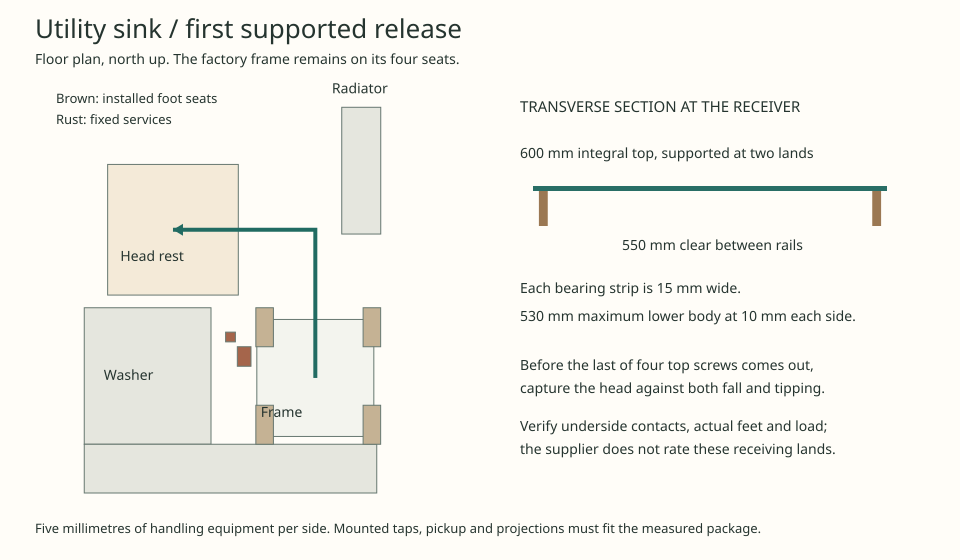

# Utility sink with a removable factory top

**Develop a stationary four-legged bench with an integral removable sink top.** This gives the utility a defined separation between the wet fitting and its support. The preceding Franke BOX route remains the fallback if the factory top cannot be captured or its four screws reached. The open frame suits utility work. Its proposed 15 mm move into the existing valve reservation needs agreement from Services and HAD before adoption. [Earlier bowl, frame and first rest](ias-03-utility-host-revised-route.md#utility-sink-release-8-november-2026)

Acorn Thorn's CS862-SB is a 600 × 600 mm stainless bench with a 500 × 400 × 200 mm bowl, rear legs inset 100 mm and two 28 mm deck tap holes at 180 mm centres. The linked assembly sheet assigns **four M6 button-head screws to the sink top and twenty to the legs and shelf**. The exploded drawing shows the top lowering onto its frame. This removes the separate clipped bowl, cut worktop and rim seal from this replacement operation. The current listing gives 890–915 mm to the bowl rim and a 100 mm boxed upstand. The older CS860 drawing gives a different height. Verify the variant and adjustment at the proposed 900 mm rim before using any release height. Check the supplied feet, backing/damping, waste seals, trap, tap tails, finishes and all other retained constituents. The optional plastic trap conflicts with the house material policy. [Current predrilled and configurable models](https://www.acornthorn.co.uk/basins-bowls-catering-sinks/catering-sinks) · [Product dimensions and fittings](https://www.acornthorn.co.uk/basins-bowls-catering-sinks/freestanding-catering-sinks/catering-sink-single-bowl) · [Supplier’s assembly drawing](https://www.acornthorn.co.uk/imagprod/downloads/CS860%20Self%20Assembly%20Sink%20Instructions.pdf) · [Earlier dimensioned product drawing](https://www.acornthorn.co.uk/imagprod/CS860-SB_5.jpg)

## Keep the working frame on its seats

With a 25 mm moving clearance to the existing carrier and the east wall, only 595.5 mm remains for a rectangular package. Even the bare 600 mm bench misses by 4.5 mm. Set the nominal bench at X10935–11535/Y740–1340. Retain the fixed washer outlet and waste cap. Put the carrier mast 30 mm west and 50 mm south of its old axis, shorten the three arms by 30 mm and return each to the mast. The foot at X10835–10905/Y1100–1200 leaves 25 mm to the proposed waste access zone. Two links back into the rear service rack at Z300 and Z800 keep the moving head and frame out of the valve load path. A supported rear receiver, restraint in both directions, torsion resistance, new arm/foot capacity and accessible connections are required. The allocated boxes do not establish those capacities. [Fixed water, valve and floor evidence](ias-03-utility-host-revised-route.md#support-and-floor-interfaces)

The four existing floor seats are 90 × 200 mm. For a **40 mm complete foot** as an inspection case, the west foot centres must lie at X10950–11000 and the east pair at X11500–11550. The rear pair must lie at Y720–880 and the front pair at Y1220–1380. Measure all four actual pads and centres, check full contact, and qualify support to the mineral floor. The maker's leg inset alone cannot establish the bearing. A 610 mm gross package can draw 400 mm north on the revised plan, but each foot then leaves its own seat and the rear working slot is only 435 mm deep. An extra 9 mm of draw cuts clearance to the radiator to 24 mm. Keep this whole-unit pull out of ordinary top renewal. It needs a separate rolling support and a working position. [Set-out and failed draw controls](studies/utility-bench-release.py)

## First release and reinstatement

1. Stop the washer and sink. Isolate and verify both tap feeds and the appliance connections. Drain the bowl and trap, independently support and disconnect the tap tails, washer hose, waste and downstream branch, and cap the retained ends. The supplied 1½-inch outlet and standpipe overflow do not identify an installed appliance spigot or a compatible metal trap. Keep the fixed valve operable independently of the sink.
2. Keep the seated underframe restrained. Establish positive support for the **complete dry top**, including taps and retained waste parts. Two flexible lifts through the rear tap holes would define one pivot line. They cannot by themselves prevent the head pitching when its centre of gravity lies ahead of them. Require an off-axis third capture or a moment-resisting pickup, rated against measured mass, balance and the actual stainless load contacts. Do not use tap holes or M6 fixings as rated lifting eyes. With capture engaged, demonstrate tool and screw withdrawal at all four locations from the installed position; the frame retains its twenty screws. Pending those checks, hold the first lift.
3. The trial limits the moving head to 610 × 610 mm in plan, 250 mm below the rim and 350 mm above. Lift until its lowest part is at +925, then move the centre 760 mm north and 730 mm west to X10505/Y1800. The retained frame reservation to +900 governs at 25 mm. The study includes the closed washer, service rack, actual radiator and east wall. Physical pickup, bracket disengagement, hands and equipment must fit the stated envelope or the operation must change.
4. Land the head with its rim at +700 on a separate 670 × 670 mm stand. Two 15 mm support strips lie 10 mm in from the outside edges of the nominal 600 mm top. Their 550 mm clear throat accepts a measured lower body up to 530 mm wide with 10 mm each side when centred. The published 500 mm bowl dimension does not locate its fittings or establish that the bearing strips can carry it. Verify both underside lands, stand stability, floor bearing and controlled transfer. Reverse the supported route for installation. Seat and fix the head, restore the four fixings to the supplier's specification, reconnect, and prove water flow, overflow, washer discharge, isolation and leak-free joints before returning the utility to use.

The factory split earns the next full-size trial. Selection depends on the floor seats, independent valve support, all four fastener stations and a load-controlled first pickup. IAS-03 remains open. [Current IAS exit ledger](ias-03-current-occurrences-and-exits.md)
