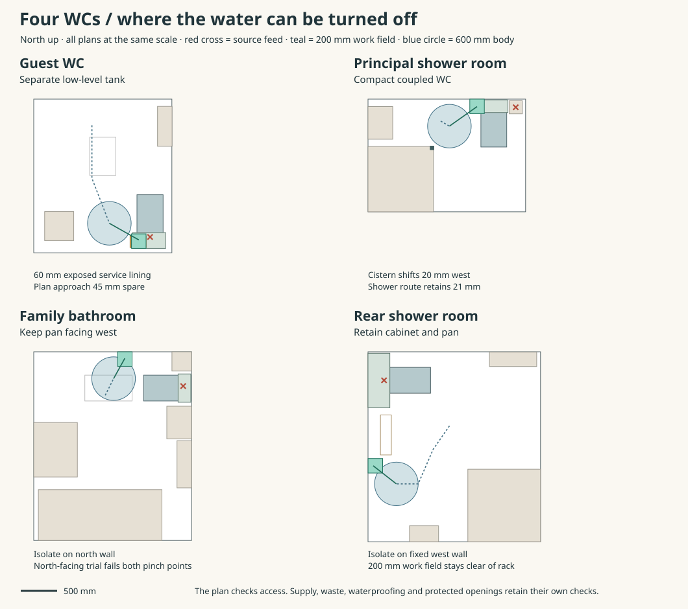

# Isolate each WC before disturbing the pan

Use a separately wall-hung ceramic cistern in the guest WC. Keep the principal and family rooms as compact coupled-suite candidates, with independent shutoffs reachable from the room. Retain the rear shower-room cabinet and put its upstream shutoff outside the removable front. All four original cold endpoints occupy the pan, service band, cabinet or soil column on plan. Services already labels them provisional. None is a safe default location for the first intervention. Coordinates below are mm from the southwest house datum, with heights above each room’s finished floor. [HAD room source](../had/studies/water-replan.json) · [Services fixture and work-space schedule](../mat/studies/whole-house-service-baseline.json) · [Reproducer](studies/wc-service-stations.py)

| Room | Original feed X/Y | Proposed accessible isolation | What the fit changes |
|---|---|---|---|
| Guest | 8900/650, inside the 400 × 650 pan reservation | W25 under separate C3 tank. Riser at 8745/547.5, switch faces into room at Y610, Z575 | The P2 pan ends at Y1232.5, 17.5 before the original front. Local working route has 45 mm clearance. |
| Principal | 11432.5/8040, centre of the 180-square soil column | 10900/8050, Z1100, on the solid north return east of the slider | Shift the coupled-suite axis 20 west to X11130. Tank to column is 17.5. The complete shower-door operation still clears the fixed room by 21 mm. |
| Family | 11452.5/5927.5, inside the east service band | 10650/6310, Z900, on the north wall | Keep the WC facing west. With its centre at Y5900 the 390-wide tank leaves 40 to the soil column and 55 to the basin. |
| Rear | 650/11177.5, inside the cabinet behind the pan | 500/10000, Z850, fixed west wall south of the parked front | The 200-square work field stays 50 clear of the existing floor rack. Upstream isolation remains accessible while the cabinet front is parked. |

## Guest room. An exposed supply and a visible first drip

Burlington’s P2 pan, C3 cistern and T31 brass flush pipe leave 215 behind the 525-deep pan within the 740 overall projection. Its drawing gives a 430-wide ceramic tank, 454 across the lever, a 360-wide pan, and a right-hand bottom inlet 155 off centre. Use the drawing's 1075 top, 748 underside and 415 pan-top envelope. The specification also describes alternate heights. Lowering the tank consumes the under-cistern working space. The 333 clear vertical interval at this setting accommodates the 300-high work field with 33 remaining. Confirm the delivered drawing, ceramic, lever, fill and flush fittings before setting out a final fixing. [Burlington assembly drawing](https://luxurybathroomsolutions.co.uk/PDFs/Burlington/P2-SLLL.pdf) · [Manufacturer’s matching parts schedule](https://www.heatandplumb.com/media/burlington/datasheets/file-16011.pdf)

Put a 60-deep independent service lining inside the proposed wet face at Y432.5. The mounting face becomes Y492.5. The W25 has a 63.5 handwheel, a 50 offset from its threaded inlet end to the tube axis, and 112.5 to its outer face. The tank inlet is 55 from the mounting face. That combination leaves 65 from the valve’s rear threaded end to the existing wet face for the supported wall socket, elbow and supply. Bring the 15 mm supply down on the warm side, give the elbow a removable side cover and maintain the wet return. The plate cannot mask a fitting projecting into the original external wall. The published cuttable 300 tube has a nominal 173 rise from the trial valve axis to the cistern underside. Allow for actual ferrules, insertion and the fill shank before cutting. The Burlington fitting guide identifies its G½ fill connection, rubber and plastic washers. W25’s chrome/brass body and ceramic index leave spindle seals and factory internals to disclose. [W25 installation](https://www.burlingtonbathrooms.com/content/upload/1/product-part-files/w25-13351/instructions.PDF) · [Bathroom Brands W25 data](https://bbwhitebook.com/Products/Whitebook/id/5303) · [Fill and flush parts](https://www.burlingtonbathrooms.com/content/upload/1/product-files/product/guild-high-level-slimline-51cm-cistern/gu7005cw-gu7002cw-ins.pdf)

Starting inside the shut guest door, the 600-wide body reaches an authored low stance at X8340/Y838. From a shoulder at Z630 the handwheel centre is 468 away. The trial tool point under the top nut at Z725 is 507 away. The 200 × 200 work field starts at the mounting face and ends before the pan heel. Catch a small inlet or stem drip on an independently supported open tray at X8625–8845/Y505–665. Give it 5 mm of fall over 220 towards the west, a low lip at X8625 and a clear view onto the room-side washable floor. Keep the tray below the Z448 work field, removable independently. The 30 mm inlet footprint and projected handwheel centre are inside it. A broken pressurised feed can overshoot this tray. The adjacent pan outlet has its own first-wetted floor and inspection after isolation. There is no assumed floor drain or unlimited containment.

Close and check W25 before releasing the tank connection. Isolate farther upstream before replacing the valve itself. Flush and bail the cistern, support it, release the upper inlet union and the T31 cistern/flush-cone connections, then remove the cistern from its independent mount. For pan replacement support the pan, free its floor fixings and disconnect the rear soil seal. Allow up to 100 of forward draw. Afterwards a 50 protective margin around the empty pan travels west and then north to X8070/Y1500 for a supported first rest inside the room. The reverse path is available for incoming ceramic. Burlington names C29 as a straight ceramic soil connector and C26 as a floor turn. Establish which connects to the actual ground foul route, its socket release and the pad, before accepting that 100 travel or lifting method. Dry and inspect the exposed floor, replace the disturbed seals, reinstate the anchors and full wet boundary, then fill, flush and inspect before closing the service cover.

## Two coupled suites and one retained cabinet

Duravit pairs the floorstanding D-Code 21180900002 with 0940150004. The pan is 355 × 650 × 400 and 24.5 kg. The 390 × 175 × 375 tank is 14.44 kg, operates from above and has a **concealed** bottom-left G½ male inlet. Use a 10 mm stand-off behind its ceramic envelope. Retire the old cistern-only cabinet projection where the new suite sits. Keep the soil column, its floor seal and the independent service supports. Reserve the complete 200 × 200 × 300 shutoff/tool space remotely on fixed backing. A 15 mm Brymec 30833 is a dimensional comparison at 67 long, with PTFE sealing and EPDM O-rings. Preserve its factory seals. Neither this valve nor the cistern internals have an owner exception. [Pan and matching tank](https://pro.duravit.co.uk/pro/content/homepage/products/categories/overview/products~402880943a1b6e1b013a1bd2494e0047.uk-en.html?ncat=toilets&nser=7120&product=94718) · [Cistern and fill connection](https://pro.duravit.co.uk/pro/content/homepage/products/series/overview/products~402880943a1b6e1b013a1bd20b39003d.uk-en.html?ncat=toilets&nser=7120&product=6461173) · [Valve construction](https://www.brymec.com/app/uploads/2024/03/valves_datasheets.pdf)

- **Principal.** The original soil-column cold stub cannot also provide a valve working space. Mount the separate valve above the coupled tank height. Its working area begins at X10800, exactly east of the rough slider aperture. Use the open bedroom-side slider during renewal. After full disconnection and 100 southward draw, the supported empty pan can pass west and north through the 775 opening and stage at X10360/Y8540 with the bed in its existing +500 maintenance position. The preserved shower-door check includes the real 50-square closing-corner reservation. [Door sequence](ias-03-principal-shower-entry.md) · [Bedroom handling state](../mat/interiors-b-wetroom-assembly.md)
- **Family.** The 430-wide Burlington body at the existing east-wall axis overlaps the north-east soil column by at least 7.5. Rotating the low-level assembly onto the north wall looks attractive until the body has to get from the west door to the proposed east-side service stance. For the same south-facing 525 × 360 pan envelope, a 600-wide body needs a centre at or east of X10729.1 to pass the west cabinet and at or west of X10447.6 to pass the basin. The two limits miss by **281.5** even before tolerance. The existing door-transfer endpoint instead joins the remote north-wall valve, with 70 body clearance and 320 reach. After disconnection, the west-facing coupled pan can move 100 west and stage at X10100/Y5722.5 inside the room, clear of the bath, basin, fixed cabinet, column and emitter. The protected room door remains a separate duty.
- **Rear.** Keep the cabinet’s existing multi-fixture floor crossing and supported pan/front-removal sequence. A C3 attached to the removable face would add a water-filled load and a live connection to its first release. The new shutoff is outside the cabinet, clear of the stowed face, basin, shower and radiator. The local service approach has 90.5 plan clearance, with 409 reach. Feed the fixed cabinet separately, leave its panel free and provide a visible low-point discharge onto the room-side floor. Check the actual pan connection and existing branch before adopting the rear assembly. [Rear crossing and support](../mat/services-b-joined-inventory.md)

For each upper room, isolate and verify the correct downstream branch, drain the tank and support it before disturbing the first union. A remote shutoff resolves isolation. The concealed inlet and concealed pan connection still need a matched supported first release. Either prove access with the ceramics in place or show a demountable local tail and the complete tank/pan withdrawal together. The staged bare-pan paths start **after** that release. A removable tray below a concealed joint only declares leakage if its true first-wetted surface drains to a lip visible from the room while everything is assembled. Run a wet test at the joint, inspect the low point and dry the backing before resealing. These are distinct work items for Services and IAS. The source still needs the revised final branches, backplates and safe socket joints; HAD must accept the changes to the actual wet rooms. [Current exit ledger](ias-03-current-occurrences-and-exits.md)
