# Workable interiors on the current house

**Development comparison for the owner's architectural review.** The existing house geometry and its protected, wet and structural boundaries remain the reference while the owner compares these alternatives. This first issue makes several decisions visible, with the Study as the worked example. Dimensions are millimetres unless stated.

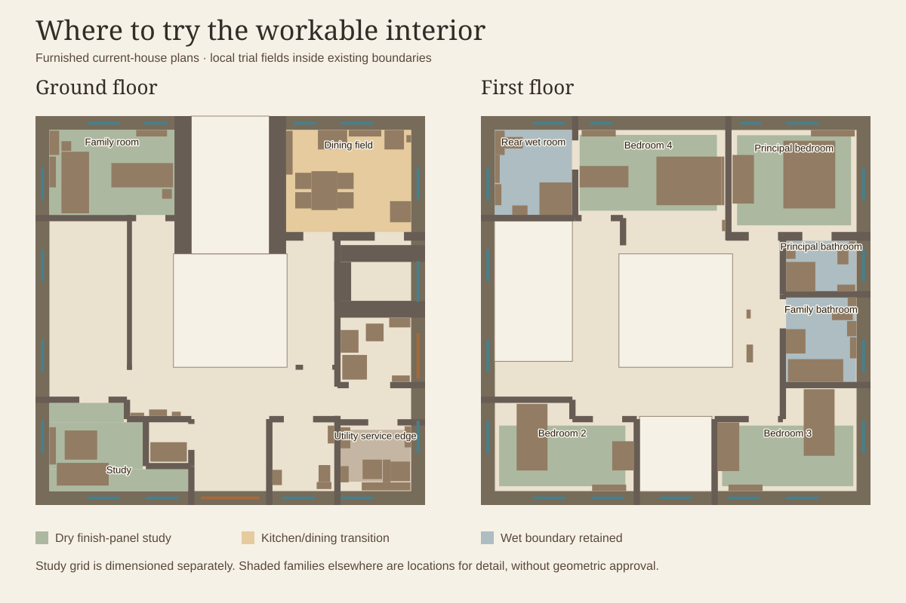

## A quiet floor that comes apart one piece at a time

Carry forward **a flush 400 mm timber finish module trial in dry rooms**. Avoid selling it as a void for plumbing or a floor that can be dismantled under the permanent stair or fitted kitchen. Keep the continuous floor support. Let every module pull out independently and compare the visual rhythm against the conventional floor. A full-size mock-up should answer whether the floor feels as solid and quiet as a conventional board, whether it rocks, what gets caught at the seam, and how the edge wears.

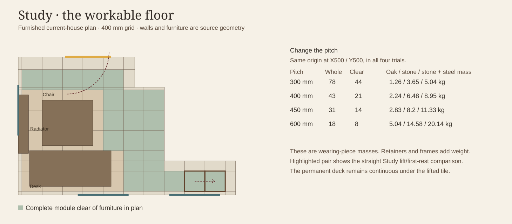

The drawing takes Study geometry from the occupied service compositor. It retains the desk, chair, radiator and door sweep; the visible X2100 window uses that compositor's revised position. The indicated 8.414 m² area uses the stepped finished footprint and excludes the cloak. The thermal room area uses a different zoning boundary and is unsuitable for ordering tiles.

| Pitch | Complete tiles | Complete tiles free of shown furniture | Timber trial | Stone trial | Stone/steel trial |
| --- | ---: | ---: | ---: | ---: | ---: |
| 300 | 78 | 44 | 1.26 kg | 3.65 kg | 5.04 kg |
| **400** | **43** | **21** | **2.24 kg** | **6.48 kg** | **8.95 kg** |
| 450 | 31 | 14 | 2.84 kg | 8.20 kg | 11.33 kg |
| 600 | 18 | 8 | 5.04 kg | 14.58 kg | 20.14 kg |

Counts use the same X500/Y500 grid origin. Green tiles clear the shown furniture in plan, before the door sweep, tool, body and first-rest requirements are applied. The weights compare a 20 mm oak skin, a 15 mm stone skin and a 12 mm stone skin on 3 mm steel with authored densities of 700, 2700 and 7850 kg/m³. Coatings, hardware, backing and lifting tools add to the complete moving mass. At room edges keep a matching, independently retained perimeter piece and protect both sides of the doorway from rocking or exposed sharp edges. The irregular cut pieces need named handling and support. Two useful pressures for the next iteration are the seam count of 300 mm modules and the handling penalty of 600 mm stone. Each pitch must work with the same threshold and finish datum.

**One Study release sequence.** Trial the two highlighted modules in the east field. Remove the retained X3700–4100, Y500–900 piece vertically by a provisional 55 mm, then translate 400 mm east to the separate X4100–4500 receiving module, protected with a temporary pad. The complete tile plan and R300 handler stance from (3300, 765) to (3700, 765) clear the three shown furniture/fixture rectangles. The conservative swept stance box has **35.5 mm** to the nearer finished wall and the moving tile has **100 mm** trailing-edge clearance to the handler envelope through the whole translation. A trial near-edge reach is **405 mm**. An entry/exit manoeuvre, loaded grip/height, complete package, actuated release heads, fingers, foot protection, permissible body movement and verified first-rest support remain to prove. The room is closed for the task and the deck stays in place.

The upper floor is **80 above the concrete, 200 of concrete, 55 for services below, and 15 for the ceiling**, fully using 350. The independent upper FFL stays at Z3450. The ground floor has 180 above the ground RC, with the *specific* dry-gallery reference allocating 15 stone, 65 screed and 100 cellular glass. These are different situations. The alternative is a supported replacement for the wearing finish. Retention, shims and finishes must consume the complete available depth without dropping the design levels. A deeper service floor requires a real load and duct route, compensating for altered level, stairs, doors, mouldings, furniture and acoustic/fire separation. Trial F2 only for a named duty and zone that earns this rework. [Current floor reservations](../../docs/reference-house/vertical-bay-coordination.md) · [Selected interior assembly schedule](../mat/interiors-whole-house-assembly-schedule.md)

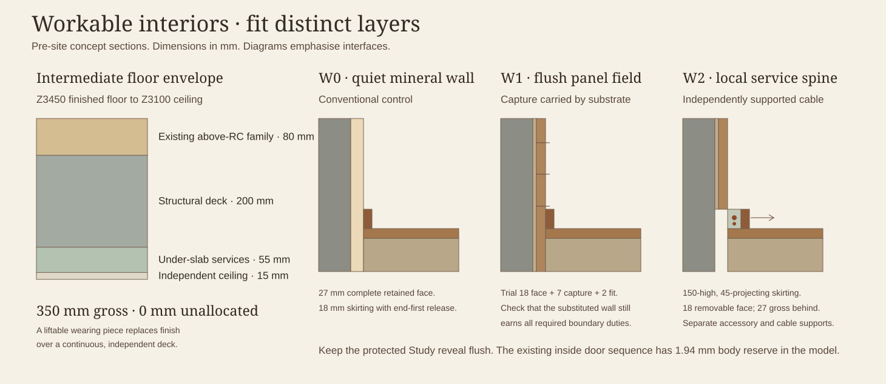

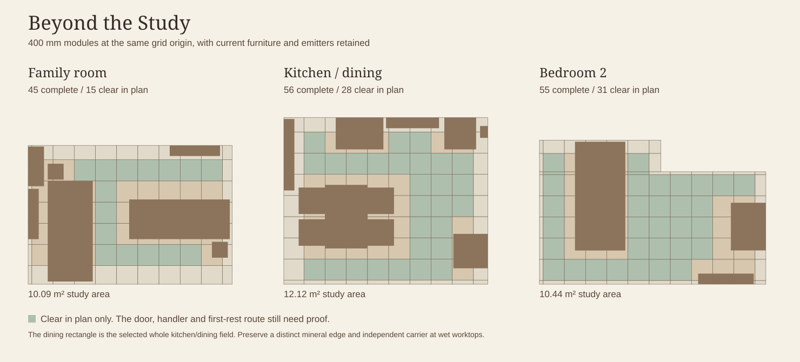

The same grid yields **15 of 45** full modules clear of the shown furniture in the family room, **28 of 56** in the kitchen/dining field and **31 of 55** in Bedroom 2. The kitchen/dining number includes its current whole rectangle, including the fixed wet service side. It records what furniture consumes in plan before the wet edge is allocated and earns no permission to blanket the kitchen with dry modules. Lack of a 600 mm handling stance and patch support can still veto a candidate that clears the plan.

## A genuinely panelled room

Give the owner the choice between the full-height panel rhythm and the calmer mineral wall. The proposed 27 mm replacement trial combines an 18 mm face, 7 mm point capture territory and 2 mm fit allowance. It preserves the face line on paper. If the full qualified 27 mm mineral treatment must stay behind it, the same scheme adds 27 mm to the current face and cannot inherit the furnished geometry and operations. The selected Study door movement has only **1.935 mm continuous modeled body reserve** at the L-return with the existing trim projection. Preserve that line and the actual door frame, or rework and recheck the source geometry. Give the cassette and conventional window comparators their own independently releasable reveal. Panel lines stop at the frame's working and sealing territory. Do not carry a hidden route over a rated closure. [Study door and trim](ias-03-study-door-reveal.md) · [Opening assemblies](../../docs/reference-house/opening-assembly-selection.md)

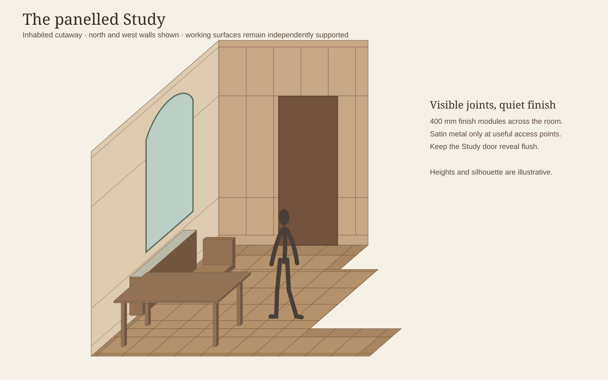

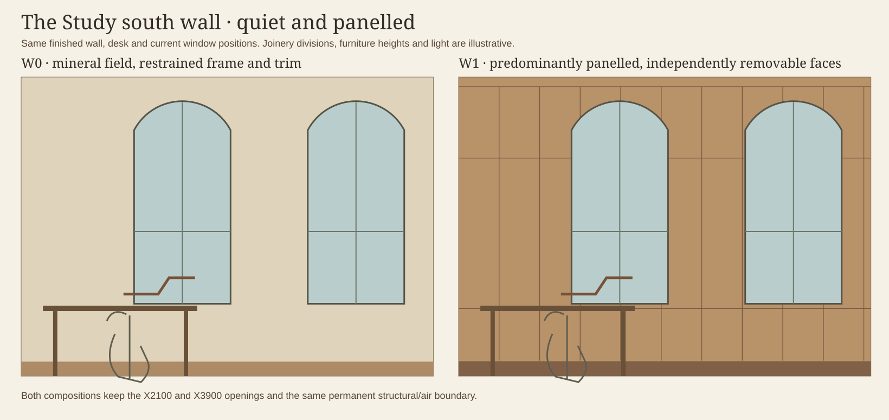

A panelled appearance can carry across the living room and bedrooms with the same colour and joint family and local changes in width, fixings and material. At the family and dining transition put seams where the trolleys, dining chairs and table maintenance can genuinely work. The dining side needs the mineral and splash control already assigned to the kitchen. In bedroom fields keep the radiator removal path, wardrobe park and treated window perimeter independent. The current palette explores timber wall panels and quiet solid timber finish, a mineral option where the room earns it, and satin-finished metal for visible access. It does not preselect a coating or release any concealed constituent. Polish the wall composition and quantify these other-room scenarios before selection.

## Separate the service piece from the standing surface

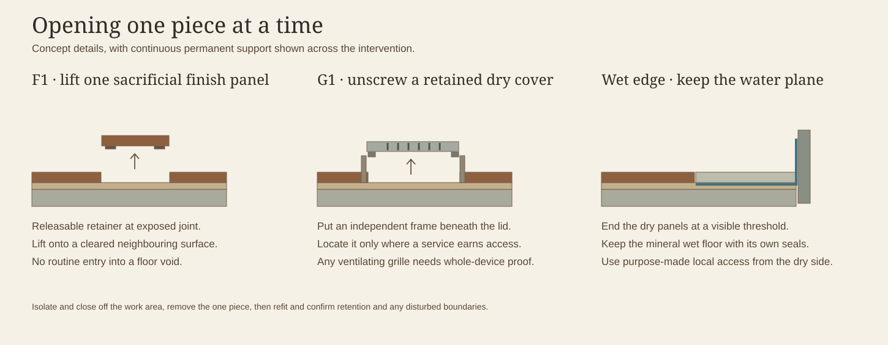

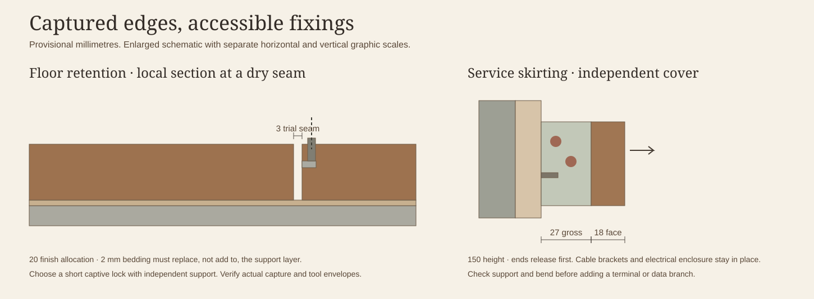

Use an end-first, normal-to-wall service skirting release. Independent mechanical captures, screws or short end caps must leave their fixing points accessible, and the cable and all live terminations remain independently enclosed and supported. A raised skirting or lid is a real working detail with switch, external bracket, isolation and closure checks. The drawing uses a localized bench/clear-floor first-rest reference. In occupied use isolate the duty, remove adjacent objects, close the work area, lift one piece onto a protected clear surface, replace it, then test locking and any disturbed service seals. Run a failed retainer/tile case in the development mock-up. Leave no unsupported crossing or shared circulation interruption during work.
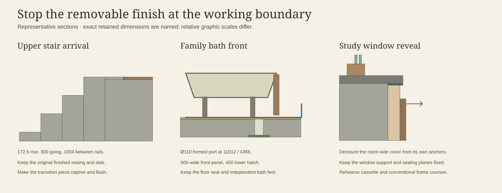

At the stair arrival keep the source 172.5 mm rise and 300 mm going. A raised 20 mm finish applied to the landing without compensating support would alter the adjoining rise by 20 mm. Meet the original finish level with independent edge capture carried out of the opening operation, rather than lifting a tile under a guard or exposed edge. At the family bath, keep the service piece on the front at Y4500, where the source gives X10625–11125 and 500 mm clear height. The located Ø110 hole and 450 square lower panel remain distinct, independently supported service and wet/fire interfaces. The Study room-side casing may move without owing the installed window the air, weather and support duties. Sections depict the stop relationships and retained datums, as an enlarged schematic rather than an installation detail.

## Whole-house exceptions and fixed boundaries

| Occurrence | Design comparison and limit |
|---|---|
| Wet enclosure | Keep the flush rear 1000 × 1000 mm enamel tray at X1802.5–2802.5 and Y8952.5–9952.5 with drain at (2012.5, 9452.5), its formed well and separately reinstated seal. Stop the dry modular finish before the wet boundary. The room-side mineral field must remain washable and able to show a leak. The family 1700 × 700 mm bath retains its locally formed Ø110 opening, Ø200 seal reservation and 450 mm lower access hatch. A removable wearing panel earns no access through that retained structural or wet construction. Keep actual pan, fixture and stem renewal duties independent. [Three-bathing source](../ias/ias-03-three-bathing-sections.md) · [Interior selection](../ias/ias-03-selection-closeout.md) |
| Protected route | The upper ring and stair continue through the south entrance hall to the front exit. Keep the walking surface, enclosed boundary and guards working through any occupied service event. Exchange a panel within an isolated room bay, or demonstrate temporary supported, slip-resistant protected crossing and a controlled occupied sequence. Do not route smoke, sound or heat behind continuous trim across protected doors or wet partitions. [Ring and escape direction](../ias/ias-03-selection-closeout.md) |
| Service skirting | Compare the 150 mm height × 45 mm projection detail at nominated dry interfaces. Its 18 mm face leaves only 27 mm gross before fixings, support and service protection. Independent enclosed ports, actual bends, supply segregation and end release at the doorway govern feasibility. On the 1015 mm west gallery, two 18 mm trims leave 979 mm, 18/45 leaves 952 mm, and two 45 mm trims leave 925 mm, all at skirting level. Use ordinary trim around the circulation pinch unless a locally bounded run demonstrably earns more. Keep water, soil and extract out of the dry skirting proposition. [Skirting source](../ias/ias-02s-services-access.md) |
| Metal grilles and covers | Select a defined air, drainage or first-access obligation before detailing a grille. Each of the six formed air-inlet sleeves needs ≥15,000 mm² inward and ≥5,000 mm² outward equivalent area for the installed terminal/screen/acoustic path. Slots alone establish a geometric open-area bound, leaving actual flow and acoustic performance open. Keep the exterior MAT walking grate distinct from door support and the blocked-water route. Indoor covers need their own seating, slip, small-object, cleanability, corrosion and load checks, and positive retention. [Air selection](../had/inhabited-services-selection.md) · [Front sill](../mat/front-threshold.md) |

## One-page owner decision shortlist

| Decision | Compare | Leading concept for discussion |
|---|---|---|
| Visible dry floor field | F0 continuous finish with discrete renewals, F1 flush liftable finish modules, F2 higher accessible platform | Illustrate F1 in named dry rooms and keep F0 at wet, protected and tightly constrained transitions. Restrict F2 to a real service duty with an accepted section rewind. Compare quiet appearance, seams, footfall, movement, cleaning and removal with furniture in place. |
| Wall character | W0 quiet direct finish, W1 panelling-dominant rooms, W2 panelled rooms with deliberate local spines | Show a genuine panelling-dominant alternative and a restrained inhabited version in the same room geometry. Any service chase stays local and independently isolated. |
| Visible service pieces | Ordinary trim with remote access, S1 skirting where it earns access, G1 grates and captured covers | Decide where access should be visible. Use intentional, independently released metalwork at located duties and avoid an arbitrary grille rhythm. |
| Openings and reveals | A worked cassette versus the conventional renewable E0 comparison | Compare how each reveal meets walls, skirting and floor renewal. Leave the opening selection subject to its own owner choice and actual OAS service and weather evidence. |

These are proposed choices for the first visual review. They preserve the controlled current house, prior comparators and the later technical/product evidence that each selected family would require.

## Dimensioned Study floor retention and release

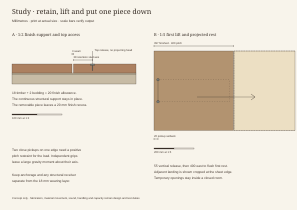

At the 400 mm pitch a 3 mm joint leaves a 397 mm square tile. The 18 mm timber trial leaves 2 mm for bedding within the selected 20 mm finish territory. A further 3 mm acoustic layer would overrun it by its full depth. A trial 13 mm socket envelope leaves 5 mm timber below it, before accounting for a pilot, splitting, repeated lifting or load transfer. Keep the flush 38 mm setback retainer distinct from the temporary 20 mm setback handling pickups. The drawing dimensions the interface. It is insufficient to specify or fabricate a threaded fitting.

With two opposed 0.5 mm setting allowances and 0.5 mm edge growth on each tile, the joint retains 1 mm. At 1 mm growth per edge it closes on that same setting allowance. At 0.75 mm adverse setting per edge it overlaps by 0.5 mm. These are geometrical sensitivities. Actual finish moisture movement, fastener slots, pad compression, lipping, wear and binding must be measured. A 3 mm seam is a trial, with no claim that it stays clear through the year.

For the handle trial, two 0.10 kg fittings make the actively supported package **2.19 kg timber** or **9.02 kg stone/steel** before larger tooling. A 1.5 handling factor gives **16.1 / 66.4 N** each under equal sharing, or **32.2 / 132.7 N** on one surviving pickup. The two near-edge pickups leave a pitch moment of **5.74 / 23.69 N·m** about their common axis. Use a positively arrested cradle or a rigid spread engaging a second pickup row **357 mm** away. The forward row lies about 781 mm from the trial shoulder in plan. It cannot be installed by leaning through the same posture and keeping all other assumptions. Prove a different setup and controlled first rest before claiming that one person can lift the tile.

The low shoulder comparison gives 593 mm maximum reach to near-edge grips at initial release and 558 mm during transfer. The earlier Study door task's 555 mm is a useful scale reference for hand travel but carries no lifting force and gives no pass here. Use a short-height guided first pickup or explicitly model a closer/alternate stance and hand placement. The measured mock-up must establish retention and stable grip, finish edge behaviour and restoration, including jammed timber, a dropped fastener and loss of one pickup. Keep the underlying support and any protected boundary permanent at every state.

### Guided pickup comparison

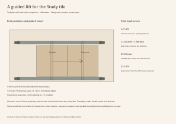

Try a low independent bridge across the existing tile and first rest. The carriage would take the loaded tile in pitch and let the worker control vertical lift and 400 mm translation from its tail. The baseline 70 mm shoes centred at Y475/Y925 intrude 10 mm into the tile’s lateral strip, even where they stand beyond the ends of the tile travel. A transverse tie in that strip would need its own geometry. The revised 30 mm shoes with rails at Y470/Y940 clear the moving tile by 15 mm south and 25 mm north. The south shoe remains 25.5 mm off the finished wall. After the actual 18 mm skirting and an adverse 5 mm setting reservation it clears by only 2.5 mm, and fails with 45 mm service skirting. The 30 mm shoe is a comparison, subject to local bearing, retention and stiffness tests. The southern 40 mm rail leaves 10 mm gross lateral reserve to the moving tile and the rail underside clears the 150 mm skirting by 60 mm. The 35 mm half-length feet at X3450 and X4550 sit outside the endpoints of the actual piece, with just 15 mm to the rest at the east end. The 210 mm lower envelope leaves an ideal 23.9 mm above the 175 mm combined lift and hardware reservation after adding 10 mm installation allowance and ideal rail bend. The assembly, carriage, pinch protection and wall/trim clearances have to fit those allocations.

Charge the full factored moving load (147.4 N including 1 kg of handling hardware) to one simply supported 40 × 20 × 3 steel tube on a 1100 mm span. With ideal elastic support it gives 21.46 MPa nominal bending stress and 1.08 mm deflection, before self weight, local wheel effects and actual connection behaviour. The near-foot reaction is 113.9 N at the transfer end under that load. A 100 N horizontal snag at 250 mm height produces a 25 N·m tipping moment. Across a 470 mm track it corresponds to an ideal 53.2 N cross-rail restraint demand with no credit for stabilising dead weight. Provide positive restraint on both frames in both directions before pickup or loading. Closing the room, shop-testing the whole carriage, and demonstrating how feet, restraints, tools and equipment get in and out still govern feasibility. The guided route addresses the loaded pitch and first-rest problem without calling the modeled grip trial a safe one-person operation.

Run `node project/ias/studies/workable-study-release.mjs --check` to reproduce the receipt and scaled A4 SVG. At actual-size output the 100 mm and 200 mm reference bars print at 50 mm and 40 mm respectively.

## Reproduction and next design material

Run `node project/ias/studies/workable-study-floor.mjs --check`. The generator consumes the selected HAD service model and records its controlling geometry blob, never edits the house model, and renders the alternatives side by side. It checks exact source presence, the matching Study opening, panel-field geometry and the level arithmetic. Relative trim section proportions and elevation furniture heights are illustrative.

The full early review package still needs whole-handler and first-rest clearances in the furnished dry rooms and at one wet transition, inhabited views of non-Study variants and the restrained Study alternative, dimensioned threshold, window reveal, ceiling and stair/landing sections, and equivalent 1:5 and 1:2 coordination at the other representative assemblies. The Study bridge comparison still requires a matched capture, supported feet and demonstrated equipment installation and transfer, plus matched finishes. This first issue keeps those remaining drawings explicit and retains the one-page owner shortlist. The owner evidence and final approval stay in their separate manual gates.
