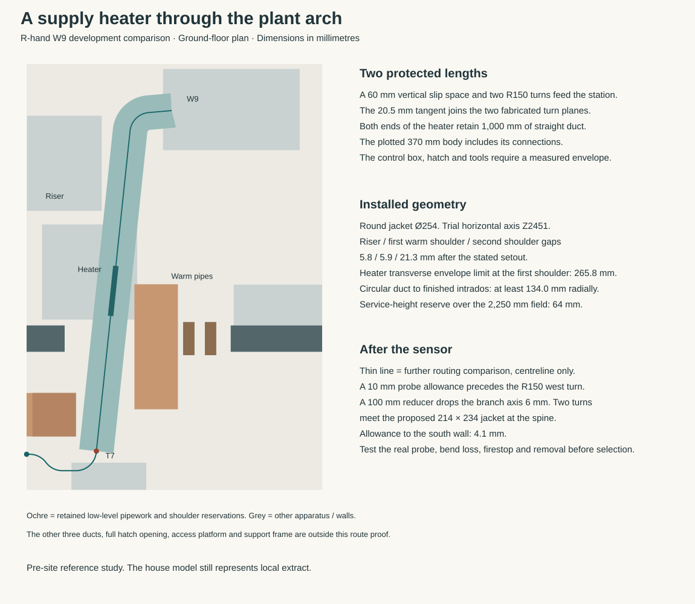

# Cooker, ventilation and heat as one operating system

**6 November 2026 — work in progress, not selected.** Replace the failed habit of adding a makeup fan, two heaters and an ideal pressure controller with a whole-house comparison. Develop one matched central balanced unit, directly extracting cooking pollution, before enlarging the heating plant or adding the unselected west kitchen radiator. The current six-local-fan strategy and current numeric Services/HAD contract remain unchanged. This is an owning MAT-SERVICES investigation, not packet closure or permission to use polymers.

The [reproducer](studies/balanced-service-architecture.py) and [numeric result](studies/balanced-service-architecture.json) pin the actual merged house and Services bytes at `8ab19d48`. They retain all six 13/16 L/s background/boost duties and the existing 48 L/s cooking capture comparator. They do not silently replace duty with a lower statutory minimum, cap simultaneous use or reuse the retired east 7400 window. All upper wet interfaces and D1800 foul geometry stay unchanged.

## Decide the topology before specifying more apparatus

| Direction | Concrete finding | Disposition |
|---|---|---|
| Existing local extraction + passive cooker makeup | Keeps cold direct air and the actual kitchen heat burden; opening size and all fan masks remain connected. | Does not solve the current package by deleting the heaters on paper. |
| Recirculating hood + retained outside kitchen extract | A continuous-system kitchen comparator is 13 L/s, not the intermittent 60 L/s row. However regulation minima do not establish grease, particle or vapour capture. | Cannot assume equivalent IAQ. Primary SINTEF/OsloMet meal tests found substantially worse recirculation exposure for the tested two hoods. No universal factor or selected-hood result inferred. |
| Matched central balanced MVHR + directly ducted hood | Deletes six distributed extract motors and the separate powered/heated makeup train as a proposed architecture; adds a real central unit, ducts, filters, condensate and renewal duties. | Strongest constructive direction, subject to the actual room-pressure/transfer, noise, frost, constituents and complete layout proof below. |

The [England 2026 ventilation document](https://assets.publishing.service.gov.uk/media/69c12224d588c92c483e4b6a/ADF1_2026.pdf), Table 1.2, is a future applicability comparator: ordinary commencement is 24 March 2027, not already operative law for an unknown plot. Recirculation alone is not ventilation. The [SINTEF/OsloMet 2022 study](https://www.sintef.no/en/publications/publication/0198cc787ec7-cf2a72ab-7202-492f-abf6-ecc58d0fe67d/) is adverse primary research, limited to its two hoods and meals; it is not a performance test of the chosen house.

## Whole operating contract

Two commissioned states replace independent local fan masks. Normal operation is **96 L/s balanced**, comprising five 16 L/s wet-room extracts and 16 L/s through the closed hood. Cooking is **128 L/s balanced**, comprising the same five 16 L/s extracts and 48 L/s through the open hood. Dedicated kitchen supply follows 16/48 L/s; the other six habitable rooms retain **80 L/s total, 13.333 L/s each in both states**. This retains every former 13/16 L/s duty while deleting the intermediate humidity mode and room-flow choreography. Cooking 48 replaces the hood background flow; it is not added to a second kitchen extract.

The cost is continuous 18 L/s above the former 78 L/s background: at a synthetic 30 K temperature difference and 70% effective recovery, that adds **194.4 W** of physical heat demand. Fan electricity must come from the actual operating point, not nameplate power. More winter dry-air exchange, terminal noise and humidity comfort are explicit design prices, not presumed benefits. No annual climate or humidity target is invented.

The [current Salsa instruction](https://www.swegon.com/globalassets/digizuite/18988-en-salsa_genius_installation.pdf), pages 6–7, gives the native background holes and pressure measurement. Eight holes have K 1.31:13 L/s needs 98.48 Pa and 16 needs 149.18 Pa at that measurement point. The calculation's inherited open-hood quadratic is explicitly an authored comparison, not a newly digitised certified curve. It shows why retaining other wet flows when the hood opens needs an actual fixed-branch balance and static pressure, not only a total airflow number. Actual native cooking/boost priority and intermediate RH demand still need mapping; the proposed targets are not a claim that the firmware already implements the complete branch network.

Global balance does **not** prove kitchen pressure. With the six old habitable-room supply locations,48 L/s crosses the closed protected east door's inherited 7600 mm² transfer requirement: the ideal orifice loss is 64.32 Pa. A new active supply loop is not the default answer. Compare a complete fire/smoke transfer assembly first; otherwise a controlled kitchen/dining supply must retain the other rooms' flows and match the hood in every state, including faults.

The real [Lorient LVN20S](https://www.lorientuk.com/files/resources/Lorient-LVN20S-datasheet.pdf) has 44 mm-door installation evidence, a smoke shutter and Talkback system. At its approximate 30% geometric free area, ideal 300 square is already 5.10 Pa at 48;350 square is 2.75 Pa and 400 square 1.61 Pa before actual cover/assembly losses. Those are sensitivity calculations, **not measured equivalent areas or product pressure results**. The mandatory rigidPVC slats, lined aperture, intumescent kit, wiring/door loop and controller remain explicit. No polymer exception, matched whole doorset, acoustic privacy or installed flow is approved. Steel [LVH44S](https://www.lorientuk.com/products/lvh44s) is wall-only: do not transfer its materials to the door variant or make the narrow existing door pier disappear.

The current [government fire document](https://assets.publishing.service.gov.uk/media/6aa3bb335f6e942efe37f150/AD_B1_2026.pdf), paragraphs 2.8–2.9, supplies the decisive rejection: this authored house has first floor 5250 mm above the D1800 ground comparator, above 4.5 m. Transfer grilles should not be fitted in the protected stair enclosure. A factory-tested LVN20S cannot earn that prohibited placement by itself. Paragraph 2.9 b instead permits rigid-steel ducts through the stair enclosure with firestopped boundary joints;2.9 c forbids one duct system directly serving both the stair and other rooms. The proposed through ducts have **no terminal into the protected stair**. Actual boundary penetration assemblies remain to be bound; no fire-engineering departure is assumed.

Choose the simpler dedicated kitchen supply for constructive development. The actual [REACT V GMB125](https://www.swegon.com/globalassets/digizuite/10842-en-reactvgmb_a_iommanual_en.pdf) covers 9–108 L/s,475 body/485 mounting length,215 actuator dimension,1.8 kg, tolerance±5% with minimum ±2 L/s under its required installation. Set **Vmin 16, Vmax 48 L/s**; the 32 L/s span exceeds its recommended 20% of 108 = 21.6 L/s. The 160 mm regulator has a larger nominal span recommendation; the 125 mm choice remains the smaller matched control.

| Commissioned mode | Kitchen extract / supply, L/s | Five other extracts each, L/s | Six other habitable supplies total / each, L/s | Kitchen transfer, L/s |
|---|---:|---:|---:|---:|
| Continuous 96 | 16 / 16 | 16 | 80 / 13.333 | 0 |
| Cooking 128 | 48 / 48 | 16 | 80 / 13.333 | 0 |

There is no nominal kitchen transfer in either state. The regulator's native tolerance is ±5%, minimum ±2 L/s: **±2 normally / ±2.4 during cooking**, giving 0.112 / 0.161 Pa ideal orifice screens through 7600 mm². These include the supply regulator tolerance alone, not all hood/network errors or a protected-door transfer qualification. No enlarged undercut is adopted.

**Native two-position wiring, not an invented analogue controller:** configure the page 8 Mode menu to **0Ai** (0–10 V analogue), Diag to **oFF** (normal operation), Min 16 / Max 48 L/s and verify Nom **108 L/s** with the unit matrix in L/s. These are proposed settings to record at commissioning, not observed installed settings or assumed factory defaults. REACT IOM page 6, Figure 9 selects Vmin with Y terminal 3 floating; a full-wave 24 V AC/DC connection from supply terminal 2 to Y 3 selects **Vmax**, while positive/negative half-wave connections mean forced fully open/closed and are not used. The Salsa ExtOut is floating normally open, maximum 30 V/5 A: its damper-open contact can bridge 2→3 to select 48 L/s; opening the contact selects 16 L/s. Use the required isolated 24 V transformer and preserve native controls. No new room pressure loop, BMS or generated 10 V source is needed. This is component-level native wiring, **not yet a factory-qualified Salsa/W9 fail-safe interlock**.

Actual flow feedback U is available, but a broken contact wire leaves Vmin = 16 L/s even if the hood is mechanically open at 48 L/s. Power, fan and frost faults are not solved by a contact. Required straight sections, independently supported ends, accessible actuator/cleaning hatch and full constituents remain real design costs.

### Prefer native paired duct-pressure control before custom automation

The [CASA PTH instructions](https://www.swegon.com/globalassets/digizuite/9893-en-pth_installation_en.pdf) specify one pressure sensor, tube and tapping per kit, with **two kits** to control both ducts. The native 300 Pa range, stable ambient reference and representative uniform-flow tapping matter. W9 lists PTH as an accessory. The older PTH manual's Smart screen layout is not claimed as the current Genius menu.

The [current Genius/SCB register manual](https://www.swegon.com/globalassets/digizuite/18172-en-casa_modbusregisters_en.pdf), version 4.2 rows, independently identifies fixed duct-pressure control and Home/Away/Boost plus **Cooking supply/extract pressure targets, registers 5325/5326**. It requires native commissioning through the wizard. This is evidence of a native configuration, not an instruction to add a BMS. Compare equal commissioned manifold-pressure targets in both states: opening the kitchen regulator and hood then changes their branch flows while the other branches remain fixed. The actual tap locations, shared main pressure changes, branch resistances, silencers and dirty-filter margin still have to prove the 80 L/s retained elsewhere. The inherited open-hood curve remains an authored screen, so a numerical pressure setting is not selected yet.

PTH compensates dirty-filter resistance while fan capacity remains available. On pressure-control malfunction it alarms and **falls back to normal fan regulation**; it does not guarantee cooking capture. Clean and inspect both tubes/tappings at unit service. A supply sensor alone cannot stand in for paired regulation.

### Visible failure and manual cooking stop versus automatic enable

The native Genius eManual says GC10/app display detected unit alarms; current records include E181 pressure-sensor failure and E191 inability to maintain duct pressure. Serious faults flash all hood LEDs. Hood filter reminders, shutdown indication and serious alarms have different patterns, so a vague instruction to watch the hood is insufficient.

The actual programme excludes combustion. Develop native unit/hood alarms plus one plain local **SUPPLY BOOST** indication and explicit **stop cooking on observed lost capture/makeup duty or native alarm; repair and recommission before resuming**. This is a proportionate visible-loss strategy for all-electric cooking, not an automated hob interlock or a demand for infallible detection of every hood/sensor failure. RPM feedback and upstream duct pressure do not measure the kitchen-supply branch: an open contact can silently retain16 L/s while extract rises to48. Reusing actual branch-flow U makes that known silent loss meaningfully visible. Native protections and the full commissioned mode/pressure/transient duties remain; residual common or stale-high faults are stated limitations, not hidden claims of safety integrity.

## Apparatus, paths and the architectural price

The [inspection sheet](studies/balanced-service-architecture.svg) compares complete mode balances, unequal-stream heat allocation and both source-bound plant trials at the same scale. The open protected leaf **intrudes 482 × 44 mm into W9's trial 600 mm front field**. Its body clears, but the field is not fully available with that door open. Closed-door component service followed by reopened-door whole-body withdrawal must be proved as separate supported states, including panel/core parking and operator escape. The 31 mm cylinder reserve alone is not a renewal pass.

Simply copying the VTC's east-facing offset also fails the complete W9 field. Rotating the 1006 × 597 mm base to `[10184,2672,597,1006]` leaves 25 mm to the protected leaf and 189.5 mm beyond a trial 600 mm east-front field. However, the actual intermediate wall has finished faces **Y = 3603 / 3797 mm**; its clear arch jambs are X = 9677 / 10898 mm. The base fits the opening but its front field intersects **483 × 75 mm of the solid east pier**. A 27 mm finish-only wall assumption would hide that collision. Moving the body south enough to clear it would meet the finished 2647 mm utility boundary. Retain this negative control; a rotated body rectangle alone does not solve W9's renewal.

The native [W5 catalogue](https://www.swegon.com/globalassets/digizuite/10170-en-casaw5_technicalcatalogue_en.pdf) and [6 October 2026 IOM](https://www.swegon.com/globalassets/digizuite/10134-en-w3_w4_w5_r5_installation.pdf) identify 87 kg,597 × 630 × 951 mm body, four 160 mm spigots. W5 has no fifth cooker bypass. Its maximum curve at 128 L/s leaves little pressure beyond the roughly 159 Pa kitchen branch comparison, before the whole main, terminal and dirty-filter burden. It is not selected merely because its headline range reaches 130 L/s. A 160 mm clear duct at 128 L/s is 6.37 m/s: a geometric fit is no noise or pressure pass.

The larger [W9 September 2026 catalogue](https://www.swegon.com/globalassets/digizuite/17453-en-w9_technicalcatalogue_en.pdf) and [IOM](https://www.swegon.com/globalassets/digizuite/17204-en-w9_installation.pdf) retain a plate core, four 200 mm ports and useful fan pressure. Native unit mass is 156 kg, body 1000 × 597 × 1314 mm, spigot top 1342 mm; the base is 1006 mm wide and 123 mm high, with feet adjustable from 15–50 mm. Do not reuse historical 594 mm depth or 155 kg as the current unit. The proposed vestibule host is `[9677,2672,1006,597]`, front north, between the actual 2550 and 3700 walls. It retains 25 mm behind and 887.5 mm east for ordinary passage, and a **trial**, not native-qualified,600 mm front field ending at Y = 3869 mm, 31 mm before the actual cylinder body. It does not move the washer, sink, cylinder, buffer, controls or wet north wall. The 850 mm cart with 25 mm each-side reserve fails that east passage; ordinary person clearance is a different question. No 850 mm cart credit is claimed there. Complete front panels/core/fans/156 kg whole-body extraction, lifting support, base feet, retained ducts and condensate release still determine selection.

Use 200 mm clear main ducts where possible:128 L/s gives 4.07 m/s. At the actual protected spine arch, a proposed short rectangular 160 × 180 mm clear transition has 214 × 234 mm full mineral-insulated/jacketed envelope and 4.44 m/s. Two crossings at Y 2909/3491,Z 2445 flank the unchanged 320 × 260 mm warm packet with 24 mm lateral gaps; literal finished intrados leaves 32.14 mm above, with 78 mm above the 2250 mm rectangular doorset. This only earns **one section**. It does not prove bends, fixings, removability, classified transom/fire stopping, attenuators, cross-talk or the full duct tree. A 25 mm radial mineral insulation is an authored warm-duct trial, not a sourced thermal/acoustic rating; the earlier 50 mm cold-duct allowance cannot automatically be applied everywhere or deleted for convenience.

### Develop the full network and port assembly before adopting an operating point

The successor [joined study](studies/w9-network-development.py), [source extracts](studies/w9-operating-point-sources.json), [results](studies/w9-network-development.json) and [inspection sheet](studies/w9-network-development.svg) now bind actual **W9 Genius model42** calculations from the manufacturer's [ProCASA](https://procasa.swegon.com/en/procasa-e) on 6 November 2026. The observed native form returns the same explicit supply/extract flow and pressure inputs; exact observation times, full response/selected-model HTML hashes and form values are retained. These are pressure sensitivities, not selected clean/dirty states. Default climate, annual energy,17°C supply/21°C indoor and the tool's−4 dB surroundings comparison are excluded from house claims.

| Native supply / extract flow | Trial duct pressure each | Native fan power supply / extract | Native SFP, kW/(m³/s) | Supply / extract / casing sound power LwA |
|---|---:|---:|---:|---:|
|96 /96 L/s|200 Pa|96 /77 W|1.80|68 /49 /46 dB(A)|
|128 /128 L/s|200 Pa|132 /110 W|1.89|71 /50 /48 dB(A)|
|128 /128 L/s|300 Pa|175 /144 W|2.49|76 /53 /51 dB(A)|

The native operating-area check is true at these points. That does not select a pressure or prove the actual network. At128/128, an extra100 Pa in **each** stream costs77 W and raises supply/casing source sound by5/3 dB. The960 W connected fan capacity is still not actual operating demand. The five duct/casing sound domains and eight octaves remain separate: supply sound power is not a bedroom sound-pressure level, and a duct attenuator cannot silently reduce casing or structural transmission.

Price one real package rather than an unnamed silencer: the native [CLA-A200-1000 sheet](https://www.swegon.com/globalassets/digizuite/6923-en-cla-a_productsheet_en.pdf),10 February2025, gives a **1000 ×321 ×252 mm body,45 mm spigot projection each end,1090 mm complete axial bound and11.2 kg**. Comparing one in each warm main therefore means **22.4 kg**, plus independent supports, couplings and complete removal fields. Its50 mm mineral wool retains **polyester facing and rubber seals** with galvanised steel; it is not an all-mineral or polymer-exempt package. Native fire safety distances are a conditional product test domain, not the required protected-stair penetration assembly.

The native static ISO7235 octave attenuation is7/13/20/28/40/45/27/20 dB at63–8000 Hz. Subtracting those values from the respective **supply octave powers**, then energetically summing after A corrections, gives static-only residual48.6 /51.5 /56.7 dB(A) for the three rows. These exclude regenerated flow sound, installation breakout, branch/terminal/cross-talk and room propagation; the casing46 /48 /51 stays unaffected. Both octave entries and native overall values are independently integer-rounded, so reconstruction can differ by up to1 dB without inventing precision. The sheet explicitly warns that nearby elbows or dampers change both pressure and sound performance. Wide visual chart reads of approximately1–3 Pa at96 and2–5 Pa at128 therefore apply only to its uniform-flow test domain. Against the inherited **authored**, not OEM-qualified,158.61 Pa hood-branch screen, the200 Pa point leaves only about36–39 Pa after one such extract-main package;300 leaves136–139. Neither remainder proves the full network. Bind actual mains/fittings/terminals and native filter reference/dirty increment, charging each loss once and retaining parallel-branch topology.

The full packages also falsify a simple drop-in. Two321 mm attenuator widths plus the retained320 mm warm packet total962 mm, greater than even the846 mm maximum finished spine span. They cannot replace both existing214 mm flanking crossings in that same band. **Develop the attenuator hosts before that constrained section**, with actual connections/support/removal rather than drawing the catalogue bodies at the bottleneck.

The current native W9 port centres also matter. For the R hand, supply/extract/outdoor/exhaust are at `[159,291] / [379,162] / [621,162] / [841,291]` on the1000 ×597 mm top plan; the L hand mirrors the domains. The inherited authored25 mm warm /50 mm cold layers plus4 mm total jacket allowance give full254/304 mm envelopes. Cold centres255.03 mm apart then overlap48.97 mm; the inner warm/cold pair242 mm apart overlaps37 mm. Even bare250/300 mm insulated envelopes already collide. This does **not** make50 mm an OEM minimum or reject every possible connection: develop offset/diverging fittings or an explicit contiguous insulation/jacket detail with thermal, vapour, acoustic, support and reversible withdrawal evidence. The native IOMp12 requires gap-free cold insulation/vapour tightness and supply acoustic insulation to the attenuator; neither duty may disappear to rescue four circles.

Keep W9 direct96/128 as the leading whole-system direction, with cooking recovery and the limited SUPPLY BOOST response. These source points now price a real network/attenuation/port question; they do not admit apparatus, materials, winter heat or the156 kg loading method. Native bottom-supported lifting, component release/masses, base-to-deck transfer and the complete folded approach remain part of the same next design, with S01–S10 preserved.

### Separate the four ports before installing the duct heater

The four fixed Ø200 spigots extend 28 mm above the cabinet. Moving the upper ducts apart cannot change this first joint. The extract and outdoor spigots leave **42 mm** of bare metal-to-metal space. The proposed 50 mm cold insulation alone exceeds it. Sharing just the two cold jackets would still fail at this warm/cold pair. Two independent 2 mm skins leave a total of 38 mm for the facing layers there. At the two cold spigots the equivalent maximum is 25.52 mm per equal layer. Reserve a common vapour-tight root enclosure around four separate metal air paths, with mineral between the pipes and a removable external closure. The webs change the local thermal and acoustic boundary. Prove cabinet-to-jacket seals, surface temperatures, moisture entry, cleaning and the separation of all four air streams before adopting it. [Genius spigot drawing, p. 26](https://www.swegon.com/globalassets/digizuite/17204-en-w9_installation.pdf) · [Native insulation duties and port centres](studies/w9-network-development.json)

A 500 mm high transition can reach four separately jacketed outlets without moving the receiver. For the illustrated R hand, take the native supply/extract/outdoor/exhaust axes at X159/379/621/841 to X64/332/649/974, retaining their Y291/162/162/291 rows. Smooth S-curves with vertical end tangents give a minimum curvature radius of 313 mm. With independent ±5 mm in **each plan coordinate** at every centre, the continuous Ø200 metal bodies retain at least 31.19 mm of separation and the four full 254/254/304/304 jackets retain at least 28 mm at the upper ends. Intermediate ducts still need the common insulation enclosure until the separate jackets can take over. The nominal jacket bounds extend from X−63 to X1126 relative to the unit. Even assigning the whole 6 mm base/body discrepancy east and a further 5 mm setout, the east wall clears that envelope by 33.5 mm before any service catches or extra casing width. This is a shape for fabrication and pressure-loss comparison. Sheet seams, flanges, tool space and a supported access face still require real dimensions. [Continuous clearance and room check](studies/w9-port-transition.py)

For removal, give the entire transition its own support and release the four upper connections. A 45 mm lift from a lower sleeve edge initially at cabinet-top level would clear the 28 mm spigots by 7 mm after two opposed 5 mm height errors. The upper connections must actually permit this stroke while the overhead ducts stay supported. Prove the lower gasket and closure can be reached and reinstated before the W9 moves out. The receiver study places the highest installed spigot at Z1741 under a 3100 mm ceiling. With the transition in service only 859 mm remains above it, or 814 mm with its lift reserved. **A vertical SDHE postheater and its 1 m downstream sensor run cannot stack directly above it**, even if the heater body took up no height. Locate the heater and sensor on a separate horizontal supply run before the constrained crossing, with access to the reset and removable parts. [Receiver height](studies/w9-forkable-receiver.json) · [Heater sensor location, p. 3](https://www.swegon.com/globalassets/digizuite/10045-en-sdhe_installation_en.pdf)

### Carry the heater and sensor through the plant arch

**Retain the R-hand W9 offset through the west side of the intermediate arch as a development option.** A horizontal heater placed directly on a single south-west-facing elbow does not fit the retained warm pipework. The offset below locates the full heater and temperature-sensor run, but leaves little transverse room for the casing. Test the native unit first at the cold, dirty-filter cooking condition. If it delivers the missing 0.1875 K, the extra heater, connections and pressure losses can be omitted.

For a 200 mm duct, the Genius installation drawing shows at least **1,000 mm on each side of the heater**, with T7 downstream. The SDHE dimension sheet shows 270 mm for the case and 370 mm overall. The trial reserves 370 mm plus the two straight lengths, 2,370 mm in total. Its full round supply jacket is Ø254. The north cell extends from the moved intermediate wall at Y3857 to Y5780.5. From the projected supply outlet, even the farthest corner is only 1,942.1 mm away before charging duct radius or furniture. A longer run must leave the cell or be fed by a different approach. [Genius installation, Fig. 2, p. 11](https://www.swegon.com/globalassets/digizuite/19732-en-ductbatteries_genius_installation.pdf) · [SDHE installation and dimensions, pp. 2–4](https://www.swegon.com/globalassets/digizuite/10045-en-sdhe_installation_en.pdf)

**Why the first diagonal fails.** Take the R-hand supply at X10464/Y5438, with the horizontal centreline at Z2451 crossing the occupied Z2370–2630 warm band. Write the westward movement per millimetre south as *t*. At Y4000 the duct must already lie west of the X10190 pipe face, which requires *t* ≥ 0.27886 even with no north projection of the shoulder. At Y3200, clearing the eastern side of the second drop at X9600 requires *t* ≤ 0.27122. This gives that drop only 130 mm of the retained 320 × 260 package east of its centre. Both bounds use the bare nominal 127 mm jacket radius and waive setout. A differently formed warm-pipe shoulder would need its own section. Looking only within the thickness of the intermediate wall misses the collision.

**The offset.** Above the 500 mm four-port transition, allow 60 mm of vertical slip space for a 45 mm release and its two 5 mm errors. A 150 mm centreline-radius quarter-turn points 5° south of west. A 20.5 mm tangent and a second R150 turn in plan feed the station 6° west of south. Treat the two turns as one independently supported fabricated branch. Their short tangent has no allowance for a pair of separate stock coupling collars. The inlet lies at X10053.5/Y4294.9, the outlet at X10014.8/Y3926.9 and T7 at X9910.3/Y2932.4. The calculation retains the full 320 mm pipe shoulders, opposed 5 mm plan setouts and the source's possible cabinet offsets. [Source-bound calculation](studies/w9-heater-station.py)

| Installed comparison | Remaining geometry |
|---|---:|
| Round jacket to the dry riser | 5.77 mm |
| Round jacket to the north warm-pipe shoulder | 5.91 mm |
| Round jacket to the westbound warm-pipe shoulder | 21.30 mm |
| Jacket below the finished arch intrados, radial lower bound | 134.0 mm |
| Underside above the 2,250 mm movement field, after setout | 64 mm |
| Maximum total width of a centred casing beside the north shoulder | 265.8 mm |

The true casing must fit its allocated width with its cover, collars and supports. Its accessible face cannot point downwards. At the cylinder the 1,745 mm body and 500 mm service field fit below the round duct, but a downward-projecting fitting can consume that separation. The 60 mm slip reservation leaves only 5 mm after the compared lift and two opposing errors. An actual captive connector, supported branch and removal sequence must realise that stroke. Inspect them with the front door in its required state and room to operate the reset. The bare duct clearance covers only the fixed geometry.

**Onward to the spine.** After the probe, give the duct a further 10 mm before an R150 west turn. That leaves 4.1 mm to the southern finish under the stated setout. On the west tangent a proposed 100 mm reducer changes the round jacket to the existing 214 × 234 mm jacket and lowers its axis 6 mm to Z2445. Two opposed R150 turns bring it to the proposed Y2909 crossing, leaving 12.4 mm before the spine face and 14 mm to the adjacent warm crossing after the plan comparison. A probe needing more than approximately 14 mm of straight duct beyond its centre, a longer terminal fitting or a wider casing can defeat this compact arrangement. Locate the actual probe, grommet, spigots, fire closure, supports, inspection opening and pressure taps before selecting the assembly.

At 128 L/s a 200 mm bore carries approximately 4.07 m/s. At 1.2 kg/m³ air density every unit of additional fitting loss coefficient costs about 10 Pa. The extract-side residual quoted for the cooking branch cannot pay for supply bends, heater or silencer. Reprice the actual supply path with the installed fitting losses, heater curve, filter datum, room terminal and acoustic transfer. Keep the two pressure-control taps at representative even-flow sections with a stable ambient reference. T7 measures supply temperature. [PTH commissioning instructions](https://www.swegon.com/globalassets/digizuite/9893-en-pth_installation_en.pdf)

### Prefer a smaller upper branch and preserve the ordinary bed

The upper floor needs at most **53.33 L/s supply and 48 L/s extract**, rather than the whole house's 128 L/s. Two 160 mm clear branches therefore run at 2.65 and 2.39 m/s. With the authored 25 mm mineral layer and steel jackets, each full diameter is 214 mm. A 25 mm separation and 30 mm edges give a proposed **513 × 274 mm** cabinet at `[11032.5,3304,513,274]` in bedroom 3's east/north extension. It reserves 25 mm to the east and north finished walls. The existing bed and wardrobe remain in their ordinary positions. The earlier west-bed riser and permanent 500 mm bed move are unnecessary for this comparison.

A full-height cabinet below would steal the narrow plant vestibule passage. The proposed lower join must instead rise from the unit and reach this position **overhead**, retaining at least 2250 mm ordinary clear height. That lower connection remains a real route to prove, not an existing free void. The upper horizontal axis is proposed at 2382 mm above first-floor level: the full straight jacket bottoms at 2275 mm, 25 mm above the reference door assembly. A 160 mm centreline-radius elbow has a full 374 × 374 mm side envelope and extends south of the cabinet. Its lower part lies inside the service/bulkhead territory; the 2275 mm straight-duct underside is **not** the elbow's complete lowest point. The slab opening, trimmers, hangers, room/fire boundary and separate airtight steel ducts remain explicit admission work. No occupied wet-shaft capacity is borrowed.

For rare upper component access, reject the bare QuickPod rectangle: its native overhead mode also needs 491 mm stabiliser deployment. A smaller real comparator is the [Werner adjustable Odd Job 600, part 31290026](https://www.wernerco.com/uk/featured-products/adjustable-odd-job-600-work-platform): maximum opened dimensions 1020 × 720 mm, 600 mm square deck, 500–700 mm deck height, 7.35 kg, 150 kg maximum load, folded 620 × 690 × 180 mm. The native maximum working-height comparator is 2450 mm; it is not permission to reach an arbitrary 2500 mm task.

Temporarily translate the complete 950 × 2055 mm bed **1040 mm south**, from Y = 1518 to 478 mm. It then retains 48.5 mm to the finished south wall and ends at Y = 2533 mm. A full 1020 × 720 mm opened-tool field at `[10475,2558,1020,720]` reserves 25 mm to the parked bed, 26 mm to the riser and 75.5 mm to the east wall. This is a **static comparison**. The native leg swing, mounting step, actual deck origin, complete worker/hands/tool, component support and reversible bed movement still need joining; these reserves alone do not qualify handling. The west mounting apron is a separate body territory, not a point silently occupying the platform. The folded tool is hand-carried; no 196 kg personnel lift is assumed upstairs.

### Prefer the front renewal route before adding an exterior hoist

The 1006 × 597 mm body/base has a **597 mm transverse width** when travelling west through the protected plant doorway. Centre it at Y = 3162.75 mm: the actual effective opening Y = 2791.5–3534 mm leaves 72.75 mm each side. This differs from the rejected 850 mm cart. A body can therefore leave the vestibule west, continue west along the south gallery, turn in the 2206 mm wide central entrance hall and leave south through the front door. The full body's turning radius is 584.85 mm; do not attempt that turn inside the narrow east gallery.

A real narrower carrier is [Fetra 25011401](https://www.fetra.com/carts/open_cart-25011401): **1000 × 600 mm deck, complete 1125 × 609 mm plan, 270 mm deck height and 600 kg rating**. Removing the native W9 base leaves the 1000 × 597 mm body dimensionally within the deck; this does not qualify its bottom support or capture. The complete trolley has 66.75 mm each side through the actual 742.5 mm plant opening. A separate authored 600 mm operator body has 71.25 mm each side.

The native [1288 four-swivel option](https://www.fetra.com/surcharge_articles/4_swivel_castors-1288) permits the initial 192.25 mm north translation. It warns of reduced directional stability and excludes the 1280 dead-man option: they cannot be combined silently. Move west with the operator behind the full handle, then move to **[5700,2700]** before turning south. That lower turn keeps the complete carrier and rear operator inside the entrance hall; turning at the old Y = 3162.75 mm would put the operator through the north boundary. After turning, translate 300 mm east to the front-door centreline. The reproducible result does not assume that the 1125 mm overall length is centred on its 1000 mm deck: it charges the full 125 mm extension at either end, a conservative **1250 × 609 mm deck-centred envelope**, plus the separate 600 mm operator. Full turn reserves remain over 100 mm. This replaces body-only SAT.

Uniform native bottom lifting, capture/restraint, base transfer, core/panel/fan removal, duct/condensate release and floor/wheel loads remain genuine admission work. The rated cart does not make the 156 kg unit hand-carriable. The actual authored front approach is `model.gardenFailureBypass.frontApproach.route`: **four 9 m ramps at 1:20 and 1200 mm clear, with folded turns and landings**, ending at the D1800 grade comparator. Summing its XYZ route segments gives **45.945 m travelled** (45.900 m in plan). The older 42 m nominal straight reservation in `model.approaches.front` is a historical budget comparison, not the selected route or a straight winch path. Complete loaded carrier/operator turns, landing transitions, attachment/capture and any rope/anchor arrangement remain unearned. [Fetra 1280](https://www.fetra.com/surcharge_articles/dead_man_brake-1280) explicitly is **not a driving brake**. The native [2200 electric-drive sheet](https://www.fetra.com/medien/pdfdata/EN/2200.pdf) states 5% / 2° uphill ability at 500 kg, adds 55 kg and batteries, and does not establish the required downhill braking or complete modified envelope. Since 5% is 2.86°, that inconsistent angle/percentage is not silently resolved in the design's favour. Neither option presently qualifies the external loaded slope. No external east landing, crane or door enlargement is adopted to evade these duties.

The successor [folded renewal study](studies/folded-service-renewal.py), [results](studies/folded-service-renewal.json) and [rendered plan](studies/folded-service-renewal.svg) now test all three actual intermediate U-turns. The same conservative **1250 × 609 mm deck-centred cart and separate authored 600 mm operator envelope**, fixed 950 mm behind the deck centre, follow a constructive 147-pose manoeuvre through each 2700 × 1200 mm landing and adjacent 1200 mm ramp wings. Four-swivel translation is explicit. Both bodies are enlarged by 25 mm and checked against the actual clear ramp/landing union. Dense checks at at most 5 mm translation or 0.25° rotation, with a less-than-2.8 mm nearest-sample movement bound, retain **more than 22 mm continuous plan reserve for the uninflated comparison bodies**. Fixed-centre turning with the whole operator fails; it is not substituted for the constructive manoeuvre. This is a plan result for the three intermediate turns, not a loaded handling method. Actual caster/wheel contact, changes of support plane, loaded centre of gravity and permitted inclination, entry/foot transitions, independent restraint and the complete hoist/rope/operator bodies remain unresolved. The 597 mm unit on a 600 mm deck also leaves only 1.5 mm nominal each side; the deck match does not provide a structural loading or restraint detail.

Keep the W9 whole-system direction and investigate **positively controlled travel per actual 9 m flight, with positively held landing transfers**. The native [Tractel Tirfor manual150425.ind-03.03-23](https://www.tractel.com/PIM/Manuals/LH/Manual%20LH/Group%201/150425.ind-03.03-23.pdf), sections1/5/6/8/10, provides a real lowering/holding mechanism: TU8 is rated 0.8 t; its 8.4 kg machine, 1 kg handle and matching 8.3 mm rope are real additional tool bodies. The rope is listed at 0.25 kg/m; longer lengths are available. Its two jaws grip the load when operation stops. **General warning10 requires the anchor and structure to withstand the machine's maximum WLL: about7.85 kN per TU8**, rather than merely the much smaller cart downslope force. A simple180° redirect can impose twice the line tension; simultaneous units require the corresponding complete structural check. Warning23 requires constant rope tension, so a slack second rope is not a qualified impact-catching system. The current HAD support note supplies only an authored200 mm structural depth and supports at no more than2000 mm pitch; actual ground/bearing/reinforcement/edge/guard capacity remains unearned. Dedicated anchorage/capture is new external work; no guard, house grid or wall-friction capacity is borrowed. That native holding function does not itself design this route's load path or independent failure capture. The manual requires suitable anchors and unobstructed straight-line operation, so the folded route needs actual per-flight setups or rated redirects. A next attachment must actually hold the load before the previous line is unloaded/released. Anchor capacity/location, the 620 mm handle and second operator field, cart attachment, redirects, support on every transition and the transfer sequence remain admission work. None of these bodies is silently included in the cart/operator plan result, and no1280/1288 compatibility or uncontrolled manual descent is assumed. This adds a source-bound constructive renewal direction to the five decisive whole-system checks below; it neither admits a cart nor lowers the operating, heat or constituent duties.

The [manufacturer's current Genius spares page](https://www.casastore.fi/swegon-casa-w9-genius?lang=en&region_selected=1) now binds actual replaceable assemblies: [F230W fan package](https://www.casastore.fi/puhallinpakkaus-w9-r-l-mallin-tulo-poisto?id=61) includes its connector and fan seal; [61030 core](https://www.casastore.fi/lto-kenno3) and [DW9RL paired doors](https://www.casastore.fi/ovi-w9-r-ja-l-malli-32018-gt) explicitly list Genius compatibility. Shared Smart compatibility makes them useful mechanical predecessor evidence, without transferring an entire old machine. The current page's maintenance link resolves to the [3 September 2024 Smart manual](https://serviceportal.swegon.com/fi//docs/TM_W9_EN), whose core bracket/fan collar and connector release methods can be compared. It does not provide current Genius component masses, measured withdrawal/hinge envelopes or the supported loading method. Retain 156 kg, current Genius controls and intact complete replacement packages; a fan seal does not disappear when the impeller is metal. No native service-clearance pass follows from parts availability.

### Develop one forkable raised receiver for the whole W9 handover

Keep the **W9 direct96/128 L/s architecture as the leading development direction**, and test a raised receiver that stays under its native base through renewal. The original floor-level stance is not an owner invariant. The [joined receiver study](studies/w9-forkable-receiver.py), [native evidence and authored sections](studies/w9-forkable-receiver-sources.json), [results](studies/w9-forkable-receiver.json) and [interface sheet](studies/w9-forkable-receiver.svg) develop a real support/transfer assembly instead of assuming that a rated cart solves lifting. No apparatus or handling adoption follows.

The current [Genie Lift IOM1314200GT](https://manuals.genielift.com/operators/english/1314200.pdf), Second Edition Third Printing, August2026, gives GL4 minimum forks-down lift89 mm. Native W9 feet15–50 mm leave **at least39 mm short for direct entry under the whole floor-level base**. That does not reject lifting the cabinet off its base with qualified bearing surfaces. A flat plate under the base also fails the proposed direct setdown onto a solid cart deck: the forks still occupy the space needed by the deck. Develop one forkable metal receiver, not a separate stool plus an unspecified transfer.

The authored receiver is **1006×597×226 mm**: a6 mm top plate with a proposed200×220 service aperture and40×6 welded rim, on two80×40×3 transverse RHS beams, four40×40×3 posts110 high and two outboard100×30×3 bottom runners. It keeps the native base/adjustable feet above the plate; the actual base1006×593 and cabinet1000×597 remain different domains. The beam underside is140 mm above receiver bottom, with an806 mm inner runner lane. Native forks are572 long/521 outside-wide; the native standard-base table gives629 wide/883 operating-long and51 kg. Nominal lateral gaps are142.5 mm each for the forks and88.5 for that complete width, and140 is51 above the native minimum lift. **Those numbers do not locate the actual legs, wheels, fork section/origin, winch/handle or operator.** Their complete vertical and plan fields must clear the receiver, retained cylinder and actual protected leaf through the supported sequence. The600 mm host-front trial is not silently enlarged into that proof. Frame racking, welded joints and floor stability are real work; no missing centre brace, wall anchor or floor capacity is assumed.

Ideal sharp-corner member arithmetic at an authored8000 kg/m³ gives **48.054 kg** of proposed uncoated316L receiver before weld metal, capture/dock hardware, actual section radii and fabrication. Listed156 kg unit plus that fixture is **204.054 kg**, leaving only**22.946 kg** below the native227 kg GL4 chart rating. Resolve whether the listed unit mass includes the actually supplied native base, and weigh the captured assembly. The actual combined loadcentre must be no more than350 mm from the load face nearest carriage, with lateral centring and the configured native chart verified. **597/2=298.5 mm is a geometric midpoint, not an actual CG.** No unknown heat-exchanger mass is deducted. The heavier custom fixture is a material, cost, fabrication and maintenance burden that can defeat this direction; it is not free non-plastic height or an approved material exception.

The authored3 kN static component challenge gives48.66 N/mm² ideal crossbeam bending stress and0.431 mm elastic deflection across906 mm between post centres. It proves neither the full plate/native-foot load path nor welds, local bearing, torsion, racking, floor or impact capacity. A deliberately isolated end-point model at400 mm support-line span requires a **negative far reaction**: free forks cannot supply that hold-down. Its elastic arithmetic is a negative stability control, not a lifting pass; actual distributed foot loads/CG/capture must bind. Native521 mm fork outside width is not measured bearing-line spacing. The two runner projections total0.1194 m²; gross dead-load pressure16.76 kPa is only area accounting, not uniform effective bearing on real tile/screed/insulation/RC. Retain actual constituent, surface treatment, fixing and air/thermal interface duties without borrowing a house-floor rating.

The constructive sequence is: isolate and release actual power, ducts and condensate with supported parts; engage the receiver lane with actual combined mass/CG and capture verified; lift only enough for the270 mm deck plus a trial20 mm approach clearance; positively dock/restrain the actual cart; lower the receiver onto its deck; then lower the fork top from**410 to390 mm** and withdraw through the retained lane. Actual tine thickness plus tolerance must fit the remaining120 mm vertical space. GL native raised travel is limited to minor loading/unloading positioning, on a firm level surface with no unattended load; do not turn it into a general loaded house route. The [current Fetra sheet](https://www.fetra.com/medien/pdfdata/EN/25011401.pdf) gives30 kg,200×40 wheels and1000×600 deck270 high, but no wheel/contact-centre geometry. Receiver end overhang3 mm and transverse deck reserve1.5 mm each are nominal, not support/tolerance approval. Actual wheel/GL-leg approach, support handover, capture/dock attachments and reversible withdrawal remain decisive. Any projecting capture hardware must be added to the complete moving envelope.

Retaining the existing conservative1515 mm native height sum gives **1741 mm installed top,2011 on the cart and2031 at the trial20 mm lifted clearance**. These are bounds, not an actual port-bend/attenuator/ceiling or protected door-head/closer pass. Listed unit+receiver+cart is234.054 kg versus186 without receiver, a25.84% increase before unpriced parts. Gravity-only force on1:20 rises from91.09 to114.62 N; actual wheel support polygon, combined CG, rolling resistance, restraint and dynamic stability remain unproved. The retained1250×609 complete-carrier plan rectangle contains the1006×597 receiver only before projecting hardware; that does not expand the existing limited folded-plan result into a cart/handling pass. The actual four-flight45.945 m approach, positive landing handovers and full TU8-WLL anchorage/redirect/capture duties remain unchanged.

Native W9 IOM pages9–10 require a real first condensate release: the3/8 inch male connection is at the rear under the heat exchanger, with minimum12 mm ID discharge, no horizontal run, second trap or direct drain. The supplied looped hose and optional UVLL remain distinct assemblies. The manufacturer's [UVLL IOM](https://www.swegon.com/globalassets/digizuite/10112-en-uvll_installation_en.pdf), UVLL_a-m/030220, requires at least annual underside-cover opening, setter/float withdrawal and movement check, with clear space below. The actual UVLL QR route on current W9 page10, [serviceportal.swegon.com/fi/docs/UVLL](https://serviceportal.swegon.com/fi/docs/UVLL), now yields the native480140-byte PDF, SHA256`d11c0efbd019d363553371f53918ffc68352a7784cbfe83449a2513e7fc20bda`; both pages were inspected. Page2 places the lowest cleaning cover72 mm below the unit bottom and gives98 mm inlet/body-axis separation. Those dimensions do not state the extraction stroke, complete body width or hand/tool space. Raising a continuous support plate raises both plate and trap, leaving clearance**d−72** unchanged, where actual base-seat/foot datum**d** is unbound. The exact p9 assembled1417 and p26 body1314 arrows share the cabinet-top reference excluding spigots (1342 includes them): their103mm difference is a nominal offset to the depicted assembled lower line, not configured native feet-to-receiver contact or installed trap clearance. Develop the permanently open200×220 plate aperture with an independently priced40×6 rim; actual feet/contact/capture and local plate/rim/weld bearing must avoid that opening before machining. Its authored rim bottom180 is40 above the nominal140 fork-top plane, and26 clear of the authored rear beam. This is an axis reservation, not a whole cleaning or handling pass. Native12 mm Cu coupling and minimum12 mm-ID downstream line remain different domains; the W9's100 mm damming requirement is not disproved or waived by a72 mm external mechanical-trap depth. Actual fixed-tail support/counterhold, finite drain-down capture, first disconnect before lift, restored water test, receptor/indirect connection and all seals/float/setter constituents remain to bind. No hidden polymer or drain alteration is admitted.

**The installed trap needs an approach from the room.** In the receiver's right-hand trial, the cover axis lies 377 mm behind the front face. The front edge of the opening is only 72 mm in front of that axis, with the steel rim hanging to 180 mm above the floor. Let `d` be the measured unit-bottom height above the receiver top. The cover then lies at `154 + d` mm. Even a point on a straight line from floor level at the front face must cross the rim at or above `(154 + d) × 305 / 377`. The present rim obstructs that approach above a seat datum of approximately 68.49 mm. At the native drawing's 103 mm offset used as a sensitivity, the point penetrates the steel envelope by 27.92 mm. The result applies to the straight approach under the front of the frame. An articulated hand or a qualified approach through the native base would require its own demonstration.

A longer aperture could preserve the 40 × 6 mm rim. At that same drawing datum, take a straight 25 mm vertical tool profile ending 150 mm out into the room, 10 mm above the floor, with 5 mm overhead allowance. Its upper edge runs from 35 mm at the outer end to 257 mm at the cleaning axis. The opening must extend at least 122.66 mm further towards the room. A **200 × 345 mm** comparison moves the front rim 125 mm, leaving 5.99 mm over the profile there, 24.96 mm below the front beam and 134 mm in plan between the rim and beam. The 0.72 kg ideal steel saving includes the longer side rims. The 200 × 220 mm receiver remains the basis of the earlier mass and lifting checks. Measure the foot and capture patches before enlarging the cut. With the unit resting on its actual feet and the fixed tail independently held, demonstrate cover rotation, setter and float withdrawal into a catch, reinstatement and water testing from the room. The static tool pose establishes neither that service sequence nor local plate strength. [Dimensioned receiver study and section](studies/w9-forkable-receiver.svg)

**Next decisive tests:** bind actual supplied mass/base/CG and native-foot/capture contacts; prove complete receiver/weld/floor stability and actual GL fork/leg/handle/operator geometry; prove positively docked cart entry/setdown/withdrawal in both directions; then bind actual condensate cleaning/release, all top-port/attenuator withdrawals, protected head and the full loaded folded-route support/capture. Failure of any of those can reject this receiver or the leading W9 architecture. Preserve the native cooking/pressure/frost protections, proposed visible-loss response, whole heat and S01–S10/constituent duties while testing it. The lower-mass VTC alternative does not inherit a system pass from this fixture's burden.

### One conditional plant-room and persistent-carrier direction

The [joined room/method producer](studies/plant-room-rewind.py), [source-bound results](studies/plant-room-rewind.json) and [current whole-room sheet](studies/plant-room-front-renewal.svg) develop **one proposal**, not adopted HAD/Services geometry: W9 at `[10400,5147,1006,597]` facing south; buffer centre `[11245.5,3155]` on a persistent600mm carrier; intermediate wall/arch60mm north; pier controls at `[10920.5,3857,650,300]`; emitter at `[9727,2647,550,200]`; cylinder/riser bodies retained, cylinder900×700 working field72mm north and425-method export line atY4600. All functions, independent support, native operating/heat duties and full renewal remain required. Actual W9 operator/GL/cart handling, its450mm riser gap/230mm task and the emitter's19.72mm reference leaf-sweep reserve remain unresolved; no25mm or actual doorset pass is claimed.

The [retained negative controls](studies/plant-room-rewind.svg) prevent a body-packing result becoming a whole-system claim:

| Control | Result retained |
| --- | --- |
| Old south W9 / utility approach | Raw900 is finished846, with27mm returns; ordinary approach fails. |
| W9 west200 | North field hits intermediate pier200×194; parked-leaf intrusion becomes682×44. |
| Utility arch east200 alone | Finished approach remains9.04mm short, before the next turn. |
| Emitter-only north W9 | Cylinder work overlap570×328 and tank export blocked. |
| Old425 buffer method | Starts100mm through east wall;850 package cannot pass835.04mm cylinder/pier throat or742.5mm Plant door. |
| First north W9 cart method | Full1250×609 body sweep passes; supplied crew path fails controls/pier. |
| Earlier600 East buffer method | Actual595 cylinder circle clears, but complete700×700 station fails by170.12mm. The preferred front method preserves that whole station. |
| Under-GL pod conversion | Not accepted: fitting/removing pods under a GL-held vessel lacks qualified positive support/no-reaching-under-load procedure. Persistent casters remove those operations. |

The [conditional wall control](studies/plant-room-wall60.svg) makes the south cell1016mm deep. Native563+2×200 gives26.5mm surplus each side; the complete600 support leaves only8mm each side. Native p7 gives200 lateral/150 top and separately requires accessible water connections. P9 places opposed ports on those lateral faces and p8 wall strips on the intervening rear face, but no explicit PORT-axis/all-around scope is invented. Proposed north/south orientation and actual fittings/access still need qualification. The upper wall remainsY3700, only10mm inside moved140core3690..3830:60mm eccentricity exceeds23.33mm middle-third; direct no-tension contact is only30mm triangular width and10mm adverse setout loses the edge. Source12.363kN/m gross upperwall alone gives1.001kNm/m ULS offset sensitivity. The **separate exterior**1400 east-door300-rise/215-ring extrados reachesY3744.31, increasing core overlap25.69→85.69mm. RC200 transfer, new internal jamb/thrust and this cross-door joint remain structural duties, not free wall movement.

The matched native **Vaillant VPS R100/1M /0010021456**, exact0020244064_02, is34kg net/101L nominal/135kg water-filled. P7 drawing563×927 and appendix550×932 are distinct source domains;101nominal does not establish100usable and draining does not establish34kg transport mass. Native3feet, full bosses/plugs/seals, temperature/pressure/flow, highest fitted point and all retained transport fittings must fit the proposed complete600 envelope. The [source register](studies/plant-room-buffer-carrier-sources.json) also records manufacturer-linked RSK6212623 dimensions932×573×550 and separate packaging655×605×1140; the gross package mass, pallet bearing and capture are not established. Native p9 names expanded polypropylene around the product; the RSK entry listsPUR. Layer/version/constituent roles remain unreconciled, with no invented revision change or exact BOM. Both polymer source roles, native seals and caster polyamide/rubber/lubricants remain unapproved; no supplied-appliance or temporary-tool exception follows.

The preferred persistent carrier keeps the8mm600 plate,40×6 rim, two40×80×3 beams and four native TENTE3470UFR100P62 casters assembled throughout installation and renewal. Actual tabulated caster sweep90mm/offset40/height128/mass0.81kg binds this comparison;160kg at4km/h is not a whole-carrier rating. Two low docking drops, removable pins and a captive220×80×30 box give **40.510kg coarse moving fixture,74.510kg native-dry assembly and175.510kg complete listed-water-filled assembly**. The listed wet case exceeds the provisional150kg rolling limit. New West-side flush floor receivers/stand-offs and removable stops positively dock the unit; they do not relieve the full wet caster/frame/floor support duty or inherit RC200 anchorage. Installed handles extend330mm west and charge a shifted task reference; removed handles/fixtures must remain within600 during motion. Actual local floor/cage/point load, dock weld/pin/drop, air/water/thermal closure and initial native-foot capture still qualify. No native brake, rotating feet or under-load pod work is assumed. Listed932+276 gives1208mm stack before top150 duty; it is not an actual fitted-foot/port maximum. The separate1600 complete-body control plus276 gives1876mm adverse CG-height cases, including negative resultants.

**Actual native installation/mode join:** p8 says remove the delivery-pallet fixing screw(s) before the p9 three-foot installation. That establishes a native transport restraint exists, not its thread/engagement/bearing/allowable loads or approval of a replacement carrier. It is the first hard capture/installation datum to bind before fabrication; neither EPP casing nor compression-only floorfeet becomes an invented lifting point. P10 **CASE3** is series return: heatpump flow bypasses the buffer; primary plate-HX return enters upper-right and lower-left returns to heatpump, with six other water ports plugged. Proposed right=north/left=south uses native710/230mm drawing-line heights, not newly asserted installed floorZ. Separate West-side600-body/25-reserve task references clear the retained plant, native port/casing and installed handles. Their roughly621–634mm nominal plan reaches are authored references, not universal human/tool access. Actual low-port stance, unions, seals, supported fixed tails and the100usable/minimum-flow/control duty remain unearned.

Two existing84mm warm-jacket **controls** are proposed overhead atX10590/10750,Z2400, rising at port-side territory before crossing west so low pipes do not occupy the worker. This proposes independent supports/demountable tails through the opening, not pier drilling or a selected pipeID/flow. Selected HAD supplies only the1275 internal plan opening. A **new, explicitly authored internal section trial**—spring2550/head2850/ring215/27 radial soffit finish—has rawR827.344, finishedR800.344 and centreZ2022.656. Both84+25 envelopes fit that trial; crown3065 leaves105mm to RC3170. This is not borrowed exterior-arch authority or pipe-bearing credit. Internal thrust/jambs, +60 upper-bearing offset, exact intrados/supports and the separate east-door joint still require owning review.

The full600 package genuinely fits the **742.5mm Plant reference passage**, exporting to the front. The shallow1050-west/25-north first pull stays between emitter and fully parked leaf, then goes west atY3180. Crew2 crosses south only after load9800/3180, waits during the leading operator's hall turn and enters6000/3180 only after bodyY2400. Both body and crew preserve the complete700×700 cylinder station. Guest-WC is closed and Plant parked open;1000 central front clear is a required comparison distinct from raw1800 and the actual frame/leaves/threshold. The new circular package, both600 crew and25mm bar are independently clipped against all three **actual folded-front**2700×1200 landings with750-radius hairpins. With50mm inflated samples and a full-shape interpolation bound, continuous raw plan reserve exceeds **44.51mm** across1113 poses per turn. A real80mm left-normal rear-crew offset resolves the low primary-rope conflict. The ideal pin-pose1m bar/990mm plan-spacing comparison gives902.90–1051.37mm grip including a1:20 floor-height sensitivity. Exact uniform first-flight frame/hand geometry gives993.80mm; actual crest/toe/regrip and footprint transitions remain unearned. Actual steering/yaw, wheel contacts/tilt/transitions, final toe/setdown and complete rigging/crew fields remain physical duties; this is no borrowed Fetra handling result or East-landing credit. W9 still needs its own full renewal method.

The finite **signed** first-flight force model includes gravity,0–50N ramp-local forebar and a primaryline to a new station at the real outer-S700 girderY332.5/P21–P22. At measured CG≤600mm/offsets≤25mm and qualified planar native contact/tread footprint±96.54mm, analytic endpoint bounds over the actual9m planar flight give≤129.40N primary tension for150kg and positive resultant support throughout the stated0–600mm CG-height/offset/forebar domain. The175.51kg listed-wet sensitivity needs about142.49N but remains over the rolling limit; residual/glycol density/slosh,1876 high-CG negatives and no-drain challenge stay explicit.150N is an authored/measured operating bound, not a native limiter. Without positive holding, unbraked casters supply no downhill control. Exact normal reactions and both support edges use signed r×F. The earlier unsigned lever table remains a conservative sensitivity. At150kg the same planar interval also requires3.31–38.13N eastward reaction and18.36–35.79N·m opposing yaw about the carrier origin. Positive normal support and along-grade balance leave those two demands open. A real steering or side-guide load path must supply them, with no assumed caster friction, braking or crew reaction.

That station is **new through-threshold structure**, not a free house anchor. TU8 requires7.845kN per machine/anchor and15.691kN simultaneous paired load, irrespective of the small operating tension. The250-run/330-rise brace gives about12.99kN axial and10.36kN upright/base couple before actual vertical components/bolt rows; rear feet have only100mm to the beam edge. One TU8/handle/20m original rope adds14.4kg; a pair28.8kg before anchors/redirects. Native machine,620mm handle, operators, rope, door/threshold and actual cage/edge/uplift capacity remain unqualified. Independent constant-tension failure capture and loaded handover still need a real qualified method: two taut TU8s are not automatically redundancy; slack impact capture is not native approved. Later stations remain new external works. No guard, wall-friction, floor-drain/outfall or free house-grid credit is taken.

The ordered source result stops at the real gates: exact native capture/first loading; positive floor dock before filling; actual CASE3/100usable commissioning; supported cold/depressurised tail release and an actual isolated-inventory capture route; verified residual mass/CG; independent restraint before final stop release; exact front method and reverse recapture/restoration. The nominal101L comparison is not a measured drainage capacity. These gates remain before fabrication or owning adoption. Keep the whole cooker96/128/control/heat, W9 native UVLL72mm/opening/fixed discharge, riser, material and lifecycle duties visible while reviewing this **one bounded candidate**.

### Ordinary visibility has an architectural price

A proposed 300 × 550 × 550 mm eye-level control cabinet on the kitchen's west wall could expose the native regulator display at roughly 1500 mm. Its original north-corner trial **fails** the actual kitchen8300 window operator: the cabinet reaches within 230.5 mm of the required 300 mm body radius. A southward trial at `[7719.5,10300,1250]` avoids that body, retains the selected table, chairs, sink and radiator, and leaves a separate 600 mm service operator field north of the table. The current result records this comparison; supplier window-leaf sweep, duct routing, supports and complete component withdrawal remain open. No cabinet or wall penetration is adopted.

The attention cost also matters. A steady 16 L/s display can be perfectly normal to the regulator during an undetected contact fault. A numerical check before every meal is not the selected ordinary operating contract. Compare native visible status/manual stop with one simple flow-ready indication before adding a hob interlock or another active loop; neither is admitted merely because a display can fit.

Prefer the limited diagnostic development comparison that reuses native **U actual-flow feedback**. The IOM page 11 explicitly gives **U = 10 × Vact/Vnom** for 0–10 V and **U = 2 + 8 × Vact/Vnom** for 2–10 V. U always references zero to nominal flow, not the Min–Max span used by analogue Y; it is not damper position. With the proposed **0Ai / Nom108** configuration, normal 16 gives 1.481 V and cooking 48 gives 4.444 V. The authored 40 L/s threshold is **3.704 V**; rated normal14–18 maps to1.296–1.667 V and cooking45.6–50.4 to4.222–4.667 V. Broken-contact16 maps to1.481 V and removes the indication.

Treat the alternate **2Ai** mode as a configuration negative control: its16/48 feedback is3.185/5.556 V and40 requires4.963 V. Leaving the0Ai threshold unchanged would indicate above just23 L/s. It does not preserve the claimed40 L/s diagnostic and is not accepted by this comparison; changing mode requires remapping switching/return, tolerance/drift and recommissioning. Record actual Mode, Nom, Min, Max, unit matrix and normal Diag setting, then verify independently measured branch flow against terminal1–4 U in both contact states, including the opened contact. No analogue label alone establishes that mapping. The label **SUPPLY BOOST** means only that reused U exceeds its commissioned threshold. It does not mean “safe to cook”, prove capture or measure the separate hood.

A real [Carlo Gavazzi DUB01CD4810V](https://www.gavazziautomation.com/fileadmin/images/PIM/DATASHEET/ENG/DUB01CB%20DS%20ENG.pdf), native 03.03.2025 datasheet, supplies a single voltage comparison: **22.5 × 80 × 99.5 mm, approximately 150 g, 24–48 V AC/DC, 3 W DC / 4 VA AC**. D48 is the 24 V version; B23 is the 115/230 V version. Its 1–10 V range has input resistance greater than 200 kΩ, drawing less than 0.05 mA at 10 V against the native GMB U limit 0.5 mA. Compare overvoltage/normally-deenergized/nonlatching output, with authored 5% hysteresis and 1 s indication delay trials. A [Schneider XB4BVB3](https://www.proface.com/en/product/spec/XB4BVB3) green indicator adds **80 g, 30 × 47 × 54 mm complete body, 22.5 mm mounting hole and 24 V / 18 mA**, about 0.432 W DC. Retain its rear terminals and replacement access; do not assume a drilled certified hood is an accepted enclosure.

That is approximately 230 g of modules plus enclosure, terminals, wire, supports and supply provisions. The monitor alone uses 26.28 kWh/year at continuous 3 W DC; monitor plus lit lamp adds 3.432 W DC. With the existing GMB 3.5 VA, the nominal 24 V AC connected sum is 7.932 VA before transformer loss/inrush/reserve. This is **not a selected transformer rating**: the required IEC 61558-1 isolation supply must keep the lamp's narrower 21.6–26.4 V AC window at actual load and wiring drop. Do not borrow an unrated W9 accessory output. The monitor explicitly retains Nylon or PPE+PS housing, PCB and contacts; the metal-front lamp still has plastic/electronic constituents. Exact supplied packages, enclosure, insulation, seals and replacements remain in the material duty without a blanket exception or stripped safety internals.

Commission switching/return against actual branch flow and U after the monitor's native 15-minute accuracy warm-up; do not set only from the knob scale. A conservative electronics-only 30°C difference trial combines 0.5% of 10 V repeatability and 1000 ppm/°C drift to ±0.35 V, or ±3.78 L/s around the 40 threshold; even that labelled trial separates 18 from 45.6. It is not a total absolute-accuracy guarantee or a stated GMB U accuracy. Actual 16→48 settling and room/network response must be measured: the native 5 Nm actuator's 100 s full 90° stroke is not that transition time. This is ordinary nonnumeric indication, not a numerical pre-meal checklist. Loss of power/lamp can remove it; stale-high U, common measurement faults or a welded contact can give a misleading light. Retain native alarms and manual stop/repair response. Those limitations do not turn this modest diagnostic into a universal safety interlock, and no installed module or material disposition is yet adopted.

The real cold terminal separation, full warm duct tree, attenuators, grease-duct cleaning, support and component routes remain to complete. Native ambient duty is 10–50°C; no cold attic or outdoor unit is assumed.

## Heat, energy and failure duties

Retain the old 220 W/K and 30 K screen as a sensitivity, not invented room heat losses or selected weather. At 128 L/s, no recovery gives 11.208 kW;70% gives 7.9824 kW and 80% gives 7.5216 kW before fan/reheat allocation. The historical 8 kW sensitivity needs 69.62% recovery; 8 kW is not an owner invariant. Each additional 1 W/K of fabric/infiltration loss adds 30 W at this 30 K sensitivity. Actual ground-bridge loss, measured leakage, design weather and heating output must determine capacity. This does not establish an 8 kW heat-pump output, room allocation, HX/glycol margin, frost performance or DHW recovery. Existing radiator bodies,300 L DHW and 100 usable-litre primary-buffer function are not deleted. The large 16 kW/65°C plant challenger and west 1100 mm radiator are not automatically carried forward.

The current Genius IOM,17 September 2026,p6, also calls for an external duct battery to use balancing functions, especially below −10°C. Its actual power, duct/support envelope, controls, renewal and constituents remain to be bound; the labelled −10°C/16°C/70% point is not a complete winter guarantee.

The current W9 schematic gives **750 W preheat, 900 W postheat, 960 W fans and 20 W PCB = 2630 W connection**. These are current W9 values, not the smaller W5's 1500/500 W heaters. At 128 L/s, −10°C outside, 20°C inside and 70% effective recovery, unreheated supply is 11°C. An 18°C target needs 1075.2 W and exceeds the native postheater; 17°C needs 921.6 W. Do not fix that by adding another duct heater automatically.

Compare **16°C supply**, within the native 15–20°C recommendation. At the same synthetic cold point, postheat is 576 W in continuous mode and 768 W during cooking, within 900 W. Space emitters then serve 7.0608 / 7.2144 kW under the inherited 220 W/K screen, while the separate direct-electric postheat contributes 0.576 / 0.768 kW. Their sums equal physical heating demand; do not count reheat twice or pretend all of it is heat-pump output. At 60% recovery the fixed-flow 16°C comparator fails native postheat capacity. No fan-heat/preheat credit, annual COP saving or cold-weather continuous-flow proof is claimed.

The sixteen retained K3 bodies screen **8.8236 kW at the old 45/40/20°C conservative factors**. The existing kitchen emitter alone screens 980.45 W. At 16°C supply it leaves 903.65 W for non-ventilation loss normally and **750.05 W during cooking**. Those are useful admission thresholds, not measured kitchen losses. The former 950 W room allocation is not a fabric-loss result and must not be silently added to ventilation. As a deliberately labelled comparison only, if actual non-ventilation kitchen loss were 950 W, the same selected body needs about **48.03/43.03°C** water at 5 K spread for cooking, before hydraulic/source losses. Compare that modest regime change before adding a west radiator or 16 kW source. Actual losses, climate, source output, primary separation, defrost, minimum flow and DHW recovery still decide the system.

All OEM overtemperature, frost, sensor, fan-rotation and cold-supply safeguards remain intact. Native low-temperature control may reduce airflow or stop; automatic restart does not establish safe cooking under loss of supply. The operating architecture must bind power loss, one fan failed, dirty filters, damper mismatch, smoke shutter closed, summer bypass, defrost/limited reheat, restart and filter/core replacement. Cooking must stop when its actual capture/replacement-air duty is lost; no claimed qualified inhibit or automatic safe stop exists yet. Residual winter ventilation, purge and ordinary user action must be explicit, rather than labelled continuous by the nominal curve.

### Cold cooking at full capture

Keep 128 L/s balanced cooking flow and 48 L/s at the kitchen in the cold comparison. **Reject a guaranteed 16°C supply from the two native heaters at −10°C outdoor, 20°C return and 60% sensible core effectiveness with no fan-heat credit.** The 750 W preheater warms the intake before recovery. Every watt upstream adds only 0.4 W to delivered supply heat at this effectiveness because it also reduces recovered heat. After full preheat, reaching 16°C takes 928.8 W downstream against the 900 W postheater. Holding 16°C by reducing flow would limit the whole unit to 125 L/s and lose the selected cooking duty. The 96 L/s normal mode has 278.4 W of postheat reserve under the same assumptions. [Cold-mode and kitchen calculation](studies/w9-cold-cooking.py)

At full cooking flow, 16°C requires at least 60.75% effective recovery with both native elements available. At 60%, a **15°C cold-mode comparison** needs 775.2 W postheat and puts a further 57.6 W onto the kitchen radiator. At zero recovery, even full preheat and postheat deliver only 0.74°C from the −10°C intake at this flow. Fan heat, actual frost sequencing, core performance and simultaneous heater availability need the manufacturer's matched state. The 15°C case prices the consequence of falling short of the original comfort target. Any loss of capture or matching supply still triggers the existing visible stop-cooking response. Space heat, water heating and element electrical demand remain separate.

The current kitchen has 3.851 × 3.146 m of floor and three segmental openings on its north and east walls totalling 4.836 m². Charge the north, east and west (loggia-facing) boundaries at the full 3.45 m storey height and the floor at the full 30 K difference. Taking wall/window/floor U-values of 0.26/1.6/0.18 W/(m²·K) as trial values gives **532.8 W**. Equal leakage per square metre across those wall and floor areas adds 91.2 W under the programme's 1 m³/(h·m²) at 50 Pa, uniform 4 Pa and 0.65 exponent sensitivity. The 980.45 W emitter at 45/40/20°C has **68.4 W left** after those losses and 288 W for 48 L/s at 15°C. That remainder must pay for the south buffer/arches, linear and point bridges, ceiling transfer and any excess local leakage. For scale, charging the entire south side as opaque wall at the same cold condition would cost 103.6 W before bridges. Its actual connected rooms and outdoor passage require their own temperatures. An empirical 950 W kitchen allowance cannot select a water temperature. The government fabric limits here are comparison inputs, and the uniform pressure is a test sensitivity. [England AD L1, 2021 edition with 2023 amendments, Table 4.1](https://assets.publishing.service.gov.uk/media/662a2e3e55e1582b6ca7e592/Approved_Document_L__Conservation_of_fuel_and_power__Volume_1_Dwellings__2021_edition_incorporating_2023_amendments.pdf) · [Current room and openings](../had/studies/water-replan.json) · [Whole-house leakage comparison](studies/whole-house-leakage-duty.json)

The same flow has an air and sound price. Charge a **50 Pa incremental dirty-filter challenge** only if additional to the OEM rating basis. The 158.61 Pa kitchen branch and 2–5 Pa silencer leave a 10.6–13.6 Pa deficit at the 200 Pa trial before the rest of the extract path. At 300 Pa, 86.4–89.4 Pa remains. The native fan pair then draws 77 W more, while the calculated static supply residual rises from 51.5 to 56.7 dB(A) sound power. The dirty-filter increment is a challenge, not a measured filter loss. [OEM points, hood and silencer comparison](studies/w9-network-development.json)

Use 30 dB LAeq at a bedroom in normal mode and a project 45 dB LAeq at the kitchen listener during cooking. England's guidance gives the first figure at minimum low rate and the latter at minimum high rate in less sensitive rooms. Its application to the cooking boost is a project choice. Allocate equal sound **energy** to the silenced supply path, casing path and all other contributions together, each 4.77 dB below the room target. The normal 96 L/s, 200 Pa case needs net source-power to listener-pressure level differences of 23.4 and 20.8 dB for duct and casing respectively. The cooking 300 Pa case requires 16.5 and 10.8 dB respectively. These are required transfer values. Locate branch division, dynamic silencer/terminal noise, actual casing isolation and room response before selecting either point. A louder fan in an acoustically open plant room cannot be justified by adding duct attenuation alone. [England AD F1, 2021 edition, §1.7 note](https://assets.publishing.service.gov.uk/government/uploads/system/uploads/attachment_data/file/1045918/ADF1.pdf)

**Keep the original 16°C and 48 L/s kitchen targets for the design choice. Develop the W9 with a replaceable 1.2 kW SDHE200-1T external postheater as the cold-duty alternative if the native-only state cannot be substantiated.** First test whether the intact W9 actually delivers the missing 0.1875 K across the cold, dirty-filter cooking event. The deficit is equivalent to 21.8% of the 132 W supply fan input at 200 Pa or 16.5% of its 175 W at 300 Pa. Input power is not heat delivered at the supply sensor. Use a sustained matched OEM result or measurements with uncertainty and frost cycling resolved, and count any fan heat already included in reported recovery only once. If that test succeeds, omit the extra heater. In the alternative calculation substitute the SDHE output for the 900 W internal postheater. With the native 750 W preheat available it leaves 271.2 W after meeting the 60% recovery case. With no preheat it is still 28.8 W short, so at least 72 W of coordinated preheat must be available. Swegon's accessory matrix marks the 200 mm model for the W9. Its 47 L/s minimum lies below the required 96/128 L/s flows. The package needs its own power, accessible hatch and overheat reset, open sensor position at least 1 m downstream, pressure allowance, control module, wiring, rubber grommet and removal path. The August 2026 Genius instructions identify the SET module, its 0–10 V heater control and T7 supply sensor. Confirm available connections alongside the two pressure-control kits, the delivered heater, and the low-flow cutout. The 16°C choice adds an apparatus/renewal burden and is conditional on delivering the airflow and room sound above. [Swegon compatibility matrix, p. 3](https://www.swegon.com/globalassets/digizuite/9749-en-sdhw_sdcw_sdhw250f_sdhe_productcatalogue_en.pdf) · [SDHE installation and airflow table, pp. 1, 3–4](https://www.swegon.com/globalassets/digizuite/10045-en-sdhe_installation_en.pdf) · [Genius duct-battery instructions, pp. 1 and 10](https://www.swegon.com/globalassets/digizuite/19732-en-ductbatteries_genius_installation.pdf)

The Systemair VTC 500 L retains the same capture duty with a separate 48 L/s hood and 144/96 L/s at the core. At 60% smaller-stream recovery, even an external 864 W preheat to −5°C leaves 1900.8 W of postheat for a 16°C supply. Its 1670 W postheater is 230.8 W short, and falls 58 W short even at 15°C. Keep it behind the W9 for this duty unless the separately heated, filtered, silenced and maintained full package earns its space. For room comfort alone, raising the existing kitchen radiator from 45/40 to 46/41°C water adds about 58 W using its catalogue exponent normalised to the original conservative output. That pays the extra room load of a 15°C supply without moving furniture. It cannot raise the air emerging from the diffuser or establish heat-pump output, so it does not replace the 16°C correction. [VTC operating cases](studies/balanced-service-architecture.json) · [Kitchen emitter schedule](studies/whole-house-service-baseline.json)

### Give the provisional air boundary a finite whole-house duty

Develop **q50 ≤1.0 m³/(h·m²) at 50 Pa as a proposed comparison**, subject to the actual pressure boundary and construction evidence. This is a deliberate whole-system development direction: leakage that bypasses recovery can consume a substantial part of the intended ventilation heat benefit. It is **not an adopted owner invariant**, a Passivhaus n50 target or a measured result. The [source-bound calculation](studies/whole-house-leakage-duty.py), [primary evidence and authored inputs](studies/whole-house-leakage-duty-sources.json), [results](studies/whole-house-leakage-duty.json) and [inspection sheet](studies/whole-house-leakage-duty.svg) make the duty and uncertainty reviewable.

Current HAD finished faces give a ground pressure-footprint comparison of **88.5536585 m² /66.639 m perimeter**, including the actual loggia and east outdoor-passage cuts, and an upper air domain of **105.121 m² /62 m**. The entrance void remains inside conditioned air; missing floor is not missing volume. The reference includes **16.5673415 m²** of upper floor over outside. With an explicit step at first FFL3450 and two3100-clear layers, its surface sum is **632.34655 m²** and gross two-layer volume proxy **600.39144135 m³**. Those are current-plan geometric comparisons, **not final TM23 envelope area or finished net Vn50**. Actual loggia underside2890, protected closure bottom6444 versus ordinary upper6550, private-room roof/steps, wall/floor/stair/hidden solids and test preparation must define the real boundary. No n50 is derived from the gross proxy. The separate **83.057362 m² occupied floor field**, **118.761 m ordinary edge** and **104.895225 m² STR gross RC quantity** do not replace that pressure footprint or each other.

| q50 comparison, m³/(h·m²) | Total reference Q50, m³/h | Uniform 2 Pa, exponent0.65 flow, L/s | Corresponding unrecovered W/K |
|---:|---:|---:|---:|
|0.6|379.41|13.01|15.61|
|**1.0 proposed**|**632.35**|**21.68**|**26.01**|
|3.0|1897.04|65.03|78.04|
|8.0 limiting comparator|5058.77|173.41|208.10|

These are **authored uniform-pressure extrapolation challenges below the cited10 Pa multipoint test minimum**, using `Qp=Q50(p/50)^n`, not natural infiltration, room distribution or annual energy. The full1/2/4 Pa × exponent0.5/0.65/1 sensitivity is retained; no site pressure or universal divide-by20 rule is selected. At the displayed2 Pa/0.65 trial, proposed1.0 adds **780.36 W at30 K**, whereas3.0 adds2341.08 W. Ideal70% recovery at96 L/s leaves34.56 W/K; leakage bypasses it and must be charged once in the fabric/infiltration term. This is why3.0 is a poorer leading comparison, while0.6 remains a stricter challenger whose extra construction/repair burden must be earned. None of these flows replaces required delivered ventilation, proves hob makeup or qualifies the old220 W/K /8 kW screen. Native frost/reheat controls remain intact.

Make the proposed budget finite: **floor/wall field10%, permanent wall bodies/junctions15%, roof/ceiling/head transitions20%, complete openings25%, service penetrations10%, unassigned reserve20%**. This is authored coordination accounting, not a sourced construction rating. The floor/wall family gets **one aggregate63.234655 m³/h at50 Pa**, including the field body and all associated ordinary joints, internal-wall and wall-base paths plus the three structural RC core crossings in the pinned floor study. Complete service sleeves/collars and fixed/renewable air joints belong to the separate service-penetrations10% family. Dividing that one budget by118.761 m gives **0.532453 m³/(h·m), or0.147904 L/(s·m)**, only a bookkeeping average. Do not spend63.23 separately on each interface or add a second field/core allowance. The **three complete external door/threshold assemblies**, including their fixed/renewable air-seal junctions, belong to the openings25%; the ordinary floor/wall family ends at their explicitly assigned assembly boundaries. A physical-path register and representative full assembly tests must prevent gaps and double counting, followed by whole-house testing. A mineral DPC, concrete body, plaster or clamp alone is not evidence of this performance; no arbitrary zero-leak joint or hidden polymer exception is introduced.

The [2021/2023 England ADL](https://assets.publishing.service.gov.uk/media/662a2e3e55e1582b6ca7e592/Approved_Document_L__Conservation_of_fuel_and_power__Volume_1_Dwellings__2021_edition_incorporating_2023_amendments.pdf), Table4.1, gives8.0 at50 Pa as a **new-dwelling limiting ceiling**, with whole-energy and test duties additional. The [published2026 edition](https://assets.publishing.service.gov.uk/media/6a9a8da39a177a1decf97e0d/Approved_Document_L__Volume_1_Dwellings.pdf) retains that ceiling but ordinarily takes effect24 March2027, or24 September2027 for higher-risk work, subject to transitions. The Reference House is a pre-site study; the eventual house commission’s regulatory applicability and compliance remain unselected. Keep the proposed1.0 comparison distinct from both the regulatory ceiling and an owner invariant.

This joined heat/boundary enquiry does not close renewal: the native156 kg W9 still needs actual evenly bottom-supported lifting, admitted base/frame bearing and the initial support/base-to270 mm deck transfer. Complete machine/fixture/operator fields, port divergence and attenuation withdrawal, and actual folded exterior capture/anchors remain open. No cart pass, handling adoption, installed air boundary or completed MAT-SERVICES packet follows.

## Whole constituent boundary

The manufacturer-linked [August 2026 W9 EPD, HUB-7279](https://www.swegon.com/globalassets/digizuite/19956-en-epd-swegon-casa-w9-en.pdf) reports a 2025-data unit with the same body dimensions, 147.3 kg declared mass, 90% metals and **10% fossil-category materials**. That is roughly 14.73 kg in the declared unit, not an exact polymer BOM or current Genius kit match. Retain 156 kg for handling. This evidence rules out presenting the candidate as an almost all-metal unit with only a few tiny gaskets.

The exact insulation, air-contact seals, filter media/binders, fan/PCB/cable constituents and replacement boundaries remain to be matched. Retain original filter and grease-cleaning duties. Prefer the native UVLL metal condensate trap over the UVLM plastic comparator where the complete connection qualifies, without hiding its remaining seals or outfall. Compare the complete local-fan/heated-makeup package and a modular metal/mineral central arrangement at the same duties; central MVHR has no assumed material victory. No polymer exception is approved, no hidden-parts exemption is used and certified safety internals are not altered for a purity claim.

## A real lower-mass conventional alternative

Systemair's manufacturer-generated **SAVE VTC 500 L, item 488843** card gives 880 × 615 × 880 mm, 82 kg, four 200 mm ports and a 750 mm front-service reservation. Its original [Systemair catalogue permalink](https://shop.systemair.com/en-GB/productPermalink?p=609979) currently fails retrieval; the exact printed 13 July 2023 primary card was recovered from a [distributor mirror](https://www.watson-heatrecovery.co.uk/sites/watson/files/product-pdfs/Systemair_SAVE_VTC_500_L.pdf), not replaced with distributor claims. The [manufacturer EPD](https://stepimassets.blob.core.windows.net/dsassetsprod/EPD_405011_SYSTEMAIR_SAVE_VTC_500.PDF), NEPD-7298-6566, identifies mineral insulation/filter and 2.618 kg of separately listed plastics/synthetic rubber; electronics, motors, binders and supplied-kit equivalence remain unresolved. The EPD's 79.29 kg does not replace 82 kg handling.

A north-facing drop-in at the W9 host fails: its native front reservation ends at Y = 4037 mm and meets the cylinder beginning at 3900 mm. Turning it east at `[9677,2672,615,880]` avoids that cylinder but collides **18 mm** with the actual fully open protected-door leaf. Moving the trial east to X = 10184 mm leaves 25 mm from that leaf and puts the complete 750 mm front field 21.5 mm inside the east wall. This promising comparison still needs the native wall-hung bracket on an independent frame, complete door removal/swing, four ports, component withdrawal and incoming method. It is not selected architecture.

A separate-capture topology can avoid assuming greasy cooking air is accepted through the core. Retain central extraction at 96 L/s, including 16 L/s kitchen background. Normal supply is 96 L/s; cooking adds a separate 48 L/s hood and increases central supply to **144 L/s**, kitchen supply to **64 L/s**, with other supplies fixed at 80 L/s. This preserves two states without closing the background extract. The native [CAV kit](https://www.systemair.com/en-gb/products/residential-ventilation-systems/accessories/accessories-for-residential-units/control/cav-kit) and configurable individual fan settings are relevant authority, not a claim that default Cooker Hood maximum-speed mode already does this.

The price is another hood motor, 144 L/s main flow and lost cooking heat recovery. Under the same synthetic 220 W/K, 30 K and 70% core effectiveness, cooking physical demand is **9.3648 kW**, 1.3824 kW above the W9 128 L/s comparison. No automatic 8 kW rejection follows; source, emitter and electric-reheat allocation must be recomputed. The 602 m³/h at 100 Pa headline does **not** establish 144 L/s at the actual dirty-filter pressure/noise point. That is the first falsifier before detailing a plant replan. Direct-hood/core compatibility is also not inferred from a generic cooker digital input.

### Recovered curve narrows the pressure question; sound remains unresolved

The later [manufacturer-generated 11 November 2024 card](https://www.puravent.co.uk/pub/media/resources/brand-pdfs/Systemair_SAVE_VTC_500_L_%281%29.pdf), page 5, provides an actual maximum pressure envelope for item 488843 with the standard pleated filters. This is Systemair primary content recovered from a distributor mirror; distributor sales prose is not substituted. Linear interpolation of the native PDF boundary at **144 L/s gives about 310 Pa supply maximum**; at 96 L/s the extract maximum is about 780 Pa. The reproducer quantises chart readings to 10 Pa and carries a 25 Pa reading allowance. These are maximum envelope readings, not a selected fan speed or an installed operating point.

Using 285 Pa as a conservative chart boundary at 144 L/s, additional filter resistance of 50 / 100 / 150 Pa leaves **235 / 185 / 135 Pa** respectively for the remaining external supply network. These are sensitivity budgets, not selected filter-change thresholds or measured clean/dirty losses. Confirm the chart's exact rating/filter condition before charging additional filter loss, and charge each loss once. The actual route, terminals, regulator, silencers and cold-air fittings must fit the same budget. The chart therefore prevents rejection merely because 144 exceeds a familiar nominal rating, but supplies no whole-network pass.

The same page flags recommended low/high flows outside its valid recommendation range and leaves the operating sound table blank. It supplies no selected 144/96 fan speed, octave sound power or room sound result. The 44 dB(A) ErP sound-power entry elsewhere is not an operating-point sound-pressure value or an authored bedroom limit. Actual sound/dirty-filter selection remains the first decisive missing evidence; do not detail a host as though that gate had passed. The 2024 card also lists 79 kg, versus 82 kg in the recovered 2023 card. Keep 82 kg for conservative handling and resolve the actual supplied revision; do not silently treat either mass as an exact match to the 79.29 kg EPD assembly.

### Unequal core streams change reheat and frost provision

The cooking core has **144 L/s supply and 96 L/s extract**. Its supply temperature cannot be borrowed from a balanced 96/96 or 128/128 calculation. Define this sensitivity's recovery fraction as recovered heat divided by the smaller stream's maximum available heat. At −10°C outside, 20°C inside and 70% of that maximum, recovered heat is 2419.2 W and the 144 L/s supply leaves the core at **4°C**, rather than 11°C. This is an authored comparison, not an OEM prediction of unbalanced effectiveness.

| Synthetic cold-point state | Preheat, W | Supply before postheat, °C | Postheat to 16°C, W | Space emitters at 16°C supply, W | Combined physical heat, W |
|---|---:|---:|---:|---:|---:|
| W9 128/128, no preheat credit | 0 | 11.00 | 768.0 | 7214.4 | 7982.4 |
| VTC 144/96, no preheat | 0 | 4.00 | 2073.6 | 7291.2 | 9364.8 |
| VTC 144/96, outside preheated −10→−5°C | 864.0 | 6.67 | 1612.8 | 7291.2 | 9768.0 |

The VTC card lists the **optional 1670 W postheater, item 158109**, so it fails the unpreheated 16°C comparator by 403.6 W; its maximum supply would be about 13.66°C. Lowering the comfort target would move the load into room emitters and needs actual kitchen/room losses and draught/noise assessment. The 84% ErP balanced temperature ratio is not imported into the unequal-flow calculation to rescue it.

The 2023 manufacturer card, page 9, explicitly warns that the supply fan can stop during defrost, and requires preheat at −5°C when unbalanced airflow is not desired. That wording does **not** establish a guaranteed frost-safe preheater leaving-air setpoint. The −5°C leaving-air row above is solely a reproducible thermal sensitivity. Preheating reduces available recovered heat, adding 403.2 W to combined demand at this same assumed 70%; neither preheat nor postheat can be counted twice or hidden inside heat-pump output. At 60% recovery this preheated comparison also exceeds the native postheater. At 80% it has more reserve; actual humidity, frost logic and unequal-stream performance must decide.

The 2024 card lists 2.1 and 3.0 kW external heater comparators and their connection kit, as well as the optional internal postheater. Their selection, control/relay/sensor/overheat provisions, electrical connection, full duct envelope, independent support, service access and constituents belong to the same apparatus comparison. An 82 kg cabinet alone does not establish fewer components, lower peak electric demand or easier renewal than the W9 package. Do not add a separate heater without carrying those duties into its complete route.

**Best current development direction: develop the W9 direct-capture 96/128 L/s architecture first.** It joins capture and replacement air through native cooking/paired-pressure facilities, retains cooking heat recovery, and meets the labelled 16°C/70% cold-point postheat comparison without a second heater. Its constituent and renewal problems remain substantial; this is a priority for investigation, not apparatus selection. Keep VTC separate capture as a real lower-mass mineral-insulated challenger, but do not lead with its smaller cabinet while omitting the extra hood motor, 144/96 core imbalance, 64 L/s kitchen supply and preheat/postheat burdens. No duty reduction or automatic material victory is earned for either.

The following evidence decides whether that leading direction survives. These are design admission checks, not an ordinary household checklist. Complete useful internal route/control/heat work against them before asking for external assurance; where product data or physical operation is missing, name that precise evidence rather than granting a paper pass.

| Decisive check | Actual condition that must be demonstrated | Failure consequence |
|---|---|---|
| Matched operating points and sound | Complete warm/cold duct tree, terminals, silencers and filters at W9 96/128; VTC challenger at 96/96 and 144/96 plus the separate 48 L/s hood. Bind exact filter/rating condition, selected fan speed and octave/occupied-room sound against an explicit project noise target. Preserve other supplies/extracts at 80 L/s each. | A maximum envelope or nominal airflow cannot admit the unit. Rework the complete network or compare a different complete apparatus; do not lower capture or hide filter loss. |
| Native mode and visible loss of duty | Actual hood opening/branch control, paired pressure sensing and commissioned fixed branches retain the two states; exercise broken contact, power/one-fan loss, restriction, pressure-sensor failure, wind, restart and frost override. Resolve actual supply/capture indication and user response during loss; U-only indication proves neither the hood nor all sensor faults. | A silent 16 L/s fallback during 48 L/s extraction prevents admission of the manual-response contract. Retain native safeguards; no automatic hob interlock is presumed as the universal cure. |
| Winter heat with retained duty | Use actual room/fabric/infiltration losses and climate, OEM unequal/balanced recovery and humidity/defrost behaviour, native heater availability and actual heat-source/emitter output. Keep preheat, postheat, room heat, source losses and DHW recovery distinct. | Revise supply comfort, source/emitters or whole topology explicitly if the matched case fails. Neither 8 kW, 18°C nor 220 W/K is an invariant; protection must not be bypassed to maintain a nominal cooking flow. |
| Supported renewal in actual architecture | Bind panel/core/fan masses and full release/withdrawal, native doors and protected-leaf states, ports/condensate, operator and temporary support. Prove whole-body base/deck transfer, captured carrier, indoor turns and the actual folded four-ramp 45.945 m approach, including turns/landings and real control/braking. Upper branch renewal includes actual ports/firestop and the full tool/person/component with reversible bed parking. | Current north-front W9 access, rotated W9 pier clash, VTC offset, cart rating and upper tool field remain comparisons. Replan the whole host/method if needed; do not claim a smaller rectangle as a handling pass. |
| Whole installed and replacement constituents | Exact supplied revision/BOM for insulation, seals, filters/binders, fan packages, controls/cables, ducts, traps, heaters and supports, including necessary replacement parts. Reconcile mandatory residues with the standing owner policy while keeping certified safety internals intact. | Coarse W9 fossil percentage and VTC category totals cannot admit a polymer-bearing package or an exception. Change the full assembly or obtain the actual owner disposition at its proper decision point. |

These checks preserve the complete water/heating/electrical/control/drainage and S01–S10 duties owned by the existing programme and constituent crosswalk. This comparison does not close those duties, change current Services/HAD geometry, admit either apparatus, or mark MAT-SERVICES complete. A failure of the leading W9 direction is a useful system decision; continue the VTC or a genuinely different matched whole-system alternative against the same duties.

## Reproducible checkpoint and remaining admission

Run `python project/mat/studies/balanced-service-architecture.py --check`. The generated result checks the pinned merged geometry, 96/128 L/s mass balance, exact arch section, pressure/heat sensitivities and the truthful negative cart control. It is a development checkpoint while completing the actual route/control/renewal design, not another inventory or completion assertion.

Recoverable native SHA-256: W5 catalogue `de9957aeb44707f37ca31dfbe33d2c4a54009219e33eb68e2cdd0a5f651a0033`; W5 IOM `3d7367487f69ccaf67a587d61d7a8f1863cbe6ce1d21c800f5daf976cb6ba618`; Salsa IOM `8192e10c8d0f9b885f1d7794ea56cc4454e23ec8a1b03b981f7fccd34a976858`; W9 IOM `216897d3bae9e4dc7e1b8e11e55dfab9911e1c146fa38cad281d1f08037eefe7`; LVN20S sheet `eb732115cd122e354899204fe6d1f9e24704a9dc52f5fc001e3fa0133f17c305`; REACT IOM `d12a08e392f62970c8b5b413deb223e873d609236f4cb4bd96baca13f306bab6`. Accessed 6 November 2026. No binary brochure is made project authority by this record.

Additional recoverable native SHA-256: PTH IOM `7cf1938ef48db4052442a807b9ec5e58599c8d72f7be229d49315e9bf047a168`; Genius Modbus registers `21567fe6fe6e60d7237213ea2dc3bf637620de3964d6fc4055bc7b14c95945e1`; native eManual data `c3f1e95b3be4162c647220c6c96ead7049b801cf4e7be0376621bdb3990f0878`. The airtightness target and floor leakage share used in this comparison await adoption for the house.

Fetra 2200 native product-sheet SHA-256: `e34ae345c09f7ec571d7975df41fdf736b95e1e5aff42260515bf3371af18846`.

W9 EPD native SHA-256: `d905af103c6c0f35196eb8f4bd0790d3a35c9981b02e7cc7bc899ec7f9cdabf3`.

Systemair manufacturer-generated card SHA-256: `42f89d052b05bd31825ce90f62270ff07bd448d5abc65feeb2118668b386debe`; primary EPD SHA-256: `b8d9cf5b8f5b55b58a8afbfdd6bf5374f7e06d990a806de9ad06f3d48953035f`.

Later Systemair manufacturer-generated 2024 card SHA-256: `0b343c023292e8f93227a47977253bd41fcc164c8c24e9fe09994760008409de`. Its page 5 was rendered and inspected for maximum-envelope readings and the blank sound table; page 10 binds the accessory heater ratings. Recovered 6 November 2026. No actual-network or sound pass is inferred.
