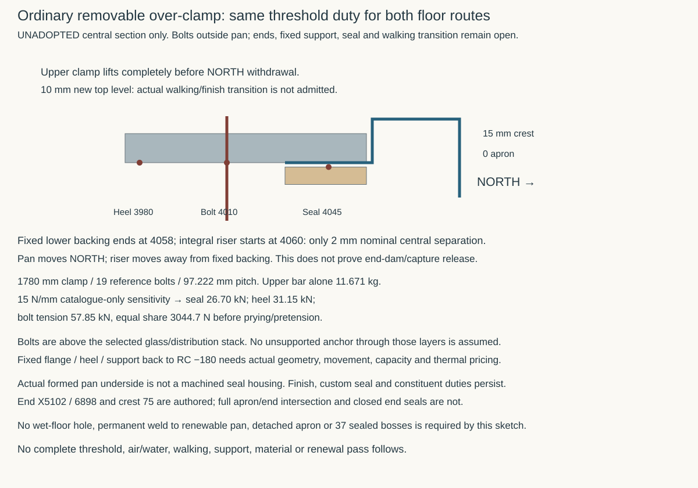

# One conventional wall / suspended-floor junction

**Development work in progress — 6 November 2026.** This continues the [whole-field comparison](ground-field-assembly.md) with one located ordinary section. It does not select a floor, masonry unit, mortar, seal, concrete recipe or site route. The [control](studies/conventional-ground-junction.json), [producer](studies/conventional-ground-junction.py), [results](studies/conventional-ground-junction.results.json) and figure identify actual source roles. STR's actual ground-floor comparison is pinned at immutable proposal `5f56d58f`, `current-house-occupied-interfaces.json`, blob `c4b2261a`, key `groundFloor`; it remains distinct from selected geometry and from older member-cover trials.

## Build the ordinary control before adding a return

**Compare the complete bonded mineral base as the floor-to-wall air transition before specifying an extra cast-in metal riser.** That is a candidate to investigate, not an earned air seal. A masonry absorption value is not an air-permeance result, but neither is generic advice about unplastered blockwork proof that this exact bonded solid-brick assembly fails. The decision must include its actual beds, perpends, wall above, concrete joint, movement and workmanship.

The section is through HAD's **service-spine wall at X9300 / Y4500 mm**, outside its Y2750..3650 mm opening. Its core is X9230..9370 mm, with finished faces X9203..9397 mm. The immutable corrected-pan/floor checkpoint is HAD `c2d5c380`, blob `265ac194`; it retains the 15/65/100/RC 200 stack at 0/−15/−80/−180/−380 mm. The current STR grid at merged development checkpoint `8c2159a8`, blob `1409f0b8`, places the **900 mm-wide common RC spine at −630..−180 mm** under this wall. This is source-bound proposed structure, not an adopted capacity or dry support. The section cannot be replaced by an isolated RC 200 coupon while claiming to represent its actual moisture or heat source.

The mineral comparison uses full-width **215 mm headers**, not a 102/102.5 mm stretcher under a 140 mm core. Two 65 mm courses and two 10 mm beds occupy −180..−30 mm; the wall above retains its own top-bed duty. The candidate base projects 37.5 mm beyond each core face and 10.5 mm beyond each finished face. Its local floor territory is therefore a real unadopted change, already charged in the whole-field width comparison. The exact WCBL65 longitudinal dimension, complete mortar constituents, brick/mortar bond, compression/shear and exposure remain subject to the [owning material evidence](envelope-ground-boundary.md#exact-candidate-evidence-and-remaining-holds--31-october-2026).

There are **180 mm from concrete top to plaster stop**, including **30 mm above the DPC top and below the plaster**. A finished-plan mask does not specify the 27 mm face territory below FFL: do not silently fill it with ordinary plaster, declare an open void or select bare glass there. Any actual infill needs its construction and retained constituents. Running a capillary finish continuously down to common RC could bypass the DPC; the geometric negative control identifies that contact without inventing a transport rate.

## What the air evidence does and does not earn

The [Passive House Institute's planning guidance](https://passipedia.org/planning/airtight_construction/general_principles/principles_for_improving_airtightness), accessed 6 November 2026, requires identification of the actual air layers and their continuous connections. Merely touching a wall does not connect to its intended plaster air layer. It is method guidance, not this house's leakage target or proof that every unplastered mineral joint is inadequate.

Sanders, Stroble and Clark's **Air Permeability of Masonry Materials**, 30 September 2014, [DOI 10.1520/STP157720130132](https://store.astm.org/stp157720130132.html), reports low air permeance in four clay-brick/mortar panel groups. Only the publisher's public abstract was inspected, not the complete paid paper. That limited primary result supports investigating the simple bonded control; its unit/mortar identities, test panel conditions and values are **not transferred** to WCBL65/M12 or this floor/DPC junction. It proves no movement durability, capillary, gas or site performance for the house.

Services' immutable proposal `e85cc19f`, `whole-house-leakage-duty.json`, blob `c4e6e9fd`, now supplies a finite development comparison: **q50 ≤1.0 m³/(h·m²)** and **one aggregate 63.234655 m³/h at 50 Pa for the floor/wall family**. Its reference envelope is 632.34655 m², explicitly not a final test-method denominator; the gross volume proxy is not certified Vn50. No owner target is adopted. Dividing that single allowance by the 118.761 m ordinary edge gives 0.532453 m³/(h·m), only a bookkeeping average, not a tested joint rating. Field body, wall-base paths, cores and their associated joints share that one allowance; each detail does not get another 63.23 m³/h. The three complete external door/threshold assemblies, including fixed and renewable air joints, belong wholly to the separate openings 25% family. Neither 0.6 ACH nor 3 m³/(h·m²) is inherited. A future specimen must include the actual concrete/bed interface, bonded DPC including perpends, upper bed and wall/base territory to the plaster, with declared pressure, movement and leakage allocation. A test of a brick body alone cannot qualify that series of interfaces. No physical test or supplier-designed junction has been commissioned here.

## Concrete, capillary source and remaining joined work

The source-bound STR proposal separates **104.895225 m² actual RC plan** into 53.862194 m² over supporting concrete, 50.634031 m² simple spans and 0.399 m² cantilever. It is not the 83.057362 m² room-field sheet quantity or a Services pressure-envelope footprint. Its longest actual clear span is 2967.5 mm, compared structurally at effective 3167.5 mm; the older 4 m axis witness lay on supporting concrete and was not a physical open span.

Its nominal floor remains RC 200, with a 195..205 mm thickness comparison, **45±5 mm outer-face cover** and adverse second-direction effective depth 127 mm. Thus this actual *candidate* clears the AD C thickness/cover comparison with minimum 195 / 40 mm; no selected cage or supplied construction follows. Uniform H12/100 at both faces in both axes gives the source's **0.293898 mm** full-service/400 microstrain crack screen against an authored 0.30 mm structural comparator; 500 microstrain gives 0.330852 mm. These are not moisture/gas/leakage limits or a lifetime crack guarantee. The source's H12/150 control gives 0.433828 mm under its 400 microstrain challenge.

The uniform H12/100 quantity is **3.725 t before laps/edges**, versus 2.483 t for H12/150; a separately detailed local-band challenger gives 3.009 t before its remaining extras. Dense reinforcement is not a house-wide invariant. Neither its full quantity nor the difference is automatically a cost attributable only to omitting a sheet: both floor routes still owe their actual structural/durability design. No installed cost winner is asserted.

STR's finite pour control is **one continuous upper 200 mm lift**, including overlap above beams/heads and the formed seat once. Its nominal volume is **20.979 m³**. If the lower grid is cast first, the structural horizontal construction interface is at −380 mm; actual interlock, preparation, continuing reinforcement, early-age restraint, interruptions and penetrations remain to detail. The drawing marks that interface beneath the upper field; it does not declare it airtight or assume a waterproof joint product is needed at every lower construction plane. The complete route must own any water/air source reaching it and all its ends.

The concrete control remains the [AD C comparison already bounded in the whole-field study](ground-field-assembly.md#conventional-source-control). Applying its 300 kg cement/m³ minimum to the nominal upper lift gives **6.294 t of cement as a guidance-only lower-bound screen**, not a concrete recipe, supplied dose or procurement schedule. C30/S500 does not disclose the cement, aggregates, water, additions/admixtures, retained processing residues, curing or permeability. The source's composite-density load bound must include its actual steel. Floor thickness/cover, cement dose, cracks, moisture, air, site gas and pressure-water duties remain distinct. The common ground/pile/grid route persists; qualifying concrete differs from pretending an upper pier plate cuts that route.

This straight internal-wall section is one component of the whole construction. The three source-proposed RC core crossings, lower stair toe, portal/corner restraints, actual exterior wall base and **three distinct door interfaces** remain to join. A concrete route still owes its renewable court-pan/frame air connection: withdrawing the 37-boss rail did not make that joint disappear. No permanent field-to-pan weld or ordinary welded service lid is allowed to substitute for the actual renewal sequence.

Next join this mineral/control construction and source-bound floor input to the actual court seat and renewable threshold with Services' bounded leakage comparison. Price actual direct-bearing thermal surfaces and movement rather than assuming uninterrupted insulation is mandatory or treating the earlier scratch model as a pass. Keep a cast-in metal return as a challenger only if the complete conventional transition cannot own the necessary duty. **No complete air/moisture route, physical/material admission or MAT-ENVELOPE exit is earned.**

## A simpler reversible court-apron clamp

**Prefer testing an ordinary removable over-clamp before developing the withdrawn 37-boss riser.** The same threshold assembly is available to both floor routes. It earns neither a concrete-route exemption from door sealing nor a sheet-route penalty for a joint both must provide.

The candidate retains the owning integral apron at Y4030..4060 mm, Z0, stepping to Z15 at Y4060 and continuing to Y4090. A separate upper bar covers Y3975..4058, with a reference bolt axis at Y4010 and heel at Y3980. All 6.5 mm reference bolt holes lie south of the pan start, with 16.75 mm from hole edge to that start; there is no wet-floor penetration or through-pan captive-nut bypass. The upper bar is removed **completely**, then actual end captures are released before the whole pan moves north. A fixed backing ending at Y4058 lies 2 mm before the central riser at Y4060; that riser moves away during northward translation. This is only a nominal central-section release, before tolerances and deformation. The authored end X positions and 75 mm crest do not specify a complete apron/end intersection, seal termination or release sweep. Do not extend this section across those missing ends and claim a sealed pan.

For 1780 mm length and reference maximum 100 mm pitch, 19 bolts give 97.222 mm spacing between 15 mm end insets. A 10 mm-thick, 83 mm-wide upper bar alone weighs **11.671 kg** at the same 7900 kg/m³ comparison density. Its new top is +10 mm; the existing rear crest remains +15 mm. That additional walking level needs an actual finish transition and load/slip/accessibility design. Neither the 15/65/100 selected room stack nor the owning pan is changed by this candidate.

The earlier catalogue's **15 N/mm is retained solely as a force sensitivity**, not proof that a suitable straight/U seal is supplied or compatible with a formed 1.5 mm pan. Across 1780 mm it gives 26.70 kN compression. With heel/bolt/seal axes at Y3980/4010/4045, moment balance adds **31.15 kN heel reaction**, so bolt tension is **57.85 kN**, or 3044.7 N per bolt under an ideal equal-share model. Pretension, bar bending, prying, unequal sharing, bearing, fastener and anchor capacities are additional; no capacity pass follows. Merely dividing seal force by bolt count undercounts this over-clamp's demand.

The bolts and heel are above the selected glass/distribution build-up. They cannot be anchored into an imaginary exposed RC surface at FFL. Actual fixed flange/support back to RC −180, its air connection, movement and thermal bridge remain to locate. The fixed backing's 6 mm reference thickness is not a structural selection. Formed-pan face finish is not a machined seal housing. A replaceable seal, its complete constituents, surface preparation, end closures and released storage all remain actual assembly duties. No permanent weld to the renewable pan or detached apron is assumed. This removes the *need to start with* 37 sealed through-riser bosses; it does not yet establish a replacement threshold.

## Keep one real floor-family boundary

| Physical route | Current comparison boundary | Remaining decisive join |
|---|---|---|
| RC field body and actual lower-grid overlap | One floor/wall 10% aggregate; upper lift and construction-interface source bound above | Actual mix/curing, cracks, body permeability and source/exposure; a 0.30 mm structural crack criterion is not an air/water criterion |
| Ordinary wall bases and 118.761 m edge | Same aggregate, including the bonded DPC series and internal wall routes | Actual complete beds/perpends/base-to-plaster continuity and movement; this straight section is representative geometry, not the test length |
| Three proposed RC cores | Same aggregate for associated air paths; stair post250×250 and wet receivers260×450 mm are actual core footprints, not finished rectangles | All three are continuous RC paths above the floor. Floor-only dryness qualification cannot confer capillary, air or finish protection on them; qualify their actual concrete/joints/exposure or develop a source cut/closure |
| Lower stair toe and ground portal/restraint contacts | No invented omission or 52-shaft boot allowance | Locate actual contact ends and assign their source/finish/interface before defining a complete specimen or quantity |
| Three complete door/threshold assemblies | Openings 25%, including fixed/renewable air seals; ordinary floor family stops at the assigned assembly perimeter | Actual jamb/end/base boundary coordinates, fixed backing, supported clamp and whole renewal sweep; no gap or double counting between families |

This is a boundary-duty register, **not yet a physically complete nonoverlapping test register**. Internal partitions that connect to a cold source may create concealed bypasses even where they do not form an external room surface. Qualifying the floor body alone does not qualify every connected column or junction. Conversely, the mere existence of the source connection is not evidence of measured moisture failure.

For the direct-bearing thermal comparison, [the current WCBL65 declaration](https://www.ketley-brick.co.uk/res/Blue%20Solids%2065mm.pdf), dated 1 January 2026, declares its thermal property NPD; the [family specification](https://www.ketley-brick.co.uk/res/Ketley%20Brick%20Staffs%20Blue%20Engineerings%20Bricks%20Specification2.pdf), p2, gives conductivity on application. Both were checked again on 6 November. No retailer's generic conductivity or dry-density conversion supplies the missing exact product/mortar property. Perfect insulation continuity remains unnecessary as an invariant, but actual surface temperature, wall/core/threshold joint behaviour and total heat loss must be priced against actual properties and climate. The earlier scratch f≈0.642 is not a passing current junction.

The next finite decision is whether **this bonded mineral/base and source-qualified concrete family, with an ordinary supported removable door clamp**, can meet the shared air/moisture/thermal duties with less whole-house burden than a separate field. The existing sheet estimate remains a real avoided challenger cost only if the conventional family earns those duties. It is not credited as a saving today; neither dense slab steel nor common threshold work is charged solely to one route. Keep the separate field live while resolving the fixed support/end assembly, exact concrete/core exposure and measured material/junction properties. No floor-route adoption or whole-envelope exit is earned.
