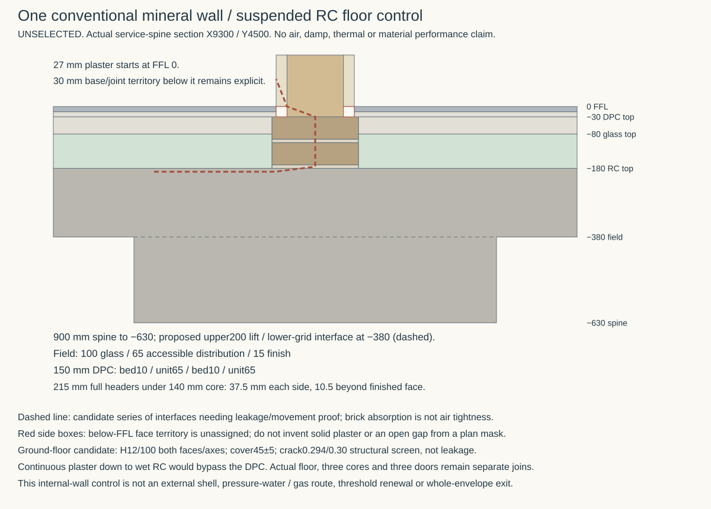

# One conventional wall / suspended-floor junction

**Development work in progress — 6 November 2026.** This continues the [whole-field comparison](ground-field-assembly.md) with one located ordinary section. It does not select a floor, masonry unit, mortar, seal, concrete recipe or site route. The [control](studies/conventional-ground-junction.json), [producer](studies/conventional-ground-junction.py), [results](studies/conventional-ground-junction.results.json) and figure identify actual source roles. STR's actual ground-floor comparison is pinned at immutable proposal `5f56d58f`, `current-house-occupied-interfaces.json`, blob `c4b2261a`, key `groundFloor`; it remains distinct from selected geometry and from older member-cover trials.

## Build the ordinary control before adding a return

**Compare the complete bonded mineral base as the floor-to-wall air transition before specifying an extra cast-in metal riser.** That is a candidate to investigate, not an earned air seal. A masonry absorption value is not an air-permeance result, but neither is generic advice about unplastered blockwork proof that this exact bonded solid-brick assembly fails. The decision must include its actual beds, perpends, wall above, concrete joint, movement and workmanship.

The section is through HAD's **service-spine wall at X9300 / Y4500 mm**, outside its Y2750..3650 mm opening. Its core is X9230..9370 mm, with finished faces X9203..9397 mm. The immutable corrected-pan/floor checkpoint is HAD `c2d5c380`, blob `265ac194`; it retains the 15/65/100/RC 200 stack at 0/−15/−80/−180/−380 mm. The current STR grid at merged development checkpoint `8c2159a8`, blob `1409f0b8`, places the **900 mm-wide common RC spine at −630..−180 mm** under this wall. This is source-bound proposed structure, not an adopted capacity or dry support. The section cannot be replaced by an isolated RC 200 coupon while claiming to represent its actual moisture or heat source.

The mineral comparison uses full-width **215 mm headers**, not a 102/102.5 mm stretcher under a 140 mm core. Two 65 mm courses and two 10 mm beds occupy −180..−30 mm; the wall above retains its own top-bed duty. The candidate base projects 37.5 mm beyond each core face and 10.5 mm beyond each finished face. Its local floor territory is therefore a real unadopted change, already charged in the whole-field width comparison. The exact WCBL65 longitudinal dimension, complete mortar constituents, brick/mortar bond, compression/shear and exposure remain subject to the [owning material evidence](envelope-ground-boundary.md#exact-candidate-evidence-and-remaining-holds--31-october-2026).

There are **180 mm from concrete top to plaster stop**, including **30 mm above the DPC top and below the plaster**. A finished-plan mask does not specify the 27 mm face territory below FFL: do not silently fill it with ordinary plaster, declare an open void or select bare glass there. Any actual infill needs its construction and retained constituents. Running a capillary finish continuously down to common RC could bypass the DPC; the geometric negative control identifies that contact without inventing a transport rate.

## What the air evidence does and does not earn

The [Passive House Institute's planning guidance](https://passipedia.org/planning/airtight_construction/general_principles/principles_for_improving_airtightness), accessed 6 November 2026, requires identification of the actual air layers and their continuous connections. Merely touching a wall does not connect to its intended plaster air layer. It is method guidance, not this house's leakage target or proof that every unplastered mineral joint is inadequate.

Sanders, Stroble and Clark's **Air Permeability of Masonry Materials**, 30 September 2014, [DOI 10.1520/STP157720130132](https://store.astm.org/stp157720130132.html), reports low air permeance in four clay-brick/mortar panel groups. Only the publisher's public abstract was inspected, not the complete paid paper. That limited primary result supports investigating the simple bonded control; its unit/mortar identities, test panel conditions and values are **not transferred** to WCBL65/M12 or this floor/DPC junction. It proves no movement durability, capillary, gas or site performance for the house.

Services has not yet selected a whole-house airtightness target or junction leakage allocation. Its provisional comparison is separate ongoing work. Neither 0.6 ACH nor 3 m³/(h·m²) is inherited. A future specimen must include the actual concrete/bed interface, bonded DPC including perpends, upper bed and wall/base territory to the plaster, with declared pressure, movement and leakage allocation. A test of a brick body alone cannot qualify that series of interfaces. No physical test or supplier-designed junction has been commissioned here.

## Concrete, capillary source and remaining joined work

The source-bound STR proposal separates **104.895225 m² actual RC plan** into 53.862194 m² over supporting concrete, 50.634031 m² simple spans and 0.399 m² cantilever. It is not the 83.057362 m² room-field sheet quantity or a Services pressure-envelope footprint. Its longest actual clear span is 2967.5 mm, compared structurally at effective 3167.5 mm; the older 4 m axis witness lay on supporting concrete and was not a physical open span.

Its nominal floor remains RC 200, with a 195..205 mm thickness comparison, **45±5 mm outer-face cover** and adverse second-direction effective depth 127 mm. Thus this actual *candidate* clears the AD C thickness/cover comparison with minimum 195 / 40 mm; no selected cage or supplied construction follows. Uniform H12/100 at both faces in both axes gives the source's **0.293898 mm** full-service/400 microstrain crack screen against an authored 0.30 mm structural comparator; 500 microstrain gives 0.330852 mm. These are not moisture/gas/leakage limits or a lifetime crack guarantee. The source's H12/150 control gives 0.433828 mm under its 400 microstrain challenge.

The uniform H12/100 quantity is **3.725 t before laps/edges**, versus 2.483 t for H12/150; a separately detailed local-band challenger gives 3.009 t before its remaining extras. Dense reinforcement is not a house-wide invariant. Neither its full quantity nor the difference is automatically a cost attributable only to omitting a sheet: both floor routes still owe their actual structural/durability design. No installed cost winner is asserted.

STR's finite pour control is **one continuous upper 200 mm lift**, including overlap above beams/heads and the formed seat once. Its nominal volume is **20.979 m³**. If the lower grid is cast first, the structural horizontal construction interface is at −380 mm; actual interlock, preparation, continuing reinforcement, early-age restraint, interruptions and penetrations remain to detail. The drawing marks that interface beneath the upper field; it does not declare it airtight or assume a waterproof joint product is needed at every lower construction plane. The complete route must own any water/air source reaching it and all its ends.

The concrete control remains the [AD C comparison already bounded in the whole-field study](ground-field-assembly.md#conventional-source-control). Applying its 300 kg cement/m³ minimum to the nominal upper lift gives **6.294 t of cement as a guidance-only lower-bound screen**, not a concrete recipe, supplied dose or procurement schedule. C30/S500 does not disclose the cement, aggregates, water, additions/admixtures, retained processing residues, curing or permeability. The source's composite-density load bound must include its actual steel. Floor thickness/cover, cement dose, cracks, moisture, air, site gas and pressure-water duties remain distinct. The common ground/pile/grid route persists; qualifying concrete differs from pretending an upper pier plate cuts that route.

This straight internal-wall section is one component of the whole construction. The three source-proposed RC core crossings, lower stair toe, portal/corner restraints, actual exterior wall base and **three distinct door interfaces** remain to join. A concrete route still owes its renewable court-pan/frame air connection: withdrawing the 37-boss rail did not make that joint disappear. No permanent field-to-pan weld or ordinary welded service lid is allowed to substitute for the actual renewal sequence.

Next join this mineral/control construction and source-bound floor input to the actual court seat and renewable threshold with Services' bounded leakage comparison. Price actual direct-bearing thermal surfaces and movement rather than assuming uninterrupted insulation is mandatory or treating the earlier scratch model as a pass. Keep a cast-in metal return as a challenger only if the complete conventional transition cannot own the necessary duty. **No complete air/moisture route, physical/material admission or MAT-ENVELOPE exit is earned.**
