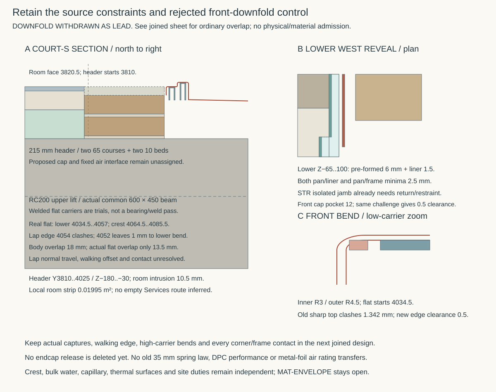

# Join the fixed mineral base and the complete court air path

**Working design — 7 November 2026.** This continues the [bounded mechanical support/end study](court-apron-support.md). It is not a closed or admitted air assembly, a selected threshold or an owning HAD change. The [control](studies/court-air-path.json), [producer](studies/court-air-path.py), [results](studies/court-air-path.results.json) and working sheet distinguish the actual HAD reference, merged mechanical proposal, ordinary mineral-base control and unadopted STR weather-jamb appraisal.

## Start with the existing ordinary header band

The actual court-S core axis is Y3917.5. Centring the existing **215 mm full-header geometric control** there gives **Y3810..4025 / Z−180..−30**, the same band as the proposed ordinary wall base. It projects 10.5 mm beyond the finished room face Y3820.5. A local X5050..6950 continuation has 0.01995 m² in that room-side strip. The threshold's remaining territory is not silently treated as empty Services space: actual service exclusion, load spreading, floor/wall and both jamb joins remain to coordinate. The house's 15/65/100/RC200 control is retained; a local threshold closure needs its own explicit allocation.

The nominal 1900 × 215 × 150 territory is 0.061275 m³. Of that, 0.058050 m³ is across the 1800 opening and 0.003225 m³ is at the proposed wall-base end joints; the overlaps cannot all be charged again as new material. This is not a supplied unit or mortar quantity. The unresolved 102/102.5 mm unit identity makes even a simple 17-unit / sixteen 10 mm-perpend length 1894 or 1902.5 mm. Bonding, cuts, end beds and the complete cap remain real design work. None of the earlier DPC, mortar or masonry-air evidence qualifies this new assembly by transfer.

## Make the whole lower opening fit, not just a cavity pocket

The owning pan is 1796 mm wide in an 1800 mm rough opening: only 2 mm nominal per side. Under the same authored ±2 mm relative-position plus 1 mm per-edge challenge, the bare reveal gives **−2 mm**. The merged mechanical checkpoint's local cavity pocket does not make that challenge pass through the weather leaf at Y4147.5..4250. Its whole-body geometry remains explicitly nominal and unadmitted.

The new comparison uses a **pre-formed 6 mm lower reservation per jamb**, Z−65..100, with a renewable 1.5 mm liner. It is designed from construction, not later chased into completed work. The lower opening becomes X5094..6906; the liner inner faces are X5095.5/6904.5. This gives **2.5 mm minimum pan/liner clearance and 2.5 mm minimum pan/frame clearance** under that shared challenge. The conservative pan box retains 4.5 mm below and 21 mm above it. Any return to the normal upper reveal must remain above that moving envelope; the frame, sill, leaves and wet pan levels are not moved by this study.

STR's immutable proposal `d21ced1f`, `current-house-arch-detail.json`, blob `504202be`, supplies the real local consequence. Its present outer court arch is **1800 span / 300 rise / 215 radial**, not the historical 600-rise case. The rebate removes **615 mm² per jamb** over a zone with 115 mm of continuous base below it, and stays 20 mm below the outer DPC at Z120. Crucially, STR's isolated weather-jamb control already has a **−1.901 kNm overturning margin** before treating this as an accepted cut. An actual perpendicular return/restraint, formed coursing, bearing and shear transfer must be joined; neither the small removed area nor a 1.00711 mean-stress ratio is a capacity pass. No arch spring, primary core or owning source is changed here.

## Test the simpler contact plane with real bends

The lead hypothesis is a short **new dry front downfold** at Y4030, ending at Z−30. Its nominal body bounds fit inside the existing pan box; that does not prove its shape clears the support. With 1.5 mm sheet and an authored **3 mm inner radius**, the outer radius is 4.5 mm and the flat apron starts at **Y4034.5**. The old sharp-top carrier idealization at Y4032 interferes by **1.342 mm**. Actual previous forming radii were unbound; this is a falsifier of blindly keeping its sharp model, not a claim that a fabricated part was inspected.

A welded-flat low carrier at Y4037..4054 gives 0.5 mm necessary clearance at the front and 1 mm at the other end after two 1 mm component edge bounds. The whole dry step must also have real bends. An authored exposed-face R3 lower turn and R4.5 upper turn at the conceptual Y4060 step leave a lower flat ending at Y4057 and a crest flat starting at Y4064.5. The back R4.5 turn at Y4090 ends that flat at Y4085.5. These are new proposed tangent contours around the nominal reference vertices, not the actual owning pan's unprovided fabricated shape.

The old high-carrier sharp top at Y4062..4088 then interferes by **1.342 mm at each end**. A welded-flat high carrier Y4067..4083 gives 0.5 mm necessary clearance at both ends under the same edge bounds. Actual forming tolerances, weld/contact geometry, narrow web bearing, local walking edge and complete support capacity remain unearned. Bounding-box containment alone cannot qualify them. The new downfold and real dry bends change the shape even though the wet crest/fall and conservative outer box remain; preserve the actual full-body draw.

Those bends also reject blindly retaining the old **Y4054** top-lap edge: the shared 4 mm in-plane challenge now gives **−1 mm to the lower bend**. Y4052 gives 1 mm necessary clearance, **18 mm minimum body overlap but only 13.5 mm over the actual flat** after the new front bend. This is an ordinary supported, adjustable-retention comparison, not a seal rating. Its real normal travel/contact, small walking offset, supported heel and both corners still need the physical section. The in-plane challenge is not an achieved normal surface-flatness tolerance or a reason to strain a foil through an arbitrary 8 mm range.

The narrower flat-piece carriers total **9.868 kg before welds**, against the earlier nominal 10.68 kg. Their four longitudinal top/web junctions total **7.12 m**, before end details and carrier retention; this is a new fabrication burden, not a free bend-radius correction. The same whole-sheet dated purchase control remains £509.58 excluding VAT, without weight-proportional savings or an installed quote. Under the same authored entire 2 kN / 50 mm-wide central strip screen, the 11/10 mm clear spans give 73.3/66.7 MPa and 0.00259/0.00195 mm elastic deflection. Equal narrow-web entry pressure remains **6.67 MPa**: narrowing the top has not solved the actual mineral bearing, load spread or walking-edge duties. The source records these screens without a plate, web, weld, overhang or assembly pass.

A rigid south-side airframe face at Y4025 leaves 1 mm normal hard space through the declared challenge. North movement could open that frontal contact, but **the complete air path and all corner/top/frame contacts have not yet been drawn and proved**. The original endcap-release sequence is therefore not deleted. Independent pan captures, actual tools, walking cover and unchanged frame/sill removal must be joined before any simplification is earned. Do not insert the old below-apron backing into the volume now occupied by the low support.

The front-plane hypothesis has no demonstrated whole-path simplification yet. Fixed end-top shoes or extra frame collars would add duties to replace two already located removable caps. The working control therefore retains those caps while the ordinary central lap is developed; this is not a universal rejection of a normal-contact interface.

## Challenge the leaf's actual contact, not just its tip projection

The merged mechanical study explicitly qualified its 35 mm flat-leaf linear calculation. It supplied neither a preformed curve nor a passing spring. A different, authored **initially straight inclined leaf**, with the same 9.5 mm free rise, can make flat contact over its tail at high compression. The producer checks the exact large-rotation, inextensible Euler–Bernoulli idealization with frictionless unilateral plane contact at the minimum hard gap. It does not model a supplied spring, material yielding, forming residual stress, finite bend radius/contact indentation, friction, pressure loading or fatigue.

For natural root angle θ₀ = arccos(H/L), define I₁ = ∫√cosθ dθ and I₀ = ∫1/√cosθ dθ over θ₀..π/2. With centreline gap g equal to hard gap minus strip thickness, the free portion is gI₀/I₁ and the remaining tail contacts the plane; this regime requires gI₀/I₁ ≤ L. Reaction per width is Et³(I₁/g)²/24 and root curvature is (I₁/g)√cosθ₀. A square-root substitution removes the endpoint singularity for deterministic quadrature.

At the existing worst 0.21336 mm strip and 1 mm hard gap, the centreline gap is 0.78664 mm. This idealization gives **8.619 mm free portion, 746.8 MPa elastic root stress and 0.6624 N/mm reaction**, compared with the earlier qualified 245 MPa linear screen. That high elastic demand may itself invalidate the linear material law; no measured yielding or thin-strip allowable is claimed. It demonstrates why the old linear screen cannot be a strict bound or be transferred to a new shape.

The west contact segment runs **X5106.554..5132.935** from the actual trial root X5098, inside the common flange territory X5106..5138 at this corner. Comparing the total 35 mm leaf length with the 32 mm common contact interval would falsely reject it: part of the free leaf bridges from a root outside the pan face. Neither that single ideal contact fit nor an undeformed tip projection proves the complete deformed shape/movement domain, contact pressure or leakage. The mechanism needs its actual geometry and normal duty before a material or retained constituent is selected.

## Give the removable cap its own space beside the fixed liner

The earlier nominal sheet rectangles also leave a local unmade attachment: the cap starts at X5094 while the fixed 1.5 mm liner reaches X5095.5, in the same Y/Z pocket. Taken literally as sheet solids, those strips overlap by 1.5 mm. An actual folded lap, notch or attachment was not supplied. The bounded mechanical study therefore cannot be inherited as a whole-cap fabrication/clearance pass.

The joined trial keeps the same **4 mm hard-clearance challenge** and enlarges only the **pre-formed cavity-front pocket to 12 mm outward**, Y4000..4060 / Z0..225. Its west outer face becomes X5088 and liner inner face X5089.5. The cap at X5094 then has **0.5 mm minimum hard clearance**, while the pan retains 8.5 mm to that local liner. The whole lower-weather reservation remains the distinct **6 mm** control; no further weather-leaf notch is taken. This cavity-only enlargement adds 0.000081 m³ per end relative to the earlier pocket and remains 12.5 mm outside the core in Y and 30 mm short of the cavity-tray start. It replaces actual reveal/cavity territory; insulation, drainage, thermal and clamped-air effects remain design duties.

The liner must jog back to the full lower-weather boundary north of this front pocket. Its actual bends, mounting and continuity are not supplied by a rectangular reservation. Moving the proposed leaf root from X5098 to **X5100** leaves 6 mm cap territory for an actual retainer; that is not a qualified clamp width or fastener detail. The same minimum-gap ideal contact shifts to **X5108.554..5134.935**, still inside the common flange territory. The east end mirrors it. Captures, real tools, root retention, cap/liner air joint and physical release remain unadmitted; no tight fabrication tolerance or invisible mortar removal replaces the geometric correction.

One narrowly relevant material lead is [KEMPER CuSn5, revision 04/2026](https://www.kemper-group.com/en-uk/content/04-produkte/walzprodukte/datenblaetter/datasheet_cusn5.pdf): its R490/H160 row gives 430 MPa minimum proof and 8% elongation; its 180° bend table concerns a **5 mm-wide test region**, not this full U. The [manufacturer portfolio](https://www.kemper-group.com/en-uk/rolled-products/portfolio/) includes 0.1 mm strip. These are research inputs, not a delivered temper/tolerance/coating specification, an installed spring law or a seal rating. The old 35 mm cantilever law is not transferred to a new folded profile or corner. Complete finish/process residues and cyclic/contact performance remain unqualified.

The next joined decision must close **RC floor → full mineral beds/units/cap → fixed air base → ordinary replaceable contact → pan/front and both corners → actual wall/frame air boundaries**, with every junction occupied and its movement/renewal state defined. Price the walking offset, local service/seat effects, actual retained constituents and release burden against a local metal-return challenger. Do not add a house-wide return by default. The finite Services openings allowance is shared, not allocated anew to this detail; no current joint rating is asserted.

The +15 crest, bulk-water backup, capillary route, thermal surfaces and site-gas duties stay independent. No whole-floor concrete waiver, material exception, first-susceptible elevation or MAT-ENVELOPE completion is earned.
