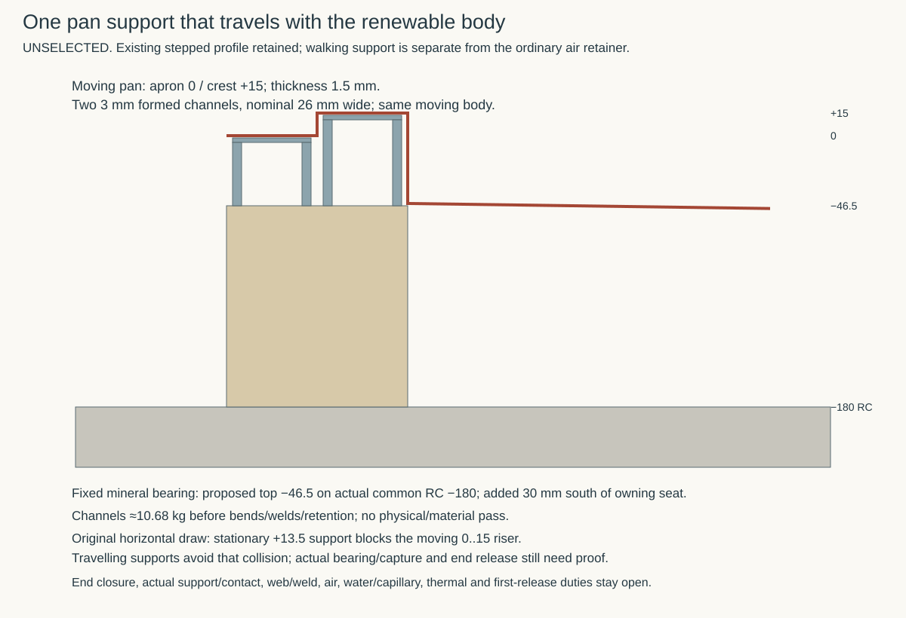
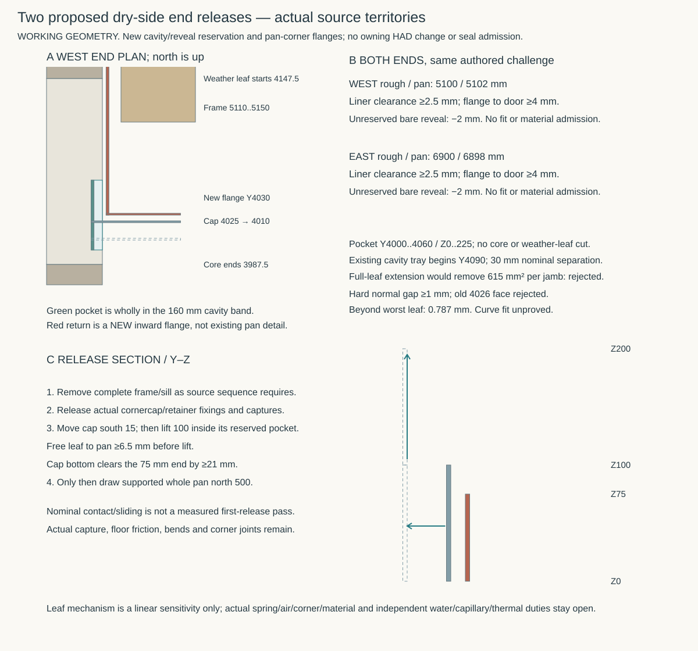

# One supported, renewable court apron

**Working comparison — 6 November 2026.** This continues the [ordinary threshold air-duty comparison](conventional-ground-junction.md#give-the-dry-side-apron-its-actual-duty), rather than adding another house-wide rail. The decision is whether one ordinary supported door interface can serve both floor routes without inheriting a vacuum-seal force or an unrelated pipe-pressure duty. It changes no owning HAD geometry, floor route or material admission. The [control](studies/court-apron-support.json), [producer](studies/court-apron-support.py), [results](studies/court-apron-support.results.json) and drawing retain exact source identities.

The distinct current-main reconciliation at `50093457` pins HAD `089f0dac` and current STR grid/wall producers. Direct named comparisons prove the complete threshold, floor control, court-S beam geometry and literal wall bands unchanged from the intentionally retained `1273d9f3` case. Integration main `b2007a2a` directly retains those exact input blobs and its new utility drift guard; the 50093457 source identities are preserved. New source roles and joined structural force results retain their own authority; the producer does not claim whole-source or force equivalence.

## Support the actual walking faces

The owning pan is a **1.5 mm formed-metal reference**, with its integral dry apron at Z0 over Y4030..4060, then the +15 crest over Y4060..4090. No structural walking capacity is established for that sheet. STR confirms its old 5 kN/m distributed projecting-seat comparison and ordinary floor actions do not qualify a pedestrian point on this apron. Treat walking, air retention and water protection separately.

A fixed support immediately beneath the +15 crest would intersect the 0..15 riser during the source's initial **horizontal north draw**. That rejects this support with that sequence; it does not prove that every alternative first-lift or removable-support sequence is impossible. An added thick walking cover above the existing apron would also raise the surface. A recessed-apron/flush-cover variant would change the actual profile. Neither change is necessary as the first comparison.

Instead test **two shallow inverted channels travelling with the pan**, nominally X5110..6890:

| Moving support | Y range, mm | Top / bottom Z, mm | Nominal section |
|---|---|---|---|
| Under the apron | 4032..4058 | −1.5 / −46.5 | 3 mm metal; 26 mm outer width; 45 mm height |
| Under the crest | 4062..4088 | +13.5 / −46.5 | 3 mm metal; 26 mm outer width; 60 mm height |

They sit below the existing faces, leaving the 0/+15 walking geometry and nominal 420 × 131.5 mm pan-body envelope unchanged. This is only nominal sharp-corner geometry: actual bend radii, face contact, tolerances, weld access/distortion and their 2 mm edge territories need a real fabrication detail. The supports must be captured to travel with the pan; no fastener passes through its wet floor, and there is no pan weld to the slab or to a service lid. Actual carrier retention remains to design. A weld to the dry fold would require its own alloy, weld, cleaning and distortion evidence, not an assumed water seal.

The candidate bearing/spreader occupies X5110..6890 / Y4030..4090, from existing RC top −180 to proposed −46.5. It is over the actual **600 mm court-S beam**, Y3650..4250, rather than a new foundation pad. The owning permanent-seat plan starts at Y4060: the additional **30 mm southward bearing reservation is real**, 0.0534 m², and must be coordinated as a proposed local change. The selected 15/65/100/RC200 stack remains the house control; a local threshold bearing must reserve its actual service exclusion and load path rather than silently anchoring into glass or treating the 65 mm service territory as solid. The complete nominal 60 mm-wide mineral volume is 0.014258 m³ before bedding, contact and actual shape reconciliation. No stone, mortar or supplied block is selected.

The −46.5 bearing level is an authored continuation of the pan wet-floor start underside, not an existing source-qualified support under the dry fold. Both channel bottoms lie below the rising pan face and can in principle slide north over the declining wet-floor support. Their bounds remain inside the original conservative pan box; this does not establish friction, sticking, face flatness, capture or first release. The source requires trays/grates and end captures released before the north draw, then handling in the reserved court field. The added carriers travel and must be included in the actual supported handling mass and forces.

## Charge the support without calling it a seal

The nominal sharp-corner channels total **10.68 kg** at 8000 kg/m³, before bends, welds and retention. That density comes from [Outokumpu's current Supra range datasheet](https://www.outokumpu.com/-/media/files/products/supra/outokumpu-supra-range-datasheet.pdf?modified=20251117111951&revision=7a909396-d1f3-4d36-9c1c-99606be41fd2), accessed 6 November 2026, Table 7. The earlier 7850 kg/m³ scratch quantity is not retained as the exact 316L comparison. Table 6 gives the 170 MPa ASTM A240 proof comparison; Table 7 gives E200 GPa. The local calculation deliberately uses an authored E190 GPa sensitivity. This is no product-form order, complete alloy/finish/constituent specification or capacity admission.

An authored **2 kN / 50 × 50 mm print** supplies a finite local challenge, distinct from an adopted loading standard or combination. Putting the entire 2 kN on one 50 mm-wide, 3 mm-thick simply supported top strip over its nominal 20 mm clear span gives **133.3 MPa elastic stress / 0.0156 mm deflection**. Equal reactions average 6.67 MPa over the two 3 mm webs at that width. These arithmetic screens deliberately confer no plate/overhang, bend, web-buckling, weld, mineral-bearing, end, fatigue or combined-design pass. They do not qualify the 1.5 mm sheet's remaining edges. Effective load spread into the actual mineral bearing and concrete, including contact widths and tolerances, remains STR/MAT work.

The narrow web feet also expose why the normal glass layer is not a free support. The same equal-reaction screen gives **6.67 MPa entry pressure before load spread**. The [exact T4+ UK data sheet of 2 April 2025](https://www.foamglas.com/-/media/project/foamglas/public/shared/files/foamglas-b/foamglas-t4-plus/pds/pds-foamglas-t4plus-uk.pdf), checked 6 November, declares a 0.60 MPa compressive-strength minimum: that declaration alone does not qualify a demand eleven times its minimum. This is not proof of measured product failure, an allowable-stress calculation, or identification of the selected floor glass. Its point-load row gives displacement without a force in that sheet; it cannot supply the missing 2 kN threshold assembly. A spreader or actual stronger mineral bearing needs its own contact and properties.

A dated [Stainless Europe 3 × 1000 × 2000 mm 2B / 1.4404 listing](https://stainlesseurope.co.uk/en_GB/p/Stainless-steel-sheet-3-X-1000-X-2000-mm-2B-1.4404/41003), checked 6 November, gives **£509.58 excluding VAT / 48 kg** for one full sheet. The ideal sharp-corner channel blanks total 0.445 m², before actual bend allowance and nesting. This is a whole-sheet purchase control with no offcut credit, not the least purchasing cost or a landed/formed/installed quote. Cutting, forming, retention, mineral support, caps/liners, other gauge stock and renewal labour remain outside it. An offered certificate is not an inspected certificate or finish/residue clearance.

The support is common door work for both floor routes; its whole cost is not automatically a penalty against the separate field. Conversely, there is no saving until the conventional floor/core/junction route earns its own moisture, air and thermal duties. Actual fabrication, bearing, access and renewal costs remain to price. The new mineral connection has a real thermal/capillary path to common RC. A small area is not a surface-temperature or joint-condensation pass, and perfect insulation continuity is not assumed mandatory.

## Keep the air mechanism ordinary and the ends real

An ordinary removable top lap can retain the pan's supported dry apron; it need not carry the walking load or inherit the earlier circular catalogue's line force. A supported top lap would reverse the earlier below-apron backing arrangement and must therefore declare its actual section, small walking offset or rebate, fixings, face tolerance and full release. The prior 20 mm minimum overlap / 2 mm riser clearance challenge remains a useful comparison, not a ready-made fabrication detail for this new carrier. Do not claim the earlier ideal central-slot model rates an installed joint.

One actual compliance reference is the manufacturer's [Pemko 73](https://www.pemko.com/en/products/gasketing/perimeter-gaskets/product-details-nm.aehpdp-73-series-ag_pemko_303050), checked 6 November. Its indexed official product text identifies a 15.875 mm-wide, 0.2032 mm hemmed spring-bronze cushion strip, 3.175..4.7625 mm gap coverage and side-of-frame mounting on wood/metal doors; the page lists no certifications. The live extracted page omitted those dynamic specifications, so this observation is explicitly search-indexed manufacturer content. Its fit across a 20 mm overlap does not prove room for actual retention, a horizontal apron application, spring force, leakage, end closure or outdoor exposure. Finish labels/images are not an exact supplied-alloy/coating disclosure. **Do not insert it into a nominal near-zero metal lap or adopt it as the installed seal.** It is a mechanism comparison, not another product selection.

## Locate both end releases inside the real wall bands

The actual pan ends are X5102/6898 with top Z75, inside a rough opening X5100..6900. A bare reveal therefore leaves only **2 mm nominal**. Applying one authored ±2 mm relative-position challenge plus 1 mm at each edge gives **−2 mm**, a rejected clearance. These are design challenges, not achieved tolerances.

The current STR wall producer supplies the literal court-south core axis Y3917.5 / width 140, weather offset 281.25 / leaf width 102.5. That gives **core Y3847.5..3987.5, cavity Y3987.5..4147.5 and weather leaf Y4147.5..4250**. The proposed lower-reveal pocket is only Y4000..4060 / Z0..225, extending 6 mm outward from each rough reveal: left X5094..5100, right X6900..6906. It stays 12.5 mm outside the core and 87.5 mm short of the weather leaf. Its nominal reservation is 0.000081 m³ per end. It removes neither leaf in this bounded geometry; it does replace real cavity/reveal territory. Actual cavity closure, insulation, fixing, water and thermal consequences still need an assembly. Do not extend it through a leaf under the same claim: a full 102.5 mm weather-leaf extension would remove **615 mm² per jamb** at the base, changing local stress, centroid, notch and thrust duties. It is retained as a rejected extension control. The arch spring, nominal 850 mm side territory, frame and leaves are not shifted by this pocket.

A proposed 1.5 mm fixed liner leaves inner faces X5095.5 / X6904.5. Under the same combined 4 mm challenge, both pan ends retain **2.5 mm clearance**. The actual frame's 40 mm jambs leave clear limits X5150 / X6850. Proposed inward pan-corner flanges occupy X5102..5142 / X6858..6898 at the south end Y4030 / Z0..75. They stay within the existing pan body and outside the clear door by **4 mm minimum** under that challenge. These flanges are new three-dimensional returns, not a claim that the owning pan already has them. Their corner bends/seams, contact with the apron and actual water/capillary behaviour remain unqualified.

The removable caps face the flanges from Y4025, nominal height Z0..100. The resulting 5 mm normal gap leaves **1 mm hard-face clearance**, or **0.78664 mm beyond the worst 0.21336 mm strip thickness**, under the combined 4 mm challenge. The former Y4026 face leaves zero hard gap and is explicitly rejected. This necessary hard-space check does not prove the deformed/preformed leaf curve fits. **Release their actual fixings/captures, move each cap south 15 mm, then lift 100 mm**, after the source's full frame/sill removal. The complete proposed sheet sweep remains inside the Y4000..4060 / Z0..225 pocket. The free leaf projection discussed below clears the pan by 6.5 mm before lift; after lift the cap bottom clears the Z75 end by 21 mm under the authored challenge. Those are nominal geometry checks, not measured release forces or an installed maintenance pass. Floor contact/sliding, actual tools, capture, bends and friction must be proved. No trim slides invisibly behind masonry and no plaster-removal exemption is inherited from an ordinary internal door.

The pocket stops at Y4060; the existing cavity-tray apron starts at Y4090, leaving **30 mm nominal separation**. It does not silently cut or qualify that tray. The fixed floor/wall air connection at the south side of the pocket, cap-to-central-retainer corner, top termination and onward actual frame/cavity-tray join remain specific unfinished interfaces. A conventional mineral reveal may connect to the room plaster, but it must stop/return around the real moving end; no continuous below-FFL plaster bypass is assumed. This proposal locates two releases without claiming a closed air/water boundary.

## Compare one ordinary compliance mechanism with the actual movement

The stock 73 gap range spans only **1.5875 mm**. It cannot cover the entire 8 mm range of this deliberately combined ±4 mm challenge. Static adjustment may remove installation error; it cannot be credited in advance as movement capacity. This rejects a direct stock-range transfer, not every possible spring-bronze seal.

One simple replacement comparison is a **35 mm free-length / 75 mm-wide flat leaf**, retained on the removable cap, with nominal 4.5 mm preload deflection. The same combined challenge leaves 0.5..8.5 mm normal deflection. It has its own geometry and is not labelled Pemko 73. The [Copper Development Association C51000 page](https://alloys.copper.org/alloy/C51000), checked 6 November, gives a 16000 ksi elastic-modulus reference. The [thyssenkrupp C51000 H08 coil table](https://www.thyssenkrupp-materials-na.com/materials/bronze/coilstrip) lists 0.008 ±0.0004 inch strip. The reproducer compares the full 0.19304..0.21336 mm thickness range. Neither source identifies a delivered uncoated product here; CDA's mechanical rows at another section size are not a thin-strip allowable or fatigue limit.

A linear clamped-cantilever sensitivity gives **0.17..3.98 N per 75 mm leaf** and about **13..245 MPa incremental elastic stress** across those corners. This exposes an ordinary low-force compliance mechanism; it does not establish the needed contact pressure or leakage. At 8.5/35 displacement, preforming and geometric nonlinearity are significant: these are neither strict force/stress bounds nor a passing spring design. Actual free shape, contact migration, retained thin-strip properties, relaxation/fatigue, corrosion, coating/residues and attachment remain open. A simple projection fits the common flange territory under the authored X challenge, but does not prove a deformed contact curve. Neither the spring nor its retaining cap carries the pedestrian load; that belongs to the travelling channels and mineral bearing.

The provisional lead is therefore **walking support with the renewable body, the actual cavity-only end release, and ordinary adjustable compliance against a finite air duty**. A fixed support with an altered first-lift sequence remains a challenger; no cost or whole-assembly performance win is established. Do not adopt a high-force seal or a masonry notch merely to hide the unlocated interface. The physical air path, cap corner and fixed wall/floor join still need completion before assigning a joint leakage allowance or testing a complete assembly. The Services openings allowance is shared by all openings; the earlier central-slot sensitivity is no installed end-joint rating.

RWT assigns no pressure-water head specifically to the dry apron; quiet −35, crest +15 and `firstSusceptible=null` remain distinct. No roof/pipe-pressure transfer is permitted. Finite air leakage cannot waive capillary, overtopping, water-end, site-gas or material duties. No complete assembly, floor-route selection or MAT-ENVELOPE exit follows.

The [joined air-path successor](court-air-path.md) compares the ordinary header/overlap, both caps, upper jamb bridges and rear sill/boot air joins. It withdraws the new front downfold, preserves its negative controls and registers finite corner entries against the shared opening-family budget. It does not promote this bounded mechanical case to an installed tolerance, support or air-path pass.
