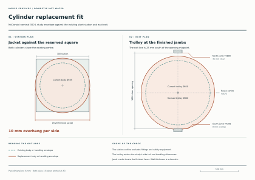

# Can a mineral-insulated 300-litre cylinder leave the plant room?

**Retain 300 litres of stored potable water. First test supplier-designed removal of the jacket for renewal. A taller factory-built vessel with bespoke connections is a second route.** The present connection and trolley admit at most a 602 mm diameter body. The existing lift-off bridge narrows that to 600.69 mm. A finished cylinder can fit the doorway in isolation and still collide with the bridge, a neighbour or a jamb. [Plant plan and trolley paths](studies/east-water-plant.json) · [Cold-bridge removal sequence](plant-inlet-route.md) · [Calculation](studies/cylinder-replacement-screen.py)

## Four catalogue comparisons

Dimensions are finished outside diameter × height unless stated. Capacity labels alone do not establish potable storage after the coil is installed.

| Manufacturer and case | Size | What happens in this house |
|---|---:|---|
| McDonald commercial 300 L, 50 mm rock wool with galvanised jacket | 720 × 1,450 mm | The 600 × 1,300 bare shell gains 120 mm in diameter, 50 mm in height and 100 mm for stand/drain. The finished case projects 10 mm beyond every side of the centred 700 mm station. |
| McDonald slimline 300 L shell, conditional comparison | Bare 450 × 2,150 mm | Applying the commercial allowances would give 570 × 2,300 mm. The required 2,300 mm door has zero height left for a trolley or fittings. The slimline catalogue offers foam or white casing. The manufacturer would have to match the mineral jacket to this shell. |
| Howden MS102, 290 L | 610 × 1,875 mm | The nominal capacity is already 10 L short. The case also exceeds the moving-bridge limit by 9.3 mm. |
| Howden MS103, 370 L | 760 × 1,650 mm | The case exceeds the station width by 60 mm. Its nominal surplus does not resolve handling. |

Howden offers custom vessel dimensions and port locations, a heat-pump coil, unvented equipment and standard mineral-fibre insulation under aluminium. This makes a bespoke assembly a credible development route. The table records family capabilities and dimensions. The exact pressurised package, true potable volume, standing loss and output at final charging temperature still need article-specific evidence. [McDonald commercial sizing guide, 300 L row and installation allowances](https://mcdonaldwaterstorage.com/wp-content/uploads/2023/11/Commercial-Cylinder-Sizing-Guide-202311.pdf) · [McDonald slimline shell sizes](https://mcdonaldwaterstorage.com/products/bespoke-cylinders-and-tanks/slimline-cylinders/) · [Howden MS specifications and dimensions, pp 1–2](https://www.howden-electric.com/wp-content/uploads/2025/07/MS-Catalogue.pdf)

## What the connection costs in plan

Let the side union occupy a 37 mm radius and retain 25 mm to both the case and the edge of the 425 mm-radius trolley. On any radius through the union, the case can use at most **425 − 25 − 74 − 25 = 301 mm**. Moving the union around the vessel cannot increase this allowance. During the existing bridge's first horizontal move its nearest foot comes closer still. It overlaps the 720 mm case by 34.66 mm before clearance. A 720 mm body moved without the projecting tail would leave 65 mm inside the old cart radius, but disconnecting it would require its own accessible joint and a new bridge movement.

Retaining the existing side tail on a 720 mm body needs at least a 484 mm cart radius. On the old centre path the enlarged cart overlaps the riser by 34 mm and the fixed buffer by 32.34 mm. At the door its centre is Y4575 and the finished jambs are Y4100 / Y5100. The south edge crosses its jamb by 9 mm while the north edge has 41 mm clear. Recentring alone would leave just 16 mm per side, below the modelled 25 mm allowance. [Handling geometry](studies/east-water-plant.py) · [Swept bridge geometry](studies/plant-inlet-route.py)

McDonald explicitly offers **loose rock wool for restricted access**. If the factory also provides a safely demountable casing and a protected handling state no larger than its bare 600 mm shell, the existing moving bridge would leave **25.34 mm** of clearance against a 25 mm requirement. That buys only **0.34 mm** beyond the allowance. The theoretical radial cart requirement is 424 mm against 425 available. This is worth a dimensioned factory trial. Even small lugs, stand projections, cradle overhang or dimensional tolerance can consume the surplus. It also needs space to remove, store and reinstall the jacket, and an enlarged installed station and service zone for the 720 mm finished case. The loose-insulation catalogue option alone establishes none of those details. [Manufacturer’s restricted-access note](https://mcdonaldwaterstorage.com/wp-content/uploads/2023/11/Commercial-Cylinder-Sizing-Guide-202311.pdf)

With McDonald’s 120 mm jacket allowance the 602 mm limit permits a bare shell at most 482 mm wide. The old 1,745 mm case height allows 1,595 mm for the shell. Even the full cylindrical bounding volume is just **291.03 L**. Achieving 300 L requires more than **1,794.13 mm overall height** once real walls, ends and coil take up volume. This is a lower bound under that family's allowances. Specify a dimensioned finished assembly, top service and element withdrawal, usable vessel volume, gross weight, actual cradle height, demountable connections and a safe transport attitude before admitting a replacement. [Prior cylinder and 500 mm top service envelope](domestic-hot-water-cylinder.md) · [Valve assembly and relief route](cylinder-safety-route.md)

## What the cylinder costs on a cold day

Use the balanced W9 comparison at −10°C outdoors, 20°C indoors, 220 W/K and 70% effective recovery. At 96/128 L/s, 16°C supply leaves **7.0608/7.2144 kW** to the rooms and requires another 0.576/0.768 kW of electric postheat. These rows credit no preheat or fan heat. At 60% recovery the 900 W postheater alone cannot hold 16°C at either flow. It takes 10.465 kWh to deliver 300 L mixed from 10°C to 40°C. This daily draw and the 300 L potable storage target describe different duties. [Ventilation heat rows](studies/balanced-service-architecture.json) · [House service duties](studies/whole-house-service-baseline.json)

Give the rooms 8 kW or the water 4 kW exclusively, with two hours of cooking and equal stored energy at the start and end of the day. Room energy left after the draw exceeds the room duty by **1.3036 kWh/day** before losses. Each extra kWh into the cylinder occupies a quarter hour and displaces 2 kWh of room heat. Break-even standing loss is **0.6518 kWh/day** if none usefully warms the house, or **1.3036 kWh/day** if all of it does. Substituting the rejected Vaillant's published 1.59 kWh/day gives deficits of **1.8764 or 0.2864 kWh/day**, respectively. Use the proposed vessel’s own loss, final-charge power, defrost and distribution data in the next operating case. [Vaillant comparison and manual](domestic-hot-water-cylinder.md)

If the entire ideal 2.616-hour draw replacement runs uninterrupted, the rooms defer **18.47–18.87 kWh**. Even 100 usable litres with a fully available 5 K buffer swing carries only 0.581 kWh, about five minutes of room load. A feasible day therefore also needs a charging sequence and room-temperature response. [Reproducer](studies/cylinder-replacement-screen.py)
