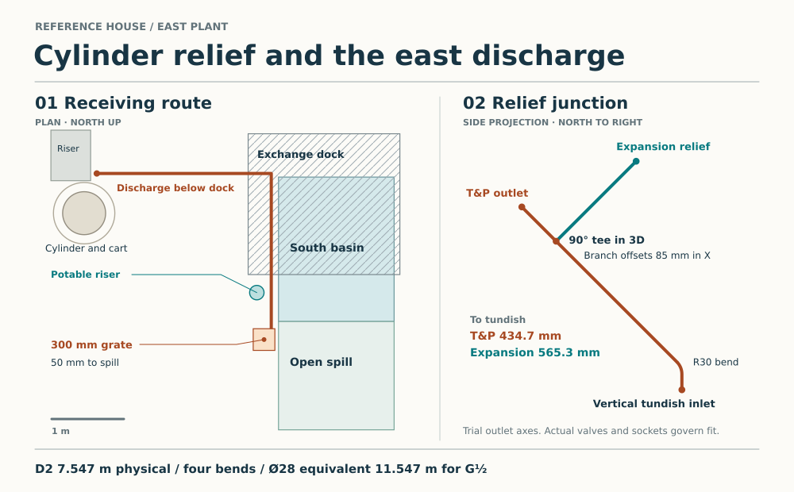

# Cylinder protection and the east discharge

Keep the lift-off cold bridge upstream of the cylinder safety group. Put the protected cold outlet, expansion connection and relief group on the cylinder side. The fixed plant terminal is at least 822 mm from a valve on the travelling cradle. The comparison appliance permits 600 mm between the two relief valves. An independently supported, demountable connection beside the cylinder and a visible vertical tundish beside the riser give an alternative with compatible pipe axes. The 300 BES itself remains rejected at 273.5 L actual capacity and 50 mm polyurethane. That disclosure supersedes the older “composition still needs declaration” in the geometry exports. [Cylinder duty and native material](domestic-hot-water-cylinder.md) · [Source-bound clearance and resistance calculation](studies/cylinder-safety-route.py)

## Bind the manufacturer's complete set

For Vaillant VIH RW GB 300 BES, the inlet reducer supplies 3.5 bar, the expansion relief opens at 6 bar and the independent cylinder T&P opens at 7 bar or 90°C. Install the cold group horizontally with its relief valve upright. Provide its 25 L vessel nearby at 3.0 bar precharge. Keep the path from cylinder to safety protections open whenever the appliance is charged. The two discharge valves address pressure and temperature relief. Bind the independent non-self-resetting heat-source cut-out, primary motorised valve, immersion cut-out and wiring to the selected heat-source/control scheme. [Vaillant §§5.2.1 and 5.3.7](https://professional.vaillant.co.uk/downloads/aproducts/cylinders-1/unistor/non-plumbed-heat-pump-cylinders-736100.pdf#page=13) · [AD G §§3.17–3.18](https://assets.publishing.service.gov.uk/media/66f6c6ce3b919067bb4828cc/ADG_with_2024_amendments.pdf#page=22)

The Ø22 protected tube between group and low drain is **cut to 1350 mm** for this model. The drain valve is at or below the cold inlet. The cut length does not locate the relief outlet. Confirm native cut ends, fitting insertion, supports and valve direction together. The Ø22 group vessel port, expansion diaphragm, potable compounds, group internals, insulation, service valves and controls each need their own constituent record. [Vaillant 0020221300_05, printed pp. 7–10 and appendices B/C](https://professional.vaillant.co.uk/downloads/aproducts/cylinders-1/unistor/non-plumbed-heat-pump-cylinders-736100.pdf#page=9)

The group cannot stay at the fixed bridge seat (11075,3970). From that seat to the cylinder centre (9860,4250) is 1246.8 mm. Giving the valve the entire R425 transport radius still leaves 821.8 mm before fittings or elevation. The Ø358 × 378 Flamco Airfix A 25/3 shows the scale of a UK potable vessel of the same nominal volume. Its diameter exceeds the earlier 163.6 mm corner space by 194.4 mm. It has a synthetic flow divider and its own matched controls. Reserve separate structural support for the actual kit, water load, membrane renewal, precharge and drain access. [Bridge and its supports](plant-inlet-route.md) · [Flamco domestic catalogue, p. 33](https://flamco.aalberts-hfc.com/media/files/documentation/Catl_UK_DOM_2018_v5_LR.pdf#page=33)

## Keep both relief paths visible and falling

This reservation uses house X/Y and levels in mm. Trial points represent discharge outlet axes. They require a supplier drawing or measured fully assembled equipment with the actual T&P elbow. The 1420 row in the Vaillant elevation does not certify its outlet position.

| Trial interface | X | Y | Z |
|---|---:|---:|---:|
| T&P discharge outlet | 10035 | 4520 | 1420 |
| Cold group expansion-relief outlet | 10120 | 4720 | 1500 |
| Factory common relief junction | 10035 | 4580 | 1360 |
| Final 45° bend tangent intersection | 10035 | 4800 | 1140 |
| Vertical visible tundish inlet | 10035 | 4800 | 1100 |
| Tundish D2 outlet | 10035 | 4800 | 1000 |

The T&P and common pipe align through the junction. The expansion branch meets them at 90° in three dimensions. A 45° bend of trial 30 mm centreline radius turns the common line vertically down and leaves 27.6 mm straight above the tundish. Developed lengths are **434.7 mm from T&P to tundish**, **565.3 mm from expansion relief to tundish** and 300.3 mm between valves. The tighter 600 mm limit leaves at most 34.7 mm for offsets and manufacturing tolerance. There is only 84.9 mm from the T&P outlet to the tee centre. The trial T&P outlet sits 24.3 mm outside the jacket before the tube radius. Bind actual valve outlet directions, socket depths and sweep. Route both Ø15 copper D1 pipes visibly with continuous fall and protection from frost. Confirm electrical separation, access to see a discharge, bracket envelope and room for tools. The manufacturer describes a T-piece. England AD G §§3.52–3.55 calls for sufficient combined capacity and a factory-fitted manifold where the other valve joins that safety-device manifold. Obtain that arrangement from the appliance maker or redesign with separate visible tundishes and independently sized paths. [Manufacturer installation detail, p. 9](https://professional.vaillant.co.uk/downloads/aproducts/cylinders-1/unistor/non-plumbed-heat-pump-cylinders-736100.pdf#page=9) · [Approved Document G, England, printed pp. 23–25](https://assets.publishing.service.gov.uk/media/66f6c6ce3b919067bb4828cc/ADG_with_2024_amendments.pdf#page=25)

A permanent Ø120 reservation for the tundish, support and vertical drop leaves 31.6 mm to the cylinder cart, 74.7 mm to the buffer cart and 25 mm to the fixed riser. It clears the documented operator positions. The expansion relief axis alone extends 112 mm beyond the R425 cart. Mount the group on a separately supported demountable stand. The D1 branches and stand must clear the moving cart after dismantling. Shut off heat and electricity, isolate incoming water, cool and drain completely before uncoupling downstream fittings. Remove the D1 branches, arrange safe support for the group, disconnect the remaining circuits and then transport the drained cylinder. Restore all protection before filling and commissioning, and test each relief discharge. The supplier still owes the working layout of the Ø22 feed, 1350 cut, expansion vessel, temporary handling and release. [House transport reservations](../had/studies/water-replan.json) · [Cylinder and buffer service positions](studies/east-water-plant.json)

## Take D2 below the east girder

1. Drop from Z1000 to −900 in one straight vertical through a proposed Ø90 formed sleeve centred (10035,4800). The sleeve edge is 240 mm from the nearest represented beam and outside the represented pile caps. The old six-service riser is occupied. STR and MAT must detail slab reinforcement, a cleanable sleeve and demountable damp, air, thermal and any required fire boundaries. Confirm Ø90 accommodates the chosen pipe, sleeve, movement and qualified seals.
2. At Z−900 turn east 2415 mm to X12450, then south 2200 mm to Y2600. Turn 45° southwest for 141.4 mm in plan to (12350,2500). Use 1:80 on all three runs, steeper than the 1:200 minimum. The run's R60 envelope clears the east girder underside by at least 210 mm, clears all represented shafts and passes 40 mm from both the Ø200 potable riser reservation and the west edge of the *alternative* southern rainwater basin. Actual dock footings, brackets, heat protection, frost exposure, further services and working access need a joint section. At the assumed outside grade of −1800 this external run is above ground beneath and beyond the dock. Provide a locked, accessible guard along the exposed run.
3. Turn down at (12350,2500) to a dedicated trapped heat-rated receptor. A trial 300-square fixed grate at Z−1800 puts the D2 end at −1850. Keep the seal water below −1950 and the terminal above the maximum receiver backwater. The grate clears the dock plan by 750 mm and the southern basin by 100 mm. Its east edge is 50 mm west of the southern spill. Without the dogleg the grate would overlap the spill by 50 × 300 mm. Survey grade, legal onward drain, backwater, frost and scald-safe access; do not share the roofwater basin, cargo collector or soil vent. The existing high foul port at Z2616.875 is above the tundish and cannot be reached by gravity. The external standing pipe, guard, grate, trap and lawful destination need real supports and procurement. [Current structural grid](../str/studies/current-house-grid.json) · [Plant dock](studies/plant-threshold.json) · [Alternative rainwater basin](../rwt/studies/forked-side-outlet.json) · [Existing foul outlet](east-water-foul-join.md)

The route has 7.547 m physical length and four bends, charging the 45° dogleg turn as a full elbow. With a G½ valve, Ø22 copper represents 10.747 m against 9 m allowed. **Reserve Ø28** at 11.547 m against 18 m. A G¾ successor requires a different D1 and Ø35 D2 on this route (13.147 m against 18 m). Confirm actual outlet, combined discharge rate, complete fittings and capacity, and update for each extra bend or obstruction. Maintain at least 300 mm straight below the tundish and unvalved gravity drainage to the protected endpoint. [Method and resistance table](https://assets.publishing.service.gov.uk/media/66f6c6ce3b919067bb4828cc/ADG_with_2024_amendments.pdf#page=26)

## Decide the next house change

The [mineral-insulated replacement study](cylinder-replacement-screen.md) rejects the stock Ø720 case in the 700 mm station and bounds a factory-removable jacket or a taller, slimmer factory design. The latter must deliver 300 L net potable. The former must allow safe supported unjacketing, a larger installed station and moisture-safe reinstatement. Require the replacement manufacturer's own pressure, expansion and discharge package. The Vaillant arrangement above supplies a physical benchmark. Adopting a different product can move all its ports and change its required discharge size.

MAT-SERVICES remains open. Three design decisions still control this packet. The existing constituent crosswalk retains all ten service families, including data, switches, protected penetrations and provider equipment. [S01–S10 disposition](constituent-audit.md#s01s10-development-decision-and-residue-crosswalk) · [Boundary Service Lodge and raceway](../had/boundary-service-lodge-and-raceway-brief.md)

1. Resolve ordinary and cooking air, dirty-filter/frost operation, all four renewable roots and occupied sound on one supported W9 layout. The governing house still represents six local extract pods and their passive inlets. Export a coherent replacement or revise that architecture before counting its lower room-heating duty.
2. Match the same house to a 300 L net cylinder, heat-pump/coil outputs, actual standing loss, separated hydraulics and a priority timetable that preserves room comfort. Allow space for the installed tank, all protections and its complete removal. At 8 kW room / 4 kW water the W9 cold-day case has only 1.30 kWh/day left before cylinder losses. The existing factory foam cylinder and stock mineral alternatives fail different requirements.
3. Qualify accessible water isolation and foul-section renewal, the proposed three inlet openings and independent D2 outlet, electricity/data terminations and service-specific closures, from the provider boundary to each room. Make the supplier-required ducts, valve seats, insulation binders, cable ends, controls and replacement seals explicit for subsequent owner decisions. Awaiting those later material exceptions alone would not prevent closing the alternatives packet. The unresolved physical architecture above still does.
