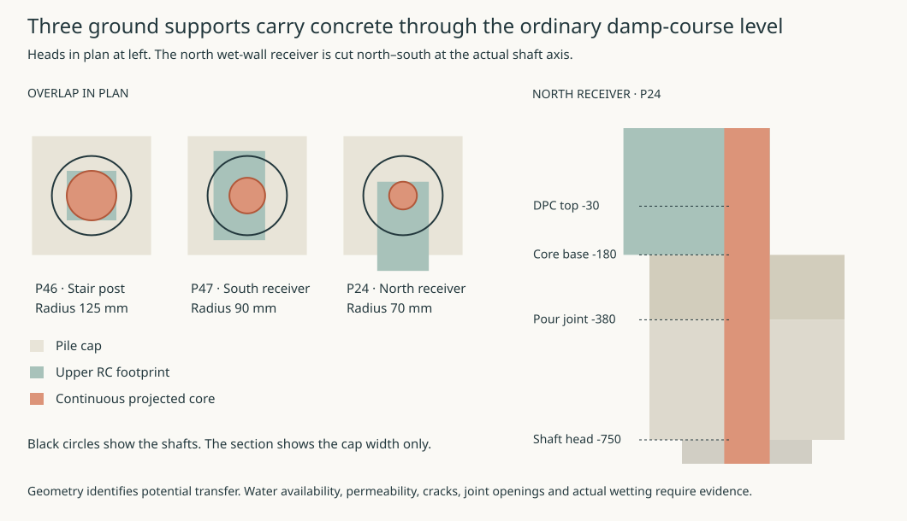

# Material choices for the pre-site envelope

**Decision.** Develop a raised concrete floor over a drainable, ventilated void, with a bonded engineering-brick break under ordinary masonry. Use this as the conventional comparator for a dry, non-pressure site. Reject the present house as a continuous capillary-isolation system. Three concrete supports carry uninterrupted material across the height of the ordinary damp course. A metal sheet cut around them leaves the same paths. Keep the complete floor, roof and glazing assemblies open for selection. The project records no owner-approved polymer exception. [Ground-water policy](../../docs/reference-house/ground-water-policy.md) · [Constituent register](constituent-audit.md) · [Material policy](../../docs/reference-house/material-policy.md)

## Trace the water from the ground to the room

Three of the 52 proposed pile heads sit directly beneath the registered occupied-floor cores. In each plan the orange disc fits inside the shaft, cap and upper core. The lower cap reaches from −750 to the prepared upper-pour interface at −380. The cast shoulder and slab rise to −180, where the upper core begins. Each disc continues through the neighbouring ordinary brick-course interval of −180 to −30 without crossing that brick. The north core reaches the receiving beam at +3020 and has a finished face in the room. At the stair, the bounding rectangle of the finish would overstate the concrete connection. The calculation uses the smaller concrete core. Coordinates are millimetres. [Three registered cores](studies/ground-field-assembly.results.json) · [Actual heads, axes and cap footprints](../str/studies/current-house-grid.json) · [Calculated contacts](studies/floor-pour-boundary.results.json)

| Head and receiving member | Shaft axis X, Y | Width × length of upper core | Radius of inscribed disc about the shaft axis |
| --- | --- | --- | --- |
| P46, stair midlanding post | 2942.5, 7257.5 | 250 × 250 | 125 mm |
| P47, south wet-wall receiver | 2942.5, 8852.5 | 260 × 450 | 90 mm |
| P24, north wet-wall receiver | 2902.5, 11667.5 | 260 × 450 | 70 mm |

A wet shaft or cap can supply the underside of the upper pour. The cast-concrete body and joint then have a **potential** route into the core and its adjoining finish. Rebar, cracks, pore structure, curing, contamination, contact at the joint and drying conditions govern actual transfer. The water transfer rate and its effect on the room remain unknown. Dropping a transverse damp course through all three cores would introduce three structural interfaces. The construction needs a bearing, shear, anchorage and erection design at each. A collar around the outside of a core can close a perimeter air joint while leaving its concrete centre in contact. Four cuts higher in the outer piers also leave the common lower floor exposed. Cuts at all 52 shaft heads would still leave potential routes to the slab through exposed RC shoulders or wet outdoor contacts above those cuts. [Earlier whole-support cut comparison](ground-pier-boundary.md) · [Construction joint, shoulder and batch controls](floor-pour-boundary.md)

For an ordinary drained exposure, qualify the concrete and its interfaces as a moisture-resistant assembly. A specimen should reproduce the two lifts, a real core, the adjoining brick base, the slab surface and the finish termination. Wet from the cap side and the exterior shoulder separately. Measure moisture reaching the upper face and drying after wetting. Isolate air leaks in a separate pressure test. Continuous brickwork only under the ordinary walls cannot stand in for this specimen. Keep the unbroken ordinary DPC where it does a real job. Its 215 mm bonded header projects 37.5 mm each side of a 140 mm core. Check bed, perpends, end bonds, structural restraint and the local narrowing of the glass before adding courses. Increasing thickness elsewhere does nothing to the three concrete paths. [Straight sections](floor-pour-boundary.md#put-each-physical-route-into-one-air-account) · [Unit, mortar and slate comparison](envelope-ground-boundary.md)

At the south door the removable pan rests on its own projecting RC/mineral seat. Its weather discharge, inner air closure and masonry DPC ends require separate joints. The two high cavity trays discharge onto the court. The high jamb ends stand 148.25 mm above the aprons. The proposed high tongues return water to those trays and the low bridge targets its original apron. Neither they nor the two door drains intercept water inside the ground supports. Qualify the upper flashing heel and backing, the low bridge discharge and the lower wet-wall return. Test both blocked paths and independent pan removal. At the east foul crossing the 160 mm carrier, 200 mm formed hole and 300 mm flashing remain a **wall** penetration at X12000, Y5625, Z2616.875. Keep the annular weather, air and movement joints accessible there. Its exterior descent to the eventual site connection does not add an unlocated boot through the room floor. The [front entrance assembly](front-threshold.md) joins the 1800 mm cut to the actual outer beam and folded approach. Its wider landing requires moving three lower flights to clear a low-headroom conflict at the return. The [east plant opening](plant-threshold.md) uses a separately supported flush plate and guarded receiving dock. The carrier needs 280 mm beyond its earlier stopping point. Both the exterior lift and the dry exchange sequence remain to be joined. [Court pan](court-air-path.md) · [Court wall trays](floor-pour-boundary.md#drain-the-south-courtyard-wall-above-its-landing) · [East foul join](east-water-foul-join.md) · [Three door cuts](studies/ground-field-assembly.results.json)

A separate sheet over the room field has 80 pieces and 116.94 m of seam. The recorded one-stock-sheet-per-slot comparison is £12,991.80 ex VAT for 60 sheets before fabrication, returns, testing and installation at the price recorded on 6 November 2026. Its trim-outs leave the core centres exposed. Carry that scheme only if it is redesigned around the actual supports and materially outperforms the concrete route. For a site requiring a continuous gas or pressure-water boundary, reject the present detail and return the site/level/floor combination to DPL, MAT and STR before freezing the foundations. If there is no passive receiving level below the solum under backwater and heave, change the ground interface or reject the plot for this house. [Sheet layout and stock basis](studies/ground-field-assembly.results.json) · [Solum fall and outlet levels](floor-pour-boundary.md#give-the-ground-beneath-the-floor-somewhere-to-drain)

## Keep the whole exterior assembly in view

These choices refer back to the existing inventory. Each source owns its supplied constituents, comparisons and rejected products. Design comparisons can proceed with declared assumptions. Installed quantities, supplier evidence, construction and owner dispositions remain tied to the assembly actually proposed.

| Register and occurrence | Material choice and rejected shortcut | Cost, first repair and decision still required |
| --- | --- | --- |
| G01, G03, G08. Substructure and floors | Carry the deep-transfer suspended RC comparison and the conventional upper RC plate. A shallow strip or raft needs its own soil and tree case. Keep concrete mix, reinforcement, coatings, spacers, grout, bearings and any retained shuttering in the specification. | The 52 proposed shafts and common pile caps commit ground works that cannot be routinely renewed. Verify real soil, heave, groundwater and signed reactions before setting the foundation type. For the upstairs perforated RC200 plate retain actual load paths around the court, stair and wet opening. Place and inspect service sleeves before pouring. [Foundation alternatives](../str/ground-movement-foundation-options-result.md) · [Current floor, ring and head comparison](../str/current-house-structural-reference.md) |
| G02, G04, G06, G07, G10. Masonry, DPC and arch seats | Develop unfaced mineral masonry with fully bonded beds, a weathering outer leaf and separate drained cavity. Ketley WCBL65 is a candidate unit. Resolve the actual unit dimensions, absorption, mortar/additives and exposure. DPC-use slate remains a comparator with its own beds, edges and sliding planes. Preserve genuine arch thrust and separate positive restraints through or beside the course. | External repointing and visible weep clearance are practicable. Replacing a buried DPC, tie, tray back or arch seat entails masonry work. The local court jamb already has an adverse isolated overturning case. Set out the actual bonded return, corner restraint, discrete tray outlets and movement before taking bearing credit. [Masonry and arch comparison](../str/str-masonry-result.md) · [Updated corner and guard](../str/corner-arch-junction.md) · [Mineral damp boundary](envelope-ground-boundary.md) |
| G05 and X01–02. Insulation, air and vapour continuity | Develop bare T4+ glass on independent support. Keep all cut joints, perimeter restraint, lath, anchors and closures in the assembly. PE-faced PERINSUL HL and the cited PUR-bonded wood-fibre product fail the default constituent test as supplied. The room-side plaster/RC route and a joined metal air-layer comparator both need real junctions. | Do not charge a brittle glass edge with structural bearing by substitution. A failed concealed board or receiver can require opening the outer leaf or roof. Check cold surfaces and drying at the wall base, eave and all metal bridges. Whole-house pressure testing follows local diagnosis. [Audit X01–02](constituent-audit.md#f-cross-cutting-and-retained-comparison-checks) · [Ordinary base](conventional-ground-junction.md) · [Roof junction](ordinary-eave-joined.md) |
| G09 and R01–05. Primary roof, weathering, underlay and edges | Develop the tied steel frame separately from its weather skin. Retain the cold unbacked zinc/open-board comparator, with a supported secondary drainage layer, clear vent route and a separate warm air/vapour layer. The standard PP underlay, SBS/SIS adhesive and butyl details fail the default material test. Copper needs a qualified deck, cushion and movement detail. A material swap cannot cure an unresolved secondary layer. | At the outer wall line, the MAT weather surface is at +7100 mm. STR’s proposed tied roof raises that same datum to +7297.52 mm, a 197.52 mm difference between design alternatives. The projecting drip ends have separate levels. Reject direct reuse of the old seat, saddle, gutter/drip or 50 mm glass neck as a joined detail. The [welded-frame eave and ridge cut](ordinary-eave-joined.md#carry-the-cold-roof-over-the-welded-frame) recuts one north occurrence. Its field lift clears the hip. The crown purlin needs a separate pitched cap. Prove tool and weld access and temporary weathering during external renewal. [HAD roof comparison](../had/studies/water-replan.json) · [STR elevations](../str/studies/current-house-roof-route.json) · [Ordinary eave](ordinary-eave-joined.md) · [Roof materials and secondary layer](envelope-cold-metal-roof.md) |
| O01–03. External frames, glazing and installation | Retain the renewable E0 family and investigate non-laminated FINEO with a complete support and weather joint. Ceramic edges leave the glass internals, blocks, bedding, beads, primer, finish, anchors and frame-to-wall connection to disclose. Monolithic glass with traditional bedding is the simpler repair control. Reject the named PIB unit seal and plastic-capped Spacia comparison under the default policy. | Remove only after independently supporting the sash or leaf. Check impact, fire, heat loss, condensation and the actual finish. The rejected north-window export exceeded the available frame width and its named synthetic-bearing stay did not make the 80° movement. It supplies no ready-made material-compliant window package. [Glazing and support comparison](envelope-glazing-alternatives.md) · [North-window disposition](../oas/north-export-occurrence-result.md) |
| O04–05. Weather interfaces, doors, hardware and external finish | Use cleanable mineral or metal sills and reversible wet faces, independent of the dry frame. Record castings, screws, finishes, seals, bushes and any rated-set internals. Select face brick and suitable mortar for exposed field walls and use a compatible disclosed finish where timber or mineral substrate requires one. Reject automatic acceptance of a hidden coating or a stripped certified component. | Release fixings on the maintainable side with the assembly supported. Keep protected timber out of the wet pan. Take a sample of the complete installed finish through local repair and weathering. Hidden primers, lath, seals and substrate treatment govern its eligibility. Door, primary/secondary weather routes and safety classification retain their own acceptance. [Opening selections](../../docs/reference-house/opening-assembly-selection.md) · [Finish and substrate](interior-mineral-coating.md) · [Complete court boundary](court-air-path.md) |

RWT owns the copper collection, accommodation of movement and metal compatibility at R06–10. Keep the zinc drip independent of wet copper contact and assess the actual common receiver and its failure. C01–02 apply to every row. Record retained form-release material, curing agents, weld passivation/flux, adhesive, drilling compound, primers and packers. A reusable tool removed cleanly differs from a coating it leaves on the house. Carry directly evidenced mandatory synthetics into the existing exception procedure only after the whole-assembly alternatives and safety consequences are established. No exception is requested here. [Rainwater materials authority](../rwt/rwt-04-materials-joints-compatibility.md) · [Constituent audit](constituent-audit.md) · [Owner exception process](../../docs/reference-house/material-policy.md)

**Next design decision.** Complete the court-jamb fixing and weather test, qualify the front threshold and shifted ramp, qualify the plant dock, its receiving lift and independently drained sill, and detail the three RC crossings where isolation is required. Resolve the raised ridge-cap supports, laps and weather test. The [joined Study comparison](study-coupled-window.md) rejects the complete moving arch and low sash over the front ramp. Develop one shorter rectangular working leaf between a fixed sill light and two independently renewable paired head cartridges. Qualify the one straight vacuum inner unit, moving ring and dry/wet joints against the full-window heat, access and load budgets. Those are internal design duties. Surveyed water/gas/ground exposure, verified batch and full material declarations, loaded joint and weather testing, and any actual residue decision belong at site and assembly admission. The envelope alternatives remain open while those internal interfaces lack a defensible construction or a tested reason to abandon them.
