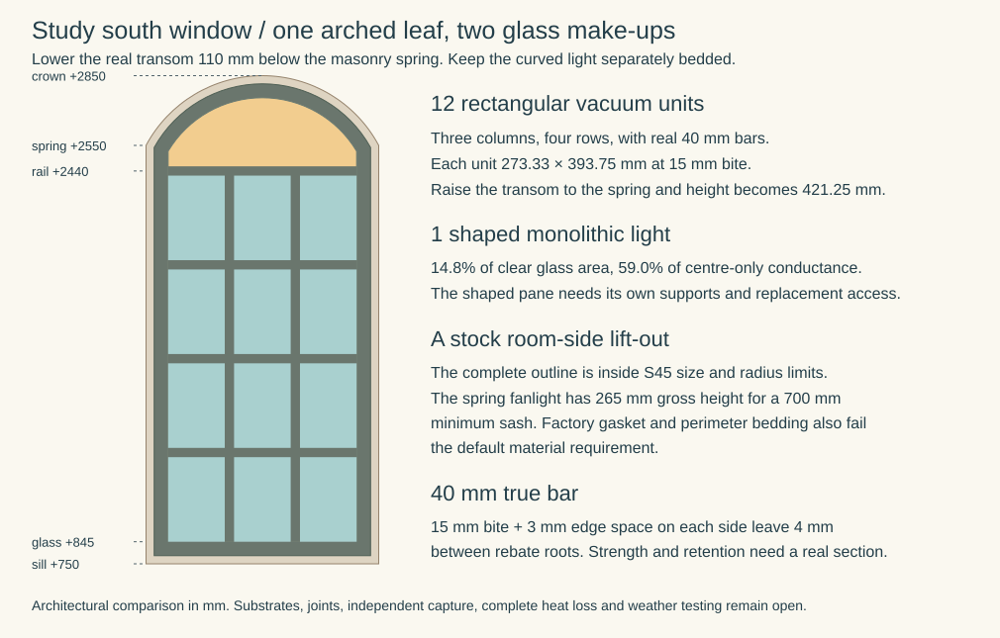

# Installed glazing: core, support and weather joint

**1 November 2026 · MAT-ENVELOPE comparative development.** Reference design — not released for construction. This resolves the installed-glazing candidate comparison at the present architectural-family stage. It does not select a window product or close the remaining envelope work. The [material policy](../../docs/reference-house/material-policy.md) prohibits concealed synthetic constituents unless explicitly approved; no exception is proposed or approved here.

## Recommendation

Retain **non-laminated FINEO as the leading insulated-glass development candidate**, conditional on a qualified complete support/weather-joint package. Reject automatic adoption of its catalogue retrofit installation under the default material policy. Retain single monolithic glazing with traditional bedding as a simpler material control, but do not adopt it for the new house without the complete energy, comfort, condensation and safety case. Reject the documented Spacia and PIB-sealed insulating-unit examples as unmodified no-synthetic solutions. Those are product/assembly-specific conclusions, not proof that all insulated glazing requires plastic.

The immediate design priority is the **joint and support**, rather than selecting a thinner pane or adding a denser decorative grid. A ceramic vacuum edge offers a meaningful advantage over a polymer-sealed unit, but leaves the installer’s package unresolved. Do not request an exception before testing that package and the simpler control. If neither can meet all duties, return a concrete window/house redesign or exact residual proposal to the owner; the existing policy supplies no default approval.

## Actual house interface

The [selected E0 family](../../docs/reference-house/opening-assembly-selection.md) retains replaceable sash/glazing and independent room trim. [OAS-NOMINAL-01](../../docs/reference-house/opening-interface-studies.md) has a nominal 1000 × 2100 opening, 970 × 2070 trial frame outside and a 60 mm frame occupation reserve. It explicitly supplies neither glazing area nor rebate construction. The current [revision source](../../compiler/reference-house/georgian/layout-revision.ts), inheriting [outer openings](../../compiler/reference-house/georgian/source.ts), locates GROUND / outer-south / south-window-0 at centre 1800 and width 1000 within the Study frontage. Sill/head 750/2850 remain nominal vertical controls. The [elevation generator](../../compiler/reference-house/georgian/layout-family.ts) draws three columns and four rows; those lines do not establish twelve individually supported panes, sash divisions or fabricated bars.

Glazing support must travel through sash/frame and actual anchors to permanent construction. The OAS frame-setting block below the sill tray is a different component from the blocks supporting glass inside its rebate. Neither can inherit the other's material or bearing evidence. Keep frame drainage connected to the OAS sill tray/outlet; a water-tolerant glass edge does not protect timber, fixings or the wall behind it.

## Candidate comparison and disposition

| Candidate | Material finding | Performance and ordinary repair consequence | Disposition |
|---|---|---|---|
| Monolithic glass, solid timber rebate, mechanically retained beads or glazing points, linseed/chalk bedding | A real non-synthetic bedding constituent candidate is described by Brouns [G6]. Primer, finish, timber treatment, hardware and support still require disclosure. | No sealed cavity to lose; local pane/bedding renewal remains possible. Whole-window heat loss, cold internal surface and moisture exposure must be assessed. Toughening may address a relevant impact duty without a laminate, but requires the actual tested product/application; it does not supply thermal insulation. | Retain as the simple control. No new-house energy/comfort pass or installed material pass. |
| Conventional insulating unit using SikaLastomer IG-106 primary seal | Manufacturer identifies a thermoplastic PIB seal [G5]; a metal spacer does not remove it. | Replace complete failed sealed unit; do not remove its primary seal or coat it with an unqualified oil system. | Exclude this exact unmodified joint under the default policy; not an adopted house product or a verdict on every IGU. |
| Pilkington Spacia STIII, GL046 edition | Permanent plastic protection cap [G4], including a visible room-side location. | Cap must remain; removing or hiding it does not create an acceptable original product. Current availability and a matched installation package are unestablished. | Exclude the documented unmodified comparator. No substitute cap is engineered here. |
| Non-laminated FINEO 8 Standard | Glass and ceramic/glass edge are supported; complete installed recipe remains N/U [G1–G3]. | Bespoke pane replacement, controlled handling and renewed bedding/support; vacuum core cannot be cut to size on site. Thinness does not prove sash/hardware capacity or whole-window thermal performance. | Leading insulated candidate, conditional on complete joint/support and actual new-frame evidence. |
| FINEO with catalogue synthetic blocks, EPDM/extruded seals or silicone installation | Known synthetic examples in the installation evidence [G1/G2]. | Their functions cannot simply be deleted; unsuitable rigid bedding can constrain glass movement. | Exclude those unmodified no-synthetic packages. Unknown alternatives remain open. |
| Single glazing plus separate secondary glazing | Potentially separates insulation and repair tasks; actual frames, sliding seals, fixings and finishes remain undisclosed. | Adds an opening, cleaning plane and access task; interspace condensation and ventilation need design. | Retain a redesign route if the first two controls fail; no product or performance claim. |

## Primary-source findings

Accessed **1 November 2026**. Page references are printed pages unless stated. These documents are evidence of the identified products and uses, not a supplier enquiry, installed sample or certification of this house.

- **G1 — [CSTB DTA 6/23-2441_V2](https://www.batipedia.com/atecstream/pdfDoc/VEYI-2.pdf)**, valid 23 May 2025–30 April 2028, pp1–2, 4, 6, 10–12. Assesses rectangular annealed FINEO, vertical ±5°, four-sided rebate support, in metropolitan France. It describes a ceramic perimeter barrier; new and existing frames both require qualified installation. EPDM is an example, not an exclusive chemistry. Other joints require the stated criteria; extruded-joint compression requires AGC validation. Silicone joints have ≥4 mm width each side, modulus ≤0.5 MPa at 100% extension/compression and G25LM classification. Calculation includes atmospheric/pillar, wind and thermal-gradient effects; thermal-shock assessment is separate. French assessment is not English building acceptance.
- **G2 — [AGC Retrofit Glazing Instructions](https://www.fineoglass.eu/wp-content/uploads/56/TDS_Fineo-retrofit-glazing-instruction_0823_EN.pdf)**, August 2023, pp4, 7–8, 15, 18–19; currently linked by [AGC documentation](https://www.fineoglass.eu/documents/). Synthetic PP/PA block examples are given; wood blocks are excluded with coated/laminated glass. The putty route permits block omission only for units smaller than 400 × 400 mm. Minimum bite is 13 mm, optimum 15; edge clearance 2–3 mm; seals require lateral allowance. Foam backing is not mandatory in every putty arrangement, but its illustrated use requires silicone finish. Primer, paint and wall connection are separate. These are retrofit instructions, not approval of a new-house joint.
- **G3 — [ETA 20/0048 v01](https://www.fineoglass.eu/wp-content/uploads/2020/11/eta-20-0048.pdf)**, pp1–4, and [FINEO 8 Standard NMD EPD](https://www.fineoglass.eu/wp-content/uploads/47/20260227_EPD_NMD_FINEO_8_Standard.pdf), file dated 27 February 2026, pp5–7. ETA describes solder-glass perimeter, pillars and getter; project conditions still control configuration. Its cover date is 2020-01-22, whereas the [EOTA index](https://www.eota.eu/etassessments/10439) says 21 January 2020 and ETA p2 contains a 2022 first-issue statement: preserve the discrepancy. EPD distinguishes 20 kg float glass and 0.06 kg “Others” per functional unit from PE/HDPE/PU/SBR packaging. Packaging is not an installed-house polymer quantity. “Others”, processing residues and accessories are not a complete constituent declaration. Neither the EPD reference life nor ETA assumed working life is a project guarantee.
- **G4 — [Pilkington GL046](https://assetmanager-ws.pilkington.com/fileserver.aspx?cd=cd&cmd=get_file&ref=GL046)**, September 2024, protection-cap and performance sections. Identifies a permanent plastic cap remaining after glazing; nominal 6.2 mm STIII and Ug 1.1 W/m²K are catalogue core properties, not whole-window results. Text and illustration differ on cap radius/diameter; this study needs presence, not an invented cap mass.
- **G5 — [SikaLastomer IG-106](https://www.sika.com/content/sika-global/msm-blueprints/en/home/building-components/facade/insulating-glass/sikalastomer-ig-106.html)**, undated current product page, chemical base/application. PIB primary seal in a dual-seal unit; substrate/compatibility qualification still applies.
- **G6 — [Brouns linseed putty](https://linseedpaint.com/product/fillers/linseed-oil-putty-filler/)**, SKU sun-putty, undated page: declared linseed oil and chalk on primed timber. Its [FAQ](https://linseedpaint.com/faqs/) warns against direct oil contact with double-glazing seals and suggests acrylic separation. That suggestion is itself excluded under the default policy; it is not qualification of this putty against FINEO's ceramic edge. Complete formulation, preparation and compatibility remain to establish.
- **G7 — [England Approved Document K](https://assets.publishing.service.gov.uk/media/60d5bdcde90e07716f516cfd/Approved_Document_K.pdf)**, 2013 edition, pp31–34, §§5.1–5.8. Critical window locations include glazing below 800 mm. The small-pane guidance needs a smaller dimension ≤250 mm, area ≤0.5 m² and normally ≥6 mm annealed glass; its limited traditional lead/copper-light case differs. Safe-breakage and protection routes also exist. This is distinct from G2's block-omission rule. Do not add separate annealed ply thicknesses and call a vacuum unit compliant with the monolithic guidance.

## Challenge the small-pane workaround

A reproducible **authored sensitivity**, not a fabrication schedule: subtract 2 × 60 from the trial 970 × 2070 frame to give 850 × 1950; assume real 40 mm bars, equal clear openings and no additional meeting rail. For c columns and r rows, visible width = (850 − 40(c−1))/c, height = (1950 − 40(r−1))/r. Add 2 × 13 mm bite to each dimension for the trial unit. The 40 mm bar is an unapproved geometry probe with room for opposing 13 mm bites and residual web/clearance; it is not a strength check. Real sash, tolerances and edge engagement can change all results.

| Grid | Visible cell, mm | Trial unit, mm | Units per window | Total unit perimeter, m |
|---|---|---|---|---|
| 3 × 4 | 256.67 × 457.50 | 282.67 × 483.50 | 12 | 18.388 |
| 3 × 6 | 256.67 × 291.67 | 282.67 × 317.67 | 18 | 21.612 |
| 4 × 6 | 182.50 × 291.67 | 208.50 × 317.67 | 24 | 25.256 |

The 3 × 4 trial misses G2's omission size. The 3 × 6 trial fits that size but misses G7's 250 mm dimension; 4 × 6 meets both dimensional screens, **not the thickness, impact, installation or new-frame acceptance requirements**. The 750 sill is an aperture datum: actual lowest exposed glass may be above 800 after real joinery, so critical-location applicability remains to locate. Adding bars to solve an assumed impact duty could therefore create needless cost and visual change.

Relative to 3 × 4, 4 × 6 doubles unit count and increases total glass-edge length by about 37%; this is a procurement/repair and thermal-edge warning, not a calculated cost or U-value. A solid meeting rail can change the arithmetic further. Do not redesign the facade around a retrofit exemption before resolving actual safety geography and a new-frame joint. Decorative applied bars cannot subdivide the underlying glass for either test. Whole-window performance must include frame, bars and edges, rather than multiplying catalogue Ug by nominal aperture area.

## Adversarial review and acceptance route

The internal challenge rejects four tempting shortcuts: “glass/ceramic core means plastic-free window”; “DTA mentions EPDM so no alternative is possible”; “small Georgian lights satisfy both unrelated exceptions”; and “linseed putty automatically suits every insulated edge”. Each fails at the identified source or assembly boundary. This is internal research review, not independent external assurance.

| Missing evidence | Decision prevented | Existing responsible route / latest resolution point |
|---|---|---|
| Exact non-laminated unit constituents and retained residues; actual support, putty/gasket, primers/finish and compatibility/compression evidence | No complete non-synthetic installed-glazing selection | MAT with OAS OS-01/02/06, supplier technical evidence through BCR; before fixing product-dependent rebate/profile and procurement |
| Actual pane/sash schedule, opening mode, wind/exposure/thermal inputs, safety geography and impact evidence | No glass thickness, grid, hardware load or safety selection | OAS OS-01/05 through BCR/EPR; before fabrication geometry and statutory submission dependent on it |
| Whole-window energy, internal surface temperatures, ventilation and condensation consequences of both leading/control assemblies | No single-glazing or FINEO whole-house performance claim | BCR/MRA with owning energy design; before envelope selection/technical convergence |
| Quote for like-for-like units, joinery, installation, access and renewal | No cost preference or budget fit | Existing owner delivery/cost route; before procurement choice. Counts above are comparative probes, not installed quantities |
| Qualified removal, support, cure/weather protection, drainage reinstatement and exposure test where required | No demonstrated ordinary renewal or installed water pass | OAS OS-02/08, MRA and DEL; design before manufacture, verify before concealed completion/handover |

This completes the bounded comparison and gives a ranked development direction. O02 and C01 remain mixed N/P/U; O01/O03–05 do not inherit a pass. MAT-ENVELOPE remains planned because its ground, roof, insulation, air/moisture and other complete installation questions remain substantive work. No house geometry, approved exception, selected product, lifecycle completion or maturity changes.

## Fit the glazing to the actual Study arch

**9 November 2026.** Reject the stock room-side Selectaglaze S45 lift-out package under the default material policy. Carry one mixed-glazing sash as the specimen for this opening. It has twelve rectangular non-laminated vacuum units below a real rail and one separately bedded monolithic light above. The curved head stays on the registered single leaf. Its independent glazing joint allows a different glass make-up. It carries no independent sash, hinges or claimed removal apparatus. [Actual segmental opening and dry lining](../had/studies/water-replan.json) · [Calculated geometry](studies/study-window-glazing.json)

The raw opening spans X1300–2300 at sill +750, spring +2550 and crown +2850. Its circle has radius 566.67 and centre Z2283.33. The older 15 mm frame allowance would overlap the 27 mm dry return by 12 mm at a common depth. Trial a 35 mm inset around the raw opening, comprising 27 mm lining and 8 mm joint. The resulting frame measures 930 × 2030 overall. The 60 mm visible frame/sash territory then gives 810 mm between sightlines and the first exposed glass at +845. That is 45 mm above the 800 mm low-window threshold in G7 on this set-out. Actual finished floor, frame, impact exposure and glazing still need checking. The Study uses its own occurrence. The rejected FIRST north-window export frame, guard and operating hardware confer no clearance or protection here. [Renewable frame family](../../docs/reference-house/opening-assembly-selection.md) · [Earlier 15 mm nominal trial](../../docs/reference-house/opening-interface-studies.md) · [North-window scope](../oas/north-export-occurrence-result.md)

| Lower sash option | Real rectangular units at 15 mm bite | Glass edges around the rectangular units | AGC retrofit putty size screen |
|---|---|---|---|
| 40 mm rail centred at the spring, three columns × four rows | 12 at 273.33 × 421.25 mm | 16.67 m | Height exceeds 400 mm |
| Same rail, three columns × five rows | 15 at 273.33 × 335 mm | 18.25 m | Both dimensions below 400 mm |
| Rail centred at +2440, three columns × four rows | 12 at 273.33 × 393.75 mm | 16.01 m | Both dimensions below 400 mm |

All three layouts use real 40 mm bars. In the last row the principal rectangle has 1575 mm of clear height below the rail. The rail centre must be strictly below +2465 for four rows to stay under 400 mm at 15 mm bite. A unit 5 mm taller than nominal still clears that size screen. A 7 mm increase fails it. This is a sensitivity on unit size, not an allowable fabrication error. At a 3 mm edge allowance, opposing 15 mm bites in a 40 mm bar leave only 4 mm between rebate roots. Design the section, cross-joints and support through the stiles and hinges before relying on it. The guide's no-block provision is confined to the small-unit retrofit putty detail. A new-house sash still needs a named compatible bedding, supported four-sided rebate, pressure retention, drainage past each block and a route from the moving sash to the permanent sill tray. Hodgson's H1 heritage bedding/fronting uses a hybrid polymer. Its H5 retains the same compound behind a traditional front. Exclude both stock bedding choices under the default policy. AGC compatibility with these named products has not been established. [AGC §§2.5–2.7 and 3.2.2.2](https://www.fineoglass.eu/wp-content/uploads/56/TDS_Fineo-retrofit-glazing-instruction_0823_EN.pdf) · [Hodgson H1/H5](https://hodgsonsealants.com/product/heritage-putty/)

**Head pane and first release.** Compare a shaped 4 mm monolithic clear pane on its own seat at the top of the rail. With an authored 15 mm engagement, its cut outline is 840 mm wide, has a 486.67 mm radius and extends from +2445 to +2770. Its 0.2141 m² weighs about 2.14 kg at an assumed 2500 kg/m³. The twelve FINEO units add 25.83 kg of glass at the G3 EPD’s 20 kg/m², giving 27.97 kg of glass on the one moving leaf before bars, frame or hardware. Hinge anchorage and sash restraint must carry the complete load in both positions. The 810 mm retained sight is 30 mm too narrow for direct normal withdrawal. Trial removable weather-side beads along both jambs, the arch and the rail. With those beads and bedding fully cleared, an 846 mm pocket gives 3 mm normal clearance to each fixed jamb line, to the concentric arch and to the rail root for a straight outward pull of the bare pane. Keep its lower seating pads clear of the outward path or provide a supported removal for them. Capture the pane independently and secure the moving sash before the first bead or putty release. A mechanical bead, bedding on a prepared backing, covered exterior timber, draining rail and weathering lip still require actual sections. The three millimetres cover no tool, grip, projecting clip, tolerance or drift. Verify a complete retained-seat/first-release arrangement, working platform, protection of the occupied room, replacement bedding and its weather test. [Calculated clear and cut profiles](studies/study-window-glazing.json) · [Face and frame renewal duties](../../docs/reference-house/opening-assembly-selection.md)

The clear fanlight occupies 0.1845 m² against 1.0622 m² for the rectangular panes. With published glass-centre values of 5.8 W/m²K for 4 mm clear Optifloat and 0.7 for FINEO 8, those areas give 1.070 and 0.744 W/K respectively. The head carries **59% of this two-glass conductance on 14.8% of visible glass area**. Lowering the rail buys three fewer vacuum units than the spring/five-row solution, at the expense of a larger cold head. Obtain whole-window heat flow and interior head temperatures, including the 16.01 m of vacuum edges, bars, frame, junction and condensation risk before selecting mixed glazing. Frame or edge losses cannot be inferred from this area calculation. [Pilkington Optifloat data](https://assetmanager-ws.pilkington.com/fileserver.aspx?cd=cd&cmd=get_file&ref=UKOPTI1) · [AGC FINEO 8 EPD](https://www.fineoglass.eu/wp-content/uploads/47/20260227_EPD_NMD_FINEO_8_Standard_1.pdf)

**Separate room-side pane.** Selectaglaze lists its S45 lift-out for segmental heads. Its recommended maximum frame is 1000 wide × 2200 high, minimum sash 450 wide × 700 high and minimum curve radius 300 mm. The 930 × 2030 outline and radius 531.67 pass the gross screens. A separate lift-out above the masonry spring has only 265 mm gross height, a shortage of at least 435 mm. Even a split at the lowered +2440 rail has at most 375 mm. The lower edge of any 700 mm upper sash must reach +2115 or below, before losses to actual frame, rail or seals. A full-height room-side pane leaves another first-release problem. The registered desk overlaps 920 mm of the 930 mm frame width in X. This establishes the need to draw access in depth and height, not a three-dimensional collision or a permissible manual lift. A second air layer would also need an airtight room-side joint, access for cleaning and a cavity that can dry outward through the weather layer. [Series 45, product guide p35](https://www.selectaglaze.co.uk/media/images/productguidejuly2023_7822.pdf) · [Segmented radius head](https://www.selectaglaze.co.uk/product-range/one-centred-curves) · [Historic England secondary-glazing guidance](https://historicengland.org.uk/images-books/publications/eehb-secondary-glazing-windows/)

The factory frame system retains glazing gaskets identified as PVC nitrile, with specialist bonding tape for specified security systems, and acrylic bedding at the frame or grounds. The available anodised aluminium finish leaves these joints in place. Reject the unmodified stock assembly under the default policy regardless of gross fit. The bounded next decision is a full-size Study sash corner and rail/head specimen. OAS and MAT need the binder and primer declarations, compliant support and movement, open-state load path, exposed-face drainage, independent pane capture and evidenced air/water and energy results. If the mixed specimen fails, compare an insulating head with its own verified shape and joint or present an exact constituent exception for owner decision. Retain the monolithic baseline and the other envelope gates. [Manufacturer's frame and gasket construction](https://www.selectaglaze.co.uk/product-range/what-is-secondary-glazing) · [Whole-envelope disposition](envelope-disposition.md)
