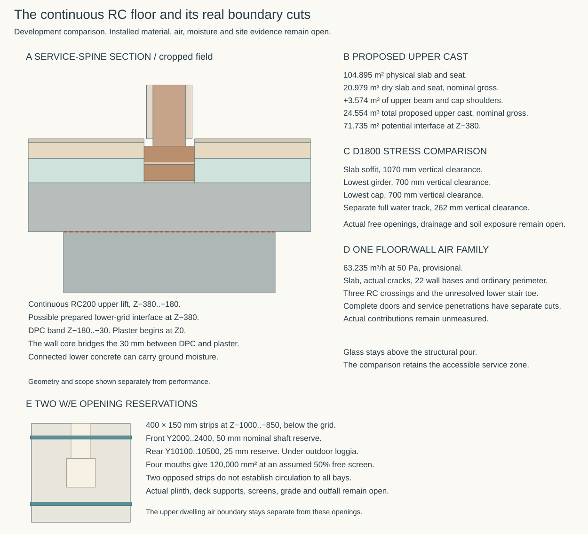
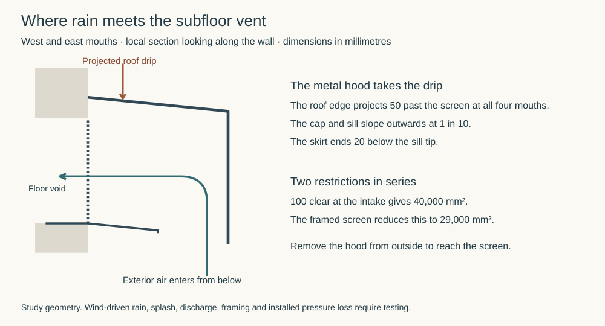
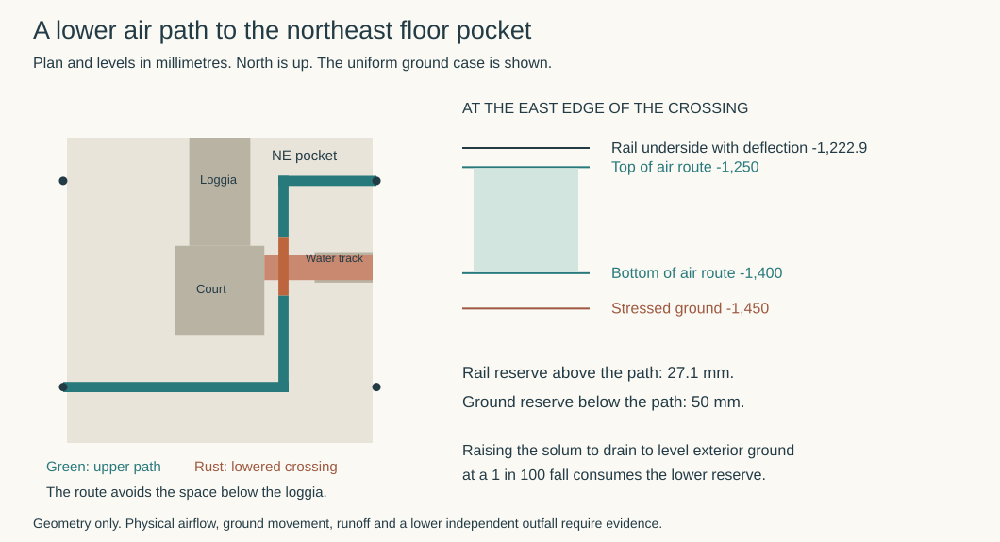
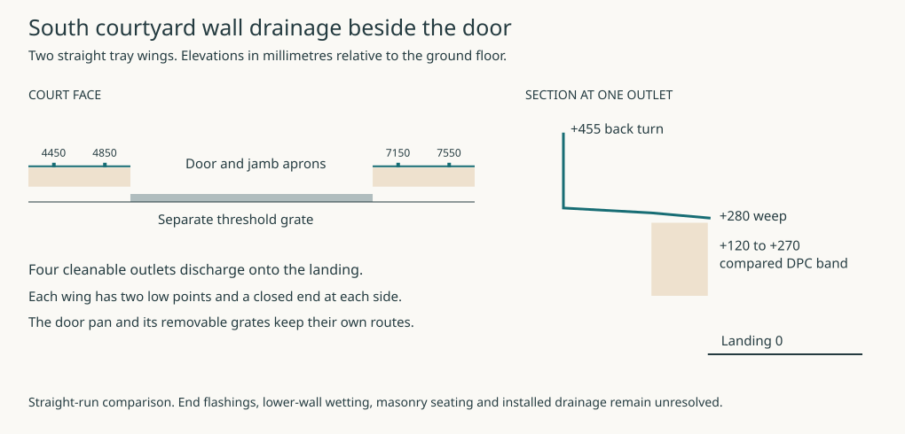

# One continuous RC floor and its wall boundary

**Working comparison, updated 8 November 2026.** Develop the ordinary suspended concrete route on the actual common grid. The current sources locate the structural pour, ordinary wall bases, three RC crossings and three external door cuts. Selection still requires measured batch, curing, interface, moisture and air performance. [Control](studies/floor-pour-boundary.json) · [Results](studies/floor-pour-boundary.results.json) · [Reproducer](studies/floor-pour-boundary.py)

## Place one upper lift over the actual supports

The physical slab and seat cover **104.895225 m²**. Of this, 53.862194 m² overlap supporting concrete, 50.634031 m² span and 0.399 m² form the projecting seat. The nominal 200 mm upper lift contains **20.979 m³ of gross RC**, counting the head/beam overlap once. Its top is −180 and its soffit −380. The reference floor retains the 15 mm finish, 65 mm accessible distribution zone and 100 mm bare glass above it. The pressure footprint is 88.553659 m² and the net room field 83.057362 m². Each area serves a different calculation. [Structural pour](../str/studies/current-house-occupied-interfaces.json) · [Field register](ground-field-assembly.md) · [Air-duty geometry](balanced-service-architecture.md)

Compare one monolithic upper cast, including the dry floor and the common beam and cap shoulders outside it. The grid union adds **17.872375 m²**, or **3.574475 m³** at nominal depth, to give **24.553520 m³ gross**. It counts all intersections once. The additional shoulder is 350 mm at the outer-west section and 100 mm at the court-east section. At the straight court-south and loggia-west sections the dry calculation already reaches the full beam edge. The shoulder quantity excludes the separate outdoor decking and low ties. Its cage, wet exposure and delivered mix still need their own design. [Cast union and section locations](studies/floor-pour-boundary.results.json) · [Grid](../str/studies/current-house-grid.json)

When the lower grillage is cast first, prepare its horizontal interface at **−380** and retain the continuing reinforcement. The located service-spine section at Y4500 has a 900 mm wide girder with final Z−630..−180. The lower-to-upper interface covers **71.734569 m²** on the proposed common grid, with **119.740 m** of plan edge at continuing dry soffit and **68.810 m** at vertical RC faces before actual contact or cover. Those edges locate possible entry paths for inspection. Actual open length, crack continuity and leakage remain unknown. Confirm the placing sequence, formwork support and recovery, cage clearance, actual roughness, laitance removal and treatment of any interruption. The structural comparison reserves no full-depth intermediate field joint. An interruption through the slab would need a separate located joint. [Structural pour](../str/studies/current-house-occupied-interfaces.json) · [Interface geometry](studies/floor-pour-boundary.results.json)

The structural control uses H12 at 100 mm each way on both faces, 40–50 mm face cover and a 195–205 mm delivered depth range. Its **0.294 mm** crack screen assumes 400 microstrain of restraint. The 500 microstrain comparison gives **0.331 mm**. Record actual binder heat, placement and curing conditions before relying on that restraint case. Test the actual cracks and joints separately for air, moisture and any site-gas duty. [Structural comparisons](../str/studies/current-house-occupied-interfaces.json)

## Earn the ordinary concrete and drying conditions

Approved Document C’s suspended-floor comparison asks for moisture resistance at the upper surface and reinforcement protection. Its in situ example gives **100 mm, 300 kg cement/m³ and 40 mm cover**. The current structural depth and cover ranges satisfy those dimensional comparisons. The cement dose and performance still depend on the delivered mix. The guidance separately calls for a ventilated air space and gives a membrane condition where the ground beneath the floor has been excavated below the lowest surrounding level and will lack effective drainage. Establish the actual solum, site exposure and applicable gas/pressure-water duties before deciding that boundary. [Approved Document C §§4.17–4.20 and 5.5](https://assets.publishing.service.gov.uk/media/5a8192a0e5274a2e8ab54b5f/BR_PDF_AD_C_2013.pdf)

The current D1800 pre-site comparison applies 300 mm of heave stress and 50 mm of separate construction loss, yielding an effective clearance datum of −1450. The slab soffit retains **1070 mm** and the lowest located girder and cap each retain **700 mm**. The separate full water track reaches −1188 and retains **262 mm**, with 112 mm beyond the 150 mm comparison. The superseded D1300 stress places the ground 238 mm inside that track envelope. The floor-area ventilation term is **52,448 mm²** at 500 mm²/m², equivalent to 34.965 m of external wall under the separate 1500 mm²/m term. Measure the actual underfloor external wall run to determine which governs. Connect opposite openings to every bay and establish real screen free area, drainage, splash and vermin protection. [HAD grade and ground envelope](../had/studies/water-replan.json) · [Grid](../str/studies/current-house-grid.json)

Reserve two straight west-to-east strips, **Y2000..2400** and **Y10100..10500**, both **Z−1000..−850**. Their nominal sections pass 100 mm below the deepest common member and 450 mm above the stress datum. The closest shafts leave 50 mm in front and 25 mm at the rear. The rear strip passes beneath the outdoor loggia and its drawn carrier. The unlocated lower supports, any plinth or protective enclosure and outside obstructions could interrupt it. For four 400 × 150 mm mouths, the authored 50% net screen comparison gives **30,000 mm² per mouth**, 60,000 mm² on each opposing face and 120,000 mm² total before other restrictions. This only establishes a geometric opening reservation. The actual screen, rain baffle, drainage and flow to every bay remain to resolve. Make the screens accessible for inspection and cleaning from outside the occupied air boundary. [Two vent strips and clearance controls](studies/floor-pour-boundary.results.json)

### Put the screen where the roof actually drips

Keep all four screens outside the common beams and below their soffits. At X−150 and X12150 the screen planes clear the west and east beam faces by 132.5 and 32.5 mm. Form the opening in the separate plinth and support the cowl independently. The difference between the two faces matters for the fixing and withdrawal space. A 202 mm projection beyond the screen puts the west nose 1048 mm clear of the garden bypass. The east mouths lie 3700 and 2400 mm clear of the wet receiver along Y. The east-front screen shares Y2200 with the electrical entry 2350 mm above its head. Reserve the exterior feeder and maintenance access when their routes are located. [House, external services and garden bypass](../had/studies/water-replan.json) · [Beam faces](../str/studies/current-house-grid.json)

Use a lift-off folded-metal cowl with closed cheeks, a removable perforated screen and a sill that drains outwards. Compare a 10 mm frame on each edge of a 400 × 150 mm opening. The remaining field accepts 58 × 20 square holes of 5 mm on a 6.5 mm pitch. Each screen therefore has **29,000 mm²** of clear area. The downward-facing intake between the 100 mm sill projection and the cowl skirt has 40,000 mm². The screen governs the geometric area. Losses through the turn, grille and plinth throat accumulate. Four clean screens give 116,000 mm². Blocking one leaves 87,000 mm² overall and just 29,000 mm² on the weaker face. Establish the applicable exterior wall run and the flow paths in the floor void before using these figures for ventilation. [Input and dimensional comparison](studies/floor-pour-boundary.results.json)

The primary roof edge falls **50 mm outboard of every screen**, directly over the cowl. Its cover must shed water beyond the skirt, including when eaves collection fails. The sill falls 10 mm to its drip. The skirt ends 20 mm below the sill tip and 770 mm above the D1800 grade. This geometry turns the air path and sheds gravity water on the sill. Wind-driven rain, rebound, capillary return at the drip, a fouled grille and failed discharge at the foot remain tests. Keep the cowl removable from outside with reusable fixings into the separate plinth. Allow a 100 mm initial outward pull for the released screen, plus room to lift the cowl, turn the panel and stand clear of the runoff. Confirm the actual fixings, support, plinth frame, alloy, edge treatment, vermin exclusion and worker access. The exterior drip still needs a receiving surface and downhill discharge clear of both the floor void and the garden path. [Roof and grade](../had/studies/water-replan.json) · [Ventilation guidance, §4.19](https://assets.publishing.service.gov.uk/media/5a8192a0e5274a2e8ab54b5f/BR_PDF_AD_C_2013.pdf)

### Cross below the wet route without using the loggia

Treat the space under the courtyard, outdoor east passage, loggia and east water track as unavailable at Z−1000..−850. Enclose each of the 52 shafts in its plan square. A 400 mm square moving in the remaining plan can reach both front openings and the west rear opening in one connected region. The northeast pocket contains only the east rear opening. The separation is conditional on those exclusions. It explains why counting four grilles can conceal a one-ended space. [Plan, masks and exact width check](studies/floor-pour-boundary.results.json)

Take air across the front from the west grille to X8300..8700, beneath the permanently occupied gallery. Turn north. At Y5800..6200 there is space to drop to Z−1400..−1250, pass below the water track, then rise at Y7700..8100. Continue north and turn east to the rear grille. The comparison reserves a 400 × 150 mm path and two 400 × 400 mm turns in the open void. Its closest shaft envelopes clear the low leg by 150 mm. The proposed rail posts clear it by 325 mm. The route needs no duct, cut beam or hole into the working water channel. Preserve that space through any later footing, plinth, support or enclosure design. [Gallery, levels and water passage](../had/studies/water-replan.json) · [Ground structure](../str/studies/current-house-grid.json)

The HAD track comparison leaves 62 mm above the air path. The separate upper-first rainwater study puts a deeper rail over it. At X8700 the 100 mm rail, 12 mm cap and 5 mm deflection comparison give an underside at −1222.9, leaving **27.1 mm above the path**. The deeper rail across the east receiver starts at X12250, beyond this crossing. The calculation challenges the moving frame, keepers, tube, flange and end boxes across the roll and translation. The deep outlet box stays east of X12548 throughout the assessed travel. Actual support deformation, footing sizes, hardware and loaded movement still have to earn these clearances. The continuous air volume between two opposed openings settles one geometric question. Distribution to the underside of the floor, including its projecting court threshold seat, pressure losses through all turns and drying performance remain open. [Upper-first track and motion](../rwt/rwt-06-upper-first-release.md) · [Checked envelopes](studies/floor-pour-boundary.results.json)

### Give the ground beneath the floor somewhere to drain

On the flat D1800 comparison the lower path clears the stressed ground by just **50 mm**. Give the solum a trial 1 in 100 fall west across 12 m. Holding the west outlet at the uniform exterior grade of −1800 raises the east edge to −1680. At X8700 the stressed surface reaches −1363, intruding **37 mm** into the air path. For positive clearance at that location the outlet must be strictly lower than −1837 before allowing a working margin. This slope and the 300 mm heave plus 50 mm construction stress are sensitivities. Differential movement can change the fall itself.

Holding the east edge at −1800 instead puts the west outlet at **−1920**. That preserves 83 mm below the path at X8700, at the cost of a west lip **120 mm below nominal outside ground**. Water can leave by gravity only if the outlet and its downstream route stay open to an independently lower receiving level. The proposed east roof-water receiver reaches −1250 in its fault case, 670 mm above this cut outlet. A connection to it cannot earn that discharge. Locate the real terrain, backwater, external path, piles, plinth openings and erosion protection before adopting the solum or omitting a moisture barrier. [Ground fall and stress cases](studies/floor-pour-boundary.results.json) · [Receiver boundary](../rwt/studies/selected-receiving-interface.json) · [Approved Document C §4.19](https://assets.publishing.service.gov.uk/media/5a8192a0e5274a2e8ab54b5f/BR_PDF_AD_C_2013.pdf)

### Qualify the concrete batch and curing

Compare one trial batch of **320 kg cement and 160 kg effective water per cubic metre**, with washed mineral aggregate and 20 mm nominal maximum coarse size. Its effective water/cement ratio is 0.50. Cemex identifies its Rugby Portland binder as CEM I 52.5 N under DoP 018-02090. Its EPD lists clinker and limestone in the composition table, excludes gypsum from that table and identifies substantial hydration heat. The control credits zero admixture. Obtain the actual minor constituents, processing aids, effective water after aggregate-moisture correction, fresh density, workability, strength and moisture performance from the delivered batch. [Cemex March 2026 bulk summary](https://www.cemex.co.uk/documents/1863241/3585604/Bulk%2BCement%2BSummary%2B-%2BMarch%2B2026.pdf/0b14cf18-ff8e-eb1a-6052-04136c036753?download=true&t=1773672730640&version=1.0) · [Rugby Portland EPD, p5](https://www.cemex.co.uk/documents/1863241/3947771/Rugby%2BCEM%2BI%2B52%2C5N%2BV4.pdf/e3078dc0-d0e6-e752-f40c-3d816729d117?download=true&t=1750248429268&version=1.0)

Within the dry slab and seat, **3.725 t of steel before laps and edges** displaces about 0.475 m³, leaving **20.505 m³ of nominal concrete**. This puts the guidance’s cement-dose comparison at 6.151 t and the trial batch at 6.561 t, with 3.281 t of effective water. The aggregate input depends on the actual yield and air content. The absolute-volume model uses 2650 kg/m³ mineral aggregate and compares two air contents to expose the density duty. The shoulder is a separate quantity until its cage and batch are reconciled. [Batch control and results](studies/floor-pour-boundary.results.json)

| Air fraction in the volume comparison | Composite at 195 mm, kN/m³ | Composite at 200 mm, kN/m³ | Composite at 205 mm, kN/m³ |
| --- | ---: | ---: | ---: |
| Zero | 25.137 | 25.106 | 25.077 |
| 2% | 24.629 | 24.598 | 24.568 |

The zero-air case exceeds STR’s 25 kN/m³ action basis across the depth range. At 195 mm the assumed cage requires plain concrete at or below about **2423 kg/m³** before allowance for actual laps and edges. Measure the delivered composite basis or recheck the actual structural actions. Keep curing as part of the batch trial. Protect the slab promptly, control moisture loss and temperature, record the placement interval and inspect the cured surface and interfaces before installing the glass and accessible layers. The proposed water curing uses recoverable protection and leaves the actual curing record open. [Batch and curing control](studies/floor-pour-boundary.json)

## Put each physical route into one air account

The ordinary air path runs from the RC body through a complete lower bed, the bonded **215 mm mineral DPC band**, perpends and upper bed, then through the 30 mm wall core between DPC top −30 and plaster start at 0. The clay-unit and mortar properties, end bonds, movement and actual plaster contact must earn this route. Keep the plaster on the room side of its termination so the air detail avoids a damp bridge around the DPC. The register binds **22 actual wall-base entries**, their holes and the proposed full-header territory. Establish the complete outer and court perimeter, internal wall ends and local structural pier cuts at their real positions. [Ordinary junction](conventional-ground-junction.md) · [Located wall bases](studies/floor-pour-boundary.results.json)

At four straight perimeter sections the centred header projects **37.5 mm** past the core each way and fits on the proposed common beam. The projection leaves **72.5 mm** of ordinary glass at the band and **162.5 mm** at the thicker loggia wall. The 50 mm drain gap remains in plan and the header takes 10.5 mm from the adjacent floor-layer zone beyond the finished face. Verify the local glass cuts, bond, beds, load and surface temperatures. This comparison retains the real thermal narrowing rather than treating the header as a line. [Four straight sections](studies/floor-pour-boundary.results.json)

The concrete fills the space immediately below the cavity at these sections, leaving zero clear depth below the inner DPC base. Develop the outward drained tray route under the separate AD C wall comparison. The earlier loggia tray exits at −35, 75 mm above that study’s highest −110 loggia walking level. The same exit would sit 35 mm below the current court south landing at Z0. Keep the actual court and ordinary-shell cavity outlets, stop ends, rainscreen drainage and continuity through pier and door returns as explicit duties. Their discharged water needs a separate route from the vent void. [Approved Document C §5.5](https://assets.publishing.service.gov.uk/media/5a8192a0e5274a2e8ab54b5f/BR_PDF_AD_C_2013.pdf) · [Loggia tray control](loggia-envelope-boundary.md) · [Current court geometry](../had/studies/water-replan.json)

### Drain the south courtyard wall above its landing

Keep cavity discharge visible on the courtyard face. The south landing starts at 0. The early loggia outlet at −35 would be buried here. The later north protective shoe opens at +15, only 15 mm above this landing and level with the south door’s unbacked crest. That shoe belongs to the north loggia. For the straight south wall, compare a higher pair of trays either side of the door. England’s Approved Document C §5.5(c) and Diagram 9(b) give a tray alternative to carrying the cavity down 225 mm. The guidance shows a 150 mm drop and calls for stop ends and at least two weeps on a limited-length tray. Both the raised landing and the door junction need their own exposure assessment. [England AD C, printed pp29–30](https://assets.publishing.service.gov.uk/media/5a8192a0e5274a2e8ab54b5f/BR_PDF_AD_C_2013.pdf) · [North protective shoe and south door](../had/studies/water-replan.json)

Place one **800 mm** wing at X4250–5050 and one at X6950–7750, stopping at the outer edges of the jamb aprons. Compare welded 1.5 mm stainless trays with a rear turn at the core face, a trough against the cavity face of the outer brick and four small spouts set into formed perpends as the brickwork rises. At each outlet the invert falls from **+300.25** at Y3987.5 to **+290.25** at Y4147.5, then to **+280** at the weather face Y4250. The free tip projects 5 mm and ends at +279.5. The back turn at +455 gives a 175 mm drop to the face invert. The metal crosses the 110 mm bare-glass zone. Fit and support the two insulation edges separately; include that continuous metal heat path in the thermal comparison. Keep masonry loads off the trough. [Section and source-bound dimensions](studies/floor-pour-boundary.results.json)

The outlet centres are X4450, 4850, 7150 and 7550. Each nominal 7 × 20 mm clear spout has a 10 mm external width before fitting tolerance. Reserve and gauge the actual perpends before laying the adjacent bricks. A 1 in 50 longitudinal fall gives each catchment a maximum 200 mm run and a 4 mm saddle to the other spout. Water at a blocked spout can spill towards its neighbour once that saddle is overtopped. With both blocked, water can rise towards the stop ends or pass unintended joints; check this with the actual trough, end closures and debris. Clean the mouths from the court and flush each wing before closing the cavity. Replacing an embedded tray would require opening the wall. Discharge falls onto the landing outside the X5050–6950 threshold grate and rejoins the exposed courtyard runoff. The spouts supply no independent outfall or additional door protection. [Door drainage and court levels](../had/studies/water-replan.json)

Preserve the bonded mineral band. STR locates its lower edge at +120 at the jamb. Extending the earlier two-course **+120 to +270** outer-band comparison along the wings would put a +150 spout through that band. The new spout underside clears its compared top by **8.5 mm at the face**, before bedding, masonry set-out, movement or tolerance. Check the arch pier’s bond and lateral restraint at the actual open perpends. Keep the low jamb apron accessible before closing the masonry. The lower bed, cavity base, RC shoulder and inner DPC still need a connected test for wetting and capillary bypass. [Jamb pocket and arch lever arm](../str/studies/current-house-arch-detail.json) · [Door-end assembly](court-air-path.md)

### Keep the jamb discharges at their own levels

At the west jamb the existing air bridge has its nominal discharge at X5088/Y4102/+217, 67 mm above the +150 apron. The closest apron edge is 12 mm away in plan, leaving 8 mm under the 4 mm relative challenge. The high wing ends at X5050 with its trough at +294.25. Water from the bridge would have to climb **77.25 mm** to reach the wing. The bridge falls only 2 mm on each axis. Its actual finished levels and a water test must establish discharge to the apron. Capture upper jamb water separately on a fixed, folded metal tongue pitched over the wing's closed end. Mirror the detail at the east jamb. Both wings retain their two visible spouts.

At the west end the tongue falls from X5090/+379.5 to X5030/+372 across 60 mm. Turn its tip down 12 mm. Reserve a 20 mm outside width at Y4115–4135 for the 1.5 mm sheet with 10 mm side folds. A 1 in 20 pitch here would fall only 3 mm. A 1 in 8 pitch leaves **3.5 mm downhill** under a separate proposed 4 mm differential end-level error on the high tongue. The stop follows the sloping tray bed with a 40 mm upstand. Its conservative crest limit across the drip is +344.25. Keep the higher +455 back turn to the inner side of the tongue. A full-height transverse stop would obstruct it. The underside of the downturned nose is +358.5. Applying the existing 4 mm relative challenge once in each clearance comparison leaves **10.25 mm above the stop, 16 mm of receiving overlap, and 6 mm outside the rough opening**. The corresponding side clearances inside the 50 mm drainage cavity are 13.5 and 8.5 mm. The east tongue runs from X6910 to X6970. [Calculated end geometry and movement checks](studies/floor-pour-boundary.results.json)

Form the closed sides and heel before the jamb masonry goes up. Back the high flashing independently of the doorset, counterlap its heel from above and leave its nose free over the tray. Support it from the jamb side without piercing its wet floor or relying on the wing to carry it. Keep the lower bridge discharge open. Check the backing, folds, fixing and actual water collection across the full jamb in a section specimen. Feed dyed water to the high and low faces separately with the door assembled and inspect their respective outlets before closing the cavity. A clear nose does not determine wind-driven capture, blocked-outlet performance, assembly strength or the behaviour of the wet wall below. Qualify alloy, weld treatment and all installed constituents with the assembled detail.

| Located interface | Source territory | Duty in the joined case |
| --- | --- | --- |
| Stair midlanding post | 250 × 250 RC core at X2817.5, Y7132.5 | Assess actual vertical moisture transfer, surrounding slab/core contact and cold surface. |
| Two wet-wall receivers | 260 × 450 RC cores at X2772.5, Y8627.5 and Y11287.5 | Each has its own concrete and cast-joint route from −180 toward the receiving beam. |
| Lower stair toe | X429.5..1523.5, bearing axis Y4332.5 | Bind the actual three-dimensional seat and heat/moisture junction. |
| Three external doors | Front 1800, plant replacement 1400, court south 1800 | Complete door assemblies belong to openings. Apply the court comparison only at its own threshold. |
| Service receivers and sleeves | Actual formed apertures and seals, owned with Services | Complete penetration assemblies retain the separate service allocation. |

The 52 proposed foundation shafts support the common concrete below. The floor register counts the three actual structural RC crossings above it. Keep the ground-to-pile/grid/slab path and outdoor RC contacts in the moisture assessment. A ventilated underside can aid drying while those connected concrete paths persist. [Ground and pier comparison](ground-pier-boundary.md) · [Court assembly cut](court-air-path.md)

The slab body, actual cracks and joints, ordinary DPC/air transitions, RC crossings and stair toe share **63.234655 m³/h at 50 Pa** in the provisional floor/wall comparison. Establish the actual interface cuts and isolate openings and service penetrations during diagnostic tests. Verify the unmasked whole envelope separately. The 118.761 m ordinary edge comes from the retained field layout and gives geometric bookkeeping for the same family. Installed flow at each path remains unmeasured. [Services leakage comparison](balanced-service-architecture.md) · [Register](studies/floor-pour-boundary.results.json)

Prepare a representative floor-to-plaster specimen with the lower cast, prepared horizontal interface and its exposed edge, upper cast, complete brick beds and perpends, and the wall-base transition through the plaster stop. Record the delivered batch, movement, conditioning and pressure boundaries. Check wetting from below and cavity drainage separately so a passing air measurement cannot mask a damp bypass. The specimen would inform the ordinary transition. The house comparison still needs the actual corners, door assembly cuts, crossing joints and nonoverlapping family boundaries. [Ordinary wall evidence](conventional-ground-junction.md) · [One floor-family allocation](balanced-service-architecture.md)

For scale, one metre of ideal, uniform, smooth **0.3 mm** slit through 200 mm of concrete gives **0.1125 m³/h at 50 Pa** with no slip and fully developed laminar flow. A 0.5 mm slit gives 0.521 m³/h. The actual crack aperture through the depth, contact, end and entry effects, length and continuity need evidence. A measured surface crack width alone supplies none of those inputs. Liquid, vapour and site-gas transfer retain their own tests and exposure conditions. [Flow model and source crack comparisons](studies/floor-pour-boundary.results.json)

The RC lift and cage belong to both structural baselines. The field challenger carries about 872 kg of sheet and ordinary returns before its remaining interfaces. Compare actual changes in mix, cure, joint treatment, thermal surfaces, intervention and renewal before assigning a differential cost. The next evidence for the ordinary case is the delivered batch and connected base/RC test boundary, with real vent and drainage openings located. [Field layout](ground-field-assembly.md) · [Current material programme](material-integrity-programme.md)
