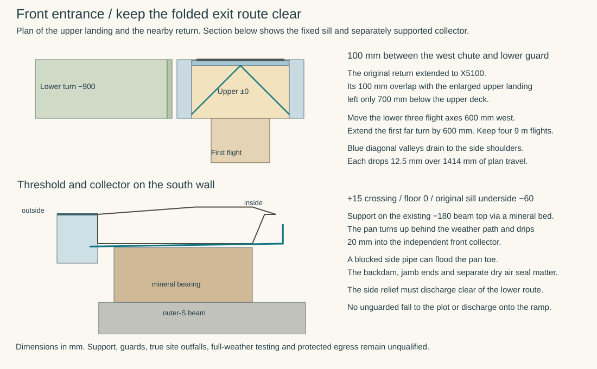

# Drain the front entrance without losing the folded exit route

**Reject a straight extension of the existing upper landing to suit the 1800 mm doorset.** It puts a 200 mm upper deck above part of the return landing only 900 mm below. Develop a 2000 mm upper platform with two lateral water routes and shift the lower three flights 600 mm west. Keep the pair of entrance leaves and the 1200 mm protected centre strip. This is a proposed HAD/STR/DPL change for the actual front door. Neither the restricted plot nor the doorset, guards and support are admitted. [Source opening and approach](../had/studies/water-replan.json) · [Existing folded route](../had/studies/garden-failure-bypass.mjs) · [Calculated geometry](studies/front-threshold.json)

## A landing that fits the door and the return underneath

The top of the existing approach spans X5400–6600, Y−1200…0 at Z0. The rough entrance opening spans X5100–6900. It projects 300 mm beyond that landing at each side. The current HAD reference has four 9 m flights at 1:20 to a trial grade of −1800. The −150 general grade in the earlier OAS front section belongs to a different comparison. The 1:80 in that detail applies to the surface leaving the collector. [OAS front section D](../../docs/reference-house/opening-interface-studies.md#d--front-threshold-case-at-15) · [Source-bound physical floor and doors](ground-field-assembly.md)

| Plan test, mm | Result |
|---|---|
| Widen the upper landing to X5000–7000 on the original fold | The −900 turn at X2400–5100 occupies the same Y strip. Its 100 mm overlap leaves at most 700 mm below the new 200 mm deck, before local crossfall or supporting structure. This violates the lower clear walking territory even when a centre-line body avoids the overlap. |
| Keep the first flight at X6000 and move only the next one west | Moving X4500 to 3900 leaves just 900 between that centre and the unchanged X3000 third flight. The two 1200-wide running fields would overlap by 300. |
| Move the lower three axes together | Trial X6000, 3900, 2400 and 900. The revised near return stops at X4500. Its 100 guard territory ends at X4600, leaving 100 mm before the west shoulder's X4700 chute/work limit. Shifting by 500 would leave zero. Both lower inter-flight gaps retain 300 between walking widths and 100 after both guards. |
| Repair the whole connected path | The first far turn widens from 2700 to 3300. The other paired turns retain 2700. The bottom foot moves from (1500,−600,−1800) to (900,−600,−1800), shortening its final connection to the west bypass by 600. The westernmost guard now reaches X200. Rebind all footings, deck edges, guards, overhead zones and site limits. A wider landing requires an additional support wherever the existing 2000 mm maximum comparison spacing would be exceeded. |

## Keep the sill level and send blocked water sideways

Read the dimensions from the OAS section itself. Its threshold nose is at Y−20. The 100 mm wide, 100 mm deep collector occupies Y−120…−20. Its near-door walking grate is level at Z0. The sill reaches +15 and the internal crossing returns to the floor at 0. Extend the landing 100 mm beyond each rough jamb, with separate protected side channels beyond X5000 and 7000. The clear paving between the outer grate edge and ramp start is **1080 mm**. A single 1:80 plane across that distance ends 13.5 mm below the unchanged first ramp. Its low end would deliver water directly to the escape flight.

Use four plane paving fields. Let *s* be the distance south from Y−120 and *u* the distance east or west of X6000. Set the level to **−min(s, |u|)/80**. The full grate edge and central ridge stay at 0. On the wall side of each diagonal, water falls south; on the other face it falls laterally. The two diagonal valleys descend 12.5 mm over 1414 mm, a gradient of 1:113.14. They terminate at X5000/7000, Y−1120. Beyond them the last 80 mm still falls sideways. Keep those edge apertures clear through the tail, with no solid border or guard foot across them. Two opposing 5 mm endpoint errors leave 2.5 mm of diagonal fall. At 6.25 mm each it disappears. These are delivered-level sensitivities. Cross-check intermediate flag joints for local lips and ponds as well as the endpoint survey.

Across the 1200 mm ramp mouth its edges are −7.5, while the centre stays at 0. Carry the crossfall across the joint and fade it to zero over the first 1200 mm of the existing 1:20 flight. The centre advances to −60. The edge advances from −7.5 to −60, giving a 1:22.86 longitudinal grade there. The steepest combined local gradient approaches 1:19.40 beside the centre ridge at the entry because the surface also falls transversely. The four original centreline drops and the −450 first far landing are retained. Form the taper with signed levels and check paving, full manoeuvre, rails, slip and real doorset operation. A route drawn through the centre cannot establish an access or escape classification.

## Support the sill independently of the collector

At X5100–6900 the existing outer-S girder runs along X on Y332.5. Its 700 mm width places its faces at Y−17.5 and +682.5, top −180. It continues between P21 at X4800 and P22 at X7200. The projecting court seat lies on a different beam. Trial a mineral bearing at Y20–360, over this actual front beam, leaving 37.5 mm to the front concrete face. The front sill nose overhangs the bearing by 40 mm. The gross height from beam top to the OAS sill underside at −60 is 120 mm. Resolve the actual shaped seat, 1.5 mm formed pan, local non-crushing load spread, fixing, insulation return and differential movement in this height. The issued floor proposal retains 100 mm cellular glass, 65 mm service space and 15 mm finish above its slab. The insulation and the removable grate cannot carry the door. [Structural beam geometry](../str/studies/current-house-grid.json) · [Actual floor and jamb DPC heights](floor-pour-boundary.md)

Run the pan from Y435/Z−60 to Y−40/Z−65.94, a 1:80 outward fall. Its 20 mm overlap projects over the collector without tying the separately supported landing to the door. Return the pan up to −20 at Y435, beyond the OAS sill body and 5 mm below the floor-finish underside. Give both jamb ends closed upturns tied into the weather face. The ordinary masonry DPC at −180…−30 ends at the jambs. It cannot bear a full doorset or prevent water travelling through the RC beam. Lap the room-side air return to a separate inspectable dry termination beyond the pan. The primary collector floor crowns at −77 and falls 1:100 to −87 at each x end. A 1.5 mm skin and 8 mm support allowance leave 3.5 mm within the −100 box. At the centre, subtracting a 1.5 mm pan lip and 4 mm relative vertical movement leaves **5.56 mm** above the collector floor. Horizontal movement of 4 mm leaves 16 mm overlap. Positive supports, movement loads, anchors, air corners, jamb closure, conductive bridges, wet wall and exterior splash require a complete specimen.

## Give normal drainage and blocked drainage distinct exits

Reserve a 300 mm strip outside each platform edge to hold a longitudinal side trough, guard and enclosed relief chute without occupying the walking field or the lower turn. The transverse front collector discharges into both troughs at its ends. Also leave the last 380 mm of each paving edge open into the side trough, including the whole 80 mm tail. Grade each trough bottom from −115 beside the front collector towards a low removable silt pocket at −145 beside the outer landing edge. Give each pocket an independently roddable normal outlet and a separate, visible 200 mm clear overflow at −55 that discharges down the outside of the platform in a guarded gravity chute. Carry each chute to a verified external receiver clear of the approach, lower folded landings, house base and garden bypass. A drop to unspecified ground 1.8 m below is an unresolved hazard, not a receiving detail. Size and locate the normal outlets, pipe/chute crossings, ironwork, guarding, fire strategy, scour protection, snow/debris access and actual two site terminations before admission.

Challenge either side with **0.4518 L/s**. This applies the existing 216 mm/h stress intensity to the entire 2.4 m² landing plus the full 5.13 m² bounding rectangle of the door. Charging its vertical face at the horizontal rate is an authored adverse allowance. Roof runoff, displaced water, wind-driven jets and site surcharge need their actual inputs. For free rectangular control, the ideal specific energy is 1.5 × [Q²/(g b²)]⅓, with SI inputs. This gives the following necessary heads before losses, blockage and approach effects. [Project rainfall challenge](../rwt/studies/live-receiver-renewal.json) · [Calculation](studies/front-threshold.py)

| Failure state | Path and limit |
|---|---|
| Near-door inlet grate blinded | Surface water leaves the flush crossing on the four facets. Over the final 380 mm of side edge the highest paving crest is −8.75. Charging the full event to one unobstructed side gives 7.86 mm of ideal specific energy. After a separate 5 mm adverse allowance the resulting level is +4.11, only **10.89 mm below the +15 sill**. Water can reach the centreline at 0 before reaching that sill. Finishes, real flow spreading, edge guards, splash and head loss govern occupied use. |
| Normal downstream pipe obstructed, local overflow open | The 200 mm side relief needs 12.06 mm of ideal energy above −55. Adding 5 mm gives −37.94, 25.44 mm below the −12.5 paving low line. This backed level **submerges the pan toe by 28.00 mm**. It leaves 17.94 mm below the proposed −20 backdam. Prove the enclosed pan ends, drain and dry return with the normal outlet blocked. Do not infer harmless backwater from the visible grate. |
| Both outlets blocked or site water above the relief | The independent site outlet has failed. Water can enter the pan and rise to the −20 backdam before the nominal +15 crossing gets wet. The level central ridge leads back to the sill. Reject occupied one-fault credit without a demonstrated independent harmless spill, actual first-wetting and a verified route at the nominated event. |
| Maintenance | Rod the fixed collector from the separate outside end chambers, remove the shoulder silt receivers outside the 1200 clear strip and keep its crossing supported. Routine cleaning must leave the protected entrance usable. A full-width grate, landing or door exchange requires a verified load-bearing temporary crossing or an approved interrupted-occupancy/alternative-exit state. The court door supplies no automatic substitute. |

Use a blocked-collector wet test and a separate blocked-pipe/overflow wet test with the assembled door, jambs, guard posts and completed ramps. Survey the 13.5 mm failed plane, working falls and actual first-wetting levels, test the protected dry air joint separately, and reinstate the normal outlet and covers before return. This decision supplies a front-specific architectural comparison. The [1400 mm east plant threshold](plant-threshold.md) follows its own cylinder and W9 carrier through a removable crossing onto a raised dock.
