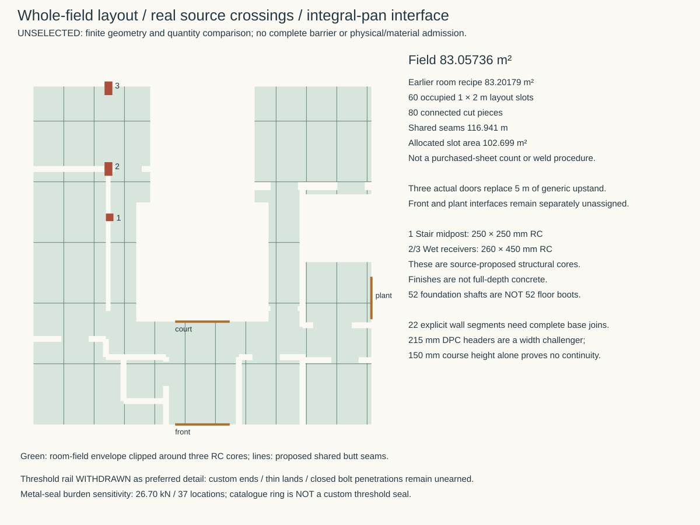
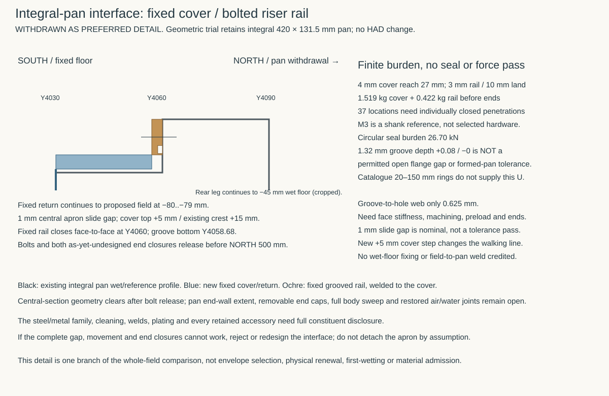

# Whole-field assembly and conventional concrete control

**6 November 2026 — development comparison; no selected geometry, material or physical admission.** The [control](studies/ground-field-assembly.json), [producer](studies/ground-field-assembly.py), [results](studies/ground-field-assembly.results.json) and two figures below consume the immutable source roles already established in the [ground/pier comparison](ground-pier-boundary.md). HAD checkpoint `c2d5c380` / blob `265ac194` owns the corrected integral threshold pan; historical STR sources own proposed support geometry. This is a comparison against those identified inputs, not a claim that every subsequent STR proposal is selected.

## Decision and complete-route test

**Withdraw the bespoke dry-riser rail as the preferred threshold detail. Test the conventional concrete floor and continuous inorganic wall break before committing to a whole-house metal field.** The earlier preference for a separate field over **52 proposed structural source cuts plus an unauthored dry-grid enclosure** remains a comparison between those two constructions. It did not establish that a separate sheet is simpler than a performance-qualified suspended concrete floor. This study makes that missing control explicit. Neither concrete nor pan has yet earned a complete route; no material exception follows.

The upper-pier plate remains bypassed by ground → pile → common RC grid → RC floor → glass joints. That disproves its claim to cut the whole floor's moisture source. It does **not** prove that every concrete section transmits unacceptable moisture to its upper surface. That requires actual material, joints, sources and performance. Ventilation cannot itself sever concrete; equally, a drawn capillary connection is not a measured floor failure.

| Complete route | Work retained | Added burden / unresolved proof |
|---|---|---|
| Conventional suspended RC field | Selected 15 mm finish / 65 mm accessible distribution / 100 mm bare glass / RC 200; wet-tolerant common underside; continuous inorganic wall-base break | Exact concrete, connected support/seat exposure, cracks and construction joints, floor/wall air junction and all three doors; actual thermal surfaces, ground-air and site suitability |
| Separate sheet above glass | Same accessible stack, with the unselected 1 mm sheet at −80..−79 mm leaving 64 mm distribution; mineral wall/support cuts still required | Supported seams, movement, puncture protection, boots, wall-base closures, three renewable doors, fabrication and field repair; no welded service lid |
| Lower structural source cuts | Actual signed support actions and complete bulk-water exclusion above each cut | Previous 52-head footprint comparison is not a plate design, dry enclosure or whole-house quantity for upper boots; retain as challenger, not default |

### Conventional source control

[England Approved Document C](https://assets.publishing.service.gov.uk/media/5a8192a0e5274a2e8ab54b5f/BR_PDF_AD_C_2013.pdf), 2004 edition with 2010/2013 amendments, §§4.17–4.22 and 5.5, was checked on 6 November 2026. Its in-situ example uses at least 100 mm concrete, 300 kg cement/m³ and 40 mm reinforcement cover. It also addresses ventilation, effective drainage, conditions requiring a membrane, condensation and wall/floor damp continuity. RC 200 clears the thickness comparison only. HAD's floor-join text names a 40 mm cover **hypothesis**, not an authenticated actual floor cage/cover schedule; bridge or other member cover cannot supply it. The actual floor cover, mix, connected sources and joints remain unbound. Site ground-gas and pressure-water assessment remains necessary; neither a blanket waiver nor a universal hazardous-site membrane is inferred.

The next internally solvable control is a **continuous section** from wet common RC at −380..−180 mm through the actual wall base at −180..−30 mm to dry-side plaster and accessible floor. Assign the concrete mix/curing/crack and joint construction, mineral units/beds, movement, retained constituents and repair before claiming air or moisture performance. Keep ordinary clamped laps accessible where a complete supported lap, working gap and sealing method can actually be justified. A clamp alone does not make rough mineral/formed-metal faces airtight. Do not replace that proof with a catalogue seal or a no-pan assertion.

## Located field and wall-base burden

Three source-proposed RC cores cross the proposed sheet plane: stair midpost **[2817.5, 7132.5, 250, 250] mm**, and wet receivers **[2772.5, 8627.5, 260, 450] mm** and **[2772.5, 11287.5, 260, 450] mm**. HAD's literal cores and STR's receiving-pier height locate concrete from −180 to +3020 mm; finished obstacle rectangles are not full-depth concrete. Clipping these cores changes the earlier room field from 83.20179 to **83.057362 m²**, with **123.761 m** edge. This is not a complete contact census: lower stair-toe contact ends, four lower loggia portal piers and the source-proposed corner restraints still require their actual bearing/exposure boundary. **52 foundation shafts are not 52 floor boots.**

One explicitly clipped 1000 × 2000 mm layout gives **60 occupied layout slots, 80 connected pieces and 116.9405 m shared butt seams**. Its allocated slot area is 102.698881 m², including 19.641519 m² unused within occupied slots. This is no optimised nesting, weld procedure, purchased-sheet schedule or proved backing/support detail.

The three actual doors are front 1800 mm, plant replacement 1400 mm and south court 1800 mm. Their 5 m replaces generic 230 mm upstands; their real interfaces must be added separately. The resulting 1 mm flat-plus-ordinary-return mass screen is **871.94 kg** at 7900 kg/m³, before door interfaces, boots, seams, corners, support, waste and finishing. Upper L plates add the earlier **164.57 kg** only if their local structural capillary duty remains necessary.

[Stainless Europe's exact 1 × 1000 × 2000 mm 2B 1.4404 stock listing](https://stainlesseurope.co.uk/en_GB/p/Stainless-steel-sheet-1-X-1000-X-2000-mm-2B-1.4404/40850), accessed 6 November 2026, advertises £216.53 without VAT and 16 kg per sheet. **One full sheet per occupied slot**, with no offcut reuse, is £12,991.80 without VAT / 120 m² / 960 kg nominal stock for flats alone. This deliberately simple scenario is not a fabrication order or landed UK price. Returns cannot be credited as free offcuts without a cutting/folding plan. Supplier mass differs from the authored density screen; no certificate, retained film/residue, weld consumable, delivery, fabrication, installed labour or whole-life quotation is established.

The inorganic wall break is common to both floor routes. Two 65 mm courses and two 10 mm beds occupy the current 150 mm wall-base territory; the top wall bed is not silently added inside it. A 102/102.5 mm stretcher does not supply full-width bearing beneath a 140 mm core. Testing **215 mm full headers** under the 22 explicit wall segments consumes another **0.828457 m²** of local floor territory below FFL. Under a centred 140 mm core it projects 37.5 mm each side, normally 10.5 mm beyond the 27 mm plaster; a 100 mm core projects 57.5 / 30.5 mm respectively. These are unselected local width consequences, not new room geometry, complete outer/court DPC quantity or a passing bond/load/thermal detail. The [existing exact-unit/mortar/slate source limits](envelope-ground-boundary.md#exact-candidate-evidence-and-remaining-holds--31-october-2026) remain; no additives or material acceptance are invented.

## Rejected preference: integral-pan dry-riser rail

The actual pan stays integral: **1796 × 420 × 131.5 mm**, with apron/step **4030/0 → 4060/0 → 4060/15 → 4090/15** and NORTH 500 mm withdrawal. A trial fixed 4 mm cover reaches Y4057 mm, underside +1 mm / top +5 mm; a 3 mm grooved rail welded to the fixed cover meets the existing riser at Y4060 mm. Releasing bolts would separate its central section northward without a permanent field-to-pan weld. Its new +5 mm step and rail face alter the walking line; no HAD geometry change is adopted. Actual ends, tolerances and full apparatus sweep are not proved.

[Trelleborg's April 2025 Wills Rings catalogue](https://www.trelleborg.com/seals/-/media/tss-media-repository/tss_website/pdf-and-other-literature/catalogs/wills_rings_gb_en.pdf?rev=aa8596043d1d45b0b3da37c0cdb6b4bd), pp6, 10, 14 and 24, supplies only a burden control: thin-wall 1.59 mm circular C rings have a typical 15 N/mm seating load; a 1.32 mm groove depth with +0.08/−0 tolerance and 2.25 mm minimum width accompanies a 20–150 mm diameter range. Its specified housing finish and replacement after dismantling matter. It does not supply this 1780 mm straight/end-return joint. Groove depth is not a permitted open flange gap or formed-pan tolerance.

Applying that line load only as a sensitivity gives **26.7 kN**, or 721.6 N equal share at **37** reference locations. The trial's 10 mm vertical land leaves only **0.625 mm** groove-to-reference-hole web and 1.68 mm metal behind the groove. Each pan penetration needs a closed welded boss or its own sealed boundary; an ordinary captive nut is an air/moisture bypass. This adds 37 fabrication/inspection duties before end closures, custom seal, machining, preload, distortion and actual tool access. The 1.52 kg cover / 0.42 kg rail and elastic strip calculation do not qualify them. **Do not develop this as the preferred joint without a demonstrated benefit over the conventional route.** No polymer exception, pressure seal or renewal pass is earned.

## Thermal price, repair and next decision

Both routes retain real common RC, pier and seat heat paths. Perfect insulation continuity is not an invariant: robust direct bearing may be preferable with a priced bridge, but actual internal surfaces and movement/air joints must work. The previous one-dimensional L-path screen and local three-dimensional scratch are not actual surface or whole-floor passes. A credible comparison must calculate the located RC/metal/mineral junctions and condensation conditions, then pass actual W/K changes to Services; no assumed heat-loss budget or invented energy saving pays for the sheet.

For the sheet, ordinary service work lifts finish/distribution without cutting the boundary. Local field repair additionally requires controlled access, supported weld/patch procedure, protection of retained glass and restored tests. Renewable pan work releases its complete interface, ends and hardware without weakening the wet pan; the rejected rail has not supplied that sequence. For concrete, identify accessible joint inspection/repair and consequences of a concealed crack before finishing. Concrete durability and a nominal metal grade are not renewal plans.

**Next bounded decision:** resolve the located conventional wall/floor/three-core and south-threshold boundary as one construction, including actual concrete performance and continuous mineral break. Retain front/plant doors as separate joins. If the concrete route cannot own the assigned sources/performance, return to the already quantified separate field with a simpler complete renewable closure; do not revive 37 bespoke penetrations merely because its central sketch clears. All six [whole-envelope exits](loggia-envelope-boundary.md#mat-envelope-owning-exit-table) remain governed by their actual dependencies; this ground comparison closes none of them and MAT-ENVELOPE remains open.

The continuing [located conventional junction comparison](conventional-ground-junction.md) now binds the actual proposed floor cage/cover/pour, one aggregate leakage allocation and the distinct dry-apron air duty. It prioritises an ordinary supported overlap or replaceable compression interface over an inherited circular-seal force requirement, while retaining independent water/capillary/core and complete end duties. Neither route is selected.
