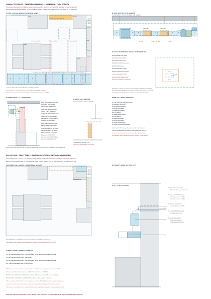

# Joined cooker families — sourced development comparison

**6 November applicability correction:** the [actual water-replan kitchen review](kitchen-replan-heat-result.md) rejects this comparison's assumed north900/east1400 spatial join: the new larder occupies the north station, while the longer east radiator intersects the retained sink feed column and its front pull enters the cooking station. The arithmetic below remains dated comparative evidence, not a viable current-room pair. Existing canonical Services is unchanged; the west1100/retained-east1200 challenger requires actual full-kit proof before adoption.

This packet joins an actual **Swegon Salsa PSV6 + Twist TTEC** external-motor family to the retained six Titon13/16L/s extracts, six habitable inlets and connected14-node house. It compares the OEM control path, physical exhaust/makeup kit, all256 fan-mask/command combinations and room/plant heat consequences. The earlier Novy810 tempered-air candidate, oversized6910 and manual-onlyERA remain explicit controls. **No family is selected for the house, operation or procurement.** No HAD/IAS/OAS projection or material exception is adopted.

The [generated result](studies/joined-cooker-system.json) and [two-sheet assembly/task drawing](studies/joined-cooker-assembly.svg) are reproduced with `python project/mat/studies/joined-cooker-system.py --check`. Review-base main is `ceb2684ecd2f6c07fc06a78440fc8df51e5ed51d`; all six declared input blobs are verified at that real main. The starting main remains separately recorded. Source comparisons and guarded calculations are reproducible; unsupported curves and physical duties remain visible.

## Matched Salsa/Twist challenger: what the sources earn

The [Salsa leaflet](https://www.swegon.com/globalassets/digizuite/10096-en-casasalsa_productcatalogue_en.pdf) and [Twist instructions](https://www.swegon.com/globalassets/digizuite/10108-en-casatwist_installation_en.pdf) explicitly match **PSV6 and TTEC**. The hood's AO/GND output controls the separate EC motor; hood24V and fan230V supplies remain separate. The [current Salsa instructions](https://www.swegon.com/globalassets/digizuite/18988-en-salsa_genius_installation.pdf) retain three factory speed commands **2/5/8V**, supported1–10V commissioning, and an OFF position. Twist used solely for the cooker hood expressly requires enabling OFF. This is an actual external-motor control route; it does not inherit the Novy window-contact wire polarity or authorise modifying certified internals. A specific latched pressure/flow controller, input diagnostics, motor interruption, response/coastdown, zeroing and manual-reset wiring still need qualification. An intended0–10V interface alone is not a certified safety function.

The pressure screen joins the published50/70/100% Twist chart curves, Salsa boosted-hood and YGC125 grille curves, an explicitly authored short-bend/Darcy remainder and **−50/0/+50Pa wind sensitivities**. These are declared development assumptions, not a measured site wind envelope. There is no published2/8V curve in the recovered material:2V uses a declared affinity surrogate;8V has an authored nominal and independent7/10V envelope. Quadratic hood/grille fits outside the printed flow/pressure domains are flagged. **No row receives operational admission.** Source uncertainty cannot silently become an OEM operating point.

| Manual command | Calm authored flow L/s | Expected negative or hold |
|---|---:|---|
| Factory2V | 14.217 | Below48L/s capture comparator; adverse stress has no forward flow; favourable stress exhausts surrogate chart domain |
| Factory5V | 44.044 | Below48L/s capture comparator; retained as a real low mode |
| Factory8V | 68.819 | Unpublished8V curve; use source7/10 envelope, not a fictional exact point |
| Allowed10V ceiling | 79.342 | Full ceiling retained; hood resistance fit exceeds printed71L/s domain |

All64 local-fan masks are enumerated at each of those four commands: **256 rows**, each carrying calm/lower/upper cases, source-domain flags, direct supply velocity and thermal duties. The OEM **EN13141-3:2017 75% at48L/s,600mm mounting** is distinct from its IEC76%/40L/s statement. Neither establishes installed capture; low modes are not relabelled adequate. The hoodOFF network remains kitchen−8.305Pa normal/−12.581Pa all-local-boost. Those background fan/transfer states need scoped disposition; PREARM must establish pressure before enabling extraction, and an ideal−4Pa boundary is not a tested controller. The conservative kitchen5Pa protective limit and inherited−5Pa/5s fault contract are retained.

For the retained two200mm/3kW VEAB stages, no heating power is credited below1.5m/s because the source limits power without supplying a guaranteed derating curve; below0.7m/s its cutoff remains binding. The worst zero-credit band approaches **2,836.46W kitchen heat**, exceeding the former east1200+north900 output. A sourced **Stelrad3063314 H600L1400,3345W atDelta50/n1.32** plus northH700L900 gives **2,935.43W at55/45**, a98.97W arithmetic margin across that band. The actual1400 unit is73.5kg dry/13.72L water, about87.22kg filled before valves/support. Its proposed complete1550mm box at[11370.5,9975,200,1550] leaves only45.5mm to the north room edge. Window/cill/feed/valve, cooker/cabinet heat, lifting and fixing duties remain owning joins. The256 sampled cases all fit this heat comparator and net14kW hydronic comparator; this is not exact net-plant or whole-room heat-loss admission.

The second drawing sheet retains the **600mm glass/598mm housing,179mm hood and455×200×353mm/9.5kg Twist** bodies, factorycaps/brackets/cable and separate supplies. The family table's525mm depth exceeds the490mm extended dimensional drawing;525 is reserved until the exact revision binds. At an authored900mm hob and1500mm hood underside, the source600mm capture mounting is represented. A200mm connector allocation includes the required sleeve or minimum100mm125duct, then353mm complete fan,89mm outlet allocation, actualBKU125/90 installed leg79mm and477.5mm wall sleeve centreline to the outer face. Connections, overlaps, insulation, fastener/lock/tool and support shapes still need a fully bound kit.

A normal north exit requires a **proposed[11125,12000,2400] cooker port**,75mm west of selected[11200,12000,2400]. The old239.214mm ring reserve gives only a164.214mm geometric translation bound. MAT has acknowledged this as a separate proposed occurrence, with no source adoption; actual host/arch, cavity/fire/weather, grille/formed320 closure and OAS/HAD reconciliation remain open. The kitchen13/16L/s outlet at3010 remains separate. The lower hood's complete first release cannot borrow the earlier high-podium access proof. The table and refrigerator stay fixed; actual hood/filter slide, supported motor/casing release, body/deck/driver/door/chair route and external terminal cleaning remain explicit duties.

The2019 Salsa BVD declares PVC, epoxy/FR4, TBBP-A, POM, PC, TPV/Santoprene, silicone and PE paint; its aluminium filter differs from the current leaflet's stainless filter. The source revision and every mandatory material remain unresolved under the default policy. Required caps, seals, safety parts and certified internals are retained. The separately sourced Panasonic high-temperature/KEYMARK comparison below improves plant evidence but does not establish this house's net14kW after glycol/HX/defrost or actual electrical capacity. These are development holds, not generic later-installer excuses or an owner waiver.

## Historical ERA/Novy controls and inherited pressure network

## Connected air and safe command sequence

The current [14-node source topology](connected-cooker-network-result.md) is solved anew at **kitchen −4 Pa as the nominal challenger**. **−4.5 Pa was an authored compatibility calculation point, not a governing requirement.** The inherited [cooker controls](studies/cooker-capture-modes.json) separately trip after pressure below −5 Pa for five seconds, while its original5Pa screen qualifies intake terminal loss. The owner-directed conservative5Pa kitchen protective ceiling is a separate retained trial contract, not an all-room criterion. The nominal −4 point leaves just **1 Pa combined sensor, response and transient budget**, not a verified safe margin. A nominal −5 setpoint has zero such margin and is rejected. Contracted arches and ensuite door proxies retain their documented uncertainty. Room transfer, local extracts and direct intake conserve air to within 0.000001 L/s at every node.

| State | Habitable inlets L/s | Direct cooker intake L/s | Total outside L/s | Extract including hood L/s |
|---|---:|---:|---:|---:|
| Hood off, six normal | 78.000 | 0 | 78 | 78 |
| Hood off, six boost | 96.000 | 0 | 96 | 96 |
| Hood on, 160 m³/h BEP, six normal | 71.354 | 51.090 | 122.444 | 122.444 |
| Hood on, 70 L/s upper sensitivity, six normal | 71.354 | 76.646 | 148 | 148 |
| Hood on, 70 L/s upper sensitivity, six boost | 82.885 | 83.115 | 166 | 166 |

The Ø250 gross area is 0.04909 m² and air velocity at 83.115 L/s is 1.693 m/s. An **authored** terminal with 75% gross free area, Cd 0.61, K=2, 0.6 m duct and Darcy f=0.03 needs **11.783 Pa** at peak; half of the original 75% net area needs **36.438 Pa**. These exclude shutter, fan casing, screens, silencers, bends, joints, weather and wind. The additional fan head beyond the 4 Pa kitchen depression is respectively **7.783/32.438 Pa**, before those missing parts. A nominal maximum airflow or a bare duct pressure curve cannot establish performance at all three hood speeds and every six-fan mode, including fouling and external wind. Excess fan flow could pressurise the kitchen or reverse protected transfers. The six local fan installed room pressure and boost point, bedroom delivery, hood capture and acoustic result require the same configured network proof.

The [same exact model's pressure sensitivity](studies/joined-cooker-system.json) gives **76.646/83.115 L/s** direct normal/all-boost at −4 Pa, 75.615/81.550 at −4.5, **74.692/80.303** at −5, and **68.107/72.699** at −10. The increased depression at −10 raises the maximum modeled room depression to 12.208 Pa and changes protected transfer and bedroom supply; **−10 also conflicts with the inherited −5 Pa/5 s trip** unless its owning source contract is deliberately redesigned and revalidated. Neither the 1 Pa budget nor capture, door force, draught, noise, fan reserve, moisture/IAQ and backdraft performance is proved by this steady flow sensitivity. The current house has no combustion appliance, but external combustion/smoke and future interfaces still require the applicable design assessment. A manufacturer controller with −10 Pa as its low bound is retained only as a redesign comparator, not admitted by this result.

One possible control architecture uses a [Lindab DTBCU spring-return shut-off shutter](https://www.lindab.com/Catalog/ventilation-systems/air-distribution/dampers-and-measure-units/shut-off-dampers/with-on-off-motor/dtbcu/) **fully open** during RUN and an independently controlled [Systemair K 250 EC sileo fan](https://www.systemair.com/en/products/fans/duct-fans/circular-duct-fans/k) with a suitable measured pressure loop. It avoids asking the Lindab DTU blade to regulate continuously, which its [source permits only rarely](https://www.lindab.com/globalassets/commerce/lindabwebproductsdoc/assets/production/ztqymjq1mditzgm1zs00nju5lwjlyjktyzdhnzc4yte0odcz/5250235942702241834/dtu.pdf?v=1772929437). The fan family has a reinforced-polyamide impeller; the shutter has an EPDM seal. Both are **material residues**, with no exception or substitution approval. The [EC-Vent control family](https://shop.systemair.com/upload/assets/EC-VENT_USER_MANUAL_GB__A005_.PDF) can vary an EC fan using a differential sensor, but its exact sensor range, fixed −5 Pa accuracy, hood interface and safe response are not established in this assembly. No qualified fan curve, installed pressure loss or actual output power has been credited.

1. With the manual hood **off**, the user requests PRE-ARM. Independently powered shutter opens. The earlier real DTBCU option has up to **150 seconds powered stroke**; a five-second substitute is unearned. Its position contact, analogue position, sensor health and fan readiness must be proved without assuming flow while the hood is off. A READY indication invites the user to turn on the factory hood manually. It never starts the hood.
2. Manual hood operation commands RUN only after READY. The fan responds to actual hood flow and kitchen pressure while the shutter remains fully open; all published hood speeds remain usable. Actual transient pressure and fan ramp must be shown safe at each start, change and stop. The OEM must approve any external power inhibit/trip path so a hood cannot run when makeup is unavailable. READY alone does not prove running airflow.
3. On manual hood off, stop the fan before shutting the spring-return shutter. Lost position/pressure feedback, low verified airflow, controller/power loss, blocked terminal or failed fan must trip or inhibit hood through the **OEM-qualified interface**, latch an alarm and require a manual reset. A separately powered hood must fail safe too. This is a required logic contract, not an installed controls approval; until the OEM and transient evidence exist, the assembly is rejected for operation.

The actual Elica ERA source documents a mechanical slider and factory speeds but does **not** establish a qualified external safety interlock or a separate remote run output. No relay may be inserted into its certified internals, nor may an external controller energise the hood. As an OEM-path alternative, the [Novy 990036 I/O module manual](https://www.novy.com/Media/Novy%20Collection/Installation%20Manuals/Accessories/990036_10540_MABC2_LR.pdf) describes a potential-free **input** that inhibits extraction while closed, and an **output** that can signal an external air valve. The [manufacturer compatibility list](https://www.novy.com/products/accessories/other/window-switches/990036/) names Panorama 1821/1831/1841 ≥v5, 42110/42120 ≥v01 and **Pureline Pro Compact 6910–6922 ≥v01**; it does **not** include the Elica ERA or a 52 cm integrated replacement. The [actual Novy 6910](https://www.novy.com/en-gb/products/cooker-hoods/ceiling-units/novy-pureline-pro-compact/6910/) is **868×508×195 mm**, requires an **845×485 mm cutout**, and publishes 257/474/550 m³/h plus 618 m³/h boost. It cannot fit the current 600 mm cooker station as an unchanged hood. At its unwaived **171.667 L/s boost**, the same −4 Pa connected graph requires **184.782 L/s direct makeup**, 267.667 L/s exterior at all local boost, **7.792 kW conservative kitchen heat** and **16.236 kW physical whole-house heat at 30 K**. This exceeds the H600+H700L900 70/60 arithmetic emitter by about3.178 kW and even a 14 kW *net delivered* plant by2.236 kW. The existing Ø250 placeholder terminal loss scales to roughly **58 Pa** at that direct flow before other components. Thus this documented OEM interface is a **rejected same-house replacement**, not an automatic cure; a different integrated hood and revised HAD/fabric/heating proposal would need a fresh source join and full-speed capture. The module output remains closed for **five minutes after hood stop**; it cannot serve as an immediate hood-off truth for fan shutdown without independently verified airflow or another source-sanctioned run signal. If no ERA-qualified inhibit exists, the present ERA assembly fails; do not assume external power interruption is approved.

The [TROX BURNF room pressure controller](https://www.troxuk.co.uk/control-component-varycontrol%E2%80%93%26nbsp%3Buniversal-static/burnf---room-pressure-spring-return-mp-modbus-bacnet-b594b3865a7b1120) has a published −10 to −50 Pa range and a VAV minimum differential requirement; it does not qualify the −4 Pa trial and is **retained as a −10 Pa redesign challenger** subject to the inherited protective-contract revision, joined room/fan/capture duties and actual low differential/flow qualification. The earlier Ø400 continuously modulated DTBCU fails manufacturer repeated-regulation suitability. A bare Ø300 passive assembly fails both normal and boost at the earlier target; Ø350 and Ø400 are not complete, removable, fouled/wind-proof controlled kits. This Ø250 assisted direction adds fan electrical energy, noise, service and controls burden and cannot be declared cheaper or preferable on nominal duct size. A smaller matched VAV/EC package can replace it only with source curves across the required modes, actual low pressure and fault/first-release proof.

## Historical ERA first-release trial — falsified complete shutter envelope

**This earlier trial is not a viable full kit: its100mm shutter box omits the230mm LF motor and is rejected.** The proposed successor port at Y8700/Z2400 (selected HAD remains Y8600) has a trial external 500 mm face Y8450–8950 and only 25.5 mm to the rear junction. The study constrains, but does not assert, a **complete** insulated fan body and motor to at most `[10800,8500,228,436]` mm in plan, a separate complete spring shutter/actuator to at most `[11200,8500,100,436]`, and their shared accessible box to at most `[10750,8450,820.5,500]`. These are procurement maxima, **not** manufacturer complete envelopes. The Ø336 bare fan housing dimension in the [Systemair K IOM](https://shop.systemair.com/upload/assets/INSTALLATION__OPERATION_AND_MAINTENANCE_INSTRUCTION_K__KV__PRIO__EN_006.PDF) plus an assumed 50 mm radial thermal jacket would be Ø436; motor, terminal, clamps, movement, acoustic, fire/weather detail and actual assembled axial dimensions could exceed it. The cold store starts at Y9025, leaving 75 mm from the unchanged 500 face. A formed sleeve must retain all thermal, acoustic, weather, fire, structure and cleanable terminal parts. Actual clear bore, frame/rebar, fan pressure and constituent interfaces need a single section/assembly drawing.

The old platform `[10145.5,8467.5,750,1100]` collides with the proposed maximum floor lift `[10550,8375,800,600]`. The assembly must first transfer every load to independently rated permanent/temporary supports, with safe isolation and capped air/weather boundary. Disassemble accessible electrical leads and clamps, separately support and release the fan and shutter without lifting through the boundary or leaving an unsupported weather face, then lower each on a rated cradle into that lift. Only after stable supported release may the old platform be removed. The lift has 50 mm plan gap to cold storage and to the R300 operator disc at `(10200,8750)`; these are **plan** gaps, not tool, human, height, scaffold, load-path or manoeuvre proof. Reassemble in reverse with commissioning, seal and fire/weather verification. The actual full mass and centre of gravity, attachment, fasteners and tool strokes, operator standing, ceiling height, hoist reactions, external terminal cleaning and removal at end of life are unprovided. A larger jacket, motor or complete tool envelope rejects this layout; the old Ø400 box cannot be credited.

## Joined heat and plant duty

The [authored 950 W kitchen allocation reconciliation](constructive-cooker-system-result.md) is retained conservatively: `950 × 30/25 + 36 × direct L/s` at 30 K, with no cooking gain, fabric improvement or double-count of the upstream 13 L/s. The all-boost 70 L/s hood state requires **4,132 W** kitchen heat at −4 Pa (versus 4,076 W at the previous −4.5 Pa). Existing H600×L1200 plus the only north H700×L900 that avoids the fixed sink/cooker plans yields about **3,946 W at 65/55**, a failure, and **4,614 W at 70/60**, a conditional 482 W arithmetic margin. The actual cill underside, fixing loads, filled body mass, valves, branch route, 50 mm upward lift and IAS renewal must still join the selected window and furniture. H700×L1000 has zero lateral reserve at the current station; H700×L1100 collides with sink and cooker. The existing east H700 uprate fails its drawn 850 mm window sill. No HAD furniture or opening has been silently moved.

The whole-house **physical** 30 K/all-local-boost/70 L/s hood duty is `(220 + 1.2 × 166) × 30 = 12.576 kW`. Net **12 kW delivered** fails by 0.576 kW; a net **14 kW delivered at the actual primary/secondary temperatures after defrost and plate-exchanger loss** has 1.424 kW arithmetic margin. At 14 kW, 10 K secondary water requires 0.335 L/s and separately glycol primary (cp 3.2 kJ/kgK, 1 kg/L assumption) 0.438 L/s; at 5 K these are 0.670/0.875 L/s. The 70/60 secondary demands primary supply above 70 °C by the real exchanger approach, and a source capable of **net 14 kW at the design outdoor A−10 and that water temperature**. A 14 or 16 model name does not establish this point. [NIBE lists S2125-16 variants](https://www.nibe.eu/en-gb/products/heat-pumps/air-source-heat-pumps/s2125), but the linked listing is not a configured A−10/high-temperature output, defrost or installed geometry proof. The current outdoor station reserved width/depth and pad, electric route, defrost drainage, buffer, HX, pumps/pressure losses, every emitter and room heat-loss/return temperature need a coordinated new contract. No product is selected or resized by the arithmetic.

**Decision.** Carry the complete assisted Ø250/−4 Pa assembly as one **conditional challenger**, while retaining the failed Ø300/Ø400 passive and 12 kW/65/55 controls. The −4 nominal has a 1 Pa authored protective margin requiring actual sensor/response proof; −5 fails and −10 requires an owning protection redesign. The smaller bare size exposes procurement maxima, but internal selection also requires a sourced fan operating curve and full component pressure loss, matched low-range sensor/interlocks and OEM hood approval, complete first-release drawing, material alternative or authorised disposition, room transfer and heat-loss join, and actual net high-temperature plant/hydraulic fit. If those are unavailable, reject this package and request an explicit new architectural intake/emitter/plant territory from the HAD owner. Construction, product, site and physical acceptance remain separate later gates.

## Compact OEM hood with a tempered-air train — coordinated redesign candidate

The next candidate replaces the ERA with **Novy 810 version 35**, and heats the direct supply in **two VEAB CV20-30-1-ViCi-QOL stages**. This is a coherent development alternative, not an admitted system: the hood input and valve output have actual OEM sources, but their use as a complete safety loop, installed fan/hood curves, all constituents and first release still need the specific evidence below. The old ERA trial and oversized 6910 remain negative controls. No factory hood mode is capped or removed.

The 810's [technical file](https://middleby-cdn.com/specsheets/810_35_TechnicalFile_en_2024_09_02_10_29_03.pdf), pages 1–3, gives **560×301×330 mm**, a **545×286 mm cutout**, 9.8 kg and **205/333/399/534 m³/h**. The actual [810 installation instructions](https://middleby-cdn.com/installations_instructions/810_v35_MA1_I.pdf), English pages 103–105, identify **990033** as the window-contact cable and require a load-bearing 18–35 mm mounting plate; induction mounting is 650–750 mm above the hob. The source also explains that loosening all four clamps releases the body downward. Thus width alone is compatible with the 600 mm cooking station, but this does not qualify the existing enclosure, hob clearance, accessible clamps, lowering support or extraction duct. The EN 61591 airflows are modelled as comparison loads; they are not installed operating points or capture measurements.

The [990030 instructions](https://middleby-cdn.com/installations_instructions/990030_110060_GA1_LR.pdf), English pages 26–28, explicitly include Mini Pureline 810 and describe a **230 V normally-closed valve output**: extraction opens the valve at every speed; absence of extraction closes it. This differs from the 990036 five-minute retained output. It is not a safety-certified pressure loop. The 810 window connection establishes an OEM inhibit route, but the exact 990033 wiring, polarity, response when already running, broken-wire behaviour and the proposed controller application remain to be bound. A window-only permissive must not be silently promoted to a proved safety trip. No modification of certified internals or external automatic hood energisation is authorised.

The [VEAB CV brochure](https://veab.com/en/customer%20files/files/brochures/cv-gb-vici.pdf), pages 4–7, identifies a Ø200, **3,000 W / 230 V** version, **375 mm axial length**, two overheat protections and the **ViCi-QOL** control/flow/alarm option. The dimensional drawing retains the junction box: 278 mm axial box length and an 82 mm projection above the round body. Each stage has its own duct temperature sensor and a nominal intermediate/final target of **5/20 °C**. The [current instructions 173656-01](https://veab.com/en/customer%20files/files/manuals/173656-01-manual-cv-o-se-en-de-fr-nl-fi-web.pdf), English pages 18–32, add material constraints that matter here: filtered incoming air, power limiting below **1.5 m/s**, cutoff below **0.7 m/s**, noncombustible duct, **100 mm to combustibles**, accessible uncovered covers/reset/labels, at least **2D (400 mm for the selected 200 mm heater)** separation from other duct components, and run-on until outlet temperature falls below **40 °C**. A fan stop must remove heater power first or simultaneously. The earlier Ø250 heater trial reached only 1.295 m/s and is rejected for full-power duty. The revised Ø200 heaters reach at least **2.024 m/s** across all 256 modes, exceeding the 1.5 m/s full-power threshold. The 250 mm intake and fan remain: actual reducers lie outside the clear 400 mm straights. This is a makeup-air reduction, with no reduction or cap applied to the hood exhaust. Neither safety nor the flow limit may be bypassed. Annual electrical inspection and quarterly operation/element maintenance are an additional ownership burden.

### Joined air, heat, plant and electrical duty

The generator enumerates **all 64 local-fan masks at all four hood loads**, retaining the actual connected 14-node graph and nominal kitchen −4 Pa. Every row carries direct airflow, velocity, the most negative room pressure, mass residual, physical whole-house duty, heater duty and remaining hydronic/kitchen duty. The lowest computed room node is **−10.914 Pa**. The inherited 5 Pa screen originally bounds intake terminal loss, and the separate −5 Pa/5 s trip specifically senses the kitchen; neither establishes an all-room pressure acceptance criterion. Other-room fan output, doors, noise, moisture/IAQ and transfer direction remain explicit supported-domain gaps. This is still the ideal-pressure-boundary network: an installed fan cannot be substituted for that boundary without its actual curve/control result. The 5 Pa inherited protective screen and −5 Pa/5 s fault contract are unchanged.

Two nominal 3 kW stages give 6 kW, but that nameplate cannot be treated as available under every supply condition. A conservative **0.90×voltage resistance screen gives 4.86 kW**. The study uses that bound, rather than claiming a constant 20 °C supply. At peak flow the room emitters must carry the residual unheated direct-air duty; the previously proposed **east H600×L1200 plus north H700×L900 remains necessary**. Their combined **55/45 water** output is tested against every row: **2,691.78 W** against the worst **2,092.14 W** remaining kitchen duty. The physical whole-house peak is **15,396 W**, nominal tempering requirement **5,812.14 W**, and low-line remaining hydronic peak **10,536 W**. Single-heater failure leaves **4,522.14 W** in the kitchen. A one-heater failure exceeds this room output and therefore cannot continue RUN. There is no cooking-gain, fabric-improvement, diversity or hot-water coincidence credit. Tolerance, sensor control and actual measured power can lower the credited heater output further: those must be resolved before operational admission.

The 14 kW plant comparator now means **net delivered at 55/45 secondary**, after defrost, exchanger loss and actual primary approach, instead of assuming >70 °C primary. This is an explicit altered duty requirement, not selection of a NIBE model by its name. At 14 kW/10 K, secondary water is 0.335 L/s and the existing assumed glycol primary is 0.438 L/s; actual pump head, exchanger/flow, defrost buffer, DHW priority, every room emitter, outdoor pad and full electrical duty remain a joined selection. The actual [NIBE S2125 installer manual IHB EN2442-1/831742](https://assetstore.nibe.se/hcms/v2.3/entity/document/892650/storage/ODkyNjUwLzAvbWFzdGVy), page 50, supplies 35/45/55 °C output curves for the 16/20 family, but explicitly **excludes defrost**. Its continuous curve therefore cannot establish the net14kW requirement, nor does its 55 °C primary curve cover a 55 °C secondary across an unquantified plate exchanger. This is a specific unresolved plant condition, rather than a product-name substitution. The two heaters add **13.04 A each at nominal 230 V** and up to **6 kWh per full-power hour**. Two separate permanently wired circuits and local all-pole isolation are a proposal; cable/protection/earthing and service capacity must include the hood, fan, controls, cooking, heat pump and DHW simultaneous loads. No existing service capacity or running-cost preference is invented.

### Full route and first release

**Source correction:** the selected HAD opening is **[12000, 8600, 2400]**. The earlier text incorrectly called 8700 the existing HAD port. **8700 is a proposed successor centre requiring a HAD/STR opening rewind**, not an adopted occurrence. The new route models that proposal explicitly. Its 500 mm face spans Y8450–8950, with only 25.5 mm to the rear finished face and 75 mm to the cold store. Those narrow reserves do not qualify rebar, arch/collector load, fire/cavity, weather, insulation or grille manufacture. The selected 8600 opening is not enlarged or moved by this Services result.

The train runs **straight west from the proposed east-wall sleeve at Y8700/Z2400**, with **zero bends**, inside a proposed noncombustible carrier **X7770.5–11570.5 / Y8450–8950 / Z2100–2850**. The complete motor correction extends the carrier west by129.5mm, leaving only **51mm** to the kitchen west finished boundary. The actual 3D room bounds and first-floor RC underside leave **2100 mm below the carrier** and **320 mm above it**. It occupies the kitchen side of the rear wall, rather than passing through an arch or assuming an upper void. The permanent carrier/anchors, cover movement, permitted headroom and smoke/fire consequences still require owning admission. It adds a visible 3.80 m overhead object and cannot be called a small cartridge.

| East-to-west part | X range mm | Evidence boundary |
|---|---:|---|
| Sleeve/weather boundary to outer face | 11570.5–12000 | Proposed 8700 opening; full thermal/weather/structural assembly unresolved |
| DTBCU250 LF24 shutter/actuator | 11320.5–11570.5 | Actual100ductbody/230motor axial/135projection/3.29kg baseline;250 allocation includes motor, not just bore |
| Systemair FGR250 filter | 11070.5–11320.5 | Actual 239 overall axial, 302×297 transverse; 250 axial allocation |
| EC fan including terminal box/insulation | 10820.5–11070.5 | Actual202axial/Ø336body/249spigots/40terminalbox projection/3.9kg;250/436 allocation still needs clamp/bracket/tools |
| Lindab RCU250/200 reducer | 10670.5–10820.5 | Actual 42 mm body/0.46 kg; 150 mm full connection allocation remains to be checked |
| Clear Ø200 straight | 10270.5–10670.5 | 400 mm / 2D; no hidden filter or valve |
| First complete VEAB Ø200 stage | 9895.5–10270.5 | Actual 375 mm axial body; side-facing box and accessible cover |
| Clear Ø200 straight | 9495.5–9895.5 | 400 mm / 2D between stages |
| Second complete VEAB Ø200 stage | 9120.5–9495.5 | Actual 375 mm axial body; side-facing box and accessible cover |
| Clear Ø200 straight | 8720.5–9120.5 | 400 mm / 2D before next component |
| Lindab RCU200/250 expansion | 8570.5–8720.5 | Same actual reducer; expansion loss is distinct from contraction |
| Silencer | 8070.5–8570.5 | Complete 500 mm procurement maximum; no acoustic/loss credit |
| Contact-protective supply diffuser | 7770.5–8070.5 | Complete 300 mm procurement maximum; discharge north into kitchen |

The [Systemair filter IOM, 004 / 29 April 2025](https://shop.systemair.com/upload/assets/INSTALLATION__OPERATION_AND_MAINTENANCE_INSTRUCTION_FILTER_CASSETTE_004_EN.PDF), page 5, distinguishes the FGR250's **123 mm casing depth from 239 mm overall axial length**. The latter is used. It requires **280 mm filter-change space**. With an upward hatch, the bare top at Z2548.5 plus 280 reaches Z2828.5, below the removable carrier roof at Z2850 and RC at Z3170. The remaining **21.5mm below the carrier roof is insufficient evidence for insulation, locks or tools**. Roof-panel release, insulation removal, locks/tools and human access still require proof; this is not a claim that a person can service it from the floor. An extra replacement filter/media suitability, dirty resistance and contamination interval must be bound. The [Lindab RCU sheet, 27 January 2026](https://www.lindab.co.uk/globalassets/commerce/lindabwebproductsdoc/assets/production/nge5ytfhmgqtnjdmny00njdkltkyntctn2nmodninzk3mjy3/5250737225389875375/rcu-datasheet-global.pdf), page 1, identifies the 250/200 reducer's 42 mm body and 0.46 kg; this is not the overall engaged length or withdrawal stroke. The generous 150 mm connection allocations remain procurement constraints. Their actual contraction/expansion losses and sealing constituents are not waived.

The layout has no qualified full assembly until actual fan/shutter/silencer, filter class, all couplings and supports fit their real envelopes. Noncombustible insulation must preserve heater access and labels; no factory insulation/seal is stripped. Known fan polymer, shutter EPDM, sensor housing/tubing, electronics/cables, filter binder, reducer seals, heater fittings and further undisclosed substances remain unapproved under the material policy.

Each of the fan and heater stages has a separately modelled **500×550 mm floor cradle** beneath the carrier, with a separate R300 standing disc **100 mm clear of the cradle** and no conflict with the selected furniture plan. The cradle's north edge is 25 mm short of the cold-store plan; that is a limited geometric reserve. Isolate and cool the complete system; positively inhibit the hood; retain independent support for every boundary and both duct tails; open and independently retain the side/downward carrier panels; support the complete component on a rated hoist/cradle **before** releasing accessible electrical connections and two real couplings; release one component laterally/downward into its cradle; seal retained duct/weather ends. Supports and weather face must remain independent throughout. Reassembly retains seals, fire/weather and electrical verification before reset. The source does **not** provide component masses/centres of gravity except the hood, anchor capacities, coupling withdrawal travel, clamp/tool sweeps, hoist/operator height, passage through the arch or the exact filter/terminal removal. The plan is therefore a first-release constraint and sequence, not proof of physical handling or a complete kit.

### Pressure, transitions and failure admission

A real low-range sensor challenger is [halstrup-walcher P26](https://www.halstrup-walcher.de/assets/products/measurement-technology/P26/data-sheet-P26.pdf), ±10 Pa / 0.2% FS, with the source's additional **±0.3 Pa** reference error retained. A 20 Pa span therefore starts with **0.34 Pa**, not 0.04 Pa. At 18–22 °C, the stated 0.03%/K span coefficient adds a conservative 0.012 Pa. Authored allocations of 0.10 Pa tubing, 0.05 Pa conversion and 0.20 Pa tracking leave **0.298 Pa dynamic reserve** within the nominal 1 Pa budget. These are procurement/commissioning limits, not measured performance. Its fastest **25 ms T63** is only a sensor time constant. The [manual](https://www.halstrup-walcher.de/assets/products/measurement-technology/P26/manual-P26.pdf) describes automatic zeroing, which interrupts measurement; a safe off-cycle calibration/drift bound or an independently monitored redundant arrangement must be resolved. A Beck 984 with a minimum ±1 Pa total error fails the same budget before any other allowance.

PRE-ARM opens the independently powered spring shutter, verifies actual position, sensor health/zero, fan and both heater readiness, and holds the hood inhibited. User manual start may be enabled only after the actual OEM-compatible permissive, supply response and start transient have been proved. RUN follows actual extraction and pressure through all speeds and local-fan changes; heater control must keep outlet temperatures and permissible air velocity/power within the OEM envelope. On normal manual hood stop, heater power ceases before/simultaneously with fan stop; any required cooling run-on must maintain safe room pressure and shutter state, with the heater outlet below 40 °C before complete shutdown. The valve output's stop semantics cannot alone establish this safe sequence. A cooling fan that pressurises the kitchen is not accepted merely to satisfy the heater.

Loss of pressure/position/flow or either heater, overtemperature, blocked intake, failed fan, sensor zeroing/disconnection, controller loss or power recovery must remove heater power and inhibit the hood via the actual approved input, latch the fault and require manual reset; cooling/retained boundaries follow the actual fault and power availability. Single-stage loss is a tested thermal rejection. Fan surplus, heater run-on and hood coastdown must be tested in the same connected network. No 25 ms sensor label proves a full control loop or hood stop in five seconds. Exact live OEM input response and application, installed curves/full losses and transient/fault response remain **intrinsic development holds**, not deferred generic installer questions. This alternative improves the OEM path and lower-temperature heat strategy but is not ready for system/house adoption, procurement or operation.

A manufacturer-generated Systemair catalogue card for **K250ECsileo/78585**, dated21November2025 and retained in a [public planning submission](https://docs.planning.org.uk/20251224/54/T7BK5SKBJGP00/9quyf95v263jppq1.pdf), records an actual **180L/s at120Pa /7.6V /71.9W** selection point with its fan curve. This supports further investigation of the family, not this installed train: the model requires up to161.448L/s, but filter loading, two heaters, reducers, shutter, silencer, terminal and wind have not been joined to that curve. The configured source must prove every low/high-speed operating point, control reserve and acoustics. No nominal free-air flow, interpolation of a different configured point or fan name earns that result.

The actual [Lindab DTBCU drawing](https://itsolution.lindab.com/lindabwebproductsdoc/assets/production/ZDE3OTFkYjQtNGI0MC00NTBmLWJkMjgtZjdmZTI5ZDQ2M2Uz/5249546583833160992/dtbcu.pdf), pages1–3, distinguishes **100mm round body from230mm LF motor axial extent**, 105mm motor width and135mm projection above the round duct. The earlier complete120.5mm shutter slot is rejected. The revised250mm territory must contain the100mm duct body, supported connecting tails on both sides and the230mm motor overhang without contact with the upstream wall or downstream filter. The motor faces upward; insulation must leave the whole actuator, connections and indication accessible. No hidden overlap with the filter hatch is credited. The exact connection and service/tool envelopes still need a joined drawing.

For a specific **LF24** comparison, [Belimo's8April2026 data sheet](https://www.belimo.com/mam/general-documents/datasheets/en-gb/belimo_LF24_datasheet_en-gb.pdf) gives **75s/90° powered**, **<20s spring return at−20..50°C**, 5W running/7VA and mechanical indication. This is a distinct revision-bound LF24 family point, not a five-second or150-second generic substitution. Its listed [S2A-F accessory,28May2025](https://www.belimo.com/mam/general-documents/datasheets/en-gb/belimo_S2A-F_datasheet_en-gb.pdf) provides two adjustable SPDT switches,0.33kg and a1m six-core cable, with explicit LF compatibility and sealed factory internals. The candidate can therefore develop actual open/closed feedback through this OEM accessory. It cannot credit that feedback until the Lindab-supplied shaft, actuator revision, accessory adaptation and complete installed geometry are bound. Do not add the1.4kg actuator again to the3.29kg damper/actuator baseline; the latter already includes a motor. No safety function is established by an auxiliary-switch label alone.

The current [Systemair FGR family source](https://www.systemair.com/en-hk/products/fans/accessories/mechanical-accessories/filter-cassettes/fgr) specifies Coarse50% and a replacement threshold of the lower of **clean pressure+50Pa** and **3×clean pressure**. Current UK FGR200 and NL FGR315 SKU pages still recommend170Pa, so the difference is a live regional/SKU-source conflict, not safely dismissed as historical. The exact FGR250/media/supply-region revision must reconcile these rules. The actual clean curve, measured installation and dirty threshold must control this train; neither an arbitrary favourable filter limit nor an assumed170Pa operating allowance is admitted. The source permits any installed orientation, but retains filter access and correct support. The media and rubber seals remain material residues.

The original Novy-authored **990.033_110108_MA2** manual is retained in a [recoverable mirrored PDF](https://device.report/m/726fcc763197b25f7705aecc6be2129d42933a4da143f5e7c9290f39f1dc1400.pdf); current manufacturer-host retrieval failed, while the current810v35 manual independently confirms the cable interface. MA2 page5 admits810≥v17 with a potential-free window contact; page20's electrical diagram shows **OPEN contact/windowOPEN/hoodON**, and **CLOSED contact/windowCLOSED/hoodOFF**. Original cable/WS terminals and strain relief are required. That diagram resolves polarity; it supplies no stop-delay/coastdown measurement or pressure-controller application approval. An open broken interface wire can resemble the permissive state, so claiming universal broken-wire-safe inhibition would be false. The actual controller/wiring and commissioned response must meet the retained protective function without modifying certified internals or inventing a second approved mains-trip route.

## Drawn assembly and maintenance countercheck

The [generated A3 drawing](studies/joined-cooker-assembly.svg) is part of the same deterministic check. It shows the current room/furniture/arches/windows, complete axial train, RC, selected-window/candidate-emitter cill interface, floor cradles, operator and platform, filter extraction and tool/grip/roof demands. Actual body dimensions are solid; unselected assembly/support/task maxima are dashed. It is an inspected development drawing, **not a drawing of an accepted first release**.

The [Zarges41972 comparator](https://www.zarges.com/en/products/mobile-access-steps-with-platform-single-sided-access-with-light-alloy-treads-and-platform) has an actual820×1450mm base,960mm deck,600×800mm platform,1m guard and31.8kg mass; its transport envelope is1350×820×400mm and maximum loading150kg. A person of authored1750mm height plus100mm helmet space on that deck reaches2810mm, so a platform directly under the2100mm carrier collides by710mm. Side placement has360mm head reserve to the3170mm RC, but centred side platforms conflict with the retained cold store, east chairs and dining table. No table or refrigerator removal has been credited. Actual stair/guard/castor deployment, erection/carry route, worker/load, edges and reach still require proof. The [Bahco808050P tool comparator](https://www.bahco.com/int_en/1-4--ratcheting-bit-screwdriver-with-pistol-handle-pb_808050p_.html) is260mm overall with40mm handle width and0.27kg mass; another50mm is reserved for grip. Its existence does not establish a match to every clamp/cover fastener.

The upward FGR extraction countercheck is deliberately failed: bare2548.5+280mm reaches2828.5, but100mm hand/tool space reaches2928.5,78.5mm through a fixed2850mm roof. A proposed500×500×50mm removable local roof panel would need independent support,100mm lift and550mm north slide; its full panel/grip field reaches3100mm, only70mm below RC. This is an unqualified task requirement, **not a safe roof-release product or a rescue by ignoring insulation/locks**. Actual alternate FGR orientations may eliminate the roof task, but must preserve whole filter/body/grip and fixed-appliance clearance. The remaining cill underside, complete supports and full handling task stay open.

### Constructive north-hatch and offset-platform successor

The revised drawing tests a conditional north-facing FGR hatch, retaining the failed upward task in the result. Systemair's [actual PFR200–250 replacement set](https://www.systemair.com/en-rs/p/PFR-200-250-Coarse-50percent-5-pcs-57218) specifies309×289mm including border, Coarse50%, five filters/0.9kg per set. Thus280mm minimum free change space cannot stand for the whole panel. Conservative309mm withdrawal from north faceY8851 plus100mm grip reachesY9260; the full289mm panel plus100mm below-axis grip reachesZ2155.5. Actual border thickness, sliding/rotation, dirty mass, two-hand reach, bagging and hatch/insulation/lock release remain unproved.

Selected HAD has no cold-store height. An explicit [Beko CNG4582VW comparator](https://www.beko.co.uk/appliances/refrigerators/fridge-freezers/product/freestanding-frost-free-fridge-freezer-harvestfresh-cng4582vw-anthracite-stainless-steel-effect-white),1824H×540W×575D/57kg, prevents assuming one. Its [manual](https://bekoplc.blob.core.windows.net/bekoupload/manuals/CNG4582V.pdf),pages9–12, requires50mm side/top ventilation,55mm rear allowance, accessible plug and300mm from central heating. A640×630×1874 ventilation envelope fits the existing650-square plan and leaves281.5mm below the filter/grip screen. Current radiator fails heat separation; the conditional complete east radiator shifts275mm north toY9975–11325 to earn300mm from the cold-store station. This is not selected appliance or HAD authority: actual door/reversal/plug, sunlight/heat, cill/window/feed/valve, occupied routes, transport/renewal and materials must reconcile. Refrigerator and table stay fixed during this filter task.

The conditional state parks EN chair at[10100,10500,500,500] and retains ES park[7750,10400,500,500]. Selected EN park conflicts with the new cradle and is not borrowed. Offset820×1450 podium bases at[9350,9000], [9800,9000] and[10075,9000] clear fixed furniture after those parks. The600×800 actual deck is retained; authored350mm operator fits only within that deck. A single centre-grip700mm reach screen passes; far-edge/dual-hand/tool work, chair-handler routes, deck/rail/stair orientation, erection and full lowering/support remain open. Base clearance is not complete first-release proof. MAT/HAD/IAS reconciliation remains explicit; no owning projection is edited.

The generic silencer now has a specific [Lindab SLU250/300/50 source,4December2023](https://itsolution.lindab.com/LindabWebProductsDoc/PDF/Documentation/ADS/Lindab/Technical/slu.pdf):418mm overall,300mm body,362mm maximum diameter,4.9kg including preinstalled Safe connectors. Its500mm allocation leaves82mm connection reserve; additional50mm thermal jacket gives462mm diameter within500mm carrier. Factory mineral wool, nonwoven liner and seals stay intact and unapproved. Octave insertion losses are recorded without installed acoustic/pressure credit; current supply revision and engagement/release must bind. [Systemair's actual FK family](https://www.systemair.com/en-gb/products/fans/accessories/mechanical-accessories/mounting-equipment/brackets-and-clamps/fk) retains galvanised steel, two screws, hanging tabs and8mm neoprene lining. Required constituents cannot be stripped to rescue material policy. Exact250 clamp geometry, support and mating/withdrawal strokes remain unqualified.

The filter IOM section drawing shows the panel installed diagonally through the123mm axial casing depth, explaining why its309mm border length can exceed the302mm transverse housing. No angle or flexible deformation is invented from that illustration: the north-hatch successor reserves the larger309mm straight withdrawal, retains full289mm vertical panel projection, and leaves actual guide/lock/dual-hand strokes unresolved.

### Actual pressure-curve join: bounded development screen

At the peak161.448L/s direct flow, the inspected manufacturer-generated K25078585 card shows about285–305Pa across its available envelope. VEAB brochurep4 assigns CV20/3000 to curve6: at5.14m/s this is about13–18Pa per heater, not a generic heater or higher-wattage curve. The [Systemair-generated2February2020 family chart](https://visto-shop.com/media/pdf/62/ec/0d/Systemair_FGR-I_125_Filterkassette_ged-am.pdf),p3, embeds FGR250 and reads about55–65Pa clean at the same flow; its enclosing card is FGR-I125 and is not a selected current-media revision. These deliberately broad visual ranges are development estimates, not certified points or an invented fan interpolation.

The generator joins both heater losses, both competing dirty-filter policies, the explicit authored terminal free fractions0.75/0.375,1.2m of clear200mm straight at authoredDarcy0.03, and the4Pa room depression. Remaining fan pressure is exposed for each comparator. With the170Pa dirty-filter comparator, half the original terminal free area exceeds the upper fan envelope even before actual shutter, reducers, silencer, discharge, connection and weather losses are added. The clean+50Pa family comparator retains only a small unallocated reserve at half free area. It therefore cannot earn RUN; fouling/obstruction must lead to proven inhibition before the protective limit, with actual transient/hood coastdown still unresolved. Positive residual at the clean terminal is only an unallocated budget. Exact full kit losses, currentFGR250 media, wind/frost, air-density/thermal expansion, low-flow controllability and the entire256-mode installed fan/network join remain necessary. This is neither a complete pressure PASS nor evidence for silently capping a factory mode.

The [primary Lindab SMFU sheet,25February2020](https://itsolution.lindab.com/lindabwebproductsdoc/pdf/documentation/ads/lindab/technical/smfu.pdf) and [current OEM table](https://www.lindab-polska.pl/pl/produkty/zlaczka-mufowa-smfu.html) expose another nominal-size trap:250/150 has60mm female plus192mm male body,252mm overall/0.90kg; it cannot stand for a complete150mm connection. For the heater-end alternative,200/150 is40+127=167mm/0.49kg. OEM explicitly permits sliding removal/cleaning through315, without Click. The drawing adds four real167mm axial coupler bodies, each overlapping a heater end40mm and extending127mm into its straight. Conditional50mm retraction gives10mm end gap; the two opposed parked bodies leave46mm within the middle400mm straight. Required screws/rivets must remain accessible. This axial result does not qualify actual VEAB neck seal/mating, stops/engagement, tool/hand/support or whether that interface satisfies the heater's clear2D requirement. A plain female sleeve is not silently airtight on a plain heater neck; required seals remain material residues. The four couplers add1.96kg before fasteners, dirty mass, insulation and supports. No complete first-release PASS follows.

Fan dimensions use the separate [manufacturer-generated5November2024 card](https://docs.planning.org.uk/20250708/236/SYF3MUQDG9500/0eewqjijfiz7rvf9.pdf),drawingp5, while the exact180L/s/120Pa configured performance point comes from the21November2025 card above. The two revisions are not silently collapsed into one document. Actual336body/249spigots/202overall/27and30.5necks/40boxprojection/88box dimension still require complete FK screw/tab/lining and adjacent-tail engagement.

### Actual high-temperature plant challenger

Panasonic's [2026/27 engineering catalogue](https://www.panasonicproclub.com/uploads/UA/catalogues/2026-2027/01%20Aquarea/01%20EU%20INTRO-AQUAREA%20GEN%2026%20LR.pdf),p146, gives WH-WXG16ME8 actual16.00kW/10.15kW input/COP1.58 atA−15/W65 and16.00kW/9.40kW/COP1.70 atA−7/W65. The source labels the measurements EN14511-2, reference-only/not guaranteed. These are relevant high-temperature points, not a net installedA−10/W65 guarantee. The [KEYMARK011-1W0924 database report](https://www.heatpumpkeymark.com/en/nc/ps-keymark/certificate-holders/?cHash=bdb4363a985a82925f4ae94dee067020&tx_pskeymark_frontend%5Baction%5D=generatePdf&tx_pskeymark_frontend%5Bcontroller%5D=Frontend&tx_pskeymark_frontend%5Bsubtype%5D=5982), fresh generated2November2026,pages2–3, independently records medium-temperaturePdh16kW atTbiv/TOL−10,COP2.04,WTOL55 and a passed defrost test. That does not transfer the certification to65°C primary across this house's HX/glycol/flow.

This challenger retains55/45 secondary emitters and proposes65/55 primary, a10K counterflow terminal approach and1400W/K UA requirement at14kW. The actualHX plates/pass/model, glycol, installedpump/head, defrost/buffer/cycling and DHW priority are still required. The16→14kW difference is only a2kW combined unproved derating budget; it is not a measured defrost correction. Net14 would exceed the modelled10.536kW hydronic maximum by3.464kW, but no product-name or test-scope substitution earns it.

The actual outdoor body is1200W×430D×1520H/165kg, with WH-CME8 controller450×450×117/7kg. The baseline explicitly discharges east, so actual width runsY and depthX. Its oriented430X×1200Y body fails the old600mmY body envelope by600mm. A conditional same-centre box[14835,3600,430,1200] retains east discharge and fits the retained2300×1800pad with835/1035mm west/east and300/300mm south/north body margins, inside5500×4200clear site; the new drawing shows both old and proposed bodies. R290 safety zone, structure/anchors, rubber mounts, frost/defrost drainage, air/noise/wind, utility controller, full transport/lifting/service and owningHAD/OAS rewind remain unqualified. The electrical source requires3×400V;10.15kW heat-pump input plus6kW makeup heaters already totals16.15kW before other house/DHW/pump/control loads. The source45.9L/min nominal water flow at35°C/5K and30–175W variable pump do not qualify glycol at65/55 or the installed pressure loss. All constituents remain unapproved.
