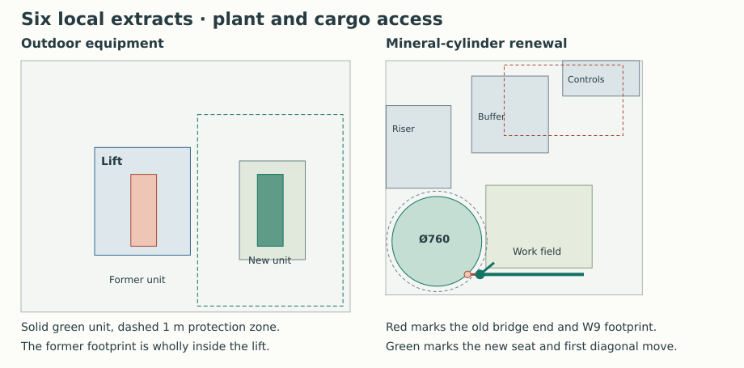

# Heating the six-extract house with an independent hot-water store

**Develop the three-phase Panasonic and a separately heated 300 L cylinder for the house that keeps its six local extracts.** Keep the existing east kitchen radiator, add the west H700×1100 and use the east plant-room door for vessel renewal. Move the outdoor unit out of the cargo lift. Use the factory Megaflo Eco Plus as the thermal and access reference and the mineral-jacketed Howden as the material-led replacement brief. The single-phase 12 kW Ecodan has only 0.432 kWh spare in a full cold day, even after changing the primary circuit. The balanced W9 and 10 kW Ecodan remain a separate, lower-room-load house option. [Room and water results](studies/local-extract-heat-and-store.json) · [Reproduce the comparison](studies/local-extract-heat-and-store.py) · [W9 house](winter-heat-and-water.md)

## The room and site follow the ventilation choice

At 20°C inside, −10°C outside and 220 W/K fabric and infiltration, six 13 L/s extracts cost the house 9.408 kW in ordinary use. For two hours of cooking take the largest 10.536 kW hydronic call across the existing 256 combinations of fans and hood, with both electric makeup-air heaters available at the low-line input. The other 22 hours give a total 228.048 kWh/day. The fan/makeup network still needs actual dirty-filter, low-flow, frost, wind, sound, occupied-room transfer and capture evidence. Loss of a heater inhibits cooking with a visible fault. One failed heater at the adverse operating point asks 4.522 kW of the kitchen. The separate 2.836 kW zero-heater comparison has a different airflow allocation. [Connected cooker modes](joined-cooker-system-result.md) · [West kitchen radiator and release](kitchen-replan-heat-result.md)

| Room-heat comparison | What the equipment and house have to deliver |
|---|---|
| **Lead. Panasonic WH-WXG16ME8, three-phase** | The maker reports 16 kW at both A−15/W65 and A−7/W65. Set a 14 kW usable requirement at A−10. At 65/55 primary and 55/45 secondary it clears the cooking peak by 3.464 kW. At maximum usable output the day's room load takes 16.29 hours. The proposed kitchen pair supplies 2.965 kW, including 129 W above the separate 2.836 kW allocation. |
| **Smaller site alternative. Mitsubishi PUZ-WZ120VAA, single-phase** | The A−10/W55 maximum is 11.2 kW at COP 1.89. With the prior 15% adverse allowance the model has 9.52 kW against 9.502 kW daily mean. It defers 2.032 kWh in the cooking period and needs 18.14 hours at ordinary load to recover. At least 4.064 kWh/K participating room heat capacity would limit average cooling to 0.5 K. A further 2 min 43 s at zero output spends the day's entire balance. |
| **W9 with the 10 kW Ecodan** | Its room loads are 7.061/7.214 kW and it can spend 2.5 hours on hot-water priority. Importing that timetable into this six-fan house with 9.52 kW useful room heat would require fabric plus infiltration at or below 187.54 W/K on the same day, against the 220 W/K comparison. |

The Panasonic rating does not guarantee installed A−10 performance on glycol. Bind the quoted 14 kW to defrost, both pumps and the always-connected 100 L reserve. The 65/55 to 55/45 exchanger needs at least 1.40 kW/K, 26.25 L/min primary at the minimum 3.2 kJ/(L·K), and 20.07 L/min secondary. The earlier 26 mm ID Mitsubishi pair fails the Panasonic installation manual’s 32 mm inside-diameter requirement. Use a 35 mm OD, 32 mm ID copper comparison with at least 30 mm insulation and a 100 mm complete jacket. At the Panasonic’s 45.9 L/min heating rating, 14 kW on the same fluid gives a 59.28°C primary return and requires 1.17 kW/K conductance to 55/45 rooms. Keeping the 1.40 kW/K exchanger target leaves thermal margin. The 21.39 m circuit with the inherited Darcy/fitting assumptions and 35 kPa accessory allowance needs 53.1 kPa at rated flow. Confirm fluid, available pump head, HX/valve/filter losses, actual return-temperature control, defrost and usable volume. The 14 kW cannot be credited twice for domestic water and rooms. [Panasonic engineering catalogue, p. 146](https://www.panasonicproclub.com/uploads/UA/catalogues/2026-2027/01%20Aquarea/01%20EU%20INTRO-AQUAREA%20GEN%2026%20LR.pdf) · [Panasonic pipe dimensions and rated flow, §12.4.5.3](https://paltaja.lt/wp-content/uploads/WH-WXG09ME8-WH-WXG12ME8-WH-WXG16ME8Manual.pdf#page=120) · [Earlier catalogue and certification comparison](joined-cooker-system-result.md#actual-high-temperature-plant-challenger)

The Ecodan's 34.4 L/min ceiling and the same minimum fluid capacity transfer only **9.173 kW at 5 K**. Change to 55/47 primary and 50/42 secondary. At 9.52 kW these need 22.31/17.06 L/min and 1.904 kW/K conductance. The native 11.2 kW would need 26.25 L/min primary and 2.24 kW/K to pass the full output. The 17 emitters in 14 rooms then offer 12.013 kW at their scheduled room temperatures. The west/east kitchen pair gives 2.425 kW against 2.092 kW in the low-line case. The least room has 5.99% above a pro-rata allocation of ordinary heat. Actual room losses and capacity during interruptions can change this result. The 15% allowance is a sensitivity on the published point, which already accounts for defrost where specified. [Mitsubishi data book, A-37–38](https://library.mitsubishielectric.co.uk/pdf/download_full/5483) · [Emitter locations and flow](whole-house-service-baseline.md)

**Move the Panasonic to X16950/Y3600, discharging east.** The former 430 × 1200 mm footprint at X14835/Y3600 sits entirely inside the newer 1600 × 1800 cargo lift. The same body on the eastern 1100 × 1650 pad fits within the reserved ground. With the manufacturer's 1 m open-area protection distance it leaves 120 mm to the lift and 120 mm to the eastern reservation limit. Enlarge the two Ø120 floor bores to Ø130 at X9950/Y5500 and Y5660, taking the northern line 10 mm farther north. The new pair retains 30 mm edge-to-edge, with at least 35/50 mm respectively to the represented obstacles. The 9.55/9.84 m axes carry the Ø100 jackets north of the lift, leaving 70 mm to the lift, 55 mm to the foul-stack reservation, 50 mm vertically between jackets and 140 mm below the caps. Size the two detachable R1¼ factory tails, structural bores, insulated supports and reinstatable seals. Keep drains, openings and ignition sources outside the protection zone. Establish the actual site, ground levels, lower depressions, pad/anchors for 165 kg, frost drainage, air/noise and a separate lifting route. A wall or corner installation has different protective geometry. [Panasonic service manual PCZ2411004CE, §12.4.2](https://paltaja.lt/wp-content/uploads/WH-WXG09ME8-WH-WXG12ME8-WH-WXG16ME8Manual.pdf) · [Dock and lift](plant-threshold.md) · [Pipe and pad coordinates](studies/winter-heat-and-water.json)

## Hot water while the heat pump stays with the rooms

Megaflo **Eco Plus 300 DDDD, 95050701**, has 300.0 L declared storage and 476 L mixed-water V40, external expansion, a 2052 mm height, 57/357 kg empty/full and 2.28 kWh/24 h standing loss. Its four 3 kW/240 V immersion elements each have a manual-reset cut-out. The maker's 78.7-minute heat-up uses all 12 kW for a 45 K rise. Use one lower element as the independent normal source. Retain every cut-out, prove the sensing depth and controller response, and bring any extra element through a separately qualified load controller. The nominally similar Telford TSMD300 has two conflicting manufacturer capacity rows, 303 and 294 L. Specifying that code alone cannot secure the 300 L minimum. [Megaflo article](https://www.megaflo.co.uk/products/megaflo-eco-plus/megaflo-eco-plus-direct-cylinder) · [Issue 10 installation manual, pp. 7–9, 20 and 34](https://www.heatraesadia.com/-/media/themes/heatrae/literature/installation-manuals/megaflo-eco-plus-250-300-installation-manual_issue10.pdf) · [Telford 303 L data](https://www.telford-group.com/uploads/shop/Tempest%20Direct%20Data%20Sheet.pdf) · [Telford 294 L data](https://www.telford-group.com/uploads/shop/TEMPEST%20DIRECT%20DATA%20SHEET%20-.pdf)

Replay the four house draws of 80, 80, 70 and 70 L at 40°C at 07:00, 07:45, 08:30 and 19:00. The fully mixed model uses 10°C inlet, 20°C surroundings, the 2.28 kWh/day loss as a 60/20 comparison, and 1 kWh/day distribution loss. One element at 216.2 V supplies 2.435 kW. Inhibit it during cooking from 17:00 to 19:00. With a 60°C stop and restart below 50°C, all draws are served in the final week of an 84-day run starting at either 45°C or 60°C. The minimum is 43.03°C and final-day electricity is 13.56 kWh at the element. With restart below 45°C the same model misses up to 65.40 L/day. Confirm the control band and hot volume available to that element. Four catalogue elements, V40 and nominal daily consumption do not establish the installed controlled sequence, a different bath schedule, hygiene operation or tap flow. [Minute model](studies/local-extract-heat-and-store.py) · [Fixture-use alternative](../ias/ias-03-shared-family-bathing.md)

At the old centre shifted 15 mm west to X9845/Y4250, test a **complete Ø600** renewable envelope around the nominal Ø579 case. The existing bridge's first diagonal leaves 35.06 mm. A 100 mm deck and 2052 mm vertical case leave 148 mm at the finished 2300 mm door. Only 15.94 mm remains between the retained 37 mm-radius cold-seat envelope and the R425 cart perimeter. Establish each projecting cap, valve, tool, base grip and actual cradle. Account for the full weight on the floor and move only the isolated, drained cylinder. The manual requires front access to lift the cover, disconnect the thermostat capillaries, undo the brass backnut and release the sealing gasket. The lower bent element hangs vertically and must be extracted and reinstalled in its real orientation. The 900 × 700 east working field and nominal diameter do not dimension that turn. [Manual, pp. 5 and 20–24](https://www.heatraesadia.com/-/media/themes/heatrae/literature/installation-manuals/megaflo-eco-plus-250-300-installation-manual_issue10.pdf) · [Inlet bridge](plant-inlet-route.md)

Keep the downstream 3.5 bar reducer, 8 bar expansion relief and 90°C/10 bar temperature-pressure relief protected and accessible. Keep 50 mm around the latter for its insulated cover. The 24 L vessel's catalogue envelope is Ø280 × 492, precharged to 3 bar. The maker recommends 28 mm feed, with 1.5 bar working and 50 L/min minimum supply. The existing 22 mm bridge needs a measured flow/pressure check including other outlets. The catalogue lists no dedicated secondary return for this article. Use the manufacturer's cold-inlet secondary-circulation arrangement, controlled bronze pump and check valve. The two distinct front circuits alone have 34.92 m plan length on their respective floors. At comparison 20/13 mm supply/return IDs they contain 15.61 L before verticals and other loops. Include the manufacturer's additional expansion check above 10 L. [Manual, pp. 6 and 11–13](https://www.heatraesadia.com/-/media/themes/heatrae/literature/installation-manuals/megaflo-eco-plus-250-300-installation-manual_issue10.pdf) · [Factory vessel and port dimensions](https://www.heatraesadia.com/-/media/themes/heatrae/literature/technical-data-sheets/megaflo-eco-plus_technical-data.pdf) · [House hot-water loops](whole-house-service-baseline.md)

Test a raised visible tundish inlet at X10035/Y4800/Z1400 on the existing independent sleeve. For the older 1674 mm tapping datum and a directed outlet on the Ø600 envelope, a straight segment to old Z1100 is **639.5 mm** before bends. Raising the inlet makes it **393.1 mm**, giving room within the 600 mm pipe limit. The actual factory valve projection, orientations, connecting manifold, port revision, falling D1 lengths and both reliefs must be measured together. At the G½ catalogue size, adding 300 mm to the prior Ø28 D2 leaves 11.847 m equivalent against 18 m. Keep the straight vertical start, heat-safe trapped receiver, protected exposed route and real gravity outfall. Recheck dimensions for any extra elbow, differing outlet size or combined discharge. [Factory port schedule](https://www.heatraesadia.com/-/media/themes/heatrae/literature/technical-data-sheets/megaflo-eco-plus_technical-data.pdf) · [Located D2](cylinder-safety-route.md)

## The factory mineral alternative needs a different first movement

Specify a **Howden MS103 direct** comparison, with the catalogue 370 L, Ø760 × 1650 jacket, a lower 3 kW family element, external safety package and no indirect coil. Its standard mineral-fibre insulation and metal cladding remove the Eco Plus's 60 mm polyurethane jacket and plastic-coated outer shell from this comparison. Obtain the pressure-rated net potable volume, actual heater/thermostat elevations, full load, standing loss, materials, below-flange drain, safe discharge and extraction drawing for the ordered build. Eco Plus performance cannot be transferred to it. The manufacturer offers stainless or copper construction and can build for unvented service. [Howden MS catalogue, pp. 1–2](https://www.howden-electric.com/wp-content/uploads/2025/07/MS-Catalogue.pdf) · [Earlier stock mineral comparisons](cylinder-replacement-screen.md)

Removing the W9 does not create an empty cylinder bay. Its north-room footprint in that alternative overlaps the local house's buffer station by 375 × 503 mm and its controls by 510.5 × 263.5. Instead, **move the wide cylinder to X9830/Y4250**. Allow the jacket to project beyond the old 700-square tape and shift the east working field 35 mm east to X10245/Y4025. The jacket has 53 mm west, 73 mm south, 70 mm to the riser, 35 mm to the operator path and 35 mm to the new east service field. Keep its working side clear for draining, removal of the safety group and the actual immersion extraction.

The original bridge hits this size by 44.94 mm at the slim design's centre. Put its west seat at X10195/Y3970, 105 mm east of the old one, keeping the east pivot. The first 120 east/100 north slide clears the relocated jacket by 43.03 mm. The new seat projects **72.03 mm beyond the cart** with its 37 mm radius. It must be on a detachable stand with a separately supported connection to the vessel. Isolate, lock off, cool and drain. Remove the supported D1 and wetted branches, lift/park the bridge and detach the downstream stand and tails before moving the vessel. A Ø760 case inside the R425 cradle has 45 mm radial allowance, only 20 mm after a 25 mm reserve. Factory retained bosses, insulation flanges, feet and handling aids must fit that envelope or the route returns to a factory-removable jacket or wider cart/door. Prove new wrench access, supports, both valve states and release at the stand before adoption. [Physical checks](studies/local-extract-heat-and-store.json) · [Earlier first movement and park](plant-inlet-route.md)

## The supply determines which branch can operate

Panasonic's model-specific service data gives 3 × 19 A maximum outdoors. Put the 32 A cooker allowance on L1, one 13.04 A makeup heater on each of L2/L3 and a 3 A auxiliaries allowance on L3. With the immersion off during cooking this gives **51.0 / 32.04 / 35.04 A** before other household loads. The manual's paired 9 kW indoor electric backup, where fitted and enabled, adds 13.1 A per phase, making L1 64.1 A. The earlier external control-box alternative needs its own configured electrical schedule. Verify phase supply, neutral, protection, actual circuits, household demand, compressor staging and independent backup/anti-freeze duties. The 12 kW Ecodan at its listed 37 A maximum plus the same cooking/auxiliary allowances takes 98.09 A on one phase, or 111.09 A with a 13 A immersion allowance. A real protected demand limit must shed the immersion ahead of a cooking call. Its failure must inhibit the affected load and retain all water safety protections. [Panasonic service data, model specification](https://paltaja.lt/wp-content/uploads/WH-WXG09ME8-WH-WXG12ME8-WH-WXG16ME8Manual.pdf) · [Mitsubishi data book](https://library.mitsubishielectric.co.uk/pdf/download_full/5483)

MAT-SERVICES remains open. The lead local architecture now has a heat and storage schedule, outdoor site and vessel release brief. It still needs a buildable S07 intake with actual correlated fan/filter/wind control and a supported 79 kg kitchen-emitter export. S01/S02/S10 need actual cold-flow tests, independently removable safe discharge, qualified sleeves and the site receptor. S03–S06 need the matched pumps, bought vessel/valve/element geometry, room heat losses and installed air delivery. S08/S09 need a supply, monitored interlocks, terminations and commissioning. The six EPDM fan gaskets and ABS fascias, intake equipment, factory valve seats and membranes, cable insulation, controls and jacket materials remain recorded for owner disposition. The mineral request changes which jacket constituents must be assessed. [Service-family crosswalk](constituent-audit.md#s01s10-development-decision-and-residue-crosswalk)
