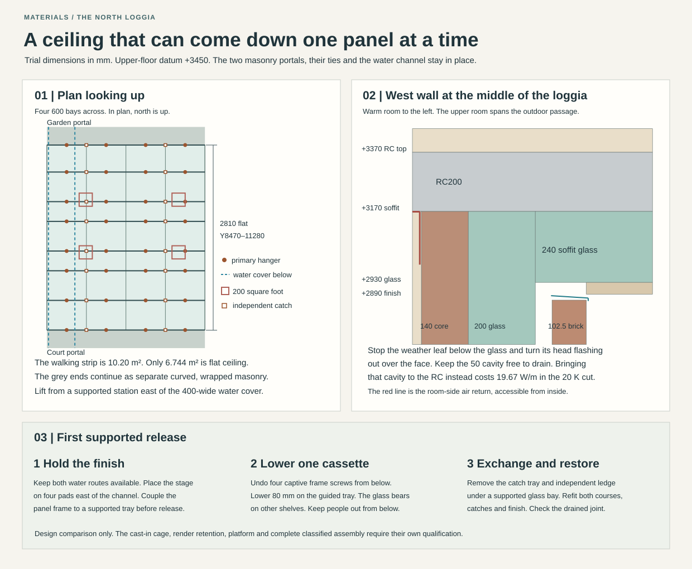

# The exposed floor over the north loggia

**Carry the mineral soffit forward as separately supported panels.** Stop the two loggia weather leaves below the upper floor, take the glass across their heads and retain the lime finish on demountable stainless frames. The floor above stays level at +3450. The garden end also needs a real shelf carrying the upper facing brick. Its 102.5 mm leaf has no bearing on the proposed lower glass wrap. The drawing and calculation cover the flat field between the two portals. Curved linings, masonry support and fire performance have distinct release and qualification duties. [Checked geometry and loads](studies/loggia-soffit.json) · [Assembly calculation](studies/loggia-soffit.py)

## Two wall heads and a floor

The RC200 field above the loggia spans east–west between X4377.5 and 7622.5. Its soffit is +3170, top +3370. On the ground, the west weather wall runs from room face X4280.5 across 27 plaster, 140 core, 200 cellular glass, 50 drained cavity and 102.5 brick to X4800. The east wall mirrors it. The court and garden portals each have 775 axial depth. Their facing surfaces at Y8470 and 11280 leave **2400 × 2810**, or 6.744 m², of flat exposed ceiling. The remaining 3.456 m² of the 10.2 m² walking strip is within the portal projections. A full rectangular quantity or hanger grid over the whole strip would cross their wraps. The ordinary 110 mm wall glass belongs to the upper outer shell. The 50 mm neck at the ordinary roof collector is a separate section. [Current house](../had/studies/water-replan.json) · [Slab field and bar cover](../str/studies/open-loggia-support.json) · [Existing wall/portal return](studies/loggia-portal-renewal.json) · [Ordinary wall and roof cut](envelope-continuation-16.md)

At the west head extend the 240 mm soffit glass over the cavity and weather leaf until it meets the vertical glass at X4647.5. Return the upper and lower courses at different lines. Keep the 50 cavity open below its head. Stop the brick at +2870, 20 below the nominal finished soffit, and provide independent high-level lateral ties to the structural wall. Trial a removable stainless head flashing from X4694.5 to 4805.5, falling from +2885 to +2877 and turned down 10. Its inner edge underlaps the vertical drainage face only if a separate folded back piece returns from X4647.5 across the cavity and laps it downhill. Carry that back piece on the fixed wall returns, with an upstand behind the last insulation course. Leave a clear drainage and ventilation path **beneath** the head tray to the existing base tray and exterior outlets. Support neither upper masonry nor soffit on this cap. Use a stopped movement joint at the exposed nose, drop edge clear of brick and removable end pieces. Open the adjacent panel first to inspect the rear lap. Test wind-driven entry, blocked weeps and fire cavity barriers with the actual vents. The grade and trough do not supply a cure for a leaking overhead joint.

Keep the room-side air line at the warm core and RC. Stop plaster against a mechanically retained, folded stainless strip that bridges the plaster-to-soffit corner, with a formed movement fold, continuous corners and separately accessible bedding/contact on both legs. A dry metal-to-mineral contact or a splash flashing alone cannot establish airtightness. Open a short room-side repair strip without disturbing the wet cap, then reinstate and separately pressure-test it. Raising equal glass above the RC would consume 240 against the entire 80 mm floor budget before finish or services, lifting the adjoining occupied floor by at least 160. Retain the underside route.

At the north end the upper ordinary façade runs from Y11570.5 to 12000. Its glass occupies Y11737.5–11847.5. The garden portal's north masonry face is Y11775, with 240 axial glass to Y12015 and the final 40 to Y12055. The two glass bands overlap **72.5** in plan. The upper brick starts at Y11897.5, **122.5 beyond** the lower masonry face. Wrap the exposed shoulder and bring its independent tray out past the 55 projection with stopped ends and a downward drip. Keep the Ø30 tie at +2200, the two collar releases and their cover travel accessible. Do not drill the 215 ring or count its glass as an upper-leaf ledge. [Portal and tie](loggia-envelope-boundary.md#exposed-soffit-a-finite-assembly-rather-than-an-internal-ceiling-label) · [Provisional structural proposition](../str/provisional-house-handoff.md)

A trial stainless masonry shelf ending at Y11977.5 gives the 102.5 brick 80 bearing, or 75 after 5 outward error. The manufacturer’s two-thirds installation figure is 68.33. From a trial RC receiver face Y11737.5 the toe projects **240**. At 600 centres, a solid 4 m-high leaf and 20 kN/m³ create 4.92 kN and 1.04 kNm per bracket at service before local openings, wind and eccentric detailing. Locate the actual slot, RC reinforcement, bracket/thrust load path and shelf splices before casting. Provide a cavity tray and end dams above it, open weeps and movement below. No nylon, neoprene or thermal break is assumed inside a named stainless system. The concealed shelf has to last with the upper brick or be renewed after independently supporting and locally dismantling it. A 2D midwall result carries no credit for these discrete steel bridges. [Leviat / Ancon MDC installation guide](https://www.ancon.co.uk/downloads/52/Ancon%20MDC%20Masonry%20Support%20Systems.pdf)

## Catch the brittle glass and hold the finish separately

Use four 600 mm bays across and seven bays of 450, 450, 300, 450, 300, 450 and 410 along the passage. This avoids an isolated 110 mm strip left by six standard boards. Each 120 mm glass course sits in its own positively retained ribbed steel tray. Cut upper pieces to a 300 mm transverse stagger, with an independent half-piece at each wall. Across the passage, an upper joint meets the middle of a lower piece. Row joints remain aligned. Return a removable close-fitted mineral spline across each row joint, with end stops and separate ledges for both courses. Inspect the actual rebate, expansion allowance, wind bypass and edge fracture in the full module. Never rely on brittle glass to support the plaster or to capture another loose board. [Bare T4+ slab and dimensions](https://www.foamglas.com/en-gb/products/fgbt4slabs) · [Manufacturer’s suspended lining with PC 56 adhesive and separate hangers](https://www.foamglas.com/-/media/project/foamglas/public/shared/files/tds/2d/interior/ceiling/tds_pcuk_en_3-3-06_b-i-ceiling-susp_pdf.pdf)

Each field row has two independent 1200 mm lengths of 40 × 35 × 3 stainless RHS, each on two rods 600 apart with 300 end overhangs. Eight rows take **32 primary hangers and 16 independent centre catches**. The rail occupies +2923…2963 and displaces 33 mm of lower glass at the line. The 8 mm rib descends to +2915 and the 25 mm mineral finish reaches +2890. Four captive mechanical fixings restrain each finish frame in both directions. Stop the render on edges of individual lath sheets, form an open, removable bead joint and keep the return accessible. Use a secondary captive lug on each short edge independently of the four removable screws. Prove render key, bead retention and fragment safety under wetting, freezing, wind and heat. Locusrite SSRL is a 0.4 mm grade 430 (1.4016) sheet, 8 mm rib and about 1.5 kg/m². The cited A1 is the lath. Check its exposure and compatibility with the chosen rail grade, stainless ties and plain NHL/sand/water mix. An undivided wet-render ceiling loses local access. The producer's PC F plates alone provide neither independent trays nor support for this finish. [Locusrite exact SSRL sheet](https://www.locusrite.co.uk/wp-content/uploads/sites/2/2024/11/SSRL-Data-Sheet-PR.pdf) · [PC F fixing system](https://www.foamglas.com/en-gb/products/fixings/pc-f-anchor) · [Binder and application evidence](loggia-envelope-boundary.md#exposed-soffit-a-finite-assembly-rather-than-an-internal-ceiling-label)

Two 1 mm trays, their returns and 20 mm folded ribs, lath, 25 wet render, frames, ledgers, RHS, rods and hardware bring the wet package to **128.26 kg/m²**, 43.86 above the old 84.4 trial. That adds about 2.90 kN over the flat field. Carry the full 8.49 kN wet load if it is absent from the structural dead-load budget. Turn accessible lips on the lower trays and give each a small visible telltale to the outdoor face at the panel edge. Water appearing there is a fault requiring local closure and repair. Keep the wall and roof weather routes separate. Price a blocked tray at 20 mm gross water, up to 5.4 litres in one large bay, and the glass at +15% density. Under the existing ±1.5 kPa wind challenge the normal full package gives 3.949 kPa down and 1.118 up. The worst signed hanger loads are **1.24 kN down and 0.47 up**, allowing opposite pressures on the two overhangs. Flooded downward demand is 1.33 kN. At 150 rib spacing the flooded 1 mm sheet strip gives 72.0 MPa and 1.75 mm deflection. Two bare 20 × 1.2 rib webs over 450 give 101.2 MPa and 1.11 mm. Preserve fall after deformation, support the edges and test the actual folds, joints, glass bearing, rattling and drainage. [Loads and component masses](studies/loggia-soffit.json)

**Keep the hanger out of the reinforcement before the pour.** RFA-Tech’s stainless 1074A10S M10 cross-pin insert has a 16 body, 60 depth, 35 usable thread and 50 × Ø6 pin. Its guide gives 600 kg axial and 400 kg shear, 75 edge, 150 spacing and 85 minimum panel depth in the stated cast-concrete system. These catalogue working loads do not qualify an in-situ overhead group, combined actions, fire or compression. Use a removable metal former and a positively locked 270 maximum rod with two-direction connections and end restraint. At an 8.16 thread-root trial, the pinned Euler load is 5.69 kN, or 1.42 with a fixed-free idealisation. Price a separate sway restraint and the actual rod connections. The existing H12/150 slab cage in both directions has 25 nominal cover. A coordinated trial cage phase X5025/Y8375 puts the 50 pins east–west and leaves at least 44 and 41 nominal between steel surfaces in plan. After 5 relative error both exceed the 21 mm placing screen. The nearest field boundary is 387.5. No drilled socket, existing bar phase or blind fix into a 140 mm wall is assumed. Record the full cage, ports, local chords and inserts before pouring. A failed embedded insert needs a shored neighbouring rail and a checked replacement socket or local concrete repair. [RFA-Tech guide, printed pp. 54–55](https://www.rfa-tech.co.uk/download_file.asp?id=34) · [Current floor reinforcement](../str/studies/current-house-lateral.json)

A rail on its two outer hangers alone rotates if one lets go. Give each 1200 rail a separate centre catch on RFA-Tech 1074A12S, with a 20 body, 50 embedment, 20 usable thread and 75 × Ø10 pin. Its catalogue axial/shear figures are 900/560 kg. At X5400/6600 these pins have 31.5 and 39 nominal surface clearance to the proposed grid, retaining 26.5 at worst after 5 relative error. Use positively locked opposing stops and a replaceable all-metal spring cartridge. For loss of either outer hanger, the remaining support and this catch form a 300 span and 600 overhang. Limit free travel to 0.5, static arrest deflection to 1–2 and provide at least 6 working travel. Under the flooded signed load the elastic drop comparison peaks at **6.44 kN at the catch, 3.51 kN at the surviving hanger and 182 MPa in the rail**. A loose safety cable or a tab returning to the failed primary does not supply that mechanism. Qualify both load directions, dynamic response, local holes, attachments, fire and corrosion on the complete three-point arrangement before occupation. Do not release a primary for work until the rail has a separate prop.

## What happens at the first repair

The largest rendered frame is budgeted at 16.01 kg. One full bare 120 mm slab is 3.56 kg. Close the passage to other users, keep the alternative indoor circulation available and retain both water routes. The west cover is X4825–5225. Put four 200-square temporary pads on the solid deck at X5390/6800, 800 between foot rows. The nearest pad stays **65** from the cover. Level the feet across the 1:100 fall and restrain the platform in both axes. A 2300-wide temporary deck at +950 reaches X4850–7150 while preserving 1940 overhead. Assemble and remove it in captured short members through the portal below the tie. Give it a gated stair or ladder from the solid deck and edge protection clear of the lowering tray. Confirm access, ground bearing, lateral stability and temporary-weather limits for the supplied rig.

With 2 kN at X4850 and 0.35 kN retained payload at X5100, the west overturning moment is 1.182 kNm. A locked 2.4 kN ballast at X6150 gives 1.824 kNm, ratio 1.54 before dynamic or lateral actions. East overturning is 0.735 against 1.56 kNm. The loaded west foot line takes 4.29 kN before the platform's own weight. A single pad receiving that line needs about 107 kPa on the actual stone, bed and deck. A narrow unsupported tower on the water cover fails this arrangement. Restrict the operator to the checked station, contain debris and retain a clear evacuation route during the operation. Do not permit a support leg to land on a removable channel lid.

Engage two lift sockets in the cassette's structural frame with a positively captured guided cradle. Keep people beside the load. A 100 mm downward tool extension puts the first screw drive at +2790. A shoulder at +2400, with separate horizontal offsets up to 295 each, needs 571 mm reach in the corner trial. Show that the actual person can operate both capture and tool. The cradle takes the load before any of the four screws and two backup retainers release. Lower 80 vertically, move toward the centre and set down on the stage. Capture and remove the lower pan and its ledge only with its glass supported. For a rear course, expose the two overlapping lower positions first and hold the upper pan before releasing its own stops. Reinstall upper first, then lower, with rebates, catches, drain and local air-return repair checked before the finish closes. Use a controlled drain from below before lowering a flooded tray. One installer, hand force or suction on lime cannot stand in for the cradle. During an insert/rail repair prop the adjacent panels, both glass levels and the rail separately. The upper RC closure stays intact.

## Thermal and fire boundary

For the dry repeating field, the prescribed wall films and material conductivities give 0.324 and 0.189 W/m²K for 110 and 200 glass respectively with the cavity open to exterior air. The 240 floor glass with 0.4 m²K/W other resistance gives 0.160. Thirty-two gross 10 mm shanks and sixteen 12 mm catch shanks add a one-dimensional 0.040 W/m²K over this field. A deliberately severe screen using only 165 mm glass everywhere, including both 20 mm ribs, the 33 rail notch and both tray gauges, gives 0.266 including shanks. These values omit sideways heat through frames, brackets, joints and three-dimensional corners.

The independent dry finite-volume cut takes 20 °C room and 0 °C exterior, indoor/outdoor film resistances 0.13/0.04 and adiabatic remote cuts. At 10 mm cells the returned wall head loses **4.45 W/m**, with a minimum interior surface of 19.54 °C. Bringing both the actual 50 cavity and 102.5 brick directly against the slab gives **24.12 W/m and 16.84 °C**. At 20 mm the respective flows are 4.45 and 23.35. Both boundary fluxes balance. This compares the same finite midwall territory. It supplies neither a junction coefficient nor a condensation or whole-house energy result. The latter geometry is rejected. Preserve a movement allowance and verify as-installed contact at the glass corner. [Thermal model](studies/loggia_soffit_heat.py)

The published RC200 field has an outer bar-axis reference of 31 and a bounded one-way REI30 comparison. The complete support zones, inserts, heat-weakened metal, spalling and openings are unclassified. Preserve that RC barrier while one panel is absent. Prove safe retention or controlled loss of the entire exposed finish and the cavity-barrier detail. The Study ceiling and the ordinary north eave have different source duties. This develops the **wall / soffit** row and the garden shoulder of **portal / tie**. The curved cover and tie penetration, wet return and weathered upper masonry shelf still require their own selected support and reinstatement. Preserve the three dry-site threshold decisions, raised slate/valley and Study glazing choices and the HAD-owned court receiver redesign. MAT-ENVELOPE remains open. [Owning six-interface table](loggia-envelope-boundary.md#mat-envelope-owning-exit-table)

Regenerate with `python3 -B project/mat/studies/loggia-soffit.py`. Add `--check` to compare the tracked JSON and drawing, including both thermal mesh sizes, against the current source geometry.
