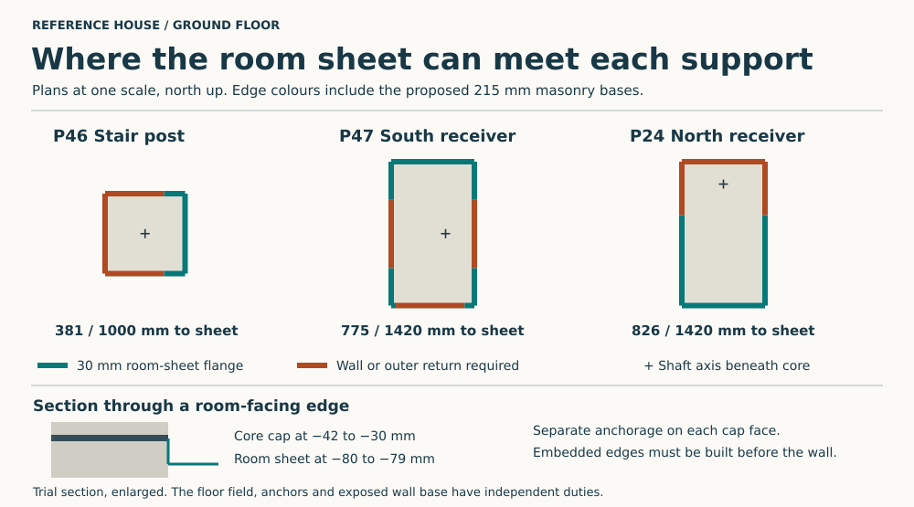

# Three occupied supports at the ground-floor moisture boundary

Keep the continuous RC cores at the stair and two wet-wall supports as the **pre-site basis for a demonstrably dry, drained site**. The adjoining masonry keeps its bonded mineral damp course. A wet pile can still feed the RC floor and all three cores. If ground or exposure demands positive separation, develop the three capped supports only as part of a separate, continuous floor boundary. A loose sheet under each post, a surface collar around each post, or a tiled glass bearing cannot provide that boundary. The pile and room schemes have different load paths. [Envelope decision](envelope-disposition.md) · [Ground and water policy](../../docs/reference-house/ground-water-policy.md) · [Whole-field comparison](ground-field-assembly.md)

## Put the cut at the actual bearing

Place the upper face of an unperforated comparison plate at −30 mm, level with the top of the ordinary damp course. A 12 mm trial plate leaves its underside at −42 and 138 mm of pedestal above the slab top at −180. Use the actual upper-core footprint. The P47 shaft axis sits 40 mm east of its upper core centre, and the P24 shaft axis is 155 mm north of its upper core centre. Moving the posts onto those shaft axes would alter the wet beam and its junctions. The north beam calculation already includes its 155 mm loaded overhang. [Actual support geometry and reactions](../str/studies/open-loggia-support.json) · [Upper core and pile contacts](studies/floor-pour-boundary.results.json)

| Support and cut section | Core centre X, Y (mm) | Gravity compression at −30 (kN) | Gravity moment on the reference axis (kNm) | Extreme whole-contact trial pressures with 5 mm radial setout (MPa) |
| --- | --- | ---: | ---: | ---: |
| P46, 250 × 250 stair post | 2942.5, 7257.5 | 74.54 | 2.267 | −0.126 to 2.512 |
| P47, 260 × 450 south receiver | 2902.5, 8852.5 | 64.10 | 1.298 | 0.179 to 0.917 |
| P24, 260 × 450 north receiver | 2902.5, 11512.5 | 70.55 | 1.430 | 0.197 to 1.009 |

These are actions on the cut through the occupied support. The wet beam applies different reactions at its two ends. At the stair the landing beam and long trimmer both load the post. The trimmer applies 27.82 kN 25 mm west of its centre. The moisture-path drawing follows the stair concrete to the landing soffit at +1525. The loaded post in STR continues to +3370 and that height governs its own weight and stiffness. Subtract 150 mm of factored post weight below the cut from the original gravity card and retain the original full-height buckling sensitivity. Give the 20 mm radial imperfection and independent 5 mm radial placement error their adverse directions in plan. The two-direction envelope is evaluated at the four corners. The head and foundation reactions also include the rest of the grid and require a separate calculation. [Reproducible signed contact comparison](studies/occupied-core-actions.py)

At P46 the first corner unloads at **1.88 mm radial placement error** on this gravity comparison. The negative trial stress marks separation in a free bed. An anchored joint or a designed partial-contact bearing needs its own contact distribution, positive shear restraint and rotation check. A square of **276.5 mm** would just preserve full contact under the same resultant and offsets. A wider plate beneath a 250 mm upper post does not spread the upper bed by itself. At both wet supports compression remains positive for this case. The comparisons carry no resistance to unassigned arch thrust, frame shear, uplift, erection loads or a new rotational restraint. Re-solve these at the proposed two-sided joint. [Structural model and exclusions](../str/studies/open-loggia-support.py)

## Follow the edge into each wall

The separate room sheet sits at −80 to −79 on the bare glass. Test a 30 mm horizontal receiving flange at field level and a folded skirt from it to the cap. From the underside of the cap to the top of the sheet there is 37 mm of vertical difference. The drawing classifies the whole 30 mm strip against the actual clipped field and the proposed masonry bases. Green edge length identifies where the field reaches the flange. It does not reserve hand or torch clearance. [Plan and edge calculation](studies/occupied-core-breaks.py) · [Wall widths and clipped room field](studies/ground-field-assembly.results.json)

| Support | Perimeter (mm) | Field contact at drawn finish (mm) | 30 mm flange reaches field with masonry base (mm) | Embedded or outer edge (mm) |
| --- | ---: | ---: | ---: | ---: |
| P46 | 1000 | 692 | 381 | 619 |
| P47 | 1420 | 878 | 775 | 645 |
| P24 | 1420 | 826 | 826 | 594 |

At **P46**, the widened protected-stair base covers the entire west side. The east side and just 65.5 mm at each of its ends meet the field. At **P47**, the rear wall and stair base meet at the post. The two open south tabs are only **14.5 and 30.5 mm** wide. Neither supplies a universal 30 mm end lap with a usable welding station. At **P24**, the room sheet stops at Y11570.5, while the concrete reaches Y11737.5. The rear 167 mm of each side and the full 260 mm north face lie outside the field. A site-welded four-sided boot would leave **1858 mm of the combined 3840 mm** to a different joint. A front U-piece leaves wet concrete or mortar in contact above its back edge.

Shop-form the complete metal perimeter and corner returns before masonry closes access. Bring the room-facing portions onto the reserved sheet flanges. Carry the inaccessible ends into dedicated wing pieces across the bonded DPC at wall intersections. At the north wall keep the external face behind the weather cavity, with a separately drained termination and room-side stepped return. Set out the seat, 215 mm unit, bedding, drip edge and mortar stop across the full junction. The cap covers the core and the skirt interrupts migration around its edge only while adjoining layers keep that division. A mortar smear, a continuous reinforcement bar, an open weld or a plaster return across the cap reinstates a bypass. Distinguish a shop-welded metal corner from its as-yet unqualified metal-to-masonry return.

## Fabricate, place and inspect the cap

Reserve separate anchorage on the two faces of each unperforated plate. A catalogue WELDA 200 × 200-112 Ar anchor plate has a 12 mm plate with four headed studs on one face. Its assessed uses and grade combinations belong to the supplied product. A laboratory study fabricated headed studs on both sides of a 12 mm steel plate and tested the connection in shear. Those examples establish fabrication precedents. The proposed stainless plate still needs the actual alloy, stud and filler compatibility, opposite-face weld sequence and distortion, embedment, cover, breakout, cage spacing, underside-bearing and shell-tightness tests. A standard one-sided plate or four interrupted H16 bars do not establish the new connection. [Peikko WELDA product and technical manual](https://www.peikko.co.uk/products/product/welda-anchor-plate/) · [UKTA 0836-23/6906](https://media.peikko.com/file/dl/i/HOKccw/qodbpvtmdcOLp-bFJkJMiA/UKTA-0836-23_6906.pdf) · [Double-sided steel-plate shear tests](https://doi.org/10.3390/buildings15183331)

The stair cage rules out simply welding the larger stock pattern onto the plate. Its four Ø16 corner bars at 39/211 mm from the local core origin leave **16.27 mm** to Ø25 stud heads on a centred 120 mm square. That misses the 21 mm aggregate clearance comparison. A 90 mm grid gives **37.48 mm** before tolerances, with less moment arm. Peikko’s one-sided 150 × 150-162 Ar provides a 90 mm grid with Ø13 studs and a 12 mm plate. Taking only its 150 mm stud projection into the trial puts the wet-side tips at −192, **12 mm into the slab**. The existing Ø6 closed link at −50 leaves just **5 mm** underneath the cap. Relocating that link to −75 gives 30 mm there and 75 mm to the link at −150. Redraw the independently anchored upper and lower cages, link end zones and both slab mats before casting. A hole in a stock plate or a straight bar through the metal would defeat the moisture cut. [Existing stair cage, PC0–3 and PL-50](../str/studies/open-loggia-support.json) · [Trial clearance checks](studies/occupied-core-breaks.py) · [Peikko product manual](https://www.peikko.co.uk/products/product/welda-anchor-plate/)

1. Set the lower cage and embedment pockets from the surveyed **upper-core** centroids before pouring. At the 138 mm-high lower pedestal a deeper stud enters the slab and its cage. Preserve the independent members, cover and actual lower anchorage without drilling completed structural bars. Coordinate the actual lower construction joint and temporary stability.
2. Make and inspect the cap, opposite-face welds, full perimeter skirt and all embedded DPC wings in the shop. Check flatness and leak-test the uninterrupted sheet and edge welds before burial. Withhold the upper pour until seated. A blind pour beneath a level plate can trap air. Provide a controlled bedding gap and side-fed, side-vented trial procedure with inspectable opposite returns. Demonstrate complete bearing with the intended grout, shrinkage and pocket fill in a sacrificial section. Keep vents and temporary fixings out of the cap. Peikko's installation guidance discusses air holes in larger horizontal plates. Such holes here would connect both faces. [Anchor plate installation guidance](https://media.peikko.com/file/dl/i/usqt1w/J7f48ZSuqQGGUVXWLMyUng/WELDAWELDA_Strong_PEIKKO_GROUP_06_Installation_Extract_Web.pdf)
3. Cast the upper cage against the dry face under independent temporary support. Inspect the wing-to-wall and north cold-side returns before laying the adjacent masonry. Keep mortar, screed and plaster from bridging the metal edge. Protect accessible tails. Install and test the room-sheet joints and movement provision before placing distribution and finish. After burial, recovering a damaged wet-side detail entails supporting the member and opening the floor or masonry.

At 7900 kg/m³ the three **12 mm core plates alone weigh 28.11 kg**, before skirts, studs, wings, finish, grout or wastage. This adds three purpose-made, buried load interfaces to the separate-field comparison of 80 cut pieces and 116.94 m of butt seam. Current stock-only comparison for that field is £12,991.80 ex VAT at its recorded 6 November price. The loose PERINSUL HL masonry comparison is also unsuitable as a drop-in cap. Its manufacturer requires a separate damp course and the supplied finish includes bituminous coating, glass fleece and polyethylene. Its masonry resistance does not qualify this concrete joint. [Field quantity and scope](ground-field-assembly.md) · [PERINSUL DPC guidance](https://perinsul.foamglas.com/en-gb/thermal-bridging-advice/damp-proof-course) · [PERINSUL HL UK product declaration](https://perinsul.foamglas.com/-/media/project/foamglas/public/shared/files/foamglas-b/perinsul-hl/pds/pds-perinsul-hl-uk.pdf)

**Site and assembly decision.** Keep the lower-material monolithic option only if site water, gas class, high backwater and heave permit it and a representative loaded junction stays acceptably dry at the room finish. Wet the shaft/cap and exposed shoulder separately, then the outside wall and failed sill. Measure uptake, migration around returns and drying. Determine air leakage separately. If a continuous gas or pressure-water barrier is required, reopen the house/plot and field design before foundation freeze. All 52 heads, exterior wetting above any lower cut, the three external doors and other wall/field transitions retain their own duties. Neither the three trial metal caps nor a dry upper plank provides that system. The joined roof, complete window, door and dock issues remain with the [whole-envelope decision](envelope-disposition.md).
