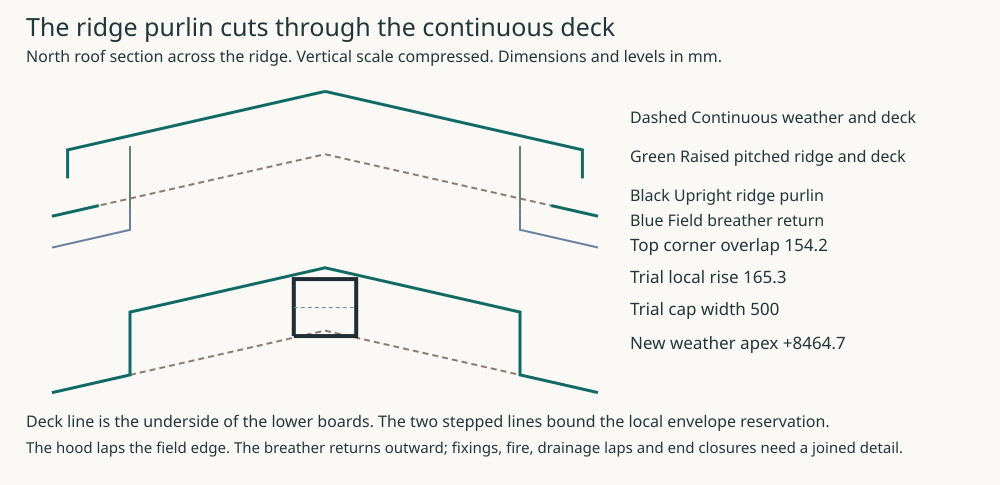

# FIRST outer-north ordinary eave · joined development candidate

**2 November 2026; MAT-ENVELOPE remains open.** The [plan and paths](studies/ordinary-eave-joined.svg), [three coordinate sections](studies/ordinary-eave-joined-sections.svg), [data and finite joint/operation schedule](studies/ordinary-eave-joined.json), and [reproducer](studies/ordinary-eave-joined.py) locate **one actual FIRST outer-north ordinary bay**. The [HAD scene projection](../had/studies/open-north-facade-projection.json) comes from the selected HAD generator's `outerDefs`, opening and enclosure definitions, with its six existing outputs preserved. It distinguishes the upper ordinary façade from the ground loggia walls and portal. The prior [roof edge](studies/loggia-roof-edge.svg) and [dry 2D thermal screen](studies/loggia-roof-wall-thermal.svg) are conditional inputs, not house approval.

## Occurrence and rejected control

The initial remote candidate `c622a56f` mapped q450 to world y8200, then assigned ordinary429.5 wall and protected176/96 ceiling to x6000 at that station. **Reject that hybrid.** The explicit HAD wall arrays omit a derived enclosure, so reading those arrays alone also led to an overbroad claim that no ordinary upper north wall existed. The selected generator creates a FIRST `outer-north` **429.5** enclosure at world y11570.5–12000. The GROUND loggia sidewalls at x4377.5/7622.5 are **519.5** and the775 portal is a distinct ground occurrence. The north700 windows centred p3700/8300 lie outside this bay. No room/roof or protected-ceiling duty is borrowed from the ground portal.

Set p=x4377.5–7622.5 and plan inward q=12000−world y. The source roof line is z=7100+q tan25°−d/cos25° at normal depth d. Its retained weather edge q−200 lies at world y12200/z7006.738. The breather drip q−220 lies at world y12220/z6913.887. q450 and q900 purlin rows are y11550/11100; **q900 is not the ridge outlet**. The seven NS rails at p4377.5+i×540.8333 leave six490.833×50 channels without EW blockage. The normal346 post at p6000 has foot(6000,11550,6845.647) and head(6000,11696.226,7159.230). Separate cuts show a clear bay p6270.417, post p6000, and primary/seat p4377.5. The end-row q450/RHS120×60×5 remains a coordinated MAT/STR development delta awaiting owning STR source; no selected fabricated connection follows.

## Connected section and actual stops

| Path | Located continuation | Internal acceptance proof still required |
|---|---|---|
| Warm envelope | Roof500.7 normal/320 bare glass meets ordinary wall429.5 (27 plaster+140 core+110 glass+50 drained cavity+102.5 weather brick). The structural core q262.5–402.5 is world y11597.5–11737.5, axis11667.5. The260×140 collector q202.5–462.5/z6540–6680 locally leaves **50 glass**; the roof/wall glass toe needs actual restraint. | Mechanically supported glass, cavity head/fire and drainage, actual exposed roof/wall contact and a joined three-dimensional heat/moisture/drying result. The dry 2D screen's16.750°C minimum at the collector underside and severe continuous solid-frame16.438°C are sensitivity loci at authored20/0°C, films0.13/0.04, not installed surface or whole U acceptance. |
| Air/vapour | Supported1mm roof AVCL runs to q550 (world y11450), descends to z6640, turns to collector plaster finish q489.5, descends along a **real underside receiver to z6513**, steps below RC soffit6540 to ordinary finish q429.5, then continues down the plaster. Seven q450 posts cross the sheet at q439.435 and need separate welded collars. At the two primary planes the q550 return intersects SHS80 z6804.008–6892.278 below roof sheet z6918.759; upper/lower sheet edges propose all-around saddle connection to sealed closed skin. | Exact post/frame saddle weld access, ends, air/gas/vapour test, movement, corrosion, structural effect, clamped plaster/metal receiver and repair. A line contact, hollow member cavity or interrupted lower red segment is not a connected air path. |
| Seat and ordinary ceiling | Plate top6702 faces primary underside6702.586 at the actual support: **0.586 mm nominal gap is not tolerance proof**. The end purlin low corner clears plate top22.212 gross/12.212 after an authored10 allowance; q550 clears its body22.097/12.097 after10. At these FIRST stations use **U-B4 / C-O70** top6620/finish6550, not C-U176/96. A bounded **27 mm mechanically supported underside reservation** under collector soffit6540 gives local underside6513,37 below ordinary finish. | STR actual plate, bed, grout, hold-down, cage/seat and gravity/lateral load path; complete mineral/metal receiver constituents and fixing within27. Assumed lime adhesion is rejected. If it cannot fit, revise the local reservation openly. Do not propagate27 beneath upper window collectors with only25 ring clearance. |
| Cold water/vent | Moving zinc hem at q−200 and separate breather on supported drip at q−220 discharge to the **same** gutter q−370..−170/bottom6730/back crest6880/front6840. The eave throat30 gross×minimum50% mesh leaves15 equivalent. Six longitudinal50 vent channels remain clear; ordinary50 wall cavity gets its own supported head, fire and water exit. | ROF weather/lap, post breather collars, movement, wind, high vent/ridge/hip/valley/corner continuation; RWT common blocked receiver/capacity/rain event. Two sheet exits to one gutter are not independent drainage. |
| Construction and renewal | Install collector/primary/seat, purlins/deck/posts, warm sheet/collars/saddles/receiver, glass and O70, then separate breather/rails/boards/zinc/gutter. From external access lower the supported gutter150 and move it outward400 while hem and drip stay fixed; deeper layers need temporary weather protection. | Full erection space, structural anchors, hand/tool access, staged temporary support, whole-body replacement route and weather isolation. The24 roof boards are not a walking deck. |

At the north seats p4377.5/7622.5,y11667.5, the first-floor collector must transfer to actual masonry and structural receivers. The named ground portal jamb territories (west p4307.5–4520/east7480–7692.5, y11560–11775) are **destinations only**, not fictitious columns through arches. North plain seats do not inherit the separate20.490kN offset shear control from window collectors; STR must report the actual seat actions and connections. A proposed air saddle cannot be assumed to qualify that support.

The generated negative controls make the decision finite: remove one post collar or underside receiver, insert an EW blocker in a50 channel, substitute the ground519.5 sidewall/775 portal for the FIRST ordinary occurrence, or put C-U176/96 at these ordinary stations. Each fails this candidate. An inadequate27 receiver,0.586 seat, movement-compatible saddle or high vent path also reopens the geometry. Full constituent disclosure and material policy, classified fire, three-dimensional hygrothermal and steel heat flow, wind/climate, site, fabrication and physical tests remain separate admissions.

## Six MAT owning exits

| Interface | Bounded progress | Necessary internal exit |
|---|---|---|
| Wall / soffit | Actual upper429.5 outer-north and50 collector neck joined to roof control; ground519.5 kept separate. | Glass toe, cavity head/fire/drain, ordinary air/gas receiver and all installed constituents. |
| Portal / tie | Ground775 portal and named jambs distinguished from FIRST wall. | Real shoulder/tie/collar/movement and 3D heat; no column through arch. |
| Roof / ceiling | Three genuine cuts, seven post collars, two primary saddles, O70/27 underside and separate cold paths located. | STR q450/seat; complete post/frame/receiver joints, 3D heat/transient moisture, high vents/ridge/hip/valley, complete ordinary ceiling. |
| Ground receiving | Existing warm-grid comparison unchanged. | Reinforced receivers/cold cap, shear/restraint/creep, thermal and floor energy method. |
| Outdoor water / renewal | Common gutter and full150 down/400 outward external renewal retained. | RWT capture/capacity, blocked outlet, incoming rain isolation and actual temporary route. |
| South threshold | Existing first-harm comparison unchanged. | Pan/frame/meeting/end-DPC and warm-grid seat correction. |

Reproduce the HAD projection from its **same** selected scene with `node --import tsx project/had/studies/open-north-loggia.mjs --check`; its six prior JSON/SVG outputs remain byte-identical. Reproduce this packet with `python project/mat/studies/ordinary-eave-joined.py --check` after the projected source is tracked. The source binds exact full-file blobs and generator SHA256, guards occurrence, world transform, support/ceiling and negative controls. This is a connected **conditional design candidate**, not a selected material/roof/foundation or physical assembly.

## Carry the cold roof over the welded frame

**Keep the north field at 25° and raise the ridge locally.** Moving every old eave layer up 197.52 mm still leaves the ridge purlin inside the lower boards and insulation. The comparison below retains the 420.7 mm normal depth from the zinc to the underside of the lower boards. It replaces the old SHS80 frame and plate with STR’s welded frame. Dimensions are local to the north occurrence and mirrored at the ridge. [Architectural roof layers](../had/studies/water-replan.json) · [Welded heels and ring](../str/studies/current-house-welded-heel.json) · [Crown purlin and one-sided saddle](../str/studies/current-house-roof-route.json)

| Cut | Change in the trial |
|---|---|
| Ordinary primary, X4700 or X7300, Y11667.5 | The welded frame moved 322.5 mm inward along the façade from the former pair of primary axes. At 332.5 mm inboard of the north wall line, the deck underside is Z6988.38 on STR’s envelope. It stands 18.04 mm vertically clear of the ordinary steel. The same roof gives effectively zero allowance at the outside edges of the hip RHS. Introduce **10 mm normal packing at the limiting hip edges**. With the 25° pitch the field rises 11.03 mm vertically, putting the wall-line zinc at **Z7308.55**. A shop-fitted warm-side seat at the ordinary heel now needs 29.07 mm vertically between steel and boards. Across the 140 mm hip top, a two-bevel seat needs 11.03 mm vertically at each edge and 34.11 mm at its centre. Gauge against the erected frame before closing the deck. A rigid flat strip cannot bear across both hip pitches. |
| Wall and gutter at the north eave | The centred 220 mm ring and 300 mm heel cassette leave **70 and 30 mm** of the 110 mm wall-glass zone. The cassette governs the local insulation return. The historical 260 mm collector’s 50 mm neck and its seat plate no longer describe this cut. Carry the zinc hem and breather drip to Z7215.29 and Z7122.44 at 200 and 220 mm outside the wall. Raise the same gutter’s bottom, front spill and back to **Z6938.55 / 7048.55 / 7088.55**. This preserves the 33.89 mm breather clearance and the shared receiver. The bracket load, moving joints, downpipe transition, new warm air-barrier return around the heel and welded-web access still need joined details. |
| Upright ridge purlin | STR puts its 150 × 80 RHS centre at **Z7895.86**, top at Z7970.86. The uninterrupted deck underside on STR’s original ridge cover is only Z7824.23 at the axis. Even after the 11.03 mm field lift, the deck falls to **Z7816.61 at the top corners**, 40 mm either side of the ridge. The solid overlap is **154.24 mm**. Raising just the eave seat cannot clear the crown. |

Compare a pitched saddle with curb faces **250 mm either side of the ridge**. Raise its two roof faces **165.28 mm** above the new field planes. The weather apex becomes **Z8464.73**. This retains the full layer depth and 10 mm normal geometric separation above the governing steel corners. Shape the underside and carry the two sides from independently designed supports. STR’s crown saddle works from one rafter half; welding the weather-cap support across the pin would change that load path. The step is a reservation for the boards, continuous warm air/vapour return and closed insulation ends. The purlin alone sets this minimum rise. Its clevis, fixings, movement and the actual additional roof weight still need checking.

A continuous field silhouette would instead require changing the crown connection. Hold the roof at the field datum, keep the same upright RHS and the same 10 mm normal corner clearance, and lower the purlin **165.28 mm**. Its centre moves from 200 mm above the crown pin to **34.72 mm above**. The lower face would sit **40.28 mm below** the pin centre. The member would enter the pin’s elevation band. A new detail would have to locate the RHS walls, pin, clevis, one-sided saddle, access for removal and load transfer in three dimensions. Elevation overlap alone does not establish solid collision. Retain the raised cap for comparison while STR evaluates a different crown node. [Crown node elevations](../str/studies/current-house-roof-route.json)

At each curb turn the secondary drainage layer up and return its collected water outward. Stop the zinc field and upper boards 290 mm from the ridge axis, leaving a **40 mm exterior pocket** between their ends and the curb. Its base drains down the field breather. Extend the pitched upper hood to 330 mm and turn its outer lip down 75 mm. The drip lands over the field zinc, 40 mm beyond its cut edge and **90.28 mm above** the extended field plane. Air from the 50 mm field channels can rise in the pocket and turn down beneath the overhang. Charging 10 mm of the 40 mm outlet to hems or supports and applying the earlier 50% open-mesh comparison gives 15 mm equivalent net per unobstructed run, matching the existing eave trial. Airflow, wind-driven rain, fire stops, end/hip closures and as-built free area remain unqualified. Compare the exterior-removable mesh and hood with the actual clips before crediting renewal. [Section inputs and results](studies/raised-roof-edge.json) · [Reproducer](studies/raised-roof-edge.py)
